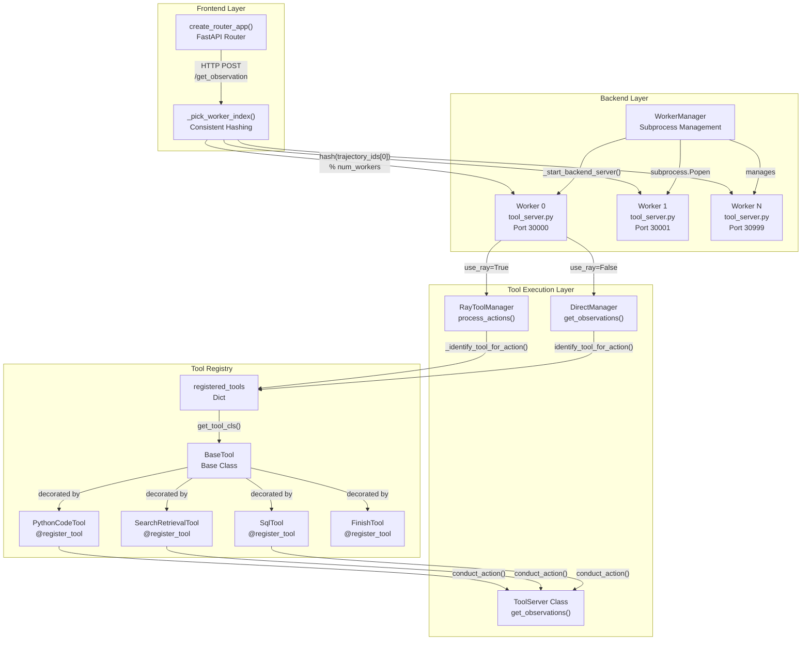
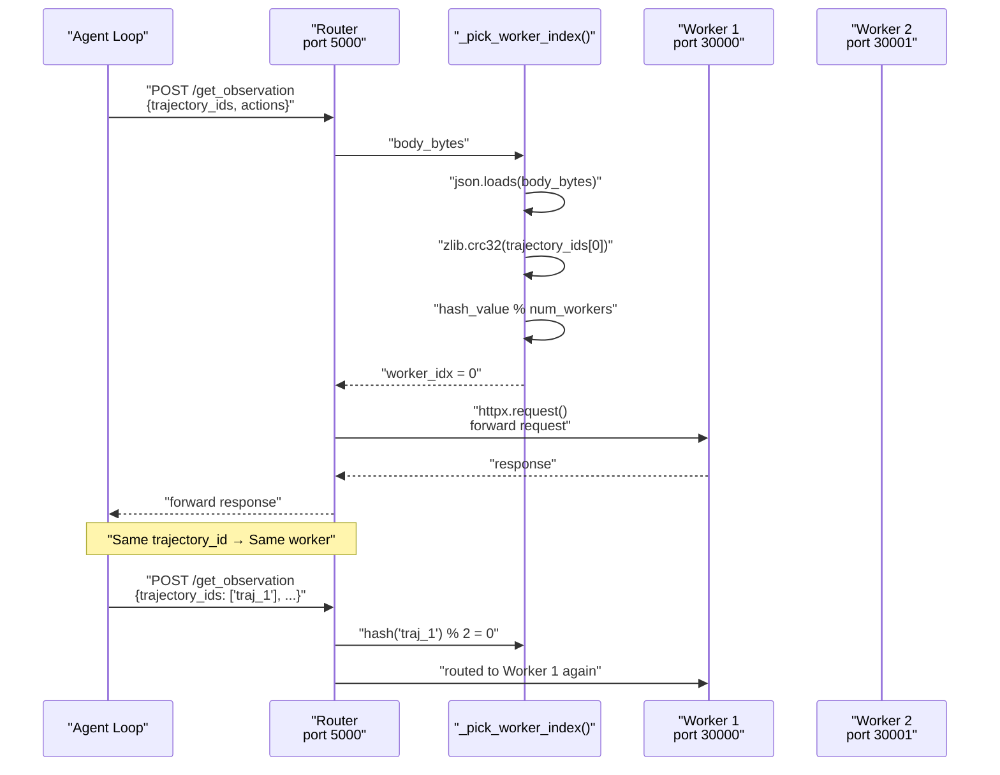
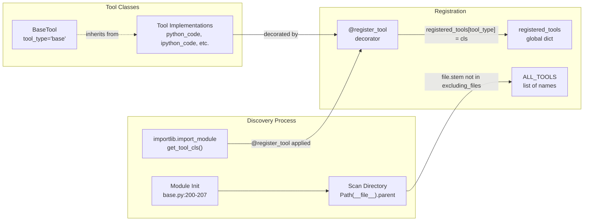
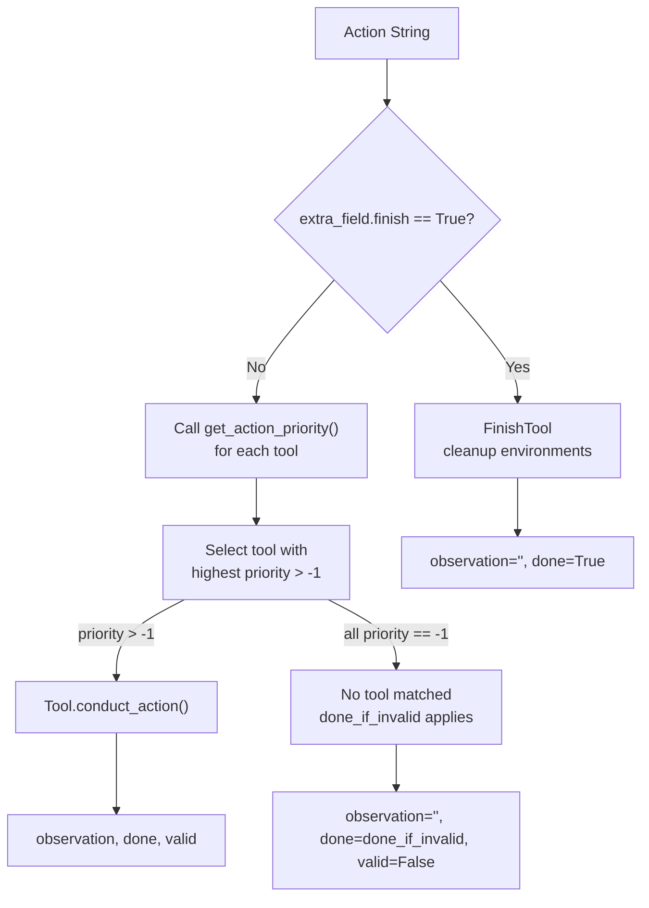
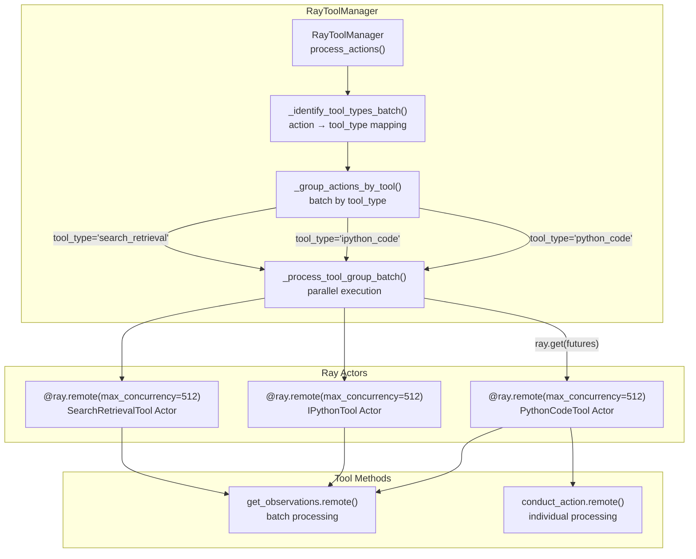
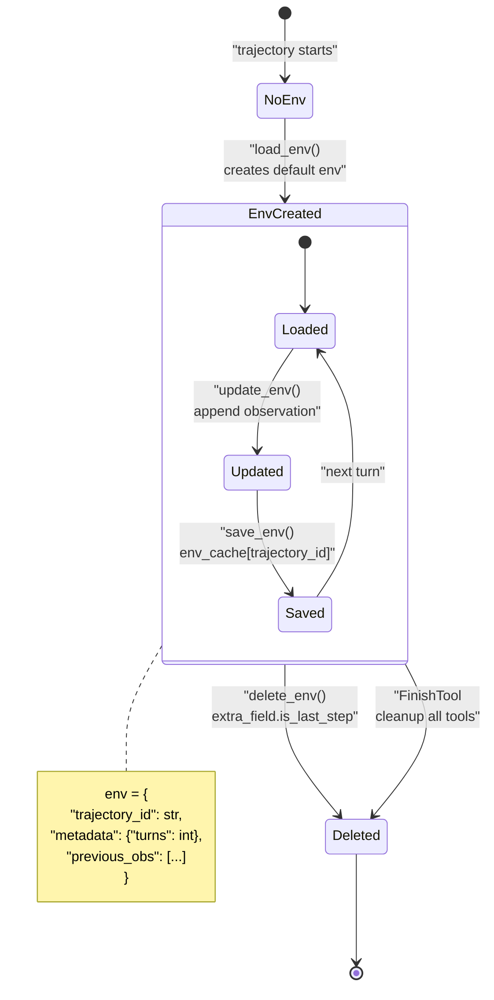
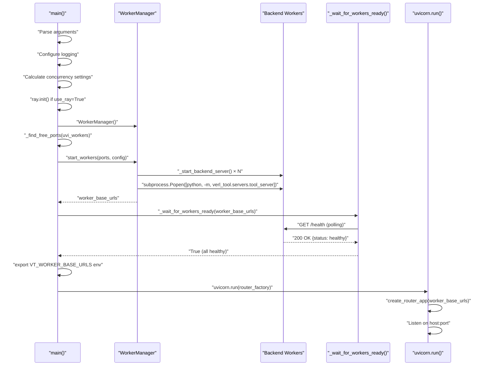
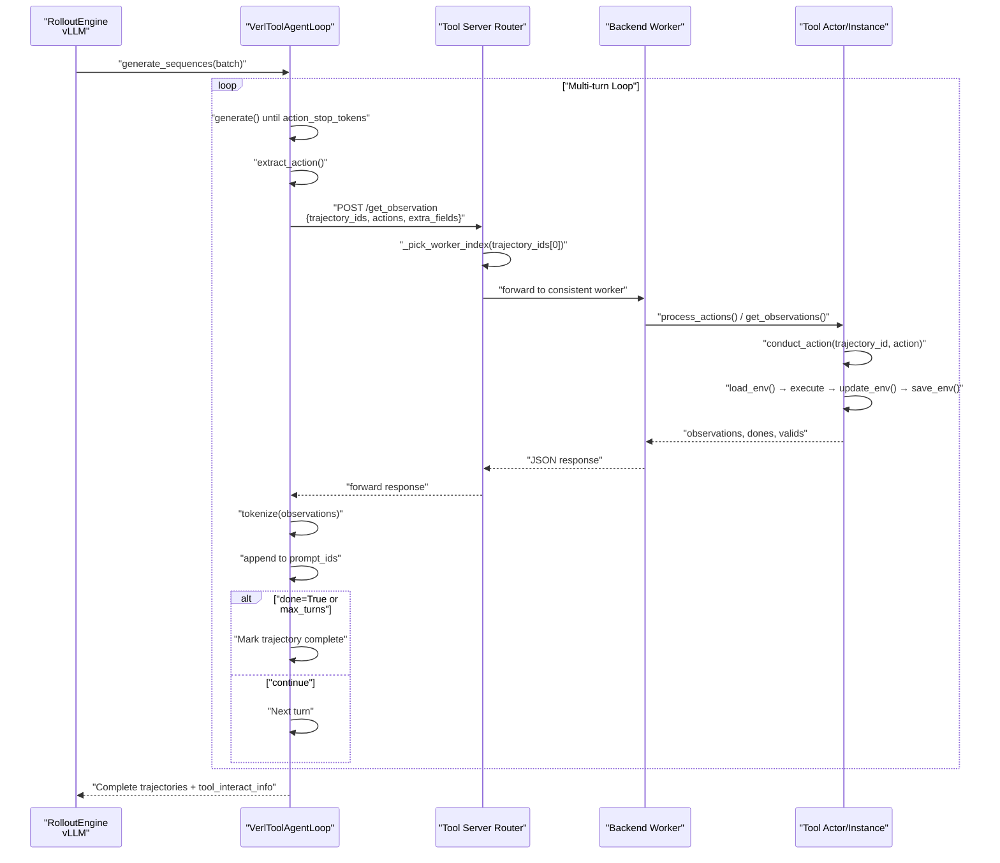

<!-- source: DeepWiki mcp.deepwiki.com · repo TIGER-AI-Lab/verl-tool · page 3 Tool Server Architecture · fetched 2026-10-30 -->

# Tool Server Architecture

<details>
<summary>Relevant source files</summary>

The following files were used as context for generating this wiki page:

- [assets/docs/tool_server.md](assets/docs/tool_server.md)
- [pyproject.toml](pyproject.toml)
- [verl_tool/servers/ray_utils.py](verl_tool/servers/ray_utils.py)
- [verl_tool/servers/serve.py](verl_tool/servers/serve.py)
- [verl_tool/servers/tools/base.py](verl_tool/servers/tools/base.py)
- [verl_tool/servers/tools/finish.py](verl_tool/servers/tools/finish.py)
- [verl_tool/servers/tools/search_retrieval.py](verl_tool/servers/tools/search_retrieval.py)
- [verl_tool/trainer/main_ppo.py](verl_tool/trainer/main_ppo.py)
- [verl_tool/trainer/ppo/ray_trainer.py](verl_tool/trainer/ppo/ray_trainer.py)

</details>


This document describes the multi-worker tool server infrastructure that enables distributed tool execution for agent training. The tool server implements a three-tier architecture: a FastAPI router for load balancing, multiple backend workers for request handling, and a tool execution layer supporting both direct and Ray-based distributed processing.

For information about specific tool implementations (Python execution, search, SQL, etc.), see [Tool Implementations](#4). For details on how the agent loop communicates with the tool server during training, see [Agent Loop System](#2.3).

---

## Architecture Overview

The tool server consists of three primary layers: a frontend router for request distribution, backend workers for concurrent request handling, and a tool execution layer with pluggable tool implementations.

### Three-Tier System Architecture



**Sources:** [verl_tool/servers/serve.py:213-429](), [verl_tool/servers/tool_server.py](), [verl_tool/servers/tools/base.py:1-207](), [verl_tool/servers/ray_utils.py:18-463]()

---

## Request Routing and Load Balancing

The tool server implements consistent hashing to route requests from the same trajectory to the same backend worker, enabling efficient caching and state management.

### Router Implementation

The router is created by `create_router_app()` and implements a proxy pattern that forwards requests to backend workers.



**Sources:** [verl_tool/servers/serve.py:267-296](), [verl_tool/servers/serve.py:312-413]()

### Worker Lifecycle Management

The `WorkerManager` class manages backend worker subprocesses, handling startup, health checks, and graceful shutdown.

| Component | Responsibility | Key Methods |
|-----------|---------------|-------------|
| `WorkerManager` | Subprocess lifecycle | `start_workers()`, `shutdown()`, `check_workers_alive()` |
| `_start_backend_server()` | Spawn worker process | Creates `subprocess.Popen` with configuration |
| `_wait_for_workers_ready()` | Health validation | Polls `/health` endpoint with timeout |
| `_find_free_ports()` | Port allocation | Finds `N` available TCP ports for workers |

**Sources:** [verl_tool/servers/serve.py:433-548](), [verl_tool/servers/serve.py:83-156](), [verl_tool/servers/serve.py:159-210]()

### Routing Configuration

The router supports several configuration parameters that affect load balancing behavior:

```python
# Configuration constants from serve.py
MAX_CONCURRENCY_PER_UVI_WORKER = 256  # Max concurrent requests per worker
ROUTER_BACKLOG = 8192                 # Connection backlog queue size
MAX_CONNECTIONS_PER_UVI_WORKER = 512  # HTTP connection pool size
KEEPALIVE_EXPIRY_PER_UVI_WORKER = 300 # Keep-alive timeout (seconds)
```

The main entry point `main()` accepts parameters:
- `uvi_workers`: Number of backend worker processes
- `router_workers`: Number of router processes (for handling connections)
- `max_concurrent_requests`: Total concurrent request capacity
- `enable_hashing`: Whether to use consistent hashing (default: `True`)

**Sources:** [verl_tool/servers/serve.py:30-40](), [verl_tool/servers/serve.py:556-763]()

---

## Tool Registry and Discovery

Tools are automatically discovered from the `verl_tool/servers/tools/` directory and registered via the `@register_tool` decorator.

### Tool Discovery Mechanism



**Sources:** [verl_tool/servers/tools/base.py:14-28](), [verl_tool/servers/tools/base.py:31-38](), [verl_tool/servers/tools/base.py:200-207]()

### BaseTool Interface

All tools inherit from `BaseTool` and implement a standard interface:

| Method | Purpose | Required |
|--------|---------|----------|
| `parse_action(action)` | Extract action from raw string | Yes |
| `conduct_action(trajectory_id, action, extra_field)` | Execute action, return observation | Yes |
| `get_observations(trajectory_ids, actions, extra_fields)` | Batch processing entry point | No (default uses ThreadPoolExecutor) |
| `get_usage_inst()` | Return usage instructions | No |
| `get_action_priority(action, extra_field)` | Return priority for tool matching | No (default: 0 if valid, -1 if invalid) |

**Sources:** [verl_tool/servers/tools/base.py:41-199]()

### Tool Priority and Action Matching

The tool server uses a priority system to determine which tool handles each action:



**Sources:** [verl_tool/servers/tools/base.py:118-130](), [verl_tool/servers/tools/search_retrieval.py:95-114](), [verl_tool/servers/tools/finish.py:1-48]()

---

## Tool Execution Strategies

The tool server supports two execution modes: direct execution with ThreadPoolExecutor and distributed execution with Ray actors.

### Execution Mode Comparison

| Feature | Direct Mode (`use_ray=False`) | Ray Mode (`use_ray=True`) |
|---------|------------------------------|---------------------------|
| Concurrency Control | `ThreadPoolExecutor(max_workers=workers_per_tool)` | `ray.remote(max_concurrency=workers_per_tool)` |
| State Isolation | Shared `env_cache` within worker | Isolated Ray actor per tool type |
| Scalability | Limited by worker process threads | Distributed across Ray cluster |
| Latency | Lower for small batches | Lower for large batches |
| Resource Limits | Per-worker process limits | Global cluster-wide enforcement |
| Recommended Use | `workers_per_tool <= 32` | `workers_per_tool >= 32` |

**Sources:** [verl_tool/servers/tools/base.py:171-198](), [verl_tool/servers/ray_utils.py:18-463]()

### Ray-Based Execution Architecture

When `use_ray=True`, the `RayToolManager` creates Ray actors for each tool type with configurable concurrency limits:



**Sources:** [verl_tool/servers/ray_utils.py:18-133](), [verl_tool/servers/ray_utils.py:177-273](), [verl_tool/servers/ray_utils.py:68-103]()

### Ray Actor Initialization

The `RayToolManager` creates tool actors with strict concurrency control:

```python
# From ray_utils.py:84
tool_instance = ray.remote(max_concurrency=self.config.workers_per_tool)(tool_cls).remote()
```

The `max_concurrency` parameter limits how many concurrent `remote()` calls can execute on each actor. This is enforced **globally** across the Ray cluster, unlike thread-based concurrency which is per-worker-process.

**Sources:** [verl_tool/servers/ray_utils.py:68-103](), [verl_tool/servers/ray_utils.py:235-273]()

---

## Environment State Management

Each tool maintains per-trajectory state through an `env_cache` dictionary, enabling stateful multi-turn interactions.

### State Lifecycle



**Sources:** [verl_tool/servers/tools/base.py:56-103](), [verl_tool/servers/tools/base.py:157-169]()

### Environment Cache Structure

The `env_cache` stores trajectory state with the following structure:

```python
# Created by BaseTool.load_env() when trajectory_id not in cache
env = {
    "trajectory_id": trajectory_id,
    "metadata": {
        "turns": 0,  # Incremented on each update_env()
    },
    "previous_obs": [
        # Appended by update_env()
        {
            "action": parsed_action,
            "is_valid": is_valid,
            "observation": observation,
            "extra_field": extra_field,
            # ... tool-specific fields
        }
    ],
}
```

**Sources:** [verl_tool/servers/tools/base.py:62-75]()

### State Management Methods

| Method | Parameters | Purpose | When Called |
|--------|-----------|---------|-------------|
| `has_env(trajectory_id)` | `trajectory_id: str` | Check if env exists | Before load |
| `load_env(trajectory_id)` | `trajectory_id: str` | Get or create env | Start of `conduct_action()` |
| `update_env(trajectory_id, env, ...)` | Multiple fields | Append turn data | After action execution |
| `save_env(trajectory_id, env)` | `trajectory_id: str, env: dict` | Persist to cache | End of `conduct_action()` |
| `delete_env(trajectory_id)` | `trajectory_id: str` | Remove from cache | On `is_last_step=True` or finish |

**Sources:** [verl_tool/servers/tools/base.py:56-100]()

### Cross-Tool Cleanup

The `FinishTool` is responsible for cleaning up environments across all active tools when a trajectory terminates:

```python
# From finish.py:36-45
for tool_type, tool in self.other_tools.items():
    if isinstance(tool, ray.actor.ActorHandle):
        has_env = ray.get(tool.has_env.remote(trajectory_id))
        if has_env:
            ray.get(tool.delete_env.remote(trajectory_id))
    else:
        if tool.has_env(trajectory_id):
            tool.delete_env(trajectory_id)
```

**Sources:** [verl_tool/servers/tools/finish.py:29-47]()

---

## Request and Response Format

The tool server exposes a single endpoint `/get_observation` that accepts batched requests and returns batched responses.

### Request Format

```json
{
    "trajectory_ids": ["traj_1", "traj_2", "..."],
    "actions": ["<tool_call>code</tool_call>", "...", "..."],
    "extra_fields": [
        {
            "finish": false,
            "is_last_step": false
        },
        {
            "finish": true,
            "is_last_step": false
        },
        "..."
    ]
}
```

### Response Format

```json
{
    "observations": ["<result>output</result>", "", "..."],
    "dones": [false, true, "..."],
    "valids": [true, false, "..."],
    "processing_time_ms": 123.45
}
```

### Field Semantics

| Field | Type | Meaning |
|-------|------|---------|
| `trajectory_ids` | `List[str]` | Unique identifiers for trajectories (used for routing and state management) |
| `actions` | `List[str]` | Raw action strings (LLM outputs containing tool calls) |
| `extra_fields[i].finish` | `bool` | If `True`, trajectory is done (no action, route to `FinishTool`) |
| `extra_fields[i].is_last_step` | `bool` | If `True`, delete `env_cache` for this trajectory after processing |
| `observations` | `List[str]` | Tool execution results (formatted for LLM consumption) |
| `dones[i]` | `bool` | If `True`, trajectory should terminate (no more tool calls) |
| `valids[i]` | `bool` | If `False`, action was invalid (no tool could parse it) |

**Sources:** [assets/docs/tool_server.md:8-30]()

---

## Health Monitoring and Statistics

The tool server provides health check endpoints and performance monitoring for operational visibility.

### Health Check Endpoints

| Endpoint | Purpose | Response |
|----------|---------|----------|
| `/health` | Backend worker health | `{"status": "healthy", "tools": [...]}` |
| `/health` (router) | Router health | `{"status": "ok", "workers": N}` |
| `/` (router) | Service info | `{"service": "tool-server-router", ...}` |

**Sources:** [verl_tool/servers/serve.py:415-427]()

### Health Check Implementation

The router waits for all backend workers to become healthy before starting:

```python
# From serve.py:159-210
def _wait_for_workers_ready(worker_base_urls: List[str], timeout: float = 60.0) -> bool:
    remaining = set(worker_base_urls)
    with httpx.Client(timeout=3.0) as client:
        while remaining and (time.time() - start) < timeout:
            for base_url in remaining:
                response = client.get(f"{base_url}/health")
                if response.status_code == 200 and response.json().get("status") == "healthy":
                    ready_workers.append(base_url)
```

**Sources:** [verl_tool/servers/serve.py:159-210]()

### Performance Monitoring

The `RayPerformanceMonitor` class tracks request processing metrics:

```python
# From ray_utils.py:479-511
class RayPerformanceMonitor:
    def record_request(self, processing_time: float, batch_size: int)
    def get_performance_summary(self) -> Dict[str, Any]
    # Returns:
    # {
    #     "requests_processed": int,
    #     "avg_processing_time_ms": float,
    #     "median_processing_time_ms": float,
    #     "avg_batch_size": float,
    #     "uptime_seconds": float,
    #     "requests_per_second": float
    # }
```

**Sources:** [verl_tool/servers/ray_utils.py:479-511]()

---

## Configuration and Startup

The tool server is started via the `main()` function in `serve.py`, which orchestrates worker spawning and router initialization.

### Startup Sequence



**Sources:** [verl_tool/servers/serve.py:556-763](), [verl_tool/servers/serve.py:456-512](), [verl_tool/servers/serve.py:159-210]()

### Configuration Parameters

Key parameters passed to `main()`:

```python
def main(
    tool_type: str = "base",           # Comma-separated tool types to enable
    host: str = "0.0.0.0",             # Router bind address
    port: int = 5000,                   # Router port
    workers_per_tool: int = 32,         # Thread/Ray concurrency per tool
    max_concurrent_requests: int = 1024, # Total concurrent request capacity
    request_timeout: Optional[float] = None,  # Request timeout (seconds)
    thread_pool_size: Optional[int] = None,   # ThreadPoolExecutor size
    use_tqdm: bool = False,             # Enable progress bars
    log_level: str = "info",            # Logging level
    done_if_invalid: bool = False,      # Mark invalid actions as done
    use_ray: bool = False,              # Use Ray for distributed execution
    enable_hashing: bool = True,        # Enable consistent hashing
    log_interval: int = 30,             # Statistics logging interval
    uvi_workers: int = 1,               # Number of backend workers
    router_workers: int = 1,            # Number of router processes
    log_directory: Optional[str] = None, # Log file directory
)
```

**Sources:** [verl_tool/servers/serve.py:556-597]()

### Environment Variable Propagation

The main process exports configuration via environment variables for worker subprocesses:

```python
# From serve.py:632-645
os.environ["VT_TOOL_TYPE"] = tool_type
os.environ["VT_HOST"] = host
os.environ["VT_PORT"] = str(port)
os.environ["VT_WORKERS_PER_TOOL"] = str(workers_per_tool)
os.environ["VT_MAX_CONCURRENT_REQUESTS"] = str(max_concurrent_requests)
os.environ["VT_REQUEST_TIMEOUT"] = "None" if request_timeout is None else str(request_timeout)
# ... additional environment variables
```

**Sources:** [verl_tool/servers/serve.py:632-645]()

### Worker Command Construction

Each backend worker is spawned with a command like:

```bash
python -m verl_tool.servers.tool_server \
    --tool_type python_code \
    --host 127.0.0.1 \
    --port 30000 \
    --workers_per_tool 512 \
    --max_concurrent_requests 1024 \
    --log_level info \
    --log_interval 30 \
    --use_ray True
```

**Sources:** [verl_tool/servers/serve.py:122-146]()

---

## Integration with Training Pipeline

The tool server is launched independently and communicates with the training pipeline via HTTP.

### Training Script Integration Pattern

Training scripts typically follow this pattern:

1. **Launch Tool Server** as a subprocess or separate process
2. **Wait for Health Check** to confirm server is ready
3. **Configure Agent Loop** with tool server URL
4. **Run Training** with tool calls routed to server
5. **Cleanup** tool server on training completion

```python
# Common pattern in training scripts
tool_server_process = subprocess.Popen([
    "python", "-m", "verl_tool.servers.serve",
    "--host", "localhost",
    "--port", "5000",
    "--tool_type", "python_code",
    "--workers_per_tool", "512",
    "--use_ray", "True",
])

# Wait for health check
# ... (polling logic)

# Configure agent loop with tool_server_url="http://localhost:5000"
```

**Sources:** [verl_tool/trainer/main_ppo.py:1-415]() (integrates with `AgentRayPPOTrainer`)

### Communication Flow During Training



**Sources:** [verl_tool/trainer/ppo/ray_trainer.py:1-260]() (integrates tool server with training)

---

## Performance Considerations

The tool server architecture is designed for high throughput and low latency in distributed training scenarios.

### Concurrency Control

| Configuration | Effect | Recommendation |
|---------------|--------|----------------|
| `uvi_workers` | Backend worker processes | `>= max_concurrent_requests / 256` |
| `router_workers` | Router processes for connections | `>= uvi_workers * 2` |
| `workers_per_tool` | Thread/Ray concurrency per tool | `32` for direct mode, `512+` for Ray mode |
| `max_concurrent_requests` | Total system capacity | Match expected batch size × rollout parallelism |

**Sources:** [verl_tool/servers/serve.py:30-40](), [verl_tool/servers/serve.py:611-629]()

### Ray vs Direct Mode Decision Matrix

Choose Ray mode (`use_ray=True`) when:
- `workers_per_tool >= 32` (better concurrency model)
- Training uses high batch size (>64) with many trajectories
- Tools have high per-request latency (e.g., code execution)
- Need global resource limits across distributed workers

Choose Direct mode (`use_ray=False`) when:
- `workers_per_tool <= 32` (simpler, lower overhead)
- Training uses small batches (<32) with few trajectories
- Tools have low latency (e.g., simple parsing)
- Single-node deployment with limited resources

**Sources:** [verl_tool/servers/ray_utils.py:77-78]() (warning about Ray concurrency settings)

### Consistent Hashing Benefits

Routing the same `trajectory_id` to the same worker enables:
1. **Cache Locality**: `env_cache` hits for repeated trajectory access
2. **State Consistency**: No need for distributed state synchronization
3. **Resource Affinity**: Same IPython kernels, database connections, etc.

The hashing function uses CRC32 for speed:

```python
# From serve.py:292-294
tid_str = str(trajectory_ids[0])
hash_value = zlib.crc32(tid_str.encode("utf-8")) & 0xFFFFFFFF
return hash_value % num_workers
```

**Sources:** [verl_tool/servers/serve.py:267-296]()

---

