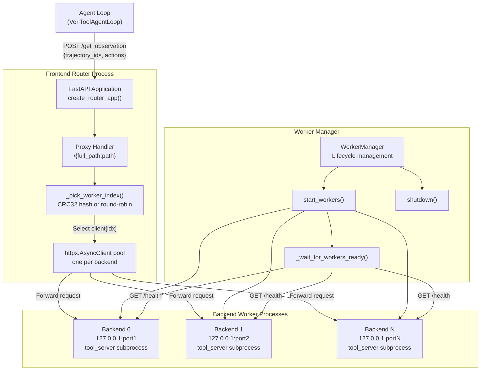
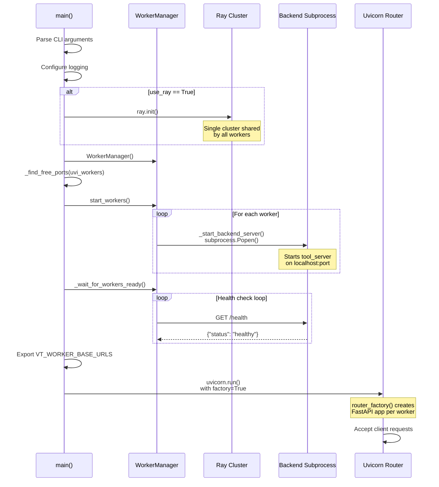
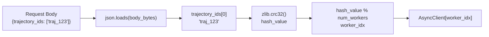
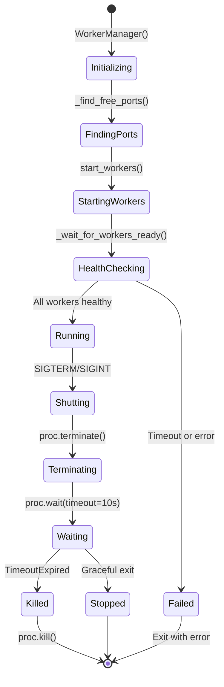
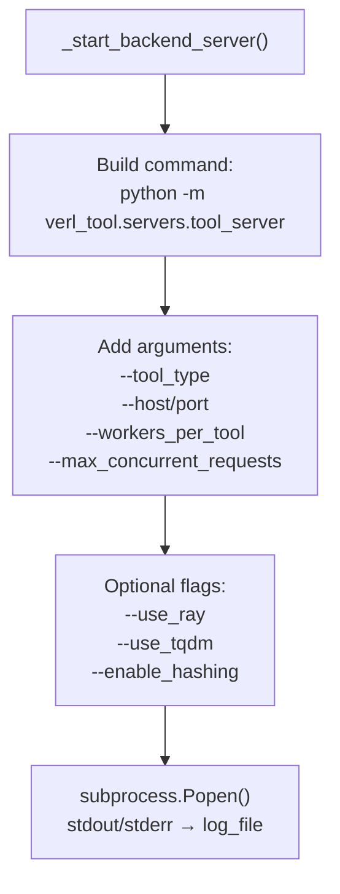
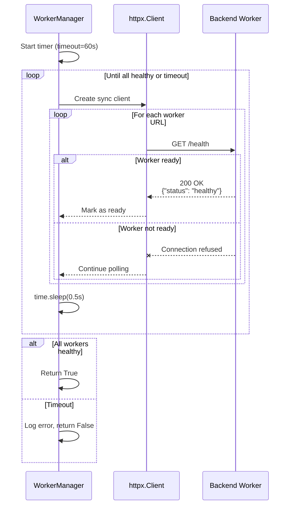
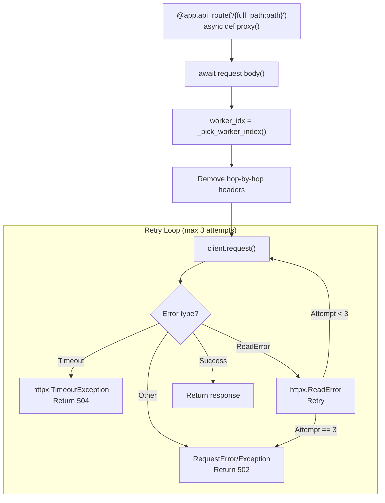
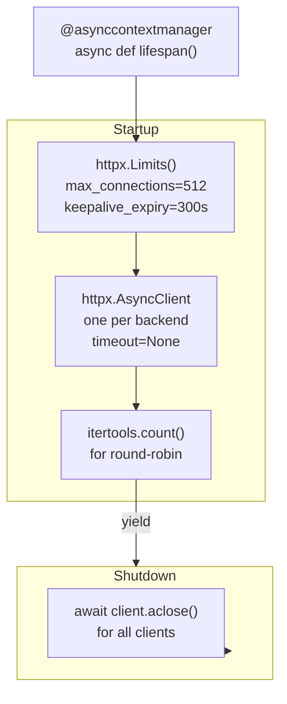

<!-- source: DeepWiki mcp.deepwiki.com · repo TIGER-AI-Lab/verl-tool · page 3.1 Tool Server Router and Load Balancing · fetched 2026-10-30 -->

# Tool Server Router and Load Balancing

<details>
<summary>Relevant source files</summary>

The following files were used as context for generating this wiki page:

- [assets/docs/tool_server.md](assets/docs/tool_server.md)
- [pyproject.toml](pyproject.toml)
- [verl_tool/servers/serve.py](verl_tool/servers/serve.py)
- [verl_tool/trainer/main_ppo.py](verl_tool/trainer/main_ppo.py)
- [verl_tool/trainer/ppo/ray_trainer.py](verl_tool/trainer/ppo/ray_trainer.py)

</details>


This document describes the multi-worker router architecture that provides load-balanced, stateful routing for tool server requests. The router ensures that requests belonging to the same trajectory are consistently routed to the same backend worker to preserve environment state across multi-turn interactions.

For information about the tool registry and discovery system, see [Tool Registry and Discovery System](#3.2). For details on Ray-based tool execution, see [Ray Tool Manager and Execution Strategies](#3.3). For environment state management within individual tools, see [Environment State Management](#3.4).

## Architecture Overview

The tool server uses a two-tier architecture consisting of a frontend router and multiple backend worker processes. This design enables horizontal scaling while maintaining trajectory-level state consistency.

### Component Architecture



**Sources:** [verl_tool/servers/serve.py:1-767]()

The router consists of:
- **Frontend Router**: A FastAPI application running with multiple Uvicorn workers that receives all client requests
- **Backend Workers**: Independent `tool_server` subprocess instances that execute tool actions
- **Worker Manager**: Manages backend process lifecycle, health checks, and graceful shutdown
- **Async HTTP Clients**: Connection pool with one persistent client per backend worker

### Process Startup Sequence



**Sources:** [verl_tool/servers/serve.py:556-763]()

## Routing Strategies

The router implements two routing strategies to balance load while maintaining trajectory consistency:

### Consistent Hashing on Trajectory IDs

When a request contains `trajectory_ids` in the JSON body, the router uses CRC32 hashing to deterministically route to the same backend worker:



**Implementation:**

[verl_tool/servers/serve.py:267-296]() implements the `_pick_worker_index()` function:

| Step | Operation | Code Location |
|------|-----------|---------------|
| Parse body | `json.loads(body_bytes)` | Line 284 |
| Extract trajectory | `trajectory_ids[0]` | Line 292 |
| Hash | `zlib.crc32(tid_str.encode("utf-8"))` | Line 293 |
| Modulo | `hash_value % num_workers` | Line 294 |

This ensures that all requests for `trajectory_id="traj_123"` always route to the same backend, preserving environment state across turns.

### Round-Robin Fallback

When `trajectory_ids` is not available in the request body, the router falls back to round-robin load balancing:

```python
# Fallback cases (lines 280-281, 286, 296)
return next(app.state.counter) % num_workers
```

The `app.state.counter` is an `itertools.count()` object that increments on each request.

**Sources:** [verl_tool/servers/serve.py:267-296]()

### Routing Decision Matrix

| Condition | Routing Strategy | Backend Selection |
|-----------|------------------|-------------------|
| `trajectory_ids` present and non-empty | Consistent hashing | `CRC32(trajectory_ids[0]) % num_workers` |
| Empty request body | Round-robin | `counter % num_workers` |
| JSON parse error | Round-robin | `counter % num_workers` |
| `trajectory_ids` missing or empty list | Round-robin | `counter % num_workers` |

## Backend Worker Management

The `WorkerManager` class handles the lifecycle of backend worker subprocesses:



**Sources:** [verl_tool/servers/serve.py:433-548]()

### Worker Startup Process

The `_start_backend_server()` function spawns each backend as a subprocess:



**Configuration Parameters:**

| Parameter | Purpose | Default |
|-----------|---------|---------|
| `host` | Backend bind address | `127.0.0.1` |
| `port` | Dynamically allocated port | Via `_find_free_port()` |
| `workers_per_tool` | Tool concurrency limit | 32 |
| `max_concurrent_requests` | Backend request limit | 1024 |
| `use_ray` | Enable Ray actors | False |
| `enable_hashing` | Enable consistent hashing | True |

**Sources:** [verl_tool/servers/serve.py:83-156]()

### Health Check Protocol

The router waits for all backends to become healthy before accepting client requests:



**Configuration:**

| Constant | Value | Purpose |
|----------|-------|---------|
| `HEALTH_CHECK_TIMEOUT` | 60.0s | Max wait time for all workers |
| `HEALTH_CHECK_INTERVAL` | 0.5s | Polling interval |

**Sources:** [verl_tool/servers/serve.py:159-210]()

### Graceful Shutdown

Signal handlers ensure clean shutdown of all subprocesses:

```python
# Signal handler setup (lines 684-690)
def signal_handler(signum, frame):
    logger.info(f"Received signal {signum}, initiating shutdown...")
    worker_manager.shutdown()
    sys.exit(0)

signal.signal(signal.SIGTERM, signal_handler)
signal.signal(signal.SIGINT, signal_handler)
```

The `shutdown()` method follows this procedure:

1. Send `SIGTERM` to all workers
2. Wait up to `SUBPROCESS_TERMINATE_TIMEOUT` (10s) for graceful exit
3. Send `SIGKILL` if timeout expires
4. Close all log file handles

**Sources:** [verl_tool/servers/serve.py:514-541](), [verl_tool/servers/serve.py:684-690]()

## Request Proxy Handler

The router's proxy handler forwards all requests to backend workers with retry logic:



**Sources:** [verl_tool/servers/serve.py:312-413]()

### Header Filtering

The proxy filters out hop-by-hop headers that should not be forwarded:

```python
# Hop-by-hop headers (lines 299-310)
HOP_BY_HOP_HEADERS = frozenset({
    "content-length", "connection", "keep-alive",
    "transfer-encoding", "proxy-authenticate",
    "proxy-authorization", "te", "trailers",
    "upgrade", "host",
})
```

Both request and response headers are filtered to prevent protocol violations.

**Sources:** [verl_tool/servers/serve.py:299-310](), [verl_tool/servers/serve.py:328-331](), [verl_tool/servers/serve.py:403-406]()

### Error Handling and Retry

| Error Type | HTTP Status | Retry | Description |
|------------|-------------|-------|-------------|
| `httpx.TimeoutException` | 504 | No | Upstream timeout |
| `httpx.ReadError` | 502 | Yes (3x) | Connection read error |
| `httpx.RequestError` | 502 | No | Connection error |
| `Exception` | 502 | No | Unexpected error |

The retry logic specifically handles transient `ReadError` conditions but fails fast on timeouts to prevent request pileup.

**Sources:** [verl_tool/servers/serve.py:335-400]()

## Connection Management

The router maintains persistent HTTP connections to backend workers using `httpx.AsyncClient`:



**Connection Pool Configuration:**

| Setting | Value | Purpose |
|---------|-------|---------|
| `max_keepalive_connections` | 512 | Max persistent connections per backend |
| `max_connections` | 512 | Total connection limit per backend |
| `keepalive_expiry` | 300s | Idle connection timeout |
| `timeout` | None | No request timeout (handled by backend) |

**Sources:** [verl_tool/servers/serve.py:230-263]()

## Configuration and Scaling

### Main Function Parameters

The `main()` function accepts the following configuration:

```python
def main(
    tool_type: str = "base",           # Tool types (comma-separated)
    host: str = "0.0.0.0",             # Router bind address
    port: int = 5000,                   # Router port
    workers_per_tool: int = 32,         # Tool concurrency
    max_concurrent_requests: int = 1024, # Backend capacity
    request_timeout: Optional[float] = None,
    thread_pool_size: Optional[int] = None,
    use_ray: bool = False,              # Enable Ray actors
    enable_hashing: bool = True,        # Enable consistent hashing
    uvi_workers: int = 1,               # Number of backend workers
    router_workers: int = 1,            # Number of router workers
    log_directory: Optional[str] = None,
)
```

**Sources:** [verl_tool/servers/serve.py:556-597]()

### Auto-Scaling Logic

The router automatically adjusts worker counts based on concurrency requirements:

```python
# Minimum workers calculation (lines 616-629)
min_workers_needed = (max_concurrency + MAX_CONCURRENCY_PER_UVI_WORKER - 1) 
                     // MAX_CONCURRENCY_PER_UVI_WORKER
min_routers_needed = min_workers_needed * 2

if uvi_workers < min_workers_needed:
    uvi_workers = min_workers_needed
if router_workers < min_routers_needed:
    router_workers = min_routers_needed
```

**Capacity Planning:**

| Component | Constraint | Formula |
|-----------|------------|---------|
| Backend workers | `MAX_CONCURRENCY_PER_UVI_WORKER = 256` | `⌈max_concurrent / 256⌉` |
| Router workers | 2x backend workers | `2 × backend_workers` |

**Sources:** [verl_tool/servers/serve.py:610-629]()

### Environment Variable Propagation

The router exports configuration via environment variables for worker processes:

```python
# Export configuration (lines 632-645)
os.environ["VT_TOOL_TYPE"] = tool_type
os.environ["VT_HOST"] = host
os.environ["VT_WORKERS_PER_TOOL"] = str(workers_per_tool)
os.environ["VT_MAX_CONCURRENT_REQUESTS"] = str(max_concurrent_requests)
# ... additional variables
```

These are read by the backend `tool_server` processes during initialization.

**Sources:** [verl_tool/servers/serve.py:632-645]()

## Request/Response Protocol

### Request Format

Clients send POST requests to `/get_observation` with JSON body:

```json
{
  "trajectory_ids": ["traj_1", "traj_2"],
  "actions": ["<python>print('hello')</python>", "..."],
  "finish": [false, true],
  "is_last_step": [false, false],
  "extra_fields": [{}, {}]
}
```

**Key Fields:**

| Field | Type | Purpose |
|-------|------|---------|
| `trajectory_ids` | `List[str]` | Unique IDs for routing and state lookup |
| `actions` | `List[str]` | Tool actions to execute |
| `finish` | `List[bool]` | Whether to clean up environment |
| `is_last_step` | `List[bool]` | Last step flag |
| `extra_fields` | `List[dict]` | Additional metadata |

**Sources:** [assets/docs/tool_server.md:8-17]()

### Response Format

The router returns the backend response unchanged:

```json
{
  "observations": ["<result>hello</result>", ""],
  "dones": [false, true],
  "valids": [true, false],
  "processing_time_ms": 65.95
}
```

**Key Fields:**

| Field | Type | Purpose |
|-------|------|---------|
| `observations` | `List[str]` | Tool execution outputs |
| `dones` | `List[bool]` | Trajectory completion status |
| `valids` | `List[bool]` | Whether action was parsed successfully |
| `processing_time_ms` | `float` | Backend processing time |

**Sources:** [assets/docs/tool_server.md:23-30](), [assets/docs/tool_server.md:90-104]()

## Performance Considerations

### Ray Cluster Initialization

When `use_ray=True`, the main process initializes the Ray cluster before spawning workers:

```python
# Ray initialization (lines 660-678)
if use_ray:
    import ray
    if not ray.is_initialized():
        ray.init(ignore_reinit_error=True, log_to_driver=False)
```

This ensures all worker subprocesses connect to the same Ray cluster instead of each attempting to start their own, preventing resource conflicts.

**Sources:** [verl_tool/servers/serve.py:659-678]()

### Event Loop Selection

The router automatically detects and uses `uvloop` if available for better performance:

```python
# Event loop detection (lines 648-654)
try:
    import uvloop
    loop_impl = "uvloop"
except ImportError:
    loop_impl = "asyncio"
```

`uvloop` provides 2-4x performance improvement over standard `asyncio` for I/O-bound workloads.

**Sources:** [verl_tool/servers/serve.py:647-654]()

### Production Configuration Example

For production deployments with high concurrency:

```bash
python -m verl_tool.servers.serve \
  --host 0.0.0.0 \
  --port 5000 \
  --tool_type python_code,google_search \
  --workers_per_tool 512 \
  --max_concurrent_requests 8192 \
  --uvi_workers 16 \
  --router_workers 32 \
  --use_ray True \
  --log_level info \
  --log_directory ./tool-server-logs
```

This configuration provides:
- 16 backend workers handling 8192 concurrent requests
- 32 router workers for connection handling
- Ray actors for distributed execution
- Separate log files per backend worker

**Sources:** [assets/docs/tool_server.md:42-44]()

---

