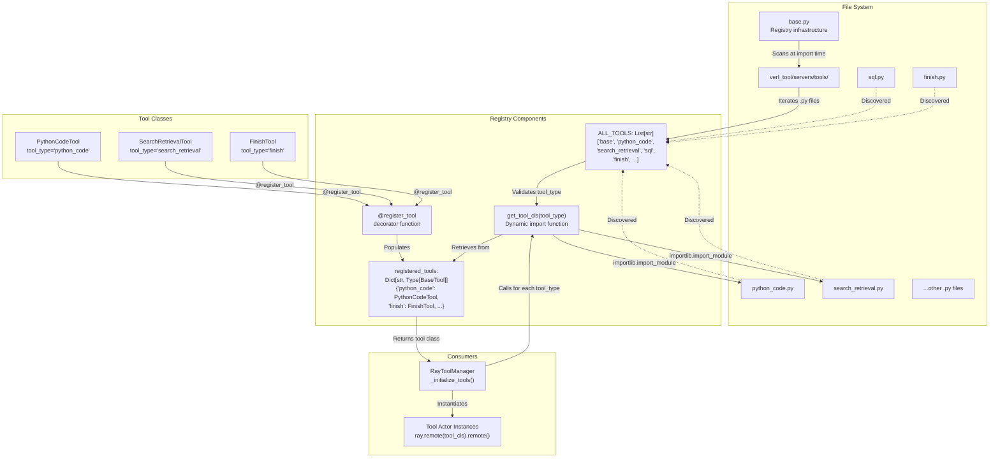
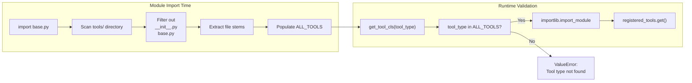
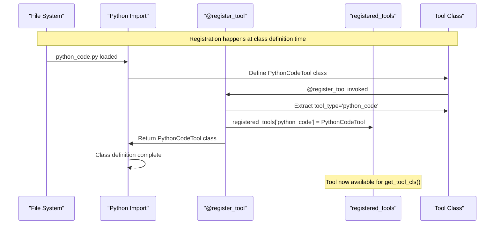
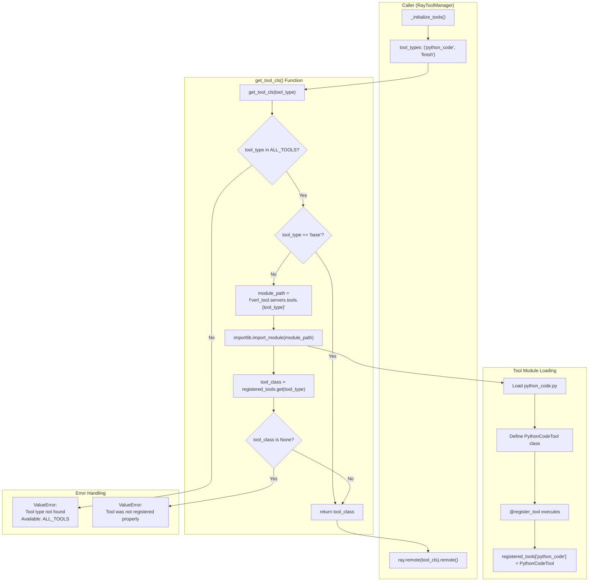
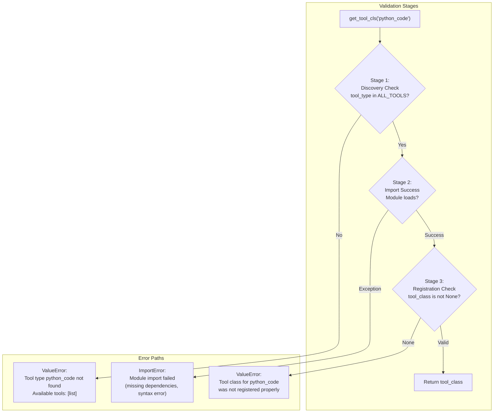
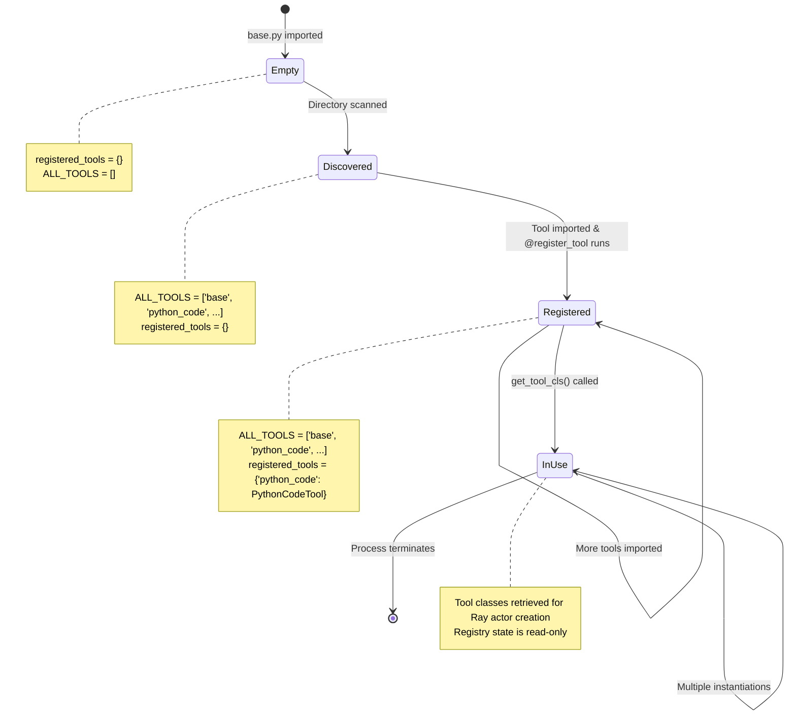

<!-- source: DeepWiki mcp.deepwiki.com · repo TIGER-AI-Lab/verl-tool · page 3.2 Tool Registry and Discovery System · fetched 2026-10-30 -->

# Tool Registry and Discovery System

<details>
<summary>Relevant source files</summary>

The following files were used as context for generating this wiki page:

- [assets/docs/tool_server.md](assets/docs/tool_server.md)
- [pyproject.toml](pyproject.toml)
- [verl_tool/servers/ray_utils.py](verl_tool/servers/ray_utils.py)
- [verl_tool/servers/tools/base.py](verl_tool/servers/tools/base.py)
- [verl_tool/servers/tools/finish.py](verl_tool/servers/tools/finish.py)
- [verl_tool/servers/tools/search_retrieval.py](verl_tool/servers/tools/search_retrieval.py)

</details>


## Purpose and Scope

This document describes VerlTool's tool registry and discovery system, which enables dynamic plugin-style tool management. The registry system allows tools to be added by simply placing a Python file in the `verl_tool/servers/tools/` directory with a `@register_tool` decorator. This page covers the registration mechanism, discovery process, and tool instantiation workflow.

For information about how the tool server routes requests to tools, see [Tool Server Router and Load Balancing](#3.1). For details on Ray-based tool execution, see [Ray Tool Manager and Execution Strategies](#3.3). For specific tool implementations, see [Tool Implementations](#4).

---

## Registry Architecture Overview

The tool registry system consists of three core components that work together to enable automatic tool discovery and instantiation:

### Registry Data Structures

| Component | Type | Purpose | Location |
|-----------|------|---------|----------|
| `registered_tools` | `Dict[str, Type[BaseTool]]` | Maps tool_type strings to tool classes | [verl_tool/servers/tools/base.py:4]() |
| `ALL_TOOLS` | `List[str]` | List of all discoverable tool types | [verl_tool/servers/tools/base.py:5]() |
| `@register_tool` | Decorator | Registers tool classes in the registry | [verl_tool/servers/tools/base.py:31-38]() |

**Registry Architecture Diagram**



**Sources:** [verl_tool/servers/tools/base.py:1-207](), [verl_tool/servers/ray_utils.py:68-103]()

---

## Tool Discovery Mechanism

The tool discovery process automatically identifies available tools by scanning the `verl_tool/servers/tools/` directory at module import time. This enables zero-configuration tool addition.

### Directory Scanning Implementation

The discovery logic is implemented at the bottom of `base.py`:

```python
# Directory scanning logic
cur_dir = Path(__file__).parent  # verl_tool/servers/tools/
excluding_files = ["__init__.py", "base.py"]
ALL_TOOLS.append("base")

for file in cur_dir.iterdir():
    if file.is_file() and file.name not in excluding_files:
        ALL_TOOLS.append(file.stem)  # Add filename without .py extension
```

**Discovery Process:**

1. **Scan Directory**: Iterates through all files in `verl_tool/servers/tools/` [verl_tool/servers/tools/base.py:201-206]()
2. **Filter Files**: Excludes `__init__.py` and `base.py` from discovery [verl_tool/servers/tools/base.py:202]()
3. **Extract Names**: Uses `file.stem` to get filename without extension (e.g., `python_code.py` → `python_code`) [verl_tool/servers/tools/base.py:206]()
4. **Populate List**: Appends to `ALL_TOOLS` list for validation [verl_tool/servers/tools/base.py:206]()

### Available Tool Types

After discovery, `ALL_TOOLS` contains all tool types that can be imported:

```python
ALL_TOOLS = [
    'base',
    'finish',
    'google_search',
    'ipython_code', 
    'pixel_reasoner',
    'python_code',
    'search_retrieval',
    'sql',
    # ... any other .py files in the tools directory
]
```

**Discovery Flow Diagram**



**Sources:** [verl_tool/servers/tools/base.py:200-207]()

---

## Tool Registration Process

Tools register themselves using the `@register_tool` decorator, which populates the `registered_tools` dictionary when the tool class is defined.

### The @register_tool Decorator

The decorator implementation:

```python
def register_tool(cls):
    """
    Decorator to register a tool class in the registered_tools dictionary.
    The class is registered using its tool_type attribute.
    """
    tool_type = getattr(cls, 'tool_type', cls.__name__)
    registered_tools[tool_type] = cls
    return cls
```

**Registration Behavior:**

1. **Extract tool_type**: Gets `tool_type` attribute from class, falls back to `cls.__name__` [verl_tool/servers/tools/base.py:36]()
2. **Store Mapping**: Adds `tool_type → class` mapping to `registered_tools` [verl_tool/servers/tools/base.py:37]()
3. **Return Class**: Returns the class unchanged (decorator is transparent) [verl_tool/servers/tools/base.py:38]()

### Registration Examples

**Example 1: FinishTool**

```python
@register_tool
class FinishTool(BaseTool):
    tool_type = "finish"
    timeout = 10
    
    def __init__(self, num_workers=1, other_tools:dict = {}):
        super().__init__(num_workers)
        self.other_tools = other_tools
```

After decorator execution:
- `registered_tools["finish"] = FinishTool`
- Accessible via `get_tool_cls("finish")`

**Example 2: SearchRetrievalTool**

```python
@register_tool
class SearchRetrievalTool(BaseTool):
    tool_type = "search_retrieval"
    
    def __init__(self, num_workers=1, retriever_url="http://127.0.0.1:8000/retrieve", topk=3, **kwargs):
        super().__init__(num_workers)
        self.retriever_url = kwargs.get('retriever_url', os.getenv('RETRIEVER_URL', retriever_url))
```

After decorator execution:
- `registered_tools["search_retrieval"] = SearchRetrievalTool`
- Tool becomes available for instantiation

**Registration Timing Diagram**



**Sources:** [verl_tool/servers/tools/base.py:31-38](), [verl_tool/servers/tools/finish.py:9-16](), [verl_tool/servers/tools/search_retrieval.py:12-23]()

---

## Tool Retrieval and Instantiation

The `get_tool_cls()` function performs lazy loading of tool classes through dynamic imports, triggered only when a tool is actually needed.

### get_tool_cls() Implementation

**Function Signature and Logic:**

```python
def get_tool_cls(tool_type):
    # 1. Validate tool_type exists
    if tool_type in ALL_TOOLS:
        # 2. Handle base tool special case
        if tool_type == "base":
            return BaseTool
        
        # 3. Dynamic import
        module_path = f"verl_tool.servers.tools.{tool_type}"
        importlib.import_module(module_path)
        
        # 4. Retrieve from registry
        tool_class = registered_tools.get(tool_type)
        if tool_class is None:
            raise ValueError(f"Tool class for {tool_type} was not registered properly")
        return tool_class
    else:
        raise ValueError(f"Tool type {tool_type} not found. Available tools: {ALL_TOOLS}")
```

**Retrieval Steps:**

| Step | Operation | Location | Purpose |
|------|-----------|----------|---------|
| 1 | Validate `tool_type in ALL_TOOLS` | [base.py:15]() | Ensure tool was discovered |
| 2 | Check for special `"base"` case | [base.py:16-17]() | Return BaseTool directly |
| 3 | Construct module path | [base.py:20]() | Build import string |
| 4 | `importlib.import_module()` | [base.py:21]() | Trigger lazy import |
| 5 | Retrieve from `registered_tools` | [base.py:23]() | Get registered class |
| 6 | Validate registration | [base.py:24-25]() | Ensure decorator ran |

### Dynamic Import Behavior

**Why Lazy Loading?**

Tools are imported only when needed, avoiding:
- Unnecessary dependency loading for unused tools
- Import errors from missing optional dependencies
- Circular import issues

**Import Trigger:**

The `importlib.import_module()` call:
1. Loads the tool's Python module (e.g., `verl_tool.servers.tools.python_code`)
2. Executes module-level code, including class definitions
3. Triggers `@register_tool` decorator during class definition
4. Populates `registered_tools[tool_type]` with the class

**Tool Retrieval and Instantiation Flow**



**Sources:** [verl_tool/servers/tools/base.py:14-28]()

---

## Integration with Tool Server

The registry system is consumed by the tool server infrastructure to instantiate and manage tool instances.

### RayToolManager Integration

The `RayToolManager` uses the registry during initialization:

**Initialization Flow:**

```python
def _initialize_tools(self):
    # 1. Order tools (ensure finish is last)
    ordered_tools = [t for t in self.tool_types if t != "finish"]
    
    # 2. Initialize each tool
    for tool_type in ordered_tools:
        try:
            # 3. Get tool class from registry
            tool_cls = get_tool_cls(tool_type)
            
            # 4. Create Ray actor with concurrency limit
            tool_instance = ray.remote(max_concurrency=self.config.workers_per_tool)(tool_cls).remote()
            self.tools[tool_type] = tool_instance
            
        except Exception as e:
            logger.error(f"Failed to initialize tool {tool_type}: {e}")
    
    # 5. Initialize finish tool with references to other tools
    if "finish" not in self.tools:
        tool_instance = ray.remote(max_concurrency=self.config.workers_per_tool)(get_tool_cls("finish")).remote(
            num_workers=1,
            other_tools={t: self.tools[t] for t in initialized_tools if t in self.tools}
        )
        self.tools["finish"] = tool_instance
```

**Key Integration Points:**

| Operation | Code Location | Purpose |
|-----------|---------------|---------|
| Order tools | [ray_utils.py:71]() | Process `finish` last for dependency injection |
| Get tool class | [ray_utils.py:82]() | Retrieve class via registry |
| Create Ray actor | [ray_utils.py:84]() | Instantiate with concurrency control |
| Handle finish tool | [ray_utils.py:93-98]() | Special initialization with `other_tools` dict |

### Tool Status Logging

After initialization, the tool server logs availability:

```python
def _log_tool_status(self):
    """Log comprehensive tool status"""
    logger.info("Ray Tool Status Summary:")
    for tool in ALL_TOOLS:
        if tool in self.tools:
            logger.info(f"  {tool}: 🟢 ACTIVE (Ray)")
        else:
            logger.info(f"  {tool}: ⚪ INACTIVE")
```

**Example Output:**

```
Ray Tool Status Summary:
  base: ⚪ INACTIVE
  finish: 🟢 ACTIVE (Ray)
  google_search: 🟢 ACTIVE (Ray)
  ipython_code: ⚪ INACTIVE
  pixel_reasoner: ⚪ INACTIVE
  python_code: 🟢 ACTIVE (Ray)
  search_retrieval: 🟢 ACTIVE (Ray)
  sql: 🟢 ACTIVE (Ray)
```

**RayToolManager Integration Sequence**

```mermaid
sequenceDiagram
    participant Server as "Tool Server<br/>serve.py"
    participant Manager as "RayToolManager<br/>__init__()"
    participant Init as "_initialize_tools()"
    participant Registry as "get_tool_cls()"
    participant Ray as "ray.remote()"
    participant Actor as "Tool Actor"
    
    Server->>Manager: RayToolManager(tool_types, config)
    Manager->>Manager: _ensure_ray_initialized()
    Manager->>Init: _initialize_tools()
    
    loop For each tool_type in ordered_tools
        Init->>Registry: get_tool_cls(tool_type)
        Registry->>Registry: Validate in ALL_TOOLS
        Registry->>Registry: importlib.import_module()
        Registry->>Registry: registered_tools.get(tool_type)
        Registry-->>Init: Return tool class
        
        Init->>Ray: ray.remote(max_concurrency=N)(tool_cls)
        Ray->>Actor: Create remote actor
        Actor-->>Init: Actor handle
        Init->>Init: self.tools[tool_type] = actor_handle
    end
    
    Init->>Registry: get_tool_cls('finish')
    Registry-->>Init: FinishTool class
    Init->>Ray: ray.remote(FinishTool).remote(other_tools={...})
    Ray->>Actor: Create finish actor with tool refs
    Actor-->>Init: Finish actor handle
    
    Init->>Init: _log_tool_status()
    Init-->>Manager: Initialization complete
    Manager-->>Server: RayToolManager ready
```

**Sources:** [verl_tool/servers/ray_utils.py:68-113]()

---

## Tool Type Discovery and Validation

The registry system provides validation mechanisms to ensure requested tools exist and are properly registered.

### Validation Flow

**get_tool_cls() Validation:**

```python
if tool_type in ALL_TOOLS:
    # Tool is discoverable - proceed with import
    ...
else:
    # Tool not found in discovery list
    raise ValueError(f"Tool type {tool_type} not found. Available tools: {ALL_TOOLS}")
```

**Post-Import Validation:**

```python
tool_class = registered_tools.get(tool_type)
if tool_class is None:
    # Import succeeded but decorator didn't run
    raise ValueError(f"Tool class for {tool_type} was not registered properly")
```

### Error Scenarios

| Error Condition | Trigger | Error Message |
|----------------|---------|---------------|
| Tool file not found | `tool_type not in ALL_TOOLS` | `"Tool type {tool_type} not found. Available tools: {ALL_TOOLS}"` |
| Missing `@register_tool` | `registered_tools.get(tool_type) is None` | `"Tool class for {tool_type} was not registered properly"` |
| Import failure | `importlib.import_module()` raises | Exception propagates with import error details |

**Validation and Error Handling Diagram**



**Sources:** [verl_tool/servers/tools/base.py:14-28]()

---

## Extension and Usage Patterns

The registry system is designed for easy extension and follows consistent patterns across the codebase.

### Adding a New Tool

**Steps to Register a New Tool:**

1. **Create Tool File**: Add `my_tool.py` to `verl_tool/servers/tools/`
2. **Define Tool Class**: Inherit from `BaseTool`
3. **Set tool_type**: Add `tool_type = "my_tool"` class attribute
4. **Apply Decorator**: Use `@register_tool` on the class
5. **Automatic Discovery**: Tool is automatically added to `ALL_TOOLS` on next import

**Example Template:**

```python
from .base import BaseTool, register_tool

@register_tool
class MyTool(BaseTool):
    tool_type = "my_tool"
    
    def __init__(self, num_workers=1, **kwargs):
        super().__init__(num_workers)
        # Custom initialization
    
    def parse_action(self, action: str):
        # Extract action from string
        return parsed_action, is_valid
    
    def conduct_action(self, trajectory_id, action, extra_field):
        # Execute action and return observation
        return observation, done, valid
```

### Common Usage Patterns

**Pattern 1: Single Tool Instantiation**

```python
# Get tool class
PythonCodeTool = get_tool_cls("python_code")

# Create instance
tool = PythonCodeTool(num_workers=512)

# Use tool
observation, done, valid = tool.conduct_action("traj_1", action, {})
```

**Pattern 2: Multi-Tool Initialization (RayToolManager)**

```python
tool_types = ("python_code", "google_search", "sql", "finish")

for tool_type in tool_types:
    tool_cls = get_tool_cls(tool_type)
    tool_instance = ray.remote(max_concurrency=512)(tool_cls).remote()
    self.tools[tool_type] = tool_instance
```

**Pattern 3: Tool Availability Check**

```python
# Check if tool is discoverable
if "python_code" in ALL_TOOLS:
    tool_cls = get_tool_cls("python_code")
    # Use tool
else:
    # Handle missing tool
    logger.warning("Python code tool not available")
```

**Tool Extension Pattern Diagram**

```mermaid
graph LR
    subgraph "Developer Actions"
        Create["1. Create<br/>my_tool.py"]
        Inherit["2. Inherit<br/>from BaseTool"]
        Decorate["3. Apply<br/>@register_tool"]
        SetType["4. Set<br/>tool_type='my_tool'"]
    end
    
    subgraph "Automatic Processing"
        Discover["5. Auto-discovered<br/>Added to ALL_TOOLS"]
        Import["6. Lazy import<br/>via get_tool_cls()"]
        Register["7. Auto-registered<br/>added to registered_tools"]
    end
    
    subgraph "Usage"
        Available["8. Available for use<br/>in tool server"]
        Instantiate["9. Instantiated<br/>as Ray actor"]
    end
    
    Create --> Inherit
    Inherit --> Decorate
    Decorate --> SetType
    SetType --> Discover
    Discover --> Import
    Import --> Register
    Register --> Available
    Available --> Instantiate
```



**Sources:** [verl_tool/servers/tools/base.py:31-46](), [verl_tool/servers/ray_utils.py:80-88]()

---

## Registry State and Lifecycle

Understanding the registry's state at different stages of the application lifecycle.

### Lifecycle Stages

**Stage 1: Module Import (base.py loads)**
```python
# Initial state
registered_tools = {}
ALL_TOOLS = []

# After directory scanning (lines 200-206)
ALL_TOOLS = ['base', 'finish', 'google_search', 'ipython_code', ...]
registered_tools = {}  # Still empty - no imports yet
```

**Stage 2: Tool Module Import (e.g., python_code.py loads)**
```python
# After @register_tool decorator executes
registered_tools = {
    'python_code': PythonCodeTool,
}
```

**Stage 3: Multiple Tool Imports**
```python
# After get_tool_cls() calls for multiple tools
registered_tools = {
    'python_code': PythonCodeTool,
    'google_search': GoogleSearchTool,
    'sql': SqlTool,
    'finish': FinishTool,
}
```

**Stage 4: Ray Actor Creation**
```python
# Ray actors reference tool classes but don't modify registry
RayToolManager.tools = {
    'python_code': ActorHandle(...),
    'google_search': ActorHandle(...),
    'sql': ActorHandle(...),
    'finish': ActorHandle(...),
}
```

### Registry Persistence

**Key Characteristics:**

| Aspect | Behavior |
|--------|----------|
| **Scope** | Module-level global variables |
| **Lifetime** | Entire Python process |
| **Thread Safety** | Not thread-safe (registration happens at import time) |
| **Modification** | Write-once during class definition, read-many during instantiation |
| **Cleanup** | No explicit cleanup needed |

**Registry Lifecycle State Machine**



**Sources:** [verl_tool/servers/tools/base.py:4-207](), [verl_tool/servers/ray_utils.py:68-113]()

---

