<!-- source: DeepWiki mcp.deepwiki.com · repo TIGER-AI-Lab/verl-tool · page 3.3 Ray Tool Manager and Execution Strategies · fetched 2026-10-30 -->

# Ray Tool Manager and Execution Strategies

<details>
<summary>Relevant source files</summary>

The following files were used as context for generating this wiki page:

- [verl_tool/servers/ray_utils.py](verl_tool/servers/ray_utils.py)
- [verl_tool/servers/tools/base.py](verl_tool/servers/tools/base.py)
- [verl_tool/servers/tools/finish.py](verl_tool/servers/tools/finish.py)
- [verl_tool/servers/tools/search_retrieval.py](verl_tool/servers/tools/search_retrieval.py)

</details>


This page documents the Ray-based distributed tool execution system in VerlTool, including the `RayToolManager` class, execution strategies, concurrency control, and performance characteristics. 

**Purpose and Scope**: This page focuses on how tools are executed in distributed environments using Ray actors, as opposed to direct sequential execution. For information about the tool server's HTTP routing and load balancing layer, see [Tool Server Router and Load Balancing](#3.1). For details on individual tool implementations, see [Tool Implementations](#4).

**Note**: As documented in the async rollout guide, Ray-based tool servers currently have performance limitations with high-concurrency async rollout modes. Setting `use_ray=False` is recommended when using asynchronous rollout (`actor_rollout_ref.rollout.mode='async'`).

## Execution Strategy Overview

VerlTool supports two execution strategies for tool operations, configured via the `use_ray` parameter when starting the tool server:

| Strategy | Configuration | Execution Model | Best Use Case |
|----------|---------------|-----------------|---------------|
| **Direct Execution** | `use_ray=False` | Tools execute in ThreadPoolExecutor within server process | Async rollout mode, low latency requirements, simple deployments |
| **Ray Distributed** | `use_ray=True` | Tools execute as Ray remote actors with configurable concurrency | Sync rollout mode, high throughput requirements, resource-intensive tools |

The execution strategy determines how the tool server processes incoming action requests:

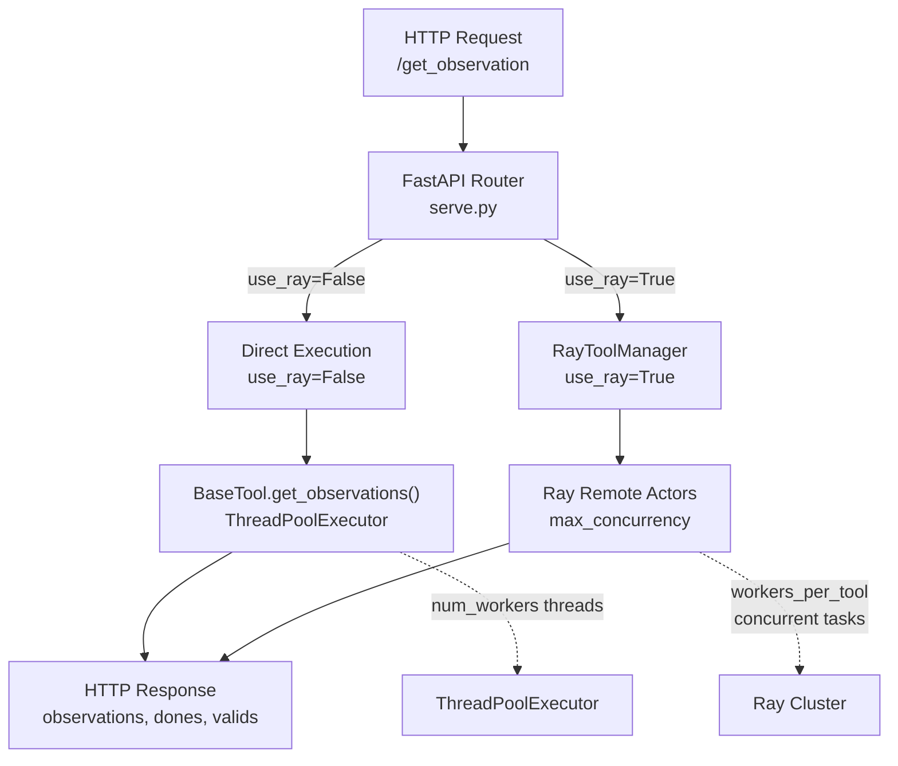

**Sources**: [verl_tool/servers/serve.py](), [verl_tool/servers/ray_utils.py:18-526](), [assets/docs/tool_server.md:107]()

### Direct Execution Strategy

When `use_ray=False`, tools execute directly within the server process using Python's `ThreadPoolExecutor`. Each tool instance maintains its own thread pool with `num_workers` threads (default: 1).

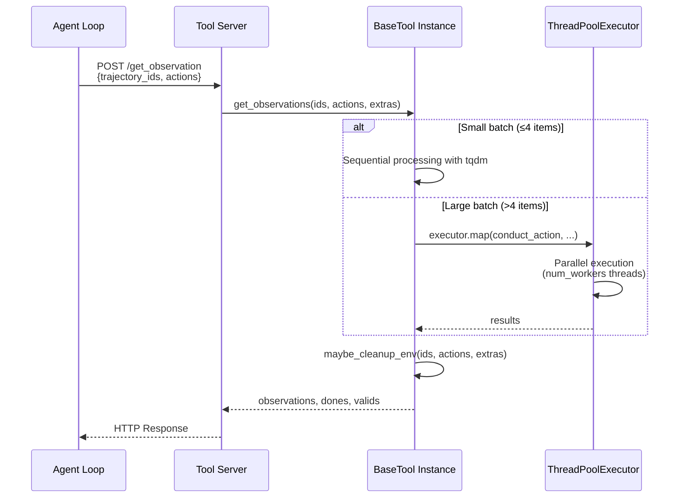

**Key characteristics**:
- **Low Overhead**: No Ray serialization/deserialization costs
- **Simple State Management**: Tools maintain `env_cache` directly in memory
- **Dynamic Scaling**: Thread pool size determined by `num_workers` parameter
- **Async-Friendly**: Better performance with async rollout mode (1.69x-2.06x speedup)

**Sources**: [verl_tool/servers/tools/base.py:171-198](), [assets/docs/asyncRL.md:1-18]()

### Ray Distributed Execution Strategy

When `use_ray=True`, tools are instantiated as Ray remote actors with strict concurrency control. The `RayToolManager` coordinates execution across the Ray cluster.

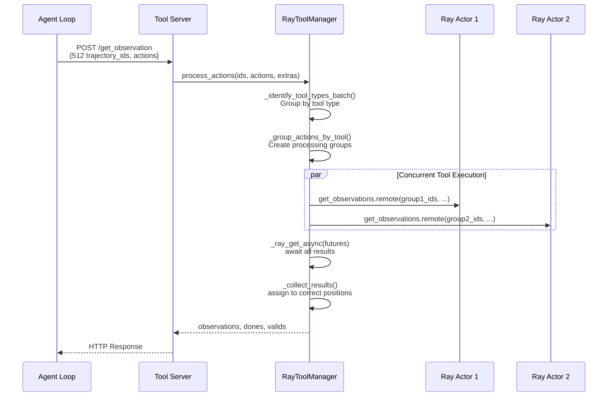

**Key characteristics**:
- **Strict Concurrency Control**: `workers_per_tool` parameter globally limits concurrent tasks per tool type
- **Resource Isolation**: Each tool runs in separate Ray actor with dedicated resources
- **Scalable**: Can leverage multi-node Ray clusters for distributed execution
- **Higher Overhead**: Ray serialization and inter-process communication costs

**Sources**: [verl_tool/servers/ray_utils.py:17-463]()

## RayToolManager Architecture

The `RayToolManager` class provides distributed tool execution with Ray. It handles tool initialization, action routing, batch processing, and result collection.

### Component Structure

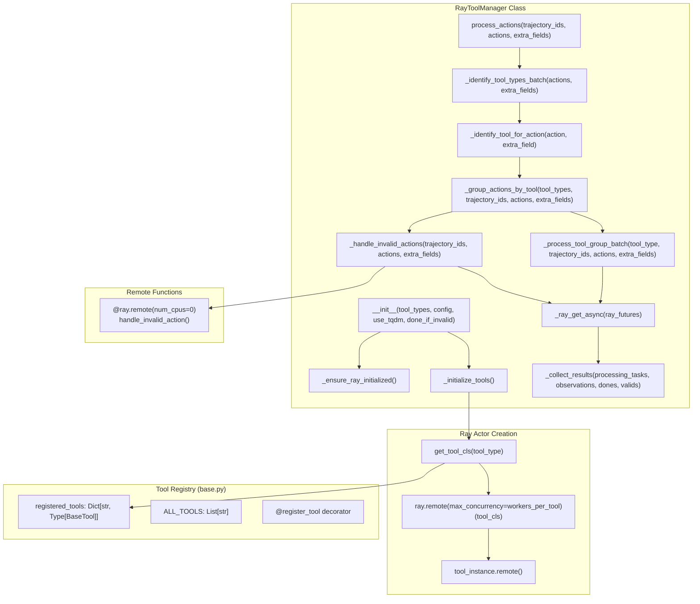

**Sources**: [verl_tool/servers/ray_utils.py:18-463](), [verl_tool/servers/tools/base.py:14-38](), [verl_tool/servers/tools/base.py:31-38]()

### Initialization Process

The `RayToolManager` initialization follows a specific sequence to ensure proper Ray cluster connection and tool registration:

**Step 1: Ray Initialization**

The manager first ensures Ray is properly initialized, attempting to connect to an existing cluster before falling back to local mode:

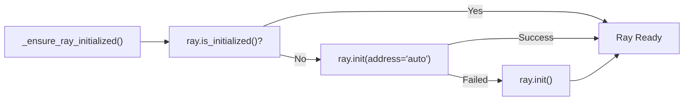

**Sources**: [verl_tool/servers/ray_utils.py:54-66]()

**Step 2: Tool Actor Creation**

Tools are initialized as Ray remote actors with specified concurrency limits. The `FinishTool` is processed last because it requires references to other tools for cleanup:

```mermaid
sequenceDiagram
    participant ITool as "_initialize_tools()"
    participant Order as "ordered_tools list"
    participant GetCls as "get_tool_cls(tool_type)"
    participant Remote as "ray.remote(max_concurrency)"
    participant Registry as "registered_tools dict"
    participant Actor as "Ray Actor"
    participant Finish as "FinishTool Actor"
    
    ITool->>Order: "ordered_tools = [t for t in tool_types if t != 'finish']"
    
    loop "For each tool_type in ordered_tools"
        ITool->>GetCls: "get_tool_cls(tool_type)"
        GetCls->>Registry: "importlib.import_module(f'verl_tool.servers.tools.{tool_type}')"
        Registry-->>GetCls: "tool_class = registered_tools[tool_type]"
        GetCls-->>ITool: "Return tool_cls"
        
        ITool->>Remote: "ray.remote(max_concurrency=config.workers_per_tool)(tool_cls)"
        Remote-->>ITool: "RemoteToolClass"
        
        ITool->>Actor: "tool_instance = RemoteToolClass.remote()"
        Actor-->>ITool: "ActorHandle"
        
        ITool->>ITool: "self.tools[tool_type] = tool_instance"
    end
    
    Note over ITool,Finish: "Special handling for FinishTool"
    ITool->>Remote: "ray.remote(max_concurrency=workers_per_tool)(FinishTool)"
    ITool->>Finish: "FinishTool.remote(num_workers=1, other_tools={...})"
    Finish-->>ITool: "FinishTool ActorHandle"
    ITool->>ITool: "self.tools['finish'] = finish_actor"
    
    ITool->>ITool: "_log_tool_status()"
```

**Key implementation details**:
- **Ray Remote Decorator**: Applied dynamically with `ray.remote(max_concurrency=config.workers_per_tool)(tool_cls)` at [verl_tool/servers/ray_utils.py:84]()
- **Max Concurrency**: Strictly limits concurrent method invocations per actor; queue depth controlled globally
- **Actor Instantiation**: Created with `.remote()` method, returns `ActorHandle` for async communication
- **FinishTool Dependencies**: Receives `other_tools` dict containing references to all initialized tool actors at [verl_tool/servers/ray_utils.py:94-98]()
- **Error Handling**: Failed tool initializations logged at [verl_tool/servers/ray_utils.py:90-91]() but don't block other tools
- **Tool Ordering**: Non-finish tools processed first at [verl_tool/servers/ray_utils.py:71]() to avoid dependency issues

**Sources**: [verl_tool/servers/ray_utils.py:68-112](), [verl_tool/servers/tools/finish.py:14-16](), [verl_tool/servers/tools/base.py:14-28]()

## Action Processing Pipeline

The `process_actions` method coordinates the complete flow from incoming requests to final responses, including tool identification, batching, parallel execution, and result collection.

### High-Level Processing Flow

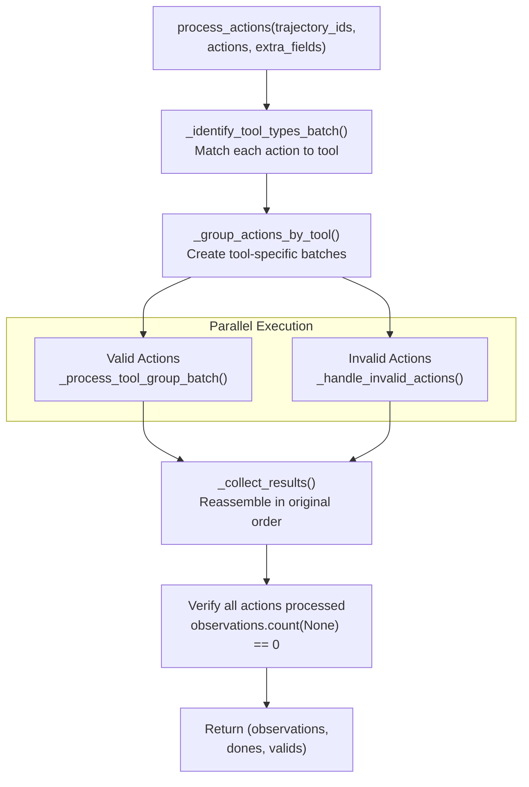

**Sources**: [verl_tool/servers/ray_utils.py:325-383]()

### Tool Identification Strategy

The `_identify_tool_for_action` method at [verl_tool/servers/ray_utils.py:133-175]() determines which tool should handle each action by checking the `extra_field` for explicit signals and calling `parse_action()` on each tool:

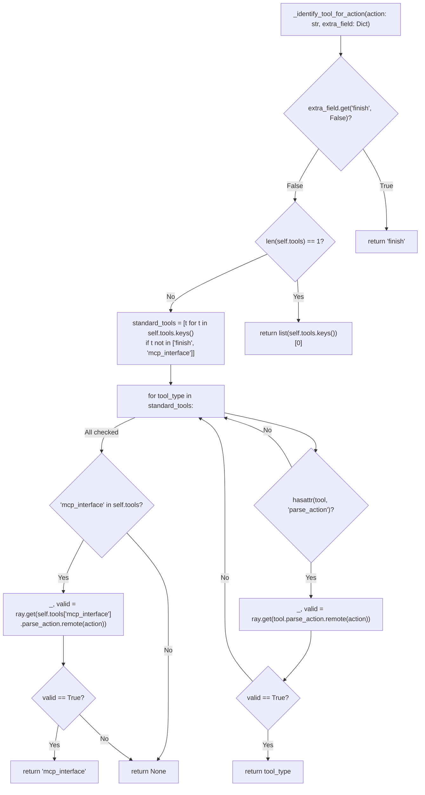

**Identification algorithm**:
1. **Explicit Finish Signal**: If `extra_field.get("finish", False) == True`, return `"finish"` immediately (line 145)
2. **Single Tool Optimization**: If `len(self.tools) == 1`, skip parsing and return that tool (lines 149-150)
3. **Standard Tool Iteration**: Loop through tools excluding `"finish"` and `"mcp_interface"` (line 153)
4. **Parse Action Via Ray**: Call `tool.parse_action.remote(action)` and check if `valid == True` (lines 158-161)
5. **First Match Wins**: Return the first tool that successfully parses the action (line 161)
6. **MCP Fallback**: If no standard tool matches, try `mcp_interface.parse_action()` (lines 168-170)
7. **Invalid Action**: If no tool matches, return `None` (line 175)

**Note**: Each `parse_action()` call is a Ray remote method that executes on the tool's actor. The method returns a tuple `(parsed_action, is_valid)` where `is_valid` indicates if the tool can handle this action.

**Sources**: [verl_tool/servers/ray_utils.py:133-175](), [verl_tool/servers/tools/base.py:105-116]()

### Batch Processing and Grouping

To maximize throughput, the manager groups actions by their assigned tool type before execution:

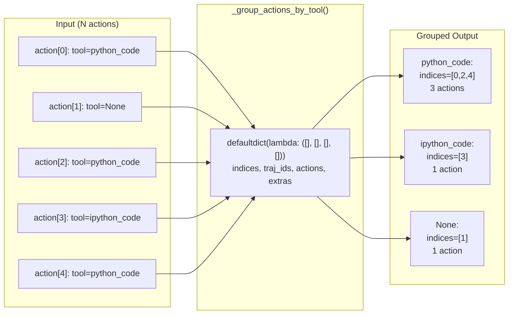

This grouping enables:
- **Efficient Batch Execution**: Tools can process multiple actions in a single Ray call
- **Parallel Tool Execution**: Different tool types execute concurrently
- **Result Ordering**: Original request order maintained via index tracking

**Sources**: [verl_tool/servers/ray_utils.py:211-233]()

### Parallel Execution with Ray

Once grouped, each tool group is processed in parallel using Ray's async capabilities. The `_process_tool_group_batch()` method at [verl_tool/servers/ray_utils.py:235-272]() handles execution:

```mermaid
sequenceDiagram
    participant PM as "process_actions()"
    participant Init as "Initialize Results"
    participant Loop as "Processing Loop"
    participant Task1 as "Tool1 Task"
    participant Task2 as "Tool2 Task"
    participant Invalid as "Invalid Task"
    participant Collect as "_collect_results()"
    participant Validate as "Validation"
    
    PM->>Init: "observations = [None] * num_actions<br/>dones = [False] * num_actions<br/>valids = [False] * num_actions"
    
    PM->>Loop: "processing_tasks = []"
    
    loop "For each tool_type in tool_groups"
        alt "tool_type is None"
            Loop->>Invalid: "task = _handle_invalid_actions(...)"
        else "tool_type is valid"
            Loop->>Task1: "task = _process_tool_group_batch(...)"
        end
        Loop->>Loop: "processing_tasks.append((tool_type, indices, task))"
    end
    
    par "Concurrent Execution"
        Task1->>Task1: "tool.get_observations.remote(...)<br/>OR conduct_action.remote(...)"
        Task2->>Task2: "tool.get_observations.remote(...)<br/>OR conduct_action.remote(...)"
        Invalid->>Invalid: "handle_invalid_action.remote(...)"
    end
    
    PM->>Collect: "await _collect_results(processing_tasks, observations, dones, valids)"
    
    loop "For each (tool_type, indices, task)"
        Collect->>Collect: "task_observations, task_dones, task_valids = await task"
        Collect->>Collect: "for idx_pos, result_idx in enumerate(indices):<br/>    observations[result_idx] = task_observations[idx_pos]<br/>    dones[result_idx] = task_dones[idx_pos]<br/>    valids[result_idx] = task_valids[idx_pos]"
    end
    
    PM->>Validate: "none_count = observations.count(None)"
    
    alt "none_count > 0"
        Validate->>Validate: "raise RuntimeError(f'Failed to process {none_count} actions')"
    else "none_count == 0"
        Validate-->>PM: "return observations, dones, valids"
    end
```

**Key implementation points**:

**Batch Execution Strategy** (lines 257-272):
- If tool has `get_observations` method: calls `tool.get_observations.remote(trajectory_ids, actions, extra_fields)` for batch processing
- Otherwise: creates individual Ray tasks with `tool.conduct_action.remote(tid, action, extra)` and parallelizes via Ray

**Async/Await Integration** (lines 274-293):
- `_ray_get_async()` wraps `ray.get()` in `asyncio.get_event_loop().run_in_executor()` to avoid blocking the event loop
- Handles both single futures and lists of futures
- Enables concurrent execution of multiple tool groups

**Error Handling** (lines 418-432):
- Failed tool groups caught via `try/except` in `_collect_results()`
- Error responses created with `{"obs": "", "error": str(e), "tool_type": tool_type}`
- All actions in failed group marked as `done=True`, `valid=False`
- Does not crash entire batch; continues processing other tool groups

**Position Tracking** (lines 411-414):
- Each tool group has `indices` list mapping results back to original request positions
- Results assigned with `observations[result_idx] = task_observations[idx_pos]`
- Maintains request ordering regardless of execution order

**Validation** (lines 375-378):
- Final check: `observations.count(None) == 0`
- If any observations are `None`, raises `RuntimeError` indicating processing failure

**Sources**: [verl_tool/servers/ray_utils.py:235-272](), [verl_tool/servers/ray_utils.py:274-293](), [verl_tool/servers/ray_utils.py:385-432]()

## Concurrency Control and Configuration

The Ray-based execution strategy provides fine-grained control over concurrency at multiple levels.

### Concurrency Levels

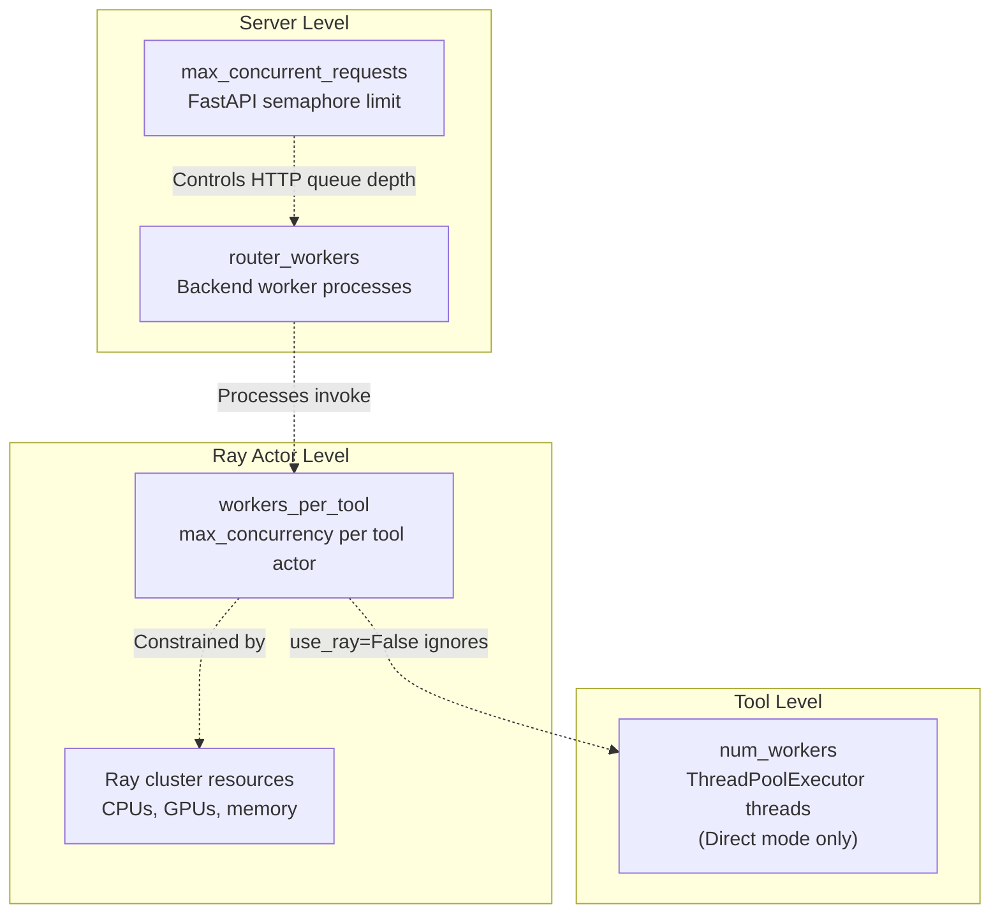

**Sources**: [assets/docs/tool_server.md:42](), [verl_tool/servers/ray_utils.py:77-78]()

### Configuration Parameters

| Parameter | Scope | Default | Description | Performance Impact |
|-----------|-------|---------|-------------|--------------------|
| `use_ray` | Server | `False` | Enable Ray distributed execution | High overhead, better for sync rollout |
| `workers_per_tool` | Ray Actor | `512` | Max concurrent method calls per tool actor | **Globally enforced**, critical for throughput |
| `num_workers` | BaseTool | `1` | ThreadPoolExecutor size (direct mode) | Local concurrency control |
| `max_concurrent_requests` | FastAPI | `8192` | HTTP request queue depth | Controls memory usage |
| `router_workers` | Server | `64` | Number of backend worker processes | CPU utilization |

**Critical Configuration Note**: When `use_ray=True`, the `workers_per_tool` parameter is **strictly enforced globally** via Ray's `max_concurrency` parameter at [verl_tool/servers/ray_utils.py:84]():

```python
# From ray_utils.py:84
tool_instance = ray.remote(max_concurrency=self.config.workers_per_tool)(tool_cls).remote()
```

**Implications**:
- If `workers_per_tool=512`, only 512 concurrent method invocations allowed per tool type across entire Ray cluster
- Methods exceeding this limit are queued by Ray until a slot becomes available
- Too low → request queuing and increased latency
- Too high → resource contention and potential OOM errors
- **Warning logged** if `workers_per_tool <= 2 * os.cpu_count()` at [verl_tool/servers/ray_utils.py:77-78]()

**Recommended Configuration**:
- `workers_per_tool >= 2 * CPU_count` for optimal CPU utilization
- For batch size 2048 with 3 max turns: `workers_per_tool >= 512` to avoid queuing

**Sources**: [verl_tool/servers/ray_utils.py:77-78](), [verl_tool/servers/ray_utils.py:84]()

### Resource Allocation Warnings

The `RayToolManager` logs warnings at [verl_tool/servers/ray_utils.py:77-78]() when configuration may lead to suboptimal performance:

```python
# From ray_utils.py:77-78
if self.config.workers_per_tool <= os.cpu_count() * 2:
    logger.warning(f"You are using ray with workers_per_tool={self.config.workers_per_tool} "
                   f"which is less than or equal to the 2 times of CPU cores ({os.cpu_count() * 2}). "
                   f"This may lead to suboptimal performance due to resource contention. "
                   f"Consider increasing workers_per_tool if you see low gpu utilization during rollouts.")
```

**Performance Impact**:

| Configuration | CPU Cores | `workers_per_tool` | Expected Behavior |
|---------------|-----------|--------------------|--------------------|
| Underprovisioned | 64 | 64 | ⚠️ Warning logged; GPU underutilized; requests queue |
| Optimal | 64 | 128-256 | ✅ No warning; high GPU utilization |
| Overprovisioned | 64 | 1024 | ⚠️ Potential memory issues; context switching overhead |

**Diagnostic Signal**: If GPU utilization is low (<60%) during rollouts with Ray enabled, increase `workers_per_tool`.

**Sources**: [verl_tool/servers/ray_utils.py:77-78]()

## Performance Characteristics

### Throughput Comparison

Based on benchmarking data from async rollout documentation:

| Configuration | Batch Size | Max Turns | Rollout Time | Actions/Second |
|---------------|------------|-----------|--------------|----------------|
| Sync + Ray | 2048 | 1 | 127s | ~16 actions/s |
| Async + Direct | 2048 | 1 | **75s** | **~27 actions/s** |
| Sync + Ray | 2048 | 3 | 194s | ~31 actions/s |
| Async + Direct | 2048 | 3 | **94s** | **~65 actions/s** |

**Key findings**:
- **Async mode with direct execution**: 1.69x-2.06x speedup over sync mode
- **Ray overhead**: Additional serialization costs make it slower for async workloads
- **Scaling with turns**: Async advantage increases with more tool interaction turns

**Sources**: [assets/docs/asyncRL.md:8-14]()

### Latency Analysis

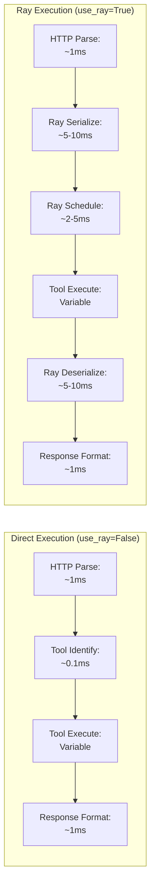

**Latency sources**:
- **Ray Overhead**: 12-25ms additional latency per request from serialization/scheduling
- **Tool Execution**: Dominant cost; varies by tool type (ms for Python, seconds for search)
- **Batch Amortization**: Ray overhead amortized over larger batches

**Sources**: [verl_tool/servers/ray_utils.py:342-381](), [assets/docs/asyncRL.md:15-18]()

### Memory Considerations

**Direct Execution**:
- Environment cache (`env_cache`) stored in server process memory
- Thread pool workers share process memory space
- Memory usage scales linearly with active trajectories

**Ray Execution**:
- Each tool actor maintains separate environment cache
- Ray object store used for passing large results
- Memory distributed across Ray cluster
- Potential for memory spikes during object serialization

## Best Practices and Usage Guidelines

### Execution Strategy Selection

| Factor | Use Ray (`use_ray=True`) | Use Direct (`use_ray=False`) |
|--------|--------------------------|------------------------------|
| **Rollout Mode** | Sync mode (`mode='sync'`) | Async mode (`mode='async'`) ✅ **1.69x-2.06x speedup** |
| **Batch Size** | Large batches (>512) | Small to medium (<512) |
| **Tool Complexity** | Resource-intensive (code exec, image processing) | Lightweight (simple parsing, lookups) |
| **Deployment** | Multi-node Ray cluster | Single-node deployment |
| **Latency** | High throughput > low latency | Low latency critical |
| **Memory** | Distributed across cluster | Centralized in server process |

**Decision Flowchart**:

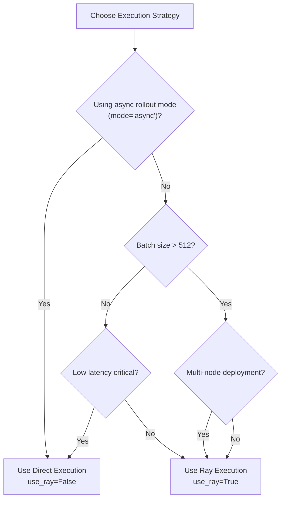

**Sources**: [assets/docs/asyncRL.md:15-18]()

### Configuration Guidelines

**For Ray execution**:
```bash
# Start tool server with Ray
python -m verl_tool.servers.serve \
    --use_ray=True \
    --workers_per_tool=512 \  # Match expected concurrent trajectories
    --max_concurrent_requests=8192 \
    --router_workers=64
```

**For direct execution**:
```bash
# Start tool server without Ray (recommended for async)
python -m verl_tool.servers.serve \
    --use_ray=False \
    --workers_per_tool=128 \  # Becomes num_workers for ThreadPoolExecutor
    --max_concurrent_requests=4096 \
    --router_workers=32
```

**Monitoring**: Use `RayPerformanceMonitor` to track throughput metrics:
- Average processing time per batch
- Requests per second
- Batch size distribution

**Sources**: [verl_tool/servers/ray_utils.py:479-511](), [assets/docs/asyncRL.md:15-18](), [assets/docs/tool_server.md:42]()

### Troubleshooting

**Symptom**: Low GPU utilization during rollouts with Ray

**Likely Cause**: `workers_per_tool` too low relative to batch size

**Solution**: Increase `workers_per_tool` to at least 2x CPU count, or switch to direct execution

---

**Symptom**: High memory usage or OOM errors with Ray

**Likely Cause**: Large objects being serialized through Ray object store

**Solution**: 
- Implement result truncation in tools (e.g., `max_obs_length`)
- Reduce batch size
- Switch to direct execution for memory-constrained environments

---

**Symptom**: Slow async rollout performance

**Likely Cause**: Using Ray with async mode (known performance limitation)

**Solution**: Set `use_ray=False` when using `actor_rollout_ref.rollout.mode='async'`

**Sources**: [verl_tool/servers/ray_utils.py:77-78](), [assets/docs/asyncRL.md:15-18]()

---

