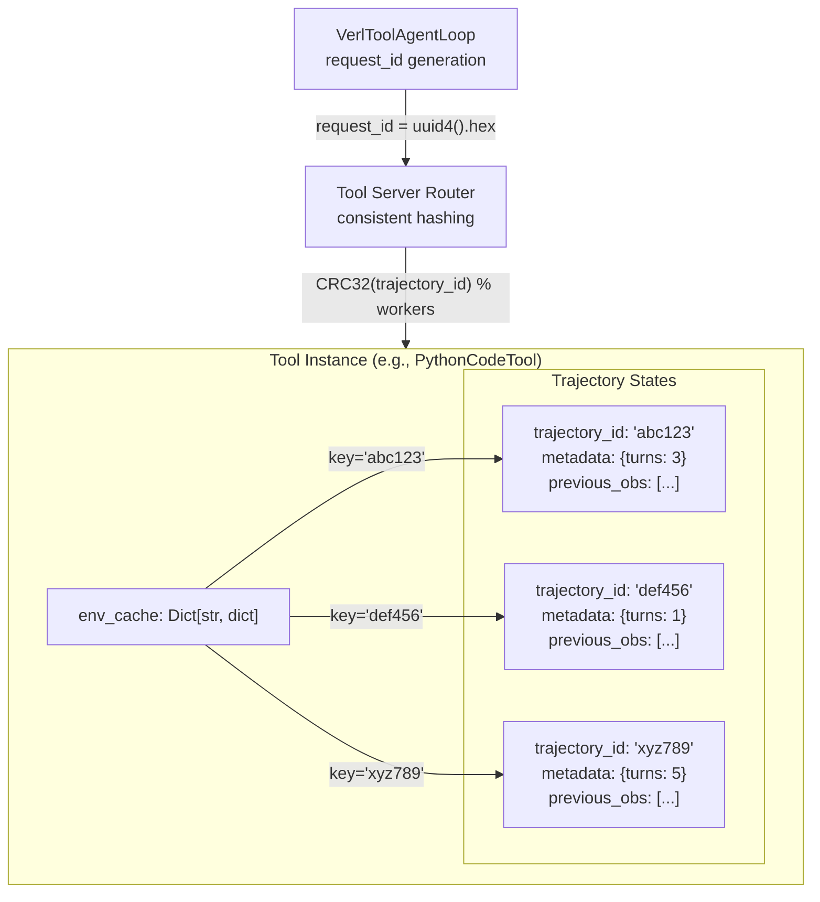
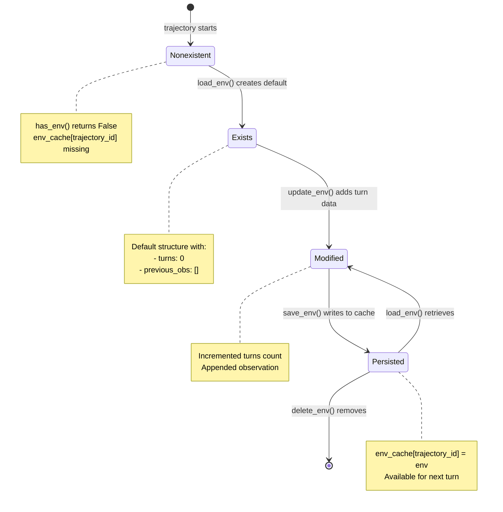
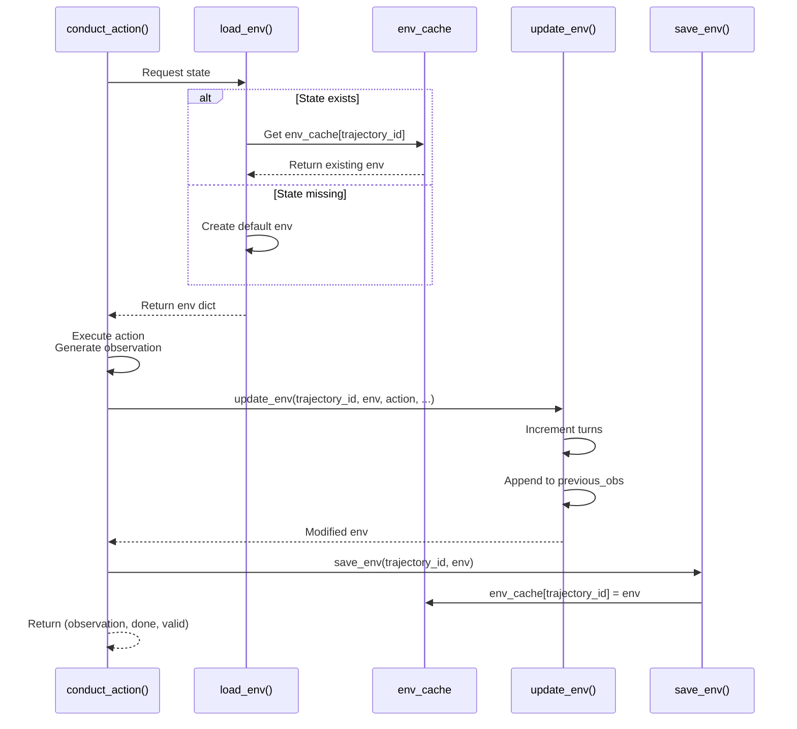
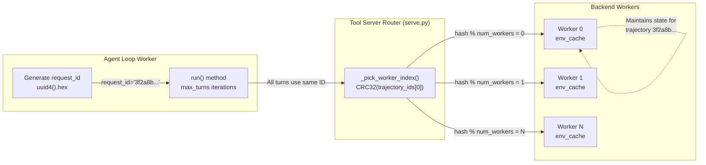
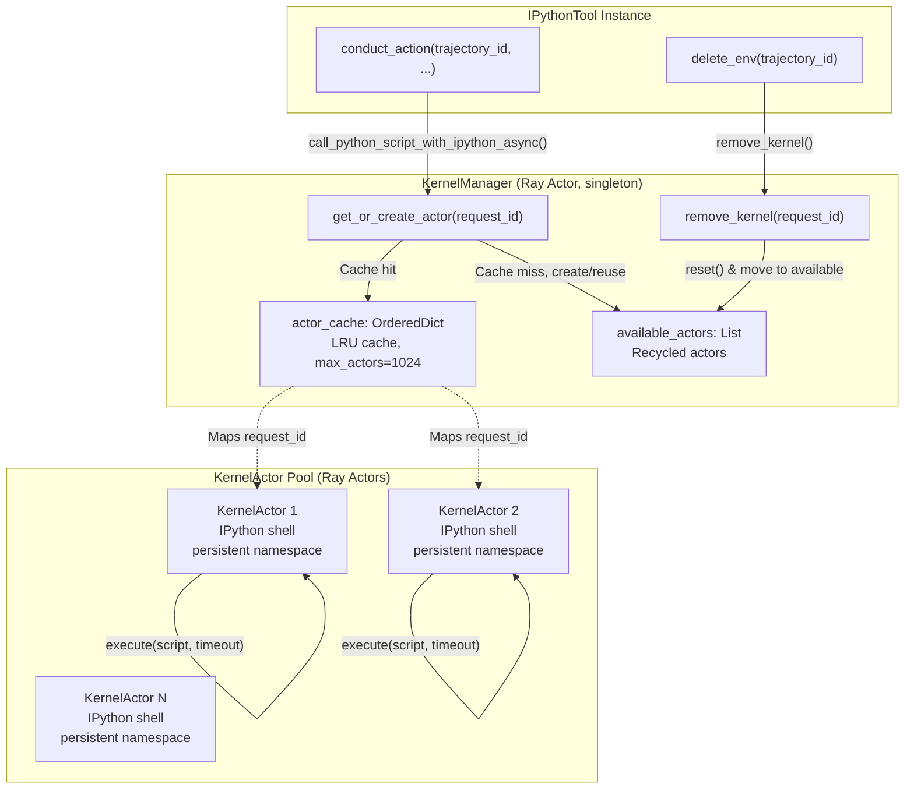
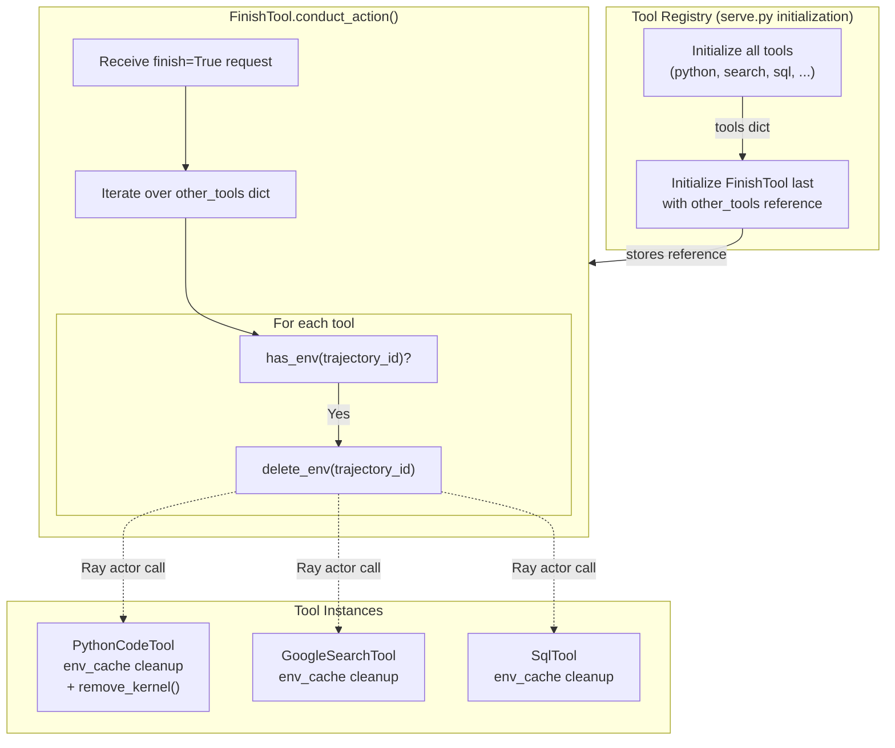
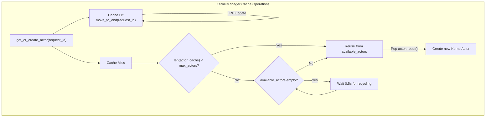

<!-- source: DeepWiki mcp.deepwiki.com · repo TIGER-AI-Lab/verl-tool · page 3.4 Environment State Management · fetched 2026-10-30 -->

# Environment State Management

<details>
<summary>Relevant source files</summary>

The following files were used as context for generating this wiki page:

- [verl_tool/agent_loop/agent_loop.py](verl_tool/agent_loop/agent_loop.py)
- [verl_tool/agent_loop/verltool_agent_loop.py](verl_tool/agent_loop/verltool_agent_loop.py)
- [verl_tool/servers/ray_utils.py](verl_tool/servers/ray_utils.py)
- [verl_tool/servers/tests/test_python_code_tool.py](verl_tool/servers/tests/test_python_code_tool.py)
- [verl_tool/servers/tools/base.py](verl_tool/servers/tools/base.py)
- [verl_tool/servers/tools/finish.py](verl_tool/servers/tools/finish.py)
- [verl_tool/servers/tools/ipython_code.py](verl_tool/servers/tools/ipython_code.py)
- [verl_tool/servers/tools/search_retrieval.py](verl_tool/servers/tools/search_retrieval.py)
- [verl_tool/servers/tools/utils/ipython_tool.py](verl_tool/servers/tools/utils/ipython_tool.py)
- [verl_tool/trainer/config/verltool/agent.yaml](verl_tool/trainer/config/verltool/agent.yaml)
- [verl_tool/trainer/ppo/metric_util.py](verl_tool/trainer/ppo/metric_util.py)
- [verl_tool/workers/reward_manager/torl.py](verl_tool/workers/reward_manager/torl.py)
- [verl_tool/workers/rollout/vllm_rollout/vllm_async_server.py](verl_tool/workers/rollout/vllm_rollout/vllm_async_server.py)

</details>


This page documents how VerlTool manages stateful environments for multi-turn tool interactions. Each trajectory maintains isolated state across turns, with specialized mechanisms for persistent execution environments (e.g., IPython kernels) and coordinated cleanup across multiple tool types.

For information about tool execution strategies and Ray-based parallelization, see [Ray Tool Manager and Execution Strategies](#3.3). For details on tool discovery and registration, see [Tool Registry and Discovery System](#3.2).

---

## Overview of State Management

VerlTool uses a trajectory-based state management system where each unique `trajectory_id` maintains isolated state within each tool. This enables:

- **Multi-turn interactions**: Tools remember previous actions and observations
- **Stateful execution**: Code environments persist variables across turns
- **Coordinated cleanup**: All tools clean up state when a trajectory completes
- **Resource limits**: LRU caching prevents unbounded memory growth

**Key Design Principle**: State is stored in `env_cache` dictionaries within each tool instance, keyed by `trajectory_id`. Tools never share state across trajectories, ensuring complete isolation.

Sources: [verl_tool/servers/tools/base.py:41-104]()

---

## Environment Cache Structure

### Base Environment Schema

Every tool inherits from `BaseTool` which provides the `env_cache` dictionary. The standard environment structure is:

```python
env = {
    "trajectory_id": str,           # Unique identifier for this trajectory
    "metadata": {
        "turns": int,                # Number of completed turns
    },
    "previous_obs": [               # History of interactions
        {
            "action": str,           # Parsed action that was executed
            "is_valid": bool,        # Whether the action was valid
            "observation": str,      # Execution result
            "extra_field": dict,     # Additional metadata
            # ... tool-specific fields
        }
    ]
}
```

This structure is defined in [verl_tool/servers/tools/base.py:68-75]() and extended by specific tool implementations.

### Environment Cache Mapping



**Key Characteristics**:

| Property | Description |
|----------|-------------|
| **Scope** | Per-tool instance (not shared across tool types) |
| **Key** | `trajectory_id` string (UUID hex format) |
| **Value** | Environment dict with metadata and history |
| **Lifetime** | Created on first action, deleted on trajectory completion |
| **Isolation** | Complete separation between trajectories |

Sources: [verl_tool/servers/tools/base.py:46-48](), [verl_tool/agent_loop/verltool_agent_loop.py:461]()

---

## State Lifecycle Operations

### Core State Management Methods

The `BaseTool` class provides five essential methods for environment lifecycle management:



#### Method Reference Table

| Method | Purpose | Returns | Implementation |
|--------|---------|---------|----------------|
| `has_env(trajectory_id)` | Check if state exists | `bool` | [base.py:56-60]() |
| `load_env(trajectory_id)` | Retrieve or create state | `dict` | [base.py:62-75]() |
| `save_env(trajectory_id, env)` | Persist state to cache | `None` | [base.py:77-81]() |
| `update_env(trajectory_id, env, ...)` | Append turn history | `None` | [base.py:83-94]() |
| `delete_env(trajectory_id)` | Remove state from cache | `None` | [base.py:96-100]() |

Sources: [verl_tool/servers/tools/base.py:56-100]()

### Typical Interaction Pattern

The standard flow for a single tool action is:



This pattern is implemented in [verl_tool/servers/tools/base.py:132-155]() and overridden by specific tools like [verl_tool/servers/tools/ipython_code.py:185-270]().

Sources: [verl_tool/servers/tools/base.py:132-155](), [verl_tool/servers/tools/ipython_code.py:185-270]()

---

## Trajectory-Specific Isolation

### Request ID Generation and Routing

Each trajectory is assigned a unique identifier that ensures consistent routing to the same tool worker:



**Key Implementation Details**:

- **ID Generation**: [verl_tool/agent_loop/verltool_agent_loop.py:461]() creates request_id with `str(uuid4().hex)`
- **Consistent Hashing**: Ensures all turns of a trajectory reach the same worker
- **State Isolation**: Each worker's `env_cache` is independent; no cross-worker state sharing

This design prevents state corruption and race conditions by guaranteeing that all operations on a trajectory's state happen serially within one worker process.

Sources: [verl_tool/agent_loop/verltool_agent_loop.py:461](), [verl_tool/servers/tools/base.py:47]()

### Cleanup on Trajectory Completion

When a trajectory completes (either naturally or due to exceeding `max_turns`), the agent loop sends a cleanup request:

```python
# From verltool_agent_loop.py:431-448
async def close_traj_tool_threads(self, request_id: str):
    """Clean up tool server for corresponding tool threads"""
    batch_data = {
        "trajectory_ids": [request_id],
        "actions": [''],              # Empty action
        "finish": [True],             # Signals cleanup
        "is_last_step": [True]
    }
    await self.send_batch_requests_async(batch_data)
```

The tool server identifies this as a finish operation and routes it to `FinishTool`, which coordinates cleanup across all tool types.

Sources: [verl_tool/agent_loop/verltool_agent_loop.py:431-448]()

---

## Persistent Execution Environments

### IPython Kernel Management

The `IPythonTool` maintains persistent IPython shells using Ray actors, allowing variables to persist across code executions within a trajectory:



**Architecture Highlights**:

| Component | Purpose | Implementation |
|-----------|---------|----------------|
| `KernelActor` | Ray actor owning single IPython shell | [ipython_tool.py:66-180]() |
| `KernelManager` | Centralized actor cache manager | [ipython_tool.py:182-268]() |
| LRU Cache | Limits memory with max_actors=1024 | [ipython_tool.py:192-194]() |
| Actor Recycling | Reuses actors after `reset()` | [ipython_tool.py:219-232]() |
| Named Actor | Singleton pattern via Ray named actor | [ipython_tool.py:290-298]() |

Sources: [verl_tool/servers/tools/utils/ipython_tool.py:66-268]()

### State Persistence Example

The IPython kernel maintains variable state across executions:

**Turn 1**: Define variable
```python
# Action: <python>x = 41</python>
# Observation: Script executed successfully (no output)
```

**Turn 2**: Use previous variable
```python
# Action: <python>x + 1</python>
# Observation: 42
```

This is implemented by the `KernelActor.execute()` method which runs code in the same IPython shell instance. The `IPythonTool.delete_env()` method ensures cleanup:

```python
# From ipython_code.py:135-142
def delete_env(self, trajectory_id):
    """Delete the environment for the given trajectory_id"""
    if trajectory_id in self.env_cache:
        del self.env_cache[trajectory_id]
    
    remove_kernel(trajectory_id)  # Cleanup Ray actor
```

Sources: [verl_tool/servers/tools/ipython_code.py:135-142](), [verl_tool/servers/tools/utils/ipython_tool.py:93-155]()

---

## Cross-Tool Cleanup with FinishTool

### FinishTool Architecture

The `FinishTool` is a special tool that coordinates cleanup across all active tool types when a trajectory completes:



**Implementation Details**:

The `FinishTool` receives a reference to all other tools during initialization:

```python
# From finish.py:14-16
def __init__(self, num_workers=1, other_tools:dict = {}):
    super().__init__(num_workers)
    self.other_tools = other_tools
```

When a finish action is detected (via `extra_field['finish']=True`), it loops through all tools:

```python
# From finish.py:35-45
for tool_type, tool in self.other_tools.items():
    if isinstance(tool, ray.actor.ActorHandle):
        has_env = ray.get(tool.has_env.remote(trajectory_id))
        if has_env:
            ray.get(tool.delete_env.remote(trajectory_id))
    else:
        if tool.has_env(trajectory_id):
            tool.delete_env(trajectory_id)
```

Sources: [verl_tool/servers/tools/finish.py:9-47]()

### Cleanup Trigger Points

Cleanup is triggered in three scenarios:

| Scenario | Trigger Location | Mechanism |
|----------|-----------------|-----------|
| **Natural completion** | Agent loop detects `done=True` | Sends `finish=True` in final request |
| **Max turns exceeded** | [verltool_agent_loop.py:709-715]() | Calls `close_traj_tool_threads()` |
| **Max length exceeded** | [verltool_agent_loop.py:515-516]() | Calls `close_traj_tool_threads()` |

The cleanup request format:

```python
{
    "trajectory_ids": ["abc123"],
    "actions": [''],
    "finish": [True],
    "is_last_step": [True]
}
```

This ensures that all tools clean up their state, preventing memory leaks and resource exhaustion.

Sources: [verl_tool/servers/tools/finish.py:29-47](), [verl_tool/agent_loop/verltool_agent_loop.py:431-448]()

---

## Memory Management and Resource Limits

### LRU Cache for Kernel Actors

The `KernelManager` uses an `OrderedDict` to implement LRU eviction when the cache reaches `MAX_ACTORS=1024`:



**Memory Management Strategy**:

- **Hard Limit**: Maximum 1024 active kernel actors ([ipython_tool.py:34]())
- **LRU Eviction**: Oldest unused kernels are recycled when limit is reached
- **Actor Recycling**: Reset actors are moved to `available_actors` list for reuse
- **Wait Strategy**: When limit reached and no available actors, wait for recycling

Implementation in [ipython_tool.py:207-236]():

```python
def get_or_create_actor(self, request_id: str):
    with self.cache_lock:
        if request_id in self.actor_cache:
            actor = self.actor_cache[request_id]
            self.actor_cache.move_to_end(request_id)  # LRU update
            return actor
        
        if self.available_actors:
            actor = self.available_actors.pop()
            ray.get(actor.reset.remote())
        else:
            if len(self.actor_cache) + len(self.available_actors) < self.max_actors:
                actor = KernelActor.remote()
            else:
                # Wait for recycling
                while not self.available_actors:
                    time.sleep(0.5)
                actor = self.available_actors.pop()
                ray.get(actor.reset.remote())
        
        self.actor_cache[request_id] = actor
        return actor
```

Sources: [verl_tool/servers/tools/utils/ipython_tool.py:34](), [verl_tool/servers/tools/utils/ipython_tool.py:201-236]()

### Environment Cache Memory

Unlike kernel actors which have hard limits, the base `env_cache` in standard tools has no explicit size limit. Memory usage is bounded by:

1. **Trajectory completion**: `delete_env()` removes state when trajectory finishes
2. **Observation truncation**: Large observations are truncated to `MAX_OBS_LENGTH=100000` chars ([verltool_agent_loop.py:45]())
3. **Worker isolation**: Each Ray worker has independent `env_cache`, distributing memory load
4. **Cleanup timing**: `maybe_cleanup_env()` removes state when `is_last_step=True` ([base.py:157-169]())

For production deployments, monitor memory usage and adjust `workers_per_tool` to distribute cache across more workers if needed.

Sources: [verl_tool/servers/tools/base.py:157-169](), [verl_tool/agent_loop/verltool_agent_loop.py:45]()

---

## Summary

VerlTool's environment state management system provides:

| Feature | Implementation | Benefit |
|---------|---------------|---------|
| **Trajectory Isolation** | `env_cache[trajectory_id]` per tool | No state leakage between trajectories |
| **Persistent Environments** | Ray `KernelActor` with IPython shells | Variables persist across code turns |
| **Consistent Routing** | CRC32 hash on trajectory_id | Same worker handles all turns |
| **Coordinated Cleanup** | `FinishTool` cross-tool cleanup | Prevents resource leaks |
| **Memory Limits** | LRU cache with max_actors=1024 | Bounded memory growth |
| **Turn History** | `previous_obs` list in env | Enables history-based actions |

This architecture enables complex multi-turn interactions while maintaining resource efficiency and isolation guarantees.

Sources: [verl_tool/servers/tools/base.py:41-199](), [verl_tool/servers/tools/utils/ipython_tool.py:66-400](), [verl_tool/servers/tools/finish.py:9-48]()

---

