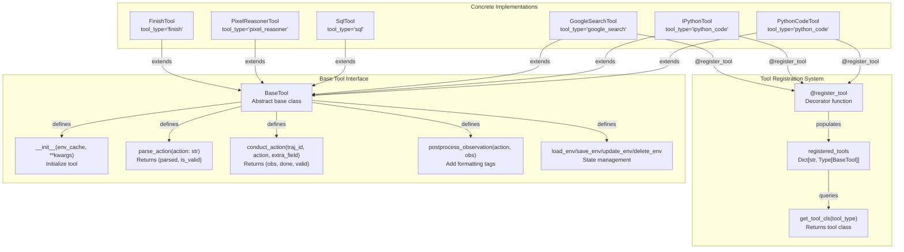
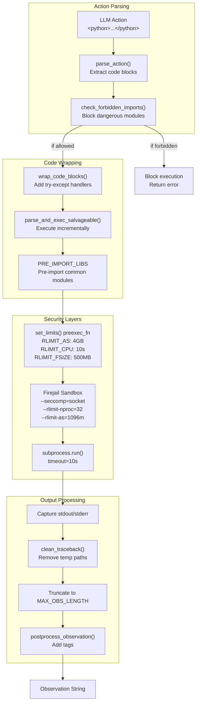
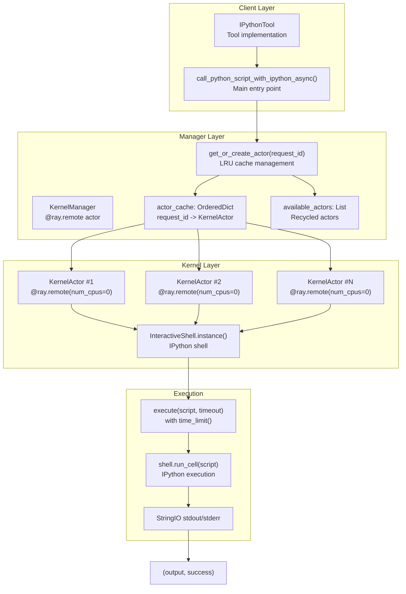
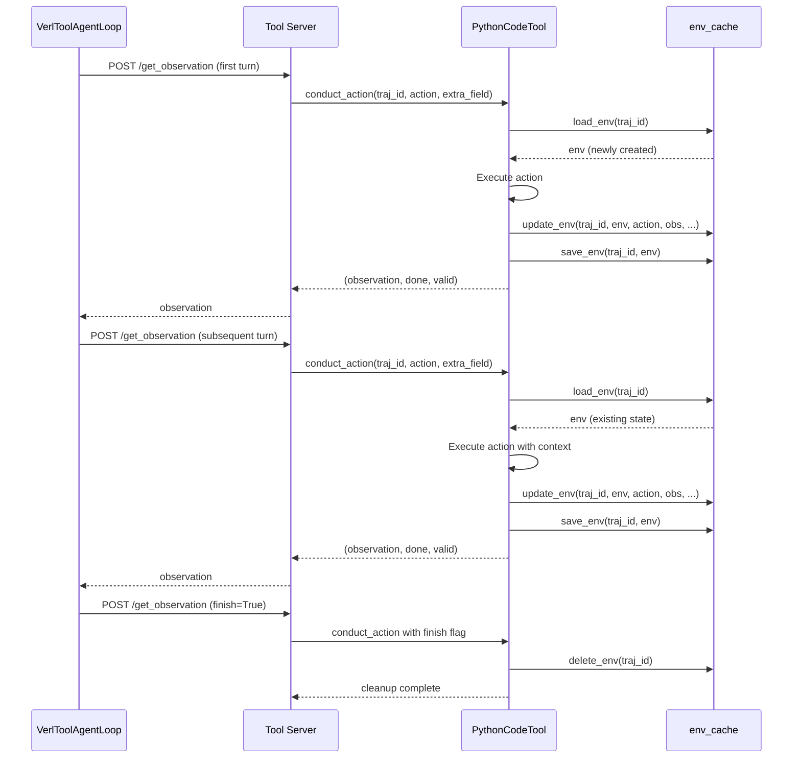

<!-- source: DeepWiki mcp.deepwiki.com · repo TIGER-AI-Lab/verl-tool · page 4 Tool Implementations · fetched 2026-10-30 -->

# Tool Implementations

<details>
<summary>Relevant source files</summary>

The following files were used as context for generating this wiki page:

- [eval_service/README.md](eval_service/README.md)
- [examples/train/deepsearch/README.md](examples/train/deepsearch/README.md)
- [examples/train/deepsearch/eval.sh](examples/train/deepsearch/eval.sh)
- [examples/train/deepsearch/train_4b.sh](examples/train/deepsearch/train_4b.sh)
- [examples/train/deepsearch/train_8b.sh](examples/train/deepsearch/train_8b.sh)
- [verl_tool/servers/tools/google_search.py](verl_tool/servers/tools/google_search.py)
- [verl_tool/servers/tools/python_code.py](verl_tool/servers/tools/python_code.py)
- [verl_tool/servers/tools/utils/web_agent_utils.py](verl_tool/servers/tools/utils/web_agent_utils.py)
- [verl_tool/servers/utils.py](verl_tool/servers/utils.py)

</details>


This page documents the concrete tool implementations in VerlTool. Each tool provides a specific capability (Python code execution, web search, SQL queries, etc.) while conforming to the `BaseTool` interface. For information about the tool server architecture and request routing, see [Tool Server Architecture](#3). For training recipes that use these tools, see [Training Recipes](#5).

## Overview

VerlTool provides several built-in tool implementations:

| Tool Class | Tool Type | Backend | Security | State Management |
|------------|-----------|---------|----------|------------------|
| `PythonCodeTool` | `python_code` | Subprocess + Firejail | Sandboxing, resource limits | Per-trajectory cache |
| `IPythonTool` | `ipython_code` | Ray `KernelActor` | Process isolation, timeouts | Persistent Ray actors |
| `GoogleSearchTool` | `google_search` | HTTP + AsyncLRU cache | Rate limiting | LRU cache |
| `SqlTool` | `sql` | SQLite connection | Read-only, rollback | Connection pool |
| `PixelReasonerTool` | `pixel_reasoner` | Image processing | Safe operations | Per-trajectory state |
| `FinishTool` | `finish` | No-op | N/A | Cleanup only |

Tools are automatically discovered and registered via the `@register_tool` decorator. Each tool implements the `BaseTool` interface with methods for action parsing, execution, and observation formatting.

Sources: [verl_tool/servers/tools/python_code.py:1-481](), [verl_tool/servers/tools/ipython_code.py:1-280]()

## Tool Class Hierarchy and Registration



**Tool Registration Flow:**
1. Tool classes are decorated with `@register_tool` at module load time
2. Decorator adds `(tool_type, tool_class)` mapping to `registered_tools` dictionary
3. Tool server calls `get_tool_cls(tool_type)` to instantiate tools
4. Each tool inherits from `BaseTool` and implements required methods

Sources: [verl_tool/servers/tools/python_code.py:275-276](), [verl_tool/servers/tools/ipython_code.py:72-73]()

## PythonCodeTool with Firejail Sandboxing

The `PythonCodeTool` executes arbitrary Python code in a Firejail sandbox with multiple security layers.

### Security Architecture



Sources: [verl_tool/servers/tools/python_code.py:21-52](), [verl_tool/servers/tools/python_code.py:147-155](), [verl_tool/servers/tools/python_code.py:156-271]()

### Forbidden Imports and Operations

The `check_forbidden_imports()` function blocks dangerous system operations:

**Blocked Modules:**
- `subprocess`, `multiprocessing`, `threading`
- `socket`, `psutil`, `resource`, `ctypes`

**Blocked Operations:**
- `os.system`, `os.popen`, `os.spawn`, `os.fork`
- `os.exec`, `sys.exit`, `os._exit`, `os.kill`

Sources: [verl_tool/servers/tools/python_code.py:21-52]()

### Resource Limits

The `set_limits()` function is called via `preexec_fn` in `subprocess.run()`:

| Resource | Limit | Purpose |
|----------|-------|---------|
| `RLIMIT_AS` | 4GB | Maximum virtual memory |
| `RLIMIT_CPU` | 10s | CPU time limit |
| `RLIMIT_FSIZE` | 500MB | Maximum file size |

Firejail adds additional constraints:
- `--rlimit-nproc=32`: Maximum 32 processes
- `--rlimit-nofile=32`: Maximum 32 open files
- `--rlimit-as=1096m`: Address space limit
- `--seccomp=socket`: Block socket creation via seccomp

Sources: [verl_tool/servers/tools/python_code.py:147-155](), [verl_tool/servers/tools/python_code.py:219-229]()

### Code Wrapping Strategy

The `wrap_code_blocks()` function handles multiple code blocks with incremental execution:

1. **Previous code blocks**: Execute with stdout/stderr redirected to null, export variables/functions
2. **Current code block**: Execute normally with output captured
3. **Syntax error handling**: `parse_and_exec_salvageable()` executes line-by-line to salvage valid code

This allows agents to build on previous code executions while only showing output from the current block.

Sources: [verl_tool/servers/tools/python_code.py:54-140]()

### Action Parsing

The `parse_action()` method extracts Python code from various formats:

```python
# Supported formats:
<python>code</python>
```python
code
```
```py
code
```
```

Multiple code blocks are concatenated with newlines. If no valid format is found, returns `("", False)`.

Sources: [verl_tool/servers/tools/python_code.py:337-368]()

### Observation Formatting

The `postprocess_observation()` method adds appropriate tags based on the action format:

| Action Pattern | Observation Format |
|----------------|-------------------|
| `</tool_call>` | `<tool_response>\n```result\n{obs}\n```\n</tool_response>` |
| `</python>` | `<output>\n{obs}\n</output>` |
| ` ```output` (unclosed) | `{obs}\n```\n` |
| ` ```output` (closed) | `\n```result\n{obs}\n```\n` |
| Default | `<result>\n{obs}\n</result>` |

Sources: [verl_tool/servers/tools/python_code.py:370-421]()

### Configuration Options

The `PythonCodeTool` class exposes several configuration attributes:

```python
timeout = TIMEOUT  # 10 seconds
stop_tokens = ["```output", "<output>", "<tool_call>"]
enable_history_code_execution = False  # Execute with previous code blocks
done_without_error = False  # Mark trajectory done on successful execution
python_path = None  # Custom Python interpreter path
pre_import_lib = True  # Pre-import common libraries
use_firejail = True  # Enable Firejail sandboxing
```

Sources: [verl_tool/servers/tools/python_code.py:278-284]()

## IPythonTool with Ray Kernel Management

The `IPythonTool` provides persistent execution environments using Ray-managed IPython kernel actors. This enables stateful multi-turn code execution where variables persist across tool calls.

### Ray Kernel Architecture



Sources: [verl_tool/servers/tools/utils/ipython_tool.py:66-176](), [verl_tool/servers/tools/utils/ipython_tool.py:182-268]()

### KernelActor Implementation

Each `KernelActor` is a Ray remote actor (`@ray.remote(num_cpus=0)`) owning a single IPython shell:

**Initialization:**
```python
c = Config()
c.HistoryManager.enabled = False  # Disable history for performance
shell = InteractiveShell.instance(colors='NoColor', config=c)
shell.cache_size = 1000
matplotlib.use('Agg')  # Non-interactive backend
```

**Execution with timeout:**
- Uses `signal.SIGALRM` for timeout enforcement
- Captures stdout/stderr with `redirect_stdout/redirect_stderr`
- Returns `(output, success)` tuple
- Truncates output if exceeds `max_output_size` (100KB)

Sources: [verl_tool/servers/tools/utils/ipython_tool.py:66-155]()

### KernelManager Centralized State

The `KernelManager` is a singleton Ray actor (`lifetime="detached"`) that manages all kernel actors:

**LRU Cache Management:**
- `actor_cache: OrderedDict[str, ActorHandle]` - Maps `request_id` to kernel actor
- `max_actors = 1024` - Maximum concurrent kernels
- `available_actors: List[ActorHandle]` - Recycled actors awaiting reuse

**Actor Lifecycle:**
1. **Cache hit**: Return existing actor, move to end (LRU)
2. **Cache miss + available**: Pop from `available_actors`, call `reset()`, assign to request
3. **Cache miss + at capacity**: Wait for actor to become available, then reuse
4. **Cache miss + under capacity**: Create new `KernelActor`

Sources: [verl_tool/servers/tools/utils/ipython_tool.py:182-268]()

### Kernel Cleanup and Recycling

When a trajectory finishes, `remove_kernel(request_id)` is called:

1. Pop actor from `actor_cache`
2. Call `actor.reset.remote()` to clear namespace
3. Append to `available_actors` for reuse
4. Garbage collection to free memory

This avoids the overhead of creating new actors for each trajectory.

Sources: [verl_tool/servers/tools/utils/ipython_tool.py:392-400](), [verl_tool/servers/tools/ipython_code.py:135-142]()

### IPythonTool Action Parsing

The `parse_action()` method supports multiple formats:

```python
# Format 1: XML tags
<python>code</python>

# Format 2: Markdown code blocks
```python
code
```

# Format 3: JSON tool calls
<tool_call>
{"name": "python", "arguments": {"code": "print('hello')"}}
</tool_call>
```

Multiple code blocks are concatenated. Invalid formats return `("", False)`.

Sources: [verl_tool/servers/tools/ipython_code.py:144-183]()

### Observation Formatting

The `conduct_action()` method formats observations based on action patterns:

| Action Pattern | Observation Format |
|----------------|-------------------|
| `</tool_call>` | `{obs}` (no tags) |
| `</python>` or `</python>` in action | `<output>\n{obs}\n</output>` |
| ` ```output` | `\n{obs}\n```\n` |
| ` ```python` (even count) | `\n```output\n{obs}\n```\n` |
| ` ```python` (odd count) | `output\n{obs}\n```\n` |
| `<\|calling system for feedback\|>` | Context-dependent formatting |

Additionally returns metrics in observation dict:
```python
{"obs": formatted_obs, "metrics": {"code_success": bool, "code_lines": int}, "timeout": bool}
```

Sources: [verl_tool/servers/tools/ipython_code.py:231-265]()

### Performance Considerations

**Advantages of Ray-based kernels:**
- State persistence across tool calls within a trajectory
- Process isolation prevents cross-contamination
- LRU caching reuses actors across trajectories
- Async execution with `asyncio.run_in_executor()`

**Disadvantages:**
- Ray actor overhead (~50-100ms per call)
- Memory accumulation in long-running kernels
- Complexity in distributed state management

**When to use IPythonTool vs PythonCodeTool:**
- Use `IPythonTool` when state persistence is required (e.g., competitive programming)
- Use `PythonCodeTool` for stateless execution with stronger sandboxing

Sources: [verl_tool/servers/tools/utils/ipython_tool.py:310-355]()

## Environment State Management

All tools inherit environment management methods from `BaseTool`:

### Environment Cache Structure

Each tool maintains an `env_cache` dictionary mapping `trajectory_id` to environment state:

```python
env_cache[trajectory_id] = {
    "trajectory_id": str,
    "metadata": {
        "turns": int,
        # Tool-specific metadata
    },
    "previous_obs": [
        {
            "action": str,
            "is_valid": bool,
            "observation": str,
            "extra_field": dict,
            # Additional fields
        }
    ]
}
```

Sources: [verl_tool/servers/tools/python_code.py:296-308](), [verl_tool/servers/tools/ipython_code.py:100-114]()

### State Management Methods

| Method | Purpose | Called By |
|--------|---------|-----------|
| `has_env(trajectory_id)` | Check if environment exists | Tool server router |
| `load_env(trajectory_id)` | Load or create environment | `conduct_action()` |
| `save_env(trajectory_id, env)` | Persist environment state | `conduct_action()` |
| `update_env(trajectory_id, env, ...)` | Add turn to history | `conduct_action()` |
| `delete_env(trajectory_id)` | Clean up on trajectory finish | Tool server `finish=True` |

Sources: [verl_tool/servers/tools/python_code.py:289-335]()

### Lifecycle Flow



Sources: [verl_tool/servers/tools/python_code.py:424-479](), [verl_tool/agent_loop/verltool_agent_loop.py:431-448]()

## Tool Execution Patterns

### Synchronous vs Asynchronous Execution

**Synchronous (Default):**
- Tool server directly calls `tool.conduct_action()`
- Simple, low overhead
- Suitable for fast operations (<100ms)

**Asynchronous (Ray-based):**
- Tool server uses `RayToolManager`
- Dispatches to Ray remote actors
- Better for I/O-bound operations (search, database)
- Configurable with `use_ray=True` in tool server config

Sources: [verl_tool/agent_loop/verltool_agent_loop.py:366-428]()

### Error Handling

Tools return three values: `(observation, done, valid)`

| Return Pattern | Meaning | Agent Behavior |
|----------------|---------|----------------|
| `(obs, False, True)` | Valid action, continue | Append observation, next turn |
| `(obs, True, True)` | Valid action, finished | Append observation, end trajectory |
| `("", False, False)` | Invalid action format | Skip observation, end trajectory |
| `(error_msg, False, False)` | Execution error | Return error message, continue |

The `valid` flag is used by reward managers to filter invalid trajectories.

Sources: [verl_tool/servers/tools/python_code.py:436-479]()

### Timeout and Retry Logic

**Tool-level timeouts:**
- `PythonCodeTool`: 10s default via `subprocess.run(timeout=...)`
- `IPythonTool`: 120s default via `signal.SIGALRM`
- `GoogleSearchTool`: 30s HTTP timeout via `aiohttp.ClientTimeout`

**Agent-level retry:**
The agent loop (`VerlToolAgentLoop`) implements retry logic for tool calls:
- `tool_call_max_retries`: Default 1
- `tool_call_timeout`: Default 30s
- Catches `asyncio.TimeoutError`, `ClientConnectorError`, generic `Exception`
- Returns error observation on all retries exhausted

Sources: [verl_tool/agent_loop/verltool_agent_loop.py:262-333]()

### Observation Truncation

Tools receive `max_obs_length` parameter (default 512 tokens) for truncating observations:

**Truncation strategies:**
- `truncate_obs_side='left'`: Keep most recent tokens (default)
- `truncate_obs_side='right'`: Keep first tokens
- `truncate_obs_side='middle'`: Keep first + last tokens

**Multi-modal handling:**
For observations with images/audio, truncation avoids splitting multi-modal sequences by finding nearest non-placeholder token.

Sources: [verl_tool/agent_loop/verltool_agent_loop.py:601-656]()

## Integration with Agent Loop

### Tool Call Detection

The `VerlToolAgentLoop` detects tool calls via `action_stop_tokens`:

```python
action_stop_tokens = ["</tool_call>", "</python>", "</action>"]
```

When vLLM generation hits a stop token:
1. Extract action text before stop token
2. Send to tool server via `interact_with_tool_server()`
3. Receive observation
4. Tokenize and append to prompt
5. Continue generation or finish trajectory

Sources: [verl_tool/agent_loop/verltool_agent_loop.py:558-674]()

### Multi-Modal Observations

Tools can return observations with images or audio:

```python
observation = {
    "obs": "Text observation",
    "image": ["data:image/png;base64,..."],
    "audio": ["data:audio/wav;base64,..."],
    "reward": 1.0  # Optional per-step reward
}
```

The agent loop:
1. Decodes image/audio URLs
2. Appends to `running_image_data`/`running_audio_data`
3. Replaces `<image>`/`<audio>` tags with placeholder tokens
4. Processes with `processor(text=..., images=..., audio=...)`

Sources: [verl_tool/agent_loop/verltool_agent_loop.py:587-642]()

### Observation Masking

The `mask_observations` flag controls gradient computation on tool responses:

- `mask_observations=True` (default): Set response_mask to 0 for observation tokens
- `mask_observations=False`: Set response_mask to 1 for observation tokens

This allows training only on LLM-generated tokens while using observations as context.

Sources: [verl_tool/agent_loop/verltool_agent_loop.py:669-673]()

---

