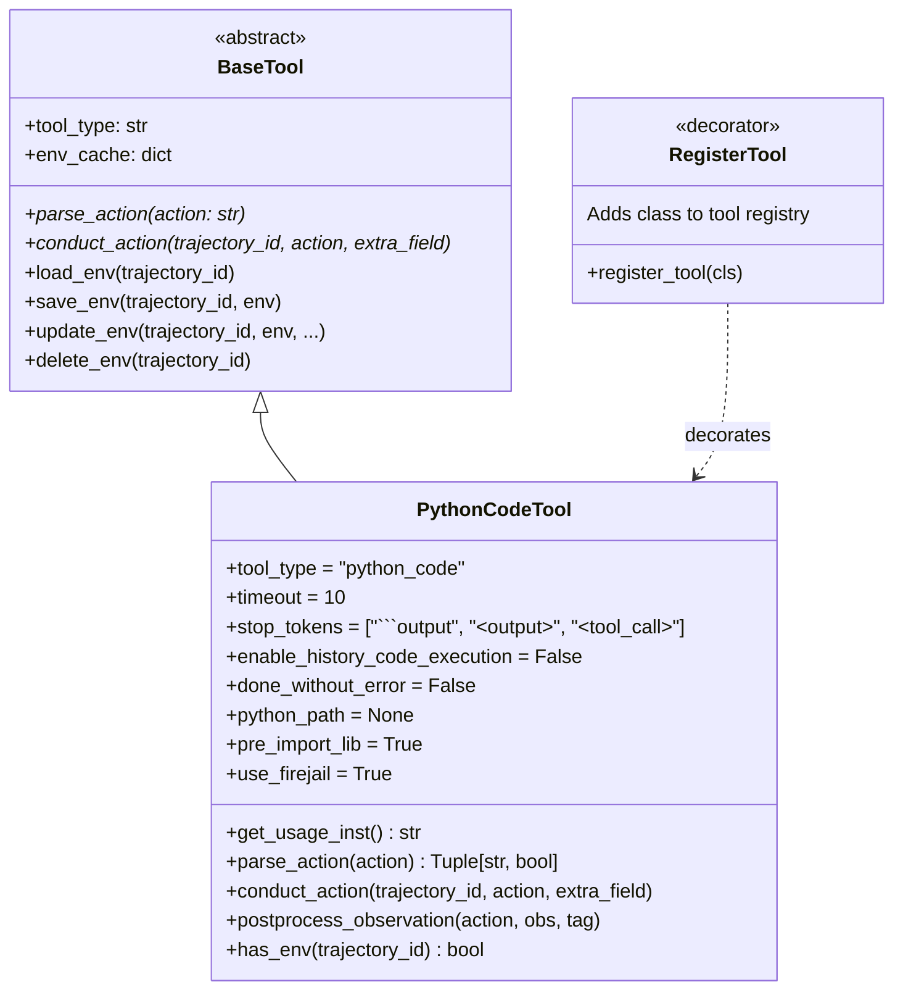
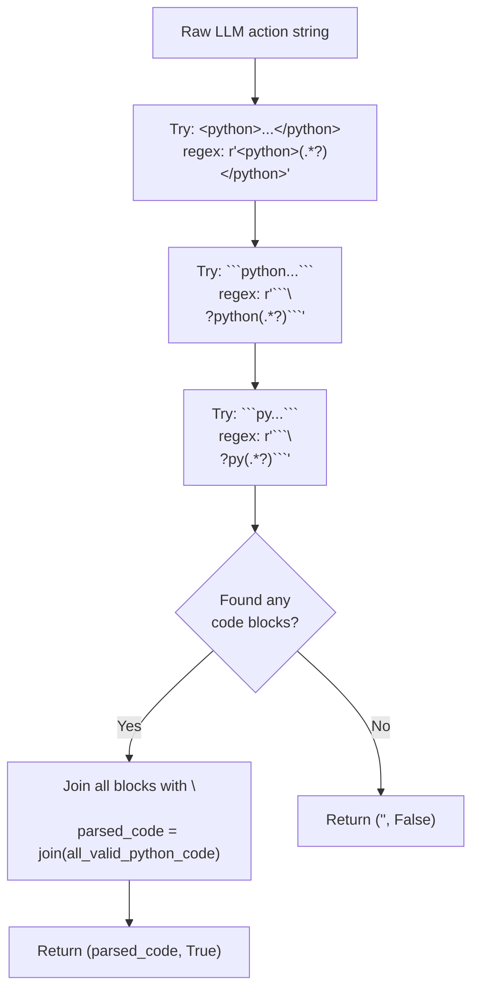
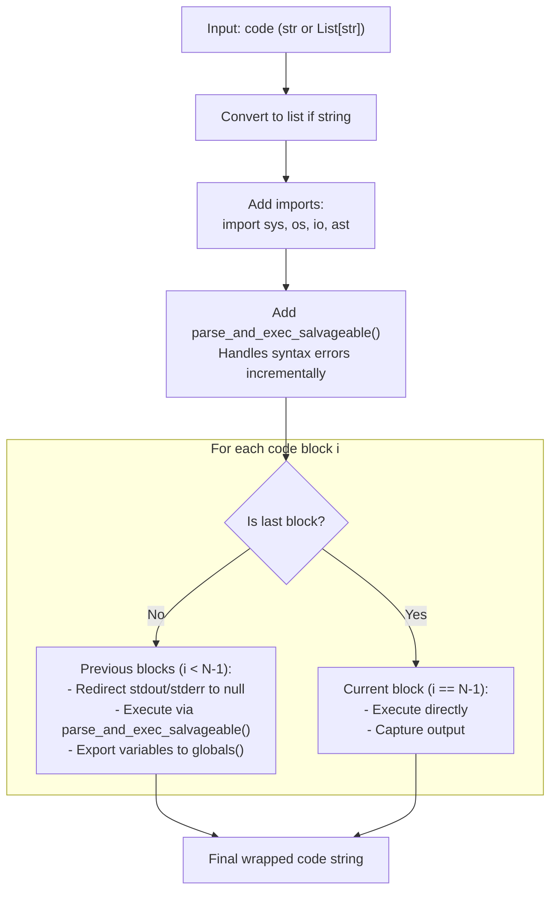
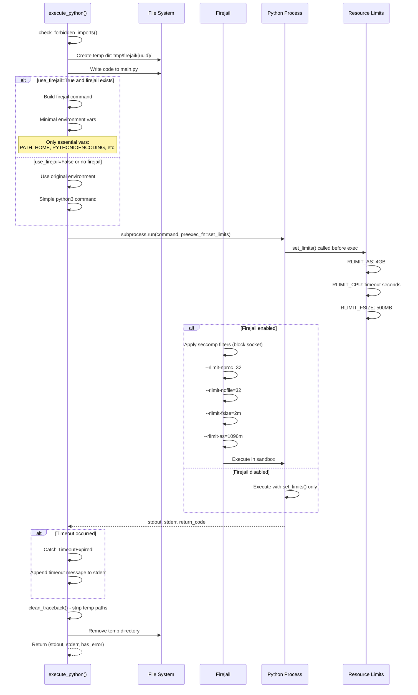
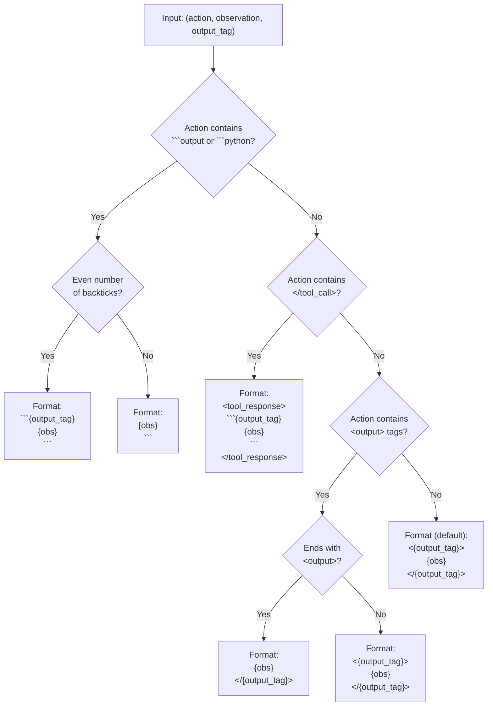
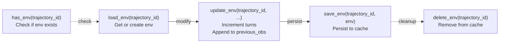
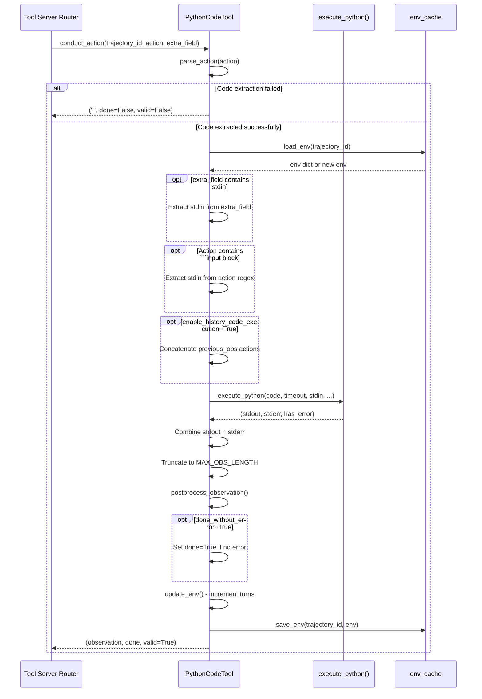

<!-- source: DeepWiki mcp.deepwiki.com · repo TIGER-AI-Lab/verl-tool · page 4.1 Python Code Execution (Firejail) · fetched 2026-10-30 -->

# Python Code Execution (Firejail)

<details>
<summary>Relevant source files</summary>

The following files were used as context for generating this wiki page:

- [eval_service/README.md](eval_service/README.md)
- [examples/train/acecoder/README.md](examples/train/acecoder/README.md)
- [verl_tool/servers/tools/python_code.py](verl_tool/servers/tools/python_code.py)
- [verl_tool/servers/utils.py](verl_tool/servers/utils.py)

</details>


## Purpose and Scope

This document describes the `PythonCodeTool` implementation, which provides secure Python code execution within Firejail sandboxes. The tool enables LLMs to write and execute Python code during multi-turn interactions while maintaining strict security boundaries through multiple defense layers.

For IPython-based persistent kernel execution, see [IPython Code Execution (Ray Kernels)](#4.2). For general tool architecture and registration, see [Tool Registry and Discovery System](#3.2).

---

## Architecture Overview

The `PythonCodeTool` implements a defense-in-depth security model with four distinct protection layers:

```mermaid
graph TB
    subgraph "Agent Request"
        LLM["LLM-generated action<br/>raw text with code blocks"]
    end
    
    subgraph "Layer 1: Code Extraction"
        ParseAction["parse_action()<br/>Extract from tags:<br/>&lt;python&gt;...&lt;/python&gt;<br/>```python...```"]
        ValidCheck["Validity Check<br/>Return empty if no code found"]
    end
    
    subgraph "Layer 2: Static Analysis"
        ForbiddenCheck["check_forbidden_imports()<br/>Block dangerous modules:<br/>subprocess, socket, etc."]
        PatternCheck["Dangerous pattern detection:<br/>os.system, os.popen, sys.exit"]
    end
    
    subgraph "Layer 3: Code Wrapping"
        WrapCode["wrap_code_blocks()<br/>Multi-block support:<br/>- Suppress previous output<br/>- Export variables<br/>- Handle syntax errors"]
        PreImport["PRE_IMPORT_LIBS<br/>Pre-import scientific libs<br/>Set recursion limit"]
    end
    
    subgraph "Layer 4: Sandboxed Execution"
        FirejailCmd["Firejail Command:<br/>--seccomp=socket<br/>--rlimit-nproc=32<br/>--rlimit-as=1096m"]
        SetLimits["set_limits()<br/>RLIMIT_AS: 4GB<br/>RLIMIT_CPU: timeout<br/>RLIMIT_FSIZE: 500MB"]
        TempDir["Isolated temp directory<br/>tmp/firejail/{uuid}/"]
    end
    
    subgraph "Execution Result"
        CaptureOutput["subprocess.run()<br/>capture stdout/stderr<br/>timeout mechanism"]
        CleanTraceback["clean_traceback()<br/>Strip temp paths"]
        PostProcess["postprocess_observation()<br/>Add output tags:<br/>&lt;result&gt;...&lt;/result&gt;"]
    end
    
    subgraph "Environment State"
        EnvCache["env_cache<br/>{trajectory_id: env}"]
        EnvData["env structure:<br/>- metadata.turns<br/>- previous_obs[]"]
    end
    
    LLM --> ParseAction
    ParseAction --> ValidCheck
    ValidCheck --> ForbiddenCheck
    ForbiddenCheck --> PatternCheck
    PatternCheck --> WrapCode
    WrapCode --> PreImport
    PreImport --> FirejailCmd
    FirejailCmd --> SetLimits
    SetLimits --> TempDir
    TempDir --> CaptureOutput
    CaptureOutput --> CleanTraceback
    CleanTraceback --> PostProcess
    PostProcess --> EnvCache
    EnvCache --> EnvData
    
    style ParseAction fill:#f9f9f9
    style ForbiddenCheck fill:#f9f9f9
    style WrapCode fill:#f9f9f9
    style FirejailCmd fill:#f9f9f9
```



**Diagram: PythonCodeTool Security and Execution Pipeline**

Sources: [verl_tool/servers/tools/python_code.py:1-481]()

---

## Class Definition and Configuration

The `PythonCodeTool` class extends `BaseTool` and is registered via the `@register_tool` decorator:



**Diagram: PythonCodeTool Class Hierarchy**

### Configuration Parameters

| Parameter | Default | Purpose |
|-----------|---------|---------|
| `tool_type` | `"python_code"` | Tool identifier for registry |
| `timeout` | `10` | Execution timeout in seconds |
| `stop_tokens` | `["```output", "<output>", "<tool_call>"]` | LLM generation stop signals |
| `enable_history_code_execution` | `False` | Execute all previous code blocks |
| `done_without_error` | `False` | Mark trajectory done on error-free execution |
| `python_path` | `None` | Custom Python interpreter path |
| `pre_import_lib` | `True` | Prepend `PRE_IMPORT_LIBS` |
| `use_firejail` | `True` | Enable Firejail sandboxing |

Sources: [verl_tool/servers/tools/python_code.py:275-284]()

---

## Security Layer 1: Code Extraction and Validation

### Code Parsing Logic

The `parse_action()` method extracts Python code from multiple tag formats:



**Diagram: Code Extraction from Multiple Tag Formats**

**Implementation details:**
- Supports multiple code blocks in a single action (all concatenated)
- Uses `re.DOTALL` flag to match across newlines
- Returns both the extracted code and a validity flag
- Empty return triggers no execution and no observation

Sources: [verl_tool/servers/tools/python_code.py:337-368]()

---

## Security Layer 2: Forbidden Import Detection

The `check_forbidden_imports()` function implements static analysis to block dangerous operations:

### Blocked Modules

```python
forbidden_modules = [
    'subprocess', 'multiprocessing', 'threading',
    'socket', 'psutil', 'resource', 'ctypes'
]
```

### Blocked Patterns

```python
dangerous_patterns = [
    "os.system", "os.popen", "os.spawn", "os.fork", 
    "os.exec", "sys.exit", "os._exit", "os.kill"
]
```

**Detection mechanism:**
1. Simple string matching for `import {module}` and `from {module}`
2. Pattern matching for dangerous function calls
3. Returns `True` if any forbidden construct is found
4. Execution is blocked with error message: `"Execution blocked: Code contains potentially dangerous operations or imports."`

**Limitations:** This is a basic string-based check and may be bypassed by sophisticated obfuscation. It serves as a first line of defense before Firejail enforcement.

Sources: [verl_tool/servers/tools/python_code.py:21-52]()

---

## Security Layer 3: Code Wrapping and Multi-Block Support

The `wrap_code_blocks()` function prepares code for execution with special handling for multi-turn code history:



**Diagram: Code Wrapping for Multi-Block Execution**

### Key Features

1. **Previous code suppression**: Non-final blocks redirect `sys.stdout` and `sys.stderr` to `io.StringIO()` to suppress output
2. **Variable export**: Variables defined in previous blocks are exported to `globals()` for access in later blocks
3. **Syntax error handling**: The `parse_and_exec_salvageable()` helper function executes code line-by-line, skipping lines with syntax errors
4. **Current code execution**: The final (most recent) code block executes normally with output captured

### Pre-Import Libraries

When `pre_import_lib=True`, the following libraries are pre-imported:

```python
PRE_IMPORT_LIBS = """
from string import *
from re import *
from datetime import *
from collections import *
from heapq import *
from bisect import *
from copy import *
from math import *
from random import *
from statistics import *
from itertools import *
from functools import *
from operator import *
from io import *
from sys import *
from json import *
from builtins import *
from typing import *
# ... (module-level imports)
sys.setrecursionlimit(6*10**5)
"""
```

This reduces token overhead and enables code to use common libraries without explicit imports.

Sources: [verl_tool/servers/tools/python_code.py:18-18](), [verl_tool/servers/tools/python_code.py:54-141]()

---

## Security Layer 4: Firejail Sandboxing and Resource Limits

The `execute_python()` function implements the final security layer with Firejail isolation:

### Execution Pipeline



**Diagram: Sandboxed Execution Pipeline**

### Firejail Command Construction

When Firejail is enabled, the command structure is:

```
firejail \
  --quiet \
  --seccomp=socket \          # Block socket creation
  --noprofile \               # Don't load default profile
  --rlimit-nproc=32 \         # Max 32 processes
  --rlimit-nofile=32 \        # Max 32 open files
  --rlimit-fsize=2m \         # Max 2MB file size
  --rlimit-as=1096m \         # Max ~1GB address space
  python3 main.py
```

### Resource Limits (via `set_limits()`)

Applied via `preexec_fn` in `subprocess.run()`:

| Limit | Value | Purpose |
|-------|-------|---------|
| `RLIMIT_AS` | 4GB | Virtual memory limit |
| `RLIMIT_CPU` | `timeout` seconds | CPU time limit |
| `RLIMIT_FSIZE` | 500MB | Maximum file size |

**Note:** Firejail limits (`--rlimit-as=1096m`) are more restrictive than `set_limits()` when both are active.

### Environment Variable Filtering

When Firejail is enabled, only essential environment variables are passed:

```python
essential_vars = [
    "PATH", "HOME", "USER", "SHELL", 
    "LANG", "LC_ALL", "LC_CTYPE", "TERM",
    # Python-specific
    "PYTHONIOENCODING", "PYTHONUNBUFFERED", "PYTHONHASHSEED", "PYTHONDONTWRITEBYTECODE",
    # Runtime optimization
    "MKL_NUM_THREADS", "OMP_NUM_THREADS", "NUMEXPR_NUM_THREADS",
    # Temp directories
    "TMPDIR", "TEMP", "TMP",
    # Display if needed
    "DISPLAY", "XAUTHORITY"
]
```

The `PYTHONPATH` variable is explicitly removed to prevent path manipulation attacks.

Sources: [verl_tool/servers/tools/python_code.py:148-271]()

---

## Observation Post-Processing

The `postprocess_observation()` method formats execution results based on the action string's syntax:



**Diagram: Observation Formatting Logic**

### Examples

| Action Format | Observation Format |
|--------------|-------------------|
| `<python>\ncode\n</python>` | `\n<result>\noutput\n</result>\n` |
| ` ```python\ncode\n``` ` | `\n```result\noutput\n```\n` |
| `code<tool_call>...` | `\n<tool_response>\n```result\noutput\n```\n</tool_response>\n` |
| `code<output>` (unclosed) | `\noutput\n</output>\n` |

**Truncation:** Observations are truncated to `MAX_OBS_LENGTH = 100000` characters to prevent token overflow.

Sources: [verl_tool/servers/tools/python_code.py:370-421](), [verl_tool/servers/tools/python_code.py:274-274]()

---

## Environment State Management

The `PythonCodeTool` maintains trajectory-specific state via the `env_cache` dictionary:

### Environment Structure

```json
{
  "trajectory_id": "unique_id",
  "metadata": {
    "turns": 3
  },
  "previous_obs": [
    {
      "action": "parsed_code_1",
      "is_valid": true,
      "observation": "execution_result_1",
      "extra_field": {...}
    },
    {
      "action": "parsed_code_2",
      "is_valid": true,
      "observation": "execution_result_2",
      "extra_field": {...}
    }
  ]
}
```

### State Management Methods



**Diagram: Environment Lifecycle Methods**

### History Code Execution

When `enable_history_code_execution=True`:
- All previous code blocks from `env["previous_obs"]` are concatenated
- The full code history is wrapped and executed together
- This enables stateful execution across turns

When `enable_history_code_execution=False` (default):
- Only the current code block is executed
- Each turn is independent
- More secure and performant

Sources: [verl_tool/servers/tools/python_code.py:289-335](), [verl_tool/servers/tools/python_code.py:424-479]()

---

## Integration with Agent Loop

The `conduct_action()` method is the main entry point called by the tool server:



**Diagram: conduct_action() Execution Flow**

### Input Parameters

- `trajectory_id`: Unique identifier for trajectory-specific state
- `action`: Raw LLM-generated text containing code
- `extra_field`: Optional dict with `stdin` or other metadata

### Return Values

- `observation`: Formatted execution result (truncated to 100k chars)
- `done`: Boolean flag (True if error-free when `done_without_error=True`)
- `valid`: Boolean flag (True if code was extracted and executed)

Sources: [verl_tool/servers/tools/python_code.py:424-479]()

---

## stdin Handling

The tool supports providing input to the executed code via two mechanisms:

1. **Via `extra_field` parameter:**
   ```python
   extra_field = {"stdin": "input data"}
   ```

2. **Via inline ````input` block in action:**
   ```
   <python>
   x = input()
   print(x)
   </python>
   ```input
   test data
   ```
   ```

The inline format is parsed via regex: `r"```input\n(.*?)\n```"` and takes precedence over `extra_field.stdin`.

Sources: [verl_tool/servers/tools/python_code.py:446-451]()

---

## Firejail Installation

The tool requires Firejail to be installed on the system. The installation commands are documented at the top of the file:

```bash
add-apt-repository ppa:deki/firejail
apt-get update
DEBIAN_FRONTEND=noninteractive apt-get -y install firejail firejail-profiles
```

**Fallback behavior:** If Firejail is not installed (`firejail_command_exists=False`), the tool falls back to execution with only `set_limits()` resource constraints, which is less secure.

Sources: [verl_tool/servers/tools/python_code.py:1-5](), [verl_tool/servers/tools/python_code.py:19-19]()

---

## Usage in Training and Evaluation

### Training Configuration

In training scripts, the Python code tool is enabled via:

```yaml
# In agent.yaml
agent:
  tool_server_url: "http://localhost:30000/get_observation"
  action_stop_tokens: ["<python>", "</python>"]
  max_turns: 3
```

### Evaluation Service

The evaluation service (see [Evaluation Service Architecture](#8.1)) integrates `PythonCodeTool` for inference-time code execution. The service configuration in `start_api_service.sh` includes:

```bash
tool_server_url=http://$host:$port/get_observation
action_stop_tokens="<python>"
max_turns=4
min_turns=4  # Force tool usage even without explicit tags
```

The `min_turns` parameter in evaluation forces code extraction and execution even when the model doesn't explicitly use `<python>` tags, enabling zero-shot tool usage.

Sources: [eval_service/README.md:1-87]()

---

## Performance Considerations

### Execution Time Budget

- Default timeout: 10 seconds per execution
- Configurable via `PythonCodeTool.timeout` class attribute
- Enforced via both `subprocess.run(timeout=...)` and `RLIMIT_CPU`

### Memory Overhead

- Each trajectory maintains isolated temp directory under `tmp/firejail/{uuid}/`
- Temp directories are cleaned up after execution
- `env_cache` stores execution history in memory (cleared via `delete_env()`)

### Concurrent Execution

The tool is typically used within Ray actors with `max_concurrency` limits:
- Each actor maintains separate `env_cache`
- Firejail sandboxes are isolated at process level
- Thread-safe via Ray's actor model

---

## Security Considerations

### Defense Layers Summary

| Layer | Mechanism | Bypass Difficulty |
|-------|-----------|------------------|
| 1. Code Extraction | Tag parsing, validity check | Low - only filters invalid syntax |
| 2. Static Analysis | String-based forbidden imports | Medium - can be obfuscated |
| 3. Code Wrapping | Namespace isolation, error handling | Medium - logical bypass possible |
| 4. Sandboxing | Firejail + resource limits | High - requires kernel exploits |

### Known Limitations

1. **String-based static analysis** can be bypassed with:
   - Dynamic imports: `__import__('subprocess')`
   - Attribute access: `getattr(os, 'system')`
   - Indirect references via variables

2. **Firejail isolation** depends on:
   - Correct Firejail installation and configuration
   - Kernel security features (seccomp, namespaces)
   - No privilege escalation vulnerabilities

3. **Resource limits** may not prevent:
   - CPU-intensive infinite loops (only timeout helps)
   - Memory allocation patterns that bypass `RLIMIT_AS`
   - Disk space exhaustion in temp directory

### Best Practices

- Always use `use_firejail=True` in production
- Set conservative timeout values (≤10 seconds)
- Monitor disk space in `tmp/firejail/` directory
- Regularly update Firejail to latest version
- Consider additional AppArmor/SELinux policies

Sources: [verl_tool/servers/tools/python_code.py:1-481]()

---

