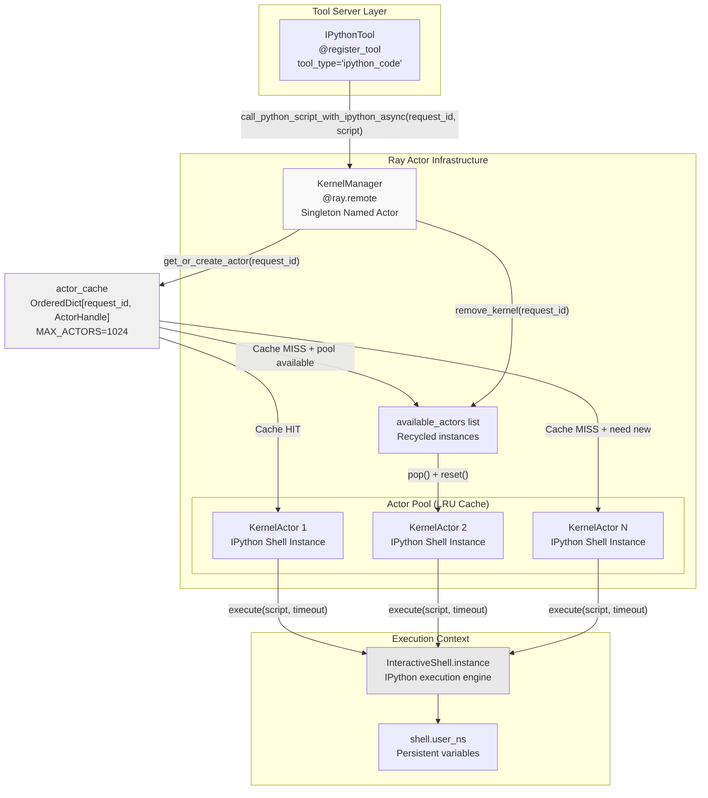
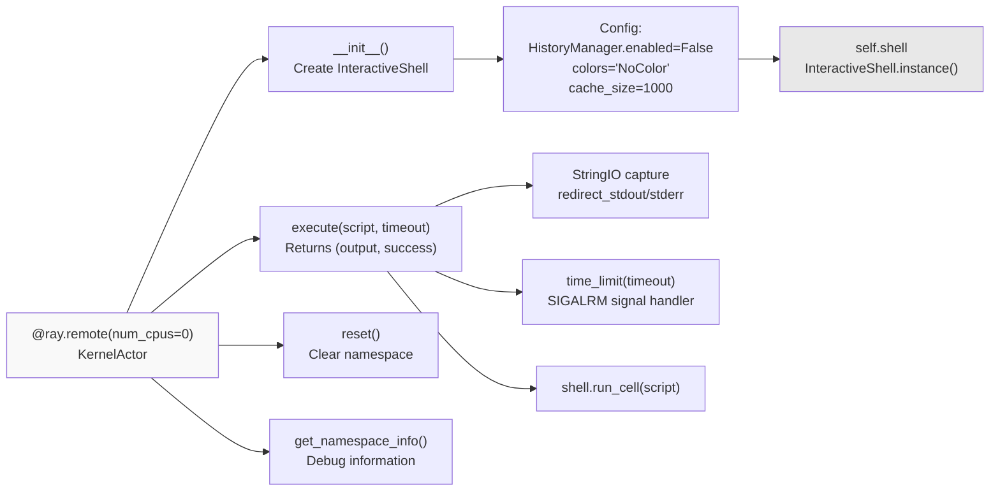
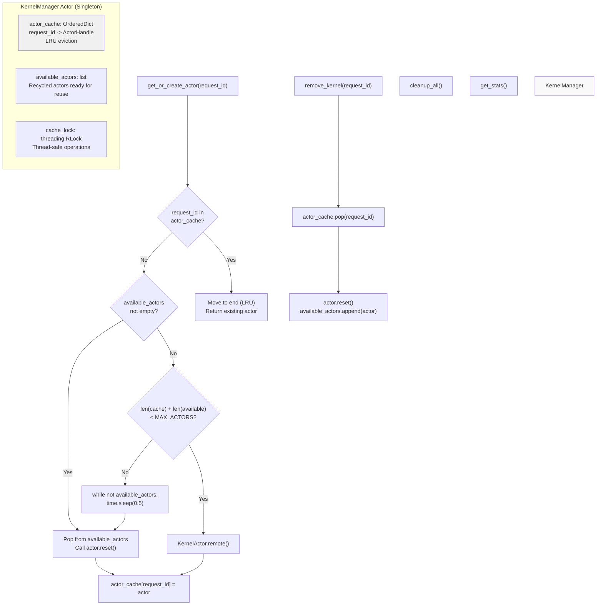
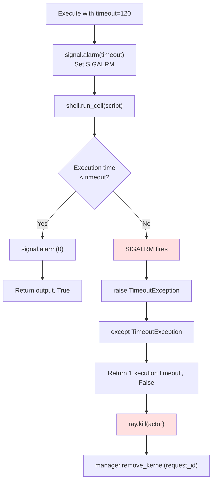
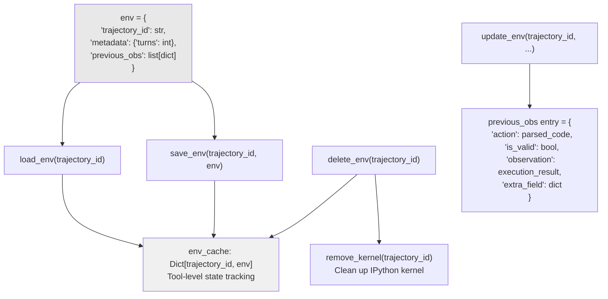
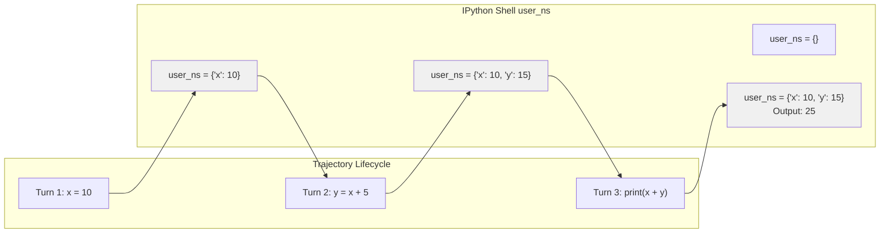
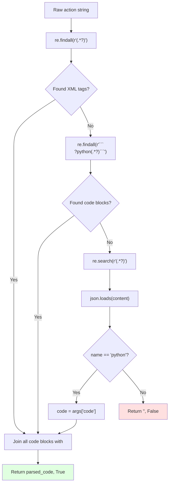

<!-- source: DeepWiki mcp.deepwiki.com · repo TIGER-AI-Lab/verl-tool · page 4.2 IPython Code Execution (Ray Kernels) · fetched 2026-10-30 -->

# IPython Code Execution (Ray Kernels)

<details>
<summary>Relevant source files</summary>

The following files were used as context for generating this wiki page:

- [eval_service/README.md](eval_service/README.md)
- [verl_tool/agent_loop/agent_loop.py](verl_tool/agent_loop/agent_loop.py)
- [verl_tool/agent_loop/verltool_agent_loop.py](verl_tool/agent_loop/verltool_agent_loop.py)
- [verl_tool/servers/tests/test_python_code_tool.py](verl_tool/servers/tests/test_python_code_tool.py)
- [verl_tool/servers/tools/ipython_code.py](verl_tool/servers/tools/ipython_code.py)
- [verl_tool/servers/tools/python_code.py](verl_tool/servers/tools/python_code.py)
- [verl_tool/servers/tools/utils/ipython_tool.py](verl_tool/servers/tools/utils/ipython_tool.py)
- [verl_tool/servers/utils.py](verl_tool/servers/utils.py)
- [verl_tool/trainer/config/verltool/agent.yaml](verl_tool/trainer/config/verltool/agent.yaml)
- [verl_tool/trainer/ppo/metric_util.py](verl_tool/trainer/ppo/metric_util.py)
- [verl_tool/workers/reward_manager/torl.py](verl_tool/workers/reward_manager/torl.py)
- [verl_tool/workers/rollout/vllm_rollout/vllm_async_server.py](verl_tool/workers/rollout/vllm_rollout/vllm_async_server.py)

</details>


This document describes the Ray-based IPython kernel execution system for stateful Python code execution during agent training and evaluation. This system provides isolated, persistent execution environments using Ray actors with LRU-cached kernel instances.

**Scope**: This page covers the `ipython_code` tool implementation and its underlying Ray actor infrastructure. For sandboxed, stateless Python execution using Firejail, see [Python Code Execution (Firejail)](#4.1). For the broader tool server architecture, see [Tool Server Architecture](#3). For how tools are called during training, see [Agent Loop System](#2.3).

---

## Purpose and Key Characteristics

The IPython code execution system enables **stateful, multi-turn Python code execution** where variables and state persist across multiple interactions within the same trajectory. This is essential for tasks that require building up context over multiple code executions, such as complex mathematical reasoning or multi-step data analysis.

**Key characteristics:**
- **Stateful execution**: Each trajectory maintains its own IPython shell instance with persistent namespace
- **Ray-based isolation**: Uses Ray actors to isolate kernel processes from each other
- **LRU caching**: Caches up to 1024 kernel actors to minimize overhead
- **Timeout protection**: Kills hung executions and cleans up resources
- **Centralized management**: Single `KernelManager` actor prevents distributed state issues

Sources: [verl_tool/servers/tools/utils/ipython_tool.py:1-70](), [verl_tool/servers/tools/ipython_code.py:1-93]()

---

## Architecture Overview



**Diagram: IPython Tool Ray Actor Architecture**

The system uses a three-tier architecture:
1. **Tool Layer**: `IPythonTool` handles action parsing and environment management
2. **Manager Layer**: `KernelManager` provides centralized kernel lifecycle management
3. **Execution Layer**: `KernelActor` instances each own an IPython shell with persistent state

Sources: [verl_tool/servers/tools/utils/ipython_tool.py:32-43](), [verl_tool/servers/tools/utils/ipython_tool.py:182-200](), [verl_tool/servers/tools/utils/ipython_tool.py:276-300]()

---

## Ray Actor System

### KernelActor: Isolated Execution Environment

The `KernelActor` class provides process-isolated Python execution:



**Diagram: KernelActor Class Structure**

**Key implementation details:**

| Aspect | Implementation | Location |
|--------|---------------|----------|
| Resource allocation | `num_cpus=0` (no CPU reservation) | [verl_tool/servers/tools/utils/ipython_tool.py:66]() |
| Shell creation | `InteractiveShell.instance(colors='NoColor')` | [verl_tool/servers/tools/utils/ipython_tool.py:75]() |
| History disabled | `HistoryManager.enabled=False` | [verl_tool/servers/tools/utils/ipython_tool.py:74-76]() |
| Timeout mechanism | `time_limit()` context manager with `SIGALRM` | [verl_tool/servers/tools/utils/ipython_tool.py:52-63]() |
| Output capture | `redirect_stdout/redirect_stderr` to `StringIO` | [verl_tool/servers/tools/utils/ipython_tool.py:100-104]() |

Sources: [verl_tool/servers/tools/utils/ipython_tool.py:66-155]()

### KernelManager: Centralized State Management

The `KernelManager` solves the distributed state problem by providing a single source of truth for all kernel mappings:



**Diagram: KernelManager Lifecycle Management**

**Configuration:**

| Parameter | Value | Description |
|-----------|-------|-------------|
| `MAX_ACTORS` | 1024 | Maximum number of kernel actors in cache + available pool |
| Actor name | `"kernel_manager"` | Named actor for singleton pattern |
| Lifetime | `"detached"` | Survives creator process termination |

Sources: [verl_tool/servers/tools/utils/ipython_tool.py:182-268](), [verl_tool/servers/tools/utils/ipython_tool.py:34]()

---

## Execution Flow

```mermaid
sequenceDiagram
    participant Tool as IPythonTool.conduct_action
    participant Async as call_python_script_with_ipython_async
    participant GetMgr as _get_kernel_manager
    participant Manager as KernelManager
    participant Actor as KernelActor
    participant Shell as IPython Shell
    
    Tool->>Tool: parse_action(action)
    Note over Tool: Extract code from<br/><python>...</python> or ```python...```
    
    Tool->>Async: call_python_script_with_ipython(trajectory_id, script, timeout)
    
    Async->>GetMgr: Get singleton manager
    GetMgr->>GetMgr: Check _kernel_manager cache
    alt Manager not initialized
        GetMgr->>Manager: ray.get_actor("kernel_manager")
        Note over GetMgr,Manager: Or create new if doesn't exist
    end
    
    Async->>Manager: get_or_create_actor(trajectory_id)
    Manager->>Manager: Check actor_cache
    alt Cache HIT
        Manager->>Manager: Move to end (LRU)
    else Cache MISS
        Manager->>Manager: Pop from available_actors or create new
        Manager->>Actor: reset() if recycled
    end
    Manager-->>Async: Return ActorHandle
    
    Async->>Actor: execute.remote(script, max_output_size, timeout)
    
    Actor->>Actor: StringIO capture setup
    Actor->>Actor: time_limit(timeout) context
    Actor->>Shell: run_cell(script)
    Shell->>Shell: Execute in user_ns namespace
    Shell-->>Actor: ExecutionResult
    
    alt Timeout
        Actor->>Actor: TimeoutException raised
        Actor-->>Async: "Execution timeout", False
        Async->>Manager: remove_kernel(trajectory_id)
        Manager->>Actor: ray.kill(actor)
    else Success
        Actor->>Actor: Capture stdout/stderr
        Actor->>Actor: Truncate if > max_output_size
        Actor-->>Async: output, success
    end
    
    Async-->>Tool: (output, success)
    Tool->>Tool: postprocess_observation(action, output)
    Note over Tool: Add output tags<br/><output>...</output> or ```output...```
    Tool-->>Tool: Return observation, done, valid
```

**Diagram: IPython Code Execution Sequence**

Sources: [verl_tool/servers/tools/ipython_code.py:185-270](), [verl_tool/servers/tools/utils/ipython_tool.py:310-354](), [verl_tool/servers/tools/utils/ipython_tool.py:93-155]()

---

## Timeout and Error Handling

### Timeout Mechanism

The system uses a signal-based timeout mechanism with cleanup:

| Component | Implementation | Location |
|-----------|---------------|----------|
| Signal handler | `signal.SIGALRM` with custom handler | [verl_tool/servers/tools/utils/ipython_tool.py:52-63]() |
| Context manager | `time_limit(seconds)` decorator | [verl_tool/servers/tools/utils/ipython_tool.py:52-63]() |
| Timeout exception | `TimeoutException` raised | [verl_tool/servers/tools/utils/ipython_tool.py:46-48]() |
| Cleanup | Actor killed via `ray.kill()` | [verl_tool/servers/tools/utils/ipython_tool.py:344]() |
| Cache removal | `remove_kernel()` clears from cache | [verl_tool/servers/tools/utils/ipython_tool.py:348-349]() |

**Timeout flow:**



**Diagram: Timeout Handling Flow**

Sources: [verl_tool/servers/tools/utils/ipython_tool.py:52-63](), [verl_tool/servers/tools/utils/ipython_tool.py:106-120](), [verl_tool/servers/tools/utils/ipython_tool.py:340-350]()

### Error Processing

```python
# Error handling in KernelActor.execute()
# Location: verl_tool/servers/tools/utils/ipython_tool.py:109-155
```

| Error Type | Handling | Output |
|------------|----------|--------|
| `TimeoutException` | Caught, returns timeout message | `"Execution time out after {timeout} seconds"` |
| `error_before_exec` | Indicates pre-execution error | Includes error details in output |
| `error_in_exec` | Indicates runtime error | Captures full traceback |
| Generic `Exception` | Catches all other errors | `"Execution error: {str(e)}"` |

**Output processing:**
- Traceback paths cleaned: `/lib/python3.10/site-packages` standardized ([verl_tool/servers/tools/utils/ipython_tool.py:154]())
- Decorative separator lines removed from traceback ([verl_tool/servers/tools/utils/ipython_tool.py:135-142]())
- Output truncated if exceeds `max_output_size` (default 100KB) ([verl_tool/servers/tools/utils/ipython_tool.py:152-153]())

Sources: [verl_tool/servers/tools/utils/ipython_tool.py:93-155]()

---

## Environment Management

### Tool-Level State Tracking

The `IPythonTool` class maintains environment state separately from the IPython kernel state:



**Diagram: IPythonTool Environment State**

**Environment lifecycle:**

| Operation | Trigger | Action |
|-----------|---------|--------|
| Create | First code execution for trajectory | Initialize env dict with metadata |
| Load | Each `conduct_action()` call | Retrieve from `env_cache` |
| Update | After each execution | Append to `previous_obs` list |
| Save | After each execution | Store back to `env_cache` |
| Delete | Trajectory finish or timeout | Remove from cache + `remove_kernel()` |

Sources: [verl_tool/servers/tools/ipython_code.py:94-142]()

### Kernel-Level State Persistence

The IPython kernel maintains stateful execution:



**Diagram: Stateful Execution Across Turns**

**Key characteristics:**
- Each `trajectory_id` maps to a unique `KernelActor` instance
- Variables persist in `shell.user_ns` across multiple `execute()` calls
- LRU cache ensures same trajectory reuses same kernel (unless evicted)
- `reset()` clears namespace when kernel is recycled

Sources: [verl_tool/servers/tools/utils/ipython_tool.py:157-167](), [verl_tool/servers/tools/ipython_code.py:213-224]()

---

## Action Parsing

The `IPythonTool.parse_action()` method extracts code from various formats:

| Format | Pattern | Example |
|--------|---------|---------|
| XML tags | `<python>...</python>` | `<python>print('hello')</python>` |
| Python code block | ` ```python...``` ` | ` ```python\nprint('hello')\n``` ` |
| Tool call JSON | `<tool_call>{"name":"python","arguments":{"code":"..."}}</tool_call>` | JSON with `name="python"` field |

**Parsing logic:**



**Diagram: Multi-Format Action Parsing**

Sources: [verl_tool/servers/tools/ipython_code.py:144-183]()

---

## Observation Formatting

The tool formats execution results based on the action format:

```python
# Conditional formatting logic
# Location: verl_tool/servers/tools/ipython_code.py:232-254
```

| Action Pattern | Observation Format |
|---------------|-------------------|
| Ends with ` ```output` | `\n{output}\n```\n` |
| Ends with `</tool_call>` | `{output}` (raw) |
| Ends with `<output>` | `\n{output}\n</output>\n` |
| Contains `</python>` | `\n<output>\n{output}\n</output>\n` |
| Contains `<\|calling system for feedback\|>` | Format based on nested code tags |
| Contains ` ```python` | `\n```output\n{output}\n```\n` (if even backticks) |
| Default | `\n{output}\n` |

**Example transformation:**

```
Action: <python>x = 10\nprint(x)</python>
Output: 10
Formatted: \n<output>\n10\n</output>\n
```

Sources: [verl_tool/servers/tools/ipython_code.py:232-254]()

---

## Configuration and Integration

### Tool Registration

```python
# Tool registration
# Location: verl_tool/servers/tools/ipython_code.py:72-93

@register_tool
class IPythonTool(BaseTool):
    tool_type = "ipython_code"
    timeout = TIMEOUT  # 10 seconds default
    stop_tokens = ["```output", "<output>", "<tool_call>"]
    enable_history_code_execution = False
    done_without_error = False
    pre_import_lib = False
```

### Agent Configuration

From [verl_tool/trainer/config/verltool/agent.yaml]():

| Parameter | Default | Description |
|-----------|---------|-------------|
| `max_turns` | 1 | Maximum agent turns per trajectory |
| `max_obs_length` | null | Maximum observation token length |
| `tool_call_timeout` | 30 | Timeout for tool server HTTP request (seconds) |
| `mask_observations` | True | Whether to mask observation tokens in loss |
| `max_concurrent_trajectories` | 1024 | Maximum concurrent aiohttp sessions |

Sources: [verl_tool/servers/tools/ipython_code.py:72-93](), [verl_tool/trainer/config/verltool/agent.yaml:1-90]()

### Ray Initialization

```python
# Ray initialization for IPython tool
# Location: verl_tool/servers/tools/utils/ipython_tool.py:37-43

def _ensure_ray_initialized():
    """Initialize Ray once (in local mode by default)."""
    if not ray.is_initialized():
        ray.init(ignore_reinit_error=True, include_dashboard=False)
        logger.info("Ray initialized")

_ensure_ray_initialized()
```

The tool automatically initializes Ray when the module is imported, using local mode without dashboard to minimize overhead.

Sources: [verl_tool/servers/tools/utils/ipython_tool.py:37-43]()

---

## Comparison with Python Code Tool (Firejail)

| Aspect | IPython (Ray Kernels) | Python (Firejail) |
|--------|----------------------|-------------------|
| **File** | `ipython_code.py` | `python_code.py` |
| **Tool type** | `"ipython_code"` | `"python_code"` |
| **Statefulness** | Stateful (persistent namespace) | Stateless (fresh each time) |
| **Isolation** | Ray actor processes | Firejail sandbox + temp directories |
| **Execution** | IPython `shell.run_cell()` | `subprocess.run()` with firejail |
| **Timeout** | `signal.SIGALRM` + actor kill | `subprocess.run(timeout=...)` |
| **Resource limits** | None (relies on system) | `rlimit` (4GB RAM, CPU time, file size) |
| **Overhead** | High initial (actor creation), low after cached | Moderate per-execution |
| **Max instances** | 1024 cached actors | Unlimited (ephemeral) |
| **Reset cost** | `shell.user_ns.clear()` (fast) | New process spawn (slower) |
| **Security** | Process isolation only | Seccomp filters + network restrictions |
| **Use case** | Multi-turn reasoning tasks | Single-turn code execution |

**When to use each:**

- **IPython tool**: Tasks requiring variable persistence across turns (e.g., math proof construction, data analysis pipelines)
- **Firejail tool**: Tasks requiring strong isolation or stateless execution (e.g., individual test case execution)

Sources: [verl_tool/servers/tools/ipython_code.py:1-280](), [verl_tool/servers/tools/python_code.py:1-481]()

---

## Debug and Monitoring

### Kernel Statistics

```python
# Get kernel usage statistics
# Location: verl_tool/servers/tools/utils/ipython_tool.py:372-381

def get_kernel_stats() -> Dict:
    """Get simple stats about current actor usage."""
    manager = _get_kernel_manager()
    stats = ray.get(manager.get_stats.remote())
    stats["current_process_memory_mb"] = memory_mb
    return stats
```

Returns:
- `active_kernels`: Number of kernels in cache
- `max_kernels`: Maximum cache size (1024)
- `kernel_ids`: List of active `request_id` values
- `manager_id`: Ray actor ID of manager
- `current_process_memory_mb`: Memory usage

Sources: [verl_tool/servers/tools/utils/ipython_tool.py:372-381]()

### Namespace Inspection

```python
# Inspect kernel namespace
# Location: verl_tool/servers/tools/utils/ipython_tool.py:169-179

def get_namespace_info(self) -> dict:
    return {
        'user_variables': list(self.shell.user_ns.keys()),
        'user_globals': list(self.shell.user_global_ns.keys()),
        'builtin_count': len([k for k in self.shell.user_ns.keys() if k.startswith('_')])
    }
```

Useful for debugging state leakage or variable persistence issues.

Sources: [verl_tool/servers/tools/utils/ipython_tool.py:169-179]()

### Cleanup Functions

| Function | Purpose | Location |
|----------|---------|----------|
| `cleanup_all_kernels()` | Kill all actors and clear cache | [verl_tool/servers/tools/utils/ipython_tool.py:384-389]() |
| `remove_kernel(request_id)` | Remove specific kernel by ID | [verl_tool/servers/tools/utils/ipython_tool.py:392-399]() |
| `IPythonTool.delete_env(trajectory_id)` | Clean up tool env + kernel | [verl_tool/servers/tools/ipython_code.py:135-142]() |

Sources: [verl_tool/servers/tools/utils/ipython_tool.py:384-399](), [verl_tool/servers/tools/ipython_code.py:135-142]()

---

## Testing

The test suite in [verl_tool/servers/tests/test_python_code_tool.py]() includes:

1. **Basic execution**: Simple print statements
2. **State persistence**: Variable definition across turns
3. **Error handling**: Syntax errors, runtime exceptions
4. **Timeout behavior**: Long-running code (sleep loops)
5. **Memory allocation**: Large array creation

**Running tests:**

```bash
python -m verl_tool.servers.tests.test_python_code_tool python \
    --url=http://localhost:5000/get_observation
```

Sources: [verl_tool/servers/tests/test_python_code_tool.py:1-182]()

---

