<!-- source: DeepWiki mcp.deepwiki.com · repo TIGER-AI-Lab/verl-tool · page 4.3 Search and Retrieval Tools · fetched 2026-10-30 -->

# Search and Retrieval Tools

<details>
<summary>Relevant source files</summary>

The following files were used as context for generating this wiki page:

- [examples/train/deepsearch/README.md](examples/train/deepsearch/README.md)
- [examples/train/deepsearch/eval.sh](examples/train/deepsearch/eval.sh)
- [examples/train/deepsearch/train_4b.sh](examples/train/deepsearch/train_4b.sh)
- [examples/train/deepsearch/train_8b.sh](examples/train/deepsearch/train_8b.sh)
- [verl_tool/servers/ray_utils.py](verl_tool/servers/ray_utils.py)
- [verl_tool/servers/tools/base.py](verl_tool/servers/tools/base.py)
- [verl_tool/servers/tools/finish.py](verl_tool/servers/tools/finish.py)
- [verl_tool/servers/tools/google_search.py](verl_tool/servers/tools/google_search.py)
- [verl_tool/servers/tools/search_retrieval.py](verl_tool/servers/tools/search_retrieval.py)
- [verl_tool/servers/tools/utils/web_agent_utils.py](verl_tool/servers/tools/utils/web_agent_utils.py)

</details>


## Purpose and Scope

This document describes the search and retrieval tool implementations in VerlTool, which enable agents to query external information sources during multi-turn interactions. The system provides two primary tools: `GoogleSearchTool` for web search via SerperAPI, and `SearchRetrievalTool` for integration with external retrieval services. Both tools implement sophisticated caching, async execution, and result processing to support efficient reinforcement learning training.

For code execution tools, see [Python Code Execution (Firejail)](#4.1) and [IPython Code Execution (Ray Kernels)](#4.2). For database query tools, see [SQL Database Tools](#4.4). For the overall tool server architecture, see [Tool Server Architecture](#3).

---

## GoogleSearchTool Architecture

The `GoogleSearchTool` provides web search capabilities through the Serper API (google.serper.dev), featuring a two-tier caching system, optional snippet processing with full webpage content extraction, and optional summarization via large language models.

### Class Hierarchy

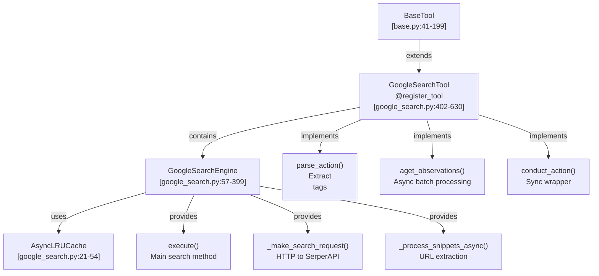

**Sources:** [verl_tool/servers/tools/google_search.py:1-630](), [verl_tool/servers/tools/base.py:41-199]()

### GoogleSearchEngine Core Components

The `GoogleSearchEngine` class ([google_search.py:57-399]()) implements the core search functionality with configurable behavior:

| Parameter | Default | Purpose |
|-----------|---------|---------|
| `api_key` | `$SERPER_API_KEY` | Serper API authentication |
| `max_results` | 10 | Number of search results to return |
| `result_length` | 1000 | Max characters per result snippet |
| `location` | "us" | Geographic location for search |
| `language` | "en" | Search result language |
| `process_snippets` | False | Enable full webpage extraction |
| `summ_model_url` | None | URL for summarization model |
| `summ_model_path` | None | Model path for summarization |
| `cache_size` | 10000 | Max entries in memory cache |
| `cache_ttl` | 3600 | Cache time-to-live (seconds) |

**Sources:** [verl_tool/servers/tools/google_search.py:62-76]()

### Two-Tier Caching System

The search engine implements a sophisticated two-tier caching mechanism to minimize API costs and improve response times:

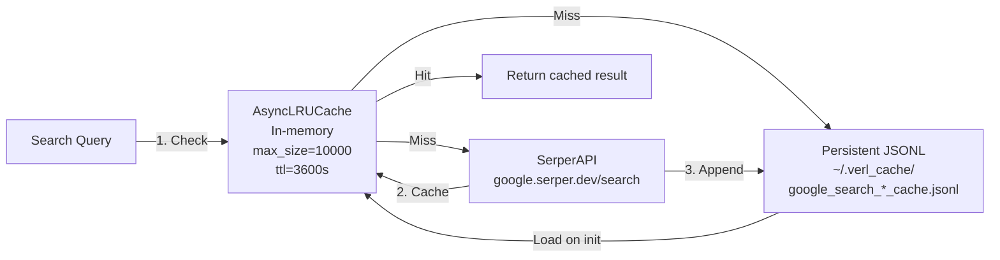

**Tier 1: AsyncLRUCache** ([google_search.py:21-54]()):
- Thread-safe LRU cache with asyncio locks
- Ordered dictionary for O(1) access and eviction
- Timestamp-based TTL validation
- Move-to-end semantics for LRU ordering

**Tier 2: Persistent JSONL** ([google_search.py:96-138]()):
- File path: `~/.verl_cache/google_search_{suffix}_cache.jsonl`
- Suffix: `with_summ` if `process_snippets=True`, else `basic`
- Async file I/O using `aiofiles`
- Loaded on initialization, appended on each new search
- Each line: `{"query": "...", "result": "...", "timestamp": 1234567890}`

**Cache Strategy:**
1. Check memory cache ([google_search.py:234-240]())
2. If miss and `process_snippets=True`, deserialize cached data and reprocess ([google_search.py:237-240]())
3. If still miss, make API request ([google_search.py:243]())
4. Cache in both memory and persistent storage ([google_search.py:249]())

**Sources:** [verl_tool/servers/tools/google_search.py:21-138](), [verl_tool/servers/tools/google_search.py:234-276]()

### Snippet Processing Pipeline

When `process_snippets=True`, the engine performs full webpage content extraction and optional summarization:

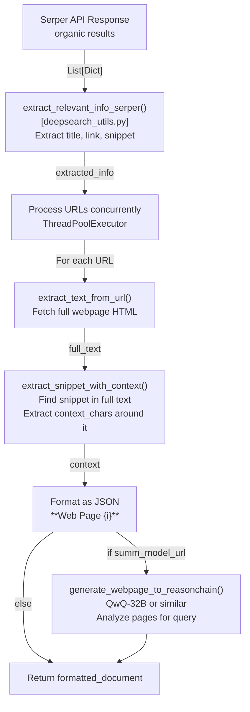

**Concurrent Processing** ([google_search.py:310-353]()):
```python
# Create tasks for all URLs
processing_tasks = []
for info in extracted_info:
    task = self._process_single_url(info, max_doc_len)
    processing_tasks.append(task)

# Wait for all URL processing to complete
processed_info = await asyncio.gather(*processing_tasks, return_exceptions=True)
```

**Snippet Extraction** ([google_search.py:355-378]()):
- Fetches full webpage content
- Locates original snippet in full text
- Extracts `context_chars` (default `max_doc_len`) surrounding snippet
- Falls back to first N chars if snippet not found

**Summarization** ([google_search.py:346-353]()):
- Only when `summ_model_url` and `summ_model_path` are set
- Uses `generate_webpage_to_reasonchain()` from [web_agent_utils.py:168-179]()
- Sends previous reasoning steps, current query, and webpage content
- Returns extracted information relevant to query

**Sources:** [verl_tool/servers/tools/google_search.py:310-399](), [verl_tool/servers/tools/utils/web_agent_utils.py:55-179](), [verl_tool/servers/tools/utils/deepsearch_utils.py]()

### Language Detection and Localization

The engine performs automatic language detection to optimize search results:

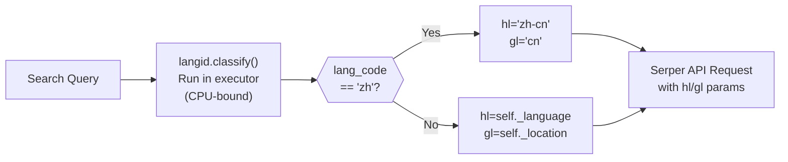

**Implementation** ([google_search.py:140-156]()):
- Uses `langid` library for language classification
- Runs in thread pool executor to avoid blocking async event loop
- Sets `hl` (host language) and `gl` (geographic location) parameters
- Falls back to default `self._language` and `self._location` on error

**Sources:** [verl_tool/servers/tools/google_search.py:140-156]()

### HTTP Request Handling and Retry Logic

The search engine implements robust HTTP request handling with exponential backoff:

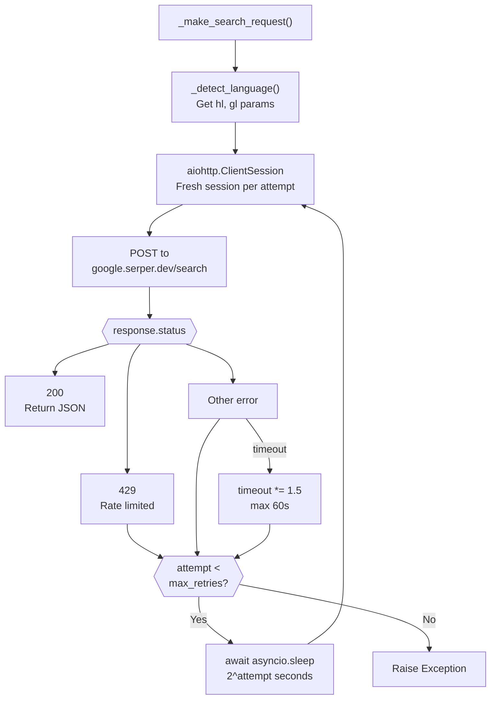

**Key Features** ([google_search.py:158-218]()):
- Creates fresh `aiohttp.ClientSession` per attempt (simplifies connection management)
- Max 2 retries (`max_retries = 2`)
- Exponential backoff: `2^attempt` seconds for rate limit (429)
- Timeout increase: `timeout *= 1.5` up to 60s for timeout errors
- Default timeout: 30 seconds

**Headers** ([google_search.py:171-177]()):
```python
headers = {
    'X-API-KEY': self._api_key,
    'Content-Type': 'application/json',
    'User-Agent': 'AsyncSearchEngine/2.0',
    'Accept': 'application/json',
    'Accept-Encoding': 'gzip, deflate'
}
```

**Sources:** [verl_tool/servers/tools/google_search.py:158-218]()

### Async Batch Processing

The `GoogleSearchTool` class provides async batch processing for concurrent search execution:

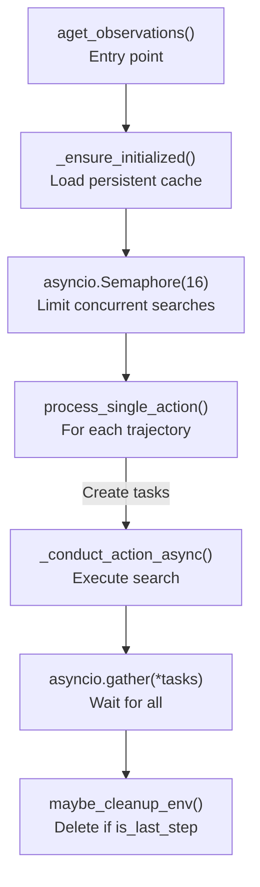

**Implementation** ([google_search.py:490-535]()):
- Lazy initialization with `_ensure_initialized()` for cache loading
- Semaphore limits to 16 concurrent searches
- Uses `asyncio.gather()` with `return_exceptions=True` for fault tolerance
- Each search wrapped in semaphore context manager
- Returns `(observations, dones, valids)` tuples

**Synchronous Wrapper** ([google_search.py:580-630]()):
The `conduct_action()` method provides a synchronous interface by:
1. Attempting to use current event loop if not running
2. Creating new thread with fresh event loop if current loop is running
3. 60-second timeout for search operations
4. Fallback to `asyncio.run()` if no event loop exists

**Sources:** [verl_tool/servers/tools/google_search.py:490-630]()

---

## SearchRetrievalTool

The `SearchRetrievalTool` provides integration with external retrieval services, compatible with Search-R1 functionality for dense retrieval over pre-indexed document collections.

### Architecture and Tag Parsing

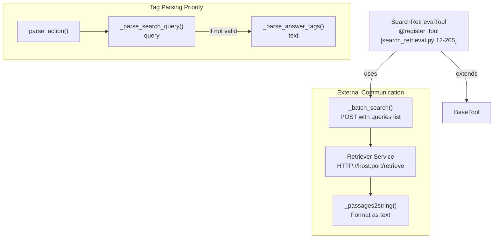

**Configuration** ([search_retrieval.py:16-22]()):
| Parameter | Default | Environment Variable | Purpose |
|-----------|---------|---------------------|---------|
| `retriever_url` | `http://127.0.0.1:8000/retrieve` | `RETRIEVER_URL` | Retrieval service endpoint |
| `topk` | 3 | `RETRIEVER_TOPK` | Number of documents to retrieve |

**Sources:** [verl_tool/servers/tools/search_retrieval.py:12-22]()

### Tag Parsing Logic

The tool implements a two-tier parsing strategy with priority handling:

**Priority 1: Search Tags** ([search_retrieval.py:27-48]()):
```python
# Extract search query from <search>query</search> tags
if "</search>" in action:
    search_matches = re.findall(r"<search>(.*?)</search>", action, re.DOTALL)
    if len(search_matches) > 0:
        query = search_matches[-1].strip()  # Use last match
        return query, True
```

**Priority 2: Answer Tags** ([search_retrieval.py:50-69]()):
```python
# Check for finish condition (</answer> tag)
if "</answer>" in action:
    answer_matches = re.findall(r"<answer>(.*?)</answer>", action, re.DOTALL)
    if len(answer_matches) > 0:
        final_answer = answer_matches[-1].strip()
        return final_answer, True
```

**Action Priority Method** ([search_retrieval.py:95-114]()):
- Returns priority `100` for actions containing `</search>` tags
- Returns priority `0` for valid answer tags
- Returns `-1` for invalid actions
- This high priority ensures search retrieval is preferred over other tools for search tags

**Sources:** [verl_tool/servers/tools/search_retrieval.py:27-114]()

### Retrieval Service Integration

The tool communicates with external retrieval services using a standard HTTP API:

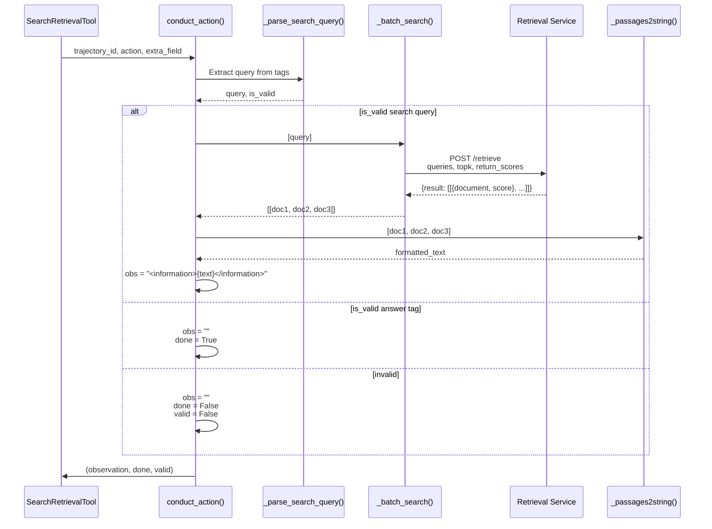

**Batch Search Implementation** ([search_retrieval.py:168-187]()):
```python
def _batch_search(self, queries: List[str]) -> List[List[Dict]]:
    payload = {
        "queries": queries,
        "topk": self.topk,
        "return_scores": True
    }
    
    response = requests.post(self.retriever_url, json=payload, timeout=30)
    response.raise_for_status()
    result = response.json()
    return result['result']
```

**Result Formatting** ([search_retrieval.py:189-205]()):
- Extracts document contents from response
- Parses title (first line) and text (remaining lines)
- Formats as: `Doc {idx}(Title: {title}) {text}\n`
- Returns concatenated string of all documents

**Sources:** [verl_tool/servers/tools/search_retrieval.py:116-205]()

### Search-R1 Compatibility

The tool is designed to be compatible with the Search-R1 framework:

**Tag Format:**
- Input: `<search>query</search>` for queries
- Input: `<answer>final answer</answer>` for completion
- Output: `<information>retrieved docs</information>` for results

**Behavior:**
- Search actions set `done=False` to continue trajectory
- Answer actions set `done=True` to end trajectory
- Invalid actions set `valid=False` but don't end trajectory

**Environment State** ([search_retrieval.py:163-164]()):
- Stores parsed query in environment
- Records execution result (formatted documents)
- Maintains turn count and history

**Sources:** [verl_tool/servers/tools/search_retrieval.py:1-205](), [examples/train/deepsearch/README.md:1-63]()

---

## Integration with Agent Loop

Search and retrieval tools integrate with the agent loop through the tool server architecture:

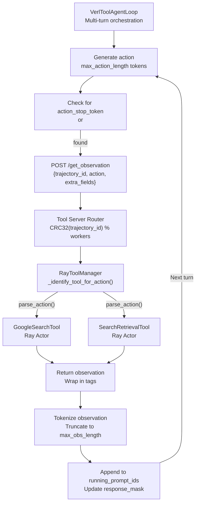

**Tool Identification** ([ray_utils.py:133-175]()):
- `RayToolManager._identify_tool_for_action()` determines which tool handles action
- Calls `parse_action()` on each registered tool
- Returns first tool with `valid=True` response
- Priority mechanism via `get_action_priority()` for ambiguous cases

**Action Stop Tokens:**
Configuration in training scripts ([train_8b.sh:24]()):
```bash
action_stop_tokens='</python>,</search>'
```

This tells the agent loop to pause generation when encountering `</python>` or `</search>` tags, enabling tool interaction.

**Observation Processing:**
1. Tool returns observation wrapped in `<result>...</result>` tags ([google_search.py:572]())
2. Agent loop tokenizes observation
3. Truncates to `max_obs_length` if necessary (default 4096)
4. Appends to `running_prompt_ids` for next turn
5. Updates `response_mask` to 0 for observation tokens if `mask_observations=True`

**Sources:** [verl_tool/servers/ray_utils.py:133-175](), [verl_tool/servers/tools/google_search.py:537-578](), [examples/train/deepsearch/train_8b.sh:1-152]()

---

## Configuration and Usage

### Environment Variables

Required environment variables for search tools:

| Variable | Tool | Purpose | Example |
|----------|------|---------|---------|
| `SERPER_API_KEY` | GoogleSearchTool | Authentication for Serper API | `"your_api_key_here"` |
| `RETRIEVER_URL` | SearchRetrievalTool | Retrieval service endpoint | `"http://127.0.0.1:8000/retrieve"` |
| `RETRIEVER_TOPK` | SearchRetrievalTool | Number of documents to retrieve | `"3"` |

**GoogleSearchTool Initialization** ([google_search.py:410-453]()):
```python
# API key from environment if not provided
if api_key is None:
    api_key = os.getenv('SERPER_API_KEY')
    if api_key is None:
        raise ValueError("API key required: set SERPER_API_KEY...")
```

**Sources:** [verl_tool/servers/tools/google_search.py:410-453](), [verl_tool/servers/tools/search_retrieval.py:16-22]()

### Tool Server Setup

Starting the tool server with search tools:

```bash
# Set API key
export SERPER_API_KEY="your_key_here"

# Start tool server
host=$(hostname -i | awk '{print $1}')
port=$(shuf -i 30000-31000 -n 1)
tool_server_url=http://$host:$port/get_observation

python -m verl_tool.servers.serve \
    --host $host \
    --port $port \
    --tool_type "google_search,ipython_code" \
    --workers_per_tool 512 \
    --use_ray True &
```

**Configuration Parameters:**
- `--tool_type`: Comma-separated list of tools to load
- `--workers_per_tool`: Ray max_concurrency per tool (affects parallelism)
- `--use_ray`: Enable Ray-based distributed execution

For DeepSearch tasks with snippet processing ([README.md:36-56]()):
1. Start summarization model:
   ```bash
   CUDA_VISIBLE_DEVICES=4,5,6,7 vllm serve Qwen/QwQ-32B \
     --dtype auto --api-key "EMPTY" --enforce-eager \
     --no-enable-prefix-caching -tp 4
   ```

2. Modify `GoogleSearchTool` initialization in [google_search.py:410-428]():
   ```python
   process_snippets: bool = True,
   summ_model_url: str = "http://0.0.0.0:8000/v1",
   summ_model_path: str = "Qwen/QwQ-32B"
   ```

**Sources:** [examples/train/deepsearch/train_8b.sh:61-67](), [examples/train/deepsearch/README.md:1-63]()

### Training Configuration

Key configuration parameters for search-based training:

```yaml
# Agent configuration
actor_rollout_ref:
  agent:
    enable_agent: True
    tool_server_url: "http://host:port/get_observation"
    max_turns: 5
    max_action_length: 8196
    max_obs_length: 4096
    action_stop_tokens: "</python>,</search>"
    mask_observations: True

# Rollout configuration  
  rollout:
    temperature: 1.0  # Training exploration
    top_p: 1.0
    n: 16  # Multiple samples per prompt

# Reward configuration
reward_model:
  reward_manager: "deepsearch"  # DeepSearchRewardManager
```

**Action Stop Tokens File** ([train_8b.sh:53-59]()):
```bash
# Create temporary file for action tokens
action_stop_tokens_file="$(pwd)$(mktemp)"
echo -e -n "$action_stop_tokens" | tee $action_stop_tokens_file
# Pass to config
actor_rollout_ref.agent.action_stop_tokens=$action_stop_tokens_file
```

This is necessary because Hydra cannot directly parse special characters in config strings.

**Sources:** [examples/train/deepsearch/train_8b.sh:1-152](), [examples/train/deepsearch/eval.sh:1-161]()

### Cache Management

**Downloading Pre-existing Cache** ([README.md:6-9]()):
```bash
# Download Serper cache to save API costs
huggingface-cli download VerlTool/deepsearch \
    google_search_cache.jsonl \
    --local-dir ~/.verl_cache \
    --repo-type dataset
```

**Cache File Locations:**
- Basic mode: `~/.verl_cache/google_search_basic_cache.jsonl`
- Snippet mode: `~/.verl_cache/google_search_with_summ_cache.jsonl`

**Cache Behavior:**
- Loaded asynchronously on first search ([google_search.py:107-124]())
- Appended after each new search ([google_search.py:129-138]())
- TTL-based expiration in memory cache (default 3600s)
- LRU eviction when size exceeds `cache_size` (default 10000)

**Sources:** [examples/train/deepsearch/README.md:1-63](), [verl_tool/servers/tools/google_search.py:96-138]()

---

## Performance Optimization

### Concurrent Search Execution

The search tools implement several strategies for concurrent execution:

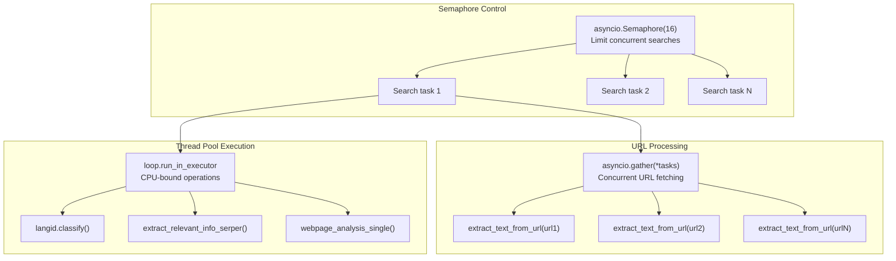

**Semaphore Limiting** ([google_search.py:458]()):
- `self.semaphore = asyncio.Semaphore(16)`
- Prevents overwhelming the API with too many concurrent requests
- Ensures reasonable memory usage during batch processing

**URL Processing** ([google_search.py:322-328]()):
```python
processing_tasks = []
for info in extracted_info:
    task = self._process_single_url(info, max_doc_len)
    processing_tasks.append(task)

processed_info = await asyncio.gather(*processing_tasks, return_exceptions=True)
```

**Thread Pool for CPU-Bound Work** ([google_search.py:316-319]()):
```python
loop = asyncio.get_event_loop()
extracted_info = await loop.run_in_executor(
    None, extract_relevant_info_serper, data
)
```

This prevents blocking the event loop during:
- Language detection ([google_search.py:144-147]())
- HTML parsing and text extraction
- Summarization model calls ([google_search.py:348-350]())

**Sources:** [verl_tool/servers/tools/google_search.py:310-399](), [verl_tool/servers/tools/google_search.py:458]()

### Ray-Based Distributed Execution

When `use_ray=True`, search tools run as Ray actors with configurable concurrency:

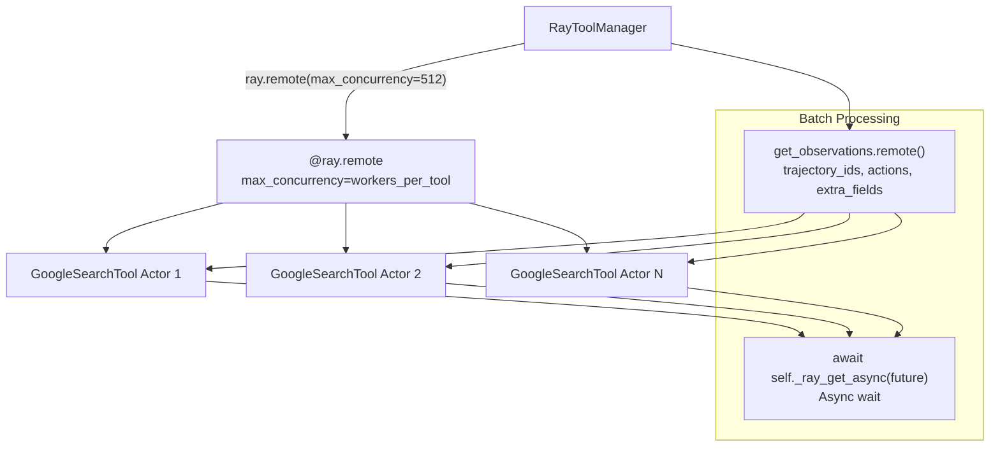

**Ray Actor Creation** ([ray_utils.py:84]()):
```python
tool_instance = ray.remote(max_concurrency=self.config.workers_per_tool)(tool_cls).remote()
```

**Benefits:**
- `max_concurrency=512` allows 512 concurrent search requests per actor
- Ray handles scheduling and load balancing
- Async execution via `_ray_get_async()` ([ray_utils.py:274-293]())

**Warning** ([ray_utils.py:77-78]()):
```python
if self.config.workers_per_tool <= os.cpu_count() * 2:
    logger.warning(f"You are using ray with workers_per_tool={self.config.workers_per_tool} 
                    which is less than or equal to 2x CPU cores...")
```

For high throughput, set `workers_per_tool` to at least 2x CPU cores, ideally 512+ for search workloads.

**Sources:** [verl_tool/servers/ray_utils.py:68-104](), [verl_tool/servers/ray_utils.py:274-293]()

### Timeout and Retry Logic

The search engine implements comprehensive error handling:

**Request-Level Retries** ([google_search.py:183-218]()):
- Max 2 retries per request
- Exponential backoff: `await asyncio.sleep(2 ** attempt)` for rate limits
- Timeout increase: `timeout *= 1.5` up to 60s maximum
- Fresh session per attempt to avoid connection pooling issues

**Search-Level Timeout:**
- Default: `default_timeout` parameter (None = 30s)
- Configurable per request via `extra_field.get('timeout')` ([google_search.py:551]())

**Error Wrapping** ([google_search.py:252-257]()):
```python
except Exception as e:
    if DEBUG:
        raise e
    error_msg = f"Search failed for '{query}': {str(e)}"
    return error_msg
```

When `DEBUG=False` (default), errors are caught and returned as error messages rather than raising exceptions, ensuring training robustness.

**Sources:** [verl_tool/servers/tools/google_search.py:183-257]()

### Memory and Cache Optimization

**Memory Cache Management:**

| Metric | Value | Rationale |
|--------|-------|-----------|
| Max size | 10,000 entries | Balances memory vs. hit rate |
| TTL | 3600s (1 hour) | Search results remain relevant |
| Eviction | LRU | Most recent queries cached |

**Persistent Cache Benefits:**
1. Survives server restarts
2. Shared across training runs
3. Reduces API costs significantly
4. Can be pre-populated from HuggingFace Hub

**Trade-offs:**

**Snippet Processing Disabled** (Training):
- Faster execution (~100ms per search)
- Lower API costs (only Serper, no webpage fetching)
- Smaller observations (≤1000 chars per result)
- Lower validation scores (snippets limited to 128 chars)

**Snippet Processing Enabled** (Evaluation):
- Slower execution (~2-5s per search with URL fetching)
- Full webpage content (up to `max_doc_len=3000` chars)
- Higher accuracy (more context available)
- Optional summarization for even better relevance

**Recommendation** ([README.md:30]()):
> "Therefore, we set `process_snippets: bool = False` during the RL training and only bring it on during the evaluation."

**Sources:** [verl_tool/servers/tools/google_search.py:21-54](), [examples/train/deepsearch/README.md:30]()

---

## Testing and Debugging

### Tool Server Testing

Test individual tools before full training:

```bash
# Start tool server
export SERPER_API_KEY="your_key"
python -m verl_tool.servers.serve \
    --host localhost --port 5000 \
    --tool_type google_search \
    --workers_per_tool 4 \
    --use_ray True &

# Test GoogleSearchTool
python -m verl_tool.servers.tests.test_google_search_tool \
    test_google_search \
    --url=http://localhost:5000/get_observation
```

**Test Parameters:**
- Creates mock trajectory IDs
- Sends various query formats
- Validates observation format
- Checks `done` and `valid` flags

**Sources:** [examples/train/deepsearch/README.md:11-24]()

### Debug Mode

Enable detailed logging by setting `DEBUG=True` at the top of [google_search.py:19]():

```python
DEBUG = True  # Enables exception raising instead of catching
```

When enabled:
- Exceptions are raised instead of returned as error messages
- Full stack traces visible for debugging
- Useful for development, disable for production training

**Sources:** [verl_tool/servers/tools/google_search.py:19]()

### Common Issues and Solutions

| Issue | Symptom | Solution |
|-------|---------|----------|
| API key not found | `ValueError: API key required` | Set `export SERPER_API_KEY="..."` |
| Rate limiting | `Rate limited after 2 retries` | Reduce concurrent searches or upgrade API plan |
| Connection timeouts | `Request timed out` | Increase `default_timeout` parameter |
| Low cache hit rate | High API costs | Pre-download cache from HuggingFace |
| OOM during rollout | Ray/vLLM crashes | Lower `gpu_memory_utilization` to 0.4-0.5 |
| Slow evaluation | Long wait times | Disable `process_snippets` or remove summarization |

**Sources:** [verl_tool/servers/tools/google_search.py:434-438](), [examples/train/deepsearch/README.md:1-63]()

---

