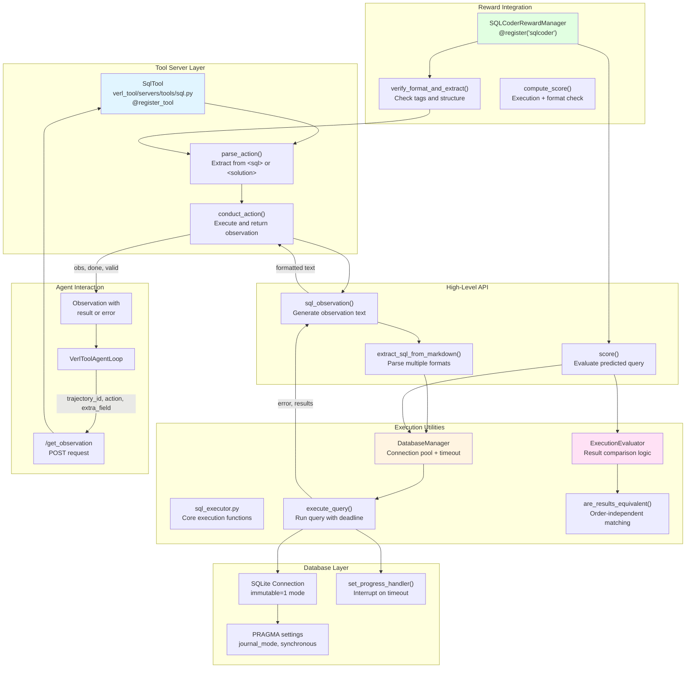
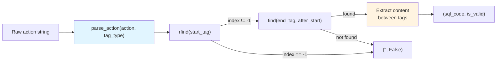
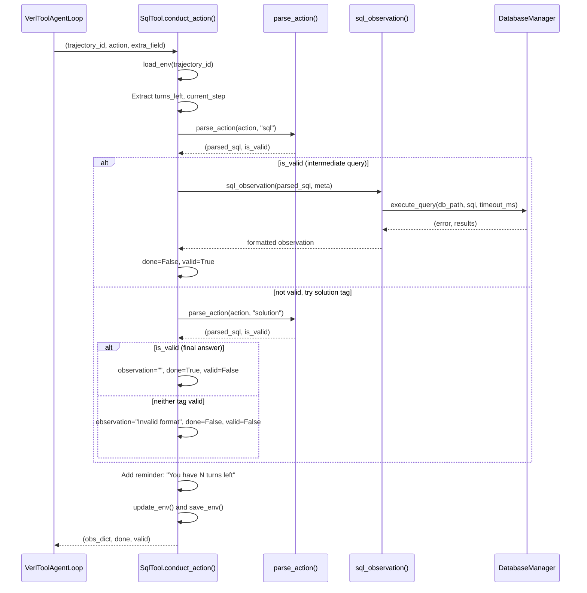
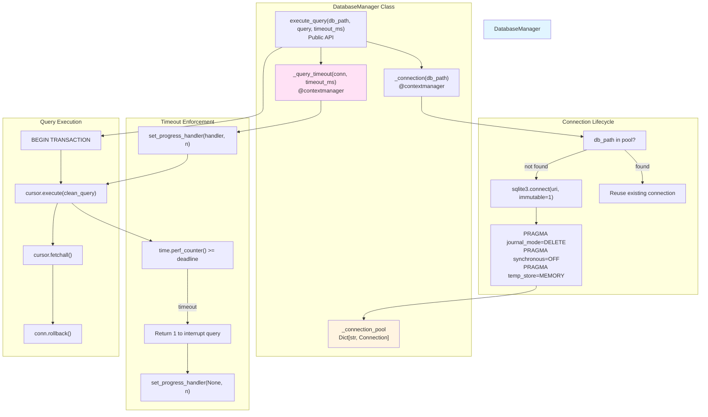
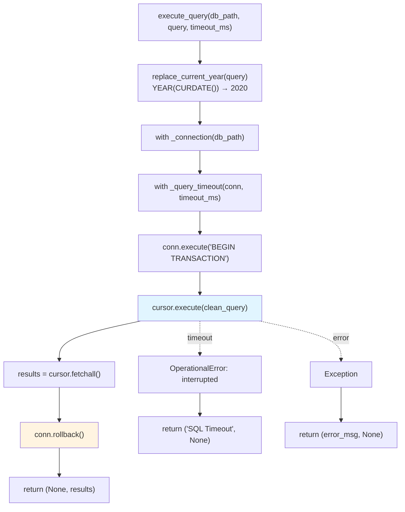
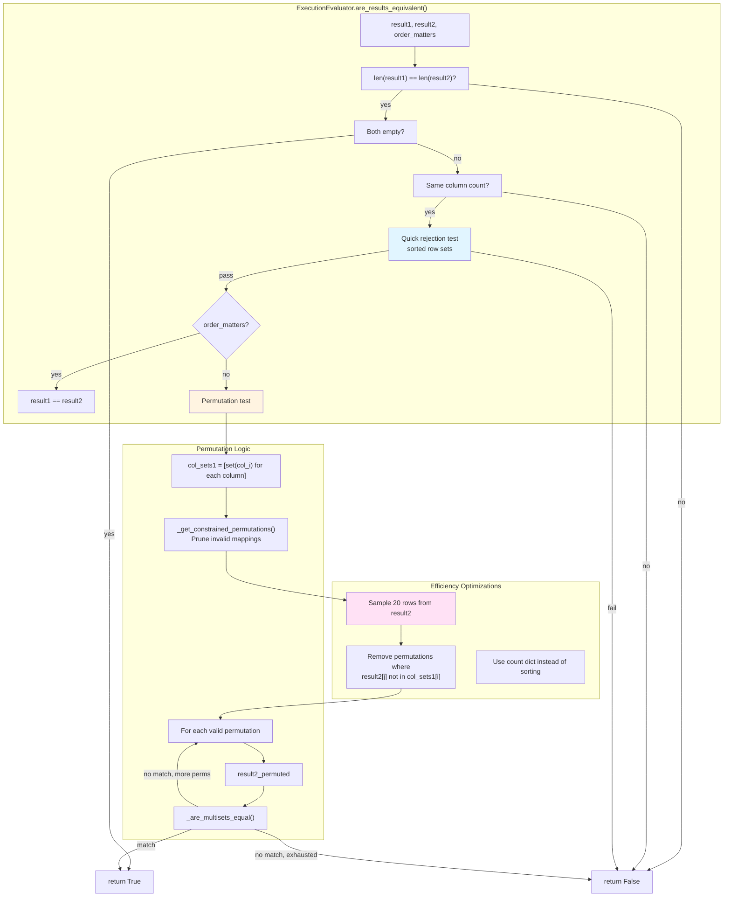
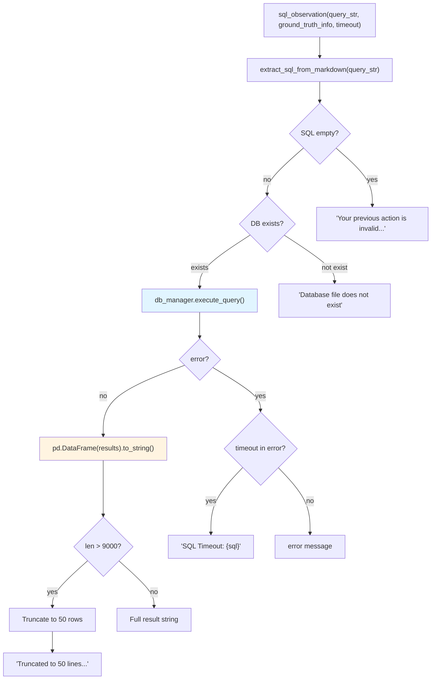
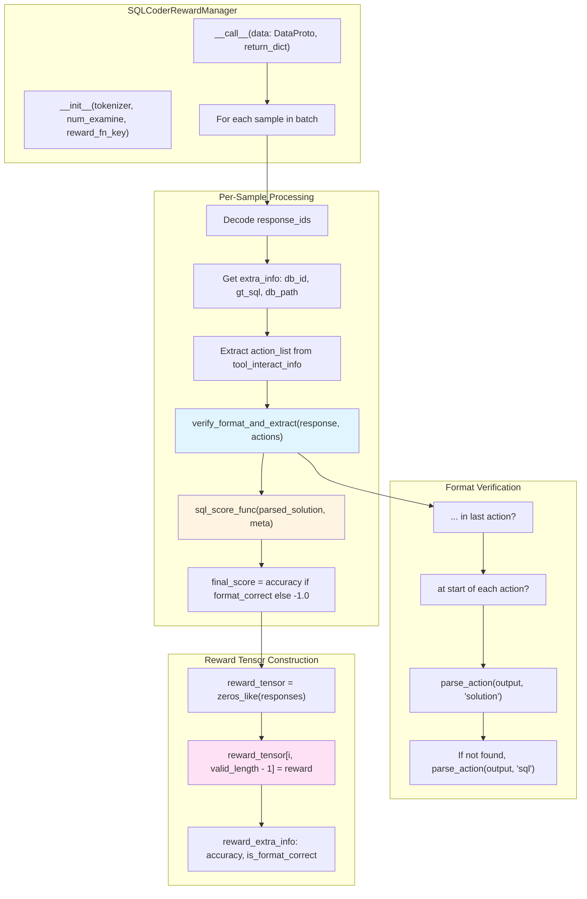

<!-- source: DeepWiki mcp.deepwiki.com · repo TIGER-AI-Lab/verl-tool · page 4.4 SQL Database Tools · fetched 2026-10-30 -->

# SQL Database Tools

<details>
<summary>Relevant source files</summary>

The following files were used as context for generating this wiki page:

- [verl_tool/servers/tools/sql.py](verl_tool/servers/tools/sql.py)
- [verl_tool/servers/tools/utils/sql_executor.py](verl_tool/servers/tools/utils/sql_executor.py)
- [verl_tool/workers/reward_manager/sqlcoder.py](verl_tool/workers/reward_manager/sqlcoder.py)

</details>


## Purpose and Scope

This document describes the SQL database tool implementation in VerlTool, which enables agents to execute SQLite queries as part of multi-turn interactions. The system provides sandboxed SQL execution with timeout control, result comparison for evaluation, and integration with the reward system for NL2SQL training tasks.

For SQL-specific training recipes and dataset preparation, see [NL2SQL Database Query Training](#5.5). For the general tool server architecture and routing, see [Tool Server Architecture](#3). For reward computation logic, see [SQL Reward Manager](#6.3).

## System Architecture Overview

The SQL tool system consists of three main components: (1) `SqlTool` class that implements the tool interface and action parsing, (2) `DatabaseManager` for safe query execution with connection pooling and timeouts, and (3) `ExecutionEvaluator` for comparing query results to ground truth. These components work together to provide reliable SQL execution during both training rollouts and evaluation.



**Diagram: SQL Tool System Architecture** - Shows the complete flow from agent interaction through tool execution to reward evaluation, with all key classes and functions mapped to their file locations.

Sources: [verl_tool/servers/tools/sql.py](), [verl_tool/servers/tools/utils/sql_executor.py](), [verl_tool/workers/reward_manager/sqlcoder.py]()

## SqlTool Class

### Tool Registration and Configuration

`SqlTool` is registered via the `@register_tool` decorator and extends `BaseTool`. The class defines SQL-specific stop tokens and configuration parameters for controlling execution behavior.

[verl_tool/servers/tools/sql.py:34-43]()

| Configuration | Default Value | Purpose |
|---------------|---------------|---------|
| `tool_type` | `"sql"` | Tool identifier in registry |
| `timeout` | `5` seconds | Maximum execution time per query |
| `stop_tokens` | `["```output", "<output>", "<tool_call>", "<observation>", "</sql>"]` | Tokens that terminate generation |
| `enable_history_code_execution` | `False` | SQL doesn't maintain execution history |
| `force_run_test_cases` | `False` | Test case execution handled by reward manager |
| `done_without_error` | `False` | Done status requires explicit tags |

Sources: [verl_tool/servers/tools/sql.py:34-43]()

### Action Parsing with Dual Tag Support

`SqlTool` supports two tag types for different interaction modes: `<sql></sql>` for intermediate verification queries and `<solution></solution>` for final answer submission. The `parse_action()` method extracts SQL code from the last occurrence of the specified tag type.



**Diagram: SQL Action Parsing Logic** - Extracts SQL from tags using last-occurrence matching to handle cases where tags appear in agent's reasoning.

The implementation searches backwards for the start tag and forwards for the end tag to handle multi-occurrence scenarios:

[verl_tool/servers/tools/sql.py:47-82]()

**Tag Type Behavior**:
- **`<sql>` tags**: Indicate intermediate query for exploration. Returns observation to agent for continued reasoning.
- **`<solution>` tags**: Signal final answer submission. Sets `done=True` and terminates trajectory for reward evaluation.

Sources: [verl_tool/servers/tools/sql.py:47-82]()

### Conduct Action Pipeline

The `conduct_action()` method orchestrates the complete execution flow, handling tag parsing, query execution, error management, and turn tracking.



**Diagram: SqlTool Conduct Action Sequence** - Shows the complete flow including dual tag parsing, execution, and state management.

[verl_tool/servers/tools/sql.py:85-188]()

**Key Implementation Details**:

1. **Turn Tracking**: Extracts `turns_left`, `current_step`, and `max_turns` from `extra_field` to provide context-aware reminders.

2. **Tag Priority**: First attempts `<sql>` parsing for intermediate queries. Falls back to `<solution>` parsing if invalid.

3. **Done Flag Logic**:
   - `<sql>` tag: `done=False` (continue interaction)
   - `<solution>` tag: `done=True` (end trajectory, defer to reward manager)
   - No valid tag: `done=False`, `valid=False` (error state)

4. **Observation Formatting**: Wraps results in `<observation>` tags with turn reminder:
   ```
   <observation>
   {query results or error message}
   <reminder>You have {turns_left} turns left to complete the task.</reminder>
   </observation>
   ```

5. **Return Structure**: Returns dictionary with both formatted observation and parsed SQL:
   ```python
   {
       "obs": formatted_observation_text,
       "parsed_sql": extracted_sql_code
   }
   ```

Sources: [verl_tool/servers/tools/sql.py:85-188]()

## DatabaseManager: Connection Pooling and Execution

### Connection Pool Design

`DatabaseManager` maintains a connection pool to avoid repeated connection overhead and provides timeout-enforced query execution. Connections are configured for read-only access with performance optimizations.



**Diagram: DatabaseManager Architecture** - Shows connection pooling, timeout mechanism, and transactional safety.

Sources: [verl_tool/servers/tools/utils/sql_executor.py:65-148]()

### Connection Configuration

[verl_tool/servers/tools/utils/sql_executor.py:76-85]()

**Connection URI Parameters**:
- `immutable=1`: Opens database in read-only mode for safety and performance
- `uri=True`: Enables URI-based connection with query parameters
- `check_same_thread=False`: Allows connection sharing across threads

**PRAGMA Settings**:
| Setting | Value | Purpose |
|---------|-------|---------|
| `journal_mode` | `DELETE` | Avoid WAL file creation for temporary operations |
| `synchronous` | `OFF` | Skip fsync for read-only access (faster) |
| `temp_store` | `MEMORY` | Store temporary tables in RAM |

Sources: [verl_tool/servers/tools/utils/sql_executor.py:76-85]()

### Timeout Mechanism

The timeout implementation uses SQLite's `set_progress_handler()` to periodically check if the deadline has been exceeded. This provides more reliable timeout enforcement than thread-based approaches.

[verl_tool/servers/tools/utils/sql_executor.py:92-110]()

**Timeout Handler Logic**:
1. Set deadline: `deadline = time.perf_counter() + (timeout_ms / 1000)`
2. Register progress handler: Called every `n_instructions` (100 for short timeouts, 1000 otherwise)
3. Handler returns `1` if deadline exceeded, causing SQLite to raise `OperationalError: interrupted`
4. Context manager ensures handler is cleared after execution

Sources: [verl_tool/servers/tools/utils/sql_executor.py:92-110]()

### Execute Query Flow

[verl_tool/servers/tools/utils/sql_executor.py:112-147]()



**Diagram: Query Execution with Timeout and Rollback** - Shows the complete execution path with error handling.

**Key Design Decisions**:
- **Always Rollback**: Even for SELECT queries, ensures no state leakage or lock contention
- **Transaction Wrapping**: Provides consistent behavior and enables rollback semantics
- **Error Types**: Returns `("SQL Timeout", None)` for timeout vs. `(error_message, None)` for other errors

Sources: [verl_tool/servers/tools/utils/sql_executor.py:112-147]()

## ExecutionEvaluator: Result Comparison

### Order-Independent Result Matching

`ExecutionEvaluator` implements sophisticated result comparison that handles column permutations and order independence, essential for evaluating SQL queries that may return correct data in different arrangements.



**Diagram: Result Comparison Algorithm** - Shows multi-stage matching with optimizations.

Sources: [verl_tool/servers/tools/utils/sql_executor.py:165-246]()

### Comparison Stages

[verl_tool/servers/tools/utils/sql_executor.py:170-212]()

**Stage 1: Quick Checks**
- Length mismatch → immediate rejection
- Empty results → immediate acceptance (both empty)
- Column count mismatch → immediate rejection

**Stage 2: Quick Rejection Test**
- Create sorted-row sets: `{tuple(sorted(row)) for row in result}`
- If sets differ → immediate rejection (values don't match)
- This catches most non-equivalent results efficiently

**Stage 3: Order Sensitivity**
- If `order_matters=True`: Direct list comparison `result1 == result2`
- If `order_matters=False`: Proceed to permutation test

**Stage 4: Permutation Test**
1. Build column value sets: `col_sets1[i] = {row[i] for row in result1}`
2. Generate constrained permutations (see below)
3. For each valid permutation, permute result2's columns
4. Check if `result1` and `permuted_result2` are equal as multisets

Sources: [verl_tool/servers/tools/utils/sql_executor.py:170-212]()

### Permutation Constraint Optimization

[verl_tool/servers/tools/utils/sql_executor.py:228-246]()

For result sets with more than 3 columns, the system uses sampling to prune impossible permutations before testing:

```python
# Sample 20 random rows from result2
sample_size = min(20, len(result2))
for _ in range(sample_size):
    random_row2 = random.choice(result2)
    for i in range(num_cols):
        for j in list(perm_constraints[i]):
            if random_row2[j] not in col_sets1[i]:
                perm_constraints[i].remove(j)  # Invalid mapping
```

This reduces the permutation space from `n!` to a much smaller set by eliminating column mappings that violate value constraints.

Sources: [verl_tool/servers/tools/utils/sql_executor.py:228-246]()

### Multiset Equality Check

[verl_tool/servers/tools/utils/sql_executor.py:214-226]()

The `_are_multisets_equal()` method uses a count-based approach instead of sorting:

```python
counts = defaultdict(int)
for item in list1:
    counts[item] += 1
for item in list2:
    counts[item] -= 1
    if counts[item] < 0:
        return False  # Early exit
return all(v == 0 for v in counts.values())
```

This is more efficient than sorting for large result sets and handles duplicate rows correctly.

Sources: [verl_tool/servers/tools/utils/sql_executor.py:214-226]()

## High-Level API Functions

### score() Function

The `score()` function provides the main API for evaluating predicted SQL queries by executing both the predicted and ground truth queries and comparing results.

[verl_tool/servers/tools/utils/sql_executor.py:250-310]()

**Function Signature**:
```python
def score(
    predicted_query_str: str,
    ground_truth_info: Dict[str, Any]
) -> Tuple[float, str, str]:
    # Returns: (score, pred_results, message)
```

**Ground Truth Info Dictionary**:
| Key | Type | Purpose |
|-----|------|---------|
| `db_path` | str | Path to SQLite database file |
| `db_id` | str | Database identifier (fallback if no path) |
| `gold_sql` / `gt_sql` | str | Ground truth SQL query |
| `cmp_method` | str | Comparison method: `"bird"` or `"spider"` |

**Execution Flow**:
1. **Extract predicted SQL**: Use `extract_sql_from_markdown()` to parse various formats
2. **Execute ground truth**: Run `gold_sql` against database
3. **Execute predicted**: Run extracted SQL against database
4. **Compare results**: Use `ExecutionEvaluator.are_results_equivalent()`
5. **Return score**: `1.0` if match, `0.0` otherwise

**Comparison Methods**:
- `"spider"`: Considers `ORDER BY` clause - if present, order matters
- `"bird"` (default): Always order-independent comparison

Sources: [verl_tool/servers/tools/utils/sql_executor.py:250-310]()

### sql_observation() Function

Generates human-readable observation text from SQL execution results, including error handling and result truncation.

[verl_tool/servers/tools/utils/sql_executor.py:313-364]()



**Diagram: sql_observation() Flow** - Shows result formatting and truncation logic.

**Observation Types**:
1. **Invalid Format**: `"Your previous action is invalid. Follow the format..."`
2. **DB Not Found**: `"The database file {db_path} does not exist."`
3. **Timeout**: `"SQL Timeout:\n{sql}"`
4. **Execution Error**: Error message from exception
5. **Success**: DataFrame formatted as table string
6. **Truncated**: `"Truncated to 50 lines since returned response too long: {df.head(50)}"`

Sources: [verl_tool/servers/tools/utils/sql_executor.py:313-364]()

### extract_sql_from_markdown() Function

Parses SQL from multiple formats with fallback logic to handle various agent output styles.

[verl_tool/servers/tools/utils/sql_executor.py:24-51]()

**Parsing Priority**:
1. **SQL code blocks**: `` ```sql\n...\n``` ``
2. **`<sql>` tags**: `<sql>...</sql>`
3. **`<solution>` tags**: `<solution>...</solution>`
4. **Fallback**: Clean the original text (replace operator spacing)

**Operator Normalization**: All parsing stages apply:
```python
.replace('> =', '>=').replace('< =', '<=').replace('! =', '!=')
```

This handles cases where agents insert spaces in comparison operators.

Sources: [verl_tool/servers/tools/utils/sql_executor.py:24-51]()

## SQLCoder Reward Manager Integration

### Reward Manager Architecture

`SQLCoderRewardManager` integrates with the verl training system to compute rewards based on SQL execution correctness and format compliance.



**Diagram: SQLCoder Reward Manager Flow** - Shows format verification, execution, and sparse reward placement.

Sources: [verl_tool/workers/reward_manager/sqlcoder.py:114-195]()

### Format Verification Logic

[verl_tool/workers/reward_manager/sqlcoder.py:83-109]()

The `verify_format_and_extract()` function checks two format requirements:

**Requirement 1: Solution Tag in Last Action**
```python
if not re.search(rf"{SOLUTION_START}.*?{SOLUTION_END}", output, re.S):
    is_correct_format = False
```

**Requirement 2: Think Tags at Action Start**
```python
for action in action_list:
    if not (action.startswith(THINK_START) and 
            re.search(rf"{THINK_START}.*?{THINK_END}", action, re.S)):
        is_correct_format = False
        break
```

**Extraction Priority**:
1. Try parsing `<solution>` tag
2. If not found, try parsing `<sql>` tag
3. Return `(solution, is_correct_format)`

This allows the reward manager to handle both complete and incomplete trajectories gracefully.

Sources: [verl_tool/workers/reward_manager/sqlcoder.py:83-109]()

### Reward Computation

[verl_tool/workers/reward_manager/sqlcoder.py:144-187]()

**Score Components**:

| Component | Computation | Range |
|-----------|-------------|-------|
| `is_format_correct` | Check tags with `verify_format_and_extract()` | 0.0 or 1.0 |
| `accuracy` | Execute SQL with `sql_score_func()` | 0.0 or 1.0 |
| `score` (final) | `accuracy if is_format_correct else -1.0` | -1.0, 0.0, or 1.0 |

**Reward Placement**:
```python
# Sparse reward at last valid token
reward_tensor[i, valid_response_length_i - 1] = reward
```

**Validation Mode**: When `num_examine == 1` (validation), only returns binary accuracy:
```python
if self.num_examine == 1:
    reward = score["accuracy"]  # 0.0 or 1.0, ignore format penalty
```

This separates training (with format penalty) from evaluation (pure accuracy).

Sources: [verl_tool/workers/reward_manager/sqlcoder.py:144-187]()

### Return Structure

[verl_tool/workers/reward_manager/sqlcoder.py:189-194]()

When `return_dict=True`, the reward manager returns:
```python
{
    "reward_tensor": torch.Tensor,  # Shape: [batch_size, seq_len]
    "reward_extra_info": {
        "score": List[float],           # Final reward value
        "accuracy": List[float],         # Execution correctness
        "is_format_correct": List[float] # Format compliance
    }
}
```

This structure integrates with verl's PPO trainer, which logs `reward_extra_info` metrics to wandb for monitoring.

Sources: [verl_tool/workers/reward_manager/sqlcoder.py:189-194]()

## Usage Example Flow

```mermaid
sequenceDiagram
    participant Agent as Agent (Qwen2.5-Coder)
    participant Loop as VerlToolAgentLoop
    participant Server as Tool Server
    participant SqlTool as SqlTool
    participant DB as DatabaseManager
    participant RM as SQLCoderRewardManager
    
    Note over Agent: Initial prompt with schema
    Loop->>Agent: Generate action (max_action_length=1024)
    Agent-->>Loop: "\n<sql>SELECT COUNT(*) FROM users</sql>"
    
    Loop->>Server: POST /get_observation
    Server->>SqlTool: conduct_action(trajectory_id, action, extra_field)
    SqlTool->>SqlTool: parse_action(action, "sql")
    Note over SqlTool: Extracted: "SELECT COUNT(*) FROM users"
    
    SqlTool->>DB: sql_observation(sql, meta, timeout=5)
    DB->>DB: execute_query("db.sqlite", sql, 5000)
    DB-->>SqlTool: "  0\n150"
    
    SqlTool->>SqlTool: Format observation with reminder
    SqlTool-->>Server: (obs_dict, done=False, valid=True)
    Server-->>Loop: observation
    
    Loop->>Agent: Continue with observation in context
    Agent-->>Loop: "\n<solution>SELECT COUNT(*) FROM users</solution>"
    
    Loop->>Server: POST /get_observation
    Server->>SqlTool: conduct_action(trajectory_id, action, extra_field)
    SqlTool->>SqlTool: parse_action(action, "sql") → invalid
    SqlTool->>SqlTool: parse_action(action, "solution") → valid
    SqlTool-->>Server: (obs_dict, done=True, valid=False)
    
    Note over Loop: Trajectory complete
    Loop->>RM: Compute rewards for batch
    RM->>RM: verify_format_and_extract(response, actions)
    RM->>DB: sql_score_func(solution, meta)
    DB-->>RM: accuracy = 1.0
    RM->>RM: final_score = 1.0 (format correct + accurate)
    RM-->>Loop: reward_tensor with sparse reward at last token
```

**Diagram: Complete SQL Tool Interaction Flow** - Shows multi-turn interaction from agent generation through reward computation.

Sources: [verl_tool/servers/tools/sql.py](), [verl_tool/servers/tools/utils/sql_executor.py](), [verl_tool/workers/reward_manager/sqlcoder.py]()

## Configuration and Environment Variables

### Database Path Resolution

The system supports multiple methods for specifying database paths:

1. **Explicit path in extra_field**: `extra_field['db_path']` takes precedence
2. **Fallback to cache directory**: 
   ```python
   cache_dir = os.getenv('SQL_CACHE_DIR', 'data/nl2sql/cache')
   db_path = os.path.join(cache_dir, extra_info['db_id'])
   ```

Sources: [verl_tool/servers/tools/utils/sql_executor.py:271-274]()

### Timeout Configuration

| Component | Timeout Setting | Default | Configurable |
|-----------|----------------|---------|--------------|
| `SqlTool.timeout` | Class variable | 5 seconds | Yes, in tool definition |
| `sql_observation()` | Function parameter | 5 seconds | Yes, per call |
| `DatabaseManager.execute_query()` | Method parameter | 15 seconds | Yes, per call |

The tool converts seconds to milliseconds for `DatabaseManager`: `timeout_ms = timeout * 1000`

Sources: [verl_tool/servers/tools/sql.py:14](), [verl_tool/servers/tools/utils/sql_executor.py:19]()

### Connection Pool Management

`DatabaseManager` maintains a singleton connection pool per instance. For proper cleanup:

[verl_tool/servers/tools/utils/sql_executor.py:149-160]()

```python
db_manager.close_all_connections()
```

This method:
- Forces WAL checkpoint: `PRAGMA wal_checkpoint(TRUNCATE)`
- Vacuums database: `VACUUM`
- Closes all connections
- Clears connection pool dictionary

Sources: [verl_tool/servers/tools/utils/sql_executor.py:149-160]()

---

