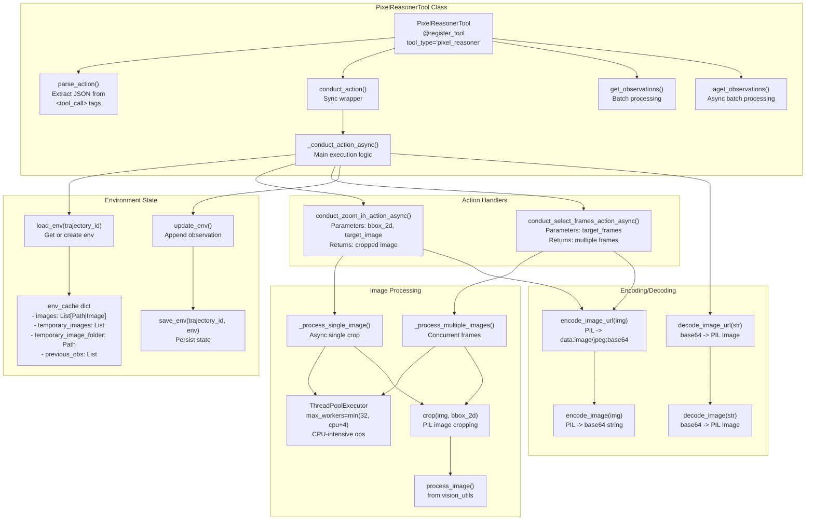
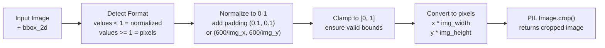
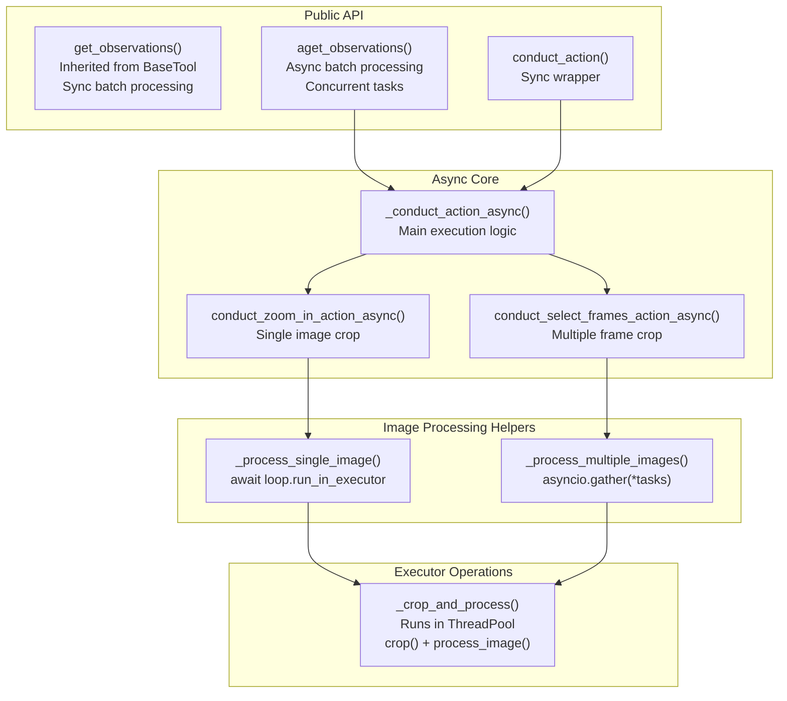
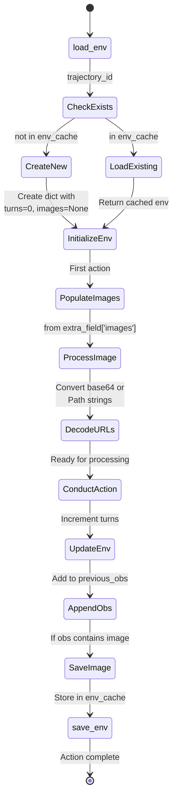
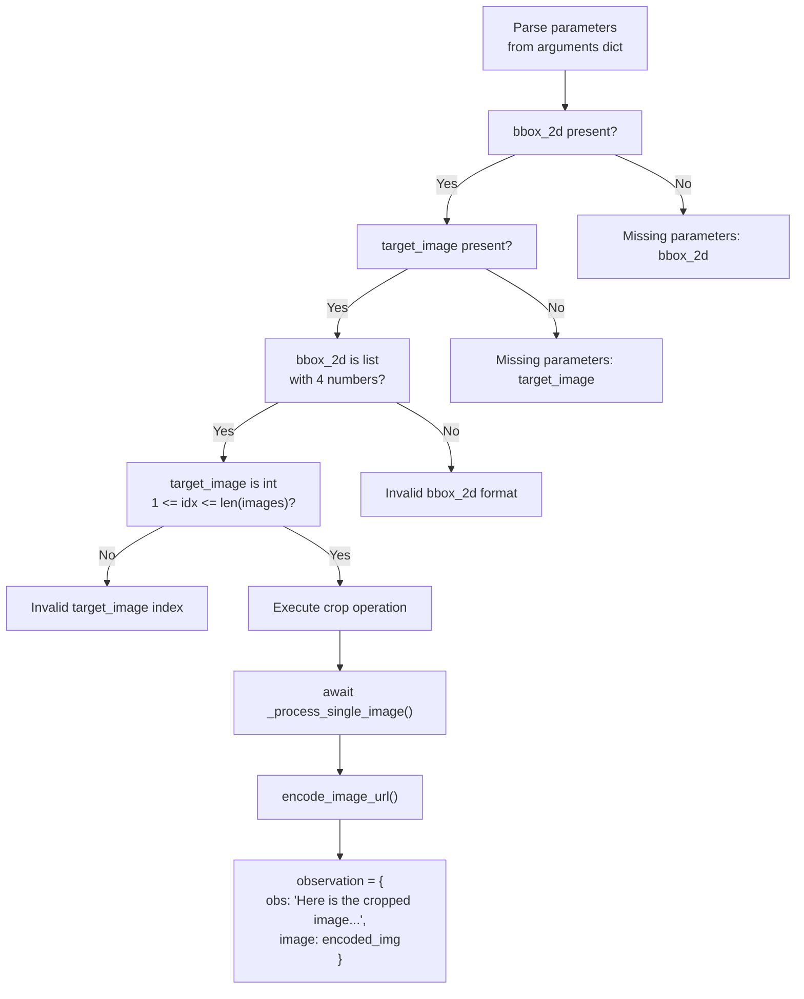
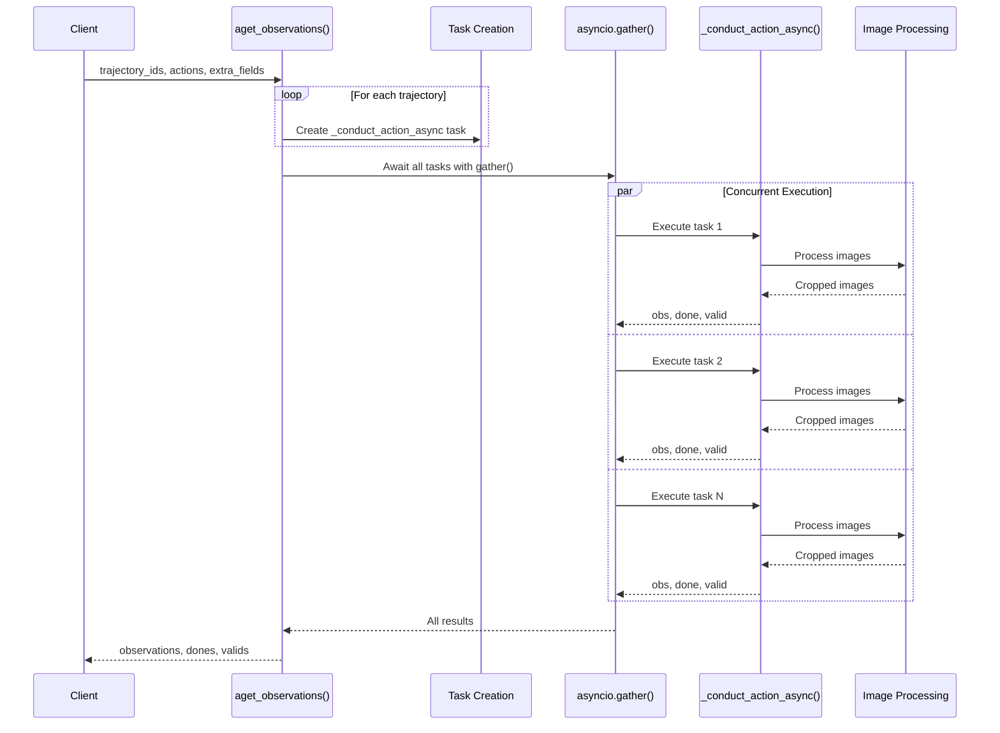
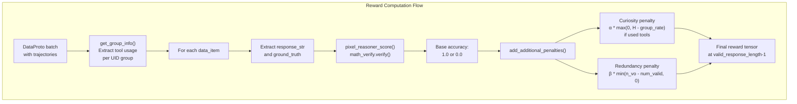
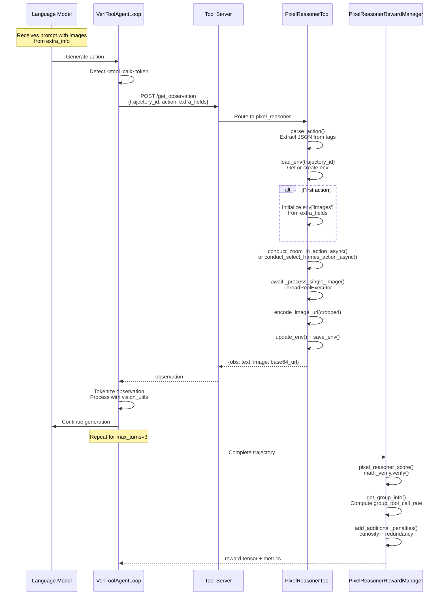

<!-- source: DeepWiki mcp.deepwiki.com · repo TIGER-AI-Lab/verl-tool · page 4.5 Pixel Reasoner Vision Tools · fetched 2026-10-30 -->

# Pixel Reasoner Vision Tools

<details>
<summary>Relevant source files</summary>

The following files were used as context for generating this wiki page:

- [examples/train/pixel_reasoner/train_3b.sh](examples/train/pixel_reasoner/train_3b.sh)
- [examples/train/pixel_reasoner/train_qwen25vl.sh](examples/train/pixel_reasoner/train_qwen25vl.sh)
- [verl_tool/servers/ray_utils.py](verl_tool/servers/ray_utils.py)
- [verl_tool/servers/tools/base.py](verl_tool/servers/tools/base.py)
- [verl_tool/servers/tools/finish.py](verl_tool/servers/tools/finish.py)
- [verl_tool/servers/tools/pixel_reasoner.py](verl_tool/servers/tools/pixel_reasoner.py)
- [verl_tool/servers/tools/search_retrieval.py](verl_tool/servers/tools/search_retrieval.py)
- [verl_tool/workers/reward_manager/pixel_reasoner.py](verl_tool/workers/reward_manager/pixel_reasoner.py)

</details>


## Purpose and Scope

This document covers the **PixelReasonerTool** implementation, which provides vision-based reasoning capabilities for multi-modal language models. The tool enables models to perform image manipulation actions (cropping, frame selection) during multi-turn interactions, supporting tasks that require visual analysis and reasoning.

For training recipes using this tool, see [Pixel-Reasoner Multi-Modal Training](#5.6). For reward computation details, see [Vision Reward Manager](#6.4). For general tool architecture concepts, see [Tool Server Architecture](#3).

**Sources:** [verl_tool/servers/tools/pixel_reasoner.py:1-378](), [examples/train/pixel_reasoner/train_qwen25vl.sh:1-156]()

---

## Architecture Overview

The PixelReasonerTool extends the BaseTool interface to provide asynchronous image processing capabilities optimized for CPU-intensive operations.



**Sources:** [verl_tool/servers/tools/pixel_reasoner.py:76-378](), [verl_tool/servers/tools/base.py:41-199]()

---

## Action Format and Protocol

### Tool Call Structure

PixelReasonerTool expects actions in JSON format wrapped in `<tool_call>` tags:

```json
<tool_call>
{
  "name": "zoom_in",
  "arguments": {
    "bbox_2d": [x1, y1, x2, y2],
    "target_image": 1
  }
}
</tool_call>
```

The tool validates action names against `valid_mcp_func_names`:

| Action Name | Purpose | Parameters |
|-------------|---------|------------|
| `zoom_in` | Crop and zoom into region | `bbox_2d`: list of 4 floats, `target_image`: int (1-indexed) |
| `crop_image_normalized` | Alias for zoom_in | Same as zoom_in |
| `crop_image` | Alias for zoom_in | Same as zoom_in |
| `select_frames` | Select multiple frames | `target_frames`: list of ints (1-indexed) |

### Action Parsing Logic

The `parse_action()` method extracts and validates tool calls:

1. **Extract JSON**: Split on `<tool_call>` and `</tool_call>` tags
2. **Parse JSON**: Load action dictionary
3. **Validate name**: Check against `valid_mcp_func_names`
4. **Return**: Tuple of `(call_dict, is_valid)`

**Sources:** [verl_tool/servers/tools/pixel_reasoner.py:94-113](), [verl_tool/servers/tools/pixel_reasoner.py:80-81]()

---

## Image Processing Pipeline

### Bounding Box Normalization

The `crop()` function handles both normalized (0-1) and pixel coordinates:



Padding logic from [verl_tool/servers/tools/pixel_reasoner.py:30-36]():
- Default padding: `(0.1, 0.1)` of image dimensions
- Minimum padding: `(600.0/img_x, 600.0/img_y)` to ensure at least 600 pixels
- Applied as: `(x - padding, y - padding, x + padding, y + padding)`

### Image Encoding

Three encoding formats are supported:

| Function | Input | Output | Use Case |
|----------|-------|--------|----------|
| `encode_image()` | PIL Image | base64 string | Storage/transmission |
| `encode_image_url()` | PIL Image | `data:image/jpeg;base64,...` | Multimodal LLM input |
| `decode_image()` | base64 string | PIL Image | Restore from storage |
| `decode_image_url()` | data URL | PIL Image | Process LLM output |

RGB conversion is automatic at [verl_tool/servers/tools/pixel_reasoner.py:47-50]():
```python
if img.mode != 'RGB':
    img = img.convert('RGB')
```

**Sources:** [verl_tool/servers/tools/pixel_reasoner.py:15-66](), [verl_tool/servers/tools/pixel_reasoner.py:45-52]()

---

## Asynchronous Processing Architecture

### ThreadPoolExecutor Configuration

PixelReasonerTool uses a dedicated thread pool for CPU-intensive image operations:

```python
self.image_executor = concurrent.futures.ThreadPoolExecutor(
    max_workers=min(32, (os.cpu_count() or 1) + 4),
    thread_name_prefix="image_processor"
)
```

This executor processes crop operations concurrently without blocking the event loop.

### Async Methods



**Concurrency Strategy:**

1. **aget_observations()** [verl_tool/servers/tools/pixel_reasoner.py:267-295](): Creates tasks for all trajectory_ids, executes with `asyncio.gather()`
2. **_process_multiple_images()** [verl_tool/servers/tools/pixel_reasoner.py:177-188](): Processes frames in parallel for select_frames action
3. **_process_single_image()** [verl_tool/servers/tools/pixel_reasoner.py:167-175](): Offloads crop+process to thread pool

**Sources:** [verl_tool/servers/tools/pixel_reasoner.py:83-89](), [verl_tool/servers/tools/pixel_reasoner.py:167-188](), [verl_tool/servers/tools/pixel_reasoner.py:267-295]()

---

## Environment State Management

### Environment Schema

Each trajectory maintains stateful environment in `env_cache`:

```python
env = {
    "trajectory_id": str,
    "metadata": {
        "turns": int  # Incremented on each action
    },
    "previous_obs": [
        {
            "action": dict,  # Parsed action
            "is_valid": bool,
            "observation": dict,  # {obs: str, image: str}
            "extra_field": dict
        }
    ],
    "images": List[Union[Path, Image.Image]],  # Current images
    "temporary_images": List[str],  # Encoded images
    "temporary_image_folder": Path  # tmp/crop_images/{trajectory_id}
}
```

### State Lifecycle



### Image Storage

Images are stored in three locations:

1. **env['images']**: Current set of images (Path or PIL.Image objects)
2. **env['temporary_images']**: Base64-encoded strings added during turns
3. **env['temporary_image_folder']**: Filesystem path for temporary storage

From [verl_tool/servers/tools/pixel_reasoner.py:115-132](), the environment is created on first access:
```python
env = {
    "trajectory_id": trajectory_id,
    "metadata": {"turns": 0},
    "previous_obs": [],
    "images": None,
    "temporary_images": [],
    "temporary_image_folder": Path(f"tmp/crop_images/{trajectory_id}"),
}
env['temporary_image_folder'].mkdir(parents=True, exist_ok=True)
```

**Sources:** [verl_tool/servers/tools/pixel_reasoner.py:115-151](), [verl_tool/servers/tools/pixel_reasoner.py:159-165]()

---

## Action Execution Details

### Zoom In Action

**Parameters Validation:**



Implementation at [verl_tool/servers/tools/pixel_reasoner.py:190-230]():

**Sources:** [verl_tool/servers/tools/pixel_reasoner.py:190-230]()

### Select Frames Action

This action processes multiple images concurrently:

1. **Validate Parameters** [verl_tool/servers/tools/pixel_reasoner.py:238-245]():
   - `target_frames` must be a list
   - Each element must be int in range [1, len(images)]

2. **Concurrent Processing** [verl_tool/servers/tools/pixel_reasoner.py:248-251]():
   ```python
   target_frame_sources = [env['images'][frame - 1] for frame in parameters['target_frames']]
   target_frames = await self._process_multiple_images(target_frame_sources)
   ```

3. **Format Response** [verl_tool/servers/tools/pixel_reasoner.py:253-258]():
   ```python
   observation = {
       'obs': f"Here are the selected frames. (Frame Size: {w}x{h}, Numbered 1 to {n}):" + "<image>" * len(frames),
       'image': [encode_image_url(img) for img in target_frames]
   }
   ```

The `<image>` tokens are repeated to indicate multiple images for the multimodal LLM.

**Sources:** [verl_tool/servers/tools/pixel_reasoner.py:232-265]()

---

## Batch Processing Flow

### Synchronous vs Asynchronous Modes

The tool supports both modes through the BaseTool interface:

| Method | Mode | Use Case |
|--------|------|----------|
| `get_observations()` | Sync | Inherited from BaseTool, uses ThreadPoolExecutor for batches |
| `aget_observations()` | Async | Custom implementation for optimal concurrency |
| `conduct_action()` | Sync | Single action, wraps async with event loop |

### Async Batch Processing

From [verl_tool/servers/tools/pixel_reasoner.py:267-295]():



Exception handling wraps results at [verl_tool/servers/tools/pixel_reasoner.py:284-293]():
```python
results = await asyncio.gather(*tasks, return_exceptions=True)
for result in results:
    if isinstance(result, Exception):
        observations.append(f"Processing error: {str(result)}")
        dones.append(False)
        valids.append(False)
```

**Sources:** [verl_tool/servers/tools/pixel_reasoner.py:267-295](), [verl_tool/servers/tools/pixel_reasoner.py:297-340]()

---

## Integration with Training System

### Tool Server Launch

From training scripts [examples/train/pixel_reasoner/train_qwen25vl.sh:61-68]():

```bash
host=$(hostname -i | awk '{print $1}')
port=$(shuf -i 30000-31000 -n 1)
tool_server_url=http://$host:$port/get_observation
python -m verl_tool.servers.serve \
    --host $host \
    --port $port \
    --tool_type "pixel_reasoner" \
    --workers_per_tool 4 &
```

### Agent Configuration

Key parameters for vision tasks:

| Parameter | Value | Reason |
|-----------|-------|--------|
| `max_prompt_length` | 16384 | Large enough for image tokens |
| `max_response_length` | 16384 | Accommodates multi-turn responses |
| `max_obs_length` | 8192 | Large for image observations |
| `action_stop_tokens` | `</tool_call>` | Matches JSON format |
| `max_turns` | 2-3 | Multiple image operations |
| `mask_observations` | True | Exclude obs from gradients |
| `enable_mtrl` | True | Multi-turn RL |

### Data Format

Training data must include `images` in `extra_info`:

```python
data_item = {
    "prompt": [...],  # Conversation history
    "extra_info": {
        "images": [
            "data:image/jpeg;base64,...",  # Base64 URLs
            # or
            "path/to/image.jpg"  # File paths
        ],
        "ground_truth": "answer"
    }
}
```

Images are decoded in `_conduct_action_async()` at [verl_tool/servers/tools/pixel_reasoner.py:303-304]():
```python
if env['images'] is None:
    env['images'] = [Path(x) if not x.startswith("data:image") else decode_image_url(x) for x in extra_field.get('images', [])]
```

**Sources:** [examples/train/pixel_reasoner/train_qwen25vl.sh:14-44](), [examples/train/pixel_reasoner/train_qwen25vl.sh:103-114](), [verl_tool/servers/tools/pixel_reasoner.py:303-304]()

---

## Reward Manager Integration

### PixelReasonerRewardManager

The reward manager at [verl_tool/workers/reward_manager/pixel_reasoner.py:60-237]() combines math verification with tool usage penalties.



### Group-Based Penalties

For GRPO training with `n > 1` samples per prompt, penalties are computed at group level:

**Curiosity Penalty** [verl_tool/workers/reward_manager/pixel_reasoner.py:108-112]():
```python
penalty = (num_valid_action != 0) * max(0, H - group_tool_call_rate)
penalty *= alpha  # Default: 0.5
```
- Applied when: Sample used tools but group tool call rate < H (0.3)
- Purpose: Encourage exploration when group is under-utilizing tools

**Redundancy Penalty** [verl_tool/workers/reward_manager/pixel_reasoner.py:113-117]():
```python
penalty = min(action_redundancy_limit - num_valid_action, 0)
penalty *= beta  # Default: 0.05
```
- Applied when: Number of valid actions < n_vo (1)
- Purpose: Penalize samples that use too few tools

### Group Information Extraction

From [verl_tool/workers/reward_manager/pixel_reasoner.py:79-101]():

```python
group_info = {}
for i in range(len(data)):
    tool_interact_info = data[i].non_tensor_batch.get('tool_interact_info', None)
    num_valid_action = sum([1 for t in tool_interact_info if t.get('valid_action', False)])
    
    uid = data[i].non_tensor_batch.get('uid', i)
    if uid not in group_info:
        group_info[uid] = {'num_turns': [], 'num_valid_actions': []}
    
    group_info[uid]['num_valid_actions'].append(num_valid_action)

for uid, info in group_info.items():
    info['group_tool_call_rate'] = np.mean([1 if nva > 0 else 0 for nva in info['num_valid_actions']])
```

**Sources:** [verl_tool/workers/reward_manager/pixel_reasoner.py:60-119](), [verl_tool/workers/reward_manager/pixel_reasoner.py:72-77]()

---

## Configuration Parameters

### Default Hyperparameters

From the reward manager class initialization [verl_tool/workers/reward_manager/pixel_reasoner.py:67-77]():

| Parameter | Default | Description |
|-----------|---------|-------------|
| `add_curiousity_penalty` | True | Enable curiosity-driven exploration |
| `add_action_redundancy_penalty` | True | Enable redundancy penalty |
| `group_tool_call_rate_lower_bound` (H) | 0.3 | Threshold for low tool usage |
| `action_redundancy_limit` (n_vo) | 1 | Minimum valid actions expected |
| `alpha` | 0.5 | Curiosity penalty weight |
| `beta` | 0.05 | Redundancy penalty weight |

### Training Script Parameters

From [examples/train/pixel_reasoner/train_qwen25vl.sh:2-44]():

| Parameter | 3B Model | 7B Model | Notes |
|-----------|----------|----------|-------|
| Dataset | `max_8192` | `max_16384` | Max sequence length |
| `n` (samples) | 8 | 8 | For GRPO group normalization |
| `batch_size` | 128 | 128 | Training batch |
| `max_prompt_length` | 16384 | 16384 | Accommodate image tokens |
| `max_response_length` | 16384 | 16384 | Long responses |
| `max_obs_length` | 8192 | 8192 | Image observations |
| `max_action_length` | 2048 | 2048 | Action token budget |
| `max_turns` | 2 | 3 | Interaction turns |
| `workers_per_tool` | 4 | 4 | Ray concurrency |
| `gpu_memory_utilization` | 0.8 | 0.8 | vLLM memory |
| `do_offload` | True | False | FSDP offloading |

**Sources:** [examples/train/pixel_reasoner/train_qwen25vl.sh:1-44](), [examples/train/pixel_reasoner/train_3b.sh:1-44]()

---

## Error Handling and Validation

### Parameter Validation

Each action handler validates inputs and returns descriptive error observations:

**Missing Parameters** [verl_tool/servers/tools/pixel_reasoner.py:195-205]():
```python
missing_parameters = []
if 'bbox_2d' not in parameters:
    missing_parameters.append('bbox_2d')
if 'target_image' not in parameters:
    missing_parameters.append('target_image')
if missing_parameters:
    observation = f"Missing parameters: {', '.join(missing_parameters)}"
```

**Format Validation** [verl_tool/servers/tools/pixel_reasoner.py:206-209]():
```python
if not isinstance(parameters['bbox_2d'], list) or len(parameters['bbox_2d']) != 4:
    observation = "Invalid bbox_2d format. It should be a list of four numbers."
elif not isinstance(parameters['target_image'], int) or parameters['target_image'] <= 0 or parameters['target_image'] > len(env['images']):
    observation = f"Invalid target_image index. It should be an integer between 1 and {len(env['images'])}."
```

### Exception Handling

Operations are wrapped in try-except blocks [verl_tool/servers/tools/pixel_reasoner.py:225-229]():

```python
try:
    processed_img = await self._process_single_image(img_to_crop, bbox_2d)
    # ... format observation
    valid = True
except Exception as e:
    observation = f"Error processing image: {str(e)}"
    print(f"Error processing zoom-in action: {str(e)}; parameters: {parameters}")
```

Debug artifacts are written on error [verl_tool/servers/tools/pixel_reasoner.py:226-227](), [verl_tool/servers/tools/pixel_reasoner.py:262-263]():
```python
with open('test.json', 'w') as f:
    json.dump(parameters, f, indent=4)
```

**Sources:** [verl_tool/servers/tools/pixel_reasoner.py:195-229](), [verl_tool/servers/tools/pixel_reasoner.py:238-265]()

---

## Performance Considerations

### Concurrency Tuning

**ThreadPoolExecutor Size:**
- Formula: `min(32, (os.cpu_count() or 1) + 4)`
- Rationale: Balance between CPU saturation and overhead
- CPU-bound operations (image cropping) benefit from parallel processing

**Ray Workers Per Tool:**
- Default: 4 workers (from training scripts)
- Warning triggered if `workers_per_tool <= cpu_count * 2` [verl_tool/servers/ray_utils.py:77-78]()
- Higher values improve throughput during rollout generation

### Memory Management

**Image Token Budget:**
- `max_prompt_length=16384`: Ensures image embeddings fit
- `max_obs_length=8192`: Allows cropped images in observations
- Right truncation (`data.truncation='right'`): Preserves beginning of context

**Temporary Storage:**
- Each trajectory creates `tmp/crop_images/{trajectory_id}/`
- Cleaned up via FinishTool when trajectory completes
- Images stored as base64 strings in `tool_interact_info` (truncated to 50 chars in logs)

### Async Optimization

From [verl_tool/servers/tools/pixel_reasoner.py:183-188]():

```python
loop = asyncio.get_event_loop()
tasks = [
    loop.run_in_executor(self.image_executor, _crop_and_process_single, img_source)
    for img_source in img_sources
]
return await asyncio.gather(*tasks)
```

This pattern:
1. Creates tasks without blocking
2. Executes CPU work in thread pool
3. Gathers results efficiently
4. Enables concurrent processing of multiple frames

**Sources:** [verl_tool/servers/tools/pixel_reasoner.py:83-89](), [verl_tool/servers/ray_utils.py:77-78](), [verl_tool/servers/tools/pixel_reasoner.py:215-224]()

---

## Usage Example

### Complete Interaction Flow



**Sources:** [verl_tool/servers/tools/pixel_reasoner.py:297-340](), [verl_tool/workers/reward_manager/pixel_reasoner.py:121-236]()

---

