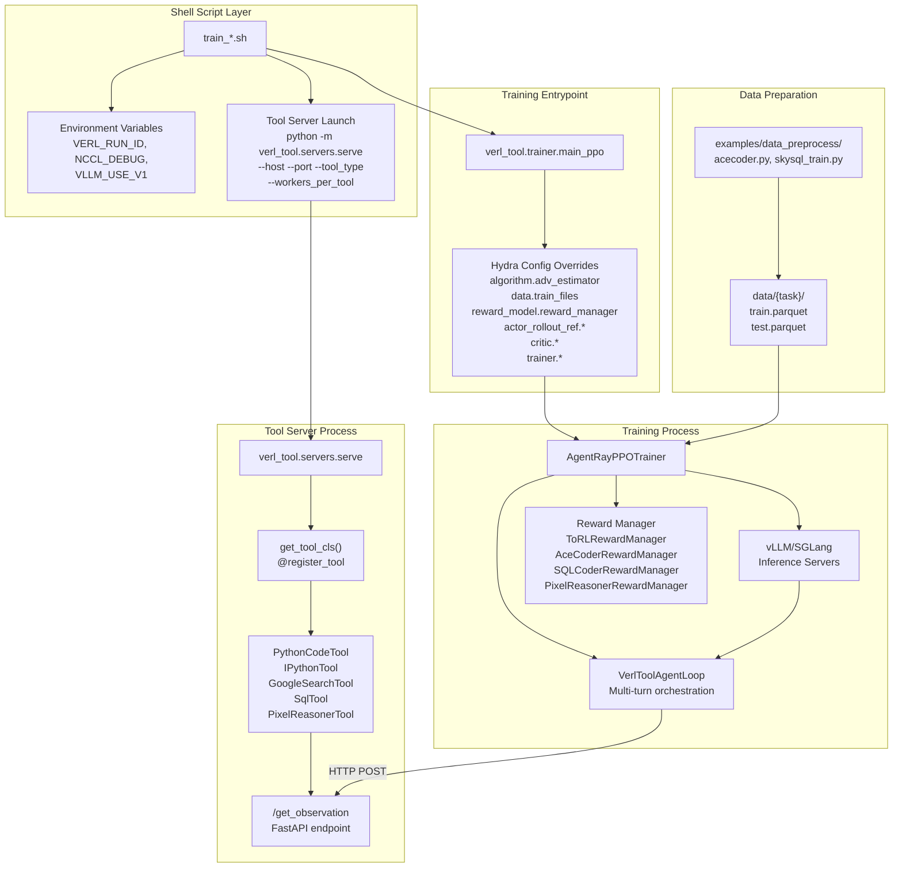
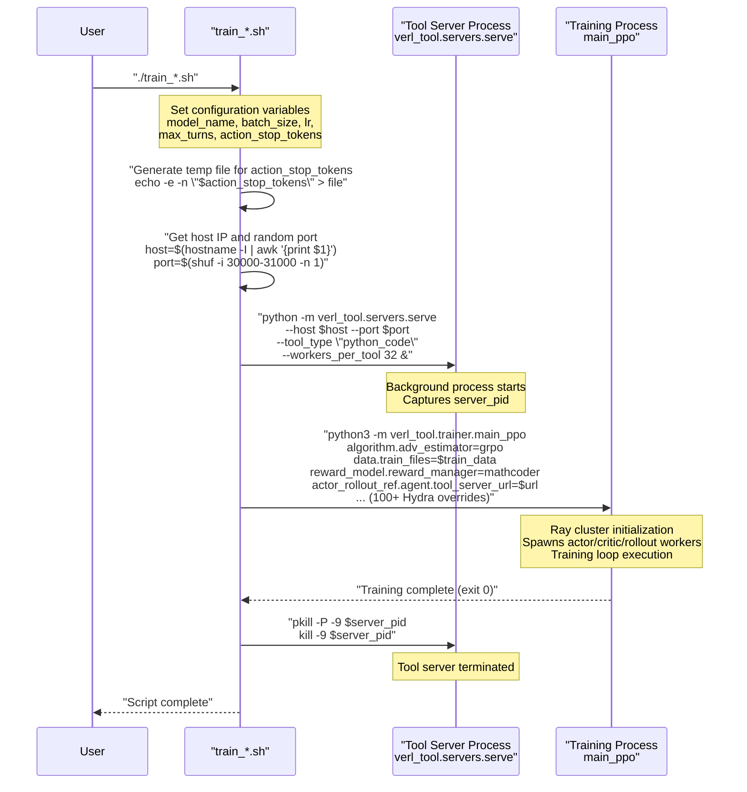
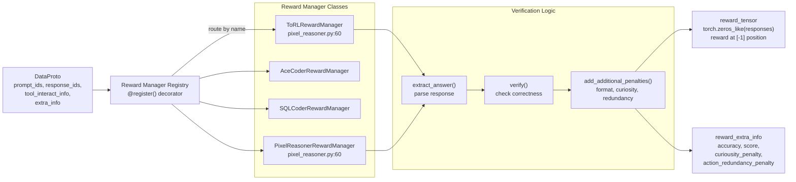

<!-- source: DeepWiki mcp.deepwiki.com · repo TIGER-AI-Lab/verl-tool · page 5 Training Recipes · fetched 2026-10-30 -->

# Training Recipes

Relevant source files

The following files were used as context for generating this wiki page:

- [examples/data_preprocess/acecoder.py](examples/data_preprocess/acecoder.py)
- [examples/train/mathcoder/train.sh](examples/train/mathcoder/train.sh)
- [examples/train/mathcoder/train_1.5b.sh](examples/train/mathcoder/train_1.5b.sh)
- [examples/train/pixel_reasoner/train_3b.sh](examples/train/pixel_reasoner/train_3b.sh)
- [examples/train/pixel_reasoner/train_qwen25vl.sh](examples/train/pixel_reasoner/train_qwen25vl.sh)
- [verl_tool/servers/tools/pixel_reasoner.py](verl_tool/servers/tools/pixel_reasoner.py)
- [verl_tool/workers/reward_manager/pixel_reasoner.py](verl_tool/workers/reward_manager/pixel_reasoner.py)

Training recipes are complete configurations for training tool-augmented agents on specific tasks. Each recipe consists of:
- Shell script (`train_*.sh`) containing environment setup and hyperparameters
- Dataset preparation script in [examples/data_preprocess/]()
- Tool server configuration via [verl_tool.servers.serve]()
- Reward manager from [verl_tool/workers/reward_manager/]()
- Hydra configuration overrides passed to [verl_tool.trainer.main_ppo]()

This page provides an overview of available recipes and their components. For detailed training script patterns, see [Training Script Structure and Patterns](#5.1). For task-specific configurations, see child pages [5.2](#5.2) through [5.6](#5.6).

Sources: [examples/train/mathcoder/train_1.5b.sh:1-131](), [examples/train/pixel_reasoner/train_qwen25vl.sh:1-156]()

## Available Training Recipes

VerlTool provides training recipes for five task domains. Each recipe integrates specific tool implementations with corresponding reward managers.

| Recipe | Training Script | Tool Type | Reward Manager Class | Dataset Preprocessor | Page |
|--------|----------------|-----------|---------------------|---------------------|------|
| **MathCoder/ToRL** | `train_1.5b.sh`, `train.sh` | `python_code` | `ToRLRewardManager` | N/A | [5.2](#5.2) |
| **AceCoder** | `train_acecoder.sh` | `python_code` | `AceCoderRewardManager` | `acecoder.py` | [5.3](#5.3) |
| **DeepSearch** | `train_deepsearch.sh` | `google_search` | `DeepSearchRewardManager` | N/A | [5.4](#5.4) |
| **NL2SQL** | `train_skysql.sh` | `sql` | `SQLCoderRewardManager` | `skysql_train.py` | [5.5](#5.5) |
| **Pixel-Reasoner** | `train_qwen25vl.sh`, `train_3b.sh` | `pixel_reasoner` | `PixelReasonerRewardManager` | N/A | [5.6](#5.6) |

All recipes follow a four-stage lifecycle: (1) data preprocessing to parquet format, (2) tool server launch via [verl_tool.servers.serve:1](), (3) PPO/GRPO training via [verl_tool.trainer.main_ppo:1](), (4) model checkpoint saving. The training loop uses `VerlToolAgentLoop` to coordinate between vLLM inference and tool execution (see [Agent Loop System](#2.3)).

Sources: [examples/train/mathcoder/train_1.5b.sh:1-131](), [examples/train/pixel_reasoner/train_qwen25vl.sh:1-156](), [examples/data_preprocess/acecoder.py:1-95]()

## Training Recipe Component Architecture

**Training Recipe Component Architecture Diagram**

This architecture shows the complete recipe flow from shell script to trained model. The shell script (1) sets environment variables, (2) launches the tool server as a background process with `python -m verl_tool.servers.serve`, (3) invokes `main_ppo` with Hydra configuration overrides. The tool server exposes the `/get_observation` endpoint for `VerlToolAgentLoop` to interact with during rollout generation. Reward managers compute task-specific scores after trajectory completion.

Sources: [examples/train/mathcoder/train_1.5b.sh:42-130](), [examples/train/pixel_reasoner/train_qwen25vl.sh:56-155]()

## Recipe Component Mapping

**Recipe-to-Tool-to-Reward Class Mapping**

```mermaid
graph TB
    subgraph "MathCoder/ToRL Recipe"
        MathScript["examples/train/mathcoder/<br/>train_1.5b.sh, train.sh"]
        MathTool["--tool_type python_code"]
        MathReward["reward_manager=mathcoder"]
        MathToolClass["PythonCodeTool"]
        MathRewardClass["ToRLRewardManager<br/>MathCoderRewardManager"]
    end
    
    subgraph "AceCoder Recipe"
        AceScript["examples/train/acecoder/<br/>train_acecoder.sh"]
        AceTool["--tool_type python_code<br/>or ipython_code"]
        AceReward["reward_manager=acecoder"]
        AceToolClass["PythonCodeTool<br/>IPythonTool"]
        AceRewardClass["AceCoderRewardManager"]
    end
    
    subgraph "DeepSearch Recipe"
        SearchScript["examples/train/deepsearch/<br/>train_deepsearch.sh"]
        SearchTool["--tool_type google_search"]
        SearchReward["reward_manager=deepsearch"]
        SearchToolClass["GoogleSearchTool"]
        SearchRewardClass["DeepSearchRewardManager"]
    end
    
    subgraph "NL2SQL Recipe"
        SQLScript["examples/train/skysql/<br/>train_skysql.sh"]
        SQLToolArg["--tool_type sql"]
        SQLReward["reward_manager=sqlcoder"]
        SQLToolClass["SqlTool"]
        SQLRewardClass["SQLCoderRewardManager"]
    end
    
    subgraph "Pixel-Reasoner Recipe"
        PixelScript["examples/train/pixel_reasoner/<br/>train_qwen25vl.sh, train_3b.sh"]
        PixelTool["--tool_type pixel_reasoner"]
        PixelReward["reward_manager=pixel_reasoner"]
        PixelToolClass["PixelReasonerTool"]
        PixelRewardClass["PixelReasonerRewardManager"]
    end
    
    MathScript -->|"line 54"| MathTool
    MathScript -->|"line 28"| MathReward
    MathTool -.->|"registered as"| MathToolClass
    MathReward -.->|"registered as"| MathRewardClass
    
    AceScript --> AceTool
    AceScript --> AceReward
    AceTool -.-> AceToolClass
    AceReward -.-> AceRewardClass
    
    SearchScript --> SearchTool
    SearchScript --> SearchReward
    SearchTool -.-> SearchToolClass
    SearchReward -.-> SearchRewardClass
    
    SQLScript --> SQLToolArg
    SQLScript --> SQLReward
    SQLToolArg -.-> SQLToolClass
    SQLReward -.-> SQLRewardClass
    
    PixelScript -->|"line 65"| PixelTool
    PixelScript -->|"line 30"| PixelReward
    PixelTool -.->|"@register_tool"| PixelToolClass
    PixelReward -.->|"@register()"| PixelRewardClass
```

This diagram connects shell script configuration parameters to their corresponding class implementations. The `--tool_type` argument in `serve` module maps to tool classes via `@register_tool` decorator. The `reward_manager` Hydra parameter maps to reward manager classes via `@register()` decorator. See [Tool Registry and Discovery System](#3.2) for tool registration details and [Reward Manager Architecture](#6.1) for reward manager registration.

Sources: [examples/train/mathcoder/train_1.5b.sh:28-54](), [examples/train/pixel_reasoner/train_qwen25vl.sh:30-65](), [verl_tool/workers/reward_manager/pixel_reasoner.py:60-77]()

## Key Configuration Parameters

All training recipes pass Hydra configuration overrides to [verl_tool.trainer.main_ppo:1](). The most critical parameters across recipes:

| Configuration Path | Example Values | Purpose | Line References |
|-------------------|----------------|---------|-----------------|
| `algorithm.adv_estimator` | `grpo`, `gae` | PPO vs GRPO advantage estimation | train_1.5b.sh:60 |
| `data.train_files` | `[$(pwd)/data/mathcoder/train.parquet]` | Training dataset paths | train_1.5b.sh:61 |
| `data.max_prompt_length` | `1024`, `16384` | Token limit for prompts | train_1.5b.sh:65 |
| `data.max_response_length` | `3072`, `16384` | Token limit for responses | train_1.5b.sh:66 |
| `reward_model.reward_manager` | `mathcoder`, `pixel_reasoner`, `acecoder` | Reward function selector | train_1.5b.sh:68 |
| `actor_rollout_ref.model.path` | `Qwen/Qwen2.5-Coder-1.5B` | Base model HuggingFace path | train_1.5b.sh:69 |
| `actor_rollout_ref.actor.optim.lr` | `1e-6` | Actor learning rate | train_1.5b.sh:71 |
| `actor_rollout_ref.actor.strategy` | `fsdp`, `fsdp2` | Distributed training strategy | train_1.5b.sh:78 |
| `actor_rollout_ref.agent.tool_server_url` | `http://{host}:{port}/get_observation` | Tool server endpoint | train_1.5b.sh:86 |
| `actor_rollout_ref.agent.max_turns` | `1`, `3` | Maximum tool interaction turns | train_1.5b.sh:91 |
| `actor_rollout_ref.agent.action_stop_tokens` | `\`\`\`output`, `</tool_call>` | Token to detect tool calls | train_1.5b.sh:92 |
| `actor_rollout_ref.rollout.n` | `16`, `8` | Samples per prompt for GRPO | train_1.5b.sh:102 |
| `actor_rollout_ref.rollout.temperature` | `1.0` | Sampling temperature | train_1.5b.sh:99 |
| `actor_rollout_ref.rollout.gpu_memory_utilization` | `0.5`, `0.8` | vLLM memory allocation | train_1.5b.sh:98 |
| `critic.optim.lr` | `1e-5` | Critic learning rate (10x actor) | train_1.5b.sh:109 |
| `trainer.total_epochs` | `10` | Number of training epochs | train_1.5b.sh:126 |

**Important Pattern**: `actor_rollout_ref` prefix indicates configurations affect the combined Actor, Rollout (vLLM), and Reference model workers. The `agent` subgroup specifically controls `VerlToolAgentLoop` behavior. See [Training Script Structure and Patterns](#5.1) for complete configuration workflows and [Configuration System](#2.4) for Hydra composition rules.

Sources: [examples/train/mathcoder/train_1.5b.sh:60-126](), [examples/train/pixel_reasoner/train_qwen25vl.sh:70-153]()

## Training Script Execution Pattern

**Training Script Launch Sequence**

All training scripts follow this pattern: (1) variable initialization [train_1.5b.sh:1-41](), (2) action stop token file creation [train_1.5b.sh:45-49](), (3) tool server background launch [train_1.5b.sh:51-57](), (4) main_ppo invocation with Hydra overrides [train_1.5b.sh:59-126](), (5) cleanup via pkill [train_1.5b.sh:129-130](). The tool server runs as a separate process accessible via HTTP, enabling stateful tool interactions across training.

Sources: [examples/train/mathcoder/train_1.5b.sh:42-130](), [examples/train/pixel_reasoner/train_qwen25vl.sh:56-155]()

## Reward Manager Integration

Each recipe uses a task-specific reward manager to evaluate trajectory correctness. Reward managers are instantiated via the `reward_model.reward_manager` parameter and implement the `__call__(data: DataProto)` interface.

**Reward Manager Execution Flow**

Reward managers receive complete trajectory information including `tool_interact_info` containing all action-observation pairs. They extract the final answer, verify correctness against `ground_truth` from `extra_info`, and apply task-specific penalties. The `PixelReasonerRewardManager` additionally computes group-level statistics across n samples for curiosity and redundancy penalties [pixel_reasoner.py:79-119](). See [Reward Management System](#6) for detailed reward manager implementations.

Sources: [verl_tool/workers/reward_manager/pixel_reasoner.py:60-236]()

## Next Steps

For detailed information about specific training recipes:
- Math Tool-Integrated RL: see [4.2](#4.2)
- AceCoder Training: see [4.3](#4.3)
- Search-R1 Training: see [4.4](#4.4)
- DeepSearch Training: see [4.5](#4.5)
- SQLCoder Training: see [4.6](#4.6)
- Pixel-Reasoner Training: see [4.7](#4.7)

For information about the underlying training framework, see [Core Training Framework](#2).

For data preprocessing details, see [Data Preprocessing Pipeline](#6).

For reward function implementations, see [Reward Management System](#5).

---

