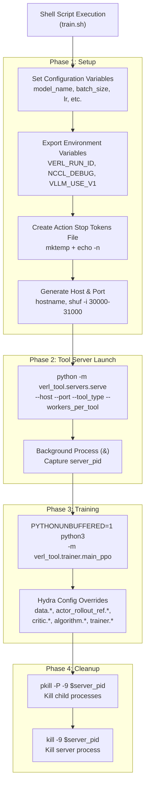

<!-- source: DeepWiki mcp.deepwiki.com · repo TIGER-AI-Lab/verl-tool · page 5.1 Training Script Structure and Patterns · fetched 2026-10-30 -->

# Training Script Structure and Patterns

<details>
<summary>Relevant source files</summary>

The following files were used as context for generating this wiki page:

- [examples/data_preprocess/acecoder.py](examples/data_preprocess/acecoder.py)
- [examples/train/mathcoder/train.sh](examples/train/mathcoder/train.sh)
- [examples/train/mathcoder/train_1.5b.sh](examples/train/mathcoder/train_1.5b.sh)
- [examples/train/pixel_reasoner/train_3b.sh](examples/train/pixel_reasoner/train_3b.sh)
- [examples/train/pixel_reasoner/train_qwen25vl.sh](examples/train/pixel_reasoner/train_qwen25vl.sh)
- [verl_tool/servers/tools/pixel_reasoner.py](verl_tool/servers/tools/pixel_reasoner.py)
- [verl_tool/workers/reward_manager/pixel_reasoner.py](verl_tool/workers/reward_manager/pixel_reasoner.py)

</details>


This document explains the common structure and patterns found in all VerlTool training scripts. Training scripts are shell scripts (`.sh` files) that orchestrate the complete training workflow: environment setup, tool server launch, main training process invocation, and cleanup. Understanding these patterns is essential before diving into task-specific training recipes.

For task-specific configuration details, see:
- Math/Code training: [5.2](#5.2) and [5.3](#5.3)
- Search/SQL training: [5.4](#5.4) and [5.5](#5.5)
- Vision training: [5.6](#5.6)

For configuration system details, see [2.4](#2.4). For main training entrypoint details, see [2.1](#2.1).

---

## Training Script Execution Flow

All training scripts follow a four-phase lifecycle: setup, server launch, training, and cleanup. The following diagram illustrates this standard flow:



**Sources:** [examples/train/mathcoder/train.sh:1-130](), [examples/train/pixel_reasoner/train_qwen25vl.sh:1-156]()

---

## Phase 1: Setup and Configuration

### Variable Definitions

Training scripts begin by defining configuration variables that will be passed to the main training script. These variables are organized into logical groups:

| Variable Category | Examples | Purpose |
|------------------|----------|---------|
| **Data** | `train_data`, `val_data` | Parquet file paths |
| **Model** | `model_name`, `strategy` | Model path, training strategy (fsdp/fsdp2) |
| **Hyperparameters** | `lr`, `batch_size`, `n`, `temperature` | Learning rate, batch sizes, sampling |
| **RL Algorithm** | `rl_alg`, `kl_coef`, `entropy_coeff` | PPO/GRPO settings |
| **Multi-Turn** | `max_turns`, `max_action_length`, `max_obs_length` | Agent interaction limits |
| **Memory** | `gpu_memory_utilization`, `do_offload` | Resource management |
| **Parallelism** | `tensor_model_parallel_size`, `ulysses_sequence_parallel_size` | Distributed training |

**Sources:** [examples/train/mathcoder/train_1.5b.sh:1-42](), [examples/train/pixel_reasoner/train_qwen25vl.sh:1-51]()

### Environment Variables

Key environment variables are exported before training:

```bash
export VERL_RUN_ID=$run_name          # Unique run identifier
export NCCL_DEBUG=INFO                # NCCL logging level
export VLLM_USE_V1=1                  # vLLM v1 API (for certain models)
```

The `VERL_RUN_ID` is constructed from configuration parameters to ensure uniqueness:

```bash
run_name="${reward_manager}-${strategy}-${model_pretty_name}-${rl_alg}-n${n}-b${batch_size}-t${temperature}-lr${lr}${run_name_postfix}"
```

**Sources:** [examples/train/mathcoder/train_1.5b.sh:42-43](), [examples/train/pixel_reasoner/train_qwen25vl.sh:51-53]()

### Action Stop Tokens Mechanism

Action stop tokens define when the model's output should be interpreted as a tool call. These tokens are written to a temporary file because Hydra cannot properly handle special characters in command-line arguments:

```bash
action_stop_tokens="\`\`\`output"      # For code execution
# OR
action_stop_tokens='</tool_call>'      # For vision tools

# Write to temp file
action_stop_tokens_file="$(pwd)$(mktemp)"
mkdir -p $(dirname $action_stop_tokens_file)
echo -e -n "$action_stop_tokens" | tee $action_stop_tokens_file
```

The `-n` flag in `echo` is critical—it prevents adding a newline character that would break token matching during inference.

**Sources:** [examples/train/mathcoder/train.sh:21,42-49](), [examples/train/pixel_reasoner/train_qwen25vl.sh:23,56-60]()

---

## Phase 2: Tool Server Launch

### Server Configuration

The tool server must be launched before training begins. The host and port are dynamically generated to avoid conflicts:

```bash
host=$(hostname -I | awk '{print $1}')    # Get first IP address
port=$(shuf -i 30000-31000 -n 1)          # Random port in range
tool_server_url=http://$host:$port/get_observation
```

**Note:** Some scripts use `hostname -i` (lowercase) instead of `hostname -I` (uppercase). The uppercase version is more reliable for getting the correct IP address.

**Sources:** [examples/train/mathcoder/train.sh:48-53](), [examples/train/pixel_reasoner/train_qwen25vl.sh:62-64]()

### Server Launch Command

The server is launched as a background process:

```bash
python -m verl_tool.servers.serve \
    --host $host \
    --port $port \
    --tool_type "python_code" \      # or "pixel_reasoner", etc.
    --workers_per_tool 32 &          # Number of backend workers
server_pid=$!

echo "Server (pid=$server_pid) started at $tool_server_url"
```

The `&` operator runs the server in the background, and `$!` captures its process ID for later cleanup. The `--workers_per_tool` parameter controls the number of Ray actors or backend workers handling concurrent requests.

**Common `workers_per_tool` values:**
- Code execution: 32-512 (depends on expected concurrency)
- Vision tools: 4-8 (image processing is CPU-intensive)
- Search tools: 16-32 (I/O-bound operations)

**Sources:** [examples/train/mathcoder/train_1.5b.sh:54-57](), [examples/train/pixel_reasoner/train_qwen25vl.sh:65-68]()

---

## Phase 3: Training Invocation

### Main Command Structure

The training is invoked via the `main_ppo.py` entrypoint with Hydra configuration overrides:

```bash
PYTHONUNBUFFERED=1 python3 -m verl_tool.trainer.main_ppo \
    [configuration overrides...]
```

`PYTHONUNBUFFERED=1` ensures that Python output is not buffered, allowing real-time logging in console and log files.

**Sources:** [examples/train/mathcoder/train.sh:55](), [examples/train/pixel_reasoner/train_qwen25vl.sh:70]()

### Configuration Parameter Groups

The Hydra configuration overrides are organized hierarchically. The following diagram shows the major parameter groups and their relationships:

```mermaid
graph TB
    MainPPO["main_ppo.py<br/>Hydra Entrypoint"]
    
    subgraph Data["data.*"]
        DataTrain["train_files<br/>val_files"]
        DataBatch["train_batch_size<br/>val_batch_size"]
        DataLength["max_prompt_length<br/>max_response_length"]
        DataProc["truncation<br/>filter_overlong_prompts<br/>dataloader_num_workers"]
    end
    
    subgraph Reward["reward_model.*"]
        RewardMgr["reward_manager<br/>(torl, acecoder, etc.)"]
        RewardAsync["launch_reward_fn_async"]
    end
    
    subgraph ActorRolloutRef["actor_rollout_ref.*"]
        Model["model.path<br/>model.enable_gradient_checkpointing<br/>model.use_remove_padding<br/>model.trust_remote_code"]
        
        subgraph Actor["actor.*"]
            ActorOptim["optim.lr<br/>optim.lr_warmup_steps"]
            ActorPPO["ppo_mini_batch_size<br/>ppo_micro_batch_size_per_gpu<br/>ppo_max_token_len_per_gpu"]
            ActorKL["use_kl_loss<br/>kl_loss_coef<br/>kl_loss_type"]
            ActorStrategy["strategy (fsdp/fsdp2)<br/>fsdp_config.param_offload<br/>fsdp_config.optimizer_offload"]
            ActorCheckpoint["checkpoint.save_contents"]
        end
        
        subgraph Agent["agent.*"]
            AgentEnable["enable_agent"]
            AgentServer["tool_server_url"]
            AgentLength["max_prompt_length<br/>max_response_length<br/>max_obs_length<br/>max_action_length"]
            AgentTurns["max_turns"]
            AgentTokens["action_stop_tokens<br/>additional_eos_token_ids"]
            AgentMask["mask_observations<br/>enable_mtrl"]
        end
        
        subgraph Rollout["rollout.*"]
            RolloutEngine["name (vllm/sglang)"]
            RolloutGPU["gpu_memory_utilization<br/>tensor_model_parallel_size"]
            RolloutSample["temperature<br/>top_p<br/>top_k<br/>n"]
            RolloutBatch["max_num_seqs<br/>max_num_batched_tokens"]
            RolloutMode["mode (sync/async)"]
            RolloutOpt["enforce_eager<br/>free_cache_engine"]
        end
        
        subgraph Ref["ref.*"]
            RefFSDP["fsdp_config.param_offload<br/>log_prob_micro_batch_size_per_gpu"]
        end
    end
    
    subgraph Critic["critic.*"]
        CriticModel["model.path"]
        CriticOptim["optim.lr"]
        CriticStrategy["strategy<br/>ppo_micro_batch_size_per_gpu"]
    end
    
    subgraph Algorithm["algorithm.*"]
        AlgEstimator["adv_estimator (grpo/gae)"]
        AlgKL["kl_ctrl.kl_coef"]
    end
    
    subgraph Trainer["trainer.*"]
        TrainerLog["logger<br/>project_name<br/>experiment_name"]
        TrainerGPU["n_gpus_per_node<br/>nnodes"]
        TrainerFreq["save_freq<br/>test_freq"]
        TrainerEpoch["total_epochs<br/>total_training_steps"]
        TrainerDir["rollout_data_dir<br/>validation_data_dir"]
        TrainerVal["val_before_train"]
    end
    
    MainPPO --> Data
    MainPPO --> Reward
    MainPPO --> ActorRolloutRef
    MainPPO --> Critic
    MainPPO --> Algorithm
    MainPPO --> Trainer
    
    ActorRolloutRef --> Model
    ActorRolloutRef --> Actor
    ActorRolloutRef --> Agent
    ActorRolloutRef --> Rollout
    ActorRolloutRef --> Ref
    
    Actor --> ActorOptim
    Actor --> ActorPPO
    Actor --> ActorKL
    Actor --> ActorStrategy
    Actor --> ActorCheckpoint
    
    Agent --> AgentEnable
    Agent --> AgentServer
    Agent --> AgentLength
    Agent --> AgentTurns
    Agent --> AgentTokens
    Agent --> AgentMask
    
    Rollout --> RolloutEngine
    Rollout --> RolloutGPU
    Rollout --> RolloutSample
    Rollout --> RolloutBatch
    Rollout --> RolloutMode
    Rollout --> RolloutOpt
```



**Sources:** [examples/train/mathcoder/train.sh:56-126](), [examples/train/pixel_reasoner/train_qwen25vl.sh:70-153]()

---

## Critical Configuration Patterns

### Memory Management Pattern

GPU memory management requires careful coordination between vLLM and FSDP:

```bash
gpu_memory_utilization=0.5  # For smaller models
# OR
gpu_memory_utilization=0.8  # For larger models

# If gpu_memory_utilization > 0.6, enable FSDP offloading
do_offload=True   # Enables param_offload and optimizer_offload
```

The pattern is applied to three components:
- `actor_rollout_ref.actor.fsdp_config.param_offload=$do_offload`
- `actor_rollout_ref.actor.fsdp_config.optimizer_offload=$do_offload`
- `actor_rollout_ref.ref.fsdp_config.param_offload=$do_offload`

**Rule of thumb:** Higher `gpu_memory_utilization` leaves less memory for training, requiring offloading to CPU to prevent OOM errors.

**Sources:** [examples/train/mathcoder/train_1.5b.sh:32-33,82-83,99-101,106](), [examples/train/pixel_reasoner/train_qwen25vl.sh:34-35,99-100,131]()

### Learning Rate Configuration

Different components use different learning rates for stability:

| Component | Typical LR | Rationale |
|-----------|-----------|-----------|
| Actor | `1e-6` | Low LR prevents policy collapse |
| Critic | `1e-5` | 10x higher for faster value learning |
| Reference | N/A | Frozen (no optimizer) |

```bash
actor_rollout_ref.actor.optim.lr=1e-6
critic.optim.lr=1e-5
```

**Sources:** [examples/train/mathcoder/train.sh:27,67,104](), [examples/train/pixel_reasoner/train_qwen25vl.sh:29,85,134]()

### Sampling Strategy Pattern

Training and validation use different sampling strategies:

```bash
# Training: Exploration with diversity
actor_rollout_ref.rollout.temperature=1.0
actor_rollout_ref.rollout.top_p=1.0
actor_rollout_ref.rollout.n=16        # Multiple samples per prompt

# Validation: Deterministic (handled automatically by trainer)
# temperature=0, n=1
```

The `n` parameter is critical for GRPO (Group Relative Policy Optimization), which requires multiple samples per prompt for group normalization.

**Sources:** [examples/train/mathcoder/train_1.5b.sh:12,18-19](), [examples/train/pixel_reasoner/train_qwen25vl.sh:11,19-20]()

### Multi-Turn Configuration Pattern

For agent-based training with tool use:

```bash
actor_rollout_ref.agent.enable_agent=True
actor_rollout_ref.agent.tool_server_url=$tool_server_url
actor_rollout_ref.agent.max_turns=3
actor_rollout_ref.agent.max_action_length=2048
actor_rollout_ref.agent.max_obs_length=8192
actor_rollout_ref.agent.action_stop_tokens=$action_stop_tokens_file
actor_rollout_ref.agent.mask_observations=True
actor_rollout_ref.agent.enable_mtrl=True
```

**Key parameters:**
- `enable_agent=True`: Activates the agent loop (see [2.3](#2.3))
- `mask_observations=True`: Excludes observations from KL loss computation
- `enable_mtrl=True`: Enables multi-turn RL with proper turn separation

**Sources:** [examples/train/pixel_reasoner/train_qwen25vl.sh:21,103-114]()

### Rollout Mode Selection

```bash
rollout_mode='async'  # or 'sync'
actor_rollout_ref.rollout.mode=$rollout_mode
```

Async mode provides 1.69x-2.06x speedup by eliminating batching barriers but requires more GPU memory. See [2.6](#2.6) for details.

**Sources:** [examples/train/pixel_reasoner/train_qwen25vl.sh:54,128]()

---

## Phase 4: Cleanup

### Process Termination

After training completes (or crashes), the tool server must be terminated:

```bash
pkill -P -9 $server_pid  # Kill all child processes
kill -9 $server_pid      # Kill the server process itself
```

The `-P` flag in `pkill` ensures that child processes (e.g., Ray actors spawned by the server) are also terminated. The `-9` signal (SIGKILL) forces immediate termination.

**Important:** If these cleanup commands are not executed (e.g., due to script interruption), orphaned server processes may consume resources. Use `ps aux | grep verl_tool.servers.serve` to identify and manually kill them.

**Sources:** [examples/train/mathcoder/train.sh:129-130](), [examples/train/pixel_reasoner/train_qwen25vl.sh:155-156]()

---

## Common Parameter Reference

### Data Configuration

```python
data.train_files=[path1,path2,...]      # List of parquet files
data.val_files=[path1,path2,...]        # Validation files
data.train_batch_size=128               # Training batch size
data.val_batch_size=128                 # Validation batch size
data.max_prompt_length=1024             # Max input tokens
data.max_response_length=3072           # Max output tokens
data.truncation='right'                 # Truncation direction
data.filter_overlong_prompts=False      # Whether to skip long prompts
data.dataloader_num_workers=4           # Parallel data loading
```

**Sources:** [examples/train/mathcoder/train.sh:57-67]()

### FSDP Configuration

```python
actor_rollout_ref.actor.strategy="fsdp"  # or "fsdp2"
actor_rollout_ref.actor.fsdp_config.param_offload=True
actor_rollout_ref.actor.fsdp_config.optimizer_offload=True
actor_rollout_ref.actor.fsdp_config.fsdp_size=-1  # Auto-determine
actor_rollout_ref.actor.ulysses_sequence_parallel_size=1
```

`fsdp_size=-1` means FSDP will automatically determine sharding based on available GPUs. For manual control, set it to a specific value (e.g., 2, 4, 8).

**Sources:** [examples/train/pixel_reasoner/train_qwen25vl.sh:38,99-102]()

### Checkpoint Configuration

```python
actor_rollout_ref.actor.checkpoint.save_contents=['model','optimizer','extra','hf_model']
trainer.save_freq=10                    # Save every 10 steps
trainer.test_freq=10                    # Validate every 10 steps
trainer.+remove_previous_ckpt_in_save=True  # Delete old checkpoints
```

The `+` prefix in Hydra adds a new configuration key that doesn't exist in the base config.

**Sources:** [examples/train/mathcoder/train_1.5b.sh:73,123-125]()

### Logging Configuration

```python
trainer.logger=['console','wandb']      # Enable console + W&B logging
trainer.project_name="mathcoder"        # W&B project name
trainer.experiment_name=$run_name       # W&B experiment name
trainer.rollout_data_dir=$(pwd)/verl_step_records/$run_name
```

The `rollout_data_dir` stores detailed trajectory records for debugging. See [9.4](#9.4) for details.

**Sources:** [examples/train/mathcoder/train.sh:110-118](), [examples/train/pixel_reasoner/train_qwen25vl.sh:141-147]()

---

## Multi-Model Training Script Variants

The codebase includes training script variants for different model sizes:

| Script Pattern | Purpose | Example |
|---------------|---------|---------|
| `train.sh` | Base/large model | 7B-8B models |
| `train_1.5b.sh` | Small model | 1.5B models with adjusted memory settings |
| `train_3b.sh` | Medium model | 3B models |
| `train_multi_node.sh` | Distributed | Multi-node training (see [9.5](#9.5)) |

Key differences across variants:
- `gpu_memory_utilization`: Lower for smaller models (0.5) vs. larger (0.8)
- `tensor_model_parallel_size`: 1 for small models, 2+ for large
- `ppo_mini_batch_size`: Adjusted based on GPU count
- `log_prob_micro_batch_size_per_gpu`: Higher for smaller models

**Sources:** [examples/train/mathcoder/train_1.5b.sh:1](), [examples/train/mathcoder/train.sh:1](), [examples/train/pixel_reasoner/train_3b.sh:1]()

---

## Template Training Script

Below is a minimal template demonstrating the essential structure:

```bash
#!/bin/bash
set -x  # Echo commands for debugging

# Phase 1: Setup
model_name=Qwen/Qwen2.5-Coder-1.5B
train_data=[$(pwd)/data/task/train.parquet]
val_data=[$(pwd)/data/task/test.parquet]
batch_size=128
n=16
lr=1e-6
reward_manager=mathcoder
action_stop_tokens="\`\`\`output"

run_name="${reward_manager}-${model_name//\//_}-n${n}-lr${lr}"
export VERL_RUN_ID=$run_name

# Action stop tokens file
action_stop_tokens_file="$(pwd)$(mktemp)"
echo -e -n "$action_stop_tokens" | tee $action_stop_tokens_file

# Phase 2: Tool server launch
host=$(hostname -I | awk '{print $1}')
port=$(shuf -i 30000-31000 -n 1)
tool_server_url=http://$host:$port/get_observation
python -m verl_tool.servers.serve \
    --host $host --port $port \
    --tool_type "python_code" \
    --workers_per_tool 32 &
server_pid=$!

# Phase 3: Training
PYTHONUNBUFFERED=1 python3 -m verl_tool.trainer.main_ppo \
    data.train_files=$train_data \
    data.val_files=$val_data \
    data.train_batch_size=$batch_size \
    reward_model.reward_manager=$reward_manager \
    actor_rollout_ref.model.path=$model_name \
    actor_rollout_ref.actor.optim.lr=$lr \
    actor_rollout_ref.agent.tool_server_url=$tool_server_url \
    actor_rollout_ref.agent.action_stop_tokens=$action_stop_tokens_file \
    actor_rollout_ref.rollout.n=$n \
    trainer.experiment_name=$run_name

# Phase 4: Cleanup
pkill -P -9 $server_pid
kill -9 $server_pid
```

This template includes only the essential parameters. Production scripts add memory management, parallelism, and debugging configurations as needed.

---

## Summary of Key Patterns

1. **Action Stop Tokens:** Always use a temp file with `echo -e -n` to preserve exact token strings
2. **Tool Server:** Launch in background with `&`, capture PID, cleanup with `pkill -P -9` and `kill -9`
3. **Memory Management:** Coordinate `gpu_memory_utilization` with `do_offload` flag
4. **Learning Rates:** Actor (1e-6) < Critic (1e-5) for stability
5. **Sampling:** Training uses exploration (temp=1.0, n>1), validation uses greedy decoding
6. **Multi-Turn:** Enable with `enable_agent=True`, configure `max_turns` and token limits
7. **Logging:** Always set `PYTHONUNBUFFERED=1` for real-time output
8. **Cleanup:** Critical for preventing orphaned server processes

**Sources:** [examples/train/mathcoder/train.sh:1-130](), [examples/train/mathcoder/train_1.5b.sh:1-131](), [examples/train/pixel_reasoner/train_qwen25vl.sh:1-156](), [examples/train/pixel_reasoner/train_3b.sh:1-155]()

---

