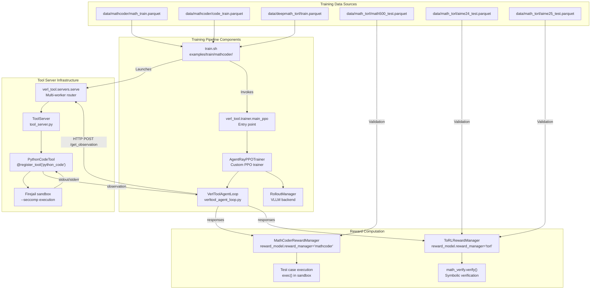
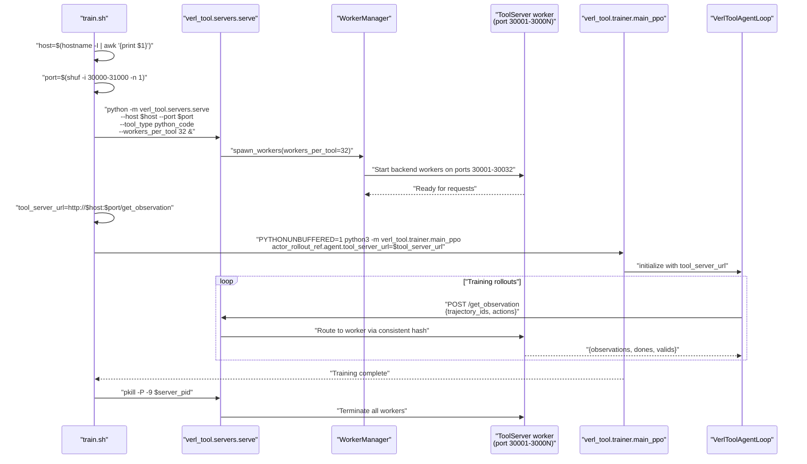
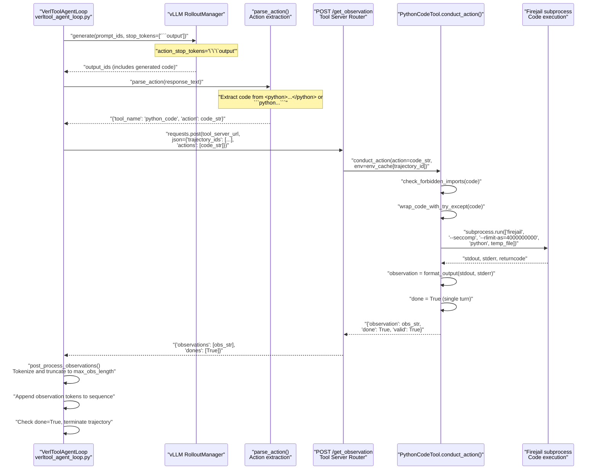
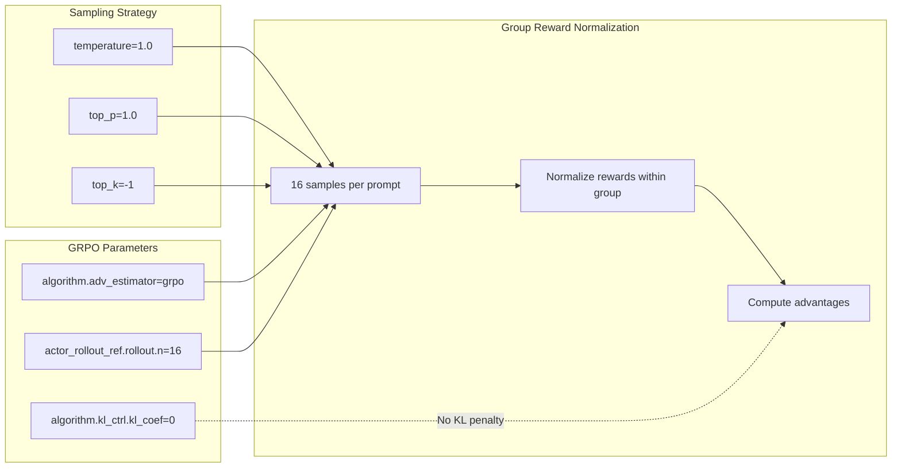

<!-- source: DeepWiki mcp.deepwiki.com · repo TIGER-AI-Lab/verl-tool · page 5.2 Math Tool-Integrated RL (MathCoder/ToRL) · fetched 2026-10-30 -->

# Math Tool-Integrated RL (MathCoder/ToRL)

<details>
<summary>Relevant source files</summary>

The following files were used as context for generating this wiki page:

- [examples/data_preprocess/acecoder.py](examples/data_preprocess/acecoder.py)
- [examples/train/mathcoder/train.sh](examples/train/mathcoder/train.sh)
- [examples/train/mathcoder/train_1.5b.sh](examples/train/mathcoder/train_1.5b.sh)
- [verl_tool/agent_loop/agent_loop.py](verl_tool/agent_loop/agent_loop.py)
- [verl_tool/agent_loop/verltool_agent_loop.py](verl_tool/agent_loop/verltool_agent_loop.py)
- [verl_tool/servers/tests/test_python_code_tool.py](verl_tool/servers/tests/test_python_code_tool.py)
- [verl_tool/servers/tools/ipython_code.py](verl_tool/servers/tools/ipython_code.py)
- [verl_tool/servers/tools/utils/ipython_tool.py](verl_tool/servers/tools/utils/ipython_tool.py)
- [verl_tool/trainer/config/verltool/agent.yaml](verl_tool/trainer/config/verltool/agent.yaml)
- [verl_tool/trainer/ppo/metric_util.py](verl_tool/trainer/ppo/metric_util.py)
- [verl_tool/workers/reward_manager/torl.py](verl_tool/workers/reward_manager/torl.py)
- [verl_tool/workers/rollout/vllm_rollout/vllm_async_server.py](verl_tool/workers/rollout/vllm_rollout/vllm_async_server.py)

</details>


This document describes how to train language models for mathematical problem-solving using tool-integrated reinforcement learning. The MathCoder and ToRL (Tool-integrated Reinforcement Learning) approaches teach models to generate Python code, execute it via the Python code execution tool, and verify solutions against test cases or ground truth answers.

For details on the underlying Python code execution tool implementation, see [4.1](#4.1). For reward manager implementation details, see [6.2](#6.2). For general dataset formatting, see [7.1](#7.1).

## Overview

Math tool-integrated RL trains models to solve mathematical problems by:
1. Generating Python code to solve a problem
2. Executing the code via the `PythonCodeTool` in a sandboxed environment
3. Verifying the output against expected answers or test cases
4. Providing rewards based on correctness

**MathCoder vs ToRL Distinctions:**

| Aspect | MathCoder | ToRL (Tool-integrated RL) |
|--------|-----------|---------------------------|
| Primary Focus | Mixed code and math problems | Pure math reasoning with tools |
| Reward Manager | `MathCoderRewardManager` | `ToRLRewardManager` |
| Dataset Mix | Code problems + math problems | Math-focused datasets (DeepMath, official ToRL data) |
| Action Format | Python code blocks | Python code blocks with TIR (Tool-Integrated Reasoning) |
| Evaluation | Code execution + math verification | Math-focused verification with symbolic checking |

Both approaches use the same training infrastructure (`AgentRayPPOTrainer`, `VerlToolAgentLoop`) and tool server (`PythonCodeTool`), but differ in their reward computation logic and dataset composition.

**Sources:** [examples/train/mathcoder/train.sh:28](), [examples/train/math_tir/train_7b_grpo_megatron.sh:29]()

## System Architecture

**System Architecture: MathCoder/ToRL Training Pipeline**



**Sources:** [examples/train/mathcoder/train.sh:2-7,51-54](), [examples/train/mathcoder/train_1.5b.sh:2-7,54-57](), [examples/train/math_tir/train_7b_grpo_megatron.sh:3-7,62-65]()

## Dataset Format

Math datasets follow the standard VerlTool format with specific fields for mathematical problem-solving:

| Field | Type | Description |
|-------|------|-------------|
| `prompt` | List[Dict] | User message with problem statement |
| `data_source` | String | Dataset origin identifier |
| `ability` | String | Set to `"math"` or `"code"` |
| `reward_model.style` | String | Set to `"rule"` for test-based verification |
| `extra_info.question` | String | Original problem text |
| `extra_info.test_cases` | String | Python test code to verify solution |
| `extra_info.ground_truth` | String | Expected answer (optional) |

### Example Dataset Structure

```python
{
    "data_source": "GSM8K",
    "prompt": [
        {
            "role": "user",
            "content": "Solve the problem step by step. Write your solution in a Python code block like ```python\\ncode\\n```"
        }
    ],
    "ability": "math",
    "reward_model": {
        "style": "rule",
        "ground_truth": "42"
    },
    "extra_info": {
        "question": "If x + y = 10 and x - y = 2, what is x?",
        "test_cases": "assert solution() == 42",
        "index": 0,
        "split": "train"
    }
}
```

The dataset preprocessing pattern follows [examples/data_preprocess/acecoder.py:43-73]() where the `process_fn` constructs this structure.

**Sources:** [examples/data_preprocess/acecoder.py]()

## Training Script Structure

### Tool Server Initialization

Math training requires a Python code execution tool server. The training scripts launch this server before starting training via the `verl_tool.servers.serve` module.

**Tool Server Launch Sequence**



The server launch in [examples/train/mathcoder/train.sh:48-53]():
```bash
host=$(hostname -I | awk '{print $1}')
port=$(shuf -i 30000-31000 -n 1)
tool_server_url=http://$host:$port/get_observation
python -m verl_tool.servers.serve --host $host --port $port --tool_type "python_code" --workers_per_tool 32 &
server_pid=$!
```

The cleanup in [examples/train/mathcoder/train.sh:123-124]():
```bash
pkill -P -9 $server_pid
kill -9 $kill $server_pid
```

**Key Parameters:**
- `--tool_type "python_code"`: Registers the `PythonCodeTool` implementation
- `--workers_per_tool 32`: Spawns 32 backend worker processes for parallel execution
- `--host` and `--port`: Router listens on this endpoint
- Background execution (`&`) allows training to proceed while server runs

**Sources:** [examples/train/mathcoder/train.sh:48-53,123-124](), [examples/train/mathcoder/train_1.5b.sh:54-57,129-130](), [examples/train/math_tir/train_7b_grpo_megatron.sh:62-65,144-145]()

### Key Configuration Parameters

The training scripts configure the system through Hydra-style command-line overrides. Below are the critical parameters for math training:

#### Dataset Configuration

| Parameter | Example Value | Purpose |
|-----------|---------------|---------|
| `data.train_files` | `[code_train.parquet, math_train.parquet]` | Training data sources |
| `data.val_files` | `[math500_test.parquet, aime24_test.parquet]` | Validation benchmarks |
| `data.train_batch_size` | `128` | Training batch size |
| `data.max_prompt_length` | `1024` | Maximum tokens for problem statement |
| `data.max_response_length` | `3072` | Maximum tokens for model generation |

From [examples/train/mathcoder/train.sh:2-7]() and [examples/train/mathcoder/train.sh:13-16]().

#### Agent Configuration

| Parameter | Example Value | Purpose |
|-----------|---------------|---------|
| `actor_rollout_ref.agent.tool_server_url` | `http://host:port/get_observation` | Tool server endpoint |
| `actor_rollout_ref.agent.max_obs_length` | `512` | Maximum tokens for tool observations |
| `actor_rollout_ref.agent.max_turns` | `1` | Number of tool interaction turns |
| `actor_rollout_ref.agent.action_stop_tokens` | `` ```output `` | Token signaling code block end |

The `action_stop_tokens` parameter is handled specially because it contains special characters. The training scripts write it to a temporary file [examples/train/mathcoder/train.sh:43-46]():

```bash
action_stop_tokens_file="$(pwd)$(mktemp)"
echo -e -n "$action_stop_tokens" | tee $action_stop_tokens_file
```

#### Algorithm Configuration

| Parameter | Example Value | Purpose |
|-----------|---------------|---------|
| `algorithm.adv_estimator` | `grpo` | Use GRPO instead of PPO |
| `actor_rollout_ref.rollout.n` | `16` | Number of samples per prompt |
| `actor_rollout_ref.rollout.temperature` | `1.0` | Sampling temperature |
| `reward_model.reward_manager` | `mathcoder` | Reward manager type |
| `actor_rollout_ref.actor.optim.lr` | `1e-6` | Actor learning rate |

From [examples/train/mathcoder/train.sh:9-28]().

**Sources:** [examples/train/mathcoder/train.sh:2-28](), [examples/train/mathcoder/train.sh:43-46](), [examples/train/mathcoder/train.sh:55-120]()

## Model Support and Memory Configuration

Math training supports various model sizes with different memory configurations:

### Small Models (1.5B-3B)

For smaller models like `Qwen2.5-Coder-1.5B`, the configuration in [examples/train/mathcoder/train_1.5b.sh:8-36]() uses:
- `n_gpus_per_node=4` (can run on fewer GPUs)
- `gpu_memory_utilization=0.5` (conservative to prevent OOM)
- `do_offload=True` (enable parameter and optimizer offloading)
- `use_dynamic_bsz=True` (enable dynamic batching for efficiency)

### Larger Models (7B+)

For larger models like `Qwen2.5-Math-7B`, the configuration in [examples/train/mathcoder/train.sh:8-35]() uses:
- `n_gpus_per_node=8` (requires more GPUs)
- `gpu_memory_utilization=0.8` (higher utilization possible)
- `do_offload=True` (still recommended to prevent OOM)
- `strategy="fsdp"` (FSDP for distributed training)

The relationship between `gpu_memory_utilization` and `do_offload` is critical, as noted in [examples/train/mathcoder/train_1.5b.sh:32-33]():
> "if gpu_memory_utilization is set to > 0.6, then do_offload should be set to True otherwise it will cause OOM"

**Sources:** [examples/train/mathcoder/train_1.5b.sh:8-36](), [examples/train/mathcoder/train.sh:8-35]()

## Action Format and Tool Interaction

### Code Generation Format

The agent is prompted to generate code in markdown format:
```
Let's think step by step and generate the final program in a markdown code block like this:
```python
your code here
```
```

This format is similar to the instruction in [examples/data_preprocess/acecoder.py:23]().

### Interaction Flow

**Single-Turn Tool Interaction (max_turns=1)**



Since `max_turns=1` in math training [examples/train/mathcoder/train.sh:22](), the interaction is **single-turn**: the model generates code once, executes it, receives the output, and the trajectory terminates. The configuration `actor_rollout_ref.agent.max_turns=1` enforces this behavior.

**Sources:** [examples/train/mathcoder/train.sh:22,86-91](), [examples/train/mathcoder/train_1.5b.sh:22,91]()

## GRPO Configuration

Math training typically uses GRPO (Group Relative Policy Optimization) instead of PPO:



From [examples/train/mathcoder/train.sh:9-24]():
- `rl_alg=grpo` - Use GRPO algorithm
- `n=16` - Generate 16 samples per prompt for group normalization
- `kl_coef=0` - No KL divergence penalty
- `temperature=1.0`, `top_p=1.0` - High diversity sampling

GRPO requires `n > 1` for effective group normalization, as noted in [examples/train/mathcoder/train.sh:9](): "if grpo, then better set n>1 otherwise the group norm can not be effective".

**Sources:** [examples/train/mathcoder/train.sh:9-24](), [examples/train/mathcoder/train.sh:56-115]()

## Validation Benchmarks

Math training validates on multiple benchmarks to assess different difficulty levels:

| Benchmark | Description | Dataset File |
|-----------|-------------|--------------|
| Code Test Set | Code problems from training distribution | `code_test.parquet` |
| Math500 | 500 mathematical problems | `math500_test.parquet` |
| AIME 2024 | American Invitational Mathematics Examination | `aime24_test.parquet` |
| AIME 2025 | Recent competition problems | `aime25_test.parquet` |

From [examples/train/mathcoder/train.sh:4-7](). Validation occurs every `trainer.test_freq=10` epochs [examples/train/mathcoder/train.sh:119]().

**Sources:** [examples/train/mathcoder/train.sh:4-7](), [examples/train/mathcoder/train.sh:119]()

## Run Name and Experiment Tracking

Training runs are identified by a constructed name that encodes key hyperparameters [examples/train/mathcoder/train.sh:37-42]():

```bash
model_pretty_name=$(echo $model_name | tr '/' '_' | tr '[:upper:]' '[:lower:]')
run_name_postfix="new"
run_name="${reward_manager}-${strategy}-${model_pretty_name}-${rl_alg}-n${n}-b${batch_size}-t${temperature}-lr${lr}${run_name_postfix}"
export VERL_RUN_ID=$run_name
```

Example run name: `mathcoder-fsdp-qwen_qwen2.5-math-7b-grpo-n16-b128-t1.0-lr1e-6new`

This run name is used for:
- WandB experiment tracking [examples/train/mathcoder/train.sh:116-118]()
- Checkpoint directory naming
- Log file organization

The `VERL_RUN_ID` environment variable [examples/train/mathcoder/train.sh:42]() is used by the training infrastructure for consistent identification.

**Sources:** [examples/train/mathcoder/train.sh:37-42](), [examples/train/mathcoder/train.sh:116-118]()

## Training Configuration Summary

### Complete Training Command Structure

The training is invoked via [examples/train/mathcoder/train.sh:55]():
```bash
PYTHONUNBUFFERED=1 python3 -m verl_tool.trainer.main_ppo \
    algorithm.adv_estimator=$rl_alg \
    data.train_files=$train_data \
    # ... (additional 60+ configuration parameters)
```

This uses Hydra configuration overrides to customize the default config in `verl_tool/trainer/config/`.

### Configuration Parameter Dependencies

**Memory Management and Performance Trade-offs**

```mermaid
graph TB
    subgraph "Memory_Management"
        GPU_MEM["actor_rollout_ref.rollout<br/>.gpu_memory_utilization<br/>0.5-0.8"]
        DO_OFFLOAD["actor_rollout_ref.actor<br/>.fsdp_config.param_offload<br/>True/False"]
        MICRO_BSZ["actor_rollout_ref.actor<br/>.ppo_micro_batch_size_per_gpu<br/>1"]
        GRADIENT_CKPT["actor_rollout_ref.model<br/>.enable_gradient_checkpointing<br/>True"]
    end
    
    subgraph "Sequence_Length_Budget"
        MAX_PROMPT["data.max_prompt_length<br/>1024 tokens"]
        MAX_RESP["data.max_response_length<br/>3072 tokens"]
        MAX_OBS["actor_rollout_ref.agent<br/>.max_obs_length<br/>512 tokens"]
        TOTAL["Total sequence:<br/>~4608 tokens max"]
    end
    
    subgraph "GRPO_Sampling_Strategy"
        N_SAMPLES["actor_rollout_ref.rollout.n<br/>16 samples per prompt"]
        BATCH["data.train_batch_size<br/>128 prompts"]
        TEMP["actor_rollout_ref.rollout<br/>.temperature<br/>1.0"]
        TOTAL_GEN["Total generations:<br/>16 * 128 = 2048"]
    end
    
    subgraph "Distributed_Training"
        STRATEGY["actor_rollout_ref.actor.strategy<br/>fsdp or megatron"]
        N_GPUS["trainer.n_gpus_per_node<br/>4 or 8"]
        N_NODES["trainer.nnodes<br/>1 (single node)"]
    end
    
    GPU_MEM -->|"If > 0.6"| DO_OFFLOAD
    DO_OFFLOAD -->|"Reduces memory"| MICRO_BSZ
    GRADIENT_CKPT -->|"Reduces memory"| MICRO_BSZ
    
    MAX_PROMPT --> TOTAL
    MAX_RESP --> TOTAL
    MAX_OBS --> TOTAL
    
    N_SAMPLES --> TOTAL_GEN
    BATCH --> TOTAL_GEN
    TEMP -->|"High diversity"| N_SAMPLES
    
    STRATEGY --> N_GPUS
    N_GPUS --> N_NODES
```



**Critical Configuration Rules:**

1. **GPU Memory**: If `gpu_memory_utilization > 0.6`, must set `param_offload=True` and `optimizer_offload=True` [examples/train/mathcoder/train_1.5b.sh:33]()
2. **GRPO**: Must use `n > 1` for effective group normalization [examples/train/mathcoder/train.sh:9]()
3. **Megatron**: Only supports `rollout.mode=async` currently [examples/train/math_tir/train_7b_grpo_megatron.sh:51]()

**Sources:** [examples/train/mathcoder/train.sh:13-35,55-120](), [examples/train/mathcoder/train_1.5b.sh:32-34](), [examples/train/math_tir/train_7b_grpo_megatron.sh:35-38,51]()

### Reward Manager Configuration

The `reward_model.reward_manager` parameter selects between different reward implementations:

| Value | Reward Manager Class | Verification Method | Use Case |
|-------|---------------------|---------------------|----------|
| `mathcoder` | `MathCoderRewardManager` | Test case execution + format validation | Mixed code and math problems |
| `torl` | `ToRLRewardManager` | Symbolic math verification via `math_verify.verify()` | Pure math reasoning |
| `acecoder` | `AceCoderRewardManager` | Test case execution with inputs/outputs | Code generation problems |

From [examples/train/mathcoder/train.sh:28,64]():
```bash
reward_manager=mathcoder
# ...
reward_model.reward_manager=$reward_manager \
```

See [6.2](#6.2) for detailed implementation of these reward managers.

**Sources:** [examples/train/mathcoder/train.sh:28,64](), [examples/train/math_tir/train_7b_grpo_megatron.sh:29,76]()

## Differences Between train.sh and train_1.5b.sh

The two training scripts differ primarily in resource allocation:

| Aspect | train.sh (7B) | train_1.5b.sh (1.5B) |
|--------|---------------|----------------------|
| Model | `Qwen2.5-Math-7B` | `Qwen2.5-Coder-1.5B` |
| GPUs per node | 8 | 4 |
| GPU memory utilization | 0.8 | 0.5 |
| Log prob micro batch | 2 | 8 |
| FSDP size | default | -1 (auto) |
| Val before train | True | False |
| Dynamic batch size | False | True |

The smaller model configuration [examples/train/mathcoder/train_1.5b.sh]() enables more aggressive optimizations like `use_dynamic_bsz=True` and larger `log_prob_micro_batch_size_per_gpu=8`, while the larger model [examples/train/mathcoder/train.sh]() requires more conservative settings to prevent OOM errors.

**Sources:** [examples/train/mathcoder/train.sh:8-35](), [examples/train/mathcoder/train_1.5b.sh:8-36]()

---

