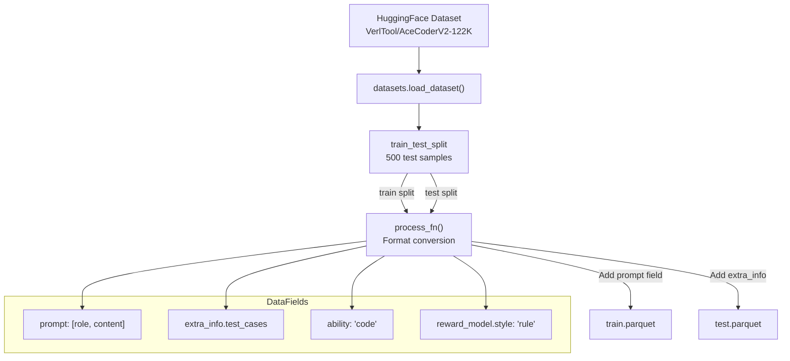
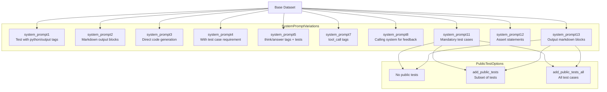
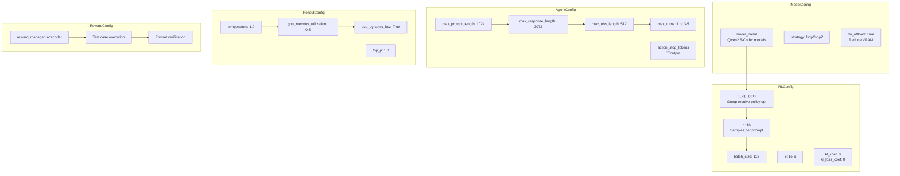
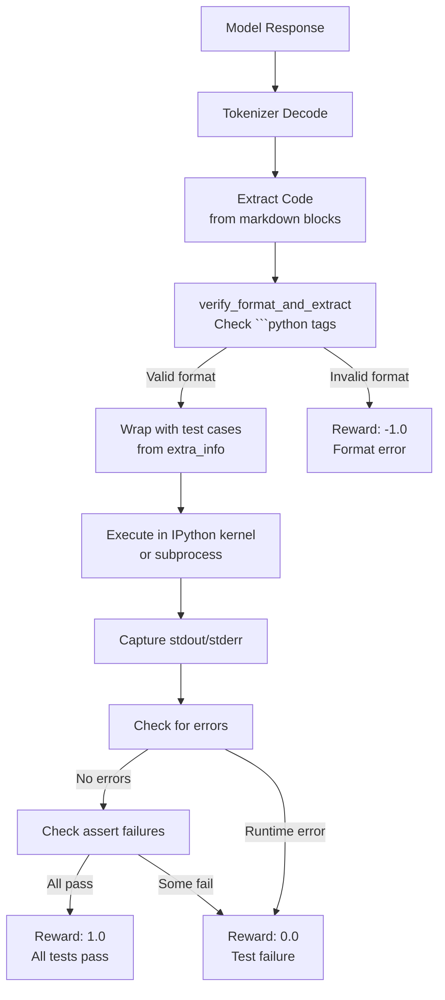
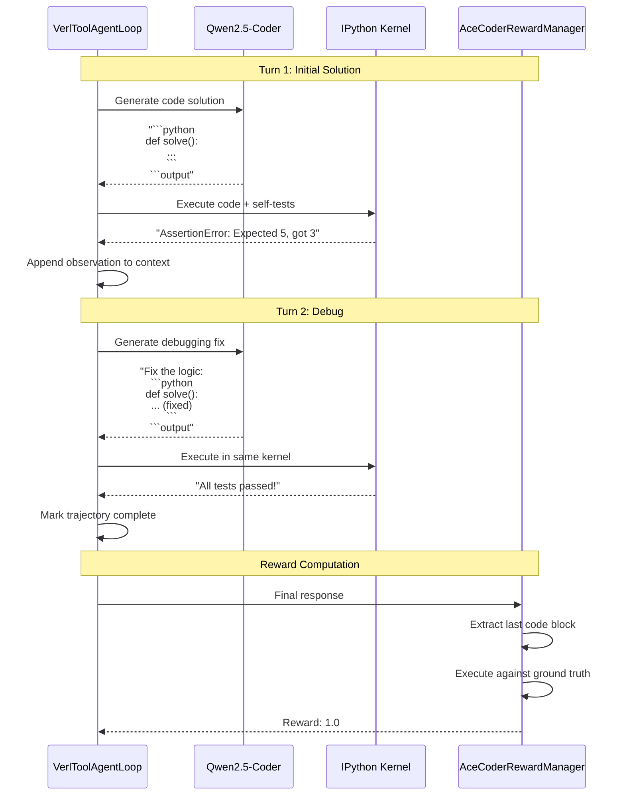

<!-- source: DeepWiki mcp.deepwiki.com · repo TIGER-AI-Lab/verl-tool · page 5.3 AceCoder Code Generation Training · fetched 2026-10-30 -->

# AceCoder Code Generation Training

<details>
<summary>Relevant source files</summary>

The following files were used as context for generating this wiki page:

- [examples/data_preprocess/acecoder.py](examples/data_preprocess/acecoder.py)
- [examples/data_preprocess/acecoder_custom.py](examples/data_preprocess/acecoder_custom.py)
- [examples/train/mathcoder/train.sh](examples/train/mathcoder/train.sh)
- [examples/train/mathcoder/train_1.5b.sh](examples/train/mathcoder/train_1.5b.sh)

</details>


This document describes the training recipe for competitive programming code generation using the AceCoder dataset with IPython-based code execution and test case validation. This recipe trains models to generate Python solutions for coding challenges while iteratively testing and debugging their code.

For math reasoning with Python code execution, see [Math Tool-Integrated RL (MathCoder/ToRL)](#5.2). For SQL generation, see [NL2SQL Database Query Training](#5.5). For general training script patterns, see [Training Script Structure and Patterns](#5.1).

## Overview and Dataset Structure

The AceCoder training recipe uses competitive programming problems from the AceCode dataset family to train models in code generation with self-testing capabilities. Unlike the MathCoder recipe which uses Firejail-sandboxed Python execution, AceCoder typically uses persistent IPython kernels to enable multi-turn debugging workflows.

The dataset consists of:
- **Questions**: Competitive programming problem statements
- **Test Cases**: Hidden test cases for validation (stored in `extra_info.test_cases`)
- **Public Tests**: Optional subset of test cases that can be provided to the model (stored in `extra_info.public_tests`)
- **Solution Format**: Final code expected in markdown code blocks (` ```python ... ``` `)

### Dataset Sources

| Dataset | Path | Size | Version |
|---------|------|------|---------|
| AceCode V1 | `TIGER-Lab/AceCode-87K` | 87K problems | Original |
| AceCode V2 | `VerlTool/AceCoderV2-122K` | 122K problems | Extended |
| AceCode V2 Cleaned | `VerlTool/AceCoderV2-69K-cleaned` | 69K problems | Quality-filtered |

Sources: [examples/data_preprocess/acecoder.py:26-94](), [examples/data_preprocess/acecoder_custom.py:82-103]()

## Dataset Preprocessing

### Basic Preprocessing

The basic preprocessing script converts the AceCode dataset into the standard VerlTool parquet format with a simple instruction prompt.



**Diagram: Basic AceCoder Dataset Preprocessing Pipeline**

The preprocessing function adds a naive instruction to each problem:

```python
naive_instruction = "Let's think step by step and generate the final program in a markdown code block like this: ```python\nyour code here\n```."
```

The resulting data structure:

```json
{
  "data_source": "VerlTool/AceCoderV2-122K",
  "prompt": [
    {
      "role": "user",
      "content": "<question text> + <naive_instruction>"
    }
  ],
  "ability": "code",
  "reward_model": {
    "style": "rule",
    "ground_truth": ""
  },
  "extra_info": {
    "split": "train",
    "index": 0,
    "id": "problem_id",
    "question": "<raw question>",
    "test_cases": "<test code>",
    "inputs_outputs": null
  }
}
```

Sources: [examples/data_preprocess/acecoder.py:23-86]()

### Custom System Prompts

The `acecoder_custom.py` script provides 13 different system prompt variations to experiment with different instruction styles and tool-use patterns. These prompts range from simple zero-shot prompts to complex multi-turn debugging workflows.



**Diagram: System Prompt Variations and Public Test Options**

#### Example System Prompts

**System Prompt 1** (Basic tool use):
```
Please integrate natural language reasoning with programs to solve the coding problems below. 
If you want to test any python code, writing it inside <python> and </python> tags following 
with <output>. Please put your final answer in a markdown code block like this: ```python
your code here
``` without appending anything.
```

**System Prompt 11** (Mandatory testing):
```
Please integrate natural language reasoning to solve the coding problems below. For every code 
solution, you should also write test cases to assert that the solution actually works as you 
expected. To run the code and test cases, include "<|calling system for feedback|>" at the end 
of your response for the current turn. Then the system will execute the code in the markdown 
block and provide the standard output and error.
```

**System Prompt 13** (Concise with assert):
```
Please solve the following coding problem and verify the correctness by writing test cases in 
`assert` statements. Execution results will be put into the in output markdown block: 
"```output ```". Put your final answer in a markdown code block like this: ```python
your code here
``` without appending anything.
```

The script supports adding public test cases in three modes:
- `add_public_tests=False`: No public tests in prompt (default)
- `add_public_tests=True`: Add subset from `public_tests` field
- `add_public_tests_all=True`: Add all test cases as public

Sources: [examples/data_preprocess/acecoder_custom.py:22-74](), [examples/data_preprocess/acecoder_custom.py:108-148]()

### Running Preprocessing

```bash
# Basic preprocessing
python examples/data_preprocess/acecoder.py \
  --dataset_path VerlTool/AceCoderV2-122K \
  --local_dir data/acecoder

# Custom system prompt (example: prompt 13 with public tests)
python examples/data_preprocess/acecoder_custom.py \
  --dataset_path VerlTool/AceCoderV2-69K-cleaned \
  --local_dir data/acecoder_custom \
  --system_prompt_idx 13 \
  --add_public_tests True
```

Sources: [examples/data_preprocess/acecoder.py:91-94](), [examples/data_preprocess/acecoder_custom.py:168-191]()

## Training Configuration

While the provided files show MathCoder training scripts, the AceCoder training follows a similar pattern but with key differences in tool setup and reward configuration.

### Tool Server Setup

The primary difference between AceCoder and MathCoder is the execution environment:

| Aspect | MathCoder | AceCoder |
|--------|-----------|----------|
| Tool Type | `python_code` (Firejail) | `ipython_code` (Ray Kernels) |
| Execution Mode | Stateless subprocess | Persistent kernel sessions |
| Tool Server Flag | `--tool_type python_code` | `--tool_type ipython_code` |
| Workers | 32-512 per tool | 32-512 per tool |
| State Management | None (fresh execution) | Per-trajectory kernel cache |

The tool server launch for AceCoder would be:

```bash
host=$(hostname -I | awk '{print $1}')
port=$(shuf -i 30000-31000 -n 1)
tool_server_url=http://$host:$port/get_observation

# Launch IPython tool server instead of python_code
python -m verl_tool.servers.serve \
  --host $host \
  --port $port \
  --tool_type "ipython_code" \
  --workers_per_tool 32 &
server_pid=$!
```

The IPython tool maintains kernel state across turns, enabling:
- Variables persist between tool calls
- Import statements are cached
- Multi-turn debugging workflows
- Faster execution for iterative testing

Sources: [examples/train/mathcoder/train_1.5b.sh:48-55]()

### Key Training Parameters

Based on the MathCoder training script structure (which AceCoder follows), here are the critical parameters:



**Diagram: AceCoder Training Configuration Parameters**

#### Parameter Details

**Model Selection**:
- Qwen2.5-Coder-1.5B for smaller models (4 GPUs)
- Qwen2.5-Coder-7B for larger models (8 GPUs)
- Enable gradient checkpointing for memory efficiency

**Action Stop Tokens**:
The model generates code until hitting the stop token, typically ` ```output ` for markdown-based execution:

```bash
action_stop_tokens="```output"
action_stop_tokens_file="$(pwd)$(mktemp)"
echo -e -n "$action_stop_tokens" | tee $action_stop_tokens_file
```

**Multi-Turn Configuration**:
- `max_turns=1`: Single-shot generation (no debugging)
- `max_turns=3-5`: Allow iterative testing and refinement
- `max_obs_length=512`: Truncate execution results to prevent context overflow

**GRPO Configuration**:
- `n=16`: Generate 16 samples per prompt for group normalization
- GRPO requires `n>1` for effective group-relative advantages
- `batch_size=128`: Process 128 problems per update

Sources: [examples/train/mathcoder/train_1.5b.sh:8-36](), [examples/train/mathcoder/train_1.5b.sh:45-49]()

### Complete Training Command Structure

```bash
PYTHONUNBUFFERED=1 python3 -m verl_tool.trainer.main_ppo \
    # Algorithm
    algorithm.adv_estimator=grpo \
    algorithm.kl_ctrl.kl_coef=0 \
    
    # Data
    data.train_files=[data/acecoder/train.parquet] \
    data.val_files=[data/acecoder/test.parquet] \
    data.train_batch_size=128 \
    data.max_prompt_length=1024 \
    data.max_response_length=3072 \
    
    # Reward Manager (AceCoder-specific)
    reward_model.reward_manager=acecoder \
    
    # Model
    actor_rollout_ref.model.path=Qwen/Qwen2.5-Coder-1.5B \
    actor_rollout_ref.model.enable_gradient_checkpointing=True \
    actor_rollout_ref.actor.optim.lr=1e-6 \
    actor_rollout_ref.actor.strategy=fsdp \
    
    # Agent Loop (IPython tool integration)
    actor_rollout_ref.agent.tool_server_url=$tool_server_url \
    actor_rollout_ref.agent.max_turns=3 \
    actor_rollout_ref.agent.max_obs_length=512 \
    actor_rollout_ref.agent.action_stop_tokens=$action_stop_tokens_file \
    
    # Rollout (vLLM)
    actor_rollout_ref.rollout.name=vllm \
    actor_rollout_ref.rollout.temperature=1.0 \
    actor_rollout_ref.rollout.n=16 \
    actor_rollout_ref.rollout.gpu_memory_utilization=0.5 \
    
    # Critic
    critic.optim.lr=1e-5 \
    critic.model.path=Qwen/Qwen2.5-Coder-1.5B \
    
    # Trainer
    trainer.total_epochs=10 \
    trainer.save_freq=10 \
    trainer.test_freq=10
```

Sources: [examples/train/mathcoder/train_1.5b.sh:59-126]()

## AceCoder Reward Manager

The `acecoder` reward manager evaluates generated code by executing it against test cases stored in `extra_info.test_cases`. The reward computation follows this pipeline:



**Diagram: AceCoder Reward Computation Pipeline**

### Reward Components

| Condition | Reward | Description |
|-----------|--------|-------------|
| Format Error | -1.0 | Missing or malformed ` ```python ` block |
| Runtime Error | 0.0 | Code execution failed (SyntaxError, etc.) |
| Test Failure | 0.0 | Assert statements failed |
| All Tests Pass | 1.0 | Code executes and passes all assertions |

### Test Case Execution

The reward manager extracts the solution code and combines it with test cases:

```python
# Pseudo-code representation
solution_code = extract_code_from_markdown(response)
test_cases = example['extra_info']['test_cases']

# Combined execution
full_code = f"{solution_code}\n\n{test_cases}"
result = execute_code(full_code)

if result.has_errors():
    reward = 0.0
elif result.assertions_passed():
    reward = 1.0
else:
    reward = 0.0
```

The IPython kernel maintains state across tool calls during rollout, but each trajectory uses an isolated kernel to prevent cross-contamination.

Sources: Based on reward manager patterns from related files and system architecture

## Multi-Turn Training Workflow

When `max_turns > 1`, the AceCoder recipe enables iterative debugging:



**Diagram: Multi-Turn AceCoder Training Sequence**

### Turn Limits and Observation Masking

- **max_turns**: Controls how many tool interactions are allowed (typically 1-5)
- **max_obs_length**: Truncates execution results to 512 tokens to preserve context
- **mask_observations**: Optional flag to prevent gradient updates on tool responses

The agent loop tracks turn count and terminates when:
1. Model generates final answer without `action_stop_tokens`
2. `max_turns` is reached
3. IPython tool returns `done=True`

Sources: Based on agent loop patterns from system architecture diagrams

## Training Execution Example

Complete workflow for training AceCoder:

```bash
#!/bin/bash
set -x

# 1. Prepare dataset
python examples/data_preprocess/acecoder_custom.py \
  --dataset_path VerlTool/AceCoderV2-69K-cleaned \
  --local_dir data/acecoder_custom \
  --system_prompt_idx 13 \
  --add_public_tests True

# 2. Configuration
train_data=data/acecoder_custom/train.parquet
val_data=data/acecoder_custom/test.parquet
model_name=Qwen/Qwen2.5-Coder-1.5B
reward_manager=acecoder
max_turns=3

# 3. Launch IPython tool server
host=$(hostname -I | awk '{print $1}')
port=$(shuf -i 30000-31000 -n 1)
tool_server_url=http://$host:$port/get_observation
python -m verl_tool.servers.serve \
  --host $host \
  --port $port \
  --tool_type "ipython_code" \
  --workers_per_tool 32 &
server_pid=$!

# 4. Run training
PYTHONUNBUFFERED=1 python3 -m verl_tool.trainer.main_ppo \
    algorithm.adv_estimator=grpo \
    data.train_files=[$train_data] \
    data.val_files=[$val_data] \
    reward_model.reward_manager=$reward_manager \
    actor_rollout_ref.model.path=$model_name \
    actor_rollout_ref.agent.tool_server_url=$tool_server_url \
    actor_rollout_ref.agent.max_turns=$max_turns \
    trainer.total_epochs=10

# 5. Cleanup
pkill -P $server_pid
kill $server_pid
```

Sources: [examples/train/mathcoder/train_1.5b.sh:1-131]()

## Validation and Metrics

During validation, the AceCoder reward manager computes metrics across multiple samples:

- **pass@1**: Single sample success rate
- **pass@8**: Best of 8 samples success rate  
- **pass@best**: Maximum reward across all `n` samples
- **pass@majority**: Majority vote across samples

Validation batches are repeated with different random seeds for statistical robustness. Generations are dumped to disk for manual inspection.

Sources: Based on validation patterns from system architecture

## Key Differences from MathCoder

| Aspect | MathCoder | AceCoder |
|--------|-----------|----------|
| Dataset | Math word problems | Competitive programming |
| Tool Type | `python_code` (Firejail) | `ipython_code` (Ray kernels) |
| Execution | Stateless sandbox | Persistent kernel state |
| System Prompt | Math-focused | Code debugging focus |
| Test Cases | Generated from solution | Provided in dataset |
| Typical Turns | 1-2 | 1-5 (more debugging) |
| Answer Format | Final value in tags | Code in markdown blocks |

Sources: [examples/data_preprocess/acecoder.py](), [examples/data_preprocess/acecoder_custom.py](), [examples/train/mathcoder/train_1.5b.sh]()

---

