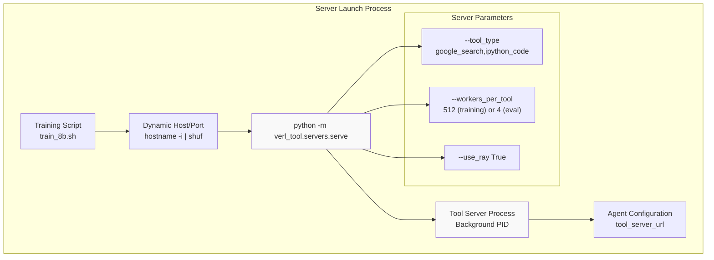
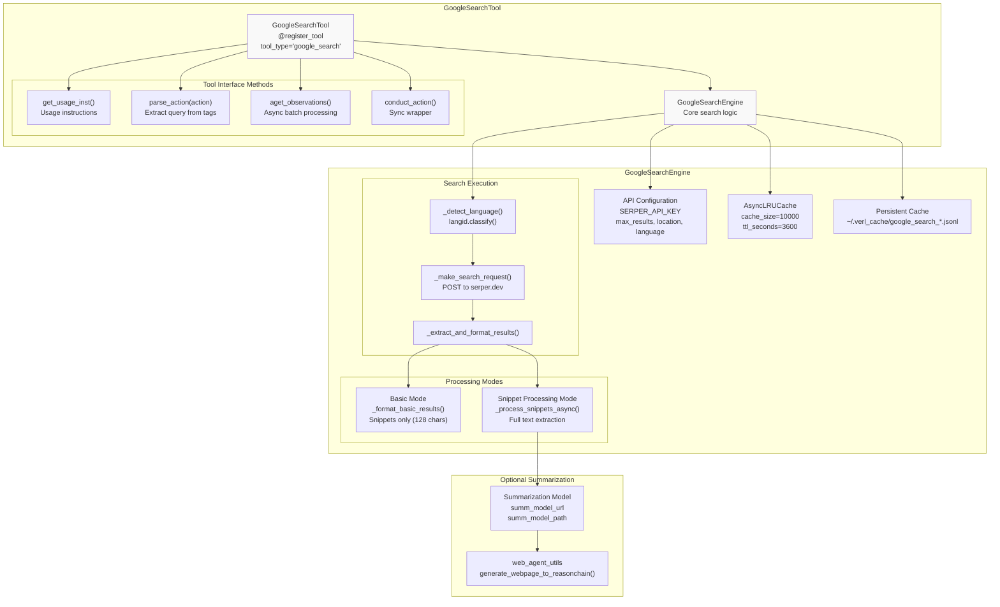
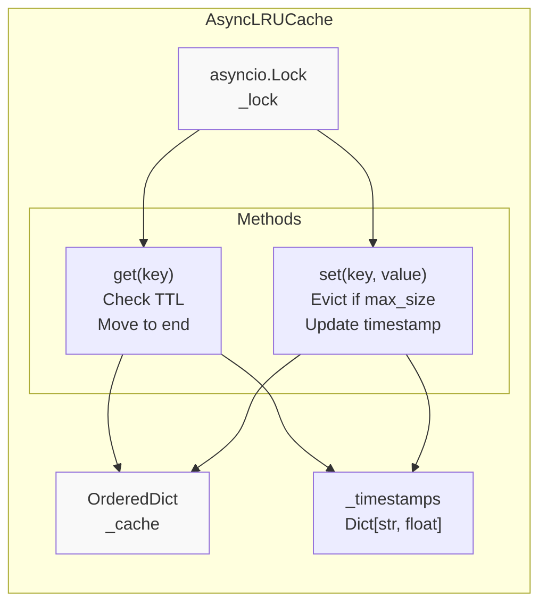
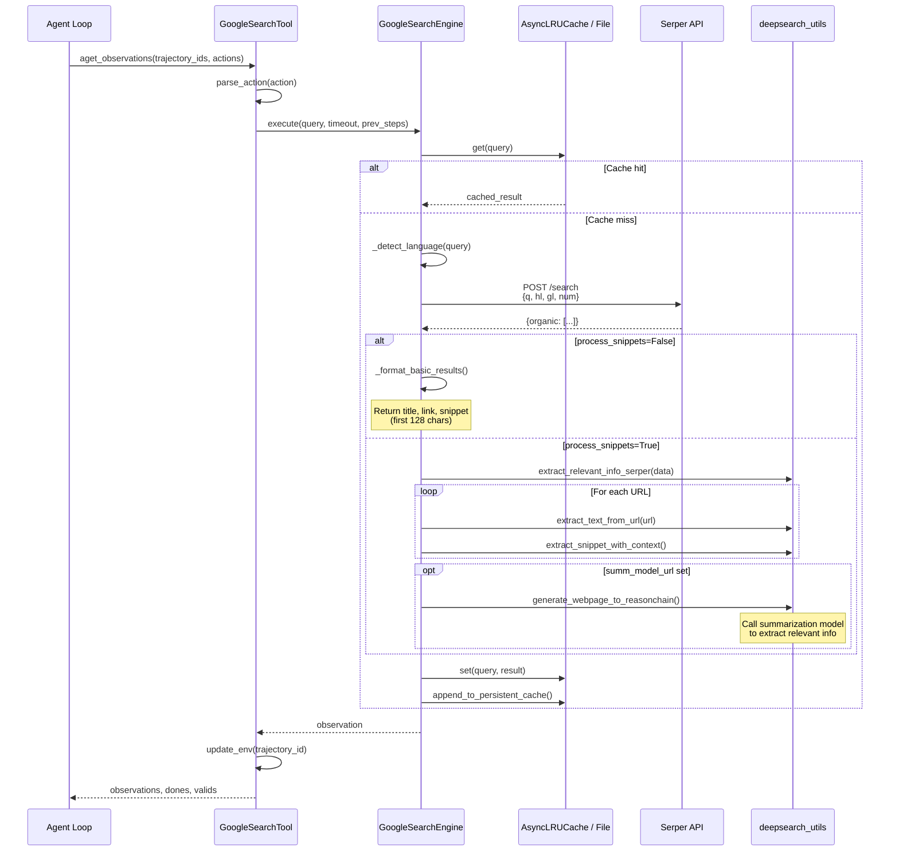
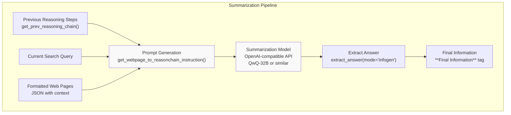
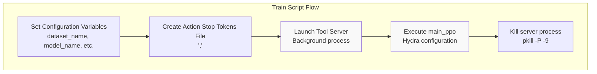
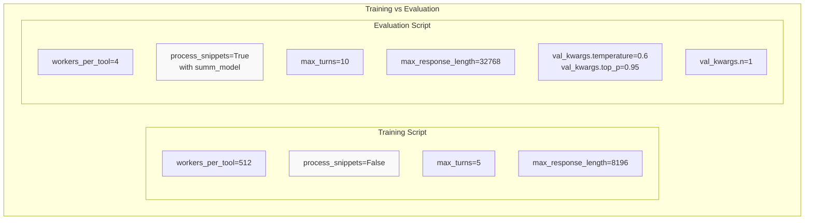
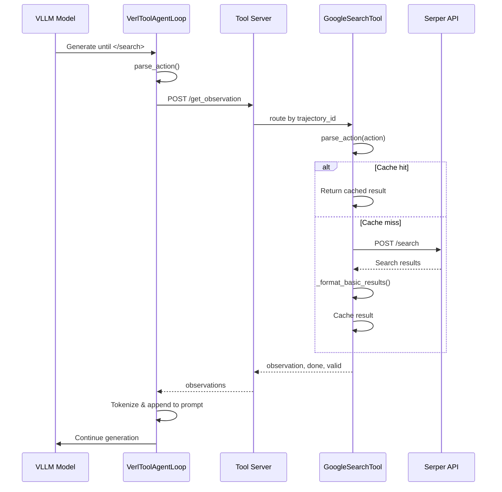

<!-- source: DeepWiki mcp.deepwiki.com · repo TIGER-AI-Lab/verl-tool · page 5.4 DeepSearch Web Research Training · fetched 2026-10-30 -->

# DeepSearch Web Research Training

<details>
<summary>Relevant source files</summary>

The following files were used as context for generating this wiki page:

- [examples/data_preprocess/acecoder.py](examples/data_preprocess/acecoder.py)
- [examples/train/deepsearch/README.md](examples/train/deepsearch/README.md)
- [examples/train/deepsearch/eval.sh](examples/train/deepsearch/eval.sh)
- [examples/train/deepsearch/train_4b.sh](examples/train/deepsearch/train_4b.sh)
- [examples/train/deepsearch/train_8b.sh](examples/train/deepsearch/train_8b.sh)
- [examples/train/mathcoder/train.sh](examples/train/mathcoder/train.sh)
- [examples/train/mathcoder/train_1.5b.sh](examples/train/mathcoder/train_1.5b.sh)
- [verl_tool/servers/tools/google_search.py](verl_tool/servers/tools/google_search.py)
- [verl_tool/servers/tools/utils/web_agent_utils.py](verl_tool/servers/tools/utils/web_agent_utils.py)

</details>


## Purpose and Scope

This document describes the training recipe for teaching language models to perform web research tasks using the Google Search tool (via Serper API) combined with Python code execution. The DeepSearch training enables models to iteratively search the web, process information, and reason over multiple turns to answer complex questions from benchmarks like GAIA, HLE, WebWalker, and XBench.

For information about the agent loop and multi-turn interaction patterns, see [Agent Loop System](#2.3). For tool server architecture details, see [Tool Server Architecture](#3). For general training patterns, see [Training Script Structure](#5.1).

## Dataset Structure and Preparation

### Dataset Format

DeepSearch training uses parquet files with the standard VerlTool schema. Each sample contains:
- `prompt`: The user question/task
- `answer`: Ground truth answer
- `use_tool`: Boolean flag indicating whether tool usage is required
- Additional metadata for evaluation

### Data Preparation

The preprocessing script prepares datasets from the HuggingFace hub:

```bash
python examples/data_preprocess/deepsearch.py --dataset_path=VerlTool/deepsearch
```

This generates training and validation splits:
- Training: `data/deepsearch/hard_search_1k.parquet`
- Validation: Multiple benchmark files (gaia_test, hle_test, webwalker_test, xbench_test)

**Sources:** [examples/train/deepsearch/README.md:1-4]()

### Cache File Download

To reduce Serper API costs during training, download the pre-built search cache:

```bash
huggingface-cli download VerlTool/deepsearch google_search_cache.jsonl \
  --local-dir ~/.verl_cache --repo-type dataset
```

The cache is automatically loaded by `GoogleSearchEngine` on initialization.

**Sources:** [examples/train/deepsearch/README.md:6-9]()

## Tool Server Setup

DeepSearch training requires a tool server running two tools: `google_search` and `ipython_code` (or `python_code`). The server is launched before training begins.

### Server Launch Configuration



**Sources:** [examples/train/deepsearch/train_8b.sh:61-67]()

### Training vs Evaluation Server Configuration

| Configuration | Training | Evaluation |
|--------------|----------|------------|
| `workers_per_tool` | 512 | 4 |
| Tools | `google_search,ipython_code` | `google_search,python_code` |
| Search mode | Basic snippets (`process_snippets=False`) | Full text + summarization |
| Concurrent requests | High (async rollout) | Lower |

The high worker count during training (512) enables parallel processing of multiple trajectories in async rollout mode. Evaluation uses fewer workers but enables expensive features like full text extraction and summarization.

**Sources:** [examples/train/deepsearch/train_8b.sh:64](), [examples/train/deepsearch/eval.sh:69](), [examples/train/deepsearch/README.md:30-33]()

## Google Search Tool Architecture

### Core Components



**Sources:** [verl_tool/servers/tools/google_search.py:57-400](), [verl_tool/servers/tools/google_search.py:402-630]()

### AsyncLRUCache Implementation

The `AsyncLRUCache` provides thread-safe caching for concurrent search operations:



Key features:
- **LRU eviction**: Maintains order using `OrderedDict.move_to_end()`
- **TTL expiration**: Entries expire after `ttl_seconds` (default 3600)
- **Async-safe**: All operations protected by `asyncio.Lock`
- **Automatic cleanup**: Removes oldest entries when `max_size` reached

**Sources:** [verl_tool/servers/tools/google_search.py:21-54]()

### Action Parsing Patterns

The `parse_action()` method extracts search queries from model outputs using multiple patterns:

| Pattern | Example | Priority |
|---------|---------|----------|
| `<search>...</search>` | `<search>quantum computing</search>` | 1 |
| ` ```search\n...\n``` ` | ` ```search\nclimate change\n``` ` | 2 |
| `search: ...` | `search: machine learning` | 3 |
| `google: ...` | `google: neural networks` | 4 |

All patterns are case-insensitive and support multi-line content. Queries are limited to 500 characters.

**Sources:** [verl_tool/servers/tools/google_search.py:472-488]()

### Search Execution Flow



**Sources:** [verl_tool/servers/tools/google_search.py:220-257](), [verl_tool/servers/tools/google_search.py:278-399]()

### Two Processing Modes

#### Basic Mode (Training)

Used during training for performance. Returns first 128 characters of each snippet directly from Serper API:

- **Configuration**: `process_snippets=False` (default)
- **Output format**: Markdown-formatted results with title, link, snippet
- **Performance**: Fast, cached responses
- **Limitation**: Snippet truncation at 128 chars by Serper API

**Sources:** [verl_tool/servers/tools/google_search.py:288-308](), [examples/train/deepsearch/README.md:30]()

#### Full Text Processing Mode (Evaluation)

Extracts full webpage content and optionally summarizes with external model:

- **Configuration**: `process_snippets=True`
- **URL extraction**: Uses `extract_text_from_url()` from deepsearch_utils
- **Context extraction**: `extract_snippet_with_context()` finds relevant sections around snippet
- **Max document length**: Controlled by `max_doc_len` parameter
- **Async processing**: Concurrent URL fetching with `asyncio.gather()`

**Sources:** [verl_tool/servers/tools/google_search.py:310-378]()

#### Optional Summarization

When both `summ_model_url` and `summ_model_path` are set:



The summarization model receives:
- **Previous reasoning steps**: Truncated to show first step and last 4 steps
- **Current search query**: The question being researched
- **Searched web pages**: Full text with context around snippets

The model extracts relevant information prefixed with `**Final Information**` tag.

**Sources:** [verl_tool/servers/tools/google_search.py:380-399](), [verl_tool/servers/tools/utils/web_agent_utils.py:55-87](), [verl_tool/servers/tools/utils/web_agent_utils.py:168-179]()

### Environment Management

The tool maintains environment state per `trajectory_id`:

```python
# Environment structure stored in env_cache
{
    'previous_obs': [
        {
            'action': '<search>query</search>',
            'observation': '<result>...</result>',
            'is_valid': True
        },
        ...
    ]
}
```

Previous actions are passed to snippet processing for context-aware summarization.

**Sources:** [verl_tool/servers/tools/google_search.py:554-558]()

## Training Configuration

### Shell Script Structure



**Sources:** [examples/train/deepsearch/train_8b.sh:1-152]()

### Key Training Parameters

| Parameter | Value (8B) | Value (4B) | Description |
|-----------|------------|------------|-------------|
| `model_name` | `Qwen/Qwen3-8B` | `Qwen/Qwen3-4B` | Base model path |
| `rl_alg` | `grpo` | `grpo` | GRPO algorithm for group-relative advantages |
| `n` | 16 | 16 | Number of rollout samples per prompt |
| `batch_size` | 128 | 128 | Training batch size |
| `ppo_mini_batch_size` | 128 | 32 | Mini-batch size for PPO updates |
| `max_turns` | 5 | 3 | Maximum tool interaction turns |
| `max_prompt_length` | 2048 | 2048 | Maximum initial prompt length |
| `max_response_length` | 8196 | 8192 | Maximum total response length |
| `max_action_length` | 8196 | 2048 | Maximum action length per turn |
| `max_obs_length` | 4096 | 4096 | Maximum observation length per turn |
| `temperature` | 1.0 | 1.0 | Sampling temperature |
| `lr` | 1e-6 | 1e-6 | Learning rate |
| `kl_coef` | 0 | 0 | KL penalty coefficient (disabled) |
| `mask_observations` | True | True | Mask observations in KL loss |
| `workers_per_tool` | 512 | 4 | Tool server workers |
| `rollout_mode` | `async` | `async` | Asynchronous rollout mode |

**Sources:** [examples/train/deepsearch/train_8b.sh:8-42](), [examples/train/deepsearch/train_4b.sh:6-39]()

### Action Stop Tokens Configuration

Action stop tokens define when the model should stop generating and call a tool:

```bash
action_stop_tokens='</python>,</search>'
```

These tokens are written to a temporary file and passed to the agent configuration, as Hydra cannot directly handle special characters in string parameters.

**Sources:** [examples/train/deepsearch/train_8b.sh:24](), [examples/train/deepsearch/train_8b.sh:56-59]()

### Agent Configuration Mapping

```mermaid
graph TB
    subgraph "Agent Configuration"
        EnableAgent["enable_agent=True"]
        ToolServerURL["tool_server_url<br/>http://host:port/get_observation"]
        
        subgraph "Length Constraints"
            MaxPrompt["max_prompt_length=2048"]
            MaxResponse["max_response_length=8196"]
            MaxAction["max_action_length=8196"]
            MaxObs["max_obs_length=4096"]
        end
        
        subgraph "Interaction Control"
            MaxTurns["max_turns=5"]
            ActionStopTokens["action_stop_tokens_file"]
            MaskObs["mask_observations=True"]
            EnableMTRL["enable_mtrl=False"]
        end
        
        subgraph "Special Tokens"
            AdditionalEOS["additional_eos_token_ids<br/>[151645] # <|im_end|>"]
        end
    end
    
    subgraph "Hydra Config Path"
        ConfigPath["actor_rollout_ref.agent.*"]
    end
    
    EnableAgent --> ConfigPath
    ToolServerURL --> ConfigPath
    MaxPrompt --> ConfigPath
    MaxResponse --> ConfigPath
    MaxAction --> ConfigPath
    MaxObs --> ConfigPath
    MaxTurns --> ConfigPath
    ActionStopTokens --> ConfigPath
    MaskObs --> ConfigPath
    EnableMTRL --> ConfigPath
    AdditionalEOS --> ConfigPath

    style ConfigPath fill:#f9f9f9
```



**Sources:** [examples/train/deepsearch/train_8b.sh:99-115]()

### GRPO Algorithm Configuration

DeepSearch uses GRPO (Group Relative Policy Optimization) instead of standard PPO:

```bash
algorithm.adv_estimator=grpo
actor_rollout_ref.rollout.n=16  # Multiple samples per prompt required
```

GRPO computes advantages relative to the group mean of all `n` samples, providing more stable training for high-variance environments like web search. Setting `n>1` is critical for GRPO effectiveness.

**Sources:** [examples/train/deepsearch/train_8b.sh:9](), [examples/train/deepsearch/train_8b.sh:121]()

### Memory Optimization Settings

| Setting | Value | Purpose |
|---------|-------|---------|
| `gpu_memory_utilization` | 0.6 | VLLM GPU memory allocation (conservative) |
| `do_offload` | True | Enable FSDP parameter/optimizer offloading |
| `use_dynamic_bsz` | True | Dynamic batch sizing for variable lengths |
| `ulysses_sequence_parallel_size` | 1 | Disable sequence parallelism (causes OOM) |
| `enable_gradient_checkpointing` | True | Trade compute for memory |

The conservative `gpu_memory_utilization=0.6` prevents VLLM from OOM crashes during async rollout with long sequences.

**Sources:** [examples/train/deepsearch/train_8b.sh:32-38]()

### Reward Manager Configuration

```bash
reward_model.reward_manager=deepsearch
reward_model.launch_reward_fn_async=True
```

The `deepsearch` reward manager evaluates model responses against ground truth answers. Async reward computation improves throughput.

**Sources:** [examples/train/deepsearch/train_8b.sh:31](), [examples/train/deepsearch/train_8b.sh:78-79]()

## Evaluation Configuration

### Enabling Full Text Processing

To evaluate with full text extraction and summarization, modify the `GoogleSearchTool` class initialization in [verl_tool/servers/tools/google_search.py:410-428]():

```python
# Snippet processing only (faster)
process_snippets: bool = True

# With summarization model
process_snippets: bool = True
summ_model_url: str = "http://0.0.0.0:8000/v1"
summ_model_path: str = "Qwen/QwQ-32B"
```

### Summarization Model Server Setup

Launch a separate VLLM server for the summarization model:

```bash
CUDA_VISIBLE_DEVICES=4,5,6,7 vllm serve Qwen/QwQ-32B \
  --dtype auto \
  --api-key "EMPTY" \
  --enforce-eager \
  --no-enable-prefix-caching \
  -tp 4 > logs/server_summarization_model.log 2>&1 &
```

The summarization model runs separately from the main training process and is called via OpenAI-compatible API during snippet processing.

**Sources:** [examples/train/deepsearch/README.md:36-43]()

### Evaluation Script Differences



Key differences:
- **More turns**: 10 vs 5 for evaluation to allow deeper research
- **Longer responses**: 32768 vs 8196 tokens
- **Lower temperature**: 0.6 vs 1.0 for more focused sampling
- **Single sample**: `n=1` during validation to reduce compute

**Sources:** [examples/train/deepsearch/eval.sh:22-29](), [examples/train/deepsearch/eval.sh:130-134]()

### Running Evaluation

To run evaluation without training:

```bash
trainer.val_before_train=True
trainer.total_training_steps=0
```

This executes validation on the first epoch and exits.

**Sources:** [examples/train/deepsearch/eval.sh:149](), [examples/train/deepsearch/eval.sh:157]()

## Dataset and Benchmarks

### Training Data

The primary training dataset is `hard_search_1k.parquet`, containing 1000 challenging search-based questions.

**Sources:** [examples/train/deepsearch/train_8b.sh:3]()

### Validation Benchmarks

Multiple benchmarks are evaluated during training:

| Benchmark | File | Domain |
|-----------|------|--------|
| GAIA | `gaia_test.parquet` | General AI Assistant tasks |
| HLE | `hle_test.parquet` | Hard Long-form Questions |
| WebWalker | `webwalker_test.parquet` | Web navigation tasks |
| XBench | `xbench_test.parquet` | Cross-domain evaluation |

All benchmarks are combined in a comma-separated list for validation:

```bash
val_data=[$(pwd)/data/deepsearch/gaia_test.parquet,\
$(pwd)/data/deepsearch/hle_test.parquet,\
$(pwd)/data/deepsearch/webwalker_test.parquet,\
$(pwd)/data/deepsearch/xbench_test.parquet]
```

**Sources:** [examples/train/deepsearch/train_8b.sh:4-7]()

## Performance Considerations

### Training Performance vs Accuracy Tradeoff

The training configuration uses basic snippets (`process_snippets=False`) for speed, while evaluation uses full text extraction and summarization for accuracy. This creates an expected gap:

> "It's common to see the validation score during the training is lower than the actual evaluation score."

The validation metrics during training are conservative estimates; final evaluation with full text processing typically shows higher accuracy.

**Sources:** [examples/train/deepsearch/README.md:30-31]()

### Serper API Cost Management

The `AsyncLRUCache` and persistent file cache minimize API calls:

1. **Memory cache**: 10,000 queries with 1-hour TTL
2. **Persistent cache**: `~/.verl_cache/google_search_*.jsonl` shared across runs
3. **Pre-built cache**: Download community cache to avoid repeated queries

The cache is critical for reducing costs during multi-epoch training with repeated validation.

**Sources:** [verl_tool/servers/tools/google_search.py:74-75](), [examples/train/deepsearch/README.md:6-9]()

### Async Rollout Benefits

Setting `rollout_mode='async'` enables trajectory-level parallelism, particularly beneficial for search-heavy workloads:

```bash
rollout_mode='async'
actor_rollout_ref.rollout.mode=$rollout_mode
```

With 512 workers per tool and async mode, the system can process hundreds of search requests concurrently.

**Sources:** [examples/train/deepsearch/train_8b.sh:53](), [examples/train/deepsearch/train_8b.sh:124]()

## Integration with Agent Loop

The DeepSearch training integrates with the VerlTool agent loop (see [Agent Loop System](#2.3)) through:

1. **Action stop tokens**: Model stops at `</search>` or `</python>` tags
2. **Tool server URL**: Agent loop posts to `/get_observation` endpoint
3. **Multi-turn interaction**: Up to 5 turns (training) or 10 turns (evaluation)
4. **Observation masking**: Search results masked in KL loss computation



**Sources:** [examples/train/deepsearch/train_8b.sh:99-115]()

---

