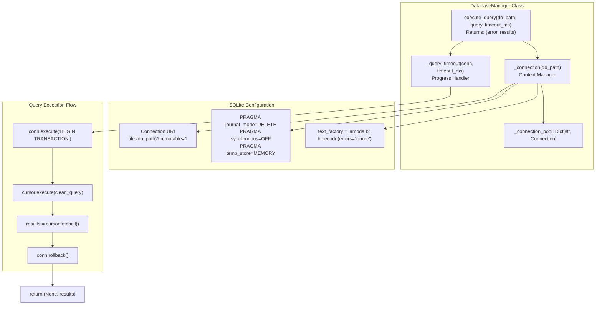
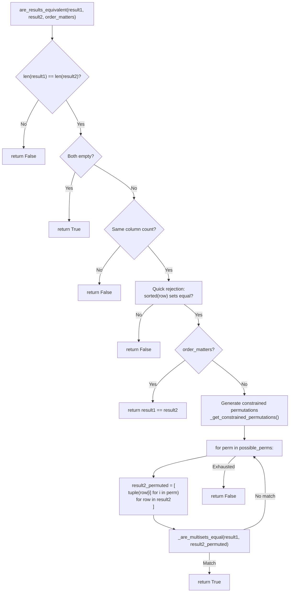
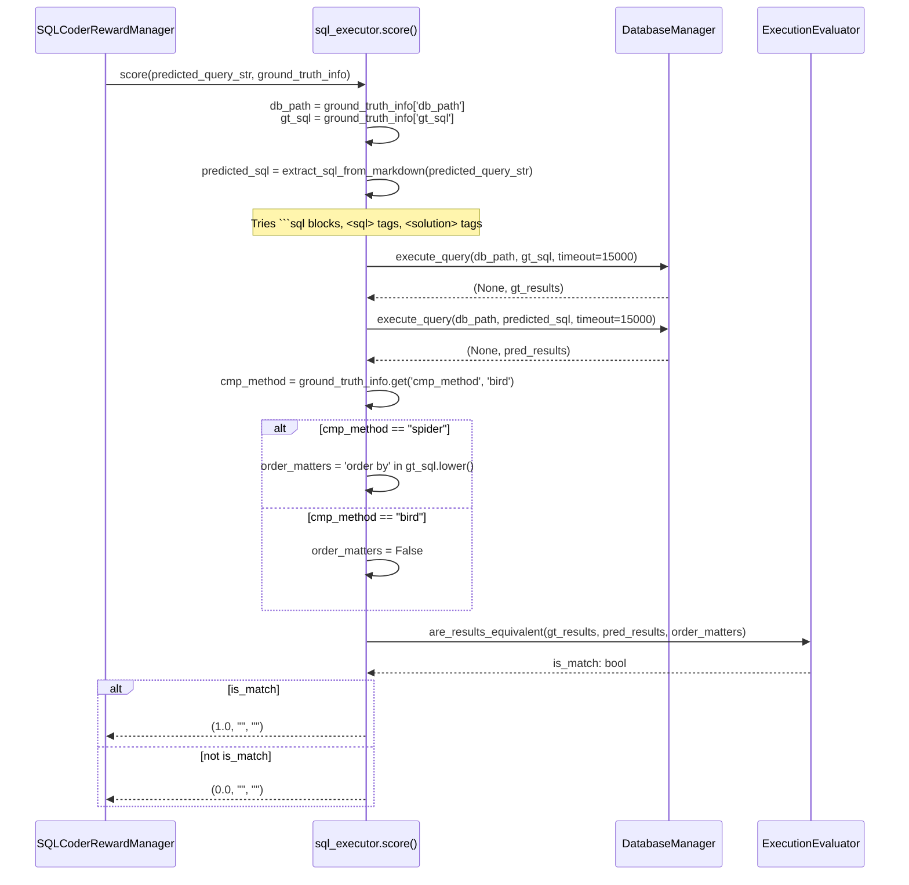
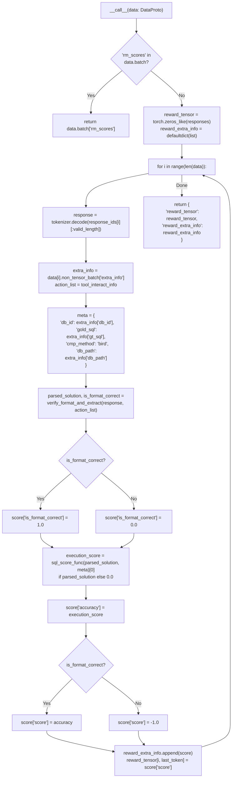
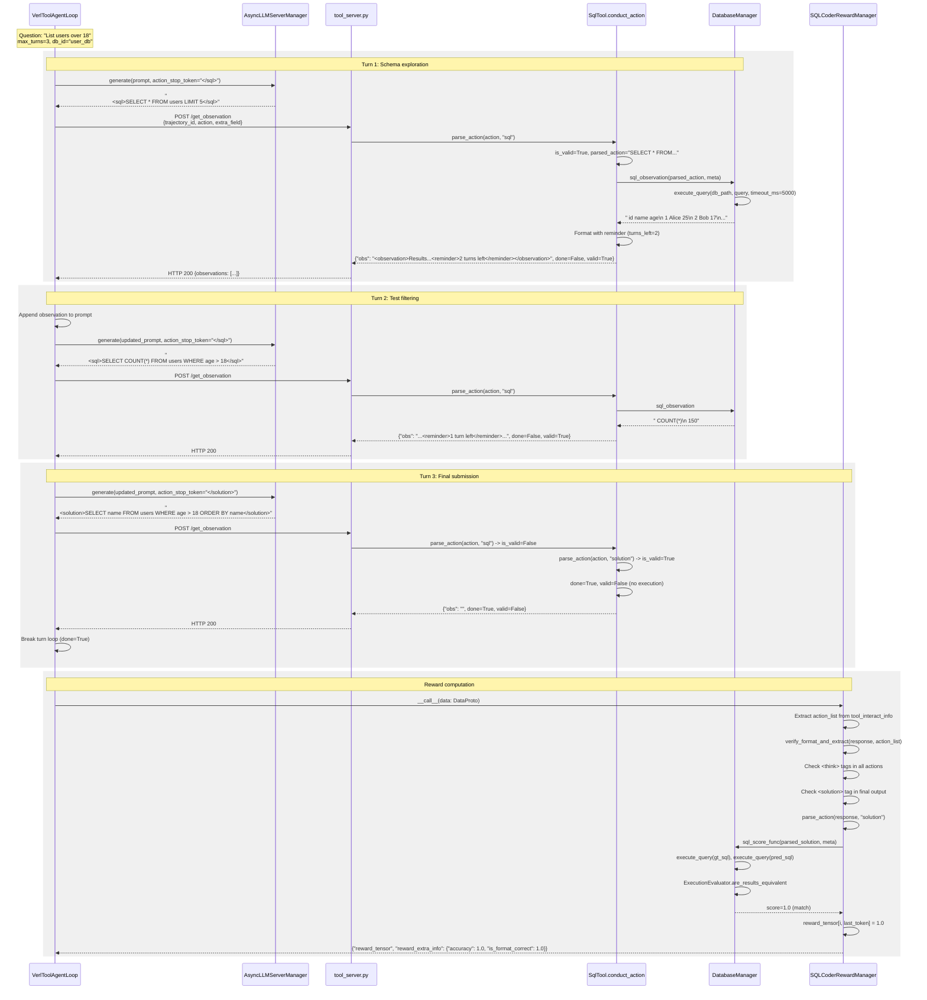
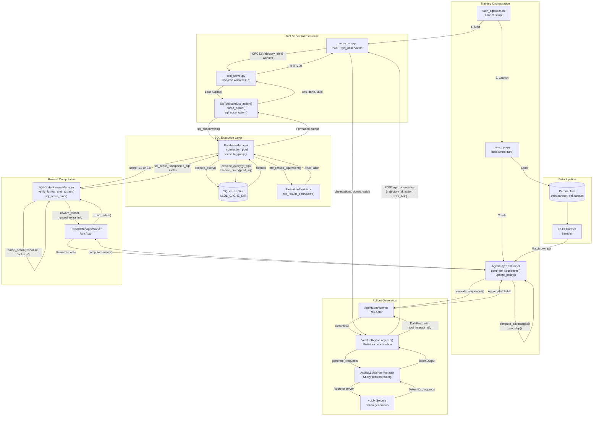

<!-- source: DeepWiki mcp.deepwiki.com · repo TIGER-AI-Lab/verl-tool · page 5.5 NL2SQL Database Query Training · fetched 2026-10-30 -->

# SQLCoder Training

<details>
<summary>Relevant source files</summary>

The following files were used as context for generating this wiki page:

- [examples/data_preprocess/acecoder.py](examples/data_preprocess/acecoder.py)
- [examples/train/mathcoder/train.sh](examples/train/mathcoder/train.sh)
- [examples/train/mathcoder/train_1.5b.sh](examples/train/mathcoder/train_1.5b.sh)
- [verl_tool/servers/tools/sql.py](verl_tool/servers/tools/sql.py)
- [verl_tool/servers/tools/utils/sql_executor.py](verl_tool/servers/tools/utils/sql_executor.py)
- [verl_tool/workers/reward_manager/sqlcoder.py](verl_tool/workers/reward_manager/sqlcoder.py)

</details>


This page documents the NL2SQL training recipe, which teaches language models to translate natural language questions into SQL queries through multi-turn database interactions. The training uses `SqlTool` for database execution and `SQLCoderRewardManager` for execution-based reward computation.

**Related pages:** [Core Training Framework](#2), [Reward Management System](#5), [SQL Database Tools](#3.6), [Training Script Structure](#4.1)

## Overview

SQLCoder training implements text-to-SQL generation using:

| Component | Implementation | Purpose |
|-----------|---------------|---------|
| Tool | `SqlTool` class [verl_tool/servers/tools/sql.py:35-189]() | Parses and executes SQL queries, manages episode state |
| Reward Manager | `SQLCoderRewardManager` [verl_tool/workers/reward_manager/sqlcoder.py:115-195]() | Computes rewards via execution-based evaluation |
| Executor | `DatabaseManager` [verl_tool/servers/tools/utils/sql_executor.py:65-161]() | SQLite connection pooling, timeout enforcement |
| Evaluator | `ExecutionEvaluator` [verl_tool/servers/tools/utils/sql_executor.py:165-247]() | Result set comparison with permutation tolerance |

**Training protocol:**
- Agent uses ``
   - Final output must contain `<solution>...</solution>` tags
   - Invalid format results in `score = -1.0` regardless of accuracy

2. **Execution-based scoring** [verl_tool/workers/reward_manager/sqlcoder.py:167-168]():
   - Calls `sql_score_func(parsed_solution, meta)` from `sql_executor.py`
   - Executes both ground truth SQL and predicted SQL
   - Compares result sets using `ExecutionEvaluator.are_results_equivalent()`

3. **Token-level assignment** [verl_tool/workers/reward_manager/sqlcoder.py:187]():
   - Reward assigned to last valid response token: `reward_tensor[i, valid_response_length_i - 1] = reward`
   - All other tokens receive zero reward
   - This encourages credit assignment to final decision point

**Sources:** [verl_tool/workers/reward_manager/sqlcoder.py:144-195]()
</old_str>

<new_str>
---

## SQL Execution and Result Comparison

The reward manager evaluates SQL queries by executing them against SQLite databases and comparing results.

### DatabaseManager and Query Execution

**DatabaseManager Architecture:**



**Key Implementation Details:**

| Component | Code Reference | Behavior |
|-----------|----------------|----------|
| Connection pooling | `_connection_pool: Dict[str, sqlite3.Connection]` [verl_tool/servers/tools/utils/sql_executor.py:70]() | Reuses connections across queries for same `db_path` |
| Read-only mode | `uri_path = f"file:{db_path}?immutable=1"` [verl_tool/servers/tools/utils/sql_executor.py:78]() | Prevents writes, enables concurrent reads |
| Timeout enforcement | `conn.set_progress_handler(handler, n_instructions)` [verl_tool/servers/tools/utils/sql_executor.py:106]() | Interrupts query after `timeout_ms` milliseconds |
| Transaction control | `conn.execute("BEGIN TRANSACTION"); ... conn.rollback()` [verl_tool/servers/tools/utils/sql_executor.py:136-139]() | Always rollback to ensure read-only behavior |
| Error handling | Returns `(error_message, None)` on failure [verl_tool/servers/tools/utils/sql_executor.py:142-147]() | Catches `OperationalError`, timeout interruptions |

**Sources:** [verl_tool/servers/tools/utils/sql_executor.py:65-161]()

### ExecutionEvaluator and Result Comparison

**Result Equivalence Algorithm:**



**Permutation Pruning:**

The `_get_constrained_permutations()` method [verl_tool/servers/tools/utils/sql_executor.py:228-246]() reduces search space:

1. Extracts column value sets from `result1`: `col_sets1 = [{row[i] for row in result1} for i in range(num_cols)]`
2. For large result sets (>3 columns), samples 20 random rows from `result2`
3. Eliminates invalid column mappings: if `random_row2[j] not in col_sets1[i]`, remove `j` from `perm_constraints[i]`
4. Returns `itertools.product(*perm_constraints)` for constrained permutation space

**Multiset Equality Check:**

The `_are_multisets_equal()` method [verl_tool/servers/tools/utils/sql_executor.py:215-226]() uses hash-based counting:

```python
counts = defaultdict(int)
for item in list1:
    counts[item] += 1
for item in list2:
    counts[item] -= 1
    if counts[item] < 0:
        return False
return all(v == 0 for v in counts.values())
```

**Sources:** [verl_tool/servers/tools/utils/sql_executor.py:165-247]()

### score() Function Integration

**Complete Evaluation Pipeline:**



**Function Signature and Return:**

```python
def score(
    predicted_query_str: str,
    ground_truth_info: Dict[str, Any]
) -> Tuple[float, str, str]:
    """
    Returns:
        score: 1.0 if results match, 0.0 otherwise
        pred_results: Empty string (unused)
        message: Empty string (unused)
    """
```

**Sources:** [verl_tool/servers/tools/utils/sql_executor.py:250-310]()

## SQLCoderRewardManager Implementation

The reward manager coordinates format validation and execution scoring.

**Reward Computation Flow:**



**Sources:** [verl_tool/workers/reward_manager/sqlcoder.py:124-195]()
    
    InitTensor --> LoopStart["for i in range(len(data)):"]
    LoopStart --> DecodeResp["response = tokenizer.decode(response_ids[i][:valid_length])"]
    
    DecodeResp --> ExtractMeta["extra_info = data[i].non_tensor_batch['extra_info']<br/>action_list = data[i].non_tensor_batch['tool_interact_info']"]
    
    ExtractMeta --> FormatCheck["parsed_solution, is_format_correct =<br/>verify_format_and_extract(response, action_list)"]
    
    FormatCheck --> ThinkCheck["for action in action_list:<br/>if not action.startswith('<sql>SELECT * FROM users LIMIT 5</sql>"
        AL->>ToolServer: POST /get_observation<br/>{trajectory_id, action, extra_field}
        ToolServer->>SqlTool: parse_action(action, "sql")
        SqlTool->>SqlTool: is_valid=True, parsed_action="SELECT * FROM..."
        SqlTool->>DBMgr: sql_observation(parsed_action, meta)
        DBMgr->>DBMgr: execute_query(db_path, query, timeout_ms=5000)
        DBMgr-->>SqlTool: "  id  name  age\n   1  Alice  25\n   2  Bob  17\n..."
        SqlTool->>SqlTool: Format with reminder (turns_left=2)
        SqlTool-->>ToolServer: {"obs": "<observation>Results...<reminder>2 turns left</reminder></observation>", done=False, valid=True}
        ToolServer-->>AL: HTTP 200 {observations: [...]}
    end
    
    rect rgb(240, 240, 240)
        Note over AL,DBMgr: Turn 2: Test filtering
        AL->>AL: Append observation to prompt
        AL->>LLM: generate(updated_prompt, action_stop_token="</sql>")
        LLM-->>AL: "<sql>SELECT COUNT(*) FROM users WHERE age > 18</sql>"
        AL->>ToolServer: POST /get_observation
        ToolServer->>SqlTool: parse_action(action, "sql")
        SqlTool->>DBMgr: sql_observation
        DBMgr-->>SqlTool: "  COUNT(*)\n  150"
        SqlTool-->>ToolServer: {"obs": "...<reminder>1 turn left</reminder>...", done=False, valid=True}
        ToolServer-->>AL: HTTP 200
    end
    
    rect rgb(240, 240, 240)
        Note over AL,RM: Turn 3: Final submission
        AL->>LLM: generate(updated_prompt, action_stop_token="</solution>")
        LLM-->>AL: "<solution>SELECT name FROM users WHERE age > 18 ORDER BY name</solution>"
        AL->>ToolServer: POST /get_observation
        ToolServer->>SqlTool: parse_action(action, "sql") -> is_valid=False
        SqlTool->>SqlTool: parse_action(action, "solution") -> is_valid=True
        SqlTool->>SqlTool: done=True, valid=False (no execution)
        SqlTool-->>ToolServer: {"obs": "", done=True, valid=False}
        ToolServer-->>AL: HTTP 200
        AL->>AL: Break turn loop (done=True)
    end
    
    rect rgb(240, 240, 240)
        Note over AL,RM: Reward computation
        AL->>RM: __call__(data: DataProto)
        RM->>RM: Extract action_list from tool_interact_info
        RM->>RM: verify_format_and_extract(response, action_list)
        RM->>RM: Check <sql>SELECT * FROM users LIMIT 5</sql>"
        
        AgentLoop->>AgentLoop: Detect "</sql>" in output
        AgentLoop->>Router: POST /get_observation<br/>body = {trajectory_ids: [tid], actions: [action], extra_field: {...}}
        
        Router->>Router: backend_idx = crc32(trajectory_id) % num_workers
        Router->>SqlTool: route to worker[backend_idx]
        
        SqlTool->>SqlTool: parse_action(action, "sql")<br/>sql_code_start = action.rfind("<sql>")<br/>sql_code_end = action.find("</sql>")
        SqlTool->>SqlTool: parsed_action = "SELECT * FROM users LIMIT 5"<br/>is_valid = True
        
        SqlTool->>SqlTool: env = load_env(trajectory_id)<br/>turns_left = extra_field["turns_left"]
        
        SqlTool->>DBManager: sql_observation(parsed_action, meta={db_id, db_path})<br/>timeout=5
        DBManager->>DBManager: execute_query(db_path, query, timeout_ms=5000)<br/>conn = _connection_pool[db_path]<br/>cursor.execute(clean_query)
        DBManager-->>SqlTool: "  id  name  age\n   1  Alice  25\n   2  Bob  17\n..."
        
        SqlTool->>SqlTool: reminder = f"<reminder>You have {turns_left} turns left</reminder>"<br/>obs = f"<observation>{result}\n{reminder}</observation>"
        SqlTool->>SqlTool: update_env(trajectory_id, env, parsed_action, is_valid, extra_field, observation)
        
        SqlTool-->>Router: return (obs, done=False, valid=True)
        Router-->>AgentLoop: HTTP 200 {observations: [obs], dones: [False], valids: [True]}
        
        AgentLoop->>AgentLoop: prompt = prompt + action + obs
    end
    
    rect rgb(240, 240, 240)
        Note over AgentLoop,DBManager: Turn 2: Query verification (turns_left=2)
        AgentLoop->>vLLM: generate(updated_prompt, stop_tokens=["</sql>"])
        vLLM-->>AgentLoop: "<sql>SELECT COUNT(*) FROM users WHERE age > 18</sql>"
        
        AgentLoop->>Router: POST /get_observation
        Router->>SqlTool: Same backend via consistent_hash
        SqlTool->>SqlTool: parse_action(action, "sql") -> valid
        SqlTool->>DBManager: sql_observation(parsed_action, meta)
        DBManager-->>SqlTool: "  COUNT(*)\n  150"
        SqlTool-->>Router: (obs with turns_left=1, done=False, valid=True)
        Router-->>AgentLoop: HTTP 200
        
        AgentLoop->>AgentLoop: Append obs to prompt
    end
    
    rect rgb(240, 240, 240)
        Note over AgentLoop,RewardMgr: Turn 3: Final answer (turns_left=1)
        AgentLoop->>vLLM: generate(updated_prompt, stop_tokens=["</solution>"])
        vLLM-->>AgentLoop: "<solution>SELECT name FROM users WHERE age > 18 ORDER BY name</solution>"
        
        AgentLoop->>Router: POST /get_observation
        Router->>SqlTool: Same backend
        
        SqlTool->>SqlTool: parse_action(action, "sql")<br/>sql_start = action.rfind("<sql>") -> -1<br/>is_valid = False
        SqlTool->>SqlTool: parse_action(action, "solution")<br/>sol_start = action.rfind("<solution>") -> found<br/>is_valid = True
        
        Note over SqlTool: <solution> tag triggers episode termination
        SqlTool->>SqlTool: done = True, valid = False<br/>obs = "" (no execution)
        
        SqlTool-->>Router: (obs="", done=True, valid=False)
        Router-->>AgentLoop: HTTP 200 {dones: [True]}
        
        AgentLoop->>AgentLoop: Break turn loop (done=True detected)
        AgentLoop->>AgentLoop: Finalize DataProto with tool_interact_info
    end
    
    rect rgb(240, 240, 240)
        Note over AgentLoop,RewardMgr: Reward computation phase
        AgentLoop-->>AgentLoop: Return DataProto to PPO trainer
        
        Note over RewardMgr: PPO trainer calls reward_manager(data)
        RewardMgr->>RewardMgr: response = tokenizer.decode(response_ids[i])<br/>action_list = data[i].non_tensor_batch['tool_interact_info']
        
        RewardMgr->>RewardMgr: verify_format_and_extract(response, action_list)<br/>- Check ` | Validated in reward manager [verl_tool/workers/reward_manager/sqlcoder.py:99-102]() | Not executed, ignored by tool | No effect on `done` flag |
| `<sql>...</sql>` | `parse_action(action, "sql")` [verl_tool/servers/tools/sql.py:47-82]() | Extract SQL, call `sql_observation()`, return result | `done=False`, `valid=True` |
| `<solution>...</solution>` | `parse_action(action, "solution")` [verl_tool/servers/tools/sql.py:117]() | Extract SQL, **no execution**, empty obs | `done=True`, `valid=False` |

**Parsing implementation:**

```python
def parse_action(self, action: str, tag_type: str = "sql") -> Tuple[str, bool]:
    """Extract SQL from tags using rfind() for last occurrence."""
    start_tag = SQL_START if tag_type == "sql" else SOLUTION_START
    end_tag = SQL_END if tag_type == "sql" else SOLUTION_END
    
    sql_code_start_idx = action.rfind(start_tag)  # Last occurrence
    if sql_code_start_idx == -1:
        return "", False
    
    sql_code_end_idx = action.find(end_tag, sql_code_start_idx + len(start_tag))
    if sql_code_end_idx == -1:
        return "", False
    
    sql_code = action[sql_code_start_idx + len(start_tag):sql_code_end_idx].strip()
    return sql_code, True
```

**Sources:** [verl_tool/servers/tools/sql.py:47-82]()

**Episode control logic in `conduct_action()`:**

```python
# Try <sql> first (intermediate query)
parsed_action, is_valid = self.parse_action(action, "sql")

if not is_valid:
    # Try <solution> (final answer)
    parsed_action, is_valid = self.parse_action(action, "solution")
    
    if is_valid:
        # Final answer detected, terminate episode
        observation = ""
        done = True
        valid = False
    else:
        # Neither tag found, invalid format
        observation = "Your previous action is invalid. Follow the format..."
        done = False
        valid = False
else:
    # <sql> found, execute and continue
    observation = sql_observation(parsed_action, meta, timeout=5)
    done = False
    valid = True
```

**Sources:** [verl_tool/servers/tools/sql.py:98-168]()

**Design rationale:**

1. **`<think>` encourages chain-of-thought:** Reward manager checks that each action starts with reasoning [verl_tool/workers/reward_manager/sqlcoder.py:99-102](), penalizing format violations with `score = -1.0`

2. **`<sql>` supports iterative refinement:** Agent can test queries, inspect results, and adjust approach across multiple turns without episode termination

3. **`<solution>` defers execution:** Final query is not executed by tool server; instead, reward manager executes both ground truth and predicted SQL for comparison, enabling format validation before expensive execution

**Sources:** [verl_tool/servers/tools/sql.py:98-130](), [verl_tool/workers/reward_manager/sqlcoder.py:95-109]()

### Turn Management

Turn tracking is implemented via `extra_field` dictionary passed through the tool server:

**Turn information structure:**

```python
extra_field = {
    "db_id": str,           # Database identifier (e.g., "spider_train_123")
    "db_path": str,         # Absolute path to .db file
    "gt_sql": str,          # Ground truth SQL for evaluation
    "turns_left": int,      # Remaining turns (decremented by AgentLoop)
    "current_step": int,    # Current turn index (0-indexed)
    "max_turns": int        # Total allowed turns (typically 3-5)
}
```

**Extraction in `SqlTool.conduct_action()`:** [verl_tool/servers/tools/sql.py:103-105]()

```python
turns_left = extra_field.get("turns_left", 0) if extra_field else 0
current_step = extra_field.get("current_step", 0) if extra_field else 0
max_turns = extra_field.get("max_turns", 0) if extra_field else 0
```

**Reminder generation:** [verl_tool/servers/tools/sql.py:171]()

```python
reminder_text = f"<reminder>You have {turns_left} turns left to complete the task.</reminder>"
obs = f"\n\n<observation>{observation}\n{reminder_text}</observation>\n\n"
```

**Behavioral impact:**

| Turns Left | Agent Behavior (Learned) |
|------------|-------------------------|
| 3-5 | Explore schema, test simple queries |
| 2 | Verify filtering logic, check edge cases |
| 1 | Transition to `<solution>` tag for final submission |
| 0 | Episode force-terminates (handled by AgentLoop) |

The reminder text provides explicit turn count to help models learn pacing strategies for multi-turn SQL generation.

**Sources:** [verl_tool/servers/tools/sql.py:103-105,171-178]()

---

## System Architecture

**SQLCoder Training Component Interaction**

```mermaid
graph TB
    subgraph "Training Orchestration"
        TrainScript["train_sqlcoder.sh"]
        MainPPO["main_ppo.py<br/>TaskRunner"]
        AgentTrainer["AgentRayPPOTrainer"]
    end
    
    subgraph "Tool Server (serve.py)"
        Router["Uvicorn Router<br/>consistent_hash(trajectory_id)"]
        Backend["tool_server.py<br/>Backend Worker"]
        SqlToolClass["SqlTool<br/>tool_type='sql'"]
    end
    
    subgraph "SQL Execution Layer"
        DBManager["DatabaseManager<br/>_connection_pool"]
        SQLiteConn["sqlite3.Connection<br/>immutable=1"]
        DBFiles[("SQLite .db files<br/>$SQL_CACHE_DIR")]
    end
    
    subgraph "Agent Loop"
        AgentLoop["VerlToolAgentLoop<br/>run()"]
        vLLM["AsyncLLMServerManager<br/>vLLM/SGLang"]
    end
    
    subgraph "Reward Computation"
        RewardMgr["SQLCoderRewardManager<br/>@register('sqlcoder')"]
        VerifyFormat["verify_format_and_extract<br/><br/>in each action?"}
    FormatCheck --> SolutionCheck{"<solution>...</solution><br/>in final output?"}
    
    ThinkCheck -->|"No"| FormatZero["score['is_format_correct'] = 0"]
    SolutionCheck -->|"No"| FormatZero
    ThinkCheck -->|"Yes"| FormatOne["score['is_format_correct'] = 1"]
    SolutionCheck -->|"Yes"| FormatOne
    
    FormatOne --> ParseSol["parse_action(response, 'solution')"]
    FormatZero --> ParseSol
    ParseSol --> ExecQuery["sql_score_func(parsed_solution, meta)"]
    
    ExecQuery --> DBMgr["DatabaseManager.execute_query"]
    DBMgr --> GTExec["execute_query(db_path, gt_sql)"]
    DBMgr --> PredExec["execute_query(db_path, predicted_sql)"]
    
    GTExec --> Compare["ExecutionEvaluator.are_results_equivalent"]
    PredExec --> Compare
    
    Compare -->|"Match"| Acc1["score['accuracy'] = 1.0"]
    Compare -->|"Mismatch"| Acc0["score['accuracy'] = 0.0"]
    
    Acc1 --> FinalScore{"is_format_correct?"}
    Acc0 --> FinalScore
    
    FinalScore -->|"Yes"| ScoreAcc["score['score'] = accuracy"]
    FinalScore -->|"No"| ScoreNeg["score['score'] = -1.0"]
    
    ScoreAcc --> AssignToken["reward_tensor[i, last_valid_token] = score['score']"]
    ScoreNeg --> AssignToken
    AssignToken --> NextIter["next iteration"]
    NextIter --> LoopStart
    
    NextIter -.all done.-> ReturnDict["return {'reward_tensor', 'reward_extra_info'}"]
```

**Sources:** [verl_tool/workers/reward_manager/sqlcoder.py:124-195]()

### Reward Components

The reward manager computes three metrics stored in `reward_extra_info`:

| Metric | Computation | Purpose |
|--------|-------------|---------|
| `is_format_correct` | 1.0 if all `<br/><sql>SELECT * FROM users LIMIT 5</sql>"
    Agent->>Tool: conduct_action(action, trajectory_id, extra_field)
    Tool->>DB: execute_query
    DB-->>Tool: Results (5 rows)
    Tool-->>Agent: "<observation>Results...<reminder>2 turns left</reminder></observation>"
    
    Note over Agent: Turn 2: Refinement
    Agent->>vLLM: Continue with observation
    vLLM-->>Agent: "<sql>SELECT COUNT(*) FROM users WHERE age > 18</sql>"
    Agent->>Tool: conduct_action
    Tool->>DB: execute_query
    DB-->>Tool: Results (count)
    Tool-->>Agent: "<observation>Count: 150<reminder>1 turn left</reminder></observation>"
    
    Note over Agent: Turn 3: Final answer
    Agent->>vLLM: Continue with observation
    vLLM-->>Agent: "<solution>SELECT name FROM users WHERE age > 18 ORDER BY name</solution>"
    Agent->>Tool: conduct_action
    Tool-->>Agent: obs="", done=True, valid=False
    
    Note over Agent: Episode complete, compute reward
    Agent->>RewardMgr: Complete trajectory
```

**Sources:** [verl_tool/servers/tools/sql.py:100-188]()

### Turn Management

The `extra_field` parameter tracks turn information:

```python
turns_left = extra_field.get("turns_left", 0)
current_step = extra_field.get("current_step", 0)
max_turns = extra_field.get("max_turns", 0)
```

These values are used to:
1. Generate reminder text in observations: [verl_tool/servers/tools/sql.py:171]()
2. Guide the agent toward providing a final solution
3. Track trajectory progress in logs

**Sources:** [verl_tool/servers/tools/sql.py:102-113]()

### Tag-based Interaction Protocol

| Tag | Purpose | Tool Behavior |
|-----|---------|---------------|
| `` | Reasoning process | Ignored by tool, validated by reward manager |
| `<sql>...</sql>` | Intermediate query | Executed, observation returned, `done=False` |
| `<solution>...</solution>` | Final answer | Not executed, `done=True`, evaluated by reward manager |

The separation between `<sql>` (intermediate) and `<solution>` (final) allows the agent to:
- Explore the database schema in early turns
- Test partial queries for correctness
- Provide a polished final query only when confident

**Sources:** [verl_tool/servers/tools/sql.py:30-32](), [verl_tool/servers/tools/sql.py:98-130]()
</old_str>

<new_str>
---

## Multi-turn Interaction Protocol

SQLCoder training uses a structured tag-based protocol for multi-turn database interaction.

### Interaction Sequence Example

**Complete Multi-turn SQL Episode**



**Sources:** [verl_tool/servers/tools/sql.py:85-188](), [verl_tool/workers/reward_manager/sqlcoder.py:144-195]()

### Tag Protocol Specification

| Tag | Detection | Execution | Episode Control |
|-----|-----------|-----------|-----------------|
| `<think>` | Validated by `verify_format_and_extract` [verl_tool/workers/reward_manager/sqlcoder.py:99-102]() | Not executed | Format penalty if missing at action start |
| `<sql>` | `parse_action(action, "sql")` [verl_tool/servers/tools/sql.py:99]() | Executed via `sql_observation` | `done=False`, `valid=True` |
| `<solution>` | `parse_action(action, "solution")` [verl_tool/servers/tools/sql.py:117]() | **Not executed** | `done=True`, `valid=False` |

**Key design rationale:**

- **`<think>` tags enforce reasoning:** The reward manager penalizes trajectories where actions don't start with thinking [verl_tool/workers/reward_manager/sqlcoder.py:99-102]()
- **`<sql>` enables exploration:** Intermediate queries receive immediate feedback without terminating the episode
- **`<solution>` defers execution:** Final answers are evaluated by the reward manager after episode completion, allowing format checking before execution

**Sources:** [verl_tool/servers/tools/sql.py:98-130](), [verl_tool/workers/reward_manager/sqlcoder.py:95-109]()

### Turn Management and Reminders

Turn information flows through `extra_field`:

```python
# Passed from AgentLoop -> ToolServer -> SqlTool
extra_field = {
    "db_id": str,
    "db_path": str,
    "gt_sql": str,
    "turns_left": int,      # Decremented each turn
    "current_step": int,    # Current turn number (0-indexed)
    "max_turns": int        # Total allowed turns
}
```

The `SqlTool` extracts these values [verl_tool/servers/tools/sql.py:103-105]() and generates reminders:

```python
reminder_text = f"<reminder>You have {turns_left} turns left to complete the task.</reminder>"
obs = f"\n\n<observation>{observation}\n{reminder_text}</observation>\n\n"
```

This guides the model to:
1. Explore efficiently in early turns
2. Transition to solution submission as `turns_left` approaches zero
3. Avoid exceeding `max_turns` without providing a final answer

**Sources:** [verl_tool/servers/tools/sql.py:103-105,171-178]()

---

## Dataset Format and Preparation

SQLCoder training requires parquet datasets with database metadata for execution-based evaluation.

### Dataset Schema Requirements

**Standard Fields:**

| Field | Type | Description | Accessed By |
|-------|------|-------------|-------------|
| `prompt` | str | Natural language question | `VerlToolAgentLoop` for initial generation |
| `use_tool` | str | Must be `"sql"` | Tool server routes to `SqlTool` class |
| `extra_info` | dict | Database metadata (see below) | `SqlTool.conduct_action()` and `SQLCoderRewardManager.__call__()` |

**extra_info Dictionary Structure:**

```python
{
    "db_id": str,          # Database identifier (e.g., "spider_train_0001")
    "db_path": str,        # Absolute path to SQLite .db file
    "gt_sql": str          # Ground truth SQL query for evaluation
}
```

**Example Dataset Row:**

```json
{
  "prompt": "What is the average age of users in each department?",
  "use_tool": "sql",
  "extra_info": {
    "db_id": "company_hr",
    "db_path": "/data/nl2sql/cache/company_hr/database.db",
    "gt_sql": "SELECT department, AVG(age) FROM employees GROUP BY department"
  }
}
```

**Field Usage in Code:**

- `db_path`: Extracted in `SqlTool.conduct_action()` [verl_tool/servers/tools/sql.py:136]() and passed to `DatabaseManager.execute_query()` [verl_tool/servers/tools/utils/sql_executor.py:112-148]()
- `gt_sql`: Used by `SQLCoderRewardManager` [verl_tool/workers/reward_manager/sqlcoder.py:154]() via `sql_score_func()` for result comparison
- `db_id`: Used for cache directory resolution if `db_path` not provided [verl_tool/servers/tools/utils/sql_executor.py:273-274]()

**Sources:** [verl_tool/workers/reward_manager/sqlcoder.py:151-157](), [verl_tool/servers/tools/sql.py:134-145](), [verl_tool/servers/tools/utils/sql_executor.py:270-280]()

### Database File Organization

**Directory Structure:**

```
$SQL_CACHE_DIR/                              # Set via environment variable
├── spider_train_0001/
│   └── database.db                          # SQLite database file
├── spider_train_0002/
│   └── database.db
└── company_hr/
    └── database.db
```

**DatabaseManager Connection Configuration:**

The `DatabaseManager` class [verl_tool/servers/tools/utils/sql_executor.py:65-161]() manages connections with:

| Configuration | Implementation | Purpose |
|---------------|----------------|---------|
| Connection URI | `file:{db_path}?immutable=1` [verl_tool/servers/tools/utils/sql_executor.py:78]() | Read-only access via URI parameter |
| Connection pool | `self._connection_pool: Dict[str, sqlite3.Connection]` [verl_tool/servers/tools/utils/sql_executor.py:70]() | Reuses connections across queries |
| Pragmas | `PRAGMA journal_mode=DELETE; synchronous=OFF; temp_store=MEMORY` [verl_tool/servers/tools/utils/sql_executor.py:81-83]() | Performance optimization, no WAL files |
| Text factory | `lambda b: b.decode(errors="ignore")` [verl_tool/servers/tools/utils/sql_executor.py:84]() | Handle encoding errors gracefully |
| Timeout | `set_progress_handler()` callback [verl_tool/servers/tools/utils/sql_executor.py:98-110]() | Interrupt queries exceeding timeout |

**Read-only Enforcement:**

- `immutable=1` URI parameter prevents any writes [verl_tool/servers/tools/utils/sql_executor.py:78]()
- `BEGIN TRANSACTION` followed by `rollback()` ensures no state changes [verl_tool/servers/tools/utils/sql_executor.py:136-139]()
- Used by both `sql_observation()` during rollouts and `score()` during reward computation

**Sources:** [verl_tool/servers/tools/utils/sql_executor.py:65-161]()

### Data Preprocessing

For converting raw NL2SQL datasets (Spider, BIRD, etc.) to verl-tool format, see preprocessing scripts in `examples/data_process/`.

**Preprocessing steps:**

1. Load raw dataset (Spider JSON, BIRD parquet, etc.)
2. Map each example to required schema with `prompt`, `use_tool`, `extra_info`
3. Copy SQLite database files to `$SQL_CACHE_DIR/{db_id}/`
4. Save to parquet with `train.parquet` and `val.parquet` splits
5. Configure paths in `data/sql_data.yaml`

**Sources:** [examples/data_process/]()

---

## Training Configuration and Execution

SQLCoder training uses Hydra configuration system with domain-specific YAML files.

### Configuration File Structure

**Directory Layout:**

```
examples/train/skysql/
├── train_sqlcoder.sh               # Launch script with tool server startup
├── ppo.yaml                        # PPO/GRPO algorithm config
├── data/
│   └── sql_data.yaml              # Dataset paths, tokenization limits
└── rollout/
    └── rollout_sql.yaml           # Agent loop config (max_turns, stop tokens)
```

**Configuration Loading:**

The training script uses Hydra's composition system:
```bash
python -u main_ppo.py \
    trainer=ppo_agent \           # Loads trainer/ppo_agent.yaml -> AgentRayPPOTrainer
    data=sql_data \               # Loads data/sql_data.yaml
    rollout=rollout_sql \         # Loads rollout/rollout_sql.yaml
    actor.model.path=<model>      # Override base model checkpoint
```

**Sources:** [examples/train/skysql/]()

### Key Configuration Parameters

| Parameter Path | YAML File | Purpose | Typical Value |
|----------------|-----------|---------|---------------|
| `data.train_files` | `data/sql_data.yaml` | List of training parquet files | `["/data/nl2sql/train.parquet"]` |
| `data.val_files` | `data/sql_data.yaml` | Validation dataset | `["/data/nl2sql/val.parquet"]` |
| `data.max_prompt_length` | `data/sql_data.yaml` | Maximum tokens in prompt | `2048` |
| `data.max_response_length` | `data/sql_data.yaml` | Maximum tokens in response | `512` |
| `rollout.n_envs` | `rollout/rollout_sql.yaml` | Parallel tool server workers | `16` |
| `rollout.agent.enable_agent` | `rollout/rollout_sql.yaml` | Enable multi-turn agent loop | `true` |
| `rollout.agent.max_turns` | `rollout/rollout_sql.yaml` | Maximum turns per episode | `3` |
| `rollout.agent.action_stop_tokens` | `rollout/rollout_sql.yaml` | Tokens to trigger tool calls | `["</sql>", "</solution>"]` |
| `rollout.agent.tool_server_url` | `rollout/rollout_sql.yaml` | Tool server endpoint | `"http://localhost:8000"` |
| `trainer.reward_fn_key` | `ppo.yaml` | Reward manager registry key | `"sqlcoder"` |
| `algorithm.gamma` | `ppo.yaml` | Discount factor for advantages | `1.0` (no discounting) |
| `algorithm.kl_coef` | `ppo.yaml` | KL divergence penalty coefficient | `0.05` |

**Sources:** [examples/train/skysql/ppo.yaml](), [examples/train/skysql/data/sql_data.yaml](), [examples/train/skysql/rollout/rollout_sql.yaml]()

### Launch Script and Tool Server

**train_sqlcoder.sh Structure:**

```bash
#!/bin/bash

# 1. Set environment variables
export SQL_CACHE_DIR="/data/nl2sql/cache"
export CUDA_VISIBLE_DEVICES="0,1,2,3"

# 2. Start tool server in background
python -m verl_tool.servers.serve \
    --tools sql \
    --workers 16 \
    --ports 30001-30016 \
    --log-level INFO &
TOOL_SERVER_PID=$!

# 3. Wait for server readiness
sleep 10

# 4. Launch PPO training with Hydra overrides
python -u main_ppo.py \
    trainer=ppo_agent \
    data=sql_data \
    rollout=rollout_sql \
    actor.model.path=/path/to/base/model \
    trainer.project_name=sqlcoder_experiment \
    trainer.experiment_name=run_001 \
    +rollout.name=sql_training

# 5. Cleanup on exit
trap "kill $TOOL_SERVER_PID" EXIT
```

**Tool Server Configuration:**

| CLI Argument | Value for SQL Training | Purpose | Implementation |
|--------------|------------------------|---------|----------------|
| `--tools` | `sql` | Load `SqlTool` via `@register_tool` | Imports `verl_tool/servers/tools/sql.py` |
| `--workers` | `16` | Backend worker processes | Creates 16 `tool_server.py` processes on ports 30001-30016 |
| `--ports` | `30001-30016` | Port range for workers | Router at port 8000 forwards via `_pick_worker_index()` |
| `--log-level` | `INFO` | Logging verbosity | Controls uvicorn and tool execution logs |

**Process Architecture:**

```
serve.py (port 8000) -> FastAPI Router -> consistent_hash(trajectory_id)
    |
    ├─> tool_server.py:30001 -> SqlTool instance
    ├─> tool_server.py:30002 -> SqlTool instance
    └─> tool_server.py:30016 -> SqlTool instance
```

**Sources:** [examples/train/skysql/train_sqlcoder.sh](), [verl_tool/servers/serve.py:1-100]()

### Training Monitoring

**WandB Metrics Logged by AgentRayPPOTrainer:**

| Metric Key | Source | Description |
|------------|--------|-------------|
| `train/reward_mean` | `reward_extra_info["score"]` | Average sparse reward across batch |
| `train/accuracy` | `reward_extra_info["accuracy"]` | Execution accuracy (0.0 or 1.0) |
| `train/is_format_correct` | `reward_extra_info["is_format_correct"]` | Format validation pass rate |
| `train/tool_interact_count` | `len(tool_interact_info)` | Average tool calls per trajectory |
| `train/avg_turns` | `tool_interact_info` aggregation | Average turns used before `<solution>` |

**Validation Metrics:**

During validation [verl_tool/trainer/ppo/agent_ray_trainer.py:_validate()](), the trainer runs greedy sampling (temperature=0) and logs:

- `val/accuracy`: Execution accuracy on validation set
- `val/avg_turns`: Average turns used
- `val/format_error_rate`: Fraction with `is_format_correct=0`

**Sources:** [verl_tool/trainer/ppo/agent_ray_trainer.py:1-500]()

---

## System Integration and Training Loop

SQLCoder training integrates multiple components in the verl-tool framework for end-to-end NL2SQL learning.

### Component Integration Diagram

**SQLCoder Training System Architecture**



**Sources:** [main_ppo.py:1-300](), [verl_tool/trainer/ppo/agent_ray_trainer.py:1-500](), [verl_tool/agent_loop.py:1-200](), [verl_tool/servers/serve.py:1-100](), [verl_tool/servers/tools/sql.py:1-189](), [verl_tool/workers/reward_manager/sqlcoder.py:1-195]()

### Training Loop Sequence

**Single PPO Iteration for SQLCoder**

1. **Data sampling:** `RLHFDataset` samples batch of prompts with `extra_info` containing `db_id`, `db_path`, `gt_sql`
2. **Rollout generation:** `AgentRayPPOTrainer.generate_sequences()` creates Ray tasks for `AgentLoopWorker`
3. **Multi-turn execution:** Each worker instantiates `VerlToolAgentLoop.run()` which:
   - Generates tokens via `AsyncLLMServerManager` until `action_stop_tokens` (`</sql>` or `</solution>`)
   - Posts actions to tool server with `extra_field` containing `turns_left`, `db_path`, `gt_sql`
   - Appends observations to prompt, updates `response_mask` to distinguish model vs tool output
   - Terminates when `done=True` (from `<solution>` tag) or `max_turns` reached
4. **Reward computation:** `RewardManagerWorker` calls `SQLCoderRewardManager`:
   - Validates format: checks `<think>` in all actions, `<solution>` in final output
   - Executes predicted and ground truth SQL via `DatabaseManager`
   - Compares results with `ExecutionEvaluator.are_results_equivalent()`
   - Assigns sparse reward at last token: `1.0` if match and format correct, `-1.0` if format error, `0.0` otherwise
5. **Advantage computation:** PPO computes advantages using GAE with `gamma=1.0` (no discounting)
6. **Policy update:** Actor and critic networks updated via PPO clip objective with KL penalty

**Sources:** [verl_tool/trainer/ppo/agent_ray_trainer.py:generate_sequences,update_policy](), [verl_tool/agent_loop.py:run](), [verl_tool/workers/reward_manager/sqlcoder.py:__call__]()

### Key Design Patterns

**Architectural Decisions:**

1. **Deferred execution for final answer:** `<solution>` tag terminates episode (`done=True`) without executing query; execution happens in reward manager, enabling format validation before expensive database operations

2. **Consistent hashing for trajectory routing:** `_pick_worker_index(trajectory_id)` uses CRC32 hash [verl_tool/servers/serve.py] to ensure same backend worker handles all turns for a trajectory, enabling stateful environment management in `env_cache`

3. **Sparse reward at last token:** Reward assigned only to final valid token [verl_tool/workers/reward_manager/sqlcoder.py:187](), creating clear credit assignment to episode outcome

4. **Format penalties enforce protocol:** Trajectories with missing `<think>` or `<solution>` tags receive `score=-1.0` regardless of SQL accuracy, incentivizing structured output

5. **Connection pooling for efficiency:** `DatabaseManager._connection_pool` reuses SQLite connections across queries, reducing overhead for large training batches

**Sources:** [verl_tool/servers/tools/sql.py:98-130](), [verl_tool/workers/reward_manager/sqlcoder.py:124-195](), [verl_tool/servers/serve.py:_pick_worker_index](), [verl_tool/servers/tools/utils/sql_executor.py:65-90]()

---

## Reward Manager: SQLCoderRewardManager

The `SQLCoderRewardManager` evaluates generated SQL queries by executing them and comparing results with ground truth queries.

### Reward Computation Flow

```mermaid
flowchart TD
    Start[Complete Trajectory] --> Decode[Decode response_ids]
    Decode --> ExtractActions[Extract action_list<br/>from tool_interact_info]
    
    ExtractActions --> FormatCheck{verify_format_and_extract}
    FormatCheck -->|Check think tags| ThinkValid{<sql>SELECT * FROM users LIMIT 5</sql>"
    Agent->>Tool: conduct_action(action, trajectory_id, extra_field)
    Tool->>DB: execute_query
    DB-->>Tool: Results (5 rows)
    Tool-->>Agent: "<observation>Results...<reminder>2 turns left</reminder></observation>"
    
    Note over Agent: Turn 2: Refinement
    Agent->>vLLM: Continue with observation
    vLLM-->>Agent: "<sql>SELECT COUNT(*) FROM users WHERE age > 18</sql>"
    Agent->>Tool: conduct_action
    Tool->>DB: execute_query
    DB-->>Tool: Results (count)
    Tool-->>Agent: "<observation>Count: 150<reminder>1 turn left</reminder></observation>"
    
    Note over Agent: Turn 3: Final answer
    Agent->>vLLM: Continue with observation
    vLLM-->>Agent: "<solution>SELECT name FROM users WHERE age > 18 ORDER BY name</solution>"
    Agent->>Tool: conduct_action
    Tool-->>Agent: obs="", done=True, valid=False
    
    Note over Agent: Episode complete, compute reward
    Agent->>RewardMgr: Complete trajectory
```

**Sources:** [verl_tool/servers/tools/sql.py:100-188]()

### Turn Management

The `extra_field` parameter tracks turn information:

```python
turns_left = extra_field.get("turns_left", 0)
current_step = extra_field.get("current_step", 0)
max_turns = extra_field.get("max_turns", 0)
```

These values are used to:
1. Generate reminder text in observations: [verl_tool/servers/tools/sql.py:171]()
2. Guide the agent toward providing a final solution
3. Track trajectory progress in logs

**Sources:** [verl_tool/servers/tools/sql.py:102-113]()

### Tag-based Interaction Protocol

| Tag | Purpose | Tool Behavior |
|-----|---------|---------------|
| `` | Reasoning process | Ignored by tool, validated by reward manager |
| `<sql>...</sql>` | Intermediate query | Executed, observation returned, `done=False` |
| `<solution>...</solution>` | Final answer | Not executed, `done=True`, evaluated by reward manager |

The separation between `<sql>` (intermediate) and `<solution>` (final) allows the agent to:
- Explore the database schema in early turns
- Test partial queries for correctness
- Provide a polished final query only when confident

**Sources:** [verl_tool/servers/tools/sql.py:30-32](), [verl_tool/servers/tools/sql.py:98-130]()

---

