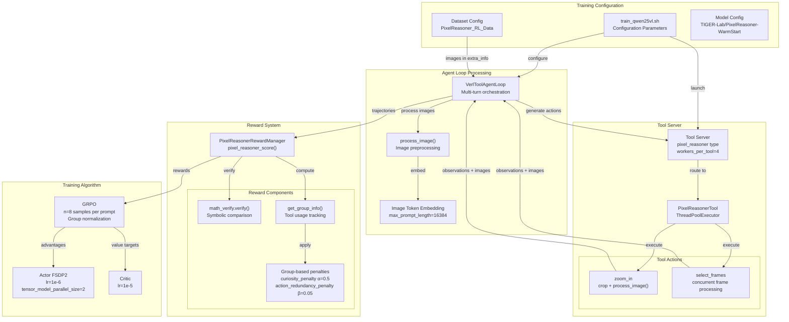
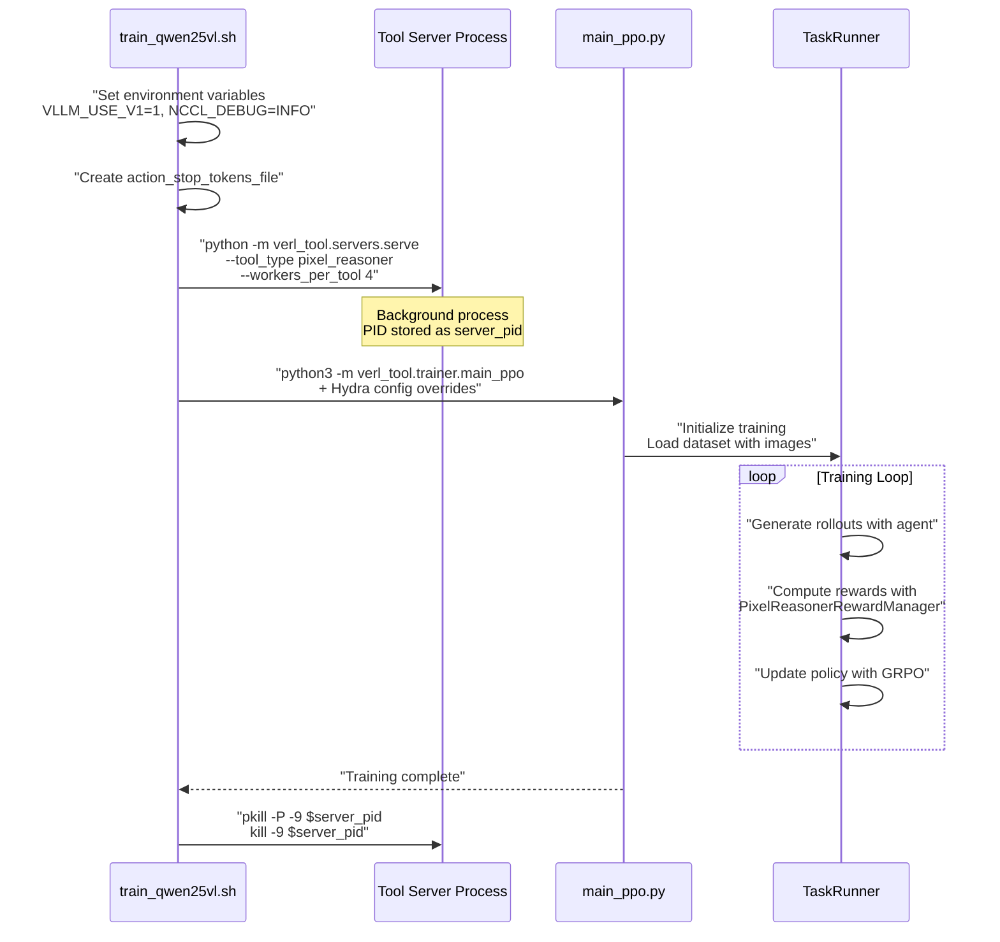
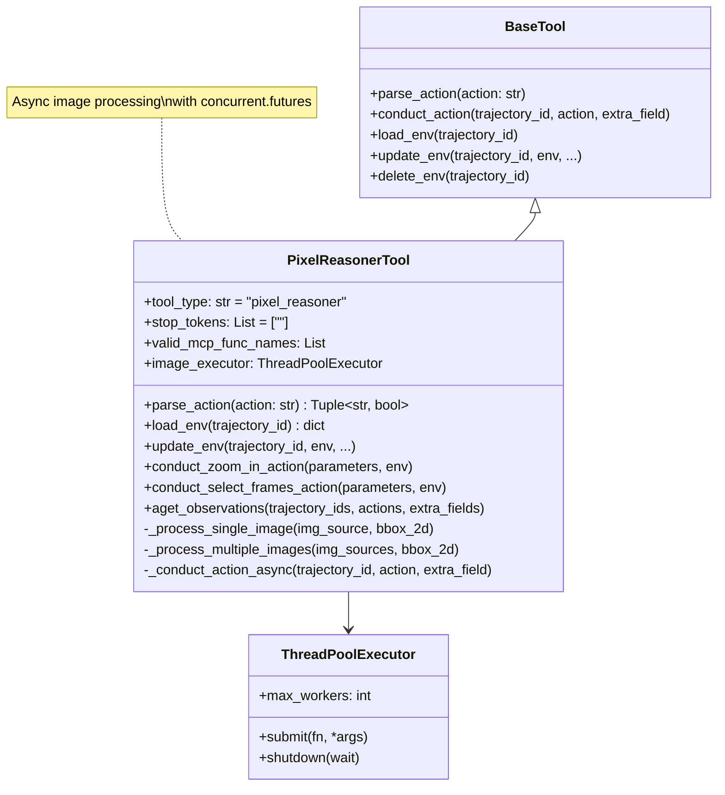
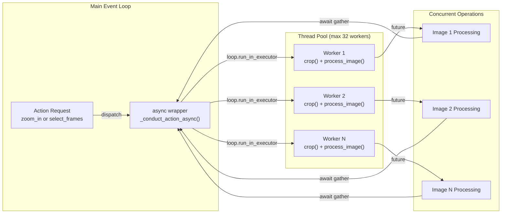
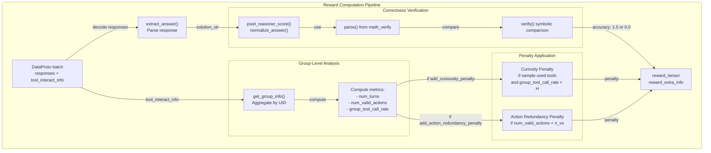
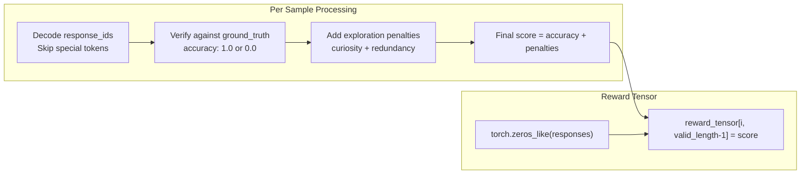
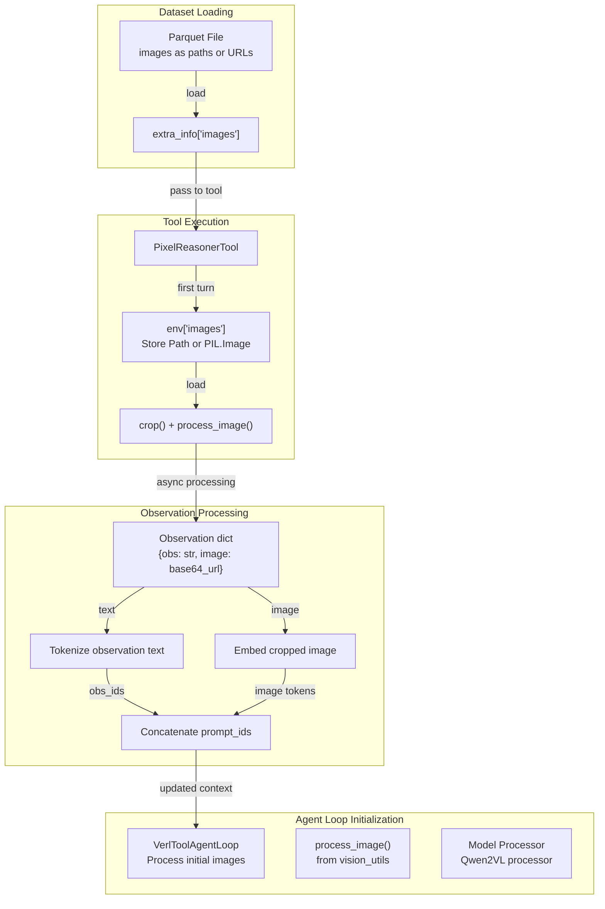
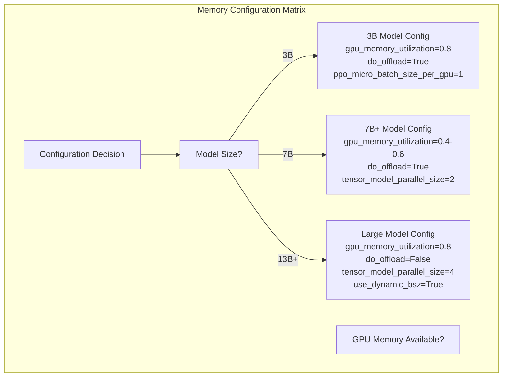

<!-- source: DeepWiki mcp.deepwiki.com · repo TIGER-AI-Lab/verl-tool · page 5.6 Pixel-Reasoner Multi-Modal Training · fetched 2026-10-30 -->

# Pixel-Reasoner Multi-Modal Training

<details>
<summary>Relevant source files</summary>

The following files were used as context for generating this wiki page:

- [examples/train/pixel_reasoner/train_3b.sh](examples/train/pixel_reasoner/train_3b.sh)
- [examples/train/pixel_reasoner/train_qwen25vl.sh](examples/train/pixel_reasoner/train_qwen25vl.sh)
- [verl_tool/servers/tools/pixel_reasoner.py](verl_tool/servers/tools/pixel_reasoner.py)
- [verl_tool/workers/reward_manager/pixel_reasoner.py](verl_tool/workers/reward_manager/pixel_reasoner.py)

</details>


## Purpose and Scope

This document describes the training setup for Pixel-Reasoner tasks, which involve vision-language models that can perform multi-turn reasoning over images using visual tools like zoom-in and frame selection. This includes the training script configuration, the `PixelReasonerTool` for image manipulation, the `PixelReasonerRewardManager` with group-based exploration penalties, and multimodal data processing pipelines.

For general multi-turn RL training concepts, see [Multi-Turn RL (MTRL) System](#9.2). For multimodal data processing details, see [Multi-Modal Data Processing](#9.1). For the agent loop that orchestrates tool interactions, see [Agent Loop System](#2.3).

**Sources:** [examples/train/pixel_reasoner/train_qwen25vl.sh](), [verl_tool/workers/reward_manager/pixel_reasoner.py](), [verl_tool/servers/tools/pixel_reasoner.py]()

## System Architecture Overview

The Pixel-Reasoner training system integrates vision-language models (Qwen2.5-VL) with tool-based image reasoning. The system enables models to iteratively refine their understanding of visual inputs through actions like `zoom_in` and `select_frames`.



**Sources:** [examples/train/pixel_reasoner/train_qwen25vl.sh](), [verl_tool/servers/tools/pixel_reasoner.py:76-378](), [verl_tool/workers/reward_manager/pixel_reasoner.py:60-237]()

## Training Script Configuration

The training script for Pixel-Reasoner follows a standard pattern but requires specific configurations for handling large image token sequences and multimodal data.

### Key Configuration Parameters

| Parameter | Value | Purpose |
|-----------|-------|---------|
| `reward_manager` | `"pixel_reasoner"` | Activates `PixelReasonerRewardManager` |
| `model_name` | `TIGER-Lab/PixelReasoner-WarmStart` | Vision-language base model |
| `rl_alg` | `"grpo"` | Group-relative policy optimization |
| `n` | `8` | Samples per prompt for group normalization |
| `max_prompt_length` | `16384` | Large context for image tokens |
| `max_response_length` | `16384` | Support multi-turn reasoning |
| `max_action_length` | `2048` | Action generation limit |
| `max_obs_length` | `8192` | Observation truncation limit |
| `action_stop_tokens` | `'</tool_call>'` | Tool invocation delimiter |
| `max_turns` | `3` | Maximum interaction rounds |
| `mask_observations` | `True` | Exclude observations from gradients |
| `enable_mtrl` | `True` | Enable multi-turn RL training |
| `tensor_model_parallel_size` | `2` | Split model across 2 GPUs |
| `gpu_memory_utilization` | `0.8` | vLLM memory allocation |
| `do_offload` | `False` / `True` | FSDP offloading (3B: True, larger: False) |
| `temperature` | `1.0` | Training exploration |
| `lr` | `1e-6` | Actor learning rate |

**Sources:** [examples/train/pixel_reasoner/train_qwen25vl.sh:1-156]()

### Training Script Execution Flow



**Sources:** [examples/train/pixel_reasoner/train_qwen25vl.sh:56-156]()

### Important Configuration Notes

**Context Length Requirements:** The `max_prompt_length` must be large (16384) to accommodate image token embeddings, which can consume thousands of tokens per image. Truncating image tokens will cause processing errors.

**Memory Management:** With `gpu_memory_utilization=0.8`, FSDP offloading (`do_offload=True`) is required for 3B models to prevent OOM. Larger models may need lower utilization (0.4-0.6) or more aggressive offloading.

**Async Rollout:** The script uses `rollout_mode='async'` for improved throughput, eliminating batching barriers between trajectory generation steps.

**GRPO Configuration:** With `n=8` samples per prompt, the reward manager computes group-level statistics to apply exploration penalties based on collective tool usage patterns.

**Sources:** [examples/train/pixel_reasoner/train_qwen25vl.sh:14-36](), [examples/train/pixel_reasoner/train_3b.sh:33-35]()

## PixelReasonerTool Implementation

The `PixelReasonerTool` implements visual reasoning actions with asynchronous image processing for efficient multi-image handling.

### Tool Class Structure



**Sources:** [verl_tool/servers/tools/pixel_reasoner.py:76-378]()

### Action Parsing and Validation

The tool expects actions in JSON format within `<tool_call>` tags:

```json
{
  "name": "zoom_in",
  "arguments": {
    "bbox_2d": [0.1, 0.2, 0.8, 0.9],
    "target_image": 1
  }
}
```

[verl_tool/servers/tools/pixel_reasoner.py:94-113]() implements parsing:

| Valid Action | Parameters | Description |
|--------------|------------|-------------|
| `zoom_in` | `bbox_2d: List[float]`, `target_image: int` | Crop and process specified image region |
| `crop_image_normalized` | Same as `zoom_in` | Alias for zoom_in |
| `crop_image` | Same as `zoom_in` | Alias for zoom_in |
| `select_frames` | `target_frames: List[int]` | Select multiple frames for concurrent processing |

**Sources:** [verl_tool/servers/tools/pixel_reasoner.py:81-113]()

### Environment State Management

Each trajectory maintains an environment with the following structure:

```python
env = {
    "trajectory_id": str,
    "metadata": {"turns": int},
    "previous_obs": List[dict],  # Action history
    "images": List[Union[Path, Image.Image]],  # Original + cropped images
    "temporary_images": List[str],  # Base64 encoded images
    "temporary_image_folder": Path  # File system cache
}
```

[verl_tool/servers/tools/pixel_reasoner.py:115-132]() initializes the environment on first access. The `images` field is populated from `extra_field['images']` in the first turn, containing either file paths or base64-encoded image URLs.

**Sources:** [verl_tool/servers/tools/pixel_reasoner.py:115-165]()

### Asynchronous Image Processing

The tool uses a `ThreadPoolExecutor` for CPU-intensive image operations to avoid blocking the event loop:



[verl_tool/servers/tools/pixel_reasoner.py:167-188]() implements concurrent processing:
- `_process_single_image()`: Processes one crop operation
- `_process_multiple_images()`: Processes multiple crops concurrently with `asyncio.gather()`

For `select_frames` with multiple target frames, all frames are processed in parallel, significantly reducing latency compared to sequential processing.

**Sources:** [verl_tool/servers/tools/pixel_reasoner.py:83-89](), [verl_tool/servers/tools/pixel_reasoner.py:167-188]()

### Zoom-In Action Execution

The `zoom_in` action crops and processes a specified region:

```mermaid
sequenceDiagram
    participant Agent as Agent Loop
    participant Tool as PixelReasonerTool
    participant Executor as ThreadPoolExecutor
    participant Image as Image Processing
    
    Agent->>Tool: "conduct_zoom_in_action_async<br/>{bbox_2d: [x1,y1,x2,y2], target_image: 1}"
    
    Tool->>Tool: "Validate parameters<br/>bbox_2d length = 4<br/>target_image in [1, len(images)]"
    
    alt Valid Parameters
        Tool->>Tool: "Load previous_images[target_image-1]"
        
        Tool->>Executor: "loop.run_in_executor<br/>crop(img, bbox_2d)"
        Executor->>Image: "crop() with padding"
        Image->>Image: "Normalize bbox coordinates<br/>Apply (0.1, 0.1) padding"
        Image-->>Executor: "PIL.Image cropped"
        
        Executor->>Image: "process_image(cropped)"
        Image->>Image: "Resize if needed<br/>Convert to RGB"
        Image-->>Executor: "Processed PIL.Image"
        
        Executor-->>Tool: "processed_img"
        
        Tool->>Tool: "encode_image_url(processed_img)"
        Tool-->>Agent: "{obs: 'Here is the cropped image...',<br/>image: 'data:image/jpeg;base64,...'}"
    else Invalid Parameters
        Tool-->>Agent: "Error message<br/>valid=False"
    end
```

[verl_tool/servers/tools/pixel_reasoner.py:15-43]() implements the `crop()` function with automatic padding to ensure context around the selected region. The padding is adaptive based on image size, with a minimum of (0.1, 0.1) relative coordinates or (600, 600) pixels.

**Sources:** [verl_tool/servers/tools/pixel_reasoner.py:15-66](), [verl_tool/servers/tools/pixel_reasoner.py:190-230]()

### Select Frames Action Execution

The `select_frames` action processes multiple frames concurrently:

[verl_tool/servers/tools/pixel_reasoner.py:232-265]() executes the action:

1. **Validation:** Check that `target_frames` is a list of valid indices
2. **Source Collection:** Gather image sources from `env['images']`
3. **Concurrent Processing:** Use `_process_multiple_images()` with `asyncio.gather()`
4. **Encoding:** Convert all processed images to base64 URLs
5. **Response:** Return formatted observation with multiple `<image>` placeholders

The observation format for 3 frames:
```python
{
    'obs': "Here are the selected frames. (Frame Size: 800x600, Numbered 1 to 3):<image><image><image>",
    'image': [base64_url_1, base64_url_2, base64_url_3]
}
```

**Sources:** [verl_tool/servers/tools/pixel_reasoner.py:232-265]()

## PixelReasonerRewardManager

The `PixelReasonerRewardManager` computes rewards based on mathematical correctness verification and applies group-based exploration penalties to encourage tool usage.

### Reward Manager Architecture



**Sources:** [verl_tool/workers/reward_manager/pixel_reasoner.py:60-237]()

### Mathematical Correctness Verification

[verl_tool/workers/reward_manager/pixel_reasoner.py:44-58]() implements `pixel_reasoner_score()`:

1. **Answer Normalization:** [verl_tool/workers/reward_manager/pixel_reasoner.py:31-41]()
   - Replace `\dfrac` with `\frac`
   - Remove `\text` wrappers
   - Standardize notation (e.g., `\varnothing` → `\emptyset`)

2. **Format Standardization:** Wrap ground truth in `\boxed{}` if not already present

3. **Symbolic Verification:** Use `math_verify.verify()` for symbolic comparison
   - First attempt: Direct comparison
   - Fallback: Case-insensitive comparison (`.lower()`)

4. **Return:** `1.0` if verified, `0.0` otherwise

**Sources:** [verl_tool/workers/reward_manager/pixel_reasoner.py:31-58]()

### Group Information Computation

The reward manager tracks tool usage across the group of `n` samples generated per prompt:

[verl_tool/workers/reward_manager/pixel_reasoner.py:79-101]() computes group statistics:

```python
group_info = {
    uid: {
        'num_turns': np.array([...]),  # Turns per sample
        'num_valid_actions': np.array([...]),  # Valid actions per sample
        'group_tool_call_rate': float,  # Fraction of samples that used tools
        'tool_call_total': int  # Total valid actions in group
    }
}
```

The `group_tool_call_rate` is computed as:
```python
np.mean([1 if num_valid_action > 0 else 0 for num_valid_action in num_valid_actions])
```

This represents the proportion of samples in the group that made at least one valid tool call.

**Sources:** [verl_tool/workers/reward_manager/pixel_reasoner.py:79-101]()

### Group-Based Exploration Penalties

The reward manager applies two types of penalties to shape exploration behavior:

#### Curiosity Penalty

[verl_tool/workers/reward_manager/pixel_reasoner.py:108-112]() implements the curiosity penalty:

```python
penalty = (num_valid_action != 0) * max(0, H - group_tool_call_rate) * α
```

Where:
- `H = 0.3` (configurable `group_tool_call_rate_lower_bound`)
- `α = 0.5` (configurable coefficient)
- Only applied if the current sample used tools (`num_valid_action != 0`)

**Intuition:** If a sample uses tools but the group's overall tool usage rate is below threshold `H`, penalize the sample. This encourages consistent tool usage across the group rather than sporadic tool calls.

#### Action Redundancy Penalty

[verl_tool/workers/reward_manager/pixel_reasoner.py:113-117]() implements the redundancy penalty:

```python
penalty = min(n_vo - num_valid_action, 0) * β
```

Where:
- `n_vo = 1` (configurable `action_redundancy_limit`)
- `β = 0.05` (configurable coefficient)
- Only negative when `num_valid_actions < n_vo`

**Intuition:** Penalize samples that make too few valid actions. With `n_vo=1`, this penalizes samples that make zero valid tool calls, encouraging at least some tool usage.

#### Penalty Configuration

| Parameter | Default | Purpose |
|-----------|---------|---------|
| `add_curiousity_penalty` | `True` | Enable curiosity penalty |
| `add_action_redundancy_penalty` | `True` | Enable redundancy penalty |
| `group_tool_call_rate_lower_bound` (H) | `0.3` | Minimum acceptable group tool usage rate |
| `action_redundancy_limit` (n_vo) | `1` | Minimum expected valid actions |
| `alpha` (α) | `0.5` | Curiosity penalty coefficient |
| `beta` (β) | `0.05` | Redundancy penalty coefficient |

**Sources:** [verl_tool/workers/reward_manager/pixel_reasoner.py:72-77](), [verl_tool/workers/reward_manager/pixel_reasoner.py:103-119]()

### Reward Tensor Construction

[verl_tool/workers/reward_manager/pixel_reasoner.py:132-198]() constructs the sparse reward tensor:



The reward is placed only at position `valid_response_length - 1`, creating a sparse reward signal at the end of each valid response. This follows standard RL practice for episodic tasks.

**Extra Info Tracking:** The reward manager populates `reward_extra_info` with:
- `accuracy`: Binary correctness
- `score`: Final score including penalties
- `curiousity_penalty`: Applied curiosity penalty (if enabled)
- `action_redundancy_penalty`: Applied redundancy penalty (if enabled)
- `correct_response_length`: Average length of correct responses
- `wrong_response_length`: Average length of incorrect responses

**Sources:** [verl_tool/workers/reward_manager/pixel_reasoner.py:132-236]()

## Multimodal Data Handling

The Pixel-Reasoner training system processes images through multiple stages, from dataset loading to tool observations.

### Dataset Format

The training data is stored in Parquet format with the following schema:

| Field | Type | Description |
|-------|------|-------------|
| `prompt` | List[Dict] | Chat-formatted conversation history |
| `reward_model` | Dict | Contains `ground_truth` for answer verification |
| `extra_info` | Dict | Contains `images`: List of image paths or base64 URLs |
| `ability` | str | Task category (optional) |
| `data_source` | str | Dataset identifier |

[verl_tool/workers/reward_manager/pixel_reasoner.py:162-166]() accesses the ground truth and images:

```python
ground_truth = data_item.non_tensor_batch['reward_model']['ground_truth']
extra_info = data_item.non_tensor_batch.get('extra_info', None)
# Images accessed via extra_field['images'] in tool
```

**Sources:** [examples/train/pixel_reasoner/train_qwen25vl.sh:2-5]()

### Image Processing Pipeline



**Sources:** [verl_tool/servers/tools/pixel_reasoner.py:302-304]()

### Image Token Management

Vision-language models embed images as large token sequences. The Qwen2.5-VL model can generate thousands of tokens per image, which is why `max_prompt_length=16384` is required.

**Key Constraints:**
1. **No Truncation:** Image tokens must not be truncated, as this causes processing errors in the model's vision encoder
2. **Observation Masking:** With `mask_observations=True`, image tokens in observations are excluded from KL divergence and gradient computation
3. **Context Budget:** The agent loop tracks `available_length = max_response_length - len(running_prompt_ids)` to prevent overflow

[examples/train/pixel_reasoner/train_qwen25vl.sh:14-17]() sets the context limits:
```bash
max_prompt_length=16384
max_response_length=16384
max_action_length=2048
max_obs_length=8192
```

With these settings:
- Initial prompt can include multiple high-resolution images
- Each observation can include cropped images (up to 8192 tokens)
- Actions are limited to 2048 tokens to reserve space for observations

**Sources:** [examples/train/pixel_reasoner/train_qwen25vl.sh:14-17]()

### Image Encoding and Transmission

The tool encodes images for transmission between processes:

[verl_tool/servers/tools/pixel_reasoner.py:45-66]() provides encoding utilities:

```python
def encode_image_url(img: Image.Image) -> str:
    """Encode PIL.Image to data URL format."""
    encoded_img = encode_image(img)
    return f"data:image/jpeg;base64,{encoded_img}"

def decode_image_url(img_str: str) -> Image.Image:
    """Decode data URL to PIL.Image."""
    if img_str.startswith("data:image/jpeg;base64,"):
        img_str = img_str.split("data:image/jpeg;base64,")[1]
    return decode_image(img_str)
```

When observations contain images, they are transmitted as base64-encoded data URLs in the format:
```
data:image/jpeg;base64,/9j/4AAQSkZJRgABAQEAYABgAAD/2wBD...
```

**Image Truncation in Logs:** [verl_tool/workers/reward_manager/pixel_reasoner.py:217-223]() truncates images in `tool_interact_info` before logging to prevent excessive memory usage:

```python
if "image" in tool_interact:
    if isinstance(tool_interact['image'], list):
        tool_interact['image'] = [x[:50] for x in tool_interact['image']]
    elif isinstance(tool_interact['image'], str):
        tool_interact['image'] = tool_interact['image'][:50]
```

This preserves the structure for debugging while reducing storage requirements.

**Sources:** [verl_tool/servers/tools/pixel_reasoner.py:45-66](), [verl_tool/workers/reward_manager/pixel_reasoner.py:217-223]()

## Best Practices and Recommendations

### Model Selection

1. **Warm-Start Models:** Use `TIGER-Lab/PixelReasoner-WarmStart` or similar models pre-trained on vision-language tasks
2. **Model Size:** 3B models require aggressive memory optimization (`do_offload=True`), while 7B+ models may need lower `gpu_memory_utilization`
3. **Tensor Parallelism:** Set `tensor_model_parallel_size=2` for models that fit on multiple GPUs

**Sources:** [examples/train/pixel_reasoner/train_qwen25vl.sh:6](), [examples/train/pixel_reasoner/train_3b.sh:5]()

### Memory Optimization



**Key Recommendations:**
- **GPU Utilization:** Higher values (0.8) enable larger batches but require FSDP offloading
- **Dynamic Batch Size:** Enable `use_dynamic_bsz=True` for automatic batch size adjustment
- **Micro Batch Size:** Use 1 for 3B models, can increase for larger models with more memory
- **Async Rollout:** Always use `rollout_mode='async'` for better throughput

**Sources:** [examples/train/pixel_reasoner/train_qwen25vl.sh:33-36](), [examples/train/pixel_reasoner/train_3b.sh:33-35]()

### GRPO Configuration

The Group Relative Policy Optimization algorithm requires careful configuration:

| Parameter | Recommendation | Rationale |
|-----------|----------------|-----------|
| `n` | 8 or 16 | Sufficient samples for group normalization |
| `rl_alg` | `"grpo"` | Better than GAE for vision tasks with exploration |
| `temperature` | 1.0 (training), 0.0 (validation) | Exploration during training, deterministic eval |
| `kl_coef` | 0 | GRPO doesn't need KL penalty |
| `kl_loss_coef` | 0.0 | Disable KL loss |
| `entropy_coeff` | 0 | GRPO provides sufficient exploration |

**Sources:** [examples/train/pixel_reasoner/train_qwen25vl.sh:8-27]()

### Exploration Penalty Tuning

The group-based penalties can be tuned for different exploration behaviors:

**Conservative (Discourage Tool Use):**
```python
alpha = 0.1  # Weak curiosity penalty
beta = 0.0  # No redundancy penalty
H = 0.5  # High threshold
```

**Balanced (Default):**
```python
alpha = 0.5
beta = 0.05
H = 0.3
```

**Aggressive (Encourage Tool Use):**
```python
alpha = 1.0  # Strong curiosity penalty
beta = 0.1  # Significant redundancy penalty
H = 0.2  # Low threshold
n_vo = 2  # Expect 2+ actions
```

**Sources:** [verl_tool/workers/reward_manager/pixel_reasoner.py:72-77]()

### Tool Server Configuration

For efficient image processing:

1. **Workers Per Tool:** Set `--workers_per_tool 4` for sufficient parallelism
2. **Tool Type:** Must be `"pixel_reasoner"` to activate `PixelReasonerTool`
3. **Concurrent Trajectories:** Set `max_concurrent_trajectories=128` for high throughput
4. **Max Turns:** Typically 2-3 turns is sufficient; more may lead to context overflow

**Sources:** [examples/turn/pixel_reasoner/train_qwen25vl.sh:65](), [examples/train/pixel_reasoner/train_qwen25vl.sh:24](), [examples/train/pixel_reasoner/train_qwen25vl.sh:115]()

### Validation Strategy

For proper evaluation:

1. **Val Before Train:** Enable `val_before_train=True` to establish baseline
2. **Test Frequency:** Set `test_freq=10` for regular checkpoints
3. **Validation Temperature:** Use `temperature=0` during validation for deterministic generation
4. **Multiple Datasets:** Include diverse test sets in `val_files` for comprehensive evaluation

[examples/train/pixel_reasoner/train_qwen25vl.sh:4-5]() shows typical validation setup:
```bash
val_data=[$(pwd)/data/pixel_reasoner/PixelReasoner_RL_Data/max_16384/val.parquet,\
$(pwd)/data/pixel_reasoner/vstar/test.parquet]
```

**Sources:** [examples/train/pixel_reasoner/train_qwen25vl.sh:4-5](), [examples/train/pixel_reasoner/train_qwen25vl.sh:144]()

---

