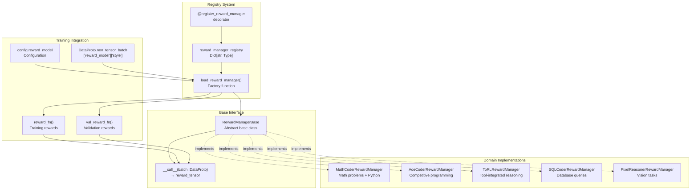
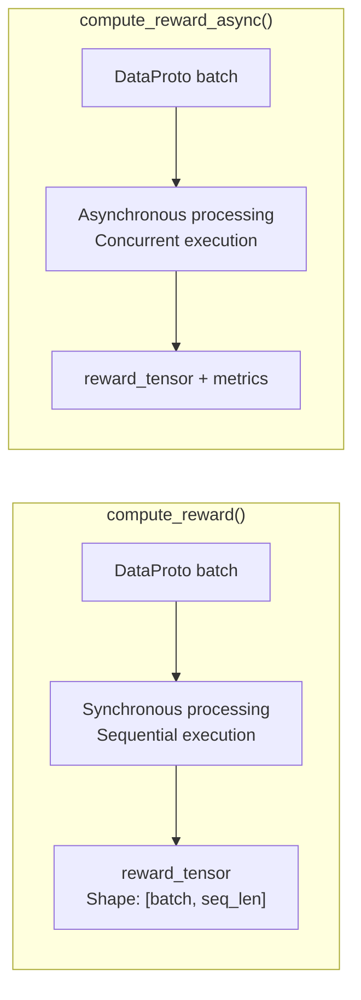
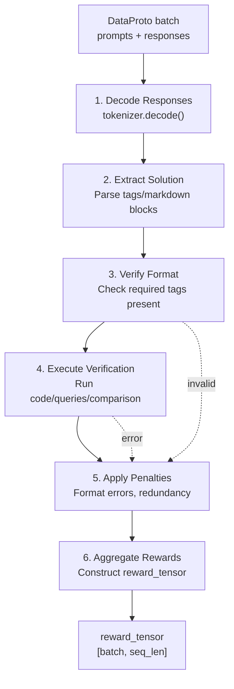
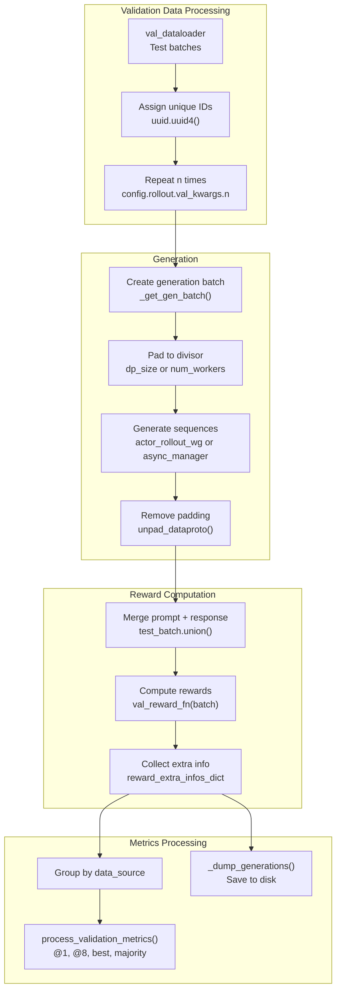

<!-- source: DeepWiki mcp.deepwiki.com · repo TIGER-AI-Lab/verl-tool · page 6 Reward Management System · fetched 2026-10-30 -->

# Reward Management System

<details>
<summary>Relevant source files</summary>

The following files were used as context for generating this wiki page:

- [verl_tool/agent_loop/agent_loop.py](verl_tool/agent_loop/agent_loop.py)
- [verl_tool/agent_loop/verltool_agent_loop.py](verl_tool/agent_loop/verltool_agent_loop.py)
- [verl_tool/servers/tests/test_python_code_tool.py](verl_tool/servers/tests/test_python_code_tool.py)
- [verl_tool/servers/tools/ipython_code.py](verl_tool/servers/tools/ipython_code.py)
- [verl_tool/servers/tools/sql.py](verl_tool/servers/tools/sql.py)
- [verl_tool/servers/tools/utils/ipython_tool.py](verl_tool/servers/tools/utils/ipython_tool.py)
- [verl_tool/servers/tools/utils/sql_executor.py](verl_tool/servers/tools/utils/sql_executor.py)
- [verl_tool/trainer/config/verltool/agent.yaml](verl_tool/trainer/config/verltool/agent.yaml)
- [verl_tool/trainer/ppo/metric_util.py](verl_tool/trainer/ppo/metric_util.py)
- [verl_tool/workers/reward_manager/sqlcoder.py](verl_tool/workers/reward_manager/sqlcoder.py)
- [verl_tool/workers/reward_manager/torl.py](verl_tool/workers/reward_manager/torl.py)
- [verl_tool/workers/rollout/vllm_rollout/vllm_async_server.py](verl_tool/workers/rollout/vllm_rollout/vllm_async_server.py)

</details>


## Purpose and Scope

The Reward Management System provides domain-specific evaluation logic for scoring agent trajectories during training and validation. This system converts generated responses into numerical rewards that drive the PPO/GRPO optimization process. It supports both rule-based and model-based reward computation, with specialized implementations for different task domains.

For information about how rewards integrate with the overall training loop, see [Core Training Framework](#2). For domain-specific reward manager implementations, see [Code Reward Managers](#6.2), [SQL Reward Manager](#6.3), and [Vision Reward Manager](#6.4).

---

## Architecture Overview

The reward system follows a registry-based architecture where domain-specific reward managers are registered and instantiated based on dataset metadata.



**Sources:** [verl_tool/trainer/main_ppo.py:284-289]()

---

## Reward Manager Interface

### Registration and Discovery

Reward managers are registered using the `@register_reward_manager` decorator, which maps reward style names to implementation classes:

```python
@register_reward_manager("rule")
class MathCoderRewardManager(RewardManagerBase):
    def __call__(self, data: DataProto, return_dict=False):
        # Implementation
        pass
```

The registry enables automatic selection based on dataset metadata. Each data sample contains a `reward_model` field specifying the evaluation style:

```python
{
    "reward_model": {
        "style": "rule",  # Maps to registered manager
        "ground_truth": "...",
        # Additional domain-specific fields
    }
}
```

**Sources:** [examples/data_preprocess/acecoder_custom.py:134-137]()

### Loading Mechanism

The `load_reward_manager()` function instantiates the appropriate reward manager based on configuration:

| Parameter | Type | Purpose |
|-----------|------|---------|
| `config` | OmegaConf | Training configuration with `reward_model` section |
| `tokenizer` | Tokenizer | For decoding model outputs |
| `num_examine` | int | Number of examples to print for debugging |
| `**reward_kwargs` | dict | Domain-specific parameters |

The loader creates separate instances for training (`num_examine=0`) and validation (`num_examine=1`) to control logging verbosity.

**Sources:** [verl_tool/trainer/main_ppo.py:284-289]()

---

## Reward Computation Functions

### Synchronous vs Asynchronous Modes

The system provides two computation modes:



**Sources:** [verl_tool/trainer/ppo/ray_trainer.py:27-36]()

### Reward Tensor Structure

The reward computation returns a `reward_tensor` with shape `[batch_size, sequence_length]`. Typically:
- All tokens receive `0.0` reward except the final token
- The final token receives the full trajectory reward (e.g., `1.0` for correct, `0.0` for incorrect)
- Optional penalties are applied to specific positions (format errors, action redundancy)

### Reward Extra Info

Reward managers can return additional diagnostic information via `reward_extra_info`:

```python
result = {
    "reward_tensor": torch.Tensor,  # Required
    "reward_extra_info": {
        "acc": [0.0, 1.0, ...],      # Accuracy per sample
        "format_valid": [True, False, ...],
        "execution_error": [None, "SyntaxError", ...],
        # Domain-specific metrics
    }
}
```

This information is logged during validation and rollout for debugging and analysis.

**Sources:** [verl_tool/trainer/ppo/ray_trainer.py:122-130]()

---

## Scoring Pipeline

The typical reward computation follows a structured pipeline:



**Pipeline Stages:**

1. **Decode**: Convert token IDs to text using the tokenizer
2. **Extract**: Parse structured content (e.g., `<solution>`, markdown code blocks)
3. **Verify**: Check format correctness (presence of required tags, valid syntax)
4. **Execute**: Domain-specific verification:
   - Code tasks: Run test cases and compare outputs
   - SQL tasks: Execute queries and compare results
   - Vision tasks: Match ground truth labels
5. **Penalty**: Apply deductions for errors or undesired behaviors
6. **Aggregate**: Construct final `reward_tensor` with rewards at appropriate positions

**Sources:** [verl_tool/trainer/ppo/ray_trainer.py:110-130]()

---

## Validation Workflow

Validation uses a specialized workflow to ensure robust evaluation:



### Repeated Sampling

Each validation sample is repeated `n` times (configured via `config.actor_rollout_ref.rollout.val_kwargs.n`) to compute statistical metrics. This enables evaluation of:

- **Mean performance** across multiple generations
- **Best-of-N** performance (maximum score achieved)
- **Majority voting** (most common answer)
- **Pass@k** metrics (probability of at least one correct answer in k samples)

**Sources:** [verl_tool/trainer/ppo/ray_trainer.py:62-64]()

### Validation Metrics

The `process_validation_metrics()` function computes aggregated metrics per data source:

| Metric Type | Description |
|-------------|-------------|
| `mean@N` | Average reward across N samples |
| `maj@N` | Majority vote accuracy (most common answer) |
| `best@N` | Maximum reward achieved in N samples |
| `pass@k` | Probability of ≥1 success in k samples |

Metrics are computed separately for each variable in `reward_extra_info` (e.g., `acc`, `reward`, `format_valid`).

**Sources:** [verl_tool/trainer/ppo/ray_trainer.py:186-202]()

### Generation Logging

Both validation and rollout data can be dumped to disk for offline analysis:

```python
_dump_generations(
    inputs=sample_inputs,      # Decoded prompts
    outputs=sample_outputs,    # Decoded responses
    gts=sample_gts,           # Ground truth answers
    scores=sample_scores,     # Computed rewards
    reward_extra_infos_dict=reward_extra_infos_dict,
    dump_path=validation_data_dir,
)
```

The dump includes:
- Input prompts
- Generated outputs
- Ground truth labels
- Reward scores
- Tool interaction traces (truncated for images)
- Trajectory stop reasons
- Domain-specific metrics

**Sources:** [verl_tool/trainer/ppo/ray_trainer.py:162-172](), [verl_tool/trainer/ppo/ray_trainer.py:212-260]()

---

## Configuration Structure

The reward system is configured through the `config.reward_model` section:

### Basic Configuration

```yaml
reward_model:
  enable: false                    # Enable model-based rewards
  style: "rule"                    # Default reward style
  enable_resource_pool: false      # Dedicated GPU pool for reward model
  n_gpus_per_node: 0              # GPUs for reward model
  nnodes: 0                        # Nodes for reward model
  strategy: "fsdp"                 # Distribution strategy
  
  reward_kwargs:                   # Domain-specific parameters
    max_obs_length: 512           # Max observation tokens
    # Additional parameters passed to reward manager
```

### Data-Level Configuration

Each data sample specifies its reward style:

```python
{
    "reward_model": {
        "style": "rule",           # Maps to @register_reward_manager
        "ground_truth": "42",      # Expected answer
        # Domain-specific fields
    }
}
```

The system supports mixing different reward styles in a single dataset by routing each sample to the appropriate reward manager based on the `style` field.

**Sources:** [examples/data_preprocess/acecoder_custom.py:134-137]()

---

## Integration with Training

### Training Reward Computation

During rollout, the training reward function is called to score generated trajectories:

```python
# In AgentRayPPOTrainer
batch = self.actor_rollout_wg.generate_sequences(gen_batch)
result = self.reward_fn(batch, return_dict=True)
batch.batch["token_level_scores"] = result["reward_tensor"]
```

The `reward_tensor` is attached to the batch and used by the PPO algorithm for advantage computation.

**Sources:** [verl_tool/trainer/ppo/ray_trainer.py:27-36]()

### Validation Reward Computation

Validation uses a separate reward function instance to enable different logging behavior:

```python
test_batch = test_batch.union(test_output_gen_batch)
test_batch.meta_info["validate"] = True

result = self.val_reward_fn(test_batch, return_dict=True)
reward_tensor = result["reward_tensor"]
scores = reward_tensor.sum(-1).cpu().tolist()
```

The `validate=True` flag in `meta_info` can trigger special behavior in reward managers (e.g., more verbose logging).

**Sources:** [verl_tool/trainer/ppo/ray_trainer.py:117-125]()

### Tool Interaction Metadata

The reward system has access to tool interaction traces stored in `DataProto.non_tensor_batch`:

```python
tool_interact_info = batch.non_tensor_batch.get('tool_interact_info', None)
traj_stop_reason = batch.non_tensor_batch.get('traj_stop_reason', None)
verl_tool_metrics = batch.non_tensor_batch.get('verl_tool_metrics', None)
```

This metadata enables rewards to consider:
- Number of tool calls made
- Types of tools used
- Trajectory termination reasons (e.g., max turns, finish action, error)
- Tool-specific metrics (e.g., search query quality, code execution time)

Images in tool interactions are truncated to 50 characters before logging to avoid excessive disk usage.

**Sources:** [verl_tool/trainer/ppo/ray_trainer.py:132-152](), [verl_tool/trainer/ppo/ray_trainer.py:237-251]()

---

## Summary

The Reward Management System provides a flexible, domain-specific framework for evaluating agent trajectories:

| Component | Purpose |
|-----------|---------|
| Registry System | Maps reward styles to implementation classes |
| RewardManagerBase | Defines standard interface for all reward managers |
| Scoring Pipeline | Standardized flow: decode → extract → verify → execute → penalize |
| Validation Workflow | Repeated sampling with statistical metrics |
| Integration Points | Seamless connection to training and validation loops |

This architecture enables adding new task domains by implementing a reward manager and registering it with the `@register_reward_manager` decorator, without modifying core training code.

For detailed implementation of specific reward managers, see:
- [Code Reward Managers](#6.2) for MathCoder, AceCoder, and ToRL
- [SQL Reward Manager](#6.3) for database query evaluation
- [Vision Reward Manager](#6.4) for multi-modal tasks with group penalties

**Sources:** [verl_tool/trainer/main_ppo.py:284-289](), [verl_tool/trainer/ppo/ray_trainer.py:41-260]()

---

