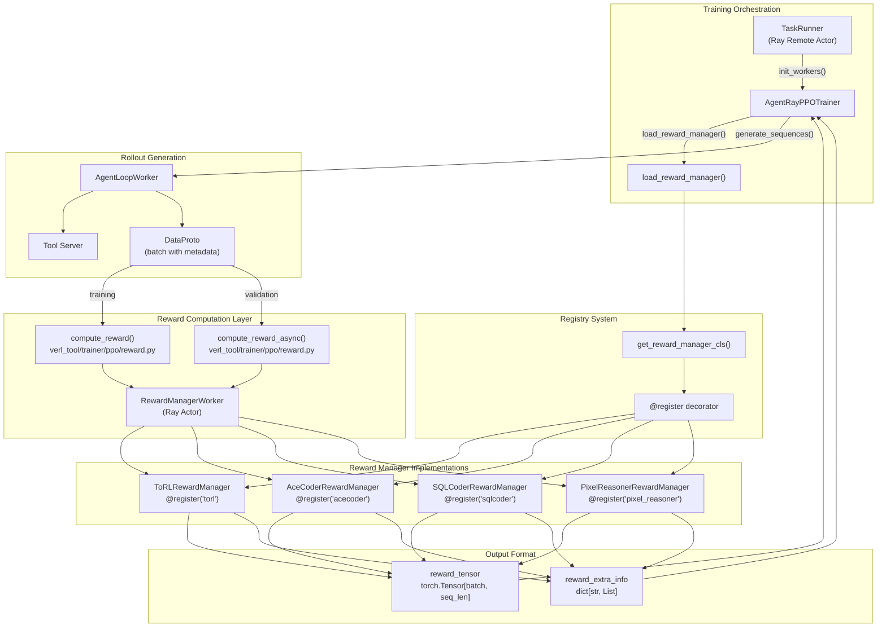
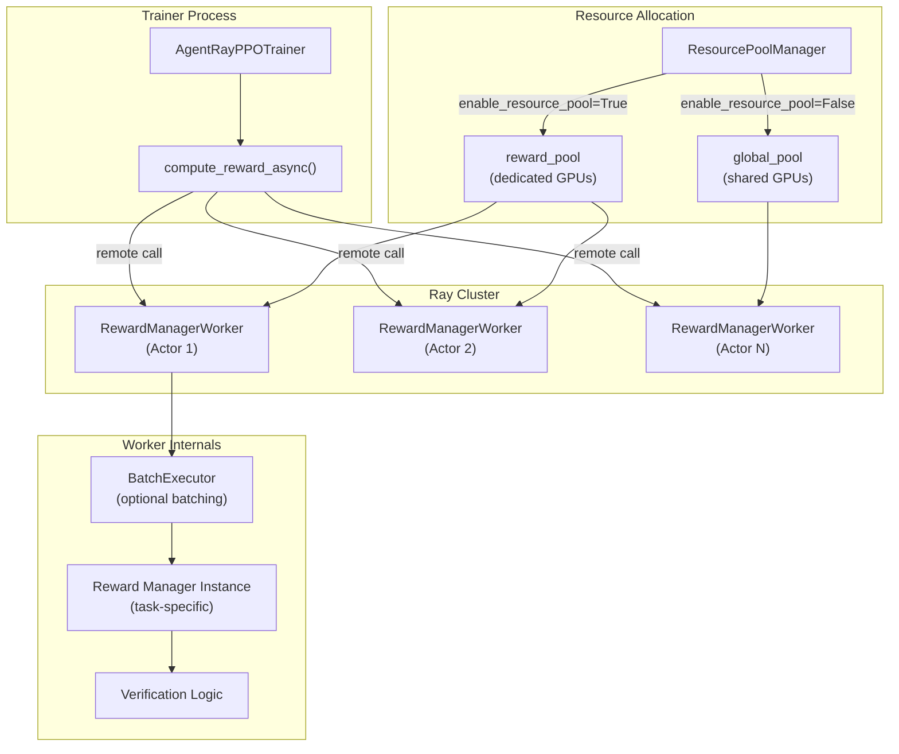
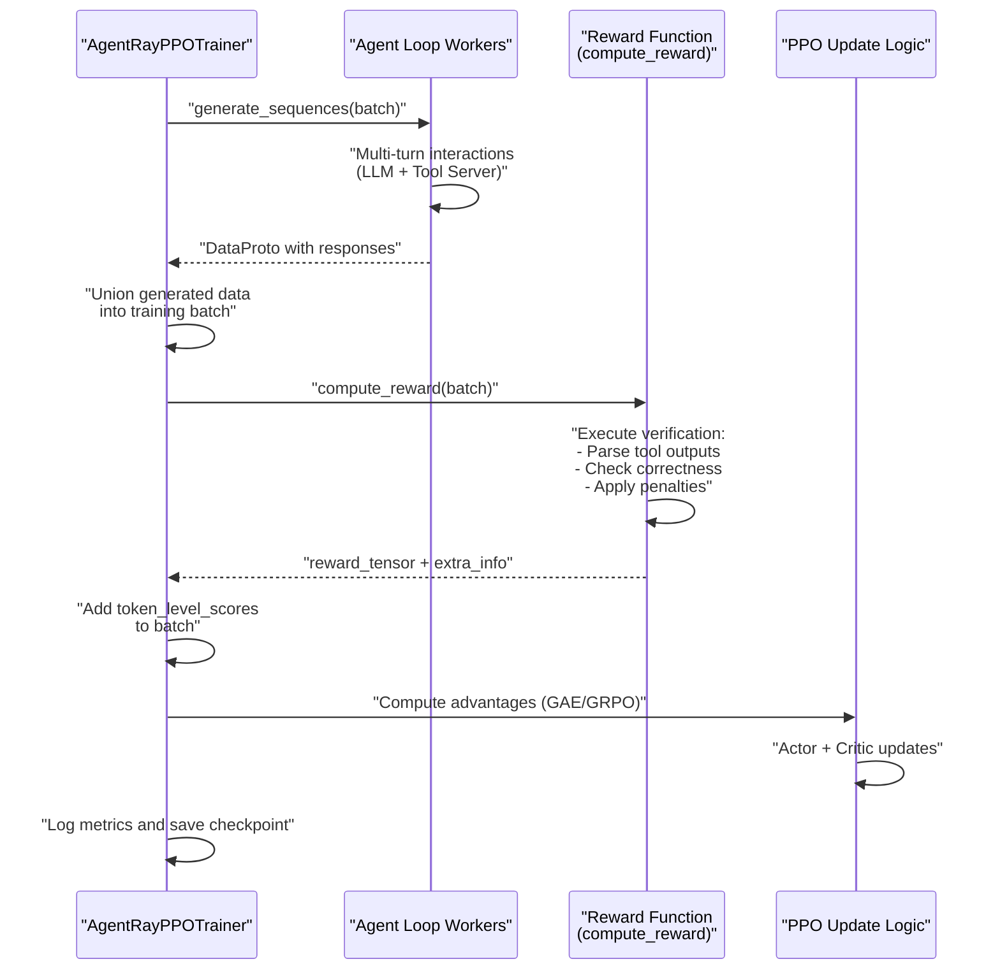
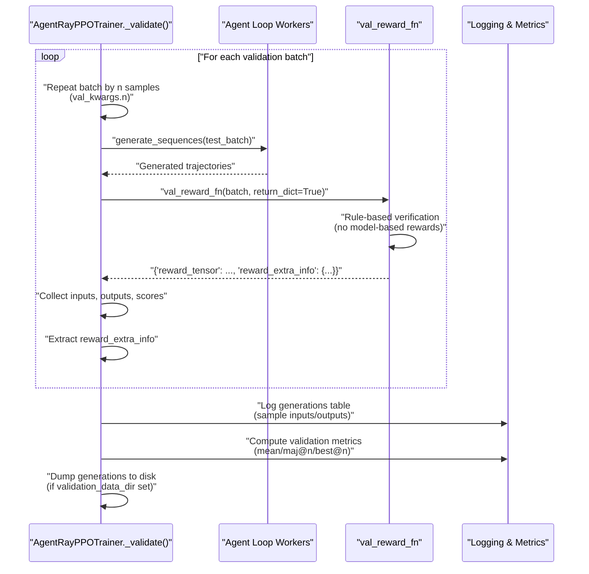
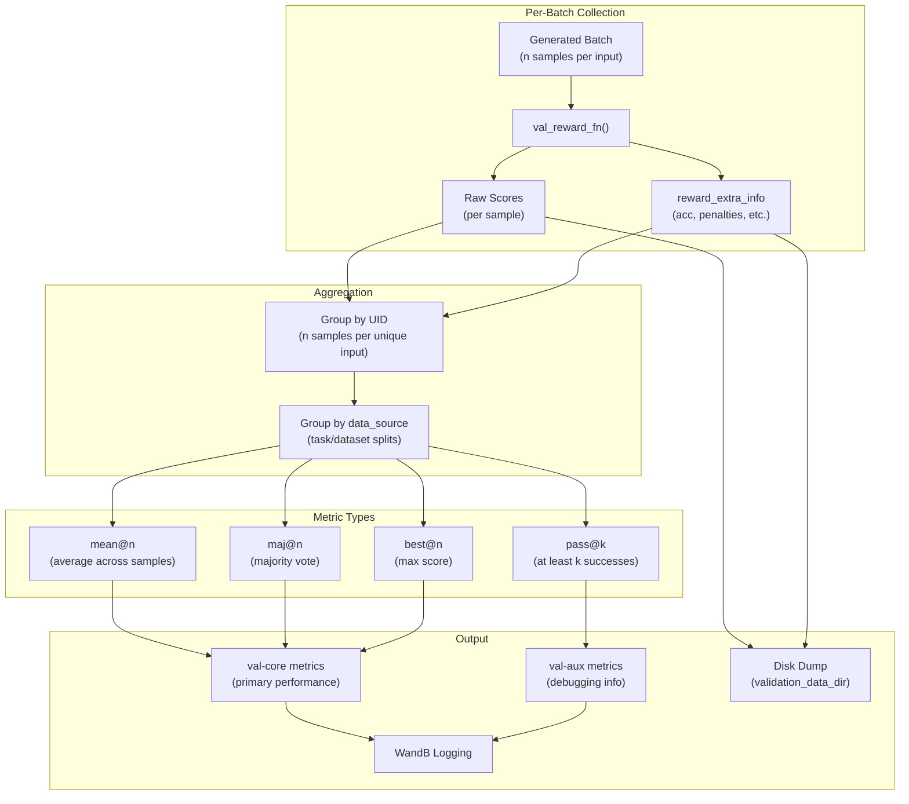
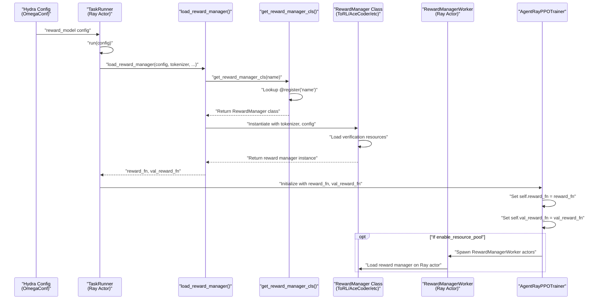

<!-- source: DeepWiki mcp.deepwiki.com · repo TIGER-AI-Lab/verl-tool · page 6.1 Reward Manager Architecture · fetched 2026-10-30 -->

# Reward Manager Framework

<details>
<summary>Relevant source files</summary>

The following files were used as context for generating this wiki page:

- [verl_tool/agent_loop/agent_loop.py](verl_tool/agent_loop/agent_loop.py)
- [verl_tool/agent_loop/verltool_agent_loop.py](verl_tool/agent_loop/verltool_agent_loop.py)
- [verl_tool/servers/serve.py](verl_tool/servers/serve.py)
- [verl_tool/servers/tests/test_python_code_tool.py](verl_tool/servers/tests/test_python_code_tool.py)
- [verl_tool/servers/tools/ipython_code.py](verl_tool/servers/tools/ipython_code.py)
- [verl_tool/servers/tools/utils/ipython_tool.py](verl_tool/servers/tools/utils/ipython_tool.py)
- [verl_tool/trainer/config/verltool/agent.yaml](verl_tool/trainer/config/verltool/agent.yaml)
- [verl_tool/trainer/main_ppo.py](verl_tool/trainer/main_ppo.py)
- [verl_tool/trainer/ppo/metric_util.py](verl_tool/trainer/ppo/metric_util.py)
- [verl_tool/trainer/ppo/ray_trainer.py](verl_tool/trainer/ppo/ray_trainer.py)
- [verl_tool/workers/reward_manager/torl.py](verl_tool/workers/reward_manager/torl.py)
- [verl_tool/workers/rollout/vllm_rollout/vllm_async_server.py](verl_tool/workers/rollout/vllm_rollout/vllm_async_server.py)

</details>


This document describes the base architecture of the Reward Manager system in VerlTool. It covers the reward function interface, registration mechanisms, `RewardManagerWorker` Ray actors, integration with the PPO trainer, and the data flow for reward computation. For specific reward manager implementations, see [Math and Code Reward Managers](#5.2), [SQL Reward Manager](#5.3), and [Vision Reward Manager](#5.4).

## Purpose and Scope

The Reward Manager Framework provides a pluggable architecture for computing task-specific rewards during both training and validation. The framework uses a decorator-based registration system (`@register`) to dynamically discover reward managers, and distributes reward computation across Ray actors (`RewardManagerWorker`) for efficient parallel processing. Key features:

- Decorator-based registration system for pluggable reward managers
- Ray actor distribution via `RewardManagerWorker` for parallel computation
- Synchronous and asynchronous reward computation modes
- Rule-based and model-based reward strategies
- Sparse reward tensor format (reward placed at last valid token)
- Rich metadata collection through `reward_extra_info` dictionary
- Per-task reward customization via configuration
- Separate training and validation reward functions

## System Architecture

The reward manager system sits between the PPO trainer and task-specific verification logic, providing a standardized interface for computing rewards from generated trajectories. The architecture uses a registry pattern for discovery and Ray actors for distributed computation.



**Diagram: Reward Manager System Architecture with Code Entities**

The framework decouples reward computation from training orchestration. The `TaskRunner` initializes the trainer and loads reward managers via `load_reward_manager()`. The trainer generates trajectories via `AgentLoopWorker`, packages them into `DataProto` batches, and passes them to `compute_reward()` or `compute_reward_async()` which route to the appropriate `RewardManagerWorker`. Reward managers return sparse reward tensors and optional metadata.

Sources: [verl_tool/trainer/ppo/ray_trainer.py:27-33](), [verl_tool/trainer/main_ppo.py:284-289]()

## Reward Manager Registry and Registration

### Decorator-Based Registration

Reward managers are registered using a `@register` decorator pattern that enables automatic discovery:

```python
# Example registration pattern (in verl_tool/trainer/ppo/reward_managers/)
@register('torl')
class ToRLRewardManager:
    def __call__(self, batch: DataProto, return_dict: bool = False):
        # Implementation
        pass

@register('acecoder')
class AceCoderRewardManager:
    def __call__(self, batch: DataProto, return_dict: bool = False):
        # Implementation
        pass
```

The registration system maintains a mapping from string identifiers to reward manager classes. This enables dynamic loading based on dataset configuration.

### Load Reward Manager Function

The `load_reward_manager()` function instantiates reward managers based on configuration:

```python
# From main_ppo.py initialization
reward_fn = load_reward_manager(
    config, tokenizer, num_examine=0, **config.reward_model.get("reward_kwargs", {})
)
val_reward_fn = load_reward_manager(
    config, tokenizer, num_examine=1, **config.reward_model.get("reward_kwargs", {})
)
```

| Parameter | Type | Purpose |
|-----------|------|---------|
| `config` | OmegaConf | Training configuration with reward_model settings |
| `tokenizer` | Tokenizer | For decoding responses |
| `num_examine` | int | Number of examples to log for debugging (0 for training, >0 for validation) |
| `**reward_kwargs` | dict | Task-specific reward manager parameters |

The function reads the reward manager name from dataset metadata or configuration and returns the appropriate callable.

Sources: [verl_tool/trainer/main_ppo.py:284-289]()

## Reward Function Interface

### Core Contract

All reward managers must implement a callable interface that conforms to the following signature:

```python
def __call__(self, batch: DataProto, return_dict: bool = False) -> Union[torch.Tensor, dict]
```

| Parameter | Type | Description |
|-----------|------|-------------|
| `batch` | `DataProto` | Batch containing trajectories with prompt_ids, response_ids, and non_tensor_batch metadata |
| `return_dict` | `bool` | If True, return dict format; if False, return tensor only |

**Return Format:**

When `return_dict=True`:
```python
{
    "reward_tensor": torch.Tensor,  # Shape: (batch_size, seq_length), sparse format
    "reward_extra_info": {          # Optional metadata dict
        "acc": List[float],         # Per-example accuracy (0 or 1)
        "penalty": List[float],     # Per-example penalties
        "custom_metric": List[Any], # Task-specific metrics
        ...
    }
}
```

When `return_dict=False`:
- Returns `torch.Tensor` of shape `(batch_size, seq_length)` directly

**Sparse Reward Format:** The reward tensor uses a sparse format where the reward is placed only at the last valid token position in each trajectory. All other positions are zero. This enables efficient advantage computation in PPO.

### Synchronous vs Asynchronous Computation

The framework provides two reward computation modes via patched functions in `verl_tool/trainer/ppo/reward.py`:

**Synchronous Mode** (`compute_reward`):
- Used for simple rule-based verification
- Executes reward computation sequentially
- Lower latency for lightweight checks
- Directly calls reward manager on batch

**Asynchronous Mode** (`compute_reward_async`):
- Used for expensive operations (sandbox execution, model inference)
- Executes reward computation in parallel via Ray actors
- Higher throughput for I/O-bound or compute-intensive tasks
- Routes through `RewardManagerWorker` for distributed execution

The trainer automatically selects the appropriate mode based on the async rollout configuration.

Sources: [verl_tool/trainer/ppo/ray_trainer.py:27-33](), [verl_tool/trainer/ppo/ray_trainer.py:32-33]()

## RewardManagerWorker and Ray Distribution

### Ray Actor Architecture

The `RewardManagerWorker` is a Ray actor that enables distributed reward computation:



**Diagram: RewardManagerWorker Ray Actor Distribution**

### Resource Pool Configuration

Reward models can be allocated to dedicated GPU pools to avoid interference with actor/critic training:

```python
# From main_ppo.py resource pool setup
if config.reward_model.enable_resource_pool:
    reward_pool = [config.reward_model.n_gpus_per_node] * config.reward_model.nnodes
    resource_pool_spec["reward_pool"] = reward_pool
    mapping[Role.RewardModel] = "reward_pool"
else:
    mapping[Role.RewardModel] = "global_pool"
```

| Config Parameter | Type | Purpose |
|-----------------|------|---------|
| `reward_model.enable_resource_pool` | bool | Whether to use dedicated GPU pool |
| `reward_model.n_gpus_per_node` | int | GPUs per node for reward model |
| `reward_model.nnodes` | int | Number of nodes for reward model |

This enables scaling reward computation independently from actor/critic training.

Sources: [verl_tool/trainer/main_ppo.py:177-217]()

## Integration with PPO Trainer

### Training Loop Integration

The reward function is invoked during the PPO training loop after rollout generation and before advantage computation:



**Diagram: Reward Computation in Training Loop**

The reward function receives the complete trajectory including:
- Input prompts (`batch.batch["prompts"]`)
- Generated responses (`batch.batch["responses"]`)
- Attention masks (`batch.batch["attention_mask"]`)
- Non-tensor metadata (`batch.non_tensor_batch`)

Sources: [verl_tool/trainer/ppo/ray_trainer.py:1-253]()

### Validation Loop Integration

During validation, a separate reward function is used to evaluate model quality on held-out data:



**Diagram: Validation Reward Flow**

Key differences from training:
1. Validation uses `self.val_reward_fn` instead of `compute_reward`
2. Only rule-based reward models are evaluated (model-based rewards return early)
3. Multiple samples per input are generated (`n` controlled by `val_kwargs.n`)
4. Results are aggregated into validation metrics (mean@n, maj@n, best@n)

Sources: [verl_tool/trainer/ppo/ray_trainer.py:40-204]()

## Reward Function Configuration

### Trainer Setup

The reward functions are configured during trainer initialization:

| Attribute | Type | Purpose |
|-----------|------|---------|
| `self.reward_fn` | Callable | Training reward function (synchronous or async) |
| `self.val_reward_fn` | Callable | Validation reward function (typically rule-based) |

The trainer selects the appropriate reward function based on the `reward_model` configuration in the dataset:

```python
# Example from validation loop
if test_batch[0].non_tensor_batch["reward_model"]["style"] == "model":
    return {}  # Skip validation for model-based rewards
```

**Configuration Flow:**

1. Dataset specifies `reward_model` metadata in `non_tensor_batch`
2. Trainer reads `reward_model["style"]` to determine verification strategy
3. Task-specific reward manager is instantiated based on task type
4. Reward function handles verification logic and penalty computation

Sources: [verl_tool/trainer/ppo/ray_trainer.py:66-67]()

## DataProto Batch Structure

### Input to Reward Functions

Reward functions receive `DataProto` objects with the following structure:

**Tensor Batch** (`batch.batch`):

| Key | Shape | Description |
|-----|-------|-------------|
| `prompts` | `(batch_size, prompt_len)` | Input token IDs |
| `responses` | `(batch_size, response_len)` | Generated token IDs |
| `attention_mask` | `(batch_size, total_len)` | Attention mask for full sequence |
| `input_ids` | `(batch_size, total_len)` | Concatenated prompts + responses |

**Non-Tensor Batch** (`batch.non_tensor_batch`):

| Key | Type | Description |
|-----|------|-------------|
| `reward_model` | dict | Contains `style`, `ground_truth`, task-specific config |
| `tool_interact_info` | list[dict] | Tool call history per trajectory |
| `traj_stop_reason` | list[str] | Stop reason for each trajectory |
| `uid` | ndarray | Unique identifiers for tracking |
| `data_source` | list[str] | Dataset source identifier |
| `__num_turns__` | ndarray | Number of turns per trajectory |

### Metadata Access Pattern

```python
# Example from validation code
ground_truths = [
    item.non_tensor_batch.get("reward_model", {}).get("ground_truth", None) 
    for item in test_batch
]

# Tool interaction extraction
tool_interact_info = test_batch.non_tensor_batch.get('tool_interact_info', None)
if isinstance(tool_interact_info, np.ndarray):
    tool_interact_info = tool_interact_info.tolist()
```

Sources: [verl_tool/trainer/ppo/ray_trainer.py:69-79](), [verl_tool/trainer/ppo/ray_trainer.py:131-148]()

## Reward Extra Info System

### Purpose and Structure

The `reward_extra_info` dictionary enables reward managers to return rich metadata alongside numerical rewards. This metadata is used for:

- **Validation metrics**: Accuracy, success rates, per-task performance
- **Debugging**: Tool interaction logs, stop reasons, intermediate results
- **Curriculum learning**: Difficulty scores, competency estimates
- **Analysis**: Penalty breakdowns, error types, behavioral patterns

### Standard Extra Info Keys

| Key | Type | Purpose | Example Value |
|-----|------|---------|---------------|
| `reward` | `List[float]` | Per-example total reward | `[1.0, 0.5, -0.2, ...]` |
| `acc` | `List[float]` | Binary accuracy (0 or 1) | `[1, 0, 1, 1, ...]` |
| `penalty` | `List[float]` | Total penalty applied | `[-0.1, -0.3, 0.0, ...]` |
| `tool_interact_info` | `List[dict]` | Tool call history | `[{"tool": "python_code", "input": "...", "output": "..."}, ...]` |
| `traj_stop_reason` | `List[str]` | Trajectory termination reason | `["max_turns", "finish_tool", "error"]` |
| `request_id` | `List[str]` | Request identifiers | `["req_123", "req_124", ...]` |

### Processing and Logging

The trainer processes extra info in two stages:

**During Training:**
```python
# Reward extra infos are collected and dumped to disk
reward_extra_infos_to_dump = reward_extra_infos_dict.copy()
if tool_interact_info:
    # Truncate images for storage efficiency
    for tool_interact in tool_interact_info:
        if "image" in tool_interact:
            tool_interact['image'] = tool_interact['image'][:50]
    reward_extra_infos_to_dump.update({
        "tool_interact_info": tool_interact_info,
        "traj_stop_reason": batch.non_tensor_batch.get("traj_stop_reason", None),
    })
```

**During Validation:**
```python
# Extra infos are aggregated into validation metrics
for key, lst in result["reward_extra_info"].items():
    reward_extra_infos_dict[key].extend(lst)

# Processed into mean/maj/best@n metrics
data_src2var2metric2val = process_validation_metrics(
    data_sources, sample_uids, reward_extra_infos_dict
)
```

Sources: [verl_tool/trainer/ppo/ray_trainer.py:119-130](), [verl_tool/trainer/ppo/ray_trainer.py:224-244]()

## Validation Metrics Pipeline

### Metric Computation Flow



**Diagram: Validation Metric Computation Pipeline**

### Metric Categories

**Core Metrics** (`val-core`):
- Primary performance indicators
- Logged with prefix `val-core/{data_source}/{var_name}/{metric_name}`
- Include: `mean@n`, `maj@n`, `best@n` for `acc` or `reward` variable
- Example: `val-core/math_problems/acc/mean@16`

**Auxiliary Metrics** (`val-aux`):
- Supplementary performance indicators and debugging info
- Logged with prefix `val-aux/{data_source}/{var_name}/{metric_name}`
- Include: pass@k variants, penalty breakdowns, turn statistics
- Example: `val-aux/math_problems/num_turns/mean`

Sources: [verl_tool/trainer/ppo/ray_trainer.py:175-203]()

## Generation Dumping System

### Purpose

The framework supports dumping generated trajectories to disk for offline analysis, debugging, and dataset creation. This is controlled by configuration parameters.

### Dump Locations

| Config Parameter | Dump Location | Used During | Format |
|-----------------|---------------|-------------|--------|
| `trainer.rollout_data_dir` | Training rollout generations | Every N steps | JSONL |
| `trainer.validation_data_dir` | Validation generations | Every validation epoch | JSONL |

### Dump Content Structure

Each dumped generation contains:

```json
{
  "input": "Decoded prompt text",
  "output": "Decoded response text", 
  "ground_truth": "Expected answer (if available)",
  "score": 1.0,
  "reward_extra_info": {
    "acc": 1,
    "penalty": -0.1,
    "tool_interact_info": [
      {"tool": "python_code", "input": "...", "output": "..."}
    ],
    "traj_stop_reason": "max_turns",
    "verl_tool_metrics": {...}
  },
  "uid": "unique_identifier",
  "global_step": 1000
}
```

### Implementation

The `_dump_generations` method (called by both `_validate` and `_log_rollout_data`) handles serialization:

**Validation Dump:**
```python
# From AgentRayPPOTrainer._validate()
self._dump_generations(
    inputs=sample_inputs,
    outputs=sample_outputs,
    gts=sample_gts,
    scores=sample_scores,
    reward_extra_infos_dict=reward_extra_infos_dict,
    dump_path=val_data_dir,
)
```

**Training Rollout Dump:**
```python
# From AgentRayPPOTrainer._log_rollout_data()
self._dump_generations(
    inputs=inputs,
    outputs=outputs,
    gts=sample_gts,
    scores=scores,
    reward_extra_infos_dict=reward_extra_infos_to_dump,
    dump_path=rollout_data_dir,
)
```

**Image Truncation:** To reduce storage overhead, image data in `tool_interact_info` is truncated to 50 characters when dumping:

```python
# From ray_trainer.py:241-246
for tool_interact in tool_interact_info:
    if "image" in tool_interact:
        if isinstance(tool_interact['image'], list):
            tool_interact['image'] = [x[:50] for x in tool_interact['image']]
        elif isinstance(tool_interact['image'], str):
            tool_interact['image'] = tool_interact['image'][:50]
```

Sources: [verl_tool/trainer/ppo/ray_trainer.py:163-172](), [verl_tool/trainer/ppo/ray_trainer.py:253-260](), [verl_tool/trainer/ppo/ray_trainer.py:241-246]()

## Reward Manager Lifecycle

### Initialization Phase



**Diagram: Reward Manager Initialization Sequence with Code Entities**

### Runtime Phase

During training, the reward manager:

1. **Receives batched trajectories** via `DataProto` after rollout generation
2. **Parses tool outputs** from `tool_interact_info` in `non_tensor_batch`
3. **Executes verification logic** (symbolic checking, sandbox execution, model inference)
4. **Computes token-level rewards** with shape `(batch_size, seq_length)`
5. **Applies penalties** for invalid actions, timeouts, or constraint violations
6. **Returns results** as dict with `reward_tensor` and optional `reward_extra_info`

### Cleanup Phase

Reward managers may maintain stateful resources (e.g., sandboxes, database connections). The framework ensures proper cleanup through:

- Explicit `reset()` or `close()` methods called after validation
- Context managers for resource-intensive operations
- Automatic cleanup via Python garbage collection for lightweight managers

Sources: [verl_tool/trainer/ppo/ray_trainer.py:1-253]()

## Summary

The Reward Manager Framework provides a flexible, pluggable architecture for computing task-specific rewards in VerlTool. Key design principles:

1. **Unified Interface**: All reward managers implement the same callable contract
2. **Rich Metadata**: `reward_extra_info` enables detailed logging and analysis
3. **Dual Mode Support**: Separate training and validation reward functions
4. **Efficient Computation**: Synchronous and asynchronous modes for different workloads
5. **Tight Integration**: Seamless connection with PPO trainer and validation pipeline

For implementations of specific reward managers, see:
- [Math and Code Reward Managers](#5.2) - ToRL and AceCoder verification
- [SQL Reward Manager](#5.3) - Database execution comparison
- [Vision Reward Manager](#5.4) - Visual reasoning verification

Sources: [verl_tool/trainer/ppo/ray_trainer.py:1-253]()

---

