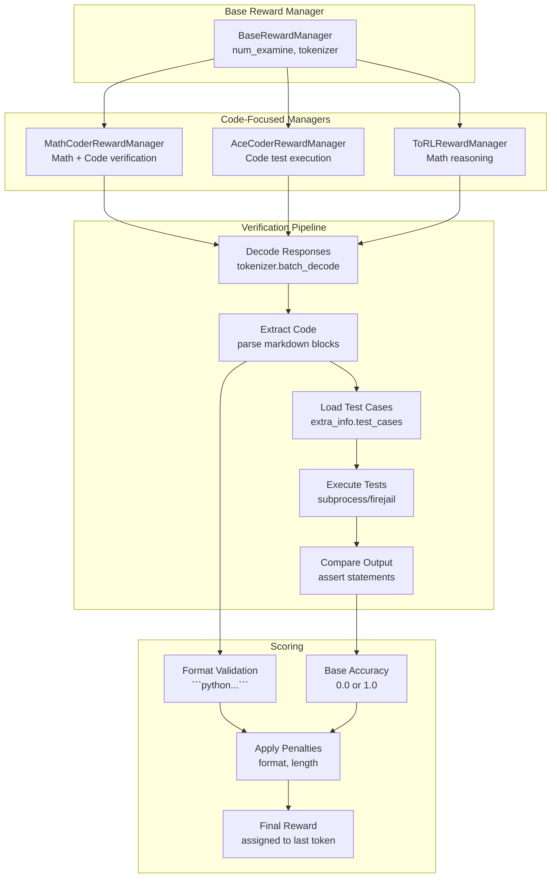
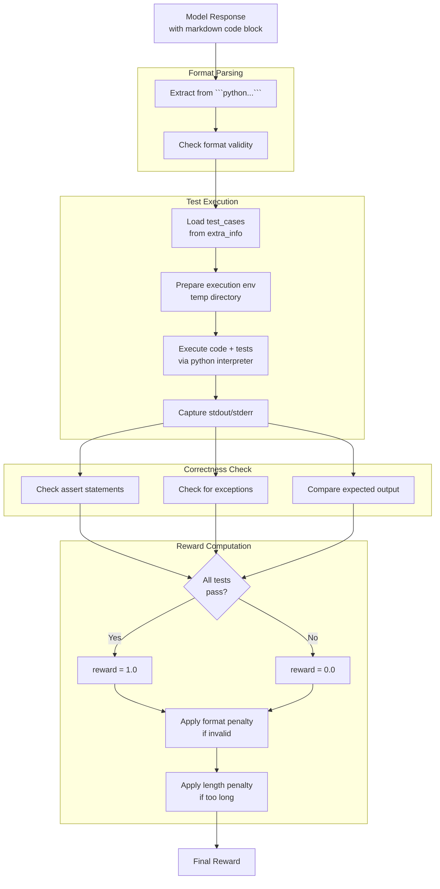
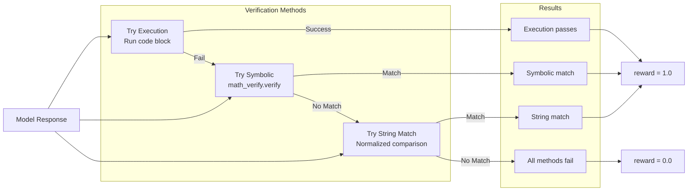
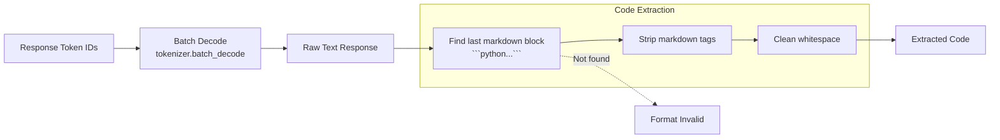
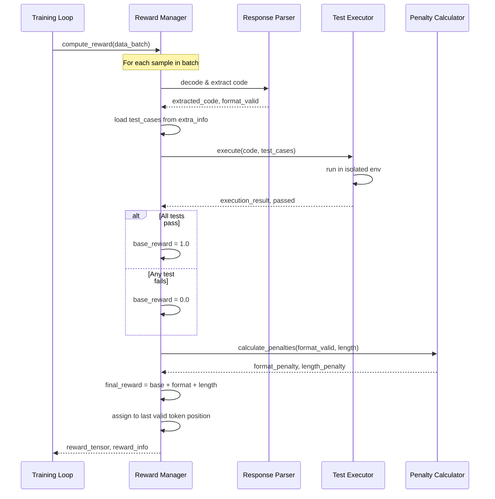

<!-- source: DeepWiki mcp.deepwiki.com · repo TIGER-AI-Lab/verl-tool · page 6.2 Code Reward Managers (MathCoder/AceCoder/ToRL) · fetched 2026-10-30 -->

# Code Reward Managers (MathCoder/AceCoder/ToRL)

<details>
<summary>Relevant source files</summary>

The following files were used as context for generating this wiki page:

- [examples/data_preprocess/acecoder.py](examples/data_preprocess/acecoder.py)
- [examples/data_preprocess/acecoder_custom.py](examples/data_preprocess/acecoder_custom.py)
- [examples/train/mathcoder/train.sh](examples/train/mathcoder/train.sh)
- [examples/train/mathcoder/train_1.5b.sh](examples/train/mathcoder/train_1.5b.sh)
- [verl_tool/agent_loop/agent_loop.py](verl_tool/agent_loop/agent_loop.py)
- [verl_tool/agent_loop/verltool_agent_loop.py](verl_tool/agent_loop/verltool_agent_loop.py)
- [verl_tool/servers/tests/test_python_code_tool.py](verl_tool/servers/tests/test_python_code_tool.py)
- [verl_tool/servers/tools/ipython_code.py](verl_tool/servers/tools/ipython_code.py)
- [verl_tool/servers/tools/utils/ipython_tool.py](verl_tool/servers/tools/utils/ipython_tool.py)
- [verl_tool/trainer/config/verltool/agent.yaml](verl_tool/trainer/config/verltool/agent.yaml)
- [verl_tool/trainer/ppo/metric_util.py](verl_tool/trainer/ppo/metric_util.py)
- [verl_tool/workers/reward_manager/torl.py](verl_tool/workers/reward_manager/torl.py)
- [verl_tool/workers/rollout/vllm_rollout/vllm_async_server.py](verl_tool/workers/rollout/vllm_rollout/vllm_async_server.py)

</details>


This page documents the code-focused reward managers used in VerlTool for training models on mathematical reasoning and code generation tasks. These reward managers compute rewards based on execution-based verification of generated code against test cases.

**Scope**: This page covers the `MathCoderRewardManager`, `AceCoderRewardManager`, and `ToRLRewardManager` classes, their verification strategies, and penalty mechanisms. For the base reward manager architecture and registration system, see [6.1](#6.1). For SQL-specific reward computation, see [6.3](#6.3). For vision reward managers, see [6.4](#6.4).

## Overview

Code reward managers evaluate agent responses by extracting Python code from markdown blocks, executing it against test cases, and computing binary rewards (0.0 or 1.0) based on correctness. They share common functionality for format validation and penalty application but differ in their specific test execution strategies.



**Sources**: [examples/train/mathcoder/train_1.5b.sh:28](), [examples/data_preprocess/acecoder.py:48-68]()

## Reward Manager Selection

The reward manager is configured via the `reward_model.reward_manager` parameter in training scripts. The selection determines which verification strategy is used:

| Reward Manager | Use Case | Verification Method | Dataset Format |
|---------------|----------|---------------------|----------------|
| `mathcoder` | Math problems solved with code | Execute Python code with test cases | Code + test_cases in extra_info |
| `acecoder` | Code generation with unit tests | Run assert-based test cases | test_cases or inputs_outputs in extra_info |
| `torl` | Math reasoning with tools | Symbolic or execution-based | Ground truth answers in extra_info |

Configuration example from training script:

```bash
reward_manager=mathcoder
python3 -m verl_tool.trainer.main_ppo \
    reward_model.reward_manager=$reward_manager
```

**Sources**: [examples/train/mathcoder/train_1.5b.sh:28,64](), [examples/train/mathcoder/train.sh:28,64]()

## MathCoder Reward Manager

The `MathCoderRewardManager` handles training on mathematical reasoning tasks where the model generates Python code to solve problems. It verifies correctness by executing the generated code with test cases.

### Verification Flow



### Dataset Format Expectations

MathCoder expects the following data structure in parquet files:

```python
{
    "prompt": [...],  # Conversation history
    "extra_info": {
        "question": "...",  # Original problem
        "test_cases": "def test():\n    assert solution(...) == ...",
        "id": "unique_id"
    }
}
```

The `test_cases` field contains Python code with assert statements that validate the solution. The reward manager extracts the final code block from the model's response and executes it together with the test cases.

**Sources**: [examples/data_preprocess/acecoder.py:63-67]()

## AceCoder Reward Manager

The `AceCoderRewardManager` is specialized for code generation tasks with comprehensive unit testing. It supports two test formats: `test_cases` (assert-based) and `inputs_outputs` (input/output pairs).

### Test Execution Strategies

#### Strategy 1: Assert-Based Tests

```python
# Test format in extra_info.test_cases
test_cases = """
def test():
    assert solution(5, 3) == 8
    assert solution(0, 0) == 0
    assert solution(-1, 1) == 0
"""
```

The reward manager:
1. Extracts code from final markdown block (```python...```)
2. Combines extracted code with test cases
3. Executes in isolated environment
4. Checks for AssertionError exceptions

#### Strategy 2: Input/Output Pairs

```python
# Test format in extra_info.inputs_outputs
inputs_outputs = {
    "inputs": ["5 3", "0 0", "-1 1"],
    "outputs": ["8", "0", "0"]
}
```

The reward manager:
1. Extracts solution function from markdown block
2. For each input, calls solution and captures output
3. Compares actual vs expected output
4. All must match for reward = 1.0

### System Prompts and Format Guidance

AceCoder training uses system prompts to guide the model on expected format. The preprocessing script provides multiple prompt variants:

```python
# Example system prompt (system_prompt13)
"""Please solve the following coding problem and verify the correctness 
by writing test cases in `assert` statements. Execution results will be 
put into the output markdown block: "```output ```". Put your final 
answer in a markdown code block like this: python\nyour code here\n``` 
without appending anything."""
```

**Sources**: [examples/data_preprocess/acecoder_custom.py:73](), [examples/data_preprocess/acecoder.py:23,48-68]()

### Training Configuration

AceCoder training scripts configure the agent loop for tool interaction:

```bash
action_stop_tokens="```output"  # Stop generating to execute code
max_turns=1                      # Single-turn for code generation
tool_server_url=http://...       # Python code execution tool
```

The `action_stop_tokens` parameter tells the model when to stop generating and execute code via the tool server.

**Sources**: [examples/data_preprocess/acecoder_custom.py:22-74]()

## ToRL Reward Manager

The `ToRLRewardManager` (Tool-integrated Reasoning for Learning) handles mathematical reasoning tasks that may involve tool use. It supports both execution-based and symbolic verification methods.

### Hybrid Verification

ToRL combines multiple verification approaches:

1. **Execution-based**: Run code to compute numerical answers
2. **Symbolic**: Use `math_verify` library for mathematical equivalence
3. **String matching**: Normalized comparison for simple cases



### Training Data Structure

ToRL datasets combine math problems with optional code execution:

```python
{
    "data_source": "math_dataset",
    "prompt": [...],
    "extra_info": {
        "question": "...",
        "answer": "42",  # Ground truth
        "use_tool": True  # Optional tool use flag
    }
}
```

The `use_tool` field enables hybrid training where some examples use Python tools and others rely on direct reasoning.

**Sources**: [examples/train/mathcoder/train_1.5b.sh:2-7](), [examples/train/mathcoder/train.sh:2-7]()

## Common Components

### Response Parsing

All code reward managers share the response parsing pipeline:



The parsing logic:
1. Decodes token IDs to text using the tokenizer
2. Searches for markdown code blocks with regex pattern `` ```python\n...\n``` ``
3. Extracts the **last** code block (assumes final answer)
4. Validates format and sets penalty flag if invalid

### Test Execution Environment

Code execution happens in isolated environments for security:

| Isolation Method | Used By | Security Features |
|-----------------|---------|-------------------|
| Firejail sandbox | Python code tool | seccomp filters, rlimits, temp dirs |
| Subprocess timeout | Reward managers | CPU time limits, memory limits |
| Ray actors | IPython code tool | Process isolation, LRU cache |

The reward manager doesn't execute code directly - it relies on the tool server for execution. However, for validation purposes during reward computation, it may use subprocess calls with timeouts.

**Sources**: [examples/train/mathcoder/train_1.5b.sh:54]()

### Format Validation

Format penalties are applied when the model fails to follow the expected markdown structure:

```python
# Expected format
response = """
<reasoning text>

```python
def solution():
    return 42
```

<optional text after>
"""

# Format errors that trigger penalty:
# - No markdown code block found
# - Empty code block
# - Incorrect language tag (e.g., ```java instead of ```python)
# - Multiple code blocks without clear final answer
```

Format penalties are typically small (e.g., -0.05) to encourage proper formatting without overwhelming the correctness signal.

## Penalty Systems

### Length Penalties

Code reward managers apply length penalties to discourage excessively long responses:

```python
# Pseudo-code for length penalty
if valid_response_length > max_response_length:
    penalty = -0.1 * (valid_response_length - max_response_length) / max_response_length
else:
    penalty = 0.0

final_reward = base_reward + format_penalty + penalty
```

Configuration from training scripts:

```bash
max_response_length=3072  # Maximum tokens for response
```

Responses exceeding this length receive graduated penalties to stay within computational constraints.

**Sources**: [examples/train/mathcoder/train_1.5b.sh:16](), [examples/train/mathcoder/train.sh:16]()

### Format Penalties

Format penalties encourage the model to generate well-formed code blocks:

| Format Issue | Penalty | Rationale |
|-------------|---------|-----------|
| Missing code block | -0.1 | Cannot execute |
| Empty code block | -0.1 | No solution provided |
| Incorrect language tag | -0.05 | Wrong tool usage |
| Malformed markdown | -0.05 | Parsing difficulty |

These penalties are applied **in addition to** the base correctness reward (0.0 or 1.0), meaning a correct solution with format issues might receive a reward of 0.95 instead of 1.0.

## Configuration and Usage

### Training Script Setup

A complete training configuration for code reward managers:

```bash
# Model and algorithm
model_name=Qwen/Qwen2.5-Coder-1.5B
reward_manager=mathcoder  # or acecoder, torl
rl_alg=grpo               # Group Relative Policy Optimization

# Data paths
train_data=[data/mathcoder/code_train.parquet,data/mathcoder/math_train.parquet]
val_data=[data/mathcoder/code_test.parquet,data/math_torl/math500_test.parquet]

# Length constraints
max_prompt_length=1024
max_response_length=3072
max_obs_length=512

# Agent configuration
action_stop_tokens="```output"  # Stop for tool execution
max_turns=1                     # Single-turn evaluation

# Tool server
tool_server_url=http://localhost:30000/get_observation
python -m verl_tool.servers.serve \
    --tool_type "python_code" \
    --workers_per_tool 32 &

# Launch training
python3 -m verl_tool.trainer.main_ppo \
    reward_model.reward_manager=$reward_manager \
    actor_rollout_ref.agent.tool_server_url=$tool_server_url \
    actor_rollout_ref.agent.max_response_length=$max_response_length \
    actor_rollout_ref.agent.action_stop_tokens=$action_stop_tokens_file
```

**Sources**: [examples/train/mathcoder/train_1.5b.sh:1-131](), [examples/train/mathcoder/train.sh:1-125]()

### Reward Manager Instantiation

The reward manager is instantiated by the training framework based on the configuration:

```python
# Configured via Hydra
reward_model:
  reward_manager: mathcoder  # or acecoder, torl
  num_examine: 64            # Number of samples to examine in logs
```

The `num_examine` parameter controls how many reward computations are logged for debugging purposes during training.

## Reward Computation Pipeline

### End-to-End Flow



### Reward Assignment

Rewards are assigned to the **last valid token position** in each response sequence:

```python
# Pseudo-code for reward assignment
for i in range(batch_size):
    valid_length = valid_response_lengths[i]
    reward_position = valid_length - 1
    
    # Initialize all positions to 0
    reward_tensor[i, :] = 0.0
    
    # Assign final reward to last token
    reward_tensor[i, reward_position] = final_rewards[i]
```

This follows standard RL practice where rewards are sparse and assigned at the end of the trajectory.

**Sources**: [examples/train/mathcoder/train_1.5b.sh:59-126]()

## Debugging and Monitoring

### Logging Examined Samples

The `num_examine` parameter controls detailed logging:

```python
# During training, detailed logs for first N samples
if sample_idx < num_examine:
    logger.info(f"Sample {sample_idx}:")
    logger.info(f"  Response: {decoded_response}")
    logger.info(f"  Extracted Code: {code}")
    logger.info(f"  Test Result: {passed}")
    logger.info(f"  Base Reward: {base_reward}")
    logger.info(f"  Format Penalty: {format_penalty}")
    logger.info(f"  Final Reward: {final_reward}")
```

This helps diagnose issues with code extraction, test execution, or penalty calculation during training.

### WandB Metrics

Training scripts log reward statistics to Weights & Biases:

- `reward/mean`: Average reward across batch
- `reward/std`: Standard deviation of rewards
- `reward/max`: Maximum reward achieved
- `reward/min`: Minimum reward achieved
- `format_errors`: Count of format validation failures
- `execution_errors`: Count of test execution failures

**Sources**: [examples/train/mathcoder/train_1.5b.sh:116-117](), [examples/train/mathcoder/train.sh:110-111]()

---

This page documented the code-focused reward managers in VerlTool. For information on the base reward manager architecture, see [6.1](#6.1). For SQL reward computation, see [6.3](#6.3). For complete training recipes using these reward managers, see [5.2](#5.2) (MathCoder/ToRL) and [5.3](#5.3) (AceCoder).

---

