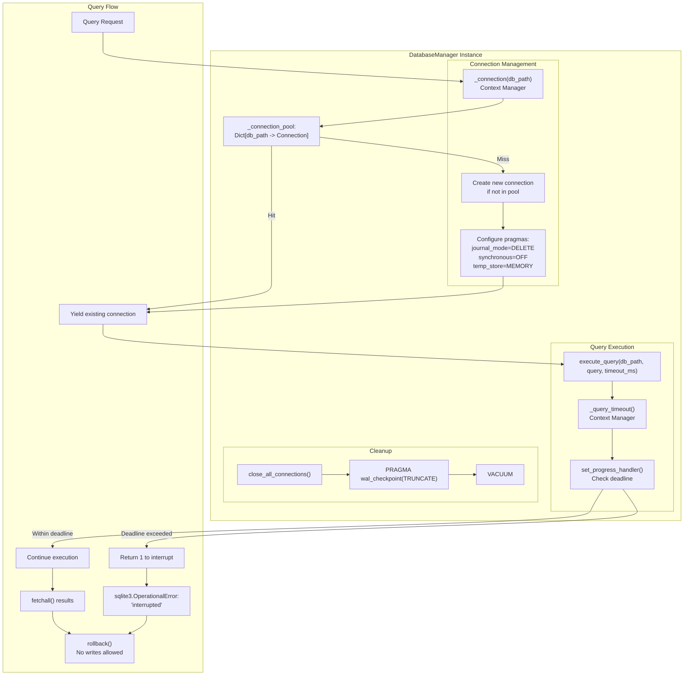
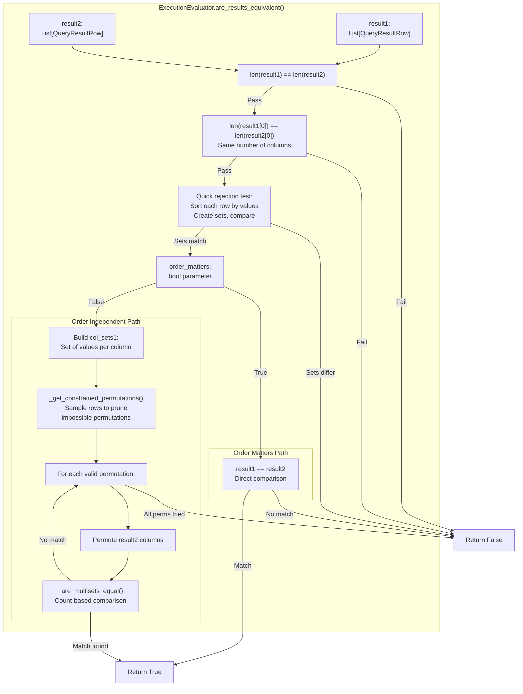
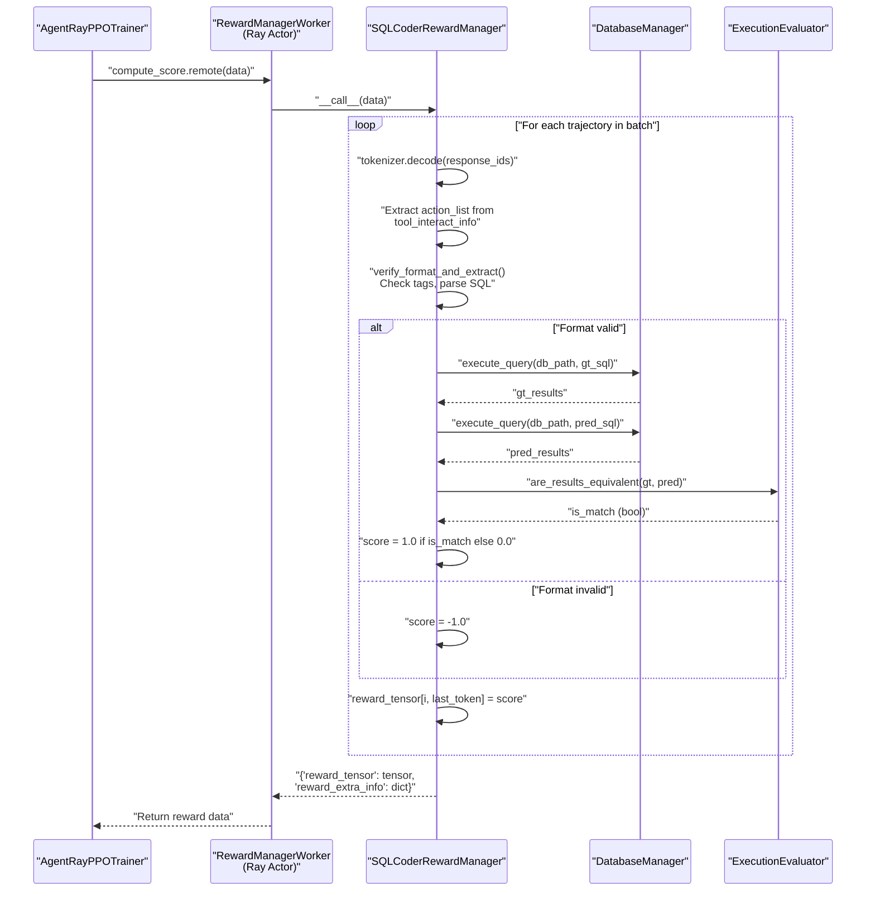

<!-- source: DeepWiki mcp.deepwiki.com · repo TIGER-AI-Lab/verl-tool · page 6.3 SQL Reward Manager · fetched 2026-10-30 -->

# SQL Reward Manager

<details>
<summary>Relevant source files</summary>

The following files were used as context for generating this wiki page:

- [verl_tool/servers/tools/sql.py](verl_tool/servers/tools/sql.py)
- [verl_tool/servers/tools/utils/sql_executor.py](verl_tool/servers/tools/utils/sql_executor.py)
- [verl_tool/workers/reward_manager/sqlcoder.py](verl_tool/workers/reward_manager/sqlcoder.py)

</details>


This document describes the **SQLCoderRewardManager** implementation, which evaluates SQL query generation tasks during training. This reward manager executes predicted SQL queries against SQLite databases and compares results with ground truth to compute accuracy scores.

For information about the general reward manager framework and registration system, see [Reward Manager Framework](#5.1). For other domain-specific reward managers, see [Math and Code Reward Managers](#5.2) and [Vision Reward Manager](#5.4).

## Overview

The SQL reward manager evaluates model-generated SQL queries by:
1. **Format validation**: Verifying that responses follow the required `` and `<solution>...</solution>` tag structure
2. **SQL extraction**: Parsing SQL code from solution tags
3. **Execution**: Running both predicted and ground truth queries against SQLite databases with timeouts
4. **Result comparison**: Using sophisticated multiset equality checks that handle column order independence
5. **Score computation**: Returning 1.0 for correct execution, 0.0 for incorrect, or -1.0 for format violations

The system is designed to handle the multi-turn SQL generation workflow where models can use intermediate `<sql>` tags for verification before submitting a final answer in `<solution>` tags.

Sources: [verl_tool/workers/reward_manager/sqlcoder.py:1-195](), [verl_tool/servers/tools/utils/sql_executor.py:1-364]()

## Reward Manager Registration and Interface

The `SQLCoderRewardManager` is registered with the name `"sqlcoder"` using the `@register` decorator:

```python
@register("sqlcoder")
class SQLCoderRewardManager:
    def __init__(self, tokenizer, num_examine, compute_score=None, 
                 reward_fn_key="data_source", **kwargs):
        self.tokenizer = tokenizer
        self.num_examine = num_examine
        self.compute_score = compute_score if compute_score else _default_compute_score
        self.reward_fn_key = reward_fn_key
        self.step = 0
```

The `__call__` method receives a `DataProto` object and returns either a reward tensor directly or a dictionary containing both the reward tensor and extra information for logging.

**Key Interface Points:**
- Input: `DataProto` containing responses, prompts, attention masks, and `extra_info` with database metadata
- Output: Sparse reward tensor (reward at last valid token) + `reward_extra_info` dict
- Metadata required in `extra_info`: `db_id`, `gt_sql`, `db_path`

Sources: [verl_tool/workers/reward_manager/sqlcoder.py:114-123]()

```mermaid
graph TB
    subgraph "Reward Manager Entry Point"
        CALL["__call__(data: DataProto)"]
        CHECK["Check for pre-computed<br/>rm_scores"]
    end
    
    subgraph "Response Processing"
        DECODE["Decode response_ids<br/>using tokenizer"]
        EXTRACT["Extract extra_info:<br/>db_id, gt_sql, db_path"]
        ACTIONS["Extract action_list from<br/>tool_interact_info"]
    end
    
    subgraph "Format Validation"
        VERIFY["verify_format_and_extract()"]
        CHECKTAGS["Check <solution> tags<br/>in last action"]
        CHECKTHINK["Check "]
    
    CHECKSOL -->|Missing| FORMATFALSE["is_correct_format = False"]
    CHECKTHINK -->|Any missing| FORMATFALSE
    
    CHECKSOL -->|Found| PARSE1["parse_action(output, 'solution')"]
    CHECKTHINK -->|All valid| CONTINUE["Continue validation"]
    
    PARSE1 -->|Success| SQLCODE["Return solution SQL code<br/>and is_correct_format"]
    PARSE1 -->|Fail| PARSE2["parse_action(output, 'sql')<br/>Fallback to <sql> tags"]
    
    PARSE2 --> SQLCODE
    
    FORMATFALSE --> SQLCODE
    CONTINUE --> CHECKSOL
```

**Format Validation Logic Flow**

Sources: [verl_tool/workers/reward_manager/sqlcoder.py:83-109]()

### SQL Code Extraction

The `parse_action()` function extracts SQL code from either `<sql>` or `<solution>` tags:

**Algorithm:**
1. Find the last occurrence of the start tag (using `rfind()`)
2. Find the corresponding end tag after the start tag
3. Extract and strip the content between tags
4. Return the SQL code and a validity flag

**Tag Types:**
- `<sql>...</sql>`: Used for intermediate query verification during multi-turn interaction
- `<solution>...</solution>`: Used for final answer submission

Sources: [verl_tool/workers/reward_manager/sqlcoder.py:45-80](), [verl_tool/servers/tools/sql.py:47-82]()

## Database Execution System

### DatabaseManager Architecture

The `DatabaseManager` class manages SQLite database connections and query execution with timeout enforcement:



**DatabaseManager Connection Pooling and Timeout Architecture**

Sources: [verl_tool/servers/tools/utils/sql_executor.py:65-161]()

### Connection Management

**Key Features:**
- **Connection pooling**: Reuses connections via `_connection_pool` dictionary keyed by `db_path`
- **Read-only mode**: Opens databases with `immutable=1` URI parameter for safety and performance
- **Performance optimizations**:
  - `PRAGMA journal_mode=DELETE`: Avoids WAL file creation
  - `PRAGMA synchronous=OFF`: Faster queries for read-only access
  - `PRAGMA temp_store=MEMORY`: In-memory temporary tables

**Connection URI Format:**
```python
uri_path = f"file:{db_path}?immutable=1"
conn = sqlite3.connect(uri_path, uri=True, check_same_thread=False)
```

Sources: [verl_tool/servers/tools/utils/sql_executor.py:72-90]()

### Query Timeout Enforcement

The timeout mechanism uses SQLite's `set_progress_handler()` to interrupt long-running queries:

**Timeout Implementation:**
1. Calculate deadline: `deadline = time.perf_counter() + (timeout_ms / 1000)`
2. Register progress handler that checks if `time.perf_counter() >= deadline`
3. Set handler to check every N virtual machine instructions (100 for short timeouts, 1000 for longer)
4. Handler returns 1 to interrupt when deadline exceeded

**Default Timeout:** 15,000 ms (15 seconds) defined by `DEFAULT_TIMEOUT_MS`

Sources: [verl_tool/servers/tools/utils/sql_executor.py:92-110](), [verl_tool/servers/tools/utils/sql_executor.py:19]()

### Query Preprocessing

Before execution, queries undergo preprocessing:

**`replace_current_year()` function:**
- Replaces `YEAR(CURDATE())` with fixed year `2020` for consistent evaluation
- Uses regex: `r"YEAR\s*\(\s*CURDATE\s*\(\s*\)\s*\)"`
- Ensures deterministic results across different execution times

**`extract_sql_from_markdown()` function:**
- Attempts to extract SQL from multiple formats:
  1. Markdown code blocks: ` ```sql\n...\n``` `
  2. `<sql>...</sql>` tags
  3. `<solution>...</solution>` tags
  4. Fallback: clean the original text
- Normalizes operators: `> =` → `>=`, `< =` → `<=`, `! =` → `!=`

Sources: [verl_tool/servers/tools/utils/sql_executor.py:54-61](), [verl_tool/servers/tools/utils/sql_executor.py:24-51]()

## Result Comparison and Evaluation

### ExecutionEvaluator Class

The `ExecutionEvaluator` implements sophisticated result comparison logic that handles:
- Different column orders (permutation testing)
- Multiset equality (duplicate rows)
- Optional order sensitivity (for queries with `ORDER BY`)



**ExecutionEvaluator Result Comparison Algorithm**

Sources: [verl_tool/servers/tools/utils/sql_executor.py:165-246]()

### Quick Rejection Optimization

Before expensive permutation testing, a quick check is performed:

```python
# Sort each row's values and create a set
s1 = {tuple(sorted(row, key=lambda x: str(x) + str(type(x)))) for row in result1}
s2 = {tuple(sorted(row, key=lambda x: str(x) + str(type(x)))) for row in result2}
if s1 != s2:
    return False
```

This efficiently rejects results that cannot possibly match, regardless of column permutations.

Sources: [verl_tool/servers/tools/utils/sql_executor.py:187-190]()

### Constrained Permutation Generation

For queries with more than 3 columns, the system uses sampling to prune impossible permutations:

**Algorithm:**
1. Build `col_sets1`: Set of all values in each column of `result1`
2. Initialize `perm_constraints[i]` = all possible column indices for position `i`
3. Sample up to 20 random rows from `result2`
4. For each sampled row, eliminate permutation options where `result2[j] ∉ col_sets1[i]`
5. Generate only permutations that satisfy constraints

This dramatically reduces the search space from `n!` to a much smaller subset.

Sources: [verl_tool/servers/tools/utils/sql_executor.py:228-246]()

### Multiset Equality Check

The `_are_multisets_equal()` function efficiently checks if two lists are equal as multisets (allowing duplicates):

**Algorithm:**
1. Use a `defaultdict(int)` to count occurrences
2. Increment count for each item in `list1`
3. Decrement count for each item in `list2`
4. Return early if any count becomes negative
5. Verify all counts are zero at the end

This is more efficient than sorting for large result sets.

Sources: [verl_tool/servers/tools/utils/sql_executor.py:214-226]()

## Reward Scoring Logic

### Score Computation Flow

The `SQLCoderRewardManager` computes the final reward through the following pipeline:

| Step | Component | Output |
|------|-----------|--------|
| 1. Decode | `tokenizer.decode(response_ids)` | Full response text |
| 2. Extract actions | `tool_interact_info` from DataProto | List of actions (model-tool interactions) |
| 3. Format validation | `verify_format_and_extract()` | `is_format_correct` (bool), `parsed_solution` (str) |
| 4. SQL execution | `sql_score_func()` | `execution_score` (0.0 or 1.0) |
| 5. Final score | Conditional logic | `score['score']` |

**Final Score Assignment:**
```python
if is_format_correct:
    score['score'] = execution_score  # 1.0 if correct, 0.0 if wrong
else:
    score['score'] = -1.0  # Format violation penalty
```

Sources: [verl_tool/workers/reward_manager/sqlcoder.py:144-172]()

### sql_score_func() Integration

The `sql_score_func()` is imported from `verl_tool.servers.tools.utils.sql_executor` and provides the core evaluation:

**Input Parameters:**
```python
score = sql_score_func(
    predicted_query_str,  # Extracted SQL code
    meta                  # Dict with db_id, gold_sql, db_path, cmp_method
)
```

**Output:** Tuple of `(score, pred_results, message)` where:
- `score`: 1.0 if results match, 0.0 otherwise
- `pred_results`: String representation of predicted query results (not used by reward manager)
- `message`: Error message if execution failed (not used by reward manager)

**Comparison Methods:**
- `"spider"`: Order-sensitive if ground truth contains `ORDER BY`
- `"bird"` (default): Always order-independent

Sources: [verl_tool/workers/reward_manager/sqlcoder.py:38](), [verl_tool/servers/tools/utils/sql_executor.py:250-310]()

### Reward Tensor Construction

The reward is placed at the last valid token position in a sparse tensor:

```python
reward_tensor = torch.zeros_like(data.batch['responses'], dtype=torch.float32)

for i in range(len(data)):
    valid_response_length_i = valid_response_length[i].item()
    # ... compute reward ...
    reward_tensor[i, valid_response_length_i - 1] = reward
```

This ensures the reward signal is associated with the completion of the trajectory, following standard RL practice for sparse rewards.

Sources: [verl_tool/workers/reward_manager/sqlcoder.py:133-187]()

### Reward Extra Info

Additional metrics are logged via `reward_extra_info` dictionary:

| Key | Type | Description |
|-----|------|-------------|
| `accuracy` | float | Execution accuracy (0.0 or 1.0) |
| `is_format_correct` | float | Format validation (0.0 or 1.0) |
| `score` | float | Final reward (-1.0, 0.0, or 1.0) |

During validation (`num_examine == 1`), only the accuracy is used as the reward:
```python
if self.num_examine == 1:
    reward = score["accuracy"]  # Ignore format penalty for validation
```

This allows clean accuracy reporting without format penalties affecting validation metrics.

Sources: [verl_tool/workers/reward_manager/sqlcoder.py:174-187]()

## Integration with Training Pipeline

### Data Requirements

The SQL reward manager expects the following fields in `DataProto`:

**Batch Fields:**
- `prompts`: Token IDs for prompts
- `responses`: Token IDs for model responses
- `attention_mask`: Mask indicating valid tokens

**Non-Tensor Batch Fields:**
- `extra_info`: Dictionary containing:
  - `db_id`: Database identifier (e.g., "california_schools")
  - `gt_sql`: Ground truth SQL query
  - `db_path`: Absolute path to SQLite database file
- `tool_interact_info`: List of dictionaries with `action` keys containing model-tool interactions

Sources: [verl_tool/workers/reward_manager/sqlcoder.py:136-159]()

### SQL Tool Coordination

The `SqlTool` (used during rollout) and `SQLCoderRewardManager` share common parsing logic:

**Shared Components:**
- `parse_action()` function for extracting SQL from tags
- Tag constants: `SQL_START`, `SQL_END`, `SOLUTION_START`, `SOLUTION_END`
- Format expectations: `<think>`, `<sql>`, `<solution>` tags

**During Rollout:**
- `SqlTool` executes intermediate `<sql>` queries and provides observations
- Final `<solution>` query triggers trajectory completion (`done = True`)
- Tool observations are appended to the prompt for next turn

**During Reward Computation:**
- `SQLCoderRewardManager` evaluates the complete response
- Checks format of all actions in `tool_interact_info`
- Executes the final SQL from `<solution>` tags
- Compares against ground truth

Sources: [verl_tool/servers/tools/sql.py:85-188](), [verl_tool/workers/reward_manager/sqlcoder.py:83-109]()

### Database Path Resolution

The database path can be provided in two ways:

1. **Explicit path** in `extra_info['db_path']` (preferred)
2. **Constructed path** using `SQL_CACHE_DIR` environment variable:
   ```python
   cache_dir = os.getenv('SQL_CACHE_DIR', 'data/nl2sql/cache')
   db_path = os.path.join(cache_dir, db_id)
   ```

This flexibility allows different training setups to manage database locations differently.

Sources: [verl_tool/servers/tools/utils/sql_executor.py:271-274](), [verl_tool/servers/tools/utils/sql_executor.py:322-324]()

### Example Scoring Flow



**SQL Reward Manager Execution Sequence**

Sources: [verl_tool/workers/reward_manager/sqlcoder.py:124-195]()

### Performance Considerations

**Connection Pooling Benefits:**
- Avoids repeated connection overhead
- Maintains warm connections for faster query execution
- Shared across all reward computations in the same worker

**Timeout Protection:**
- Prevents hanging on complex or infinite-loop queries
- Default 15s timeout is sufficient for most BIRD/Spider queries
- Progress handler has minimal overhead (~0.1-1ms per check)

**Multiset Comparison Optimization:**
- Quick rejection test eliminates most non-matches in O(n log n)
- Constrained permutation search reduces factorial complexity
- Sampling-based pruning effective for wide tables (>3 columns)

Sources: [verl_tool/servers/tools/utils/sql_executor.py:65-161](), [verl_tool/servers/tools/utils/sql_executor.py:165-246]()

---

