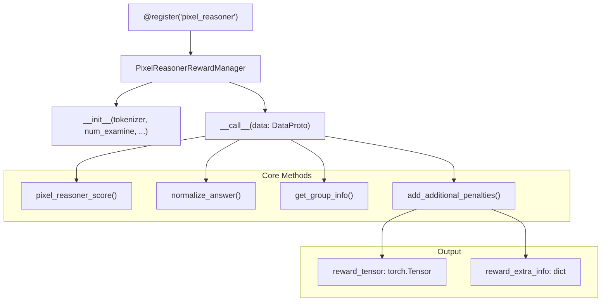
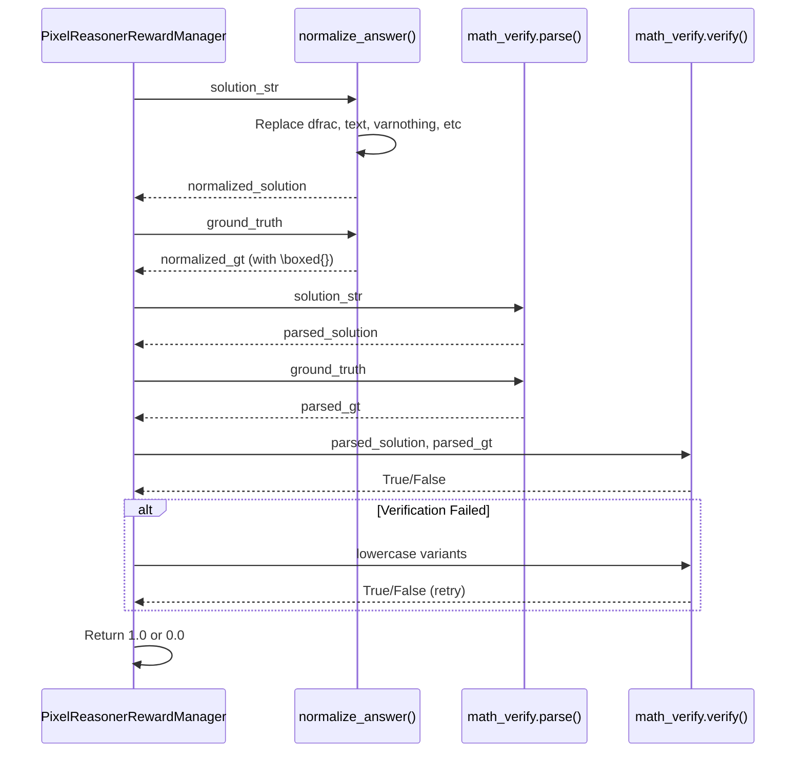
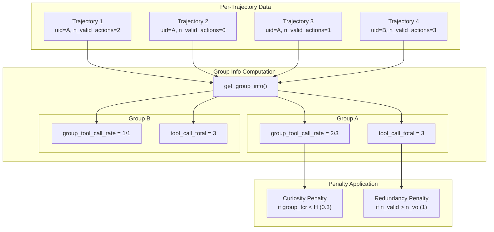
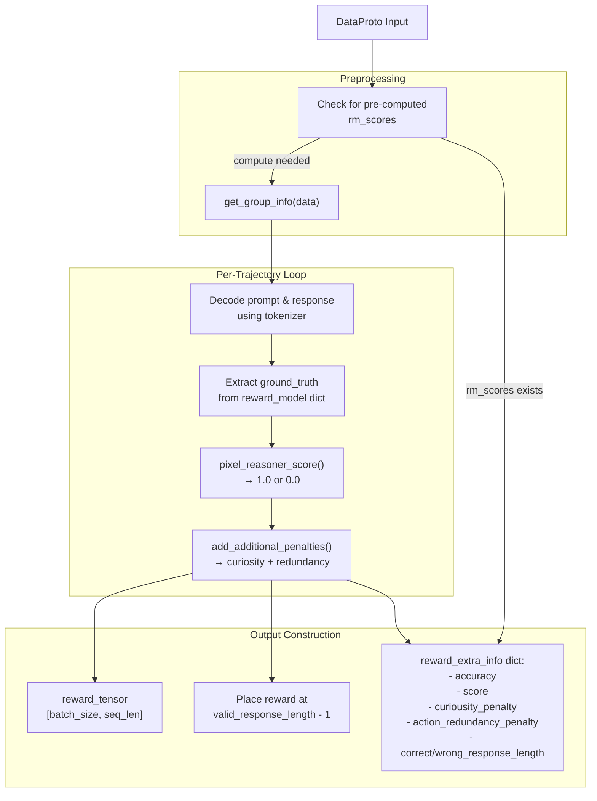
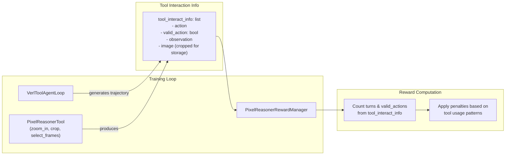

<!-- source: DeepWiki mcp.deepwiki.com · repo TIGER-AI-Lab/verl-tool · page 6.4 Vision Reward Manager · fetched 2026-10-30 -->

# Vision Reward Manager

<details>
<summary>Relevant source files</summary>

The following files were used as context for generating this wiki page:

- [examples/train/pixel_reasoner/train_3b.sh](examples/train/pixel_reasoner/train_3b.sh)
- [examples/train/pixel_reasoner/train_qwen25vl.sh](examples/train/pixel_reasoner/train_qwen25vl.sh)
- [verl_tool/servers/tools/pixel_reasoner.py](verl_tool/servers/tools/pixel_reasoner.py)
- [verl_tool/workers/reward_manager/pixel_reasoner.py](verl_tool/workers/reward_manager/pixel_reasoner.py)

</details>


This document describes the `PixelReasonerRewardManager`, a specialized reward manager for evaluating visual reasoning tasks that involve mathematical problem-solving with vision tools. This reward manager combines mathematical answer verification with penalties for tool usage patterns to encourage effective exploration and avoid redundant actions.

For information about the reward manager framework and registry system, see [Reward Manager Framework](#5.1). For other domain-specific reward managers, see [Math and Code Reward Managers](#5.2) and [SQL Reward Manager](#5.3).

## Purpose and Scope

The `PixelReasonerRewardManager` is designed specifically for training vision-language models on mathematical reasoning tasks where the model can interact with images through tools (zoom, crop, select frames). It:

- Evaluates mathematical correctness by parsing and verifying expressions using symbolic math
- Applies **curiosity penalties** to encourage exploration across the entire batch (group-level incentive)
- Applies **action redundancy penalties** to discourage excessive tool calls
- Normalizes answers to handle common formatting variations in mathematical expressions
- Operates on multi-modal data containing both text and image observations

Sources: [verl_tool/workers/reward_manager/pixel_reasoner.py:60-78]()

## Registration and Architecture

The reward manager is registered with the decorator pattern and can be instantiated by name through the reward manager registry:



Sources: [verl_tool/workers/reward_manager/pixel_reasoner.py:60-78](), [verl_tool/workers/reward_manager/__init__.py:1-35]()

### Configuration Parameters

| Parameter | Type | Default | Description |
|-----------|------|---------|-------------|
| `tokenizer` | Tokenizer | Required | Used to decode prompt and response token IDs |
| `num_examine` | int | Required | Number of decoded responses to print for debugging |
| `compute_score` | callable | `pixel_reasoner_score` | Function for computing base accuracy |
| `reward_fn_key` | str | `'data_source'` | Key in `non_tensor_batch` for data source identification |
| `add_curiousity_penalty` | bool | `True` | Enable/disable curiosity penalty |
| `add_action_redundancy_penalty` | bool | `True` | Enable/disable action redundancy penalty |
| `group_tool_call_rate_lower_bound` | float | `0.3` | Threshold H for curiosity penalty |
| `action_redundancy_limit` | int | `1` | Threshold n_vo for redundancy penalty |
| `alpha` | float | `0.5` | Curiosity penalty coefficient |
| `beta` | float | `0.05` | Redundancy penalty coefficient |

Sources: [verl_tool/workers/reward_manager/pixel_reasoner.py:67-77]()

## Mathematical Answer Verification

The core scoring logic uses symbolic math verification to check answer correctness:



### Answer Normalization

The `normalize_answer()` function handles common LaTeX formatting variations:

| Original | Replacement | Reason |
|----------|-------------|---------|
| `dfrac` | `frac` | Standardize fraction notation |
| `\text{...}` | Remove | Clean up text wrapping |
| `\varnothing` | `\emptyset` | Standardize empty set symbol |
| `minutes`, `cm` | Remove | Strip units |

Sources: [verl_tool/workers/reward_manager/pixel_reasoner.py:31-41]()

### Multi-Answer Support

The scoring function supports multiple ground truth answers by taking the maximum score:

```python
if isinstance(ground_truth, list):
    return max([pixel_reasoner_score(solution_str, gt) for gt in ground_truth])
```

Sources: [verl_tool/workers/reward_manager/pixel_reasoner.py:44-46]()

## Group-Level Analysis and Penalties

The reward manager performs group-level analysis to compute statistics across trajectories that belong to the same UID (typically trajectories generated from the same prompt with different sampling parameters).



Sources: [verl_tool/workers/reward_manager/pixel_reasoner.py:79-101]()

### Group Information Structure

The `get_group_info()` method constructs a dictionary with the following structure for each unique `uid`:

```python
group_info[uid] = {
    'num_turns': np.array([...]),              # Turn counts per trajectory
    'num_valid_actions': np.array([...]),       # Valid action counts per trajectory
    'group_tool_call_rate': float,              # Fraction of trajectories with valid_action > 0
    'tool_call_total': int                      # Sum of all valid actions in group
}
```

Sources: [verl_tool/workers/reward_manager/pixel_reasoner.py:79-101]()

### Curiosity Penalty

The curiosity penalty encourages exploration by penalizing trajectories that use tools when the overall group has low tool usage:

**Formula**: `penalty = (n_valid_actions > 0) × max(0, H - group_tool_call_rate) × α`

Where:
- `n_valid_actions > 0`: Binary indicator (1 if trajectory used tools, 0 otherwise)
- `H = 0.3`: The threshold below which penalty applies
- `group_tool_call_rate`: Fraction of trajectories in the group that used tools
- `α = 0.5`: Curiosity penalty coefficient

**Interpretation**: If a group has low tool usage (< 30%), trajectories that do use tools receive a positive penalty. This discourages premature convergence to non-tool-using solutions and maintains exploration diversity.

Sources: [verl_tool/workers/reward_manager/pixel_reasoner.py:108-112]()

### Action Redundancy Penalty

The redundancy penalty discourages excessive tool calls within a single trajectory:

**Formula**: `penalty = min(n_vo - n_valid_actions, 0) × β`

Where:
- `n_vo = 1`: The redundancy limit threshold
- `n_valid_actions`: Number of valid tool calls in this trajectory
- `β = 0.05`: Redundancy penalty coefficient

**Interpretation**: Trajectories with more than 1 valid action receive a negative penalty (reward reduction). This encourages concise tool usage.

Sources: [verl_tool/workers/reward_manager/pixel_reasoner.py:113-117]()

## Reward Computation Flow



Sources: [verl_tool/workers/reward_manager/pixel_reasoner.py:121-236]()

### Token-Level Placement

The reward is placed at the last valid token position of the response:

```python
reward_tensor[i, valid_response_length - 1] = reward
```

This is the **sparse reward** pattern used by all reward managers in the system, where the reward signal is only provided at the end of the trajectory.

Sources: [verl_tool/workers/reward_manager/pixel_reasoner.py:198]()

### Loss Mask Handling

When a `loss_mask` is present in the batch (from MTRL - Multi-Turn RL), the reward manager only decodes tokens that have `loss_mask == 1`:

```python
if "loss_mask" in data_item.batch:
    loss_mask = data_item.batch['loss_mask']
    valid_response_ids_with_loss_mask = torch.where(
        loss_mask[prompt_length:prompt_length + valid_response_length] == 1,
        valid_response_ids,
        self.tokenizer.pad_token_id
    )
```

This ensures that tool observations (which have `loss_mask == 0`) are excluded from the decoded response when computing the score.

Sources: [verl_tool/workers/reward_manager/pixel_reasoner.py:152-156]()

## Integration with Tool Server

The reward manager evaluates trajectories that have interacted with the `PixelReasonerTool`:



The reward manager accesses tool interaction information through `data_item.non_tensor_batch['tool_interact_info']`, which is populated by the agent loop during trajectory generation. Each entry contains:

- `action`: The parsed tool call
- `valid_action`: Boolean indicating if the action was valid
- `observation`: The tool's output
- `image`: Base64-encoded image data (cropped to 50 characters for storage efficiency)

Sources: [verl_tool/workers/reward_manager/pixel_reasoner.py:83-101](), [verl_tool/workers/reward_manager/pixel_reasoner.py:215-223]()

## Training Configuration

To use the `PixelReasonerRewardManager` in training, configure the following parameters in your training script:

```bash
reward_manager=pixel_reasoner
python -m verl_tool.trainer.main_ppo \
    reward_model.reward_manager=$reward_manager \
    reward_model.launch_reward_fn_async=True \
    ...
```

### Example Configuration from Training Scripts

| Parameter | train_qwen25vl.sh | train_3b.sh | Description |
|-----------|-------------------|-------------|-------------|
| `reward_manager` | `pixel_reasoner` | `pixel_reasoner` | Selects this reward manager |
| `enable_agent` | `True` | `True` | Enables tool interactions |
| `tool_server_url` | `http://$host:$port/get_observation` | Same | Tool server endpoint |
| `max_turns` | `3` | `2` | Maximum tool interaction turns |
| `rl_alg` | `grpo` | `grpo` | GRPO algorithm for group-based rewards |
| `n` | `8` | `8` | Number of samples per prompt (group size) |
| `mask_observations` | `True` | `True` | Masks tool observations in loss |
| `enable_mtrl` | `True` | `True` | Enables multi-turn RL mode |

Sources: [examples/train/pixel_reasoner/train_qwen25vl.sh:30](), [examples/train/pixel_reasoner/train_3b.sh:29]()

### Tool Server Launch

The training scripts launch a dedicated tool server with the `pixel_reasoner` tool:

```bash
python -m verl_tool.servers.serve \
    --host $host \
    --port $port \
    --tool_type "pixel_reasoner" \
    --workers_per_tool 4 &
```

Sources: [examples/train/pixel_reasoner/train_qwen25vl.sh:65]()

## Reward Extra Info Dictionary

The reward manager returns a `reward_extra_info` dictionary containing detailed statistics for logging and debugging:

| Key | Type | Description |
|-----|------|-------------|
| `accuracy` | list[float] | Binary accuracy (1.0 or 0.0) per trajectory |
| `score` | list[float] | Final reward including all penalties |
| `curiousity_penalty` | list[float] | Curiosity penalty value per trajectory |
| `action_redundancy_penalty` | list[float] | Redundancy penalty value per trajectory |
| `correct_response_length` | list[float] | Mean response length for correct answers (repeated for all trajectories) |
| `wrong_response_length` | list[float] | Mean response length for wrong answers (repeated for all trajectories) |

These metrics are automatically logged to Weights & Biases or MLflow during training for monitoring model behavior and penalty effectiveness.

Sources: [verl_tool/workers/reward_manager/pixel_reasoner.py:180-228]()

## Validation Behavior

During validation (when `num_examine == 1`), the reward manager uses binary accuracy instead of the penalized score:

```python
if self.num_examine == 1:
    reward = score["accuracy"]  # for validation
```

This ensures that validation metrics reflect pure task performance without training-specific penalties.

Sources: [verl_tool/workers/reward_manager/pixel_reasoner.py:190-191]()

## Example Output

When `num_examine > 0`, the reward manager prints decoded examples for debugging:

```
[prompt] Solve this geometry problem... <image>
[response] Let me zoom in on the triangle... <tool_call>{"name": "zoom_in", ...}</tool_call>
<observation>Here is the cropped image...</observation>
The area is 25 square units. \boxed{25}
[ground_truth] \boxed{25}
[accuracy] 1.0
[score] 1.0
[curiousity_penalty] 0.0
[action_redundancy_penalty] 0.0
```

Sources: [verl_tool/workers/reward_manager/pixel_reasoner.py:200-212]()

---

