<!-- source: DeepWiki mcp.deepwiki.com · repo TIGER-AI-Lab/verl-tool · page 7 Data Preprocessing Pipeline · fetched 2026-10-30 -->

# Data Preprocessing Pipeline

<details>
<summary>Relevant source files</summary>

The following files were used as context for generating this wiki page:

- [examples/data_preprocess/acecoder.py](examples/data_preprocess/acecoder.py)
- [examples/data_preprocess/acecoder_custom.py](examples/data_preprocess/acecoder_custom.py)
- [examples/train/mathcoder/train.sh](examples/train/mathcoder/train.sh)
- [examples/train/mathcoder/train_1.5b.sh](examples/train/mathcoder/train_1.5b.sh)

</details>


## Purpose and Scope

The data preprocessing pipeline transforms raw datasets from various sources (HuggingFace datasets, custom data files) into a standardized parquet format suitable for training tool-calling agents with VerlTool. This document covers the standard dataset schema, preprocessing scripts for different domains (code, SQL), and common patterns for dataset preparation.

For information about how datasets are consumed during training, see [Core Training Framework](#2). For details on reward computation from preprocessed ground truth data, see [Reward Management System](#5).

---

## Standard Dataset Schema

All preprocessed datasets follow a unified schema that enables consistent handling across different training tasks and reward managers.

### Core Fields

Each training example in the dataset contains the following fields:

| Field | Type | Description |
|-------|------|-------------|
| `data_source` | `str` | Source dataset identifier (e.g., "VerlTool/AceCoderV2-122K") |
| `prompt` | `List[Dict]` | List of message dictionaries with `role` and `content` keys |
| `ability` | `str` | Task type identifier (e.g., "code", "math", "sql") |
| `reward_model` | `Dict` | Reward configuration with `style` and `ground_truth` fields |
| `extra_info` | `Dict` | Task-specific metadata for reward computation and tool execution |
| `use_tool` | `bool` | (Optional) Whether this example requires tool interaction |

### Prompt Structure

The `prompt` field follows the chat template format with two or three messages:

```python
prompt = [
    {
        "role": "system",
        "content": "System instruction defining task and tool usage..."
    },
    {
        "role": "user", 
        "content": "Task-specific question or problem statement"
    }
]
```

The system message defines the interaction protocol, available tools, and output format requirements. User message contains the actual task to solve.

### Extra Info Metadata

The `extra_info` dictionary contains task-specific data required for reward computation and tool execution:

**Code Tasks:**
- `test_cases`: List of test case strings for execution validation
- `public_tests`: Optional public test cases visible to model
- `inputs_outputs`: Optional input/output pairs for validation
- `id`: Unique problem identifier
- `split`: Train/test split indicator

**SQL Tasks:**
- `db_id`: Database identifier
- `db_path`: Absolute path to SQLite database file
- `gt_sql`: Ground truth SQL query for execution comparison
- `cmp_method`: Comparison method ("bird" or "spider")

**Math Tasks:**
- `ground_truth`: Expected numerical or symbolic answer
- `question`: Original problem statement

Sources: [examples/data_preprocess/acecoder_custom.py:121-147]()

---

## Preprocessing Workflow

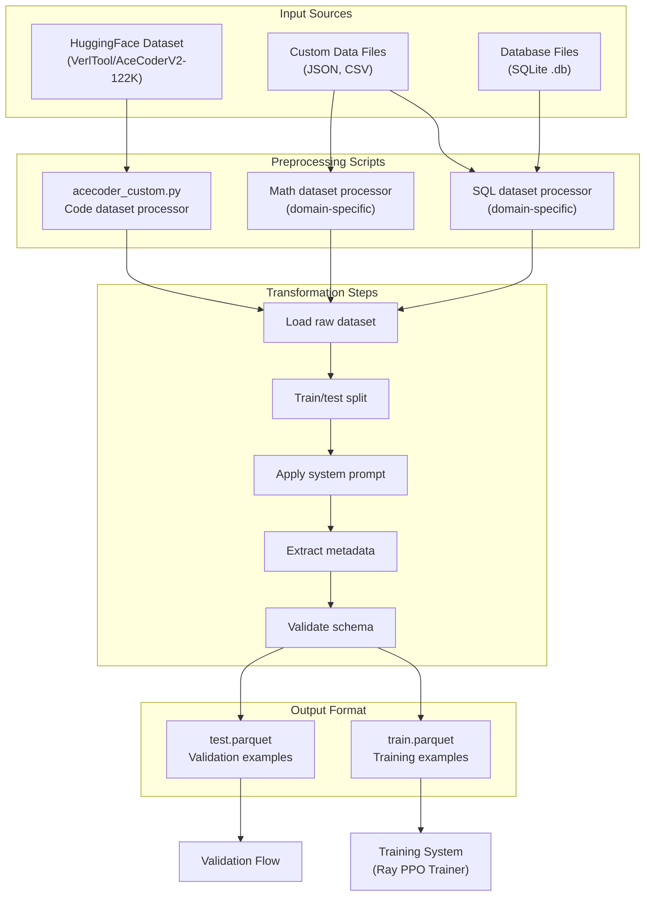

Sources: [examples/data_preprocess/acecoder_custom.py:82-164]()

---

## Code Dataset Preparation

VerlTool provides two preprocessing scripts for code generation datasets:

1. **`acecoder.py`**: Basic preprocessing with a single naive instruction format
2. **`acecoder_custom.py`**: Advanced preprocessing with 13 configurable system prompt variations

### Basic AceCoder Processor (`acecoder.py`)

The basic processor at [examples/data_preprocess/acecoder.py]() provides simple preprocessing with minimal configuration:

**Processing Logic:**

```python
naive_instruction = "Let's think step by step and generate the final program in a markdown code block like this: ```python\nyour code here\n```."

# Prompt construction at [examples/data_preprocess/acecoder.py:51-56]()
"prompt": [
    {
        "role": "user",
        "content": question_raw + naive_instruction
    }
]
```

**Key Characteristics:**
- Single-message prompt (user role only, no system message)
- Fixed instruction appended to question
- No public test configuration options
- Train/test split: 500 examples for testing

**Usage:**
```bash
python examples/data_preprocess/acecoder.py \
  --dataset_path VerlTool/AceCoderV2-122K \
  --local_dir data/acecoder
```

Sources: [examples/data_preprocess/acecoder.py:23-89]()

### Advanced AceCoder Processor (`acecoder_custom.py`)

The advanced processor at [examples/data_preprocess/acecoder_custom.py]() provides extensive customization for different training protocols.

**Key Features:**
- **13 system prompt variations** for different interaction protocols
- **Test case configuration** (public tests only, all tests, or none)
- **Train/test splitting** with fixed seed for reproducibility
- **Metadata preservation** for reward computation

#### System Prompt Variations

The script supports 13 different system prompts (defined at [examples/data_preprocess/acecoder_custom.py:22-74]()) that define different tool-calling protocols:

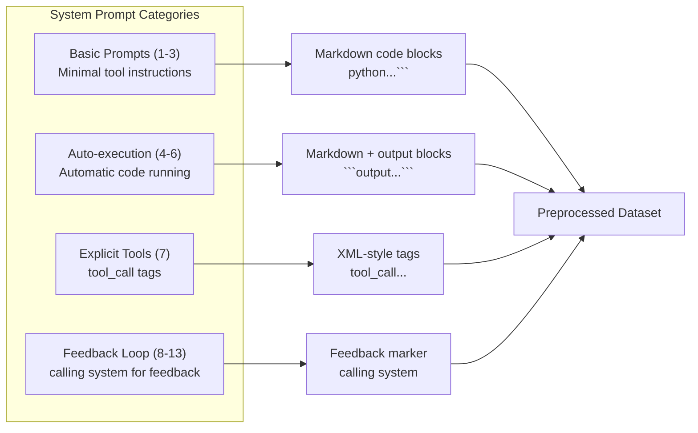

**Example System Prompts:**

| Index | Protocol | Tool Interaction | Output Format |
|-------|----------|------------------|---------------|
| 1 | Basic instruction | `<python>...</python>` tags with `<output>` | Markdown code block |
| 4 | Auto-execution | Markdown blocks with `output` blocks | Markdown code block |
| 7 | Explicit tool calls | `<tool_call>` tags | `<answer>` tags with code |
| 11 | Feedback loop | `calling system for feedback` marker | Markdown code block |
| 13 | Assert-based testing | Auto-execution with assert statements | Markdown code block |

Sources: [examples/data_preprocess/acecoder_custom.py:22-74]()

#### Test Case Configuration

The processor supports three test case inclusion modes:

```python
# No public tests (default)
python acecoder_custom.py --dataset_path VerlTool/AceCoderV2-122K

# Include public tests only (partial test suite)
python acecoder_custom.py --add_public_tests True

# Include all tests (full test suite)
python acecoder_custom.py --add_public_tests_all True
```

**Test Case Flow:**

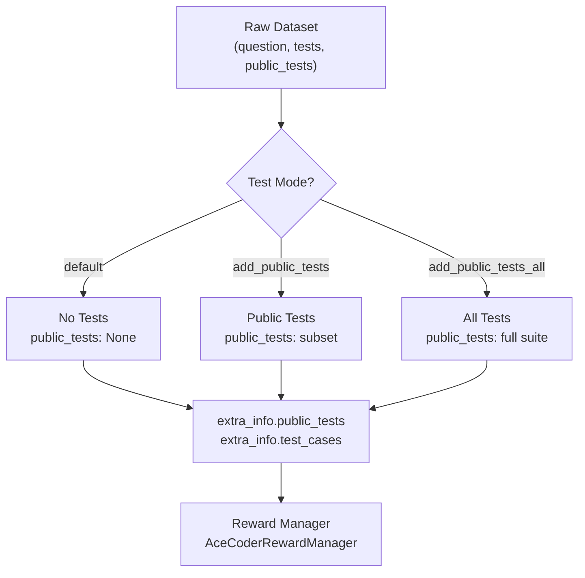

Sources: [examples/data_preprocess/acecoder_custom.py:113-120]()

#### Processing Function (`make_map_fn`)

The `make_map_fn` closure at [examples/data_preprocess/acecoder_custom.py:108-150]() transforms raw dataset examples into the standard schema:

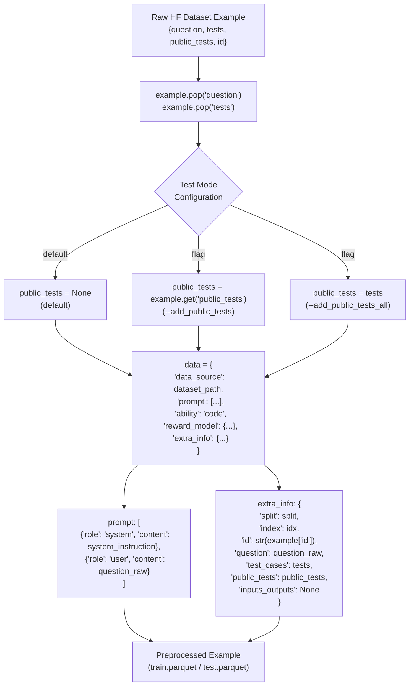

**Implementation Steps:**

The `process_fn` nested function at [examples/data_preprocess/acecoder_custom.py:110-148]() performs:

1. **Extract fields**: `question_raw = example.pop('question')`, `tests = example.pop('tests')`
2. **Test mode logic**: Apply `add_public_tests` or `add_public_tests_all` flags
3. **Build `prompt` list**: System message with `system_instruction.strip()`, user message with question
4. **Build `extra_info` dict**: Package split, index, id, test_cases, public_tests
5. **Return data dict**: Complete schema with all required fields

**Map Application:**

```python
# Apply processing function at [examples/data_preprocess/acecoder_custom.py:152-153]()
train_dataset = train_dataset.map(
    function=make_map_fn('train'), 
    with_indices=True, 
    remove_columns=train_dataset.column_names
)
```

#### Usage Examples

```bash
# Preprocess with basic system prompt
python examples/data_preprocess/acecoder_custom.py \
  --dataset_path VerlTool/AceCoderV2-122K \
  --local_dir data/acecoder_custom \
  --system_prompt_idx 1

# Preprocess with feedback loop prompt and public tests
python examples/data_preprocess/acecoder_custom.py \
  --dataset_path VerlTool/AceCoderV2-69K \
  --local_dir data/acecoder_custom \
  --system_prompt_idx 11 \
  --add_public_tests True

# Preprocess with assert-based testing and all tests
python examples/data_preprocess/acecoder_custom.py \
  --dataset_path VerlTool/AceCoderV2-69K-cleaned \
  --local_dir data/acecoder_custom \
  --system_prompt_idx 13 \
  --add_public_tests_all True
```

**Output:**
- `{local_dir}/train.parquet` - Training split with ~121.5K examples
- `{local_dir}/test.parquet` - Test split with 500 examples

Sources: [examples/data_preprocess/acecoder_custom.py:82-164](), [examples/data_preprocess/acecoder_custom.py:168-191]()

---

## SQL Dataset Preparation

SQL datasets require specialized preprocessing to package database files, ground truth queries, and comparison metadata. While a specific SQL preprocessing script is not shown in the provided files, the required schema and processing logic can be inferred from the tool and reward manager implementations.

### SQL Preprocessing Requirements

SQL dataset preprocessing scripts (e.g., `skysql_train.py` referenced in training configurations) must generate parquet files with the following structure:

**Output Schema:**
```python
{
    "data_source": "dataset_name",
    "prompt": [
        {"role": "system", "content": "SQL tool instructions..."},
        {"role": "user", "content": "task description + database schema"}
    ],
    "ability": "sql",
    "reward_model": {"style": "rule", "ground_truth": ""},
    "extra_info": {
        "db_id": "bird_dev_001",
        "db_path": "/absolute/path/to/database.sqlite",
        "gt_sql": "SELECT * FROM ...",
        "cmp_method": "bird",  # or "spider"
        "question": "natural language query"
    }
}
```

Sources: [verl_tool/servers/tools/sql.py:85-146](), [verl_tool/workers/reward_manager/sqlcoder.py:144-173]()

### SQL Dataset Schema

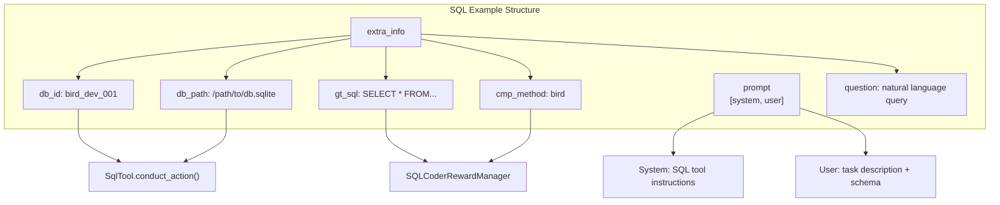

**Required Metadata Fields:**

| Field | Type | Purpose |
|-------|------|---------|
| `db_id` | `str` | Database identifier for caching and logging |
| `db_path` | `str` | Absolute path to SQLite database file |
| `gt_sql` | `str` | Ground truth SQL query for execution comparison |
| `cmp_method` | `str` | Comparison method: "bird" (order-independent) or "spider" (order-aware) |
| `question` | `str` | Natural language question for logging |

Sources: [verl_tool/servers/tools/sql.py:134-146](), [verl_tool/workers/reward_manager/sqlcoder.py:151-157]()

### SQL Format Validation

The preprocessing pipeline must ensure SQL responses follow the required format with thinking and solution tags:

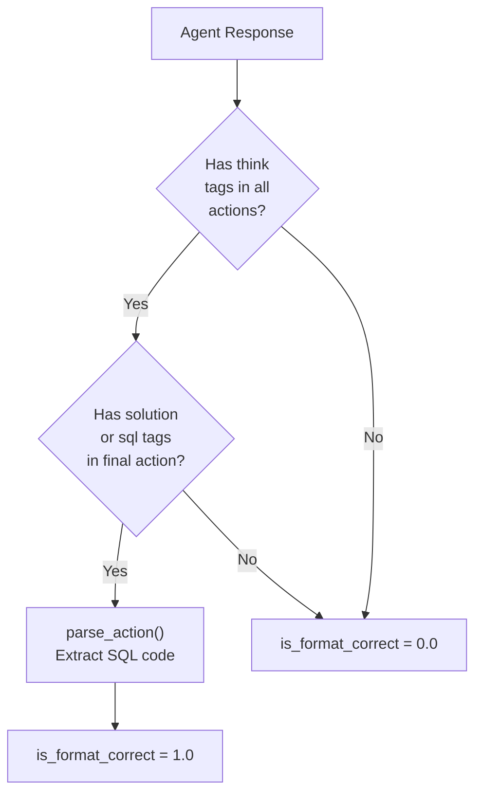

**Format Requirements:**

1. **Think tags**: Every action must start with `` containing reasoning
2. **SQL tags**: Intermediate queries use `<sql>...</sql>` for tool execution
3. **Solution tags**: Final answer uses `<solution>...</solution>` for submission

**Tag Extraction Logic:**

The `parse_action()` function at [verl_tool/workers/reward_manager/sqlcoder.py:45-80]() and [verl_tool/servers/tools/sql.py:47-82]() extracts SQL code:

1. Find the **last occurrence** of start tag (`<sql>` or `<solution>`)
2. Find the **corresponding end tag** after start tag
3. Extract content between tags and strip whitespace
4. Return extracted code and validity flag

Sources: [verl_tool/workers/reward_manager/sqlcoder.py:45-109](), [verl_tool/servers/tools/sql.py:47-82]()

### Database File Management

SQL datasets require SQLite database files to be available during training and evaluation.

```mermaid
graph LR
    subgraph "Database Setup"
        Raw["Raw Databases<br/>(bird, spider, etc.)"]
        CacheDir["SQL_CACHE_DIR<br/>environment variable"]
        DBPath["Absolute db_path<br/>in extra_info"]
    end
    
    subgraph "Database Manager"
        Pool["Connection Pool<br/>DatabaseManager._connection_pool"]
        URI["URI Connection<br/>file:path?immutable=1"]
        Pragma["PRAGMA settings<br/>journal_mode=DELETE"]
    end
    
    subgraph "Execution"
        Query["Execute SQL Query<br/>with timeout"]
        Results["Fetch Results<br/>List[QueryResultRow]"]
        Compare["Compare with ground truth<br/>ExecutionEvaluator"]
    end
    
    Raw --> CacheDir
    CacheDir --> DBPath
    DBPath --> Pool
    
    Pool --> URI
    URI --> Pragma
    Pragma --> Query
    
    Query --> Results
    Results --> Compare
```

**Database Connection Pooling:**

The `DatabaseManager` class at [verl_tool/servers/tools/utils/sql_executor.py:65-161]() manages database connections:

1. **Connection pool**: Reuses connections for same database path
2. **Read-only mode**: Uses `immutable=1` URI parameter for safety
3. **Performance pragmas**: Disables journaling and synchronous writes
4. **Error handling**: Gracefully handles missing or corrupted databases
5. **Cleanup**: Properly closes connections and removes WAL files

**Environment Configuration:**

```bash
# Set SQL cache directory
export SQL_CACHE_DIR=/path/to/sql/databases

# Database path resolution
# If db_path not in extra_info: $SQL_CACHE_DIR/{db_id}
# If db_path in extra_info: use absolute path directly
```

Sources: [verl_tool/servers/tools/utils/sql_executor.py:65-161](), [verl_tool/servers/tools/sql.py:134-137]()

### SQL Execution and Comparison

The preprocessing pipeline works with the execution evaluation system to validate SQL correctness.

#### Execution Flow

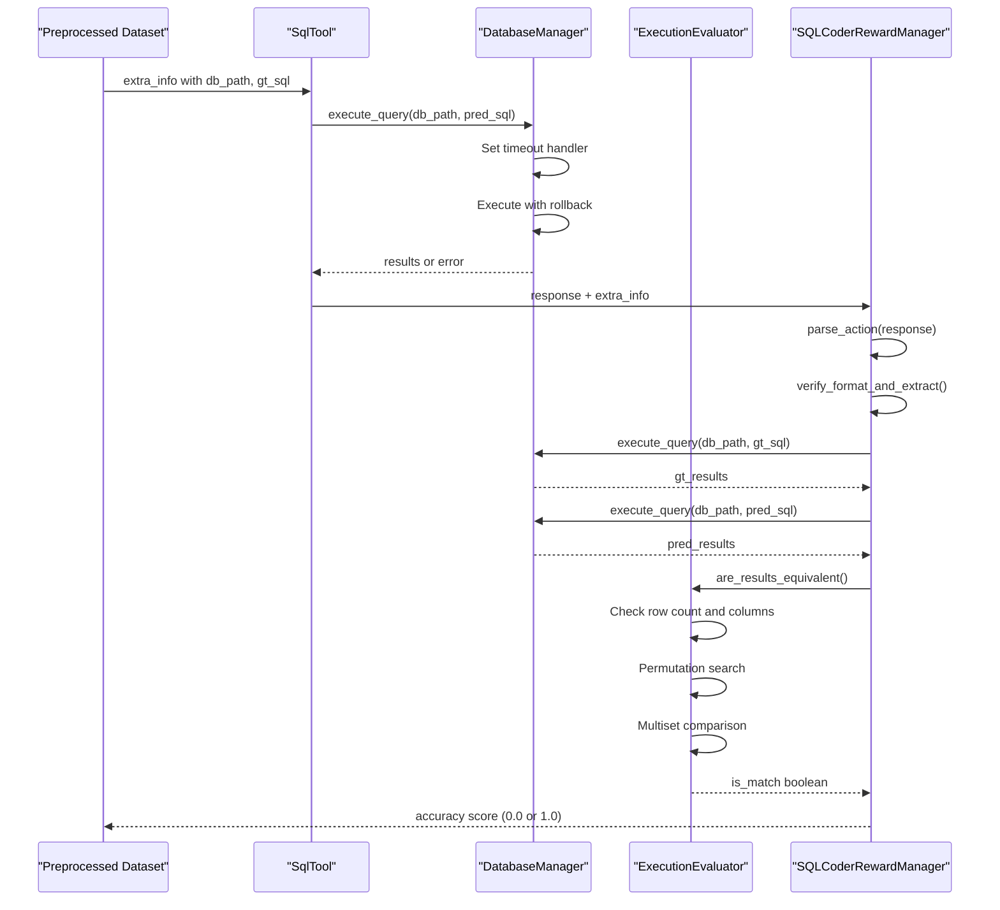

#### Query Execution with Timeout

The `execute_query()` method at [verl_tool/servers/tools/utils/sql_executor.py:112-148]() provides safe SQL execution:

1. **Query cleaning**: Replaces `YEAR(CURDATE())` with fixed year 2020
2. **Timeout enforcement**: Uses `set_progress_handler()` for query interruption
3. **Transaction safety**: Wraps execution in `BEGIN TRANSACTION` / `ROLLBACK`
4. **Error handling**: Returns error message and None results on failure

#### Result Comparison Logic

The `ExecutionEvaluator` class at [verl_tool/servers/tools/utils/sql_executor.py:165-247]() compares query results:

**Comparison Steps:**

1. **Row count check**: Quick rejection if different row counts
2. **Column count check**: Reject if different column counts
3. **Quick set comparison**: Test if unordered rows match
4. **Permutation search**: Find valid column permutations (handles column reordering)
5. **Multiset equality**: Check if results match as multisets

**Order Sensitivity:**

| Method | Order Matters | Use Case |
|--------|---------------|----------|
| `bird` | No | Default, handles column reordering |
| `spider` | Conditional | Order matters if `ORDER BY` in ground truth |

Sources: [verl_tool/servers/tools/utils/sql_executor.py:112-310](), [verl_tool/workers/reward_manager/sqlcoder.py:114-195]()

---

## Preprocessing Utilities

### Query Extraction Utilities

Multiple extraction patterns handle different SQL response formats:

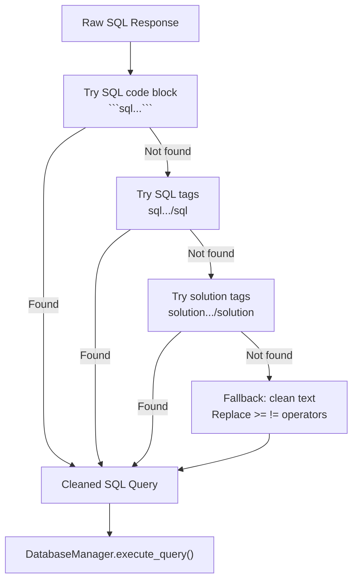

The `extract_sql_from_markdown()` function at [verl_tool/servers/tools/utils/sql_executor.py:24-51]() tries multiple patterns in order:

1. Markdown SQL blocks: ` ```sql\n...\n``` `
2. XML-style SQL tags: `<sql>...</sql>`
3. Solution tags: `<solution>...</solution>`
4. Fallback: clean the original text

Sources: [verl_tool/servers/tools/utils/sql_executor.py:24-51]()

### Format Verification

The `verify_format_and_extract()` function at [verl_tool/workers/reward_manager/sqlcoder.py:83-109]() validates response structure:

**Validation Rules:**

```python
# Rule 1: Solution tags must be present in final action
is_correct_format &= re.search(r"<solution>.*?</solution>", output, re.S)

# Rule 2: All actions must start with think tags
for action in action_list:
    is_correct_format &= action.startswith("", action, re.S)
```

**Return Values:**

- `solution`: Extracted SQL code from `<solution>` or `<sql>` tags
- `is_correct_format`: Boolean indicating format compliance

Sources: [verl_tool/workers/reward_manager/sqlcoder.py:83-109]()

---

## Common Preprocessing Patterns

### Dataset Splitting

Standard train/test split pattern used across preprocessing scripts:

```python
# Load dataset from HuggingFace
dataset = datasets.load_dataset(dataset_path, split='train')

# Split with fixed seed for reproducibility
dataset = dataset.train_test_split(test_size=500, seed=42)
train_dataset = dataset['train']
test_dataset = dataset['test']

# Save to parquet format
train_dataset.to_parquet(os.path.join(local_dir, 'train.parquet'))
test_dataset.to_parquet(os.path.join(local_dir, 'test.parquet'))
```

**Splitting Strategy:**
- Fixed test size (typically 500 examples)
- Fixed random seed (42) ensures reproducibility
- Train split used for policy training
- Test split used for validation during training

Sources: [examples/data_preprocess/acecoder_custom.py:98-164]()

### System Prompt Selection

System prompts define the interaction protocol and must be carefully chosen:

**Selection Criteria:**

| Criterion | Considerations |
|-----------|---------------|
| Tool syntax | XML tags vs markdown blocks vs special markers |
| Execution mode | Automatic vs explicit tool calls |
| Feedback mechanism | Inline execution vs explicit feedback requests |
| Output format | Structured tags vs markdown blocks |
| Test case visibility | Public tests, all tests, or none |

**Implementation Pattern:**

```python
# Define multiple system prompts
system_prompt1 = "Protocol 1 instructions..."
system_prompt2 = "Protocol 2 instructions..."
# ... up to system_prompt13

# Select via configuration
system_instruction = eval(f'system_prompt{system_prompt_idx}')

# Apply to all examples
prompt = [
    {"role": "system", "content": system_instruction.strip()},
    {"role": "user", "content": question}
]
```

Sources: [examples/data_preprocess/acecoder_custom.py:22-105]()

### Metadata Preservation

All preprocessing scripts preserve task-specific metadata in `extra_info`:

**Essential Metadata:**
- **Identifiers**: `id`, `index`, `split` for tracking and debugging
- **Ground truth**: Test cases, expected outputs, or SQL queries
- **Execution context**: Database paths, timeout settings, comparison methods
- **Dataset provenance**: `data_source` for experiment tracking

**Reward Manager Integration:**

```python
# Reward manager accesses extra_info
extra_info = data[i].non_tensor_batch.get('extra_info', {})

# Extract task-specific fields
test_cases = extra_info.get("test_cases")
db_path = extra_info.get("db_path")
gt_sql = extra_info.get("gt_sql")

# Use for reward computation
score = compute_accuracy(prediction, test_cases)
```

Sources: [verl_tool/workers/reward_manager/sqlcoder.py:144-157](), [examples/data_preprocess/acecoder_custom.py:138-146]()

---

## Integration with Training Pipeline

### Dataset Loading and Training Integration

Preprocessed parquet files are loaded by the training system through configuration parameters:

**Training Script Configuration:**

```bash
# From examples/train/mathcoder/train_1.5b.sh

# Define data paths at [examples/train/mathcoder/train_1.5b.sh:2-7]()
train_data=[$(pwd)/data/mathcoder/code_train.parquet,\
$(pwd)/data/mathcoder/math_train.parquet]
val_data=[$(pwd)/data/mathcoder/code_test.parquet,\
$(pwd)/data/math_torl/math500_test.parquet,\
$(pwd)/data/math_torl/aime24_test.parquet,\
$(pwd)/data/math_torl/aime25_test.parquet]

# Pass to main_ppo.py at [examples/train/mathcoder/train_1.5b.sh:61-62]()
data.train_files=$train_data \
data.val_files=$val_data \
```

**Data Flow Diagram:**

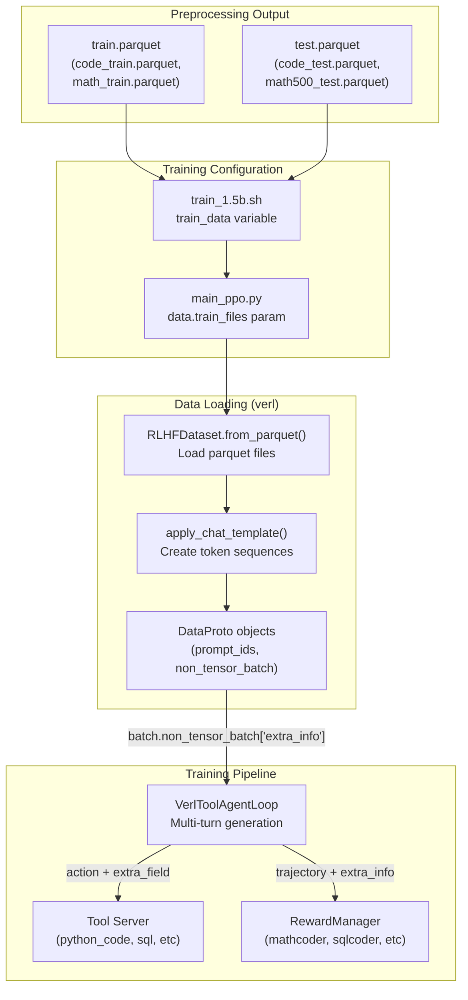

Sources: [examples/train/mathcoder/train_1.5b.sh:2-7](), [examples/train/mathcoder/train_1.5b.sh:59-68]()

### Extra Info Flow

The `extra_info` dictionary flows through the entire training pipeline:

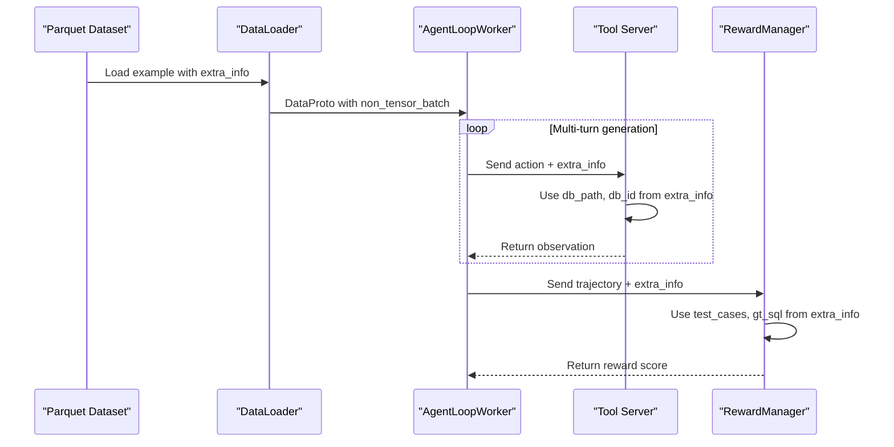

**Key Points:**
- `extra_info` stored in `non_tensor_batch` (not moved to GPU)
- Tool server receives `extra_info` for each action via `extra_field` parameter
- Reward manager accesses `extra_info` from `data[i].non_tensor_batch`
- Information preserved across entire training episode

Sources: [verl_tool/servers/tools/sql.py:85-188](), [verl_tool/workers/reward_manager/sqlcoder.py:144-173]()

---

