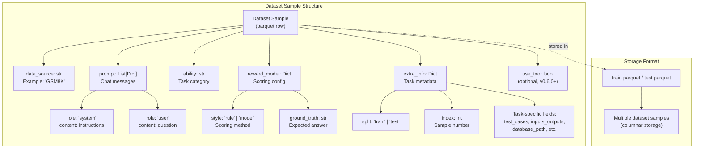
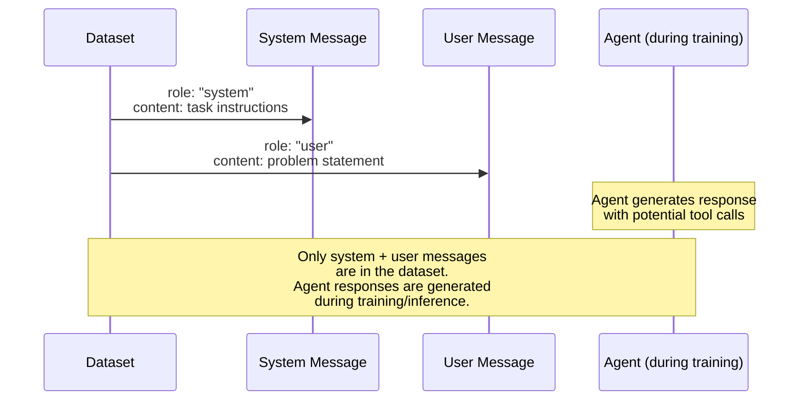
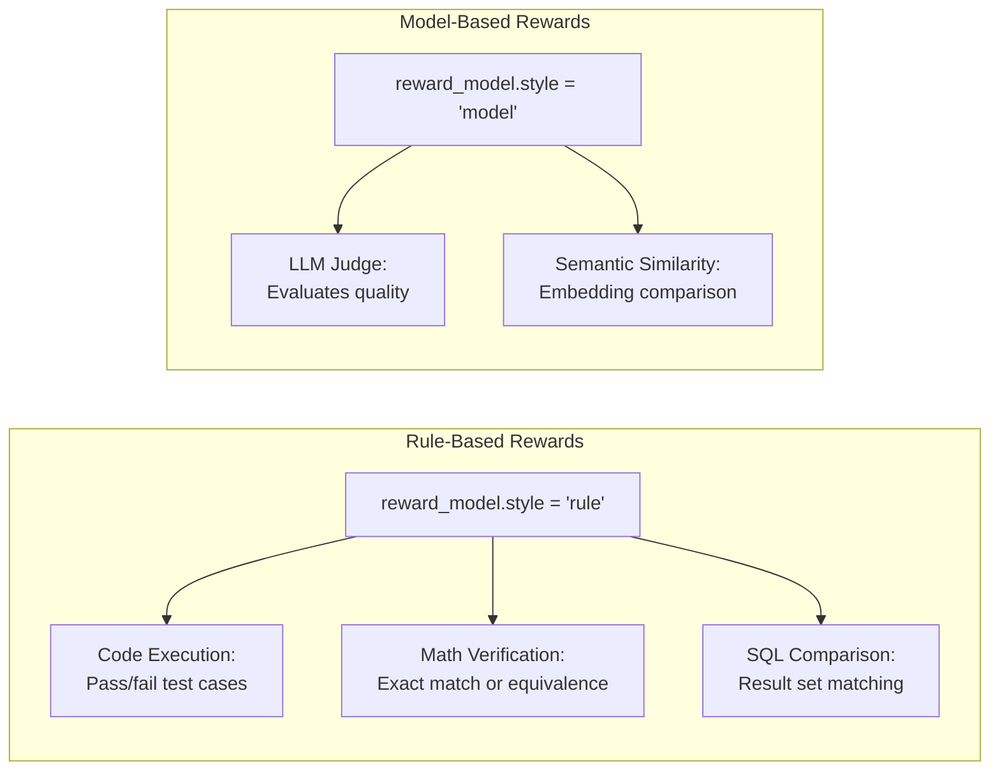
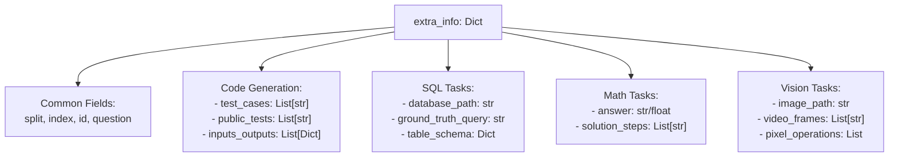
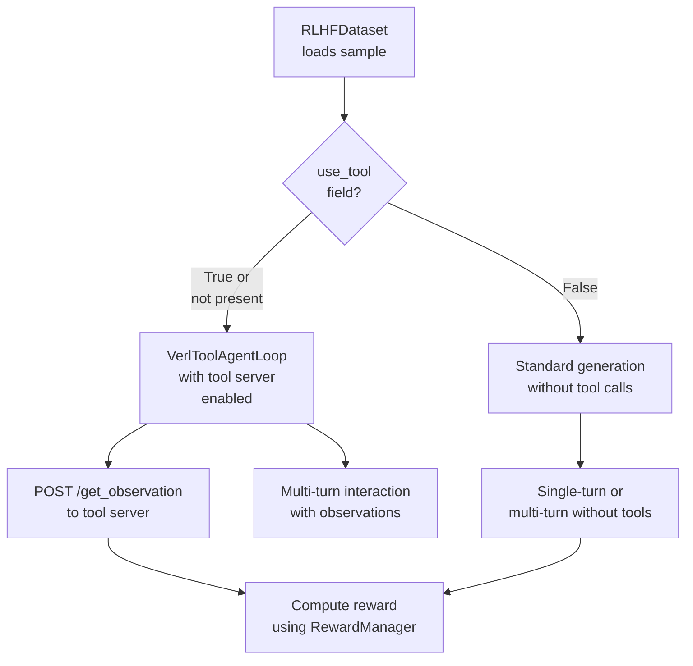
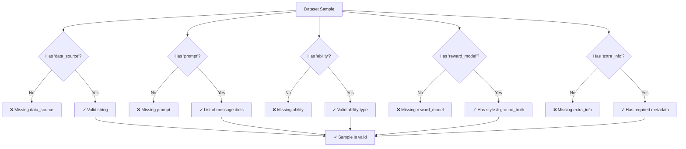
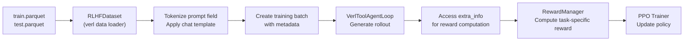

<!-- source: DeepWiki mcp.deepwiki.com · repo TIGER-AI-Lab/verl-tool · page 7.1 Dataset Format and Structure · fetched 2026-10-30 -->

# Dataset Format and Structure

<details>
<summary>Relevant source files</summary>

The following files were used as context for generating this wiki page:

- [examples/data_preprocess/acecoder_custom.py](examples/data_preprocess/acecoder_custom.py)
- [verl_tool/servers/tools/sql.py](verl_tool/servers/tools/sql.py)
- [verl_tool/servers/tools/utils/sql_executor.py](verl_tool/servers/tools/utils/sql_executor.py)
- [verl_tool/workers/reward_manager/sqlcoder.py](verl_tool/workers/reward_manager/sqlcoder.py)

</details>


This document specifies the standard dataset format used by VerlTool for training and evaluation. All training recipes in VerlTool expect datasets to conform to this schema, which includes prompt messages, reward model configuration, and task-specific metadata. For information about preparing datasets for specific domains, see [Code Dataset Preparation](#6.2) and [SQL Dataset Preparation](#6.3).

## Overview

VerlTool uses a standardized parquet-based dataset format that supports both text-only and multi-modal training scenarios. Each dataset sample represents a single training instance with its associated metadata, reward configuration, and optional tool usage flags. The format is designed to be flexible enough to accommodate different task types (code generation, mathematical reasoning, SQL queries, web search, visual reasoning) while maintaining a consistent interface for the training pipeline.

## Standard Dataset Schema

The VerlTool dataset format consists of five core fields that every dataset must provide:

| Field Name | Type | Required | Description |
|------------|------|----------|-------------|
| `data_source` | `str` | Yes | Identifier for the source dataset (e.g., "GSM8K", "MATH", "HumanEval") |
| `prompt` | `List[Dict]` | Yes | Conversation history in chat format with role/content pairs |
| `ability` | `str` | Yes | Task category identifier (e.g., "math", "code", "sql", "search") |
| `reward_model` | `Dict` | Yes | Reward computation configuration with style and ground truth |
| `extra_info` | `Dict` | Yes | Task-specific metadata and evaluation information |
| `use_tool` | `bool` | Optional | Flag indicating whether the sample requires tool usage (for hybrid training) |

### Dataset Structure Diagram



**Sources:** [examples/data_preprocess/acecoder_custom.py:121-147]()

## Prompt Field Structure

The `prompt` field contains a list of message dictionaries that form the conversation context. Each message has two required keys:

```python
{
    "role": "system" | "user" | "assistant",
    "content": "<message text>"
}
```

### Typical Prompt Sequence



### System Message Examples

System messages provide task instructions and formatting requirements. Different training recipes use different system prompts:

**Example 1: Basic Code Generation**
```python
system_prompt = """A conversation between User and Assistant. The user asks a 
question, and the Assistant solves it. The assistant first thinks about the 
reasoning process in the mind and then provides the user with the answer. User: 
Please solve the coding problems below and put your final answer in a markdown 
code block like this: ```python\nyour code here\n``` without appending anything."""
```

**Example 2: Code with Tool Feedback**
```python
system_prompt = """A conversation between User and Assistant. Please integrate 
natural language reasoning to solve the coding problems below. **For every code 
solution, you should also write test cases to assert that the solution actually 
works as you expected**. To run the code and test cases, include 
"<|calling system for feedback|>" at the end of your response for the current turn. 
Then the system will execute the code in the markdown block and provide the standard 
output and error."""
```

**Sources:** [examples/data_preprocess/acecoder_custom.py:22-74]()

## Reward Model Configuration

The `reward_model` field specifies how the generated response should be scored:

| Field | Type | Values | Description |
|-------|------|--------|-------------|
| `style` | `str` | `"rule"` or `"model"` | Whether to use rule-based or model-based scoring |
| `ground_truth` | `str` | Task-specific | Expected answer or empty string (when using test cases) |

### Rule-Based vs Model-Based Rewards



For most training recipes, `style` is set to `"rule"` and `ground_truth` is empty (`""`), as the actual evaluation uses test cases or execution results stored in `extra_info`.

**Sources:** [examples/data_preprocess/acecoder_custom.py:134-137]()

## Extra Info Metadata

The `extra_info` field is a flexible dictionary that stores task-specific metadata required for evaluation and reward computation. Different task types require different metadata fields:

### Common Fields Across All Tasks

| Field | Type | Description |
|-------|------|-------------|
| `split` | `str` | Dataset split: `"train"` or `"test"` |
| `index` | `int` | Sample index within the split |
| `id` | `str` | Unique identifier for the problem |
| `question` | `str` | Raw question text |

### Task-Specific Extra Info Fields



### Code Generation Extra Info Example

```python
extra_info = {
    "split": "train",
    "index": 42,
    "id": "humaneval_001",
    "question": "Write a function to compute factorial",
    "test_cases": [
        "assert factorial(5) == 120",
        "assert factorial(0) == 1",
        "assert factorial(3) == 6"
    ],
    "public_tests": [
        "assert factorial(5) == 120"
    ],
    "inputs_outputs": None
}
```

**Sources:** [examples/data_preprocess/acecoder_custom.py:138-146]()

## Use Tool Field for Hybrid Training

Starting from VerlTool v0.6.0, datasets support a `use_tool` field that enables hybrid training with and without tool usage in the same training run:

```python
# Sample requiring tool usage
{
    "use_tool": True,  # Agent will call tools during generation
    "prompt": [...],
    "extra_info": {...}
}

# Sample not requiring tool usage
{
    "use_tool": False,  # Agent generates response directly
    "prompt": [...],
    "extra_info": {...}
}
```

### Tool Usage Flow



When `use_tool` is not present in a sample, the default behavior is to enable tool usage. This maintains backward compatibility with datasets created before v0.6.0.

**Sources:** [assets/docs/updates/verltool_v0.6.0_upgrade.md:10-11]()

## Data Storage Format

VerlTool stores datasets as parquet files, which provide efficient columnar storage and fast read access:

### Directory Structure

```
data/
├── task_name/
│   ├── train.parquet          # Training split
│   ├── test.parquet           # Test/validation split
│   └── metadata.json          # Optional metadata file
```

### Parquet Format Advantages

| Feature | Benefit |
|---------|---------|
| Columnar storage | Efficient compression and selective column reading |
| Schema enforcement | Type safety and automatic validation |
| Fast random access | Quick sampling during training |
| Distributed compatible | Works with Ray Dataset and other distributed loaders |

### Loading Datasets in Training Code

```python
import datasets

# Load parquet files
train_dataset = datasets.load_dataset(
    'parquet',
    data_files={'train': 'data/task_name/train.parquet'}
)

# Access specific columns
for sample in train_dataset['train']:
    prompt = sample['prompt']
    extra_info = sample['extra_info']
    # Process sample...
```

**Sources:** [examples/data_preprocess/acecoder_custom.py:160-163]()

## Complete Dataset Example

Here is a complete example of a code generation dataset sample as it would appear in the parquet file:

```python
{
    "data_source": "VerlTool/AceCoderV2-122K",
    "prompt": [
        {
            "role": "system",
            "content": "A conversation between User and Assistant. The user asks "
                      "a question, and the Assistant solves it. Please solve the "
                      "coding problems below and put your final answer in a markdown "
                      "code block like this: ```python\nyour code here\n``` without "
                      "appending anything."
        },
        {
            "role": "user",
            "content": "Write a function that takes a list of integers and returns "
                      "the sum of all even numbers in the list."
        }
    ],
    "ability": "code",
    "reward_model": {
        "style": "rule",
        "ground_truth": ""
    },
    "extra_info": {
        "split": "train",
        "index": 0,
        "id": "custom_001",
        "question": "Write a function that takes a list of integers and returns "
                   "the sum of all even numbers in the list.",
        "public_tests": None,
        "test_cases": [
            "def test_sum_evens():\n    assert sum_evens([1,2,3,4]) == 6\n    "
            "assert sum_evens([1,3,5]) == 0\n    assert sum_evens([]) == 0"
        ],
        "inputs_outputs": None
    },
    "use_tool": True
}
```

## Dataset Schema Validation

### Required Field Validation



The training pipeline expects these fields to be present and correctly typed. Missing or malformed fields will cause errors during dataset loading.

## Integration with Training Pipeline

### Data Flow from Parquet to Training



The `extra_info` field is particularly important as it flows through the entire pipeline and is used by the reward manager to evaluate generated responses against ground truth test cases or other validation criteria.

**Sources:** [examples/data_preprocess/acecoder_custom.py:82-163](), [assets/docs/updates/verltool_v0.6.0_upgrade.md:1-11]()

## Dataset Preprocessing Workflow

The typical workflow for creating a VerlTool-compatible dataset:

1. **Load raw data** from source (HuggingFace dataset, JSON files, CSV, etc.)
2. **Format prompts** according to task requirements and system instructions
3. **Structure metadata** into the `extra_info` field
4. **Set reward configuration** based on evaluation method
5. **Add `use_tool` flag** if hybrid training is needed (v0.6.0+)
6. **Save as parquet** with train/test splits

### Example Preprocessing Code Pattern

```python
def process_sample(example, idx):
    return {
        "data_source": "dataset_name",
        "prompt": [
            {"role": "system", "content": system_instructions},
            {"role": "user", "content": example['question']}
        ],
        "ability": "task_category",
        "reward_model": {
            "style": "rule",
            "ground_truth": ""
        },
        "extra_info": {
            "split": "train",
            "index": idx,
            "id": str(example['id']),
            "question": example['question'],
            # Task-specific fields here
        },
        "use_tool": True  # Optional
    }
```

**Sources:** [examples/data_preprocess/acecoder_custom.py:108-150]()

---

