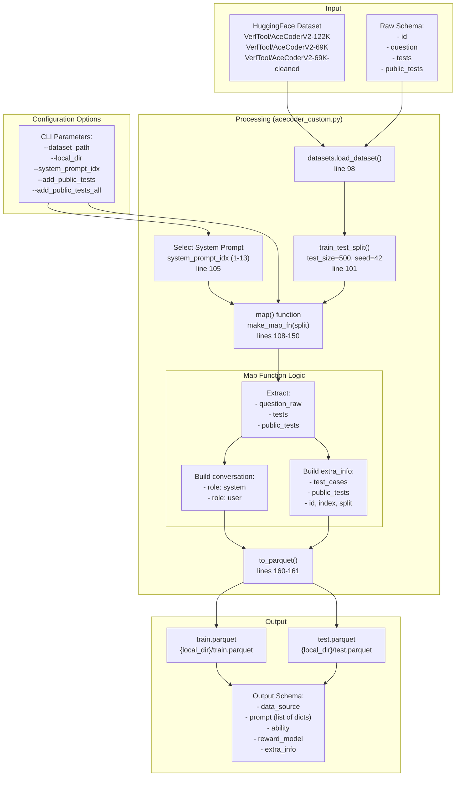
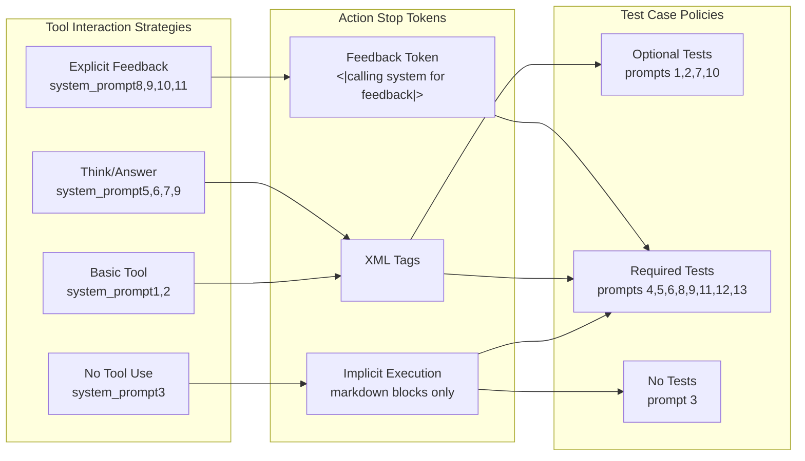
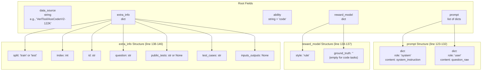
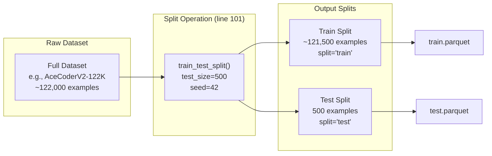
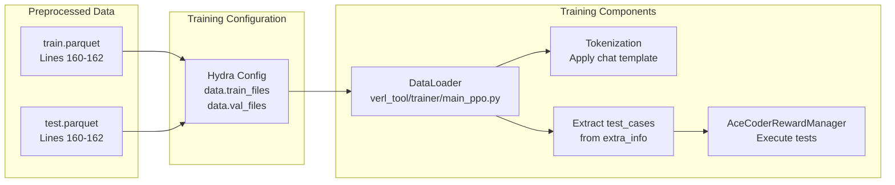

<!-- source: DeepWiki mcp.deepwiki.com · repo TIGER-AI-Lab/verl-tool · page 7.2 Code Dataset Preparation (AceCoder) · fetched 2026-10-30 -->

# Code Dataset Preparation (AceCoder)

<details>
<summary>Relevant source files</summary>

The following files were used as context for generating this wiki page:

- [examples/data_preprocess/acecoder_custom.py](examples/data_preprocess/acecoder_custom.py)

</details>


This page documents the preprocessing pipeline for AceCoder code generation datasets, focusing on the `acecoder_custom.py` script. This preprocessing converts raw AceCoder datasets from HuggingFace Hub into the standardized Parquet format required by VerlTool's training pipeline. The script provides 13 distinct system prompt variations that instruct the model on different interaction patterns for code generation with tool use.

For information about the reward computation for code generation tasks, see [Code Reward Managers (MathCoder/AceCoder/ToRL)](#6.2). For the overall dataset format specification, see [Dataset Format and Structure](#7.1). For training recipes using these datasets, see [AceCoder Code Generation Training](#5.3).

---

## Overview and Purpose

The `acecoder_custom.py` preprocessing script transforms raw AceCoder datasets into training-ready Parquet files with the following capabilities:

- **System Prompt Selection**: Choose from 13 pre-defined system prompts that specify different interaction patterns
- **Test Case Integration**: Optionally include public test cases in the user prompt
- **Train/Test Splitting**: Automatically creates a 500-example held-out test set
- **Schema Standardization**: Outputs data in VerlTool's expected format with conversation structure and metadata

**Sources**: [examples/data_preprocess/acecoder_custom.py:1-191]()

---

## Preprocessing Pipeline Architecture



**Sources**: [examples/data_preprocess/acecoder_custom.py:82-163]()

---

## System Prompt Variations

The preprocessing script provides 13 distinct system prompt options, each designed to encourage different interaction patterns with code execution tools. The system prompt is selected via the `--system_prompt_idx` parameter.

### System Prompt Taxonomy

| Prompt ID | Key Features | Action Format | Output Format | Test Case Requirement |
|-----------|-------------|---------------|---------------|----------------------|
| 1 | Basic tool integration | `<python>` / `</python>` | `<output>` | Optional |
| 2 | Explicit output blocks | N/A | ` ```output\n...\n``` ` | Optional |
| 3 | No tool use | N/A | N/A | No |
| 4 | Mandatory test cases | ` ```python\n...\n``` ` | ` ```output\n...\n``` ` | Required |
| 5 | Think/answer structure | ` ```python\n...\n``` ` | ` ```output\n...\n``` ` | Required |
| 6 | XML tool format | `<python>` / `</python>` | `<output>` / `</output>` | Required |
| 7 | Tool call syntax | `<tool_call>` / `</tool_call>` | Markdown block | Optional |
| 8 | Explicit feedback request | `<\|calling system for feedback\|>` | stdout/stderr | Required |
| 9 | Think/answer + feedback | `<\|calling system for feedback\|>` | stdout/stderr | Required |
| 10 | Debug-focused | `<\|calling system for feedback\|>` | stdout/stderr | Optional |
| 11 | Assert-based testing | `<\|calling system for feedback\|>` | stdout/stderr | Required |
| 12 | Concise assert testing | Implicit | ` ```output ``` ` | Required |
| 13 | Simple assert testing | Implicit | ` ```output ``` ` | Required |

**Sources**: [examples/data_preprocess/acecoder_custom.py:22-73]()

### Prompt Strategy Details



**Sources**: [examples/data_preprocess/acecoder_custom.py:22-73]()

### Example System Prompts

**system_prompt1** (Basic Tool Integration):
```
A conversation between User and Assistant. The user asks a question, and the Assistant 
solves it. The assistant first thinks about the reasoning process in the mind and then 
provides the user with the answer. User: Please integrate natural language reasoning 
with programs to solve the coding problems below. If you want to test any python code, 
writing it inside <python> and </python> tags following with <output>. Please put your 
final answer in a markdown code block like this: python\nyour code here\n``` without 
appending anything.
```

**system_prompt8** (Explicit Feedback Request):
```
A conversation between User and Assistant. [...] If you want to test the code of your 
solution, include "<|calling system for feedback|>" at the end of your response for the 
current turn. Then the system will execute the code in the markdown block and provide 
the standard output and error. Make sure you also write test cases for the code you write 
so you can get non-empty execution results for debugging.
```

**system_prompt13** (Simple Assert Testing):
```
A conversation between User and Assistant. [...] Please solve the following coding problem 
and verify the correctness by writing test cases in `assert` statements. Execution results 
will be put into the in output markdown block: "```output ```". Put your final answer in a 
markdown code block like this: python\nyour code here\n``` without appending anything.
```

**Sources**: [examples/data_preprocess/acecoder_custom.py:22-73]()

---

## Dataset Schema Structure

The preprocessing script transforms raw AceCoder data into VerlTool's standardized conversation format with the following schema:

### Output Data Structure



**Sources**: [examples/data_preprocess/acecoder_custom.py:121-148]()

### Test Case Integration Options

The script provides three modes for including test cases in the dataset:

| Mode | CLI Flag | Behavior | Use Case |
|------|----------|----------|----------|
| **Hidden Tests** | (default) | `public_tests=None`<br/>All tests in `test_cases` | Standard training; model must generate own tests |
| **Public Tests** | `--add_public_tests` | `public_tests=example['public_tests']`<br/>Subset visible in prompt | Give model example test cases |
| **All Tests Public** | `--add_public_tests_all` | `public_tests=tests`<br/>All tests visible | Maximum guidance; model can see all test cases |

**Implementation Details**:
```python
# Lines 115-120
if add_public_tests:
    public_tests = example.get('public_tests', None)
elif add_public_tests_all:
    public_tests = tests
else:
    public_tests = None
```

When `public_tests` is not None, it is formatted into the user message using the template at [examples/data_preprocess/acecoder_custom.py:75-81]():

```
### Public Test Cases
Here are some public test cases where you can use to test your program.
```python
{test_cases}
```
```

**Sources**: [examples/data_preprocess/acecoder_custom.py:75-120]()

---

## Train/Test Split Strategy

The preprocessing script automatically creates a held-out test set with the following characteristics:

### Split Configuration



**Fixed Parameters**:
- `test_size=500`: Exactly 500 examples reserved for testing
- `seed=42`: Reproducible random split across runs
- Split information stored in `extra_info['split']` field

**Sources**: [examples/data_preprocess/acecoder_custom.py:101-103]()

---

## Usage Examples and CLI Interface

### Command-Line Interface

The script accepts the following parameters via Fire CLI:

```python
# Function signature (lines 82-88)
def main(
    dataset_path: str = 'VerlTool/AceCoderV2-122K',
    local_dir: str = 'data/acecoder',
    system_prompt_idx: int = 1,
    add_public_tests: bool = False,
    add_public_tests_all: bool = False,
)
```

| Parameter | Type | Default | Description |
|-----------|------|---------|-------------|
| `dataset_path` | str | `'VerlTool/AceCoderV2-122K'` | HuggingFace Hub dataset identifier |
| `local_dir` | str | `'data/acecoder'` | Output directory for parquet files |
| `system_prompt_idx` | int | `1` | System prompt variation (1-13) |
| `add_public_tests` | bool | `False` | Include original public tests in prompt |
| `add_public_tests_all` | bool | `False` | Include all tests as public tests |

**Sources**: [examples/data_preprocess/acecoder_custom.py:82-88]()

### Output Directory Structure

The script creates directories with automatic naming based on configuration:

```python
# Lines 89-96
local_dir = Path(local_dir)
local_dir_post_fix = f"-system-prompt-{system_prompt_idx}"
if add_public_tests:
    local_dir_post_fix += f"-pub-tests"
if add_public_tests_all:
    local_dir_post_fix += f"-all-tests"
local_dir = local_dir / (dataset_path.split('/')[-1] + local_dir_post_fix)
```

**Example Outputs**:
- `data/acecoder/AceCoderV2-122K-system-prompt-1/`
- `data/acecoder/AceCoderV2-122K-system-prompt-13-pub-tests/`
- `data/acecoder/AceCoderV2-69K-cleaned-system-prompt-11-all-tests/`

**Sources**: [examples/data_preprocess/acecoder_custom.py:89-96]()

### Common Usage Patterns

```bash
# Basic preprocessing with system prompt 1
python examples/data_preprocess/acecoder_custom.py \
    --dataset_path VerlTool/AceCoderV2-122K \
    --local_dir data/acecoder_custom \
    --system_prompt_idx 1

# Assert-based testing with public test cases
python examples/data_preprocess/acecoder_custom.py \
    --dataset_path VerlTool/AceCoderV2-69K \
    --local_dir data/acecoder_custom \
    --system_prompt_idx 13 \
    --add_public_tests True

# Maximum guidance: all tests visible, think/answer structure
python examples/data_preprocess/acecoder_custom.py \
    --dataset_path VerlTool/AceCoderV2-69K-cleaned \
    --local_dir data/acecoder_custom \
    --system_prompt_idx 11 \
    --add_public_tests_all True
```

**Comprehensive Example List**: See [examples/data_preprocess/acecoder_custom.py:169-191]() for all 23 documented usage patterns.

**Sources**: [examples/data_preprocess/acecoder_custom.py:169-191]()

---

## Integration with Training Pipeline

### Data Loading in Training

The preprocessed Parquet files integrate directly with VerlTool's training scripts:



**Key Integration Points**:

1. **Prompt Field**: The `prompt` list is converted to token IDs via the model's chat template
2. **Test Cases**: `extra_info['test_cases']` is passed to `AceCoderRewardManager` for correctness evaluation
3. **Public Tests**: If included, `extra_info['public_tests']` can be appended to the user message
4. **Ability Field**: `ability='code'` triggers code-specific processing in the training loop
5. **Reward Model**: `reward_model.style='rule'` indicates rule-based (test execution) evaluation

**Sources**: [examples/data_preprocess/acecoder_custom.py:121-147]()

---

## Available Datasets

The preprocessing script supports multiple AceCoder dataset variants from the VerlTool HuggingFace organization:

| Dataset | Size | Description | Hub Link |
|---------|------|-------------|----------|
| `VerlTool/AceCoderV2-122K` | ~122,000 | Full AceCoder V2 dataset | Standard version |
| `VerlTool/AceCoderV2-69K` | ~69,000 | Subset version | Smaller training set |
| `VerlTool/AceCoderV2-69K-cleaned` | ~69,000 | Cleaned subset | Quality-filtered |

All datasets follow the same raw schema with fields: `id`, `question`, `tests`, and optionally `public_tests`.

**Sources**: [examples/data_preprocess/acecoder_custom.py:83, 169-191]()

---

## Summary

The `acecoder_custom.py` preprocessing script provides a flexible pipeline for preparing AceCoder datasets:

- **13 System Prompt Variations**: Ranging from no-tool baselines to explicit feedback request patterns
- **Test Visibility Control**: Hidden, partial, or full test case exposure
- **Standardized Output**: Conversation-based Parquet format with metadata
- **Automatic Splitting**: 500-example held-out test set with reproducible seed
- **Directory Organization**: Automatic naming based on configuration choices

The preprocessing output integrates seamlessly with VerlTool's training pipeline, where the `test_cases` field is used by `AceCoderRewardManager` to evaluate code correctness during RL training.

**Sources**: [examples/data_preprocess/acecoder_custom.py:1-191]()

---

