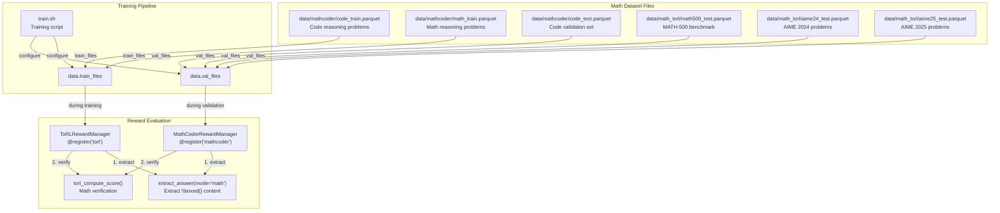
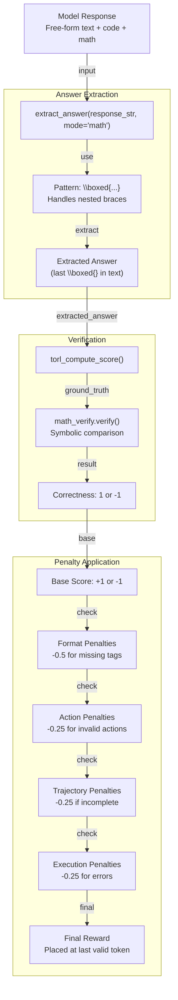

<!-- source: DeepWiki mcp.deepwiki.com · repo TIGER-AI-Lab/verl-tool · page 7.3 Math Dataset Preparation · fetched 2026-10-30 -->

# Math Dataset Preparation

<details>
<summary>Relevant source files</summary>

The following files were used as context for generating this wiki page:

- [examples/data_preprocess/acecoder.py](examples/data_preprocess/acecoder.py)
- [examples/train/mathcoder/train.sh](examples/train/mathcoder/train.sh)
- [examples/train/mathcoder/train_1.5b.sh](examples/train/mathcoder/train_1.5b.sh)
- [verl_tool/agent_loop/agent_loop.py](verl_tool/agent_loop/agent_loop.py)
- [verl_tool/agent_loop/verltool_agent_loop.py](verl_tool/agent_loop/verltool_agent_loop.py)
- [verl_tool/servers/tests/test_python_code_tool.py](verl_tool/servers/tests/test_python_code_tool.py)
- [verl_tool/servers/tools/ipython_code.py](verl_tool/servers/tools/ipython_code.py)
- [verl_tool/servers/tools/utils/ipython_tool.py](verl_tool/servers/tools/utils/ipython_tool.py)
- [verl_tool/trainer/config/verltool/agent.yaml](verl_tool/trainer/config/verltool/agent.yaml)
- [verl_tool/trainer/ppo/metric_util.py](verl_tool/trainer/ppo/metric_util.py)
- [verl_tool/workers/reward_manager/torl.py](verl_tool/workers/reward_manager/torl.py)
- [verl_tool/workers/rollout/vllm_rollout/vllm_async_server.py](verl_tool/workers/rollout/vllm_rollout/vllm_async_server.py)

</details>


## Purpose and Scope

This page documents the preprocessing pipeline for mathematical reasoning datasets used in VerlTool's tool-integrated reinforcement learning training. Math datasets are prepared in a standardized parquet format that enables models to generate solutions using Python code execution tools and mathematical notation.

For general dataset format requirements, see [Dataset Format and Structure](#7.1). For code-focused datasets (AceCoder), see [Code Dataset Preparation](#7.2). For SQL datasets, see [SQL Dataset Preparation](#7.4).

---

## Math Dataset Overview

VerlTool supports math reasoning tasks where models solve mathematical problems by:
1. Generating reasoning steps in natural language
2. Optionally executing Python code via `PythonCodeTool` for calculations
3. Formatting final answers in LaTeX boxed notation: `\boxed{answer}`

The training pipeline uses datasets from two primary sources:
- **MathCoder datasets**: Combined code and math reasoning problems
- **ToRL (Tool-integrated Reasoning Learning) datasets**: Pure math problems from MATH, GSM8K, AIME, etc.

Sources: [examples/train/mathcoder/train.sh:2-7](), [examples/train/mathcoder/train_1.5b.sh:2-7]()

---

## Dataset File Structure



**Training Configuration**: The training scripts specify separate train and validation files, with math datasets mixed with code datasets for multi-task training. The `reward_manager` parameter determines which reward function processes the data.

Sources: [examples/train/mathcoder/train.sh:2-7, 28, 64](), [examples/train/mathcoder/train_1.5b.sh:2-7, 28, 68]()

---

## Parquet Schema for Math Datasets

Math datasets follow the standardized parquet schema with specific requirements for mathematical reasoning:

| Field | Type | Description | Example |
|-------|------|-------------|---------|
| `data_source` | `str` | Dataset identifier for routing reward functions | `"MATH"`, `"GSM8K"`, `"AIME24"` |
| `prompt` | `list[dict]` | Conversation format with role and content | `[{"role": "user", "content": "Solve: ..."}]` |
| `ability` | `str` | Task type identifier | `"math"`, `"code"` |
| `reward_model` | `dict` | Reward configuration with ground truth | `{"style": "rule", "ground_truth": "42"}` |
| `extra_info` | `dict` | Metadata including original question, split, index | `{"question": "...", "split": "train", "index": 0}` |

**Key Requirements**:
- **ground_truth**: Must contain the correct answer in a parseable format (numeric, symbolic expression, or LaTeX)
- **prompt content**: Should instruct the model to use `\boxed{}` notation for final answers
- **data_source**: Used by reward managers to route to appropriate verification logic

Sources: [verl_tool/workers/reward_manager/torl.py:181-193](), [examples/data_preprocess/acecoder.py:46-71]()

---

## Ground Truth Format

The `ToRLRewardManager` expects ground truth answers in formats compatible with mathematical verification:

```python
# Numeric answers
"ground_truth": "42"
"ground_truth": "3.14159"

# Symbolic expressions
"ground_truth": "\\frac{1}{2}"
"ground_truth": "2\\sqrt{3}"

# LaTeX notation (common in MATH dataset)
"ground_truth": "\\boxed{42}"
"ground_truth": "\\boxed{\\frac{1}{2}}"
```

**Answer Extraction from Model Responses**:

The `extract_answer()` function extracts the final answer from the model's generated text:

```python
def extract_answer(text, mode='math'):
    if mode == 'math':
        return extract_box_contents(text)  # Extracts content from \boxed{}
```

The regex pattern matches nested braces: `r'\\boxed\{([^{}]*(?:\{[^{}]*\}[^{}]*)*)\}'`

Sources: [verl_tool/workers/reward_manager/torl.py:27-43, 44-74]()

---

## Answer Extraction and Verification Pipeline



**Verification Logic**:

1. **Extraction**: The last `\boxed{}` content is extracted from the model's response
2. **Symbolic Comparison**: `math_verify.verify()` handles various formats (fractions, radicals, etc.)
3. **Base Score**: Returns `+1` for correct, `-1` for incorrect
4. **Penalty Addition**: Various behavioral penalties are applied based on trajectory properties

Sources: [verl_tool/workers/reward_manager/torl.py:27-43, 86-94, 145-246]()

---

## Reward Manager Configuration

The `ToRLRewardManager` class processes math datasets with configurable penalties:

| Penalty Type | Flag | Value | Condition |
|--------------|------|-------|-----------|
| `think_format_penalty` | `add_format_think_penalty` | `-0.5` | Missing/malformed `` tags |
| `answer_format_penalty` | `add_format_answer_penalty` | `-0.5` | Missing/malformed `<answer>...</answer>` tags |
| `valid_action_penalty` | `add_valid_action_penalty` | `-0.25` | Invalid tool actions when `num_turns > 0` |
| `unfinished_traj_penalty` | `add_unfinished_traj_penalty` | `-0.25` | Trajectory not marked as finished |
| `no_tool_interact_penalty` | `add_no_tool_interact_penalty` | `-0.25` | Zero valid actions (no tool usage) |
| `exec_error` | `add_code_exec_penalty` | `-0.25` | Python execution errors detected |

**Reward Placement**: All rewards are sparse, placed only at `valid_response_length - 1` (the final valid token).

```python
# Example penalty application
reward_tensor[i, valid_response_length - 1] = final_score
```

Sources: [verl_tool/workers/reward_manager/torl.py:82-95, 96-143, 219]()

---

## Preprocessing Steps (Inferred Pattern)

While no explicit math preprocessing script is provided in the repository, the expected preprocessing follows this pattern based on the AceCoder example:

```python
# Pseudo-code for math dataset preprocessing
import datasets
from pathlib import Path

def preprocess_math_dataset(
    dataset_name: str = "TIGER-Lab/MATH",
    local_dir: str = "data/math_torl",
):
    """
    Convert raw math dataset to VerlTool parquet format.
    """
    dataset = datasets.load_dataset(dataset_name, split='train')
    
    def process_fn(example, idx):
        # Extract problem and solution
        problem = example['problem']
        solution = example['solution']
        
        # Add instruction for boxed notation
        prompt_content = (
            f"{problem}\n\n"
            "Think step by step and provide your final answer in "
            "\\boxed{{}} notation. You can use Python code for calculations."
        )
        
        return {
            "data_source": dataset_name,
            "prompt": [
                {
                    "role": "user",
                    "content": prompt_content
                }
            ],
            "ability": "math",
            "reward_model": {
                "style": "rule",
                "ground_truth": solution  # Often contains \boxed{answer}
            },
            "extra_info": {
                "split": "train",
                "index": idx,
                "question": problem,
                "original_solution": solution,
            }
        }
    
    processed = dataset.map(function=process_fn, with_indices=True)
    processed.to_parquet(Path(local_dir) / "train.parquet")
```

**Key Preprocessing Requirements**:
1. Extract problem text and ground truth solution
2. Add instructions for `\boxed{}` notation in the prompt
3. Store ground truth in `reward_model.ground_truth`
4. Preserve original data in `extra_info` for debugging
5. Set `data_source` for proper reward manager routing

Sources: [examples/data_preprocess/acecoder.py:43-76](), [verl_tool/workers/reward_manager/torl.py:181-193]()

---

## Tool Integration for Math Solving

Math datasets support tool-integrated reasoning where models can execute Python code:

```mermaid
graph LR
    subgraph "Multi-Turn Math Solving"
        Q["Question:<br/>Calculate 13! / 7!"]
        Think1[""]
        Code1["```python<br/>import math<br/>result = math.factorial(13) // math.factorial(7)<br/>print(result)<br/>```"]
        Obs1["```output<br/>1235520<br/>```"]
        Think2[""]
        Answer["<answer>\\boxed{1235520}</answer>"]
    end
    
    Q -->|turn 0| Think1
    Think1 -->|action| Code1
    Code1 -->|tool call| Obs1
    Obs1 -->|turn 1| Think2
    Think2 -->|final| Answer
```

**Configuration for Tool-Integrated Math**:
- `action_stop_tokens`: Set to `"\`\`\`output"` to detect code execution points
- `max_turns`: Number of allowed tool interactions (e.g., `1` for single code execution)
- `max_obs_length`: Maximum tokens for observation truncation (e.g., `512`)
- `tool_server_url`: URL of `PythonCodeTool` server for code execution

Sources: [examples/train/mathcoder/train.sh:21-22, 86-92](), [verl_tool/agent_loop/verltool_agent_loop.py:558-564]()

---

## Training Script Integration

The math datasets are integrated into training via configuration parameters:

```bash
# From train.sh
train_data=[$(pwd)/data/mathcoder/code_train.parquet,\
$(pwd)/data/mathcoder/math_train.parquet]

val_data=[$(pwd)/data/mathcoder/code_test.parquet,\
$(pwd)/data/math_torl/math500_test.parquet,\
$(pwd)/data/math_torl/aime24_test.parquet,\
$(pwd)/data/math_torl/aime25_test.parquet]

reward_manager=mathcoder  # or 'torl'
action_stop_tokens="\`\`\`output"
max_turns=1
```

**Training Command**:
```bash
python3 -m verl_tool.trainer.main_ppo \
    data.train_files=$train_data \
    data.val_files=$val_data \
    reward_model.reward_manager=$reward_manager \
    actor_rollout_ref.agent.action_stop_tokens=$action_stop_tokens_file \
    actor_rollout_ref.agent.max_turns=$max_turns
```

The training loop:
1. Loads parquet files via `DataLoader`
2. Samples prompts for agent loop execution
3. Generates multi-turn trajectories with optional tool calls
4. Computes rewards via `ToRLRewardManager` or `MathCoderRewardManager`
5. Updates policy via PPO/GRPO

Sources: [examples/train/mathcoder/train.sh:2-7, 21-22, 28, 55-92]()

---

## Validation Metrics

During validation, math dataset performance is tracked with several metrics:

| Metric | Description | Computation |
|--------|-------------|-------------|
| `accuracy` | Binary correctness (0 or 1) | `1.0 if torl_score > 0 else 0.0` |
| `score` | Raw reward score | `torl_compute_score()` result |
| `has_answer` | Whether `\boxed{}` was found | `1.0 if extracted_answer else 0.0` |
| `response_length` | Total generated tokens | `valid_response_length` |
| `best@N` | Best-of-N accuracy | Bootstrap sampling over N samples |
| `maj@N` | Majority voting accuracy | Most common prediction across N samples |

**Metrics Processing**: The `process_validation_metrics()` function groups results by `data_source` and computes aggregated statistics.

Sources: [verl_tool/workers/reward_manager/torl.py:194-219](), [verl_tool/trainer/ppo/metric_util.py:48-160]()

---

## Example Dataset Records

**Math Reasoning Problem**:
```json
{
  "data_source": "MATH",
  "prompt": [
    {
      "role": "user",
      "content": "Find the value of $x$ if $|x-3| = 2x+1$. Provide your answer in \\boxed{} notation."
    }
  ],
  "ability": "math",
  "reward_model": {
    "style": "rule",
    "ground_truth": "\\boxed{\\frac{2}{3}}"
  },
  "extra_info": {
    "split": "train",
    "index": 42,
    "question": "Find the value of $x$ if $|x-3| = 2x+1$."
  }
}
```

**Code-Math Hybrid Problem**:
```json
{
  "data_source": "GSM8K",
  "prompt": [
    {
      "role": "user",
      "content": "A factory produces 120 widgets per hour. How many widgets are produced in 8.5 hours? Use Python to calculate and provide your answer in \\boxed{} notation."
    }
  ],
  "ability": "math",
  "reward_model": {
    "style": "rule",
    "ground_truth": "1020"
  },
  "extra_info": {
    "split": "train",
    "index": 156,
    "question": "A factory produces 120 widgets per hour. How many widgets are produced in 8.5 hours?"
  }
}
```

Sources: [verl_tool/workers/reward_manager/torl.py:181-193](), [examples/data_preprocess/acecoder.py:46-71]()

---

## Common Issues and Solutions

**Issue 1: Ground Truth Format Mismatch**
- **Problem**: Ground truth contains `\boxed{}` but verification fails
- **Solution**: Ensure ground truth is the raw answer content, not wrapped in `\boxed{}`
- **Example**: Use `"42"` not `"\\boxed{42}"`

**Issue 2: Missing Answer Extraction**
- **Problem**: Model generates correct answer but `has_answer=0`
- **Solution**: Verify model is using `\boxed{}` notation in responses
- **Check**: Look at decoded responses in training logs

**Issue 3: Tool Server Not Configured**
- **Problem**: Math problems requiring code execution fail
- **Solution**: Launch `PythonCodeTool` server and set `tool_server_url`
- **Command**: `python -m verl_tool.servers.serve --tool_type python_code`

**Issue 4: Penalty Flags Not Set**
- **Problem**: Reward scores don't reflect format violations
- **Solution**: Enable penalty flags in reward manager initialization
- **Example**: `add_format_answer_penalty=True`

Sources: [verl_tool/workers/reward_manager/torl.py:82-143](), [examples/train/mathcoder/train.sh:50-54]()

---

