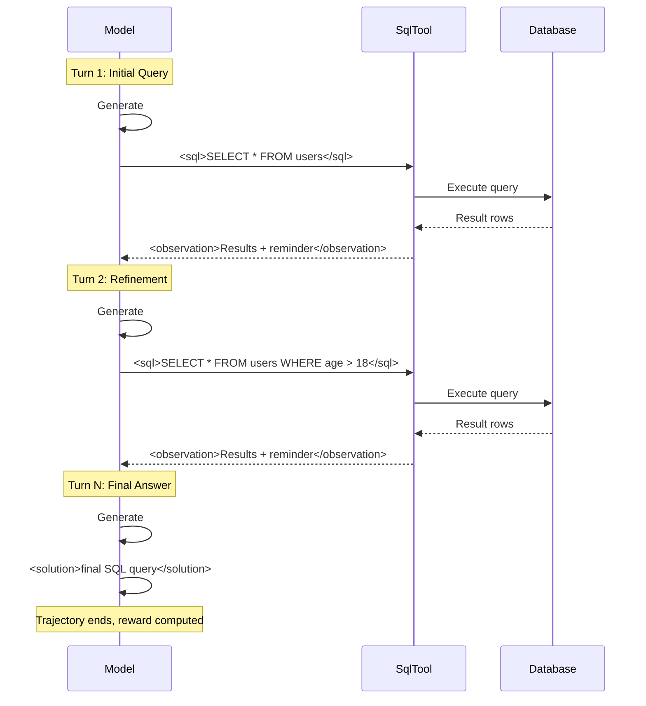
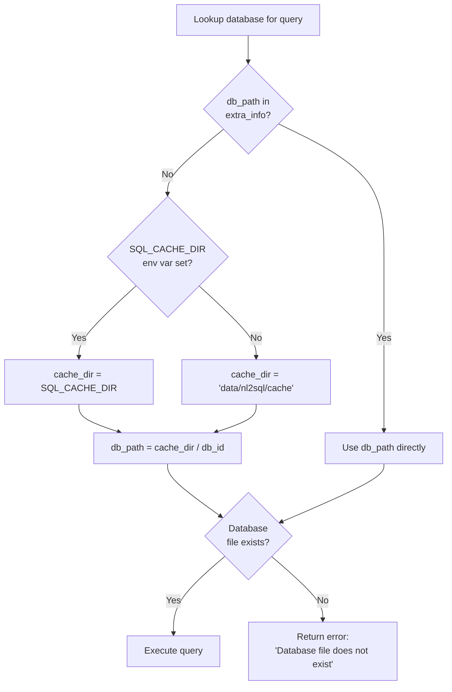
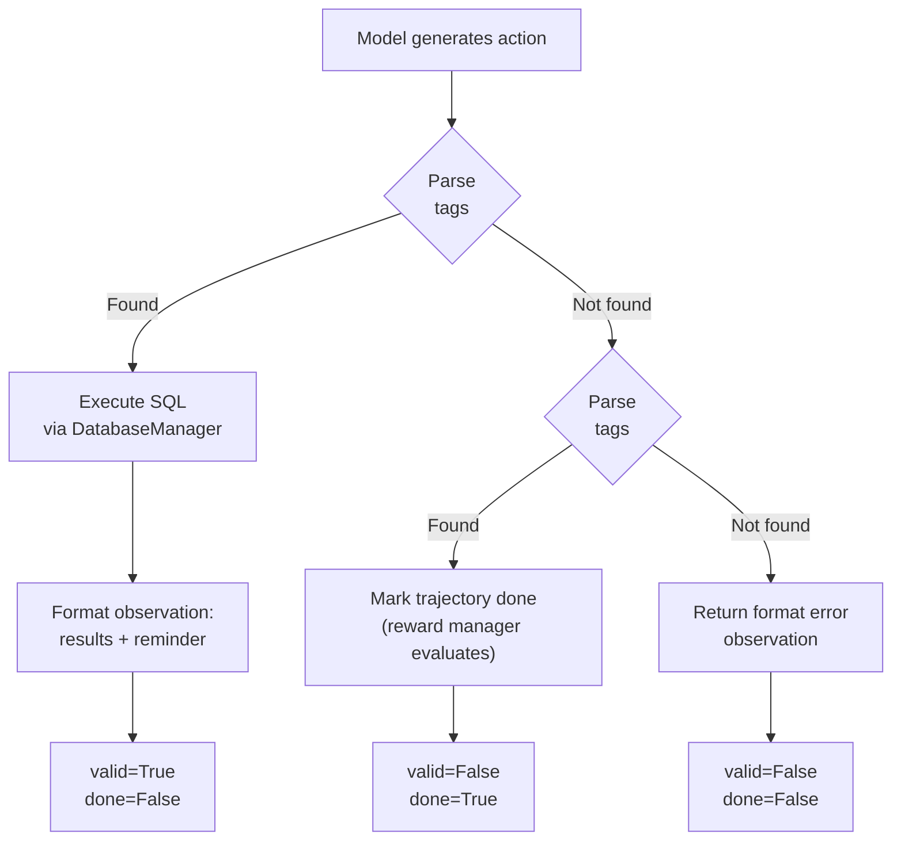

<!-- source: DeepWiki mcp.deepwiki.com · repo TIGER-AI-Lab/verl-tool · page 7.4 SQL Dataset Preparation · fetched 2026-10-30 -->

# SQL Dataset Preparation

<details>
<summary>Relevant source files</summary>

The following files were used as context for generating this wiki page:

- [verl_tool/servers/tools/sql.py](verl_tool/servers/tools/sql.py)
- [verl_tool/servers/tools/utils/sql_executor.py](verl_tool/servers/tools/utils/sql_executor.py)
- [verl_tool/workers/reward_manager/sqlcoder.py](verl_tool/workers/reward_manager/sqlcoder.py)

</details>


## Purpose and Scope

This document describes the dataset preparation requirements and format specifications for training SQL code generation models (SQLCoder) using the verl-tool framework. It covers the parquet file structure, required metadata fields, database file management, and the expected interaction format with `              # Reasoning and planning (required at start of each turn)
<sql>...</sql>                  # Intermediate SQL query for verification
<solution>...</solution>        # Final SQL answer submission
<observation>...</observation>  # Tool feedback (system-generated, not by model)
```

### Multi-Turn Interaction Format



**Sources:** [verl_tool/servers/tools/sql.py:30-32](), [verl_tool/workers/reward_manager/sqlcoder.py:40-43]()

### Example Training Sample

A complete training sample with system prompt might look like:

```
System: You are a SQL expert. Answer the question by writing SQL queries.
Use 

<sql>SELECT name FROM students JOIN grades ON students.id = grades.student_id 
WHERE grades.subject = 'Math' AND grades.score > 90</sql>

[System provides observation with results]

[Model continues or submits solution:]
<solution>SELECT name FROM students JOIN grades ON students.id = grades.student_id 
WHERE grades.subject = 'Math' AND grades.score > 90</solution>
```

**Sources:** [verl_tool/servers/tools/sql.py:44-45]()

---

## Database File Management

### Database Path Resolution

The system uses the following logic to locate database files:



**Sources:** [verl_tool/servers/tools/utils/sql_executor.py:271-283](), [verl_tool/servers/tools/sql.py:135-137]()

### DatabaseManager Connection Pooling

The `DatabaseManager` class maintains a connection pool to avoid repeatedly opening database files:

```python
# From sql_executor.py:65-90
class DatabaseManager:
    def __init__(self):
        self._connection_pool: Dict[str, sqlite3.Connection] = {}
    
    # Opens connection with:
    # - immutable=1 (read-only access)
    # - PRAGMA journal_mode=DELETE (avoid WAL files)
    # - PRAGMA synchronous=OFF (performance)
    # - PRAGMA temp_store=MEMORY
```

Each unique `db_path` gets one persistent connection that is reused across queries. Connections use read-only mode (`immutable=1`) for safety and performance.

**Sources:** [verl_tool/servers/tools/utils/sql_executor.py:65-90]()

---

## Ground Truth Format Requirements

### SQL Field Naming

The system accepts two field names for ground truth SQL:

- `gt_sql` (preferred in newer code)
- `gold_sql` (legacy, still supported)

The reward manager checks both names:

```python
# From sql_executor.py:276
gt_sql = ground_truth_info.get('gold_sql') or ground_truth_info.get('gt_sql')
```

**Sources:** [verl_tool/servers/tools/utils/sql_executor.py:276]()

### Comparison Methods

Two comparison methods are supported via the `cmp_method` field:

| Method | Description | Order Sensitivity |
|--------|-------------|-------------------|
| `"bird"` | Default method, order-insensitive multiset comparison | No |
| `"spider"` | Order-sensitive if ground truth contains `ORDER BY` | Conditional |

```python
# From sql_executor.py:300-305
comparison_method = ground_truth_info.get('cmp_method', 'bird')
if comparison_method == "spider":
    order_matters = 'order by' in gt_sql.lower()
    is_match = evaluator.are_results_equivalent(gt_results, pred_results, order_matters)
else:  # Default or 'bird' method
    is_match = evaluator.are_results_equivalent(gt_results, pred_results, order_matters=False)
```

**Sources:** [verl_tool/servers/tools/utils/sql_executor.py:300-305]()

---

## Format Verification and Penalties

### verify_format_and_extract Function

The `SQLCoderRewardManager` enforces strict format requirements through the `verify_format_and_extract` function:

```mermaid
graph TB
    INPUT["Model response text"]
    
    CHECK1{"Has <solution><br/>tags?"}
    CHECK2{"Each action starts<br/>with ` tag

**Sources:** [verl_tool/workers/reward_manager/sqlcoder.py:83-109]()

### Reward Computation

The reward structure uses format compliance as a gating condition:

```python
# From sqlcoder.py:167-170
execution_score = sql_score_func(parsed_solution, meta)[0] if parsed_solution else 0.0
score['accuracy'] = execution_score
score['score'] = score['accuracy'] if is_format_correct else -1.0  # final score
```

| Condition | Reward Value | Meaning |
|-----------|--------------|---------|
| Correct format + correct execution | 1.0 | Full success |
| Correct format + incorrect execution | 0.0 | Format ok, wrong answer |
| Incorrect format | -1.0 | Format violation penalty |
| Empty/no solution | 0.0 | No answer provided |

**Sources:** [verl_tool/workers/reward_manager/sqlcoder.py:162-170]()

---

## SQL Code Extraction

The system uses multiple extraction strategies to handle different output formats:

### extract_sql_from_markdown Function

This utility function tries multiple patterns in priority order:

1. **Markdown SQL blocks**: ` ```sql\n...\n``` `
2. **XML-style `<sql>` tags**: `<sql>...</sql>`
3. **XML-style `<solution>` tags**: `<solution>...</solution>`
4. **Fallback**: Raw text with operator normalization

```python
# From sql_executor.py:24-51
def extract_sql_from_markdown(text: str) -> str:
    # Try SQL code blocks
    program_pattern = r"```sql[ \t]*[\r\n]+(.*?)[\r\n]+[ \t]*```"
    matches = re.findall(program_pattern, text, re.DOTALL | re.IGNORECASE)
    if matches:
        return matches[-1].strip().replace('> =', '>=').replace('< =', '<=').replace('! =', '!=')
    
    # Try <sql>...</sql> tags
    sql_tag_pattern = r"<sql>(.*?)</sql>"
    matches = re.findall(sql_tag_pattern, text, re.DOTALL | re.IGNORECASE)
    if matches:
        return matches[-1].strip().replace('> =', '>=').replace('< =', '<=').replace('! =', '!=')
    
    # Try <solution>...</solution> tags
    solution_pattern = r"<solution>(.*?)</solution>"
    matches = re.findall(solution_pattern, text, re.DOTALL | re.IGNORECASE)
    if matches:
        return matches[-1].strip().replace('> =', '>=').replace('< =', '<=').replace('! =', '!=')
    
    # Fallback: clean the original text
    return text.replace('> =', '>=').replace('< =', '<=').replace('! =', '!=')
```

All extraction methods normalize SQL operators to handle tokenization artifacts (`> =` → `>=`).

**Sources:** [verl_tool/servers/tools/utils/sql_executor.py:24-51]()

---

## Tool Server Integration

During training, the `SqlTool` handles intermediate query execution and provides observations back to the model.

### SqlTool Action Processing



**Key Behavior:**
- `<sql>` tags trigger intermediate execution (trajectory continues)
- `<solution>` tags mark trajectory as done without execution
- Invalid format returns error observation and continues trajectory

**Sources:** [verl_tool/servers/tools/sql.py:85-188]()

### Observation Format

Observations returned to the model include execution results and turn reminders:

```python
# From sql.py:171-178
reminder_text = f"<reminder>You have {turns_left} turns left to complete the task.</reminder>"
obs = f"\n\n<observation>{observation}\n{reminder_text}</observation>\n\n"
```

The observation structure:
- Wrapped in `<observation>...</observation>` tags
- Contains query execution results (formatted as pandas DataFrame string)
- Includes turn count reminder
- Truncated to 50 rows if results exceed 9000 characters

**Sources:** [verl_tool/servers/tools/sql.py:171-178](), [verl_tool/servers/tools/utils/sql_executor.py:346-356]()

---

## Preprocessing Script Reference

While the preprocessing script (`skysql_train.py`) is not included in the provided files, the expected workflow based on the reward manager implementation is:

### Expected Preprocessing Steps

1. **Load Raw Dataset**: Load question-SQL pairs from source dataset (e.g., Spider, Bird)
2. **Create System Prompts**: Add instructions about tag format and tool usage
3. **Prepare extra_info**: For each sample, construct the metadata dictionary:
   ```python
   extra_info = {
       "db_id": <database_identifier>,
       "gt_sql": <ground_truth_sql_query>,
       "db_path": <path_to_sqlite_db>,
       "cmp_method": "bird"  # or "spider"
   }
   ```
4. **Set reward_model**: Ensure `reward_model` field is set to `"sqlcoder"`
5. **Save to Parquet**: Write processed data to `train.parquet` and `test.parquet`

### Database File Organization

Organize database files in the structure:

```
data/nl2sql/cache/
├── database1.db
├── database2.db
├── database3.db
└── ...
```

Set the `SQL_CACHE_DIR` environment variable to this directory path or include absolute paths in each sample's `db_path` field.

**Sources:** [verl_tool/servers/tools/utils/sql_executor.py:273-274](), [verl_tool/workers/reward_manager/sqlcoder.py:151-157]()

---

## Training Configuration

To use the prepared SQL dataset, configure the training script to:

1. **Point to parquet files**:
   ```yaml
   data:
     train_files: ["data/nl2sql/train.parquet"]
     val_files: ["data/nl2sql/test.parquet"]
   ```

2. **Enable agent mode**:
   ```yaml
   agent:
     enable_agent: true
     max_turns: 5  # Allow multi-turn refinement
   ```

3. **Configure SqlTool**:
   ```yaml
   tool_config:
     tools: ["sql"]
   ```

4. **Set reward manager**:
   ```yaml
   reward:
     reward_manager: "sqlcoder"
   ```

For complete SQLCoder training configuration and recipe details, see [SQLCoder Training (NL2SQL)](#4.5).

**Sources:** [verl_tool/workers/reward_manager/sqlcoder.py:114-115]()

---

