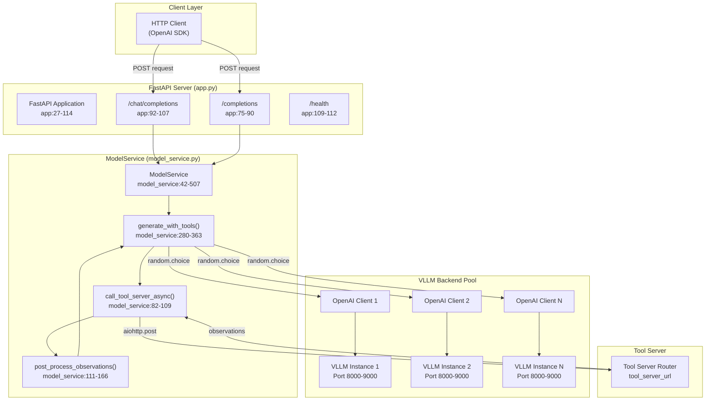
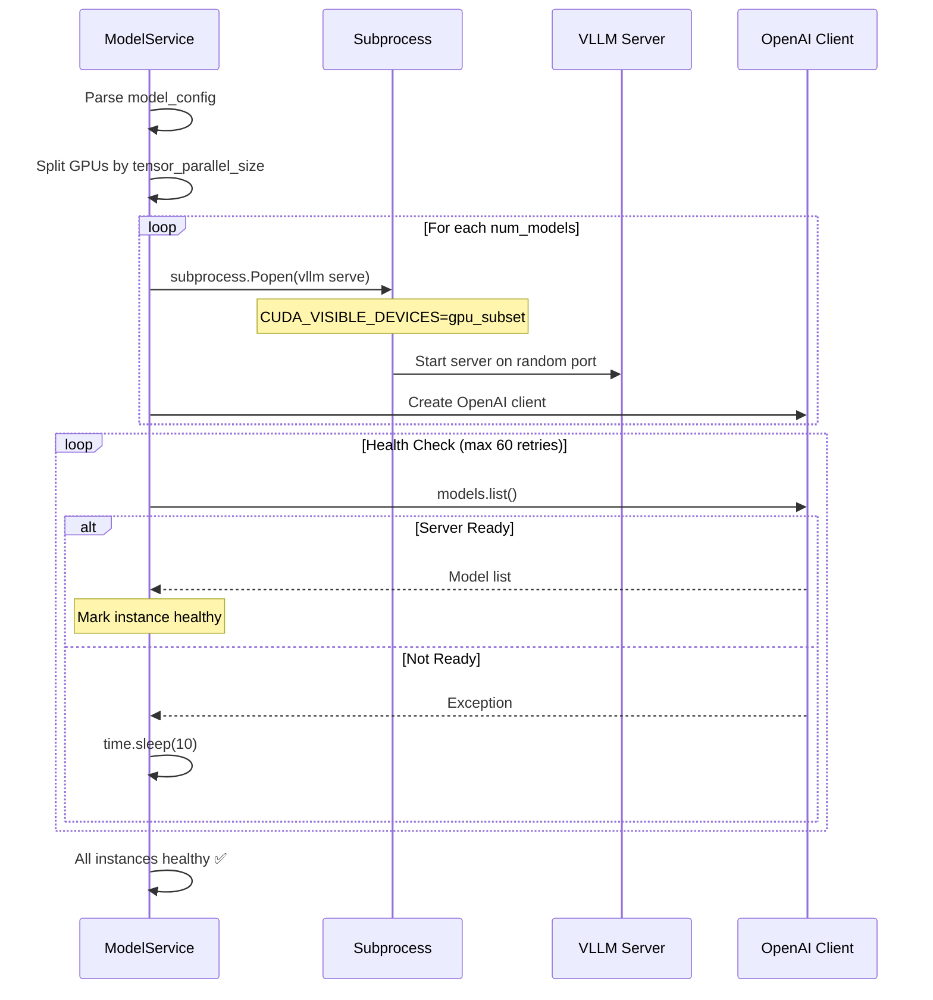
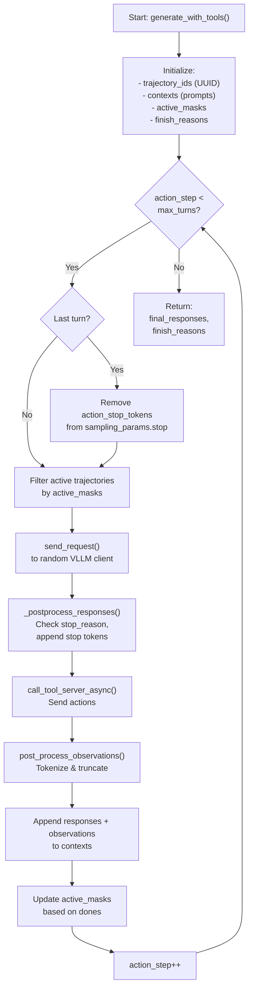
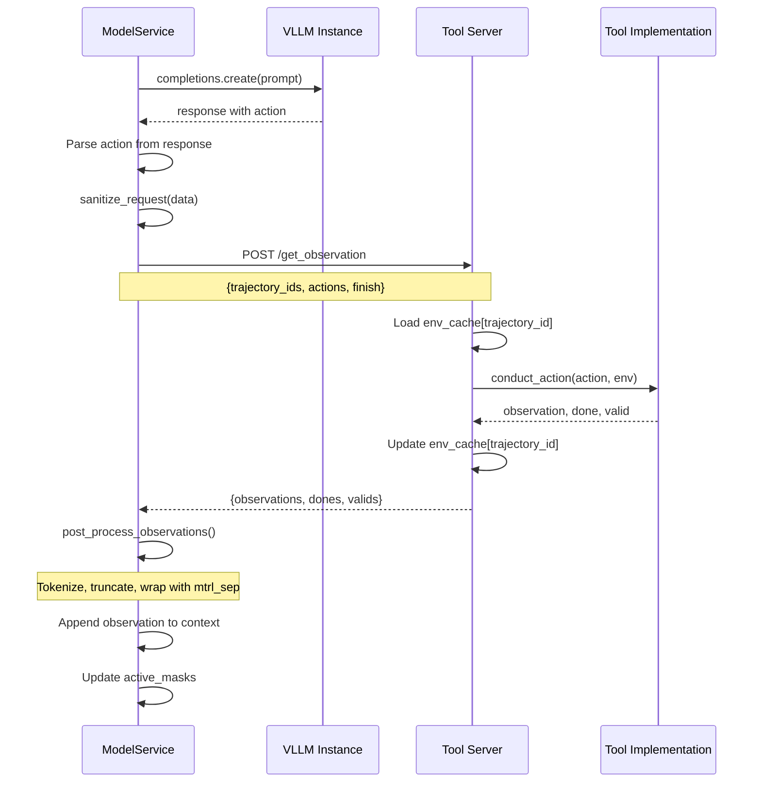

<!-- source: DeepWiki mcp.deepwiki.com · repo TIGER-AI-Lab/verl-tool · page 8 Evaluation and Deployment · fetched 2026-10-30 -->

# Evaluation and Deployment

<details>
<summary>Relevant source files</summary>

The following files were used as context for generating this wiki page:

- [eval_service/app.py](eval_service/app.py)
- [eval_service/config.py](eval_service/config.py)
- [eval_service/model_service.py](eval_service/model_service.py)
- [eval_service/scripts/start_api_service.sh](eval_service/scripts/start_api_service.sh)
- [eval_service/test/test_api.py](eval_service/test/test_api.py)
- [eval_service/test/test_api_mp.py](eval_service/test/test_api_mp.py)

</details>


This document describes the evaluation service infrastructure and deployment process for trained VerlTool models. The evaluation service provides an OpenAI-compatible API for running inference with trained models while maintaining tool-calling capabilities during generation. It enables deployed models to interact with the tool server across multiple turns, replicating the training-time interaction patterns.

For information about the training process that produces these models, see [Core Training Framework](#2). For details about tool implementations, see [Tool Implementations](#4). For dataset-specific evaluation recipes, see [Training Recipes](#5).

## Service Architecture Overview

The evaluation service consists of three main components:
1. **FastAPI Application** ([eval_service/app.py]()) - HTTP server exposing OpenAI-compatible endpoints
2. **ModelService** ([eval_service/model_service.py]()) - Core inference logic with multi-turn tool integration
3. **VLLM Backend** - Multiple VLLM instances for parallel inference

The service spawns multiple VLLM server processes and uses an OpenAI client to communicate with them, enabling high-throughput parallel processing. Each request is routed to one of the VLLM instances using random selection with prefix caching for trajectory stickiness.



**Sources:** [eval_service/app.py:27-114](), [eval_service/model_service.py:42-507]()

## ModelService Core Implementation

The `ModelService` class ([eval_service/model_service.py:42-507]()) manages model inference with tool integration. It initializes multiple VLLM server processes and maintains OpenAI clients for each instance.

### Initialization and Model Loading

The initialization process ([eval_service/model_service.py:45-56]()) loads the tokenizer and configures the `mtrl_sep` template for multi-turn interactions. The `load_model()` method ([eval_service/model_service.py:191-254]()) spawns VLLM server subprocesses:

| Component | Configuration | Source |
|-----------|---------------|--------|
| VLLM Instances | `num_models` parameter | [eval_service/model_service.py:204]() |
| Tensor Parallelism | `tensor_parallel_size` parameter | [eval_service/model_service.py:208]() |
| GPU Assignment | `CUDA_VISIBLE_DEVICES` split per instance | [eval_service/model_service.py:207-209]() |
| Port Allocation | Random ports in range 8000-9000 | [eval_service/model_service.py:205]() |
| API Key | Fixed token "token-abc123" | [eval_service/model_service.py:213]() |

The service waits for all VLLM instances to become healthy by polling the `models.list()` endpoint ([eval_service/model_service.py:226-245]()), with a maximum of 60 retries at 10-second intervals.



**Sources:** [eval_service/model_service.py:191-254]()

### Request Sanitization

Before sending requests to the tool server, the service sanitizes input by removing control characters ([eval_service/model_service.py:19-40]()):

```python
CONTROL_CHAR_RE = re.compile(r'[\x00-\x08\x0B\x0C\x0E-\x1F]')
```

The `sanitize_request()` function recursively walks through dictionaries, lists, and strings to strip NUL characters and other C0 control characters (excluding tab, LF, CR). This prevents injection attacks and parsing errors.

**Sources:** [eval_service/model_service.py:19-40]()

## Multi-Turn Generation with Tools

The `generate_with_tools()` method ([eval_service/model_service.py:280-363]()) implements the core multi-turn interaction loop. It maintains trajectory state across turns and handles tool calls transparently.

### Generation Loop Architecture



**Sources:** [eval_service/model_service.py:280-363]()

### Turn-by-Turn Processing

For each turn, the service performs these steps:

1. **Filter Active Trajectories** ([eval_service/model_service.py:310-312]()): Only process trajectories where `active_masks[i] == True`

2. **Send Request** ([eval_service/model_service.py:316-321]()): Call `send_request()` with active contexts and sampling parameters

3. **Postprocess Responses** ([eval_service/model_service.py:322]()): The `_postprocess_responses()` method ([eval_service/model_service.py:168-189]()) handles:
   - Appending stop tokens if `finish_reason == "stop"`
   - Adding `turn_end_token` if MTRL is enabled
   - Enforcing minimum turns by preventing early finish

4. **Call Tool Server** ([eval_service/model_service.py:325-339]()): Send actions to tool server using `call_tool_server_async()`

5. **Process Observations** ([eval_service/model_service.py:342]()): Tokenize and truncate observations with `post_process_observations()`

6. **Update State** ([eval_service/model_service.py:354-361]()): Append response and observation to contexts, update masks based on `dones`

### Observation Processing

The `post_process_observations()` method ([eval_service/model_service.py:111-166]()) handles observation tokenization with async locks:

| Parameter | Purpose | Default |
|-----------|---------|---------|
| `truncate_obs_side` | Side to truncate ("left" or "right") | "left" |
| `max_obs_length` | Maximum observation tokens | 512 |
| `enable_mtrl` | Multi-turn chat format | False |
| `mtrl_sep` | Separator template with {obs} placeholder | Auto-generated |

When `enable_mtrl=True`, observations are wrapped in the chat template format ([eval_service/model_service.py:140-161]()):
- Valid actions: Format with `mtrl_sep.format(obs=observation)`
- Invalid actions: Prepend error message "Your action is not valid..."
- Finished/done: Return empty string

**Sources:** [eval_service/model_service.py:111-166](), [eval_service/model_service.py:280-363]()

## OpenAI-Compatible API Endpoints

The FastAPI application ([eval_service/app.py]()) exposes two primary endpoints that mirror OpenAI's API format.

### Chat Completions Endpoint

**Route:** `POST /chat/completions` ([eval_service/app.py:92-107]())

The `chat_completions_async()` method ([eval_service/model_service.py:365-423]()) processes chat-formatted requests:

**Request Format:**
```json
{
  "model": "model_name",
  "messages": [
    {"role": "system", "content": "system prompt"},
    {"role": "user", "content": "user query"}
  ],
  "temperature": 1.0,
  "max_tokens": 512,
  "top_p": 1.0,
  "n": 1,
  "stop": ["custom_stop_token"]
}
```

**Response Format:**
```json
{
  "id": "chatcmpl-<uuid>",
  "object": "chat.completion",
  "created": 1234567890,
  "model": "model_name",
  "choices": [
    {
      "index": 0,
      "message": {
        "role": "assistant",
        "content": "response text with tool interactions"
      },
      "finish_reason": "stop"
    }
  ],
  "usage": {
    "prompt_tokens": 100,
    "completion_tokens": 200,
    "total_tokens": 300
  }
}
```

The implementation ([eval_service/model_service.py:365-423]()) applies the chat template using the tokenizer ([eval_service/model_service.py:376-379]()), merges action stop tokens with user-provided stop tokens ([eval_service/model_service.py:385-390]()), and calls `generate_with_tools()` for multi-turn generation.

**Sources:** [eval_service/app.py:92-107](), [eval_service/model_service.py:365-423]()

### Completions Endpoint

**Route:** `POST /completions` ([eval_service/app.py:75-90]())

The `completions_async()` method ([eval_service/model_service.py:429-476]()) handles raw prompt-based requests:

**Request Format:**
```json
{
  "model": "model_name",
  "prompt": "raw prompt string",
  "temperature": 1.0,
  "max_tokens": 512,
  "top_p": 1.0,
  "n": 1,
  "stop": ["custom_stop_token"]
}
```

**Response Format:**
```json
{
  "id": "chatcmpl-<uuid>",
  "object": "chat.completion",
  "created": 1234567890,
  "model": "model_name",
  "choices": [
    {
      "index": 0,
      "text": "response text with tool interactions",
      "finish_reason": "stop"
    }
  ],
  "usage": {
    "prompt_tokens": 100,
    "completion_tokens": 200,
    "total_tokens": 300
  }
}
```

The primary difference from chat completions is that it accepts raw prompts without applying the chat template, and returns `text` instead of `message` in the response.

**Sources:** [eval_service/app.py:75-90](), [eval_service/model_service.py:429-476]()

### Health Check Endpoint

**Route:** `GET /health` ([eval_service/app.py:109-112]())

Returns a simple health status for load balancer integration:
```json
{"status": "healthy"}
```

**Sources:** [eval_service/app.py:109-112]()

## Configuration System

The service uses three dataclass configurations defined in [eval_service/config.py]():

### ModelConfig

[eval_service/config.py:5-12]()

| Parameter | Type | Default | Description |
|-----------|------|---------|-------------|
| `model` | str | Required | HuggingFace model path or local path |
| `gpu_memory_utilization` | float | 0.9 | GPU memory fraction for VLLM |
| `tensor_parallel_size` | int | 1 | Number of GPUs per VLLM instance |
| `trust_remote_code` | bool | True | Allow remote code execution |
| `num_models` | int | 1 | Number of parallel VLLM instances |
| `max_model_len` | int | 4096 | Maximum context length |

### ToolConfig

[eval_service/config.py:14-40]()

| Parameter | Type | Default | Description |
|-----------|------|---------|-------------|
| `tool_server_url` | str | "http://localhost:30150/get_observation" | Tool server endpoint |
| `max_turns` | int | 5 | Maximum tool interaction turns |
| `truncate_obs_side` | str | "left" | Which side to truncate observations |
| `action_stop_tokens` | str | None | Tokens that trigger tool calls (comma-separated or file path) |
| `max_obs_length` | int | 512 | Maximum observation length in tokens |
| `enable_mtrl` | bool | False | Enable multi-turn chat format |
| `mtrl_sep` | str | None | Template for observation wrapping ({obs} placeholder) |
| `turn_end_token` | str | "<\|im_end\|>" | Token appended after each turn |
| `min_turns` | int | 0 | Minimum enforced tool interaction turns |

The `post_init()` method ([eval_service/config.py:25-40]()) processes `action_stop_tokens`:
- If it's a file path, read tokens from file (comma-separated)
- If it's a string, split by commas
- Strip whitespace and filter empty strings

### ServerConfig

[eval_service/config.py:43-49]()

| Parameter | Type | Default | Description |
|-----------|------|---------|-------------|
| `host` | str | "0.0.0.0" | Bind address |
| `port` | int | 8000 | HTTP port |
| `workers` | int | 32 | Uvicorn worker processes |
| `ws_max_queue` | int | 1000 | WebSocket queue size |
| `log_level` | str | "error" | Logging verbosity |
| `timeout_keep_alive` | int | 60 | Keep-alive timeout (seconds) |

**Sources:** [eval_service/config.py:5-49]()

## Tool Server Integration

During inference, the service communicates with the tool server using the same protocol as training (see [Tool Server Architecture](#3)).

### Tool Server Communication Flow



**Sources:** [eval_service/model_service.py:82-109](), [eval_service/model_service.py:111-166]()

### Async HTTP Communication

The service uses `aiohttp.ClientSession` ([eval_service/model_service.py:82-109]()) for non-blocking tool server requests:

1. **Session Management** ([eval_service/model_service.py:94-95]()): Create session on first use and reuse across requests
2. **Request Sanitization** ([eval_service/model_service.py:98]()): Apply `sanitize_request()` before sending
3. **Error Handling** ([eval_service/model_service.py:103-109]()): Return error observations with `dones=True` and `valids=False`

The async implementation prevents blocking during tool execution, enabling higher throughput for multi-trajectory batches.

**Sources:** [eval_service/model_service.py:82-109]()

## Deployment and Startup

### Startup Script

The deployment script [eval_service/scripts/start_api_service.sh]() handles two-step initialization:

**Step 1: Start Tool Server** ([eval_service/scripts/start_api_service.sh:3-9]())
```bash
host=0.0.0.0
port=$(shuf -i 30000-31000 -n 1)
tool_server_url=http://$host:$port/get_observation
python -m verl_tool.servers.serve --host $host --port $port \
    --tool_type "python_code" --workers_per_tool 32 \
    --done_if_invalid True --slient True &
server_pid=$!
```

**Step 2: Start API Service** ([eval_service/scripts/start_api_service.sh:11-36]())
```bash
python eval_service/app.py \
    --host $api_host \
    --port $api_port \
    --tool_server_url $tool_server_url \
    --model $model_path \
    --max_turns $max_turns \
    --min_turns $min_turns \
    --action_stop_tokens $action_stop_tokens_file \
    --tensor_parallel_size $tensor_parallel_size \
    --num_models $num_models \
    --enable_mtrl $enable_mtrl
```

### Configuration Parameters

| Parameter | Example | Purpose |
|-----------|---------|---------|
| `model_path` | VerlTool/torl-deep_math-fsdp_agent-qwen2.5-math-1.5b-grpo-n16-b128-t1.0-lr1e-6-320-step | Model checkpoint to load |
| `max_turns` | 4 | Maximum tool interaction turns |
| `min_turns` | 0 | Minimum enforced turns (0 = no enforcement) |
| `action_stop_tokens` | "\`\`\`output" | Token that triggers tool calls |
| `tensor_parallel_size` | 1 | GPUs per VLLM instance |
| `num_models` | 8 | Number of parallel VLLM instances |
| `enable_mtrl` | False | Multi-turn chat format |

**Important Constraint:** `num_models × tensor_parallel_size` must equal total available GPUs ([eval_service/scripts/start_api_service.sh:46-51]())

**Sources:** [eval_service/scripts/start_api_service.sh:1-45]()

### Resource Allocation Strategy

The script automatically distributes GPUs across VLLM instances:

```python
gpu_ids = os.environ.get("CUDA_VISIBLE_DEVICES", ...).split(",")
tensor_parallel_size = self.model_config.tensor_parallel_size
gpu_ids_per_model = [
    gpu_ids[i:i+tensor_parallel_size] 
    for i in range(0, len(gpu_ids), tensor_parallel_size)
]
```

Each VLLM instance receives a contiguous slice of GPUs via `CUDA_VISIBLE_DEVICES` environment variable ([eval_service/model_service.py:207-218]()).

**Sources:** [eval_service/model_service.py:207-218]()

## Model Upload and Versioning

### Model Merger for Deployment

The [eval_service/README.md:66-86]() documents the model upload process using `verl/scripts/model_merger.py`:

```bash
backend=fsdp
checkpoint_path=checkpoints/acecoder/acecoder-fsdp_agent-qwen_qwen2.5-coder-1.5b-instruct-grpo-n16-b128-t1.0-lr1e-6-69k-sys12-mtrl-d1fo/global_step_280/actor
hf_upload_path=VerlTool/acecoder-fsdp_agent-qwen_qwen2.5-coder-1.5b-instruct-grpo-69k-sys12-mtrl-d1fo-280-step

python3 verl/scripts/model_merger.py \
    --backend $backend \
    --hf_model_path $checkpoint_path/huggingface \
    --hf_upload_path "$hf_upload_path" \
    --local_dir $checkpoint_path \
    --target_dir $checkpoint_path/huggingface
```

This merges FSDP sharded checkpoints into a single HuggingFace-compatible model.

### Optional Step Records Upload

Training step records can be uploaded alongside the model:

```bash
step_records_dir=verl_step_records/acecoder-fsdp_agent-qwen_qwen2.5-coder-1.5b-instruct-grpo-n16-b128-t1.0-lr1e-6-69k-sys12-mtrl-d1fo
zip -r $step_records_dir/step_records.zip $step_records_dir 
huggingface-cli upload --repo-type model $hf_upload_path $step_records_dir/step_records.zip
```

This enables analysis of training trajectories post-deployment.

**Sources:** [eval_service/README.md:66-86]()

## Testing and Usage

### Test Script Structure

The test script [eval_service/test/test_api.py]() demonstrates both API endpoint types:

**Chat Completion Test** ([eval_service/test/test_api.py:40-59]()):
```python
completion = client.chat.completions.create(
    model=model_name,
    messages=[
        {"role": "system", "content": system_prompt},
        {"role": "user", "content": math_problem}
    ],
    temperature=temperature,
    max_tokens=max_tokens,
    top_p=top_p,
    n=n,
)
print(completion.choices[0].message.content)
```

**Completion Test** ([eval_service/test/test_api.py:60-81]()):
```python
prompt = tokenizer.apply_chat_template(
    chat_messages, tokenize=False, add_generation_prompt=True
)
completion = client.completions.create(
    model=model_name,
    prompt=prompt,
    temperature=temperature,
    max_tokens=max_tokens,
    top_p=top_p,
    n=n,
)
print(completion.choices[0].text)
```

### Example Test Command

```bash
python eval_service/test/test_api.py \
    --model_name VerlTool/torl-deep_math-fsdp_agent-qwen2.5-math-1.5b-grpo-n16-b128-t1.0-lr1e-6-320-step \
    --test_task math \
    --test_type chat_completion \
    --base_url http://localhost:5000
```

**Sources:** [eval_service/test/test_api.py:1-93]()

## Service Lifecycle Management

### Application Initialization

The `create_app()` function ([eval_service/app.py:27-114]()) configures the FastAPI application:

1. **CORS Middleware** ([eval_service/app.py:46-52]()): Allow all origins for development
2. **Global Exception Handling** ([eval_service/app.py:66-73]()): Log unhandled exceptions to `error_log.txt`
3. **Model Service Initialization** ([eval_service/app.py:59-63]()): Create and load ModelService, store in `app.state`

### Cleanup and Shutdown

The `close()` method ([eval_service/model_service.py:482-499]()) handles graceful shutdown:

1. **Close HTTP Session** ([eval_service/model_service.py:485-487]()): Close aiohttp session
2. **Terminate VLLM Processes** ([eval_service/model_service.py:489-496]()): Send SIGTERM, wait 5 seconds, then SIGKILL if necessary
3. **Clear Client References** ([eval_service/model_service.py:498-499]()): Empty process and client lists

The destructor `__del__()` ([eval_service/model_service.py:501-507]()) ensures cleanup even on abnormal termination.

**Sources:** [eval_service/app.py:27-114](), [eval_service/model_service.py:482-507]()

## Performance Considerations

### Parallel VLLM Instances

The multi-instance architecture provides horizontal scaling:
- Each instance handles independent requests
- Random client selection distributes load
- Prefix caching improves throughput for multi-turn trajectories

**Throughput Estimation:**
- Single instance: ~5-20 requests/second (depending on model size)
- 8 instances: ~40-160 requests/second

### Async HTTP Requests

The async tool server communication ([eval_service/model_service.py:82-109]()) prevents blocking:
- Multiple trajectories can await tool responses concurrently
- HTTP connection pooling via `aiohttp.ClientSession`
- Non-blocking I/O during observation processing

### Token Budget Management

The `send_request()` method ([eval_service/model_service.py:256-278]()) dynamically adjusts `max_tokens`:

```python
async with self.encode_lock:
    prompt_lens = [len(self.tokenizer.encode(prompt)) for prompt in prompts]
    max_prompt_tokens = max(prompt_lens)

sampling_params['max_tokens'] = min(
    max(self.model_config.max_model_len - max_prompt_tokens, 0), 
    sampling_params['max_tokens']
)
```

This prevents context overflow while maximizing generation length.

**Sources:** [eval_service/model_service.py:256-278]()

## Deployment Checklist

Before deploying the evaluation service:

1. ✅ **Start Tool Server** - Launch tool server with appropriate workers
2. ✅ **Verify GPU Allocation** - Ensure `num_models × tensor_parallel_size = num_gpus`
3. ✅ **Configure Action Tokens** - Set `action_stop_tokens` matching training configuration
4. ✅ **Set Turn Limits** - Configure `max_turns` and `min_turns` appropriately
5. ✅ **Test Health Endpoint** - Verify `/health` returns {"status": "healthy"}
6. ✅ **Test Tool Integration** - Send test request with tool calls
7. ✅ **Monitor Logs** - Check `error_log.txt` for initialization issues

**Sources:** [eval_service/scripts/start_api_service.sh](), [eval_service/README.md]()

---

