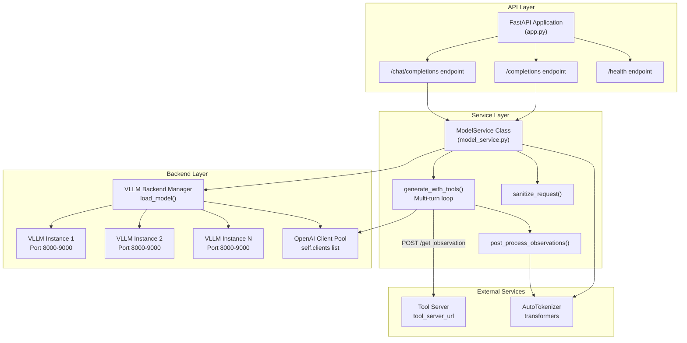
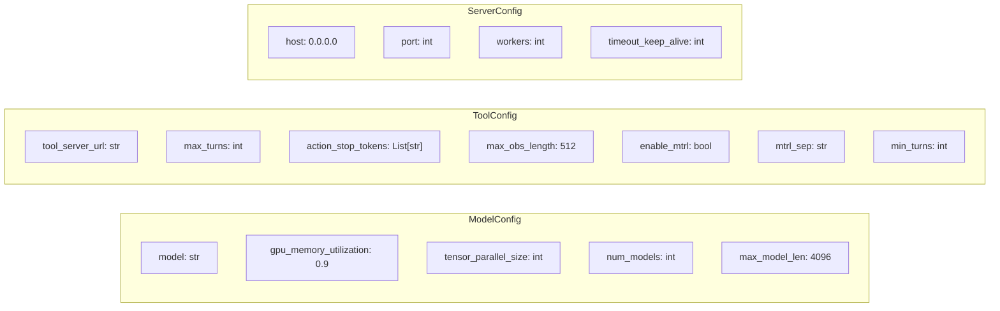
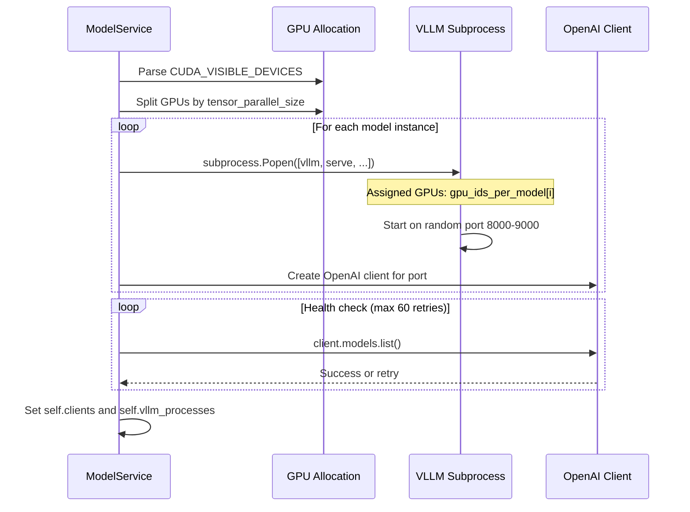
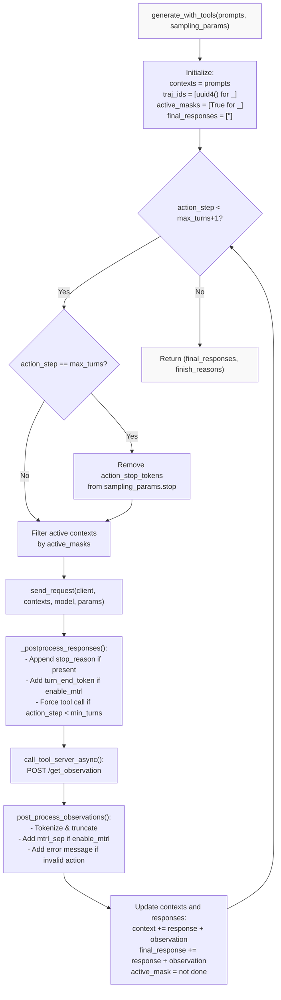
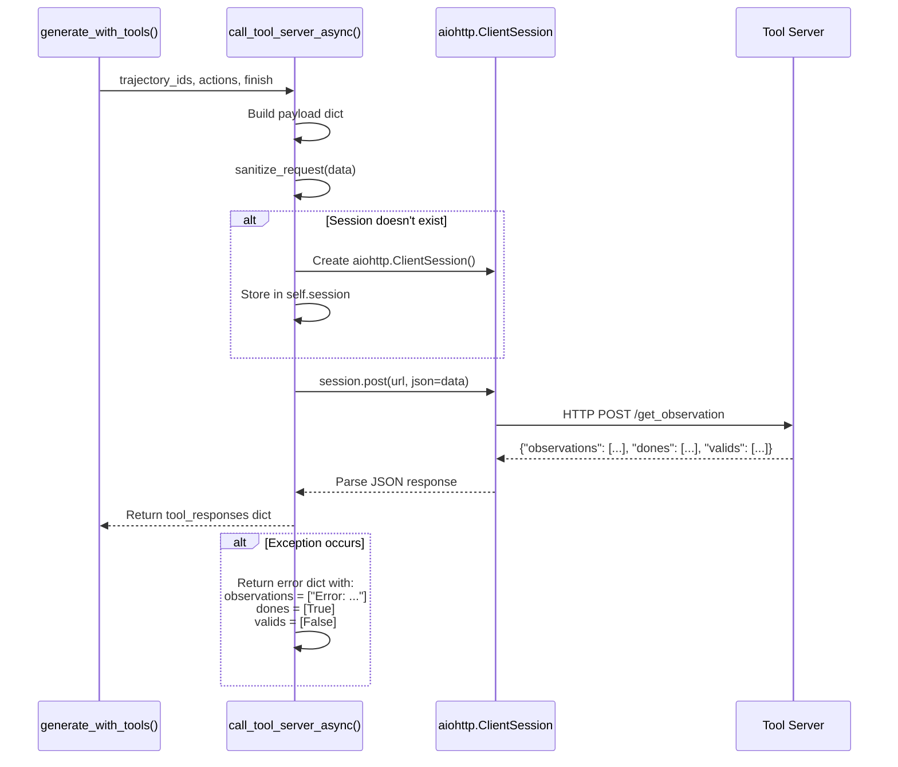
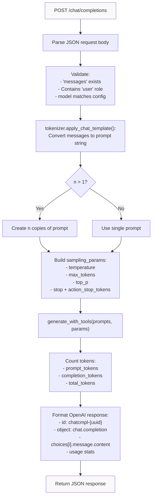
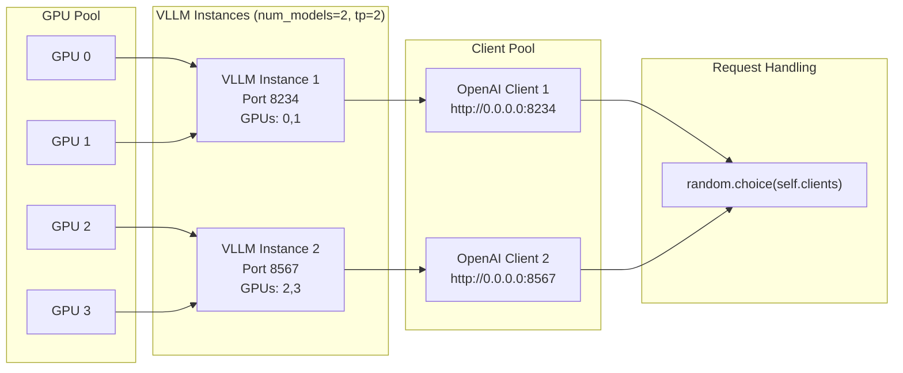
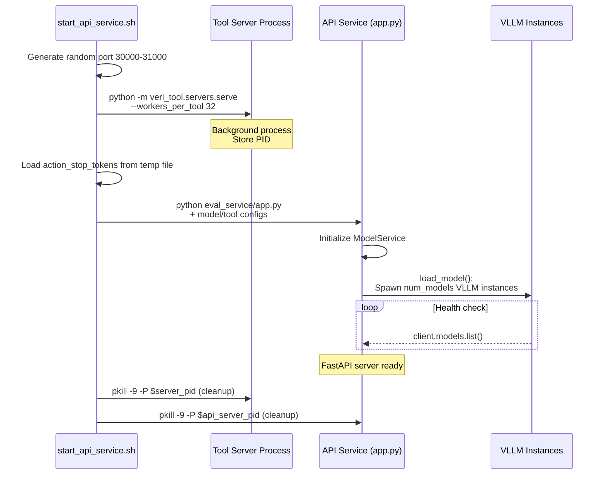

<!-- source: DeepWiki mcp.deepwiki.com · repo TIGER-AI-Lab/verl-tool · page 8.1 Evaluation Service Architecture · fetched 2026-10-30 -->

# Evaluation Service Architecture

<details>
<summary>Relevant source files</summary>

The following files were used as context for generating this wiki page:

- [eval_service/app.py](eval_service/app.py)
- [eval_service/config.py](eval_service/config.py)
- [eval_service/model_service.py](eval_service/model_service.py)
- [eval_service/scripts/start_api_service.sh](eval_service/scripts/start_api_service.sh)
- [eval_service/test/test_api.py](eval_service/test/test_api.py)
- [eval_service/test/test_api_mp.py](eval_service/test/test_api_mp.py)

</details>


## Purpose and Scope

The Evaluation Service provides an OpenAI-compatible API for deploying trained VerlTool models with integrated tool-calling capabilities. This service enables multi-turn inference where models can interact with tools (Python execution, SQL, search, etc.) across multiple reasoning steps. The service uses VLLM as the inference backend and manages multiple parallel VLLM instances for high-throughput evaluation.

For details on the specific API endpoints exposed by this service, see [OpenAI-Compatible API Endpoints](#8.2). For information on how tool calling works during inference, see [Tool Integration in Inference](#8.3).

**Sources:** [eval_service/README.md:1-9](), [eval_service/model_service.py:42-56]()

## System Overview

The evaluation service consists of three main layers:



**Sources:** [eval_service/app.py:27-114](), [eval_service/model_service.py:42-56](), [eval_service/model_service.py:191-254]()

## Core Components

### ModelService Class

The `ModelService` class ([eval_service/model_service.py:42-508]()) is the central component managing model inference and tool integration. It maintains:

| Component | Type | Purpose |
|-----------|------|---------|
| `self.model_config` | `ModelConfig` | Model and VLLM configuration parameters |
| `self.tool_config` | `ToolConfig` | Tool server URL, max_turns, action_stop_tokens |
| `self.tokenizer` | `AutoTokenizer` | Tokenizer for prompt formatting and observation processing |
| `self.clients` | `List[openai.Client]` | Pool of OpenAI clients for parallel VLLM instances |
| `self.vllm_processes` | `List[subprocess.Popen]` | VLLM subprocess handles for lifecycle management |
| `self.session` | `aiohttp.ClientSession` | Async HTTP session for tool server communication |
| `self.encode_lock` | `asyncio.Lock` | Prevents tokenizer race conditions in async context |

**Sources:** [eval_service/model_service.py:45-56]()

### Configuration System

The service uses three dataclass configurations defined in [eval_service/config.py:1-49]():



The `ToolConfig.post_init()` method ([eval_service/config.py:25-40]()) handles special processing for `action_stop_tokens`, which can be:
- A comma-separated string: `"<python>,</python>"`
- A file path containing comma-separated tokens
- Parsed into a list of stripped token strings

**Sources:** [eval_service/config.py:5-49](), [eval_service/app.py:118-120]()

### VLLM Backend Management

The `load_model()` method ([eval_service/model_service.py:191-254]()) spawns multiple VLLM server instances for parallel processing:



**Key implementation details:**
- Each VLLM instance runs on a random port in range 8000-9000 ([eval_service/model_service.py:205]())
- GPU allocation: `num_models * tensor_parallel_size` must equal total GPUs ([eval_service/model_service.py:210]())
- Health checks poll `client.models.list()` with 10-second intervals, max 60 retries ([eval_service/model_service.py:227-245]())
- VLLM processes use `--disable-log-stats` and `--disable-log-requests` for clean logging ([eval_service/model_service.py:215]())

**Sources:** [eval_service/model_service.py:191-254](), [eval_service/scripts/start_api_service.sh:18-19]()

## Multi-Turn Generation Pipeline

The `generate_with_tools()` method ([eval_service/model_service.py:280-363]()) implements the core multi-turn interaction loop:



**Key behavioral details:**

1. **Last turn handling** ([eval_service/model_service.py:303-308]()): On the final turn (`action_step == max_turns`), action stop tokens are removed from the stop list to prevent premature termination.

2. **Response postprocessing** ([eval_service/model_service.py:168-189]()):
   - If `finish_reason == "stop"` and a `stop_reason` exists, append the stop token to the response
   - If `enable_mtrl=True`, append `turn_end_token` (e.g., `<|im_end|>`)
   - If `action_step < min_turns`, force continuation by appending action stop tokens

3. **Observation processing** ([eval_service/model_service.py:111-166]()):
   - Truncate observations to `max_obs_length` tokens (left or right side based on config)
   - Wrap observations in `mtrl_sep` template if `enable_mtrl=True`
   - Add error message prefix for invalid actions: `"Your action is not valid, please check the format and try again."`

4. **Sticky client assignment** ([eval_service/model_service.py:291]()): Each trajectory uses the same randomly chosen VLLM client for prefix caching benefits.

**Sources:** [eval_service/model_service.py:280-363](), [eval_service/model_service.py:168-189](), [eval_service/model_service.py:111-166]()

## Tool Server Integration

The service communicates with the tool server through two methods:

### Synchronous Tool Calling

The `call_tool_server()` method ([eval_service/model_service.py:58-80]()) uses `requests.post()`:

```python
# Simplified structure
data = {
    "trajectory_ids": trajectory_ids,
    "actions": actions,
    "finish": finish,
    **kwargs  # Extra fields passed through
}
data = sanitize_request(data)  # Remove control characters
response = requests.post(server_url, json=data)
```

### Asynchronous Tool Calling

The `call_tool_server_async()` method ([eval_service/model_service.py:82-109]()) uses `aiohttp.ClientSession`:



**Sanitization:** The `sanitize_request()` function ([eval_service/model_service.py:24-40]()) recursively removes control characters (U+0000 through U+001F excluding tab/LF/CR) to prevent issues with embedded nulls in tool outputs.

**Sources:** [eval_service/model_service.py:58-109](), [eval_service/model_service.py:19-40]()

## Observation Processing

The `post_process_observations()` method ([eval_service/model_service.py:111-166]()) handles tokenization and formatting of tool outputs:

| Step | Implementation | Configuration |
|------|----------------|---------------|
| 1. Clear finished observations | `obs if not done else ""` | Always applied |
| 2. Tokenize with padding | `tokenizer(..., padding='longest')` | `padding_side` based on `truncate_obs_side` |
| 3. Truncate if too long | Keep first/last `max_obs_length` tokens | `truncate_obs_side='left'` or `'right'` |
| 4. Add MTRL wrapper | `mtrl_sep.format(obs=next_obs[i])` | Only if `enable_mtrl=True` |
| 5. Add invalid action message | Prepend error string | Only if `valid_action[i]=False` |
| 6. Re-tokenize if MTRL | Second tokenization pass | Only if `enable_mtrl=True` |
| 7. Decode to text | `tokenizer.batch_decode()` | Always applied |

**MTRL separator inference:** If `mtrl_sep` is `None`, it's automatically inferred ([eval_service/model_service.py:53-56]()):
```python
messages = [{"role": "system", "content": "{obs}"}]
self.tool_config.mtrl_sep = "\n" + self.tokenizer.apply_chat_template(
    messages, tokenize=False, add_generation_prompt=True
)
```

This creates a chat turn separator like:
```
<|im_start|>system
{obs}<|im_end|>
<|im_start|>assistant
```

**Thread safety:** The `encode_lock` prevents race conditions when multiple async tasks call the tokenizer simultaneously ([eval_service/model_service.py:114]()).

**Sources:** [eval_service/model_service.py:111-166](), [eval_service/model_service.py:53-56]()

## Request Processing Flow

### Chat Completions Endpoint

The `/chat/completions` endpoint ([eval_service/app.py:92-107]()) processes chat-style requests:



**Sources:** [eval_service/model_service.py:365-423](), [eval_service/app.py:92-107]()

### Completions Endpoint

The `/completions` endpoint ([eval_service/app.py:75-90]()) processes raw prompt requests:

**Key differences from chat completions:**
- No template application—uses raw prompt string ([eval_service/model_service.py:435]())
- Response format uses `choices[i].text` instead of `choices[i].message.content` ([eval_service/model_service.py:467]())
- Object type is `"chat.completion"` in both cases (implementation detail)

**Sources:** [eval_service/model_service.py:429-480](), [eval_service/app.py:75-90]()

## Resource Management and Parallelism

### Multi-Worker Configuration

The service supports parallel request processing through multiple VLLM instances:



**GPU allocation logic** ([eval_service/model_service.py:207-210]()):
```python
gpu_ids_per_model = [
    gpu_ids[i:i+tensor_parallel_size] 
    for i in range(0, len(gpu_ids), tensor_parallel_size)
]
```

**Recommendation from configuration** ([eval_service/scripts/start_api_service.sh:46-51]()):
```bash
# num_models * tensor_parallel_size should equal number of GPUs
# Recommend setting num_models as large as possible for parallel processing
tensor_parallel_size=1  # Tensor sharding across GPUs
num_models=8           # Number of VLLM instances
```

**Sources:** [eval_service/model_service.py:207-224](), [eval_service/scripts/start_api_service.sh:18-19](), [eval_service/README.md:46-51]()

### Resource Cleanup

The service implements cleanup in the `close()` method ([eval_service/model_service.py:482-499]()) and destructor:

1. **HTTP session cleanup:** Close `aiohttp.ClientSession` if exists
2. **VLLM process termination:** 
   - Send `SIGTERM` to each subprocess
   - Wait up to 5 seconds with `process.wait(timeout=5)`
   - If timeout expires, send `SIGKILL` with `process.kill()`
3. **Client pool reset:** Clear `self.clients` and `self.vllm_processes` lists

The `__del__` destructor ([eval_service/model_service.py:501-507]()) calls `close()` but handles `RuntimeError` gracefully for event loop shutdown scenarios.

**Sources:** [eval_service/model_service.py:482-507]()

## Startup and Deployment

### Service Startup Script

The [eval_service/scripts/start_api_service.sh:1-45]() script orchestrates the full service startup:



**Action stop tokens handling:** The script writes action stop tokens to a temporary file because shell parameter passing doesn't handle special strings well ([eval_service/scripts/start_api_service.sh:22-24]()):
```bash
action_stop_tokens_file=$(mktemp)
echo "$action_stop_tokens" > $action_stop_tokens_file
```

**Sources:** [eval_service/scripts/start_api_service.sh:1-45](), [eval_service/app.py:116-141]()

### Testing the Service

The test script [eval_service/test/test_api.py:1-93]() demonstrates usage:

```python
client = OpenAI(api_key=api_key, base_url=base_url)

# Chat completion example
completion = client.chat.completions.create(
    model=model_name,
    messages=[
        {"role": "system", "content": system_prompt},
        {"role": "user", "content": math_problem}
    ],
    temperature=0.0,
    max_tokens=2048,
    top_p=1.0,
    n=1
)
```

**Sources:** [eval_service/test/test_api.py:1-93](), [eval_service/README.md:58-63]()

---

