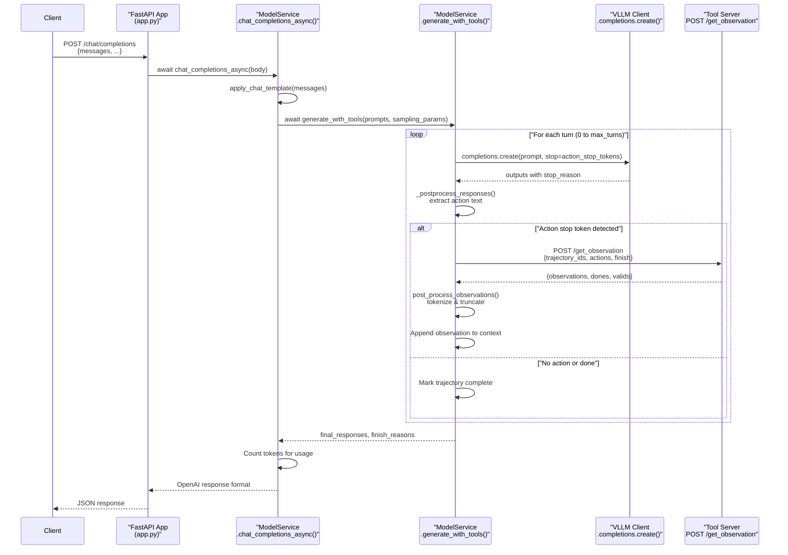
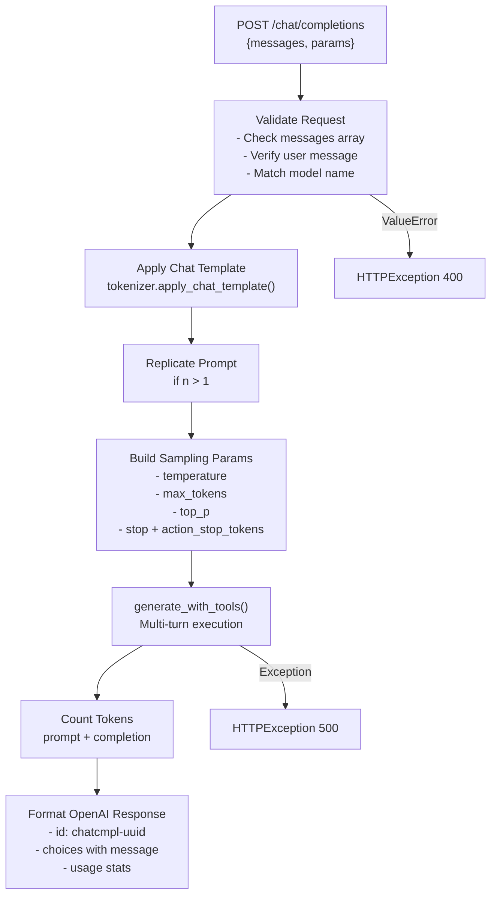
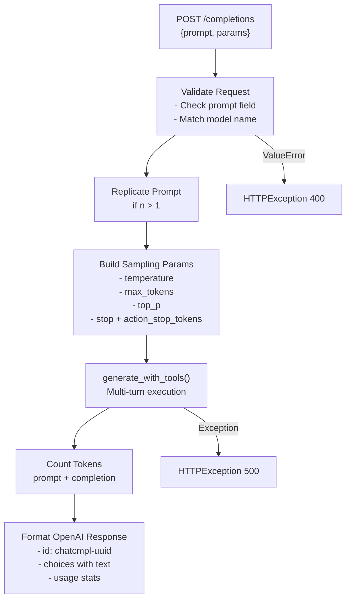

<!-- source: DeepWiki mcp.deepwiki.com · repo TIGER-AI-Lab/verl-tool · page 8.2 OpenAI-Compatible API Endpoints · fetched 2026-10-30 -->

# OpenAI-Compatible API Endpoints

<details>
<summary>Relevant source files</summary>

The following files were used as context for generating this wiki page:

- [eval_service/app.py](eval_service/app.py)
- [eval_service/config.py](eval_service/config.py)
- [eval_service/model_service.py](eval_service/model_service.py)
- [eval_service/scripts/start_api_service.sh](eval_service/scripts/start_api_service.sh)
- [eval_service/test/test_api.py](eval_service/test/test_api.py)
- [eval_service/test/test_api_mp.py](eval_service/test/test_api_mp.py)

</details>


This document describes the HTTP API endpoints exposed by VerlTool's evaluation service for inference with trained models. The service provides OpenAI-compatible endpoints that support multi-turn tool-calling interactions transparently to the client.

For information about the underlying evaluation service architecture and VLLM backend initialization, see [Evaluation Service Architecture](#8.1). For details on how tools are integrated during inference, see [Tool Integration in Inference](#8.3).

---

## Endpoint Overview

The evaluation service exposes three primary HTTP endpoints through FastAPI, defined in [eval_service/app.py:75-113]():

| Endpoint | Method | Purpose | OpenAI Equivalent |
|----------|--------|---------|-------------------|
| `/chat/completions` | POST | Chat-style interactions with message history | `chat.completions.create()` |
| `/completions` | POST | Raw text completion from a prompt string | `completions.create()` |
| `/health` | GET | Service health check | N/A |

Both completion endpoints support transparent multi-turn tool execution, where the service automatically handles tool calls and observations without requiring explicit tool management from the client.

**Sources:** [eval_service/app.py:75-113]()

---

## API Endpoint Definitions

### Chat Completions Endpoint

**Route:** `POST /chat/completions`

The chat completions endpoint accepts OpenAI-formatted message arrays and returns assistant responses. It is implemented in [eval_service/app.py:92-107](), which delegates to `ModelService.chat_completions_async()` in [eval_service/model_service.py:365-423]().

#### Request Format

```json
{
  "model": "model-name",
  "messages": [
    {"role": "system", "content": "system prompt"},
    {"role": "user", "content": "user query"}
  ],
  "temperature": 0.7,
  "max_tokens": 2048,
  "top_p": 1.0,
  "n": 1,
  "stop": ["custom_stop_token"]
}
```

**Request Fields:**

| Field | Type | Required | Description |
|-------|------|----------|-------------|
| `model` | string | Yes | Must match the model name loaded in `ModelConfig` |
| `messages` | array | Yes | Array of message objects with `role` and `content` |
| `temperature` | float | No | Sampling temperature (default: 1.0) |
| `max_tokens` | int | No | Maximum completion tokens (default: 512) |
| `max_completion_tokens` | int | No | Alias for `max_tokens` |
| `top_p` | float | No | Nucleus sampling parameter (default: 1.0) |
| `n` | int | No | Number of completions (default: 1, max: 1 for tool mode) |
| `stop` | array | No | Additional stop tokens (merged with `action_stop_tokens`) |

The implementation applies the tokenizer's chat template to convert messages into a prompt string [eval_service/model_service.py:376-379]():

```python
prompt = self.tokenizer.apply_chat_template(body['messages'],
                                        add_generation_prompt=True,
                                        tokenize=False)
```

**Sources:** [eval_service/model_service.py:365-423](), [eval_service/app.py:92-107]()

---

### Completions Endpoint

**Route:** `POST /completions`

The completions endpoint accepts raw prompt strings for text generation. It is implemented in [eval_service/app.py:75-90](), delegating to `ModelService.completions_async()` in [eval_service/model_service.py:429-476]().

#### Request Format

```json
{
  "model": "model-name",
  "prompt": "raw prompt string",
  "temperature": 0.7,
  "max_tokens": 2048,
  "top_p": 1.0,
  "n": 1,
  "stop": ["custom_stop_token"]
}
```

**Request Fields:**

| Field | Type | Required | Description |
|-------|------|----------|-------------|
| `model` | string | Yes | Must match loaded model name |
| `prompt` | string | Yes | Raw text prompt for completion |
| `temperature` | float | No | Sampling temperature (default: 1.0) |
| `max_tokens` | int | No | Maximum completion tokens (default: 512) |
| `top_p` | float | No | Nucleus sampling parameter (default: 1.0) |
| `n` | int | No | Number of completions (default: 1) |
| `stop` | array | No | Stop tokens (merged with `action_stop_tokens`) |

The prompt is used directly without chat template processing [eval_service/model_service.py:435-440]().

**Sources:** [eval_service/model_service.py:429-476](), [eval_service/app.py:75-90]()

---

## Response Format

Both endpoints return OpenAI-compatible response structures with tool interaction results transparently included in the completion text.

### Chat Completions Response

```json
{
  "id": "chatcmpl-uuid",
  "object": "chat.completion",
  "created": 1234567890,
  "model": "model-name",
  "choices": [
    {
      "index": 0,
      "message": {
        "role": "assistant",
        "content": "complete response with tool interactions"
      },
      "finish_reason": "stop"
    }
  ],
  "usage": {
    "prompt_tokens": 150,
    "completion_tokens": 500,
    "total_tokens": 650
  }
}
```

Generated by [eval_service/model_service.py:403-423]().

**Sources:** [eval_service/model_service.py:403-423]()

---

### Completions Response

```json
{
  "id": "chatcmpl-uuid",
  "object": "chat.completion",
  "created": 1234567890,
  "model": "model-name",
  "choices": [
    {
      "index": 0,
      "text": "complete response text",
      "finish_reason": "stop"
    }
  ],
  "usage": {
    "prompt_tokens": 150,
    "completion_tokens": 500,
    "total_tokens": 650
  }
}
```

Generated by [eval_service/model_service.py:459-476]().

**Key Difference:** The completions endpoint returns `text` in choices, while chat completions returns a `message` object with `content`.

**Sources:** [eval_service/model_service.py:459-476]()

---

### Finish Reasons

The `finish_reason` field indicates why generation stopped [eval_service/model_service.py:359]():

| Reason | Description |
|--------|-------------|
| `"stop"` | Model generated natural stop or hit action stop token |
| `"length"` | Reached `max_tokens` limit |
| Other | VLLM-specific finish reasons (e.g., EOS token) |

**Sources:** [eval_service/model_service.py:168-189]()

---

## Multi-Turn Tool Execution Flow

Both endpoints transparently handle multi-turn tool interactions through `ModelService.generate_with_tools()` [eval_service/model_service.py:280-363](). The client sends a single request and receives a single response, but internally the service may execute multiple turns.

### Execution Sequence Diagram



**Key Implementation Points:**

1. **Trajectory IDs**: Each request generates unique `trajectory_ids` for state tracking [eval_service/model_service.py:295]()
2. **Active Masks**: Track which trajectories are still generating [eval_service/model_service.py:296]()
3. **Action Stop Tokens**: Generation stops at configured tokens (e.g., `<python>`, `</tool_call>`) [eval_service/model_service.py:389]()
4. **Context Accumulation**: Responses and observations are appended to context [eval_service/model_service.py:357-358]()
5. **Turn Limits**: Enforced by `max_turns` config [eval_service/model_service.py:301-308]()

**Sources:** [eval_service/model_service.py:280-363](), [eval_service/app.py:75-107]()

---

## Request Processing Pipeline

### Chat Completions Processing Flow



**Implementation:** [eval_service/model_service.py:365-423]()

**Sources:** [eval_service/model_service.py:365-423]()

---

### Completions Processing Flow



**Implementation:** [eval_service/model_service.py:429-476]()

**Sources:** [eval_service/model_service.py:429-476]()

---

## Configuration Parameters

The API behavior is controlled by configuration parameters passed to `ModelService` via `ModelConfig` and `ToolConfig` dataclasses.

### ToolConfig Parameters

Defined in [eval_service/config.py:14-40]():

| Parameter | Type | Default | Description |
|-----------|------|---------|-------------|
| `tool_server_url` | str | `http://localhost:30150/get_observation` | Tool server endpoint URL |
| `max_turns` | int | 5 | Maximum tool interaction turns per request |
| `min_turns` | int | 0 | Minimum tool interaction turns enforced |
| `action_stop_tokens` | str/list | None | Tokens that trigger tool calls (comma-separated or file path) |
| `max_obs_length` | int | 512 | Maximum observation tokens after truncation |
| `truncate_obs_side` | str | `"left"` | Truncation side: `"left"` or `"right"` |
| `enable_mtrl` | bool | False | Enable multi-turn RL mode with chat turns |
| `mtrl_sep` | str | None | Separator template for MTRL observations |
| `turn_end_token` | str | `<|im_end|>` | Token marking end of turn in MTRL mode |

**Action Stop Tokens Processing:**

The `action_stop_tokens` parameter can be:
- A comma-separated string: `"<python>,</tool_call>"`
- A file path containing tokens (one per line or comma-separated)
- Automatically parsed by `post_init()` [eval_service/config.py:25-40]()

These tokens are merged with any `stop` tokens provided in the API request [eval_service/model_service.py:389](), [eval_service/model_service.py:446]().

**Sources:** [eval_service/config.py:14-40](), [eval_service/model_service.py:385-390]()

---

### ModelConfig Parameters

Defined in [eval_service/config.py:5-12]():

| Parameter | Type | Default | Description |
|-----------|------|---------|-------------|
| `model` | str | Required | HuggingFace model path or name |
| `gpu_memory_utilization` | float | 0.9 | VLLM GPU memory utilization |
| `tensor_parallel_size` | int | 1 | Tensor parallelism degree |
| `trust_remote_code` | bool | True | Allow remote code execution |
| `num_models` | int | 1 | Number of parallel VLLM instances |
| `max_model_len` | int | 4096 | Maximum sequence length |

These parameters are passed to VLLM during model loading [eval_service/model_service.py:191-254]().

**Sources:** [eval_service/config.py:5-12](), [eval_service/model_service.py:191-254]()

---

## Token Management and Limits

### Dynamic Token Limit Adjustment

The service dynamically adjusts `max_tokens` based on prompt length to avoid exceeding model capacity [eval_service/model_service.py:260-264]():

```python
async with self.encode_lock:
    prompt_lens = [len(self.tokenizer.encode(prompt)) for prompt in prompts]
    max_prompt_tokens = max(prompt_lens)

sampling_params['max_tokens'] = min(
    max(self.model_config.max_model_len - max_prompt_tokens, 0), 
    sampling_params['max_tokens']
)
```

This ensures the total sequence length (prompt + completion) does not exceed `max_model_len`.

**Sources:** [eval_service/model_service.py:260-264]()

---

### Observation Truncation

Tool observations are truncated if they exceed `max_obs_length` [eval_service/model_service.py:111-139]():

```python
if self.tool_config.truncate_obs_side == 'left':
    # Truncate from left, keeping recent tokens
    next_obs_ids = next_obs_ids[:, -self.tool_config.max_obs_length:]
elif self.tool_config.truncate_obs_side == 'right':
    # Truncate from right, keeping early tokens
    next_obs_ids = next_obs_ids[:, :self.tool_config.max_obs_length]
```

A warning is logged if truncation occurs [eval_service/model_service.py:125-126](), [eval_service/model_service.py:136-137]().

**Sources:** [eval_service/model_service.py:111-139]()

---

## Usage Examples

### Example 1: Chat Completions with Tool Calling

Using the OpenAI Python client [eval_service/test/test_api.py:40-59]():

```python
from openai import OpenAI

client = OpenAI(
    api_key="sk-proj-1234567890",
    base_url="http://localhost:5000"
)

response = client.chat.completions.create(
    model="VerlTool/torl-deep_math-fsdp_agent-qwen2.5-math-1.5b-grpo",
    messages=[
        {
            "role": "system",
            "content": "Solve problems using Python when needed."
        },
        {
            "role": "user",
            "content": "Convert (0,3) to polar coordinates."
        }
    ],
    temperature=0.0,
    max_tokens=2048,
    top_p=1.0,
    n=1
)

print(response.choices[0].message.content)
```

The response will contain the complete reasoning trace including any tool interactions:

```
To convert rectangular coordinates to polar...
<python>
import math
r = math.sqrt(0**2 + 3**2)
theta = math.atan2(3, 0)
print(f"r = {r}, theta = {theta}")
</python>
```output
r = 3.0, theta = 1.5707963267948966
```

Therefore, the answer is $(3, \frac{\pi}{2})$ or $(3, 1.571)$.
```

**Sources:** [eval_service/test/test_api.py:40-59]()

---

### Example 2: Raw Completions

For pre-formatted prompts [eval_service/test/test_api.py:60-82]():

```python
from transformers import AutoTokenizer

tokenizer = AutoTokenizer.from_pretrained(model_name)
prompt = tokenizer.apply_chat_template(
    [
        {"role": "system", "content": "System prompt"},
        {"role": "user", "content": "User query"}
    ],
    tokenize=False,
    add_generation_prompt=True
)

response = client.completions.create(
    model=model_name,
    prompt=prompt,
    temperature=0.0,
    max_tokens=2048,
    top_p=1.0,
    n=1
)

print(response.choices[0].text)
```

**Sources:** [eval_service/test/test_api.py:60-82]()

---

## Error Handling

### Request Validation Errors

Both endpoints validate requests and raise exceptions for invalid input [eval_service/model_service.py:369-374](), [eval_service/model_service.py:432-434]():

**Chat Completions Validation:**
- `ValueError` if `messages` field is missing or empty
- `ValueError` if no user message in messages array
- `AssertionError` if model name doesn't match loaded model

**Completions Validation:**
- `ValueError` if `prompt` field is missing
- `AssertionError` if model name doesn't match loaded model

These are caught by FastAPI middleware and returned as HTTP 500 errors [eval_service/app.py:87-90](), [eval_service/app.py:104-107]().

**Sources:** [eval_service/model_service.py:369-374](), [eval_service/model_service.py:432-434](), [eval_service/app.py:87-107]()

---

### Tool Server Errors

If the tool server call fails [eval_service/model_service.py:74-80](), [eval_service/model_service.py:104-109]():

```python
except Exception as e:
    print(f"Error calling tool server: {str(e)}")
    return {
        "observations": [f"Error calling tool server: {str(e)}" for _ in range(len(trajectory_ids))],
        "dones": [True for _ in range(len(trajectory_ids))],
        "valids": [False for _ in range(len(trajectory_ids))]
    }
```

The error message is included in observations and generation terminates for affected trajectories.

**Sources:** [eval_service/model_service.py:74-80](), [eval_service/model_service.py:104-109]()

---

## Input Sanitization

All requests are sanitized to remove control characters that could cause parsing issues [eval_service/model_service.py:19-40]():

```python
CONTROL_CHAR_RE = re.compile(r'[\x00-\x08\x0B\x0C\x0E-\x1F]')

def sanitize_request(obj: Any) -> Any:
    """Recursively strip NUL and C0 control chars"""
    if isinstance(obj, str):
        return CONTROL_CHAR_RE.sub('', obj)
    elif isinstance(obj, dict):
        return {sanitize_request(k): sanitize_request(v) for k, v in obj.items()}
    # ... handle lists/tuples
```

This is applied before sending requests to the tool server [eval_service/model_service.py:69](), [eval_service/model_service.py:98]().

**Sources:** [eval_service/model_service.py:19-40](), [eval_service/model_service.py:69](), [eval_service/model_service.py:98]()

---

## Startup and Service Configuration

### Launching the API Service

The service is typically started via [eval_service/scripts/start_api_service.sh:1-45]():

```bash
#!/bin/bash

# 1. Start tool server
host=0.0.0.0
port=$(shuf -i 30000-31000 -n 1)
tool_server_url=http://$host:$port/get_observation
python -m verl_tool.servers.serve \
    --host $host --port $port \
    --tool_type "python_code" \
    --workers_per_tool 32 &
server_pid=$!

# 2. Start API service
model_path=VerlTool/model-name
max_turns=4
min_turns=0
api_host="0.0.0.0"
api_port=5000
action_stop_tokens='```output'
tensor_parallel_size=1
num_models=8

python eval_service/app.py \
    --host $api_host \
    --port $api_port \
    --tool_server_url $tool_server_url \
    --model $model_path \
    --max_turns $max_turns \
    --min_turns $min_turns \
    --action_stop_tokens $action_stop_tokens \
    --tensor_parallel_size $tensor_parallel_size \
    --num_models $num_models \
    --enable_mtrl False
```

**Key Parameters:**
- `num_models * tensor_parallel_size` should equal total GPUs available
- Setting `num_models` as high as possible enables more parallel requests
- `action_stop_tokens` defines when the model requests tool execution

**Sources:** [eval_service/scripts/start_api_service.sh:1-45]()

---

### VLLM Backend Management

The `ModelService` spawns multiple VLLM server processes [eval_service/model_service.py:191-254]():

1. **Process Spawning**: Creates `num_models` VLLM servers on random ports [eval_service/model_service.py:205-221]()
2. **GPU Assignment**: Distributes GPUs across instances using `CUDA_VISIBLE_DEVICES` [eval_service/model_service.py:207-218]()
3. **Client Pool**: Creates OpenAI clients for each instance [eval_service/model_service.py:222-224]()
4. **Health Checks**: Waits for all instances to be ready [eval_service/model_service.py:226-254]()
5. **Random Selection**: Each request uses a random client for load balancing [eval_service/model_service.py:291]()

**Sources:** [eval_service/model_service.py:191-254]()

---

## Performance Considerations

### Concurrency and Load Balancing

**Multiple VLLM Instances:** Setting `num_models > 1` enables parallel request processing across multiple VLLM instances [eval_service/model_service.py:204-224](). Each request randomly selects an instance [eval_service/model_service.py:291]().

**Uvicorn Workers:** The FastAPI server uses `workers = server_config.workers * model_config.num_models` [eval_service/app.py:132](), creating multiple application processes.

**Async Request Processing:** Both tool server calls and VLLM inference use async operations [eval_service/model_service.py:82-109](), [eval_service/model_service.py:256-278]().

**Sources:** [eval_service/model_service.py:204-224](), [eval_service/model_service.py:291](), [eval_service/app.py:132]()

---

### Token Encoding Lock

A shared async lock prevents concurrent tokenizer access [eval_service/model_service.py:52]():

```python
self.encode_lock = asyncio.Lock()
```

This lock is acquired for:
- Calculating prompt lengths [eval_service/model_service.py:260-262]()
- Tokenizing observations [eval_service/model_service.py:114]()
- Applying chat templates [eval_service/model_service.py:376]()
- Counting usage tokens [eval_service/model_service.py:395-400](), [eval_service/model_service.py:451-456]()

**Rationale:** Many tokenizer implementations are not thread-safe for encoding operations.

**Sources:** [eval_service/model_service.py:52](), [eval_service/model_service.py:114](), [eval_service/model_service.py:260-262]()

---

## Health Check Endpoint

**Route:** `GET /health`

Returns service status [eval_service/app.py:109-112]():

```json
{
  "status": "healthy"
}
```

This endpoint can be used for:
- Load balancer health checks
- Service discovery readiness probes
- Monitoring and alerting

**Sources:** [eval_service/app.py:109-112]()

---

