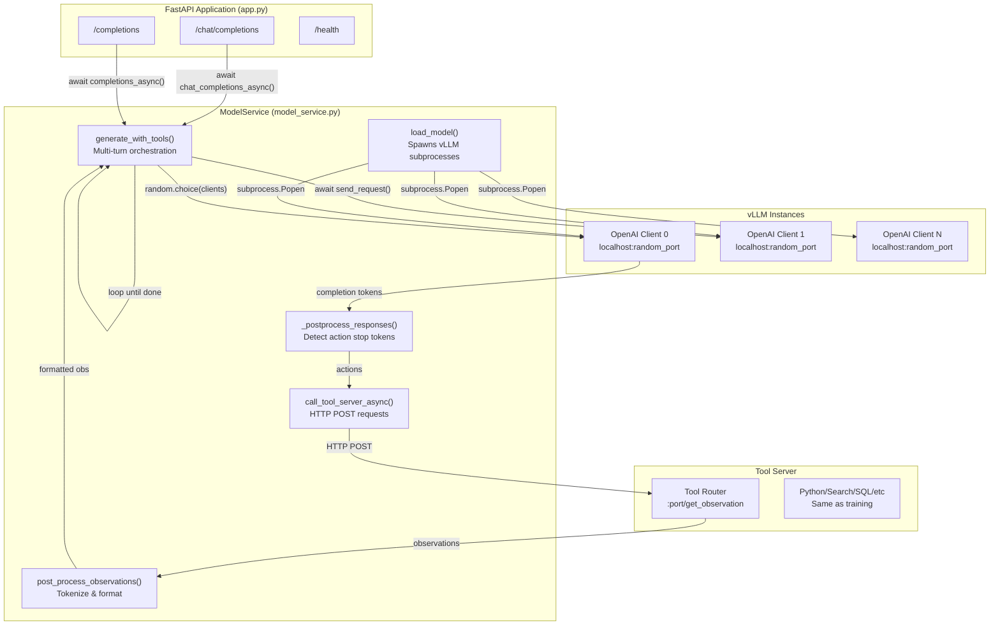
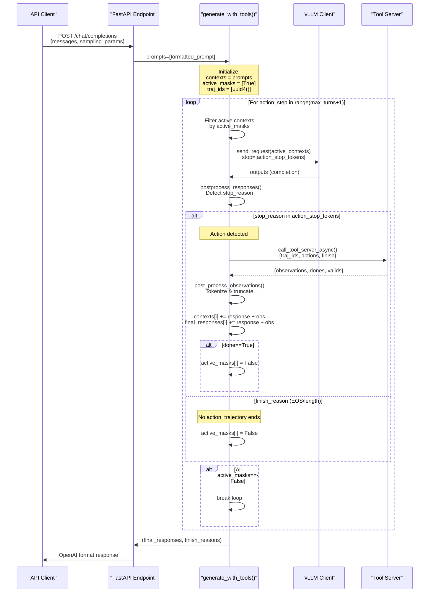
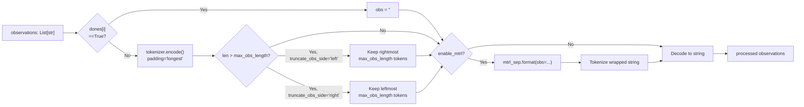
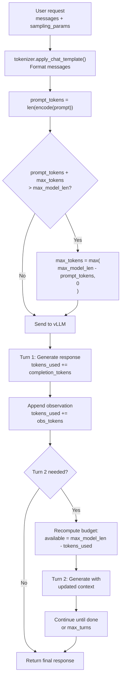
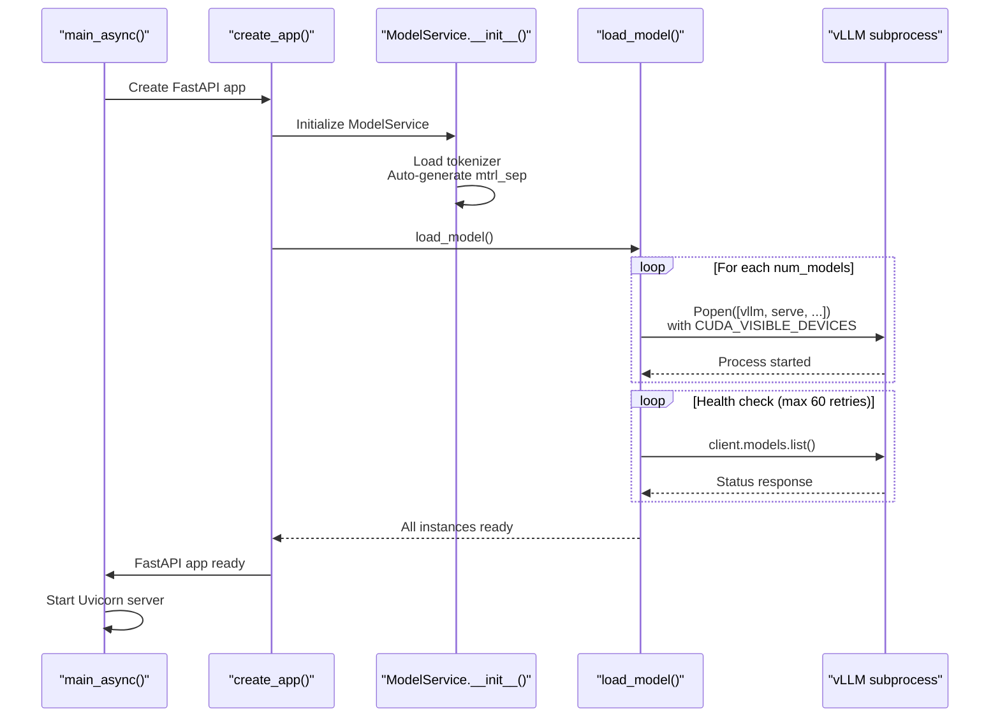

<!-- source: DeepWiki mcp.deepwiki.com · repo TIGER-AI-Lab/verl-tool · page 8.3 Tool Integration in Inference · fetched 2026-10-30 -->

# Tool Integration in Inference

<details>
<summary>Relevant source files</summary>

The following files were used as context for generating this wiki page:

- [assets/docs/tool_server.md](assets/docs/tool_server.md)
- [eval_service/app.py](eval_service/app.py)
- [eval_service/config.py](eval_service/config.py)
- [eval_service/model_service.py](eval_service/model_service.py)
- [eval_service/scripts/start_api_service.sh](eval_service/scripts/start_api_service.sh)
- [eval_service/test/test_api.py](eval_service/test/test_api.py)
- [eval_service/test/test_api_mp.py](eval_service/test/test_api_mp.py)
- [pyproject.toml](pyproject.toml)

</details>


## Purpose and Scope

This page documents how the evaluation service (`eval_service/`) integrates with tool servers during inference to enable multi-turn tool calling in deployed models. The evaluation service provides OpenAI-compatible API endpoints that automatically orchestrate tool interactions transparently to the client.

**Related Pages:**
- For training-time tool integration with the agent loop, see [Agent Loop System (VerlToolAgentLoop)](#2.3)
- For tool server architecture and load balancing, see [Tool Server Router and Load Balancing](#3.1)
- For OpenAI API endpoint specifications, see [OpenAI-Compatible API Endpoints](#8.2)

The key difference from training is that inference operates on a per-request basis with no batching requirements, allowing for simpler trajectory management and synchronous/asynchronous execution patterns.

**Sources:** [eval_service/model_service.py:1-508](), [eval_service/config.py:1-49]()

---

## Architecture Overview

The inference service consists of three primary components: the `ModelService` class manages vLLM instances and orchestrates multi-turn generation, the tool server handles action execution (identical to training), and the FastAPI application exposes OpenAI-compatible endpoints.

### Component Diagram



**Sources:** [eval_service/app.py:27-114](), [eval_service/model_service.py:42-508]()

---

## Multi-Turn Generation Loop

The core of tool integration is the `generate_with_tools()` method in `ModelService`, which implements a multi-turn loop that alternates between model generation and tool execution.

### Generation Loop Flow



**Sources:** [eval_service/model_service.py:280-363]()

### Core Loop Implementation

The loop operates on batches of prompts (though typically `n=1` in inference). Key steps:

1. **Initialization** [eval_service/model_service.py:291-299]()
   - `contexts`: Running prompt with accumulated responses/observations
   - `final_responses`: Complete output returned to client
   - `traj_ids`: UUID for each trajectory (enables tool server routing)
   - `active_masks`: Boolean flags for which trajectories are still active

2. **Generation Step** [eval_service/model_service.py:310-322]()
   ```python
   outputs = await self.send_request(
       client,
       active_contexts,
       model,
       sampling_params
   )
   ```
   Uses `asyncio` executor to call vLLM's synchronous `client.completions.create()` without blocking the event loop.

3. **Response Postprocessing** [eval_service/model_service.py:168-189]()
   - Extracts generated text from `outputs.choices[i].text`
   - Checks if `stop_reason` matches `action_stop_tokens` (e.g., `"```output"`)
   - Appends stop token to response if detected
   - Adds `turn_end_token` (e.g., `"<|im_end|>"`) when `enable_mtrl=True`
   - Sets `finish=False` if action detected, `finish=True` otherwise

4. **Tool Server Call** [eval_service/model_service.py:325-343]()
   - Only called if at least one trajectory has an action
   - Uses `call_tool_server_async()` for asynchronous HTTP POST
   - Payload: `{trajectory_ids, actions, finish}`
   - Response: `{observations, dones, valids}`

5. **Observation Processing** [eval_service/model_service.py:111-166]()
   - Tokenizes observations with `max_obs_length` truncation
   - Supports `truncate_obs_side="left"` or `"right"`
   - If `enable_mtrl=True`, wraps observations in chat template:
     ```python
     mtrl_sep.format(obs=next_obs[i])  # e.g., "\n<|im_start|>system\n{obs}<|im_end|>\n"
     ```
   - Adds error message if `valid_action[i]==False`

6. **Context Update** [eval_service/model_service.py:354-361]()
   ```python
   contexts[i] += active_responses[active_idx] + observations[active_idx]
   final_responses[i] += active_responses[active_idx] + observations[active_idx]
   active_masks[i] = not dones[active_idx]
   ```

7. **Loop Termination**
   - Exits when all `active_masks==False` or `action_step >= max_turns`
   - At the last turn (`action_step == max_turns`), removes `action_stop_tokens` from stop criteria to force completion

**Sources:** [eval_service/model_service.py:280-363](), [eval_service/model_service.py:168-189](), [eval_service/model_service.py:111-166]()

---

## Tool Server Communication

### Request Protocol

The `call_tool_server_async()` method sends HTTP POST requests to the tool server's `/get_observation` endpoint. The request payload structure:

| Field | Type | Description |
|-------|------|-------------|
| `trajectory_ids` | `List[str]` | UUIDs identifying each trajectory |
| `actions` | `List[str]` | Generated text containing tool actions |
| `finish` | `List[bool]` | Whether trajectory is finished (no action) |
| Additional kwargs | `Dict[str, List[Any]]` | Extra fields (e.g., images, database paths) |

Example request [eval_service/model_service.py:82-91]():
```python
data = {
    "trajectory_ids": ["uuid-1", "uuid-2"],
    "actions": ["```python\nprint('hello')\n```", "No action"],
    "finish": [False, True],
}
```

### Response Protocol

The tool server returns:

| Field | Type | Description |
|-------|------|-------------|
| `observations` | `List[str]` | Tool execution results |
| `dones` | `List[bool]` | Whether trajectory should terminate |
| `valids` | `List[bool]` | Whether action was valid |

**Sources:** [eval_service/model_service.py:58-109](), [assets/docs/tool_server.md:8-30]()

### Request Sanitization

Before sending, the service applies `sanitize_request()` to strip null bytes and control characters that could cause JSON encoding errors:

```python
CONTROL_CHAR_RE = re.compile(r'[\x00-\x08\x0B\x0C\x0E-\x1F]')

def sanitize_request(obj: Any) -> Any:
    """Recursively strip control characters from strings"""
    if isinstance(obj, str):
        return CONTROL_CHAR_RE.sub('', obj)
    # ... handle dicts, lists, etc.
```

This prevents crashes when tool outputs contain binary data or special characters.

**Sources:** [eval_service/model_service.py:17-40](), [eval_service/model_service.py:69-98]()

### Trajectory ID Routing

Each request generates a unique UUID per trajectory [eval_service/model_service.py:295]():
```python
traj_ids = [str(uuid.uuid4()) for _ in range(len(prompts))]
```

The tool server uses consistent hashing on `trajectory_ids[0]` to route all requests from the same conversation to the same backend worker, preserving environment state across turns. This is identical to the training-time routing strategy described in [Tool Server Router and Load Balancing](#3.1).

**Sources:** [eval_service/model_service.py:295](), [assets/docs/tool_server.md:1-108]()

---

## Observation Processing Pipeline

### Tokenization and Truncation

The `post_process_observations()` method handles observation tokenization with length control:



**Key Configuration Parameters:**

| Parameter | Default | Description |
|-----------|---------|-------------|
| `max_obs_length` | 512 | Maximum tokens per observation |
| `truncate_obs_side` | `"left"` | Which side to truncate: `"left"` or `"right"` |
| `enable_mtrl` | `False` | Enable multi-turn RL formatting |
| `mtrl_sep` | Auto-generated | Template for wrapping observations |

**Sources:** [eval_service/model_service.py:111-166](), [eval_service/config.py:14-24]()

### Multi-Turn RL (MTRL) Formatting

When `enable_mtrl=True`, observations are wrapped in a chat template to treat each turn as a separate message. The service auto-generates `mtrl_sep` if not provided [eval_service/model_service.py:53-56]():

```python
if self.tool_config.mtrl_sep is None:
    messages = [{"role": "system", "content": "{obs}"}]
    self.tool_config.mtrl_sep = "\n" + self.tokenizer.apply_chat_template(
        messages, tokenize=False, add_generation_prompt=True
    )
```

For Qwen2.5 models, this produces:
```
\n<|im_start|>system\n{obs}<|im_end|>\n<|im_start|>assistant\n
```

During processing [eval_service/model_service.py:140-161]():
1. If `finish[i] or dones[i]`: observation is empty (no formatting needed)
2. If `valid_action[i]`: wrap observation with `mtrl_sep.format(obs=next_obs[i])`
3. If `not valid_action[i]`: prepend error message before wrapping:
   ```python
   "Your action is not valid, please check the format and try again." + next_obs[i]
   ```

This creates a conversation structure:
```
<|im_start|>user
[Initial prompt]
<|im_end|>
<|im_start|>assistant
[Model generates action]```output
<|im_end|>
<|im_start|>system
[Tool observation]
<|im_end|>
<|im_start|>assistant
[Model continues...]
```

**Sources:** [eval_service/model_service.py:53-56](), [eval_service/model_service.py:140-161]()

### Invalid Action Handling

When `valids[i]==False` (tool server couldn't parse the action), the observation includes an error message:

```python
if valid_action[i]:
    processed_next_obs.append(mtrl_sep.format(obs=next_obs[i]))
else:
    processed_next_obs.append(mtrl_sep.format(
        obs="Your action is not valid, please check the format and try again." + next_obs[i]
    ))
```

This guides the model to retry with correct formatting in the next turn.

**Sources:** [eval_service/model_service.py:151-154]()

---

## Configuration System

### ToolConfig Parameters

The `ToolConfig` dataclass [eval_service/config.py:14-40]() controls tool integration behavior:

| Parameter | Type | Default | Description |
|-----------|------|---------|-------------|
| `tool_server_url` | `str` | `"http://localhost:30150/get_observation"` | Tool server endpoint URL |
| `max_turns` | `int` | 5 | Maximum number of tool interaction turns |
| `min_turns` | `int` | 0 | Minimum turns before allowing EOS (forces tool use) |
| `action_stop_tokens` | `str` or `List[str]` | `None` | Tokens indicating action completion (e.g., `"```output"`) |
| `max_obs_length` | `int` | 512 | Maximum tokens per observation |
| `truncate_obs_side` | `str` | `"left"` | Truncation side: `"left"` or `"right"` |
| `enable_mtrl` | `bool` | `False` | Enable multi-turn RL chat formatting |
| `mtrl_sep` | `str` | `None` | Template for observation wrapping (auto-generated if None) |
| `turn_end_token` | `str` | `"<|im_end|>"` | Token marking end of turn in MTRL mode |

**Action Stop Tokens Loading:**

The `action_stop_tokens` parameter accepts multiple formats [eval_service/config.py:29-40]():
- Comma-separated string: `"```output,</action>"`
- File path: `"/tmp/action_tokens.txt"` (reads and splits by comma)
- Python list: `["```output", "</action>"]`

Example usage in startup script [eval_service/scripts/start_api_service.sh:22-24]():
```bash
action_stop_tokens='```output'
action_stop_tokens_file=$(mktemp)
echo "$action_stop_tokens" > $action_stop_tokens_file
```

**Sources:** [eval_service/config.py:14-40](), [eval_service/scripts/start_api_service.sh:1-45]()

### ModelConfig Parameters

The `ModelConfig` dataclass [eval_service/config.py:6-12]() controls vLLM instances:

| Parameter | Type | Default | Description |
|-----------|------|---------|-------------|
| `model` | `str` | - | Model name or path |
| `gpu_memory_utilization` | `float` | 0.9 | GPU memory fraction for vLLM |
| `tensor_parallel_size` | `int` | 1 | Tensor parallelism degree |
| `trust_remote_code` | `bool` | `True` | Allow remote code execution |
| `num_models` | `int` | 1 | Number of vLLM instances to spawn |
| `max_model_len` | `int` | 4096 | Maximum sequence length |

**Multi-Instance Load Balancing:**

When `num_models > 1`, the service spawns multiple vLLM subprocesses on random ports [eval_service/model_service.py:191-254]():

```python
ports = random.sample(range(8000, 9000), num_models)
gpu_ids_per_model = [
    gpu_ids[i:i+tensor_parallel_size] 
    for i in range(0, len(gpu_ids), tensor_parallel_size)
]

for i in range(num_models):
    cmd = ["vllm", "serve", self.model_config.model, 
           "--host", host, "--port", str(ports[i]), ...] + vllm_args
    env = os.environ.copy()
    env["CUDA_VISIBLE_DEVICES"] = ",".join(gpu_ids_per_model[i])
    vllm_process = subprocess.Popen(cmd, env=env)
```

At inference time, `generate_with_tools()` randomly selects a client [eval_service/model_service.py:291]():
```python
client = random.choice(self.clients)  # Enables prefix caching per trajectory
```

Using the same client for all turns in a trajectory leverages vLLM's prefix caching.

**Sources:** [eval_service/config.py:6-12](), [eval_service/model_service.py:191-254](), [eval_service/model_service.py:291]()

---

## Minimum Turns Enforcement

The `min_turns` parameter forces the model to use tools at least a specified number of times before generating a final answer. This prevents the model from immediately producing output without tool interaction.

**Implementation** [eval_service/model_service.py:181-188]():

```python
finishes = []
for i in range(len(active_responses)):
    finish = True
    if active_finish_reasons[i] == "stop" and outputs.choices[i].stop_reason is not None:
        # Action stop token detected
        active_responses[i] = active_responses[i] + outputs.choices[i].stop_reason
        if self.tool_config.enable_mtrl:
            active_responses[i] += self.tool_config.turn_end_token
        finish = False
    if finish and self.tool_config.min_turns > action_step:
        # Force continuation even if EOS generated
        finish = False
        if self.tool_config.enable_mtrl:
            if self.tool_config.action_stop_tokens:
                active_responses[i] += self.tool_config.action_stop_tokens[0]
            active_responses[i] += self.tool_config.turn_end_token
    finishes.append(finish)
```

When `min_turns > action_step` and the model generates EOS:
1. Override `finish=False` to continue generation
2. Append an action stop token if available (forcing tool call)
3. Add `turn_end_token` in MTRL mode

This is useful for research tasks requiring multi-step reasoning, ensuring the model explores tool usage before converging to an answer.

**Sources:** [eval_service/model_service.py:181-188]()

---

## Sampling Parameter Handling

The service automatically merges user-provided stop tokens with `action_stop_tokens` [eval_service/model_service.py:385-390]():

```python
sampling_params = {
    "temperature": body.get("temperature", 1.0),
    "max_tokens": body.get("max_tokens", 512),
    "top_p": body.get("top_p", 1.0),
    "stop": list(set(body.get("stop", []) + self.tool_config.action_stop_tokens)),
}
```

Additionally, it dynamically adjusts `max_tokens` based on prompt length [eval_service/model_service.py:256-264]():

```python
async with self.encode_lock:
    prompt_lens = [len(self.tokenizer.encode(prompt)) for prompt in prompts]
    max_prompt_tokens = max(prompt_lens)

sampling_params['max_tokens'] = min(
    max(self.model_config.max_model_len - max_prompt_tokens, 0), 
    sampling_params['max_tokens']
)
```

This prevents vLLM errors when `prompt_tokens + max_tokens > max_model_len`.

**Sources:** [eval_service/model_service.py:256-264](), [eval_service/model_service.py:385-390]()

---

## Example Usage

### Starting the Service

Example startup script [eval_service/scripts/start_api_service.sh:1-45]():

```bash
#!/bin/bash
# 1. Start tool server
host=0.0.0.0
port=$(shuf -i 30000-31000 -n 1)
tool_server_url=http://$host:$port/get_observation
python -m verl_tool.servers.serve \
    --host $host --port $port \
    --tool_type "python_code" \
    --workers_per_tool 32 \
    --done_if_invalid True &

# 2. Start API service
model_path=VerlTool/torl-deep_math-qwen2.5-math-1.5b
max_turns=4
min_turns=0
action_stop_tokens='```output'
tensor_parallel_size=1
num_models=1
enable_mtrl=False

python eval_service/app.py \
    --host 0.0.0.0 \
    --port 5000 \
    --tool_server_url $tool_server_url \
    --model $model_path \
    --max_turns $max_turns \
    --min_turns $min_turns \
    --action_stop_tokens $action_stop_tokens \
    --tensor_parallel_size $tensor_parallel_size \
    --num_models $num_models \
    --enable_mtrl $enable_mtrl
```

### Client Request Example

Using OpenAI Python client [eval_service/test/test_api.py:42-58]():

```python
from openai import OpenAI

client = OpenAI(api_key="sk-proj-1234567890", base_url="http://localhost:5000")

completion = client.chat.completions.create(
    model="VerlTool/torl-deep_math-qwen2.5-math-1.5b",
    messages=[
        {
            "role": "system",
            "content": "Integrate natural language reasoning with programs. Put your final answer within \\boxed{}."
        },
        {
            "role": "user",
            "content": "Convert the point (0,3) in rectangular coordinates to polar coordinates."
        }
    ],
    temperature=0.0,
    max_tokens=2048,
    top_p=1.0,
    n=1,
)

print(completion.choices[0].message.content)
```

The service transparently handles all tool interactions, returning the complete conversation (including tool outputs) in the response.

**Sources:** [eval_service/test/test_api.py:1-93](), [eval_service/scripts/start_api_service.sh:1-45]()

### Response Format

The response follows OpenAI's schema [eval_service/model_service.py:403-423]():

```json
{
    "id": "chatcmpl-uuid",
    "object": "chat.completion",
    "created": 1234567890,
    "model": "VerlTool/torl-deep_math-qwen2.5-math-1.5b",
    "choices": [
        {
            "index": 0,
            "message": {
                "role": "assistant",
                "content": "[Full response including tool calls and observations]"
            },
            "finish_reason": "stop"
        }
    ],
    "usage": {
        "prompt_tokens": 123,
        "completion_tokens": 456,
        "total_tokens": 579
    }
}
```

The `content` field contains the complete multi-turn interaction, with tool actions and observations interleaved.

**Sources:** [eval_service/model_service.py:403-423]()

---

## Comparison: Training vs Inference Tool Integration

| Aspect | Training (VerlToolAgentLoop) | Inference (ModelService) |
|--------|------------------------------|--------------------------|
| **Batching** | Batched rollouts (n=16 samples) | Single request or small batches (n=1 typically) |
| **LLM Backend** | AsyncLLMServerManager with sticky sessions | Multiple vLLM OpenAI clients, random selection |
| **Trajectory IDs** | Deterministic from batch indices | Random UUIDs per request |
| **Observation Masking** | `mask_observations=True` for gradient exclusion | No masking needed (inference only) |
| **Token Management** | Strict `available_length` tracking for batching | Dynamic `max_tokens` adjustment per request |
| **Configuration** | Hydra YAML configs (rollout.yaml, agent.yaml) | Command-line args + dataclasses |
| **Async Execution** | Cooperative within Ray workers | Asyncio event loop with executors |
| **Context Accumulation** | `running_prompt_ids` tensor | String concatenation in `contexts` list |
| **Error Handling** | Returns to training loop with `done=True` | HTTP exception responses |

**Key Similarity:** Both use the same tool server protocol and consistent hashing for trajectory routing, ensuring identical tool execution behavior between training and deployment.

**Sources:** [eval_service/model_service.py:280-363](), [Comparison with training loop architecture in Diagram 2]()

---

## Advanced Configuration Examples

### High-Throughput Deployment

For serving many concurrent requests:

```bash
python eval_service/app.py \
    --model path/to/model \
    --tool_server_url http://localhost:30000/get_observation \
    --num_models 4 \
    --tensor_parallel_size 2 \
    --workers 32 \
    --gpu_memory_utilization 0.85 \
    --max_turns 3
```

This configuration:
- Spawns 4 vLLM instances (8 GPUs total with TP=2)
- Uses 32 Uvicorn workers for parallel request handling
- Limits turns to 3 for faster inference

**Sources:** [eval_service/app.py:116-137](), [eval_service/model_service.py:191-254]()

### Multi-Modal with MTRL

For vision tasks with multi-turn formatting:

```bash
python eval_service/app.py \
    --model Qwen/Qwen2-VL-7B-Instruct \
    --tool_server_url http://localhost:30000/get_observation \
    --enable_mtrl True \
    --turn_end_token "<|im_end|>" \
    --action_stop_tokens "</tool>" \
    --max_obs_length 1024 \
    --truncate_obs_side "left" \
    --max_turns 5
```

This enables the vision model to process images through tools (e.g., PixelReasonerTool) with proper chat template formatting.

**Sources:** [eval_service/model_service.py:53-56](), [eval_service/config.py:14-40]()

---

## Token Budget Management

The inference service carefully manages token budgets to prevent context overflow:



**Key Points:**
1. Initial `max_tokens` adjustment prevents immediate overflow [eval_service/model_service.py:256-264]()
2. Each turn's context grows with: `response + observation`
3. Observations truncated to `max_obs_length` to control growth [eval_service/model_service.py:124-137]()
4. No explicit budget tracking across turns (relies on vLLM to handle context window)

**Sources:** [eval_service/model_service.py:256-264](), [eval_service/model_service.py:111-166]()

---

## Lifecycle and Resource Management

### Initialization Sequence



**Sources:** [eval_service/app.py:116-141](), [eval_service/model_service.py:191-254]()

### Cleanup on Shutdown

The `ModelService` implements cleanup methods [eval_service/model_service.py:482-507]():

```python
async def close(self):
    """Close HTTP sessions and VLLM processes"""
    if self.session:
        await self.session.close()
        self.session = None
        
    for process in self.vllm_processes:
        if process:
            process.terminate()
            try:
                process.wait(timeout=5)
            except subprocess.TimeoutExpired:
                process.kill()
                
    self.vllm_processes = []
    self.clients = []

def __del__(self):
    """Destructor for resource cleanup"""
    try:
        asyncio.run(self.close())
    except RuntimeError:
        pass  # Event loop closed during shutdown
```

This ensures:
- Aiohttp sessions properly closed
- vLLM subprocesses terminated gracefully (SIGTERM → SIGKILL)
- GPU memory released

**Sources:** [eval_service/model_service.py:482-507]()

---

## Thread Safety Considerations

The `ModelService` uses an `asyncio.Lock` for tokenizer access [eval_service/model_service.py:52]():

```python
self.encode_lock = asyncio.Lock()
```

This lock protects tokenizer calls that aren't thread-safe:

```python
async with self.encode_lock:
    prompt = self.tokenizer.apply_chat_template(messages, ...)
```

The lock is acquired in:
- `chat_completions_async()` [eval_service/model_service.py:376-379]()
- `post_process_observations()` [eval_service/model_service.py:114]()
- `send_request()` [eval_service/model_service.py:260-263]()
- Token counting for usage stats [eval_service/model_service.py:395-400]()

This enables safe concurrent request handling when `workers > 1` in Uvicorn.

**Sources:** [eval_service/model_service.py:52](), [eval_service/model_service.py:114](), [eval_service/model_service.py:260-263]()

---

