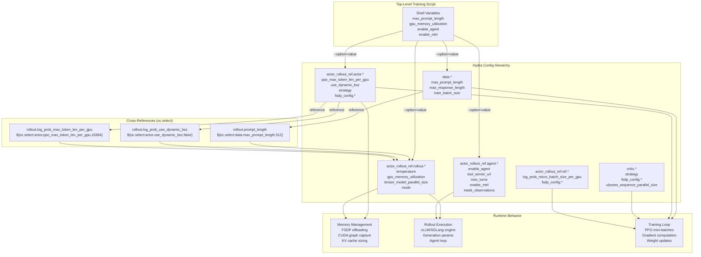
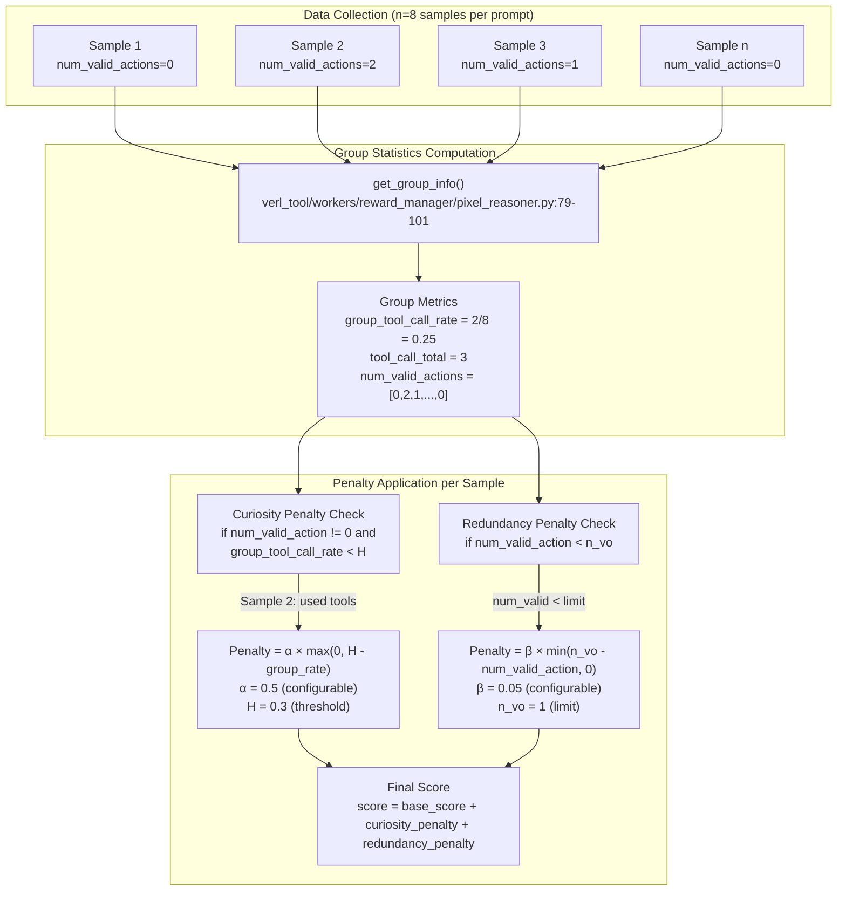
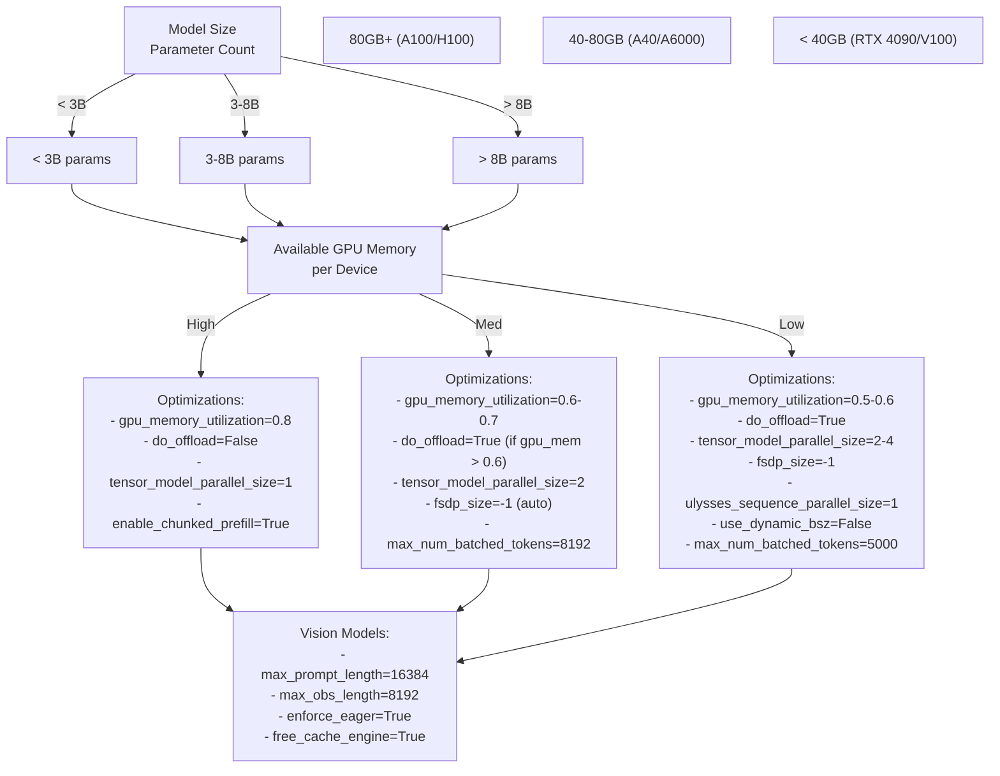
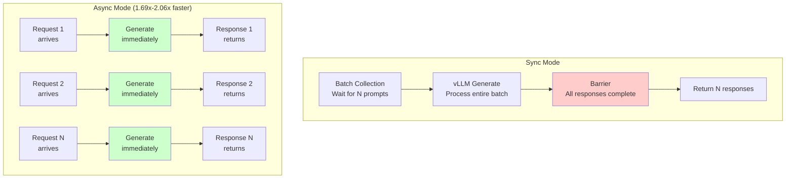
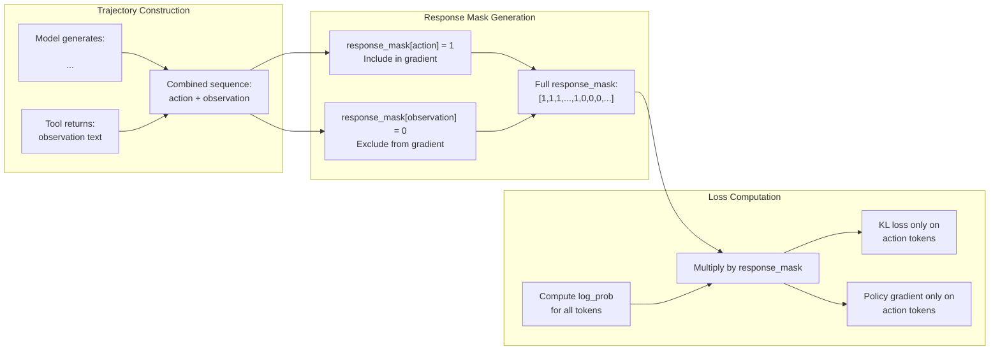
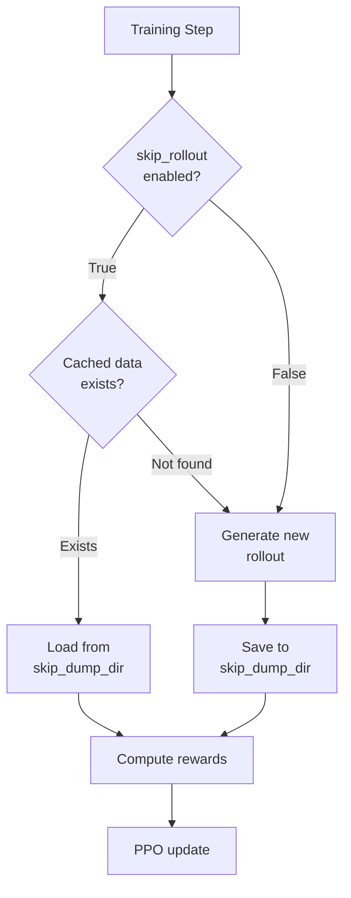

<!-- source: DeepWiki mcp.deepwiki.com · repo TIGER-AI-Lab/verl-tool · page 9 Advanced Topics · fetched 2026-10-30 -->

# Advanced Topics

<details>
<summary>Relevant source files</summary>

The following files were used as context for generating this wiki page:

- [examples/train/pixel_reasoner/train_3b.sh](examples/train/pixel_reasoner/train_3b.sh)
- [examples/train/pixel_reasoner/train_qwen25vl.sh](examples/train/pixel_reasoner/train_qwen25vl.sh)
- [verl_tool/servers/tools/pixel_reasoner.py](verl_tool/servers/tools/pixel_reasoner.py)
- [verl_tool/trainer/config/rollout/rollout.yaml](verl_tool/trainer/config/rollout/rollout.yaml)
- [verl_tool/workers/reward_manager/pixel_reasoner.py](verl_tool/workers/reward_manager/pixel_reasoner.py)

</details>


This page covers advanced configuration options and optimization strategies for power users of VerlTool. These topics build on the foundational training recipes described in [Training Recipes](#5) and enable sophisticated use cases including multi-modal learning, complex reward shaping, performance optimization, and large-scale distributed training.

**Scope**: This page provides an overview of advanced capabilities and their interdependencies. For detailed documentation on specific topics, see:
- [Multi-Modal Data Processing](#9.1) - Image handling with vision models
- [Multi-Turn RL (MTRL) System](#9.2) - Turn-by-turn tokenization strategies  
- [Configuration Deep Dive](#9.3) - Comprehensive rollout configuration options
- [Debugging and Profiling](#9.4) - Tools for troubleshooting and performance analysis
- [Multi-Node Training Setup](#9.5) - Distributed training across multiple machines

For basic training setup, see [Training Recipes](#5). For core training loop mechanics, see [Core Training Framework](#2).

---

## Overview of Advanced Features

VerlTool provides several advanced capabilities that extend beyond basic training workflows. These features are designed to handle complex scenarios involving multi-modal data, large-scale models, sophisticated reward functions, and distributed infrastructure.

### Feature Categories

| Category | Key Capabilities | Primary Use Cases |
|----------|-----------------|-------------------|
| **Multi-Modal** | Image tokenization, vision processors, placeholder tokens | PixelReasoner, VQA, visual reasoning tasks |
| **Multi-Turn RL** | Turn-by-turn tokenization, observation masking, MTRL separator tokens | Tool-using agents, conversational RL |
| **Memory Optimization** | CUDA graphs, prefix caching, chunked prefill, FSDP offloading | Large models (>7B params), limited GPU memory |
| **Reward Shaping** | Group-based penalties, curiosity rewards, action redundancy detection | Exploration-exploitation balance, GRPO |
| **Performance** | Async rollout mode, dynamic batch sizing, sequence packing | High throughput training, fast iteration |
| **Debugging** | Rollout caching, validation dumps, trajectory logs, profiling | Development, troubleshooting OOM issues |
| **Distributed** | Multi-node Ray clusters, NCCL tuning, resource management | Scaling beyond single machine |

### Common Configuration Patterns

Advanced features are often used together. Below are typical configuration combinations:

**Pattern 1: Vision Model Training** (e.g., PixelReasoner)
```bash
max_prompt_length=16384  # Accommodate image tokens
enable_mtrl=True         # Multi-turn with observations
mask_observations=True   # Exclude obs from gradient
gpu_memory_utilization=0.8
do_offload=True          # FSDP offloading for memory
```

**Pattern 2: High-Performance Training** (code/math tasks)
```bash
rollout_mode='async'            # 1.69x-2.06x speedup
use_dynamic_bsz=True            # Sequence packing
enable_chunked_prefill=True     # Better token utilization
max_num_batched_tokens=10000    # Higher throughput
```

**Pattern 3: Large Model Training** (8B+ parameters)
```bash
tensor_model_parallel_size=2    # Tensor parallelism
gpu_memory_utilization=0.6      # Conservative memory
do_offload=True                 # Offload to CPU
fsdp_size=-1                    # Auto FSDP configuration
ulysses_sequence_parallel_size=1 # Disable sequence parallel
```

**Pattern 4: Exploration-Focused Training** (GRPO with n>1)
```bash
rl_alg=grpo                     # Group-normalized advantages
n=8                             # Multiple samples per prompt
reward_manager=pixel_reasoner   # Group-based penalties
# Penalty hyperparameters in reward manager:
# group_tool_call_rate_lower_bound=0.3 (H)
# alpha=0.5 (curiosity weight)
# beta=0.05 (redundancy weight)
```

Sources: [examples/train/pixel_reasoner/train_qwen25vl.sh:1-156](), [verl_tool/trainer/config/rollout/rollout.yaml:1-299]()

---

## Advanced Configuration System Architecture

The configuration system uses Hydra's hierarchical composition to manage complex interdependencies between training components. Understanding how configuration values propagate is essential for advanced customization.

### Configuration Dependency Graph



**Configuration Propagation Rules**:

1. **Shell Variables to Hydra**: Training scripts use `key=value` syntax to override Hydra configs
2. **Cross-References**: `${oc.select:path.to.key,default}` enables dependent configurations
3. **Validation**: Mismatched values (e.g., `rollout.prompt_length != data.max_prompt_length`) can cause subtle bugs
4. **Scoping**: Configs are nested under `actor_rollout_ref`, `critic`, `reward_model`, etc.

Sources: [verl_tool/trainer/config/rollout/rollout.yaml:20-92](), [examples/train/pixel_reasoner/train_qwen25vl.sh:69-153]()

---

## Group-Based Reward Penalties for Exploration

When training with GRPO (`n > 1` samples per prompt), VerlTool supports sophisticated group-level reward shaping to encourage exploration. This is particularly important for tool-using agents where models may under-explore tool capabilities.

### Penalty Mechanism Architecture



### Penalty Formulas

**Curiosity Penalty** (encourages tool usage when group is under-exploring):
```
curiosity_penalty = (num_valid_actions > 0) × α × max(0, H - group_tool_call_rate)

where:
  α = 0.5  (weight, configurable via self.alpha)
  H = 0.3  (threshold, configurable via self.group_tool_call_rate_lower_bound)
  group_tool_call_rate = fraction of samples in group that used any tools
```

**Redundancy Penalty** (discourages too few tool calls):
```
redundancy_penalty = β × min(n_vo - num_valid_actions, 0)

where:
  β = 0.05  (weight, configurable via self.beta)
  n_vo = 1  (minimum expected actions, configurable via self.action_redundancy_limit)
```

**Example**: For a group with `n=8` samples where only 2 samples used tools (`group_tool_call_rate = 0.25`):
- Sample with `num_valid_actions=2`: Gets curiosity bonus `0.5 × (0.3 - 0.25) = 0.025`
- Sample with `num_valid_actions=0`: No curiosity penalty (didn't use tools), but gets redundancy penalty `0.05 × (1 - 0) = -0.05`

### Configuration Parameters

The penalty system is configured in the reward manager initialization:

```python
# From verl_tool/workers/reward_manager/pixel_reasoner.py:72-77
self.add_curiousity_penalty = True
self.add_action_redundancy_penalty = True
self.group_tool_call_rate_lower_bound = 0.3  # H
self.action_redundancy_limit = 1              # n_vo
self.alpha = 0.5
self.beta = 0.05
```

To customize these values, you would need to modify the reward manager class or pass them as initialization parameters.

Sources: [verl_tool/workers/reward_manager/pixel_reasoner.py:72-119](), [verl_tool/workers/reward_manager/pixel_reasoner.py:103-119]()

---

## Asynchronous Image Processing

For vision tasks, VerlTool implements concurrent image processing using Python's `concurrent.futures.ThreadPoolExecutor` to avoid blocking the event loop during CPU-intensive operations like image cropping and encoding.

### Async Processing Architecture

```mermaid
graph LR
    subgraph "Request Handling"
        AgentRequest["Agent Loop Request<br/>POST /get_observation<br/>trajectory_id + action"]
        ToolDispatch["Tool Dispatch<br/>aget_observations()<br/>pixel_reasoner.py:267"]
    end
    
    subgraph "Async Orchestration"
        ConductAction["_conduct_action_async()<br/>pixel_reasoner.py:297-340"]
        ParseAction["parse_action()<br/>Extract tool call JSON<br/>pixel_reasoner.py:94-113"]
        
        ZoomInAsync["conduct_zoom_in_action_async()<br/>pixel_reasoner.py:190-230"]
        SelectFramesAsync["conduct_select_frames_action_async()<br/>pixel_reasoner.py:232-265"]
    end
    
    subgraph "Concurrent Execution"
        ThreadPool["ThreadPoolExecutor<br/>max_workers=min(32, cpu_count+4)<br/>thread_name_prefix='image_processor'<br/>pixel_reasoner.py:85-89"]
        
        ProcessSingle["_process_single_image()<br/>crop() + process_image()<br/>pixel_reasoner.py:167-175"]
        
        ProcessMultiple["_process_multiple_images()<br/>asyncio.gather() for multiple crops<br/>pixel_reasoner.py:177-188"]
    end
    
    subgraph "Image Operations"
        Crop["crop()<br/>PIL Image.crop()<br/>bbox_2d + padding<br/>pixel_reasoner.py:15-43"]
        
        ProcessImage["process_image()<br/>Qwen2VL processor<br/>vision_utils.py"]
        
        Encode["encode_image_url()<br/>base64 + data URL<br/>pixel_reasoner.py:59-61"]
    end
    
    AgentRequest --> ToolDispatch
    ToolDispatch --> ConductAction
    ConductAction --> ParseAction
    
    ParseAction -->|"zoom_in"| ZoomInAsync
    ParseAction -->|"select_frames"| SelectFramesAsync
    
    ZoomInAsync -->|"await"| ProcessSingle
    SelectFramesAsync -->|"await"| ProcessMultiple
    
    ProcessSingle -->|"run_in_executor"| ThreadPool
    ProcessMultiple -->|"asyncio.gather"| ThreadPool
    
    ThreadPool --> Crop
    Crop --> ProcessImage
    ProcessImage --> Encode
```



### Key Implementation Details

**1. ThreadPoolExecutor Setup**:
```python
# From verl_tool/servers/tools/pixel_reasoner.py:86-89
self.image_executor = concurrent.futures.ThreadPoolExecutor(
    max_workers=min(32, (os.cpu_count() or 1) + 4),
    thread_name_prefix="image_processor"
)
```
- Size: `min(32, CPU_count + 4)` for balanced parallelism
- Separate from Ray actor pool to avoid blocking async event loops

**2. Async Image Processing Pattern**:
```python
# From verl_tool/servers/tools/pixel_reasoner.py:167-175
async def _process_single_image(self, img_source, bbox_2d):
    def _crop_and_process():
        cropped_img = crop(img_source, bbox_2d)
        processed_img = process_image({"image": cropped_img})
        return processed_img
    
    loop = asyncio.get_event_loop()
    return await loop.run_in_executor(self.image_executor, _crop_and_process)
```
- Wraps sync operations in async executor
- Returns awaitable for non-blocking orchestration

**3. Concurrent Multi-Image Processing**:
```python
# From verl_tool/servers/tools/pixel_reasoner.py:183-188
tasks = [
    loop.run_in_executor(self.image_executor, _crop_and_process_single, img_source)
    for img_source in img_sources
]
return await asyncio.gather(*tasks)
```
- Processes multiple images in parallel
- Used for `select_frames` action with multiple frame indices

**Why ThreadPoolExecutor over AsyncIO?**
- Image cropping (PIL) and processing (Qwen2VL) are CPU-bound, synchronous operations
- AsyncIO is designed for I/O-bound tasks, not CPU-bound
- ThreadPoolExecutor enables true parallelism for CPU-intensive work without blocking the event loop

Sources: [verl_tool/servers/tools/pixel_reasoner.py:85-89](), [verl_tool/servers/tools/pixel_reasoner.py:167-188](), [verl_tool/servers/tools/pixel_reasoner.py:267-295]()

---

## Memory Optimization Strategies

Training large models with tool interactions requires careful memory management. VerlTool provides multiple optimization strategies that can be combined for different memory constraints.

### Memory Optimization Decision Tree



### Configuration Parameters Explained

**GPU Memory Utilization** (`gpu_memory_utilization`):
- Controls KV cache size in vLLM/SGLang: `KV_cache = GPU_total × utilization`
- Higher values (0.8): More KV cache, less memory for weights/gradients
- Lower values (0.5): Less KV cache, more room for model operations
- **Rule**: If `gpu_memory_utilization > 0.6`, must set `do_offload=True`

**FSDP Offloading** (`do_offload`):
```bash
# From examples/train/pixel_reasoner/train_qwen25vl.sh:99-100
actor_rollout_ref.actor.fsdp_config.param_offload=$do_offload \
actor_rollout_ref.actor.fsdp_config.optimizer_offload=$do_offload \
```
- Offloads parameters and optimizer states to CPU RAM during rollout
- Trades memory for slightly slower weight updates
- Essential for large models with high `gpu_memory_utilization`

**Tensor Model Parallelism** (`tensor_model_parallel_size`):
- Shards model weights across multiple GPUs
- Reduces per-GPU memory at cost of inter-GPU communication
- Common values: 1 (no TP), 2 (8B models), 4-8 (70B+ models)

**Sequence Parallelism** (`ulysses_sequence_parallel_size`):
- Further shards activations across sequence dimension
- Can cause OOM with certain configurations, often disabled (`=1`)
- Only enable if memory critically constrained

**Dynamic Batch Sizing** (`use_dynamic_bsz`):
- Packs variable-length sequences into batches
- Improves throughput but increases memory fragmentation
- Disable (`False`) if encountering OOM during training

**CUDA Graphs** (`enforce_eager`):
- `False`: Capture CUDA graphs for faster inference (default)
- `True`: Disable CUDA graphs to save memory
- Vision models often need `enforce_eager=True` due to dynamic shapes

**Chunked Prefill** (`enable_chunked_prefill`):
```yaml
# From verl_tool/trainer/config/rollout/rollout.yaml:71
enable_chunked_prefill: True
```
- Breaks long prompts into chunks to reduce peak memory
- Particularly helpful for tool interactions with long contexts
- May slightly increase latency

**Free Cache Engine** (`free_cache_engine`):
```yaml
# From verl_tool/trainer/config/rollout/rollout.yaml:47
free_cache_engine: True
```
- Clears KV cache after each generation batch
- Prevents memory accumulation across rollout iterations
- Essential for multi-turn interactions

Sources: [examples/train/pixel_reasoner/train_qwen25vl.sh:33-35](), [examples/train/pixel_reasoner/train_qwen25vl.sh:99-101](), [verl_tool/trainer/config/rollout/rollout.yaml:32-47](), [verl_tool/trainer/config/rollout/rollout.yaml:71]()

---

## Rollout Mode: Sync vs Async

VerlTool supports two rollout execution modes with significant performance implications. The mode is configured via `actor_rollout_ref.rollout.mode`.

### Mode Comparison

| Aspect | Sync Mode | Async Mode |
|--------|-----------|------------|
| **Throughput** | Baseline | 1.69x - 2.06x faster |
| **Batching** | Waits for full batch | Processes as requests arrive |
| **Barrier** | Synchronized generation | No global synchronization |
| **Use Case** | Development, debugging | Production training |
| **vLLM Version** | Any | Requires `VLLM_USE_V1=1` |

### Execution Flow Comparison



### Configuration

**Enable Async Mode**:
```bash
# From examples/train/pixel_reasoner/train_qwen25vl.sh:53-54
export VLLM_USE_V1=1
rollout_mode='async'

# In training command:
actor_rollout_ref.rollout.mode=$rollout_mode \
```

**Why Async is Faster**:
1. **No Batching Barrier**: Requests are processed as they arrive, not in synchronized batches
2. **Better GPU Utilization**: Continuous stream of work, no idle time waiting for batch completion
3. **Reduced Latency**: Each trajectory completes independently, enabling faster reward computation and PPO updates

**When to Use Sync**:
- Debugging: Deterministic execution order
- Development: Simpler to trace
- Older vLLM versions: Async requires V1 API

**Performance Data**: Based on empirical results mentioned in the system overview, async mode provides 1.69x-2.06x speedup over sync mode for typical training workloads.

Sources: [examples/train/pixel_reasoner/train_qwen25vl.sh:53-54](), [examples/train/pixel_reasoner/train_qwen25vl.sh:128](), [verl_tool/trainer/config/rollout/rollout.yaml:7-8]()

---

## Action Stop Tokens Configuration

Action stop tokens are critical for multi-turn tool interactions. They signal when the model has completed generating an action and expects a tool observation.

### Stop Token File Pattern

Training scripts use a temporary file to pass stop tokens because Hydra cannot handle special characters in command-line arguments:

```bash
# From examples/train/pixel_reasoner/train_qwen25vl.sh:23
action_stop_tokens='</tool_call>'

# Create temporary file
action_stop_tokens_file="$(pwd)$(mktemp)"
mkdir -p $(dirname $action_stop_tokens_file)
echo -e -n "$action_stop_tokens" | tee $action_stop_tokens_file

# Pass file path to config
actor_rollout_ref.agent.action_stop_tokens=$action_stop_tokens_file
```

### Stop Token Matching Flow

```mermaid
graph LR
    subgraph "Generation Loop"
        Generate["vLLM Generate<br/>max_action_length tokens"]
        CheckEOS["Check stop_reason"]
        CheckAction["Check for<br/>action_stop_tokens"]
    end
    
    subgraph "Token Detection"
        LoadTokens["Load from<br/>action_stop_tokens file"]
        TokenizeStops["Tokenize stop strings"]
        ScanResponse["Scan response_ids<br/>for stop token sequences"]
    end
    
    subgraph "Action Dispatch"
        ExtractAction["Extract action text<br/>before stop token"]
        SendTool["POST /get_observation<br/>to tool server"]
        ReceiveObs["Receive observation"]
        AppendContext["Append obs to<br/>running_prompt_ids"]
    end
    
    Generate --> CheckEOS
    CheckEOS -->|"not EOS"| CheckAction
    
    CheckAction --> LoadTokens
    LoadTokens --> TokenizeStops
    TokenizeStops --> ScanResponse
    
    ScanResponse -->|"found"| ExtractAction
    ExtractAction --> SendTool
    SendTool --> ReceiveObs
    ReceiveObs --> AppendContext
    
    ScanResponse -->|"not found"| Generate
    CheckEOS -->|"EOS"| ExtractAction
```



### Stop Token Syntax by Tool

| Tool Type | Stop Token | Example |
|-----------|-----------|---------|
| PixelReasoner | `</tool_call>` | `<tool_call>{"name":"zoom_in","arguments":{...}}</tool_call>` |
| Python Code | `</python>` | `<python>print("hello")</python>` |
| SQL | `</solution>` | `<solution>SELECT * FROM users</solution>` |
| Search | `</search>` | `<search>query</search>` |
| MCP Tools | `</function_calls>` | `<function_calls>[{...}]</function_calls>` |

**Important**: Stop tokens must match the format the model was fine-tuned with. Mismatched stop tokens cause the agent loop to never detect actions, leading to meaningless long generations.

Sources: [examples/train/pixel_reasoner/train_qwen25vl.sh:23](), [examples/train/pixel_reasoner/train_qwen25vl.sh:56-60](), [examples/train/pixel_reasoner/train_qwen25vl.sh:112]()

---

## Additional EOS Tokens for Multi-Turn

Vision models and chat models often have special tokens that signal turn boundaries. These must be configured as additional EOS tokens to prevent premature termination during multi-turn rollouts.

### Additional EOS Configuration

```bash
# From examples/train/pixel_reasoner/train_qwen25vl.sh:39
additional_eos_token_ids=[151645]  # <|im_end|> for Qwen models

# In training command:
actor_rollout_ref.agent.additional_eos_token_ids=$additional_eos_token_ids
```

**Common Token IDs**:
- Qwen2VL: `151645` (`<|im_end|>`)
- Llama3: `128009` (`<|eot_id|>`)
- Check model's `tokenizer.json` or `special_tokens_map.json` for your model

### Why This Matters

```mermaid
graph TB
    subgraph "Without additional_eos_token_ids"
        Gen1["Generate action"]
        DetectEOS1["Detect <|im_end|><br/>Stop generation"]
        NoObs1["No observation<br/>Trajectory ends prematurely"]
        
        Gen1 --> DetectEOS1
        DetectEOS1 --> NoObs1
    end
    
    subgraph "With additional_eos_token_ids configured"
        Gen2["Generate action"]
        DetectEOS2["Detect <|im_end|><br/>Continue generation"]
        DetectStop["Detect action_stop_token<br/>(e.g., </tool_call>)"]
        GetObs["Tool execution<br/>Receive observation"]
        Continue["Continue to next turn"]
        
        Gen2 --> DetectEOS2
        DetectEOS2 --> DetectStop
        DetectStop --> GetObs
        GetObs --> Continue
    end
```



**Configuration in Agent Loop**:
The `additional_eos_token_ids` are passed to the vLLM/SGLang engine's sampling parameters, instructing it to ignore these tokens as end-of-sequence markers. This allows the model to generate beyond turn boundaries for multi-turn tool interactions.

Sources: [examples/train/pixel_reasoner/train_qwen25vl.sh:39](), [examples/train/pixel_reasoner/train_qwen25vl.sh:110]()

---

## Observation Masking for Gradient Computation

When training with tool observations, you often want to exclude observation text from the policy gradient computation. This is controlled by `mask_observations`.

### Masking Mechanism



### Configuration

```bash
# From examples/train/pixel_reasoner/train_qwen25vl.sh:40
mask_observations=True

# In training command:
actor_rollout_ref.agent.mask_observations=$mask_observations
```

**When to Mask Observations**:
- **Mask (`True`)**: Tool observations are deterministic, external data (e.g., search results, code output, image crops)
  - The model should not learn to "predict" these observations
  - Reduces gradient noise from non-policy tokens
  - Standard practice for tool-using agents

- **Don't Mask (`False`)**: The observation is part of the model's output space (e.g., model generates both query and answer in one response)
  - Used in some conversational RL setups
  - Not recommended for tool interactions

**Implementation**: The `response_mask` is created in `VerlToolAgentLoop` and propagates through the training pipeline. During PPO updates, the loss computation multiplies log probabilities by this mask before computing advantages and policy gradients.

Sources: [examples/train/pixel_reasoner/train_qwen25vl.sh:40](), [examples/train/pixel_reasoner/train_qwen25vl.sh:111]()

---

## Rollout Data Directory and Trajectory Logging

For debugging and analysis, VerlTool can save complete trajectory records including tool interactions, rewards, and token sequences.

### Data Dump Configuration

```bash
# From examples/train/pixel_reasoner/train_qwen25vl.sh:147
trainer.rollout_data_dir=$(pwd)/verl_step_records/$run_name
```

### Directory Structure

```
verl_step_records/$run_name/
├── step_0/
│   ├── batch_0.pkl
│   ├── batch_1.pkl
│   └── ...
├── step_10/
│   ├── batch_0.pkl
│   └── ...
└── validation/
    ├── step_0/
    └── step_10/
```

### Data Format

Each pickle file contains a list of trajectory dictionaries:

```python
{
    'prompt_ids': torch.Tensor,           # [seq_len]
    'response_ids': torch.Tensor,         # [seq_len]
    'attention_mask': torch.Tensor,       # [total_len]
    'response_mask': torch.Tensor,        # [seq_len] - 0 for observations
    'reward': float,                      # Final reward score
    'tool_interact_info': [               # List of tool interactions
        {
            'action': str,                # Raw action text
            'observation': str,           # Tool response
            'valid_action': bool,         # Whether action was valid
            'done': bool,                 # Whether trajectory ended
            'image': str,                 # Base64 image (truncated to 50 chars in logs)
            'turn': int                   # Turn number
        },
        ...
    ],
    'uid': int,                           # Unique ID for grouping (GRPO)
    'data_source': str,                   # Dataset identifier
    'extra_info': dict                    # Task-specific metadata
}
```

### Usage Examples

**Load and Analyze Trajectories**:
```python
import pickle
from pathlib import Path

# Load a batch
with open('verl_step_records/my_run/step_5/batch_0.pkl', 'rb') as f:
    trajectories = pickle.load(f)

# Analyze tool usage
for traj in trajectories:
    num_turns = len(traj['tool_interact_info']) if 'tool_interact_info' in traj else 0
    valid_actions = sum(1 for t in traj['tool_interact_info'] if t['valid_action'])
    print(f"Reward: {traj['reward']:.3f}, Turns: {num_turns}, Valid: {valid_actions}")
```

**Debug Why Model Didn't Use Tools**:
```python
# Check if action stop tokens were detected
for traj in trajectories:
    response = tokenizer.decode(traj['response_ids'])
    has_stop_token = '</tool_call>' in response
    has_tool_interact = len(traj.get('tool_interact_info', [])) > 0
    
    if not has_tool_interact:
        print(f"No tool interaction detected")
        print(f"Response: {response[:200]}...")
        print(f"Contains stop token: {has_stop_token}")
```

**Calculate Tool Usage Statistics**:
```python
from collections import defaultdict

stats = defaultdict(int)
for traj in trajectories:
    stats['total'] += 1
    if 'tool_interact_info' in traj and len(traj['tool_interact_info']) > 0:
        stats['used_tools'] += 1
        stats['total_turns'] += len(traj['tool_interact_info'])
        valid = sum(1 for t in traj['tool_interact_info'] if t['valid_action'])
        stats['valid_actions'] += valid

print(f"Tool usage rate: {stats['used_tools'] / stats['total']:.2%}")
print(f"Avg turns per traj: {stats['total_turns'] / stats['total']:.2f}")
```

Sources: [examples/train/pixel_reasoner/train_qwen25vl.sh:147]()

---

## Profiling Configurations

VerlTool integrates with multiple profiling tools for performance analysis. Profiling is configured via the `profiler` section in rollout and actor configs.

### Profiler Options

```yaml
# From verl_tool/trainer/config/rollout/rollout.yaml:276-298
profiler:
  _target_: verl.utils.profiler.ProfilerConfig
  
  # Profiler tool choice
  tool: null  # Options: nsys, npu, torch
  
  # Enable profiling
  enable: false
  
  # Profile all ranks
  all_ranks: false
  
  # Specific ranks to profile
  ranks: []  # e.g., [0, 1]
  
  # Output directory
  save_path: null  # e.g., ./profiler_results
  
  # Tool-specific config
  tool_config: null
```

### Profiler Tools Comparison

| Tool | Use Case | Output Format | Platform |
|------|----------|---------------|----------|
| **nsys** | NVIDIA GPU profiling, kernel analysis | `.nsys-rep`, `.qdrep` | CUDA devices |
| **npu** | Ascend NPU profiling | NPU-specific format | Huawei Ascend |
| **torch** | PyTorch autograd profiler, CPU/GPU | Chrome trace JSON | All platforms |

### NSys Profiling Example

```bash
# Enable nsys profiling for rank 0
python3 -m verl_tool.trainer.main_ppo \
    actor_rollout_ref.rollout.profiler.enable=True \
    actor_rollout_ref.rollout.profiler.tool=nsys \
    actor_rollout_ref.rollout.profiler.ranks=[0] \
    actor_rollout_ref.rollout.profiler.save_path=./nsys_profiles \
    ...

# Analyze with NVIDIA Nsight Systems
nsys-ui ./nsys_profiles/rank_0.nsys-rep
```

**What to Profile**:
- **Rollout**: `actor_rollout_ref.rollout.profiler.*` - Generation performance, vLLM kernels
- **Actor**: `actor_rollout_ref.actor.profiler.*` - Training step, gradient computation
- **Critic**: `critic.profiler.*` - Value network updates

### Torch Profiler Example

```bash
# Enable torch profiler for detailed Python-level tracing
python3 -m verl_tool.trainer.main_ppo \
    actor_rollout_ref.actor.profiler.enable=True \
    actor_rollout_ref.actor.profiler.tool=torch \
    actor_rollout_ref.actor.profiler.save_path=./torch_traces \
    ...

# View in Chrome
# 1. Open chrome://tracing
# 2. Load ./torch_traces/rank_0.json
```

**Common Profiling Scenarios**:
- **OOM Debugging**: Profile memory allocation patterns with torch profiler
- **Slow Generation**: Profile rollout with nsys to identify kernel bottlenecks
- **Training Throughput**: Profile actor updates to find gradient computation hotspots

Sources: [verl_tool/trainer/config/rollout/rollout.yaml:276-299]()

---

## Skip Rollout for Cached Generation

During development, repeatedly generating rollouts for the same data can be wasteful. The `skip_rollout` feature enables loading cached rollout data from disk.

### Skip Rollout Configuration

```yaml
# From verl_tool/trainer/config/rollout/rollout.yaml:262-269
skip_rollout: False  # Set to True to enable

skip_dump_dir: /tmp/rollout_dump  # Where to cache/load data
```

### Workflow



### Use Cases

**1. Reward Function Development**:
```bash
# First run: Generate and cache rollouts
python3 -m verl_tool.trainer.main_ppo \
    actor_rollout_ref.rollout.skip_rollout=False \
    actor_rollout_ref.rollout.skip_dump_dir=./my_rollouts \
    ...

# Subsequent runs: Reuse rollouts while iterating on reward function
python3 -m verl_tool.trainer.main_ppo \
    actor_rollout_ref.rollout.skip_rollout=True \
    actor_rollout_ref.rollout.skip_dump_dir=./my_rollouts \
    reward_model.reward_manager=new_reward_manager \
    ...
```

**2. Ablation Studies**:
- Generate rollouts once with a baseline policy
- Test different advantage estimators (GAE vs GRPO) on same data
- Compare different KL penalty coefficients

**3. Fast Iteration on PPO Hyperparameters**:
- Skip expensive vLLM generation
- Quickly test `ppo_mini_batch_size`, learning rates, etc.

**Limitations**:
- Cached data is specific to model checkpoint and data batch
- Changing model weights invalidates the cache
- Not suitable for production training (no policy improvement loop)

**Cache Format**:
The skip_dump_dir contains DataProto objects serialized per training step:
```
/tmp/rollout_dump/
├── step_0_batch_0.pkl
├── step_0_batch_1.pkl
├── step_1_batch_0.pkl
└── ...
```

Sources: [verl_tool/trainer/config/rollout/rollout.yaml:262-269]()

---

## Summary: Advanced Configuration Checklist

This checklist helps determine which advanced features to enable for your use case:

### Vision Models (Qwen2VL, Pixel-Reasoner)
- ✅ `max_prompt_length=16384` - Accommodate image tokens
- ✅ `max_obs_length=8192` - Large image observations
- ✅ `enable_mtrl=True` - Multi-turn RL
- ✅ `mask_observations=True` - Exclude obs from gradients
- ✅ `additional_eos_token_ids=[151645]` - Qwen's `<|im_end|>`
- ✅ `action_stop_tokens='</tool_call>'` - JSON tool call format
- ✅ `gpu_memory_utilization=0.8` + `do_offload=True` - Memory optimization
- ✅ `enforce_eager=True` - Disable CUDA graphs for dynamic shapes
- ✅ `free_cache_engine=True` - Clear KV cache between batches

### Code Generation (AceCoder)
- ✅ `action_stop_tokens='</python>'` - Code block markers
- ✅ `max_turns=3` - Multiple code iterations
- ✅ `temperature=1.0` during training, `0.0` during validation
- ✅ `n=8` for GRPO exploration
- ⚠️ `mask_observations=True` if excluding execution results from gradients

### High-Performance Training
- ✅ `rollout_mode='async'` - 1.69x-2.06x speedup
- ✅ `use_dynamic_bsz=True` - Sequence packing
- ✅ `enable_chunked_prefill=True` - Better throughput
- ✅ `max_num_batched_tokens=10000` - Higher batch capacity
- ✅ `VLLM_USE_V1=1` - Required for async mode

### Large Models (8B+ params)
- ✅ `tensor_model_parallel_size=2-4` - Model sharding
- ✅ `gpu_memory_utilization=0.5-0.6` - Conservative memory
- ✅ `do_offload=True` - FSDP offloading
- ✅ `fsdp_size=-1` - Auto FSDP configuration
- ⚠️ `use_dynamic_bsz=False` - Reduce memory fragmentation
- ⚠️ `ulysses_sequence_parallel_size=1` - Avoid sequence parallel OOM

### Exploration (GRPO with Group Penalties)
- ✅ `rl_alg=grpo` - Group-normalized advantages
- ✅ `n=8-16` - Multiple samples per prompt
- ✅ `reward_manager=pixel_reasoner` - Supports group penalties
- 🔧 In reward manager: `group_tool_call_rate_lower_bound=0.3`
- 🔧 In reward manager: `alpha=0.5`, `beta=0.05`

### Debugging
- ✅ `trainer.rollout_data_dir=./verl_step_records/$run_name` - Save trajectories
- ✅ `skip_rollout=True` + `skip_dump_dir=./my_cache` - Reuse rollouts
- ✅ `profiler.enable=True` + `profiler.tool=nsys` - Performance profiling
- ✅ `trainer.val_before_train=True` - Check initial model quality

### Multi-Node Training
- ✅ Use `train_multi_node.sh` script
- ✅ Set `trainer.nnodes=N`
- ✅ Set `trainer.n_gpus_per_node=8`
- ✅ Configure Ray cluster on all nodes
- ✅ Set `NCCL_DEBUG=INFO` for distributed debugging
- ℹ️ See [Multi-Node Training Setup](#9.5) for detailed instructions

Sources: [examples/train/pixel_reasoner/train_qwen25vl.sh:1-156](), [examples/train/pixel_reasoner/train_3b.sh:1-155](), [verl_tool/trainer/config/rollout/rollout.yaml:1-299]()

---

