<!-- source: DeepWiki mcp.deepwiki.com · repo TIGER-AI-Lab/verl-tool · page 9.1 Multi-Modal Data Processing · fetched 2026-10-30 -->

# Multi-Modal Data Processing

<details>
<summary>Relevant source files</summary>

The following files were used as context for generating this wiki page:

- [examples/train/pixel_reasoner/train_3b.sh](examples/train/pixel_reasoner/train_3b.sh)
- [examples/train/pixel_reasoner/train_qwen25vl.sh](examples/train/pixel_reasoner/train_qwen25vl.sh)
- [verl_tool/agent_loop/agent_loop.py](verl_tool/agent_loop/agent_loop.py)
- [verl_tool/agent_loop/verltool_agent_loop.py](verl_tool/agent_loop/verltool_agent_loop.py)
- [verl_tool/servers/tests/test_python_code_tool.py](verl_tool/servers/tests/test_python_code_tool.py)
- [verl_tool/servers/tools/ipython_code.py](verl_tool/servers/tools/ipython_code.py)
- [verl_tool/servers/tools/pixel_reasoner.py](verl_tool/servers/tools/pixel_reasoner.py)
- [verl_tool/servers/tools/utils/ipython_tool.py](verl_tool/servers/tools/utils/ipython_tool.py)
- [verl_tool/trainer/config/verltool/agent.yaml](verl_tool/trainer/config/verltool/agent.yaml)
- [verl_tool/trainer/ppo/metric_util.py](verl_tool/trainer/ppo/metric_util.py)
- [verl_tool/workers/reward_manager/pixel_reasoner.py](verl_tool/workers/reward_manager/pixel_reasoner.py)
- [verl_tool/workers/reward_manager/torl.py](verl_tool/workers/reward_manager/torl.py)
- [verl_tool/workers/rollout/vllm_rollout/vllm_async_server.py](verl_tool/workers/rollout/vllm_rollout/vllm_async_server.py)

</details>


This page documents how VerlTool processes images and audio for multi-modal models like Qwen2-VL and Qwen2.5-Omni. The system handles encoding of raw multi-modal data, insertion of placeholder tokens, processor-based tokenization, and deduplication of special tokens before inference. These mechanisms enable vision-language and audio-language models to interact with tools that accept or return multi-modal observations.

**Scope**: This page focuses on the technical mechanisms for multi-modal data encoding, placeholder token handling, processor integration, and deduplication. For tool implementations that use multi-modal data, see page 4.5 (Pixel Reasoner Vision Tools). For the agent loop that orchestrates multi-modal interactions, see page 2.3 (Agent Loop System).

---

## Processing Pipeline Overview

Multi-modal data undergoes several transformations: (1) encoding from PIL Images or audio arrays to base64 strings for tool server transmission, (2) processor-based tokenization that inserts model-specific placeholder tokens, (3) deduplication of consecutive special tokens before vLLM inference, and (4) truncation-aware observation processing that preserves special token sequences. The pipeline is implemented primarily in `VerlToolAgentLoop` with processor-specific logic in `VerlToolvLLMHttpServer`.

**Key Processing Components:**

| Component | Location | Function |
|-----------|----------|----------|
| `encode_image_url()` | [verl_tool/agent_loop/vision_utils.py:30-33]() | Encode PIL.Image to base64 data URL |
| `encode_audio_data()` | [verl_tool/utils/dataset/audio_utils.py:1-20]() | Encode audio array to base64 string |
| `decode_image_url()` | [verl_tool/agent_loop/vision_utils.py:17-23]() | Decode base64 data URL to PIL.Image |
| `processor(text, images, audio)` | AutoProcessor (transformers) | Insert placeholder tokens, generate pixel_values |
| `_qwen2_5_dedup_multimodal_tokens()` | [verl_tool/workers/rollout/vllm_rollout/vllm_async_server.py:106-156]() | Deduplicate consecutive special tokens |
| `non_truncate_token_ids` | [verl_tool/agent_loop/verltool_agent_loop.py:210-220]() | List of tokens to protect from splitting |
| `get_rope_index()` | [verl.models.transformers.qwen2_vl]() | Compute 3D positional indices for Qwen2-VL |

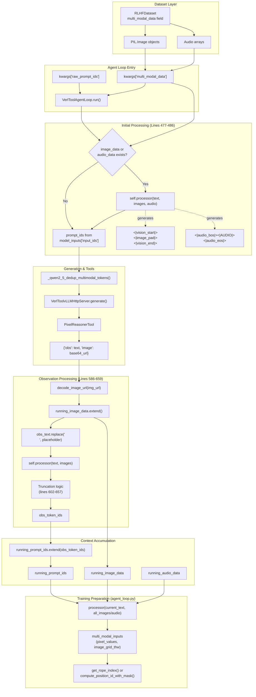

**Sources**: [verl_tool/agent_loop/verltool_agent_loop.py:451-692](), [verl_tool/workers/rollout/vllm_rollout/vllm_async_server.py:48-156](), [verl_tool/agent_loop/agent_loop.py:502-678]()

---

## Image and Audio Encoding

Multi-modal data must be encoded to base64 strings for transmission between agent loop and tool servers, then decoded back to PIL.Image or audio arrays for processor consumption.

### Encoding Functions

The `VerlToolAgentLoop.run()` method at [verl_tool/agent_loop/verltool_agent_loop.py:451]() receives raw multi-modal data and encodes it for tool server communication:

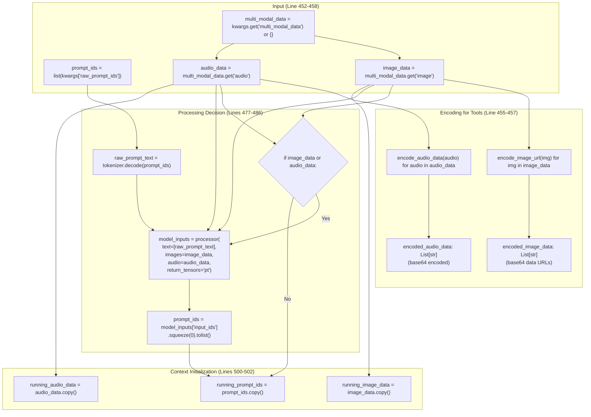

**Encoding Implementation**:

The encoding functions from [verl_tool/agent_loop/vision_utils.py:30-33]() and [verl_tool/utils/dataset/audio_utils.py:1-20]() convert multi-modal data to base64 data URLs:

```python
# Image encoding (vision_utils.py)
def encode_image_url(img: Image.Image) -> str:
    """Convert PIL.Image to base64 data URL"""
    buffered = io.BytesIO()
    if img.mode != 'RGB':
        img = img.convert('RGB')
    img.save(buffered, format="JPEG")
    img_str = base64.b64encode(buffered.getvalue()).decode()
    return f"data:image/jpeg;base64,{img_str}"

# Audio encoding (audio_utils.py)
def encode_audio_data(audio: np.ndarray) -> str:
    """Convert audio array to base64 string"""
    # Implementation encodes audio to base64 format
```

**Decoding Implementation**:

The `decode_image_url()` function at [verl_tool/agent_loop/vision_utils.py:17-23]() reverses the encoding when tool servers return images:

```python
def decode_image_url(img_str: str) -> Image.Image:
    """Decode base64 data URL to PIL.Image"""
    if img_str.startswith("data:image/jpeg;base64,"):
        img_str = img_str.split("data:image/jpeg;base64,")[1]
    img_data = base64.b64decode(img_str)
    return Image.open(io.BytesIO(img_data))
```

**Usage in Agent Loop**:
- Line [verl_tool/agent_loop/verltool_agent_loop.py:455](): Encode images for tool server at loop start
- Line [verl_tool/agent_loop/verltool_agent_loop.py:457](): Encode audio for tool server
- Lines [verl_tool/agent_loop/verltool_agent_loop.py:589-590](): Decode images returned by tools
- Lines [verl_tool/agent_loop/verltool_agent_loop.py:615-616](): Decode audio returned by tools

**Sources**: [verl_tool/agent_loop/verltool_agent_loop.py:451-616](), [verl_tool/agent_loop/vision_utils.py:17-33](), [verl_tool/utils/dataset/audio_utils.py:1-20]()

---

## Placeholder Token Handling

Multi-modal processors insert special placeholder tokens to represent images and audio in the token sequence. VerlTool maintains constants for these placeholders and uses them during observation processing.

### Qwen2-VL Vision Tokens

Qwen2-VL uses a three-token sequence to represent images:

| Token | Defined At | Purpose |
|-------|-----------|---------|
| `<\|vision_start\|>` | Line [verl_tool/agent_loop/verltool_agent_loop.py:207]() | Vision sequence delimiter |
| `<\|image_pad\|>` | `processor.image_token_id` | Repeated for each image patch |
| `<\|vision_end\|>` | Line [verl_tool/agent_loop/verltool_agent_loop.py:207]() | Vision sequence terminator |
| `<\|video_pad\|>` | Line [verl_tool/agent_loop/verltool_agent_loop.py:208]() | Used for video frames |

**Placeholder Constant**:
```python
# From verltool_agent_loop.py:207-208
cls.qwen_image_placeholder = "<|vision_start|><|image_pad|><|vision_end|>"
cls.qwen_video_placeholder = "<|vision_start|><|video_pad|><|vision_end|>"
```

**Token Replication**: The processor automatically replicates `<|image_pad|>` tokens based on the `image_grid_thw` (temporal, height, width) dimensions returned by the processor. The number of replicated tokens equals `temporal * height * width` patches. For example:
- A 448×448 image with 28×28 patch grid generates 784 `<|image_pad|>` tokens
- The grid dimensions are stored in `model_inputs['image_grid_thw']` with shape `(batch, num_images, 3)`
- The processor at [verl_tool/agent_loop/verltool_agent_loop.py:484]() computes these dimensions automatically

### Qwen2.5-Omni Audio Tokens

Qwen2.5-Omni uses similar three-token sequences for audio:

| Token | Defined At | Purpose |
|-------|-----------|---------|
| `<\|audio_bos\|>` | Line [verl_tool/agent_loop/verltool_agent_loop.py:209]() | Audio sequence start |
| `<\|AUDIO\|>` | `processor.tokenizer.audio_token_id` | Repeated based on audio duration |
| `<\|audio_eos\|>` | Line [verl_tool/agent_loop/verltool_agent_loop.py:209]() | Audio sequence end |

**Placeholder Constant**:
```python
# From verltool_agent_loop.py:209
cls.qwen_audio_placeholder = "<|audio_bos|><|AUDIO|><|audio_eos|>"
```

### Placeholder Usage in Observation Processing

When tools return images or audio, the agent loop replaces `<image>` or `<audio>` tags with the appropriate placeholder tokens:

```python
# From verltool_agent_loop.py:599
obs_text = obs_text.replace("<image>", self.qwen_image_placeholder, num_image_tags)

# From verltool_agent_loop.py:625
obs_text = obs_text.replace("<audio>", self.qwen_audio_placeholder, num_audio_tags)
```

The processor is then called with both the text (containing placeholders) and the actual image/audio data to generate token IDs with the correct number of special tokens.

**Sources**: [verl_tool/agent_loop/verltool_agent_loop.py:207-209](), [verl_tool/agent_loop/verltool_agent_loop.py:599](), [verl_tool/agent_loop/verltool_agent_loop.py:625]()

---

## Processor Integration

The `AutoProcessor` from HuggingFace transformers handles tokenization and multi-modal data preparation. VerlTool calls the processor at multiple points to insert placeholder tokens and generate model inputs.

### Initial Prompt Processing

When the agent loop receives multi-modal data, it calls the processor to tokenize the prompt with images/audio:

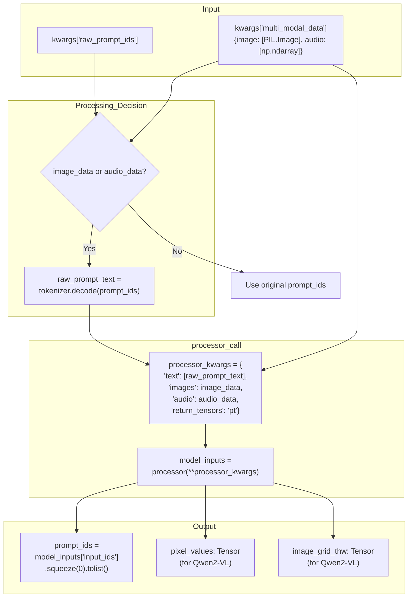

**Implementation** at [verl_tool/agent_loop/verltool_agent_loop.py:477-486]():
```python
if image_data or audio_data:
    raw_prompt_text = self.tokenizer.decode(prompt_ids, skip_special_tokens=False)
    processor_kwargs = {"text": [raw_prompt_text], "return_tensors": "pt"}
    if image_data:
        processor_kwargs["images"] = image_data
    if audio_data:
        processor_kwargs["audio"] = audio_data
    model_inputs = self.processor(**processor_kwargs)
    prompt_ids = model_inputs["input_ids"].squeeze(0).tolist()
```

### Observation Processing

When tools return observations with images/audio, the processor is called again to tokenize the observation:

```python
# From verltool_agent_loop.py:600
obs_token_ids = self.processor(
    text=[obs_text], 
    images=decoded_images, 
    return_tensors="pt"
)["input_ids"].squeeze(0).tolist()

# From verltool_agent_loop.py:629 (audio)
obs_token_ids = self.processor(
    text=[obs_text], 
    audio=decoded_audios, 
    return_tensors="pt"
)["input_ids"].squeeze(0).tolist()
```

**Key Outputs**:
- `input_ids`: Token sequence with placeholder tokens inserted
- `pixel_values`: Processed image tensors (Qwen2-VL) with shape `(batch, channels, height, width)`
- `image_grid_thw`: Grid dimensions `(batch, num_images, 3)` for temporal/height/width
- Audio feature tensors for Qwen2.5-Omni

**Sources**: [verl_tool/agent_loop/verltool_agent_loop.py:477-486](), [verl_tool/agent_loop/verltool_agent_loop.py:600](), [verl_tool/agent_loop/verltool_agent_loop.py:629]()

---

## Token Deduplication

vLLM's multi-modal implementation automatically replicates placeholder tokens (`<|image_pad|>`, `<|AUDIO|>`) based on provided multi-modal data. Since the processor already generates these tokens, VerlTool must deduplicate consecutive occurrences before sending sequences to vLLM to prevent double-replication.

### Deduplication Function

The `_qwen2_5_dedup_multimodal_tokens()` function at [verl_tool/workers/rollout/vllm_rollout/vllm_async_server.py:106-156]() implements deduplication:

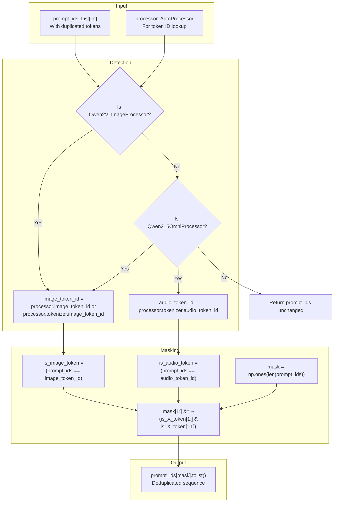

**Algorithm Implementation**:

```python
def _qwen2_5_dedup_multimodal_tokens(prompt_ids: list[int], processor) -> list[int]:
    """
    Deduplicate consecutive image and audio tokens for Qwen2.5-VL/Omni.
    
    Example transformation:
    <|vision_start|><|image_pad|><|image_pad|>...<|image_pad|><|vision_end|>
    => <|vision_start|><|image_pad|><|vision_end|>
    """
    if processor is None:
        return prompt_ids
    
    # Detect processor type
    is_qwen2_5_omni = "Qwen2_5OmniProcessor" in processor.__class__.__name__
    is_qwen2vl = not is_qwen2_5_omni and "Qwen2VLImageProcessor" in processor.image_processor.__class__.__name__
    
    if is_qwen2vl or is_qwen2_5_omni:
        prompt_ids = np.array(prompt_ids)
        mask = np.ones(len(prompt_ids), dtype=bool)
        
        # Get image token ID
        if is_qwen2vl:
            image_token_id = processor.image_token_id
        else:
            image_token_id = processor.tokenizer.image_token_id
        
        # Deduplicate consecutive image tokens
        is_image_token = prompt_ids == image_token_id
        mask[1:] &= ~(is_image_token[1:] & is_image_token[:-1])
        
        # For Qwen2.5-Omni, also deduplicate audio tokens
        if is_qwen2_5_omni:
            audio_token_id = processor.tokenizer.audio_token_id
            is_audio_token = prompt_ids == audio_token_id
            mask[1:] &= ~(is_audio_token[1:] & is_audio_token[:-1])
        
        return prompt_ids[mask].tolist()
    else:
        return prompt_ids
```

**Usage**: Called in `VerlToolvLLMHttpServer.generate()` at [verl_tool/workers/rollout/vllm_rollout/vllm_async_server.py:63]() before passing prompt to vLLM engine.

**Sources**: [verl_tool/workers/rollout/vllm_rollout/vllm_async_server.py:106-156](), [verl_tool/workers/rollout/vllm_rollout/vllm_async_server.py:63]()

---

## Tool Server Image Returns

Tools like `PixelReasonerTool` can return images as part of their observations. These images are encoded as base64 URLs and appended to the agent's context.

### Image Return Flow

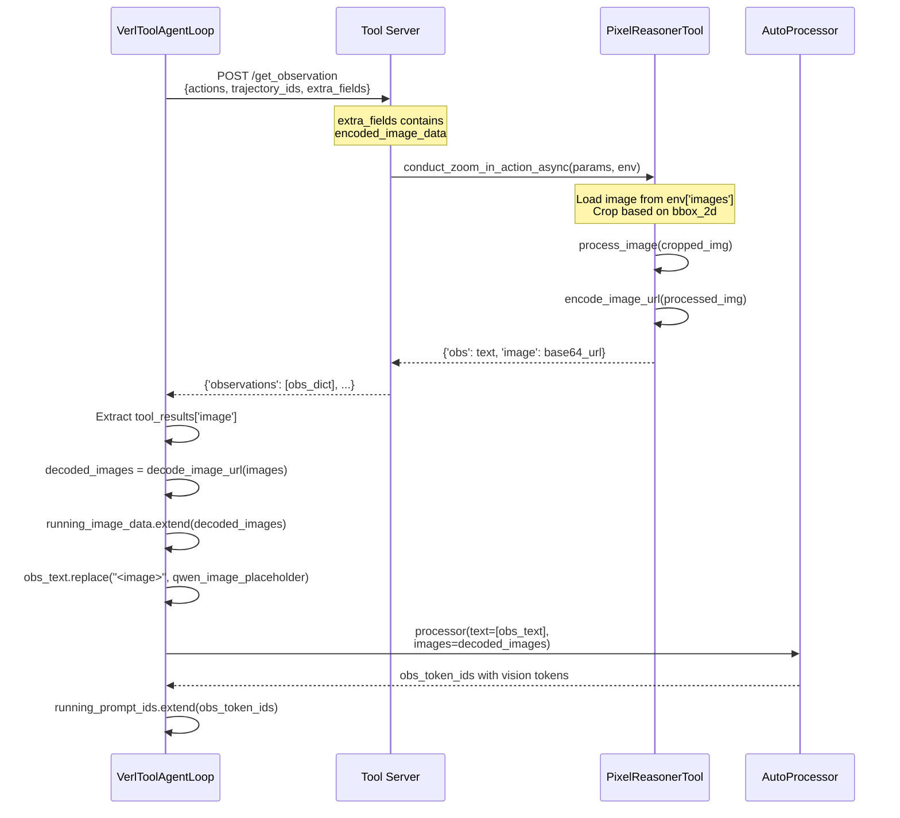

**Implementation Breakdown**:

1. **Tool Execution** ([verl_tool/servers/tools/pixel_reasoner.py:190-230]()):
   - `conduct_zoom_in_action_async()` crops image and processes it
   - Returns dict with `'obs'` text and `'image'` as base64 URL

2. **Agent Loop Processing** ([verl_tool/agent_loop/verltool_agent_loop.py:586-601]()):
   - Detects `'image'` key in tool results
   - Decodes base64 URLs back to PIL.Image objects
   - Appends to `running_image_data` list

3. **Text Processing**:
   - Replaces `<image>` tags with `qwen_image_placeholder`
   - Calls processor with both text and images
   - Obtains token IDs with proper vision tokens

**Sources**: [verl_tool/agent_loop/verltool_agent_loop.py:586-613](), [verl_tool/servers/tools/pixel_reasoner.py:190-230]()

---

## Truncation-Aware Observation Processing

Observations that exceed `max_obs_length` must be truncated without splitting multi-modal token sequences (e.g., `<|vision_start|>...<|vision_end|>`), as splitting these sequences causes processor errors.

### Protected Token List

VerlTool defines a list of special tokens that must not be split during truncation at [verl_tool/agent_loop/verltool_agent_loop.py:210-220]():

```python
# From verltool_agent_loop.py:210-220
cls.non_truncate_tokens = [
    "<|vision_start|>",
    "<|image_pad|>",
    "<|vision_end|>",
    "<|video_pad|>",
    "<|audio_bos|>",
    "<|AUDIO|>",
    "<|audio_eos|>",
]
cls.non_truncate_token_ids = [
    cls.tokenizer.convert_tokens_to_ids(tok) 
    for tok in cls.non_truncate_tokens
]
```

### Safe Truncation Algorithm

The truncation logic at [verl_tool/agent_loop/verltool_agent_loop.py:602-613]() scans backward from the truncation point to find a safe cut location:

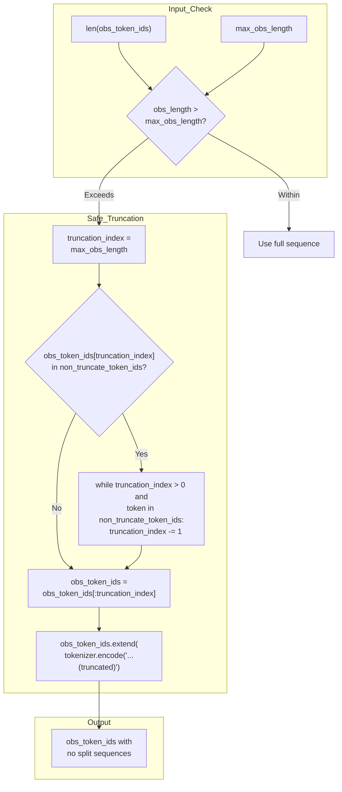

**Implementation Code** at [verl_tool/agent_loop/verltool_agent_loop.py:602-613]():

For left truncation with images:
```python
if max_obs_length < len(obs_token_ids):
    if self.agent_config.truncate_obs_side == 'left':
        truncation_index = max_obs_length
        if obs_token_ids[max_obs_length] in self.non_truncate_token_ids:
            # Find nearest non-special token before max_obs_length
            truncation_index = max_obs_length - 1
            while truncation_index > 0 and \
                  obs_token_ids[truncation_index] in self.non_truncate_token_ids:
                truncation_index -= 1
        obs_token_ids = obs_token_ids[:truncation_index]
        obs_token_ids.extend(self.tokenizer.encode("...(truncated)"))
```

**Rationale**: Splitting vision/audio token sequences causes processor errors. By scanning backward to find a safe truncation point, we ensure token sequence integrity.

**Sources**: [verl_tool/agent_loop/verltool_agent_loop.py:602-657]()

---

## Position ID Computation for Multi-Modal Models

Multi-modal models require specialized position ID computation that occurs in `AgentLoopWorker._run_agent_loop()` after padding and concatenation. Qwen2-VL uses 3D RoPE (Rotary Position Embedding) that incorporates temporal and spatial dimensions, while Qwen2.5-Omni uses standard sequential position IDs.

### Position ID Computation Location

Position IDs are computed in the `_run_agent_loop()` method of `AgentLoopWorker` after the response is padded and concatenated with the prompt. This happens at [verl_tool/agent_loop/agent_loop.py:596-651]().

### Qwen2-VL Position IDs (3D RoPE)

For Qwen2-VL models, position computation uses the `get_rope_index()` function from `verl.models.transformers.qwen2_vl`:

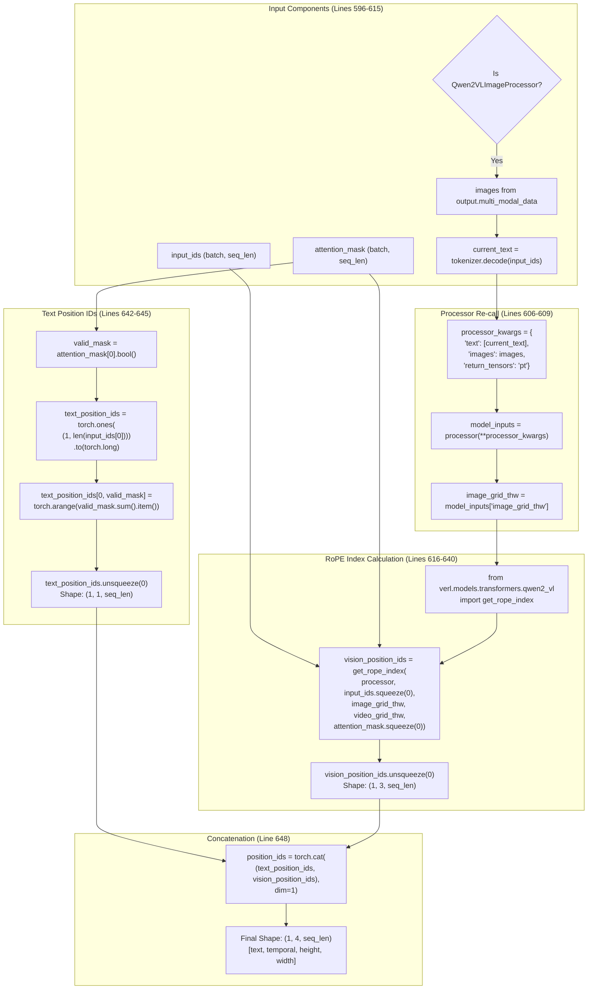

**Implementation Code Structure** at [verl_tool/agent_loop/agent_loop.py:616-648]():

```python
# Import RoPE index calculator
from verl.models.transformers.qwen2_vl import get_rope_index

# Get vision position IDs (temporal, height, width dimensions)
vision_position_ids = get_rope_index(
    self.processor,
    input_ids=input_ids.squeeze(0),
    image_grid_thw=image_grid_thw,
    video_grid_thw=video_grid_thw,
    second_per_grid_ts=second_per_grid_ts,
    attention_mask=attention_mask.squeeze(0),
).unsqueeze(0)  # Shape: (1, 3, seq_len)

# Compute sequential text position IDs
valid_mask = attention_mask[0].bool()
text_position_ids = torch.ones((1, len(input_ids[0])), dtype=torch.long)
text_position_ids[0, valid_mask] = torch.arange(valid_mask.sum().item())
text_position_ids = text_position_ids.unsqueeze(0)  # Shape: (1, 1, seq_len)

# Concatenate: [text_pos, temporal_pos, height_pos, width_pos]
position_ids = torch.cat((text_position_ids, vision_position_ids), dim=1)
# Final shape: (1, 4, seq_len)
```

**Key Points**:
- `get_rope_index()` from `verl.models.transformers.qwen2_vl` computes 3D positional indices
- `image_grid_thw` contains grid dimensions `(num_images, 3)` where 3 = [temporal, height, width]
- For static images, temporal dimension is 1; for videos, it represents frame count
- Text tokens get standard sequential positions (0, 1, 2, ...)
- Vision tokens get 3D spatial positions based on their patch location in the grid
- Final `position_ids` shape is `(1, 4, seq_len)` where 4 = [text_pos, temporal_pos, height_pos, width_pos]
- This 4D structure enables Qwen2-VL's multi-axis attention mechanism to attend differently along temporal vs. spatial dimensions

### Qwen2.5-Omni Position IDs (Standard Sequential)

For Qwen2.5-Omni (audio models), standard 1D position IDs are computed using `compute_position_id_with_mask()`:

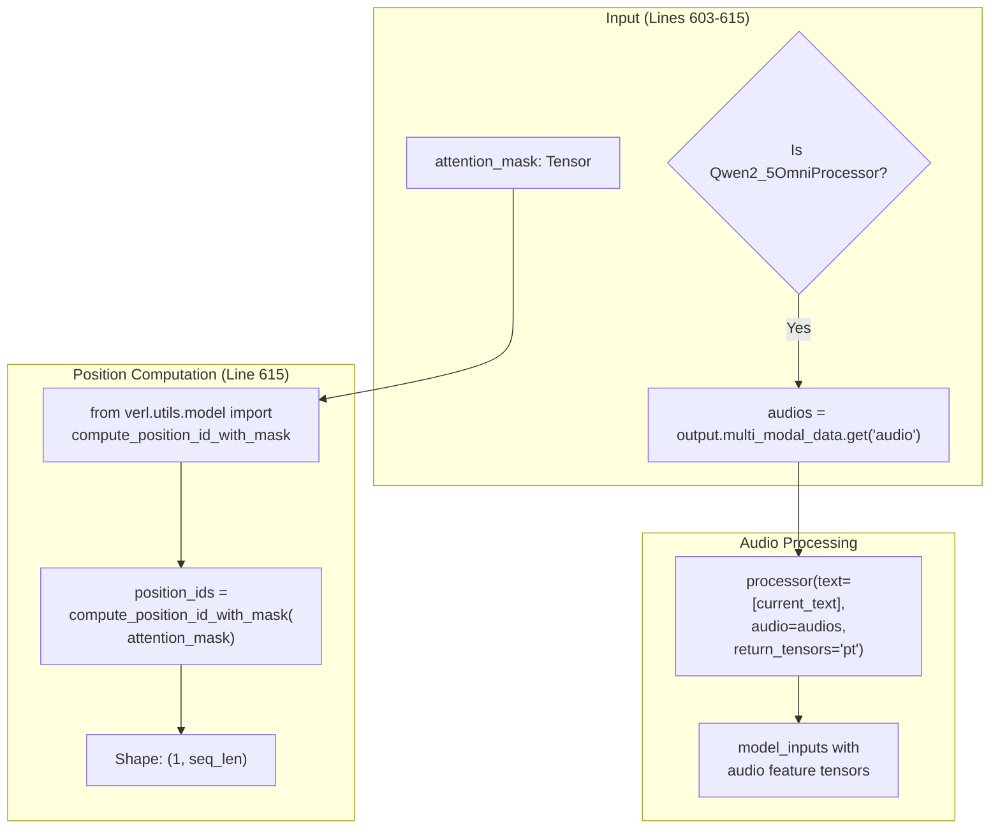

**Implementation** at [verl_tool/agent_loop/agent_loop.py:603-615]():

```python
from verl.utils.model import compute_position_id_with_mask

if self.processor is not None and \
   "Qwen2_5OmniProcessor" in self.processor.__class__.__name__:
    audios = output.multi_modal_data.get("audio", None)
    current_text = self.tokenizer.decode(input_ids.squeeze(0), skip_special_tokens=True)
    processor_kwargs = {"text": [current_text], "return_tensors": "pt"}
    if audios:
        processor_kwargs["audio"] = audios
    model_inputs = self.processor(**processor_kwargs)
    # Standard sequential position IDs for audio models
    position_ids = compute_position_id_with_mask(attention_mask)  # Shape: (1, seq_len)
```

**Key Points**:
- Audio models don't require special spatial position encoding
- `compute_position_id_with_mask()` assigns sequential positions to non-padding tokens
- Result is standard 1D position IDs suitable for transformer attention

**Sources**: [verl_tool/agent_loop/agent_loop.py:596-651](), [verl.models.transformers.qwen2_vl:get_rope_index](), [verl.utils.model:compute_position_id_with_mask]()

---

## Multi-Modal Inputs in Training Pipeline

After the agent loop completes, multi-modal inputs are prepared for PPO training in the `_run_agent_loop()` method of `AgentLoopWorker`. The processor is called one final time to generate all necessary inputs for model training.

### Final Processing Flow

The multi-modal input preparation happens in several steps within `AgentLoopWorker._run_agent_loop()`:

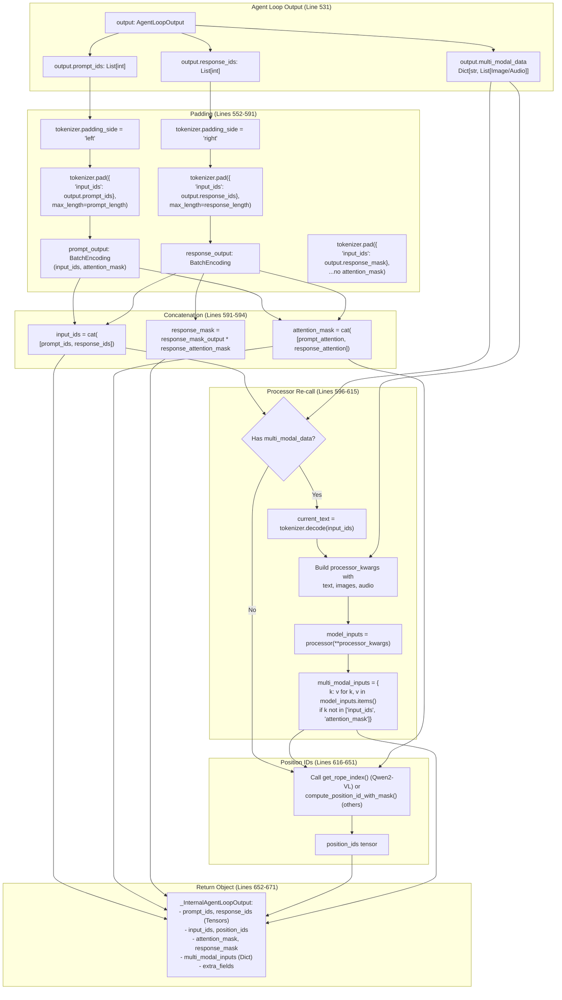

**Implementation Steps** at [verl_tool/agent_loop/agent_loop.py:552-671]():

1. **Padding (Lines 552-591)**: 
   - Left-pad prompts to `config.actor_rollout_ref.rollout.prompt_length`
   - Right-pad responses to `config.actor_rollout_ref.rollout.response_length`
   - Pad response masks (no attention mask needed for mask-only padding)

2. **Concatenation (Lines 591-594)**: 
   - Combine prompt and response tensors
   - Create unified attention mask
   - Adjust response mask based on attention

3. **Processor Re-call (Lines 596-615)**:
   - Decode full `input_ids` back to text
   - Re-call processor with complete text and all accumulated multi-modal data
   - Extract multi-modal-specific outputs (excluding `input_ids` and `attention_mask`)

4. **Position ID Computation (Lines 616-651)**: 
   - For Qwen2-VL: Call `get_rope_index()` for 3D RoPE
   - For Qwen2.5-Omni: Call `compute_position_id_with_mask()` for standard positions
   - For other models: Use standard position computation

5. **Package as _InternalAgentLoopOutput (Lines 652-671)**:
   - All tensors (prompts, responses, input_ids, position_ids, masks)
   - `multi_modal_inputs` dict with processor-generated tensors
   - Extra fields from agent loop

### Multi-Modal Inputs Dictionary Structure

The `multi_modal_inputs` field contains processor-generated tensors that are model-specific:

| Model Type | Key Fields in multi_modal_inputs | Tensor Shapes |
|------------|----------------------------------|---------------|
| **Qwen2-VL** | `pixel_values`<br/>`image_grid_thw` | `(batch, num_images, channels, height, width)`<br/>`(batch, num_images, 3)` where 3 = [temporal, height, width] |
| **Qwen2.5-Omni** | Audio feature tensors<br/>Audio attention masks | Processor-specific shapes for audio embeddings |

**Code Reference** at [verl_tool/agent_loop/agent_loop.py:611-614]():
```python
# Remove input_ids and attention_mask as they're separately computed
multi_modal_inputs = {
    k: v for k, v in dict(model_inputs).items() 
    if k not in ["input_ids", "attention_mask"]
}
```

**Usage in Training**: These tensors are passed directly to the model's forward pass:
- `pixel_values` are processed by the vision encoder (e.g., CLIP-based encoder in Qwen2-VL)
- `image_grid_thw` informs the position embedding calculation in `get_rope_index()`
- The model uses these to generate vision embeddings that are integrated with text embeddings at the positions marked by `<|image_pad|>` tokens

### Integration with Training

The `_InternalAgentLoopOutput` flows through `_postprocess()` at [verl_tool/agent_loop/agent_loop.py:680-765](), which batches multiple outputs into a `DataProto` object containing:

- **Tensor batch**: `prompts`, `responses`, `input_ids`, `position_ids`, `attention_mask`, `response_mask`
- **Multi-modal inputs**: Stored in `batch["multi_modal_inputs"]` if present
- **Non-tensor batch**: Metadata like `tool_interact_info`, reward model ground truth

This `DataProto` is then passed to:
1. **Reference model** for log probability computation
2. **Reward manager** (e.g., `PixelReasonerRewardManager`) for reward scoring
3. **Actor/Critic models** for PPO updates

**Sources**: [verl_tool/agent_loop/agent_loop.py:502-765](), [verl_tool/workers/reward_manager/pixel_reasoner.py:121-236]()

---

## Configuration for Multi-Modal Training

Several configuration parameters control multi-modal behavior:

### Agent Configuration

| Parameter | Purpose | Example Value |
|-----------|---------|---------------|
| `max_prompt_length` | Maximum prompt tokens (must accommodate image tokens) | `16384` |
| `max_obs_length` | Maximum observation tokens | `8192` |
| `max_action_length` | Maximum action tokens per turn | `2048` |
| `truncate_obs_side` | Truncation direction for observations | `"left"` |
| `mask_observations` | Whether to mask observations in loss | `True` |
| `enable_mtrl` | Enable multi-turn training | `True` |

**Example Configuration** from [examples/train/pixel_reasoner/train_qwen25vl.sh:13-17]():
```bash
max_prompt_length=16384  # Must accommodate text + all image tokens
                          # e.g., 1000 text + 784*N image_pad tokens for N images
max_response_length=16384 # Similarly large for multi-turn responses
max_action_length=2048    # Per-turn action generation limit
max_obs_length=8192       # Must accommodate returned observation + image tokens
```

**Token Budget Calculation**:
- For Qwen2-VL with 448×448 images: ~784 tokens per image
- For a prompt with 2 images: ~2000 text tokens + 1568 vision tokens = 3568 total
- For multi-turn with observation images: Can accumulate 4-5 images across turns
- Safe configuration: Set `max_prompt_length` to 8192-16384 for multi-image scenarios

### Rollout Configuration

| Parameter | Purpose | Example Value | Notes |
|-----------|---------|---------------|-------|
| `tensor_model_parallel_size` | Tensor parallelism for large vision models | `2` | Qwen2-VL 7B+ benefits from TP |
| `gpu_memory_utilization` | vLLM memory fraction | `0.8` | Vision models need more memory |
| `max_num_batched_tokens` | Token budget for batching | `5000-10000` | Lower for vision to avoid OOM |
| `enforce_eager` | Disable CUDA graphs | `True` | Required for vision models |
| `max_model_len` | Maximum sequence length | Computed from prompt+response lengths | Must match training config |

**Memory Constraints**: From [examples/train/pixel_reasoner/train_qwen25vl.sh:33-35]():
```bash
gpu_memory_utilization=0.8  # Higher utilization for vision models
do_offload=False            # Set to True if gpu_memory_utilization > 0.6
                            # Controls FSDP param/optimizer offloading
```

**Vision Model Requirements**:
- `enforce_eager=True` is mandatory as CUDA graphs don't support dynamic vision inputs
- `max_num_batched_tokens` should be lower (5000-10000) compared to text-only (20000+) due to vision encoder memory overhead
- `free_cache_engine=True` helps release memory between training steps

### Tool Server Configuration

For vision tools ([examples/train/pixel_reasoner/train_qwen25vl.sh:64-65]()):
```bash
tool_server_url=http://$host:$port/get_observation
python -m verl_tool.servers.serve \
    --host $host \
    --port $port \
    --tool_type "pixel_reasoner" \
    --workers_per_tool 4
```

The `PixelReasonerTool` uses concurrent thread pool executors for CPU-intensive image processing ([verl_tool/servers/tools/pixel_reasoner.py:83-89]()).

**Sources**: [examples/train/pixel_reasoner/train_qwen25vl.sh:1-156](), [verl_tool/trainer/config/verltool/agent.yaml:1-90]()

---

## Multi-Modal Context Accumulation

In multi-turn scenarios, images and audio accumulate across turns, growing the context. The agent loop maintains running lists of all multi-modal data.

### Context Growth Pattern

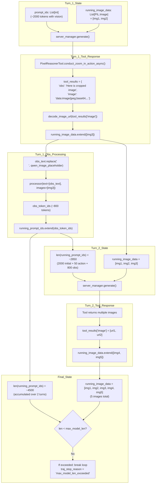

**Implementation** ([verl_tool/agent_loop/verltool_agent_loop.py:500-675]()):

```python
running_prompt_ids = prompt_ids.copy()
running_image_data = image_data.copy() if image_data is not None else None
running_audio_data = audio_data.copy() if audio_data is not None else None

for step in range(max_turns + 1):
    # Generate action
    output = await self.server_manager.generate(
        request_id=request_id,
        prompt_ids=running_prompt_ids,
        image_data=running_image_data,
        audio_data=running_audio_data,
    )
    
    # If tool returns images
    if tool_results.get('image', None):
        decoded_images = [decode_image_url(img) for img in images]
        running_image_data.extend(decoded_images)
    
    # Process observation with all accumulated images
    obs_token_ids = self.processor(
        text=[obs_text], 
        images=decoded_images
    )["input_ids"].squeeze(0).tolist()
    
    running_prompt_ids.extend(obs_token_ids)
```

**Memory Implications**: Each additional image increases memory usage. The `max_model_len` parameter limits total sequence length to prevent OOM during inference.

**Sources**: [verl_tool/agent_loop/verltool_agent_loop.py:500-692]()

---

## Complete Multi-Modal Example

Here's a concrete example showing token flow for a single-turn interaction with image observation:

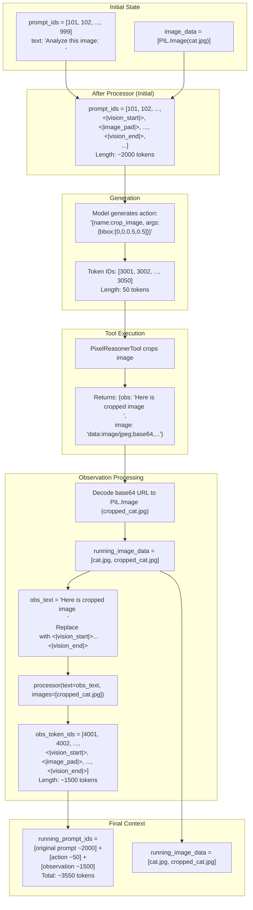

This example demonstrates:
1. Initial image processed into ~1800 vision tokens (typical for Qwen2-VL)
2. Action generation adds ~50 tokens
3. Tool returns new image, processed into ~1500 vision tokens
4. Final context contains both images' tokens plus text

**Sources**: [verl_tool/agent_loop/verltool_agent_loop.py:451-675](), [verl_tool/servers/tools/pixel_reasoner.py:190-340]()

---

