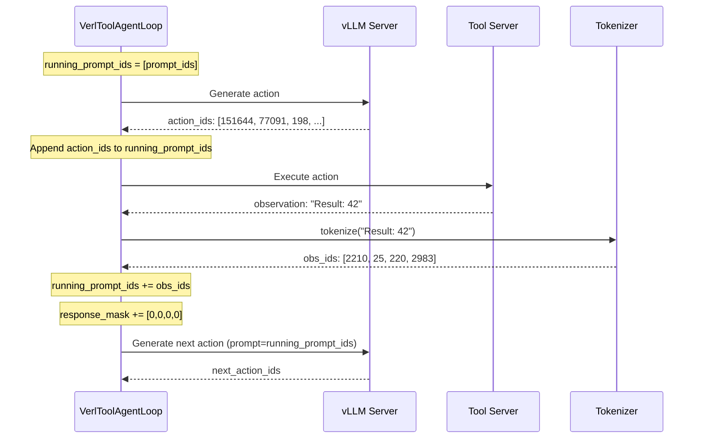
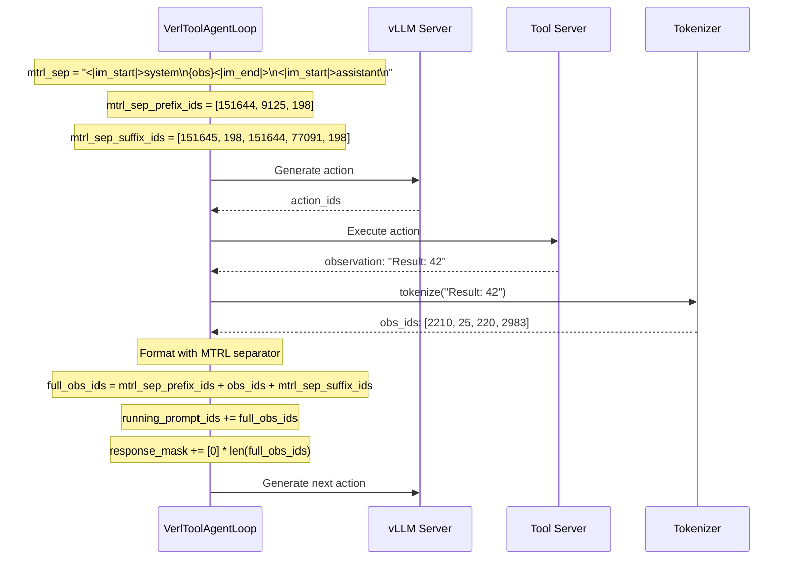
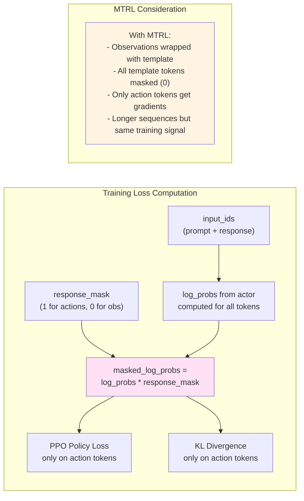
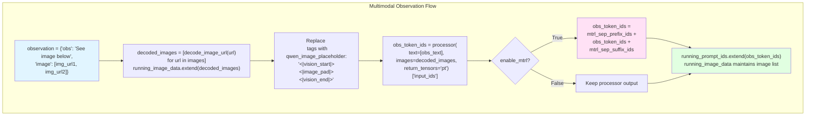
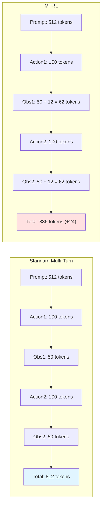
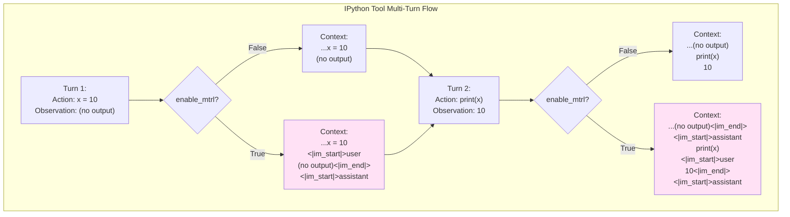

<!-- source: DeepWiki mcp.deepwiki.com · repo TIGER-AI-Lab/verl-tool · page 9.2 Multi-Turn RL (MTRL) System · fetched 2026-10-30 -->

# Multi-Turn RL (MTRL) System

<details>
<summary>Relevant source files</summary>

The following files were used as context for generating this wiki page:

- [verl_tool/agent_loop/agent_loop.py](verl_tool/agent_loop/agent_loop.py)
- [verl_tool/agent_loop/verltool_agent_loop.py](verl_tool/agent_loop/verltool_agent_loop.py)
- [verl_tool/servers/tests/test_python_code_tool.py](verl_tool/servers/tests/test_python_code_tool.py)
- [verl_tool/servers/tools/ipython_code.py](verl_tool/servers/tools/ipython_code.py)
- [verl_tool/servers/tools/utils/ipython_tool.py](verl_tool/servers/tools/utils/ipython_tool.py)
- [verl_tool/trainer/config/rollout/rollout.yaml](verl_tool/trainer/config/rollout/rollout.yaml)
- [verl_tool/trainer/config/verltool/agent.yaml](verl_tool/trainer/config/verltool/agent.yaml)
- [verl_tool/trainer/ppo/metric_util.py](verl_tool/trainer/ppo/metric_util.py)
- [verl_tool/workers/reward_manager/torl.py](verl_tool/workers/reward_manager/torl.py)
- [verl_tool/workers/rollout/vllm_rollout/vllm_async_server.py](verl_tool/workers/rollout/vllm_rollout/vllm_async_server.py)

</details>


## Purpose and Scope

This document explains the Multi-Turn RL (MTRL) system in VerlTool, which provides an alternative tokenization strategy for multi-turn tool interactions during reinforcement learning training. MTRL changes how observations from tool calls are formatted and tokenized, wrapping them with chat template structure to maintain explicit turn boundaries.

For general multi-turn agent loop implementation, see [Agent Loop System (VerlToolAgentLoop)](#2.3). For tool server architecture, see [Tool Server Architecture](#3).

---

## MTRL vs. Standard Multi-Turn Approach

VerlTool supports two tokenization strategies for multi-turn tool interactions:

| Aspect | Standard Multi-Turn | MTRL (Multi-Turn RL) |
|--------|---------------------|---------------------|
| **Observation Formatting** | Raw observation tokens appended directly | Observations wrapped with chat template (e.g., `<|im_start|>system\n{obs}<|im_end|>`) |
| **Turn Boundaries** | Implicit (no special formatting) | Explicit (chat template markers) |
| **Token IDs** | Observation tokens only | Template tokens + observation tokens + template tokens |
| **Use Case** | Simpler training, shorter sequences | Maintains chat format consistency, explicit role separation |
| **Configuration** | `enable_mtrl: False` (default) | `enable_mtrl: True` |

**Standard Multi-Turn Flow:**
```
Action: [LLM tokens] <|im_end|>
Observation: [Tool response tokens]
Next Action: [LLM tokens] <|im_end|>
```

**MTRL Flow:**
```
Action: [LLM tokens] <|im_end|>
Observation: <|im_start|>system\n[Tool response tokens]<|im_end|>\n<|im_start|>assistant\n
Next Action: [LLM tokens] <|im_end|>
```

**Sources:** [verl_tool/agent_loop/verltool_agent_loop.py:94-96](), [verl_tool/agent_loop/verltool_agent_loop.py:658-659]()

---

## Token-Level Tokenization Strategy

### Standard Multi-Turn Tokenization



### MTRL Tokenization



**Key Difference:** MTRL wraps each observation with chat template structure, making turn boundaries explicit in the token sequence.

**Sources:** [verl_tool/agent_loop/verltool_agent_loop.py:180-189](), [verl_tool/agent_loop/verltool_agent_loop.py:658-659]()

---

## MTRL Implementation Architecture

### MTRL Separator Construction

```mermaid
graph TB
    subgraph "MTRL Initialization"
        Config[AgentActorConfig<br/>enable_mtrl=True<br/>mtrl_role='user'<br/>mtrl_sep=None]
        
        CheckSep{mtrl_sep<br/>provided?}
        
        ConstructSep[Construct default mtrl_sep:<br/>1. Create messages with role<br/>2. Apply chat template<br/>3. Split on '{obs}' placeholder]
        
        Tokenize[Tokenize prefix and suffix:<br/>mtrl_sep_prefix_ids<br/>mtrl_sep_suffix_ids]
        
        ClassVars[Class variables:<br/>cls.mtrl_sep<br/>cls.mtrl_sep_prefix_ids<br/>cls.mtrl_sep_suffix_ids<br/>cls.enable_mtrl]
    end
    
    Config -->|init_class| CheckSep
    CheckSep -->|No| ConstructSep
    CheckSep -->|Yes| Tokenize
    ConstructSep -->|messages = [{'role': 'system', 'content': '{obs}'}]| Tokenize
    Tokenize --> ClassVars
    
    subgraph "Default MTRL Sep Construction"
        Messages["messages = [{'role': 'system', 'content': '{obs}'}]"]
        ApplyTemplate["mtrl_sep = turn_end_token + '\\n' +<br/>tokenizer.apply_chat_template(messages,<br/>  tokenize=False,<br/>  add_generation_prompt=True)"]
        ReplaceRole["mtrl_sep = mtrl_sep.replace('system', mtrl_role)"]
        Split["mtrl_sep_prefix, mtrl_sep_suffix =<br/>mtrl_sep.split('{obs}')"]
    end
    
    ConstructSep --> Messages
    Messages --> ApplyTemplate
    ApplyTemplate --> ReplaceRole
    ReplaceRole --> Split
    
    style Config fill:#e1f5ff
    style ClassVars fill:#e1ffe1
    style ConstructSep fill:#fff4e1
```

**Default MTRL Separator for Qwen Models:**

For a model with `turn_end_token="<|im_end|>"` and `mtrl_role="user"`, the constructed separator is:

```
<|im_end|>
<|im_start|>user
{obs}<|im_end|>
<|im_start|>assistant
```

This gets split into:
- **Prefix:** `<|im_end|>\n<|im_start|>user\n`
- **Suffix:** `<|im_end|>\n<|im_start|>assistant\n`

**Sources:** [verl_tool/agent_loop/verltool_agent_loop.py:180-189]()

---

## Observation Processing with MTRL

```mermaid
graph TB
    subgraph "Tool Interaction Result"
        ToolResult["tool_results = interact_with_tool_server()<br/>obs_text: 'Result: 42'<br/>image: None<br/>audio: None"]
    end
    
    subgraph "Tokenization Branch"
        CheckMultimodal{Has image<br/>or audio?}
        
        ProcessorPath[Use processor:<br/>processor(text=[obs_text],<br/>  images=images,<br/>  return_tensors='pt')]
        
        TokenizerPath[Use tokenizer:<br/>tokenizer.encode(obs_text)]
        
        TruncateObs{obs_token_ids<br/>length ><br/>max_obs_length?}
        
        TruncateLeft["Truncate from left/right/middle<br/>based on truncate_obs_side"]
        
        AppendTruncateMarker["Append '...(truncated)' tokens"]
    end
    
    subgraph "MTRL Formatting"
        CheckMTRL{enable_mtrl?}
        
        WrapMTRL["obs_token_ids =<br/>mtrl_sep_prefix_ids +<br/>obs_token_ids +<br/>mtrl_sep_suffix_ids"]
        
        NoWrap[Keep obs_token_ids as-is]
    end
    
    subgraph "Update Running Context"
        ExtendPrompt["running_prompt_ids.extend(obs_token_ids)"]
        MaskObs["response_mask.extend([0] * len(obs_token_ids))<br/>if mask_observations else [1] * len(obs_token_ids)"]
        LogProbs["response_logprobs.extend([0.0] * len(obs_token_ids))"]
    end
    
    ToolResult --> CheckMultimodal
    CheckMultimodal -->|Yes| ProcessorPath
    CheckMultimodal -->|No| TokenizerPath
    ProcessorPath --> TruncateObs
    TokenizerPath --> TruncateObs
    TruncateObs -->|Yes| TruncateLeft
    TruncateObs -->|No| CheckMTRL
    TruncateLeft --> AppendTruncateMarker
    AppendTruncateMarker --> CheckMTRL
    CheckMTRL -->|True| WrapMTRL
    CheckMTRL -->|False| NoWrap
    WrapMTRL --> ExtendPrompt
    NoWrap --> ExtendPrompt
    ExtendPrompt --> MaskObs
    MaskObs --> LogProbs
    
    style ToolResult fill:#e1f5ff
    style WrapMTRL fill:#ffe1f5
    style ExtendPrompt fill:#e1ffe1
```

**Code Example (MTRL Enabled):**

Given:
- `obs_text = "Result: 42"`
- `tokenizer.encode("Result: 42")` → `[2210, 25, 220, 2983]`
- `mtrl_sep_prefix_ids = [151644, 9125, 198]`
- `mtrl_sep_suffix_ids = [151645, 198, 151644, 77091, 198]`

Result:
```python
obs_token_ids = [151644, 9125, 198, 2210, 25, 220, 2983, 151645, 198, 151644, 77091, 198]
# Which decodes to:
# "<|im_end|>\n<|im_start|>user\nResult: 42<|im_end|>\n<|im_start|>assistant\n"
```

**Sources:** [verl_tool/agent_loop/verltool_agent_loop.py:643-673](), [verl_tool/agent_loop/verltool_agent_loop.py:658-659]()

---

## Configuration Parameters

### Agent Configuration (agent.yaml)

```yaml
# Enable multi-turn RL (MTRL) mode
enable_mtrl: False

# Role for observation formatting in MTRL mode
# Options: "user", "system", "assistant"
mtrl_role: user

# Custom MTRL separator template (optional)
# If null, automatically constructed from chat template
# Format: prefix + "{obs}" + suffix
# Example: "\n<|im_start|>system\n{obs}<|im_end|>\n<|im_start|>assistant\n"
mtrl_sep: null

# Token that marks end of a turn (used in MTRL separator construction)
turn_end_token: "<|im_end|>"

# Assistant role identifier (used in MTRL separator construction)
assistant_role: "assistant"
```

**Sources:** [verl_tool/trainer/config/verltool/agent.yaml:67-77]()

### AgentActorConfig Data Class

| Field | Type | Default | Description |
|-------|------|---------|-------------|
| `enable_mtrl` | `bool` | `False` | Enable multi-turn RL formatting |
| `mtrl_role` | `str` | `"user"` | Role for observation messages |
| `mtrl_sep` | `str` | `None` | Custom separator template |
| `assistant_role` | `str` | `"assistant"` | Assistant role identifier |
| `turn_end_token` | `str` | `"<|im_end|>"` | End-of-turn token |

**Sources:** [verl_tool/agent_loop/verltool_agent_loop.py:74-99]()

---

## Training Impact and Response Masking

### Token Sequence Comparison

**Standard Multi-Turn:**
```
Prompt: [p1, p2, ..., pN]
Action1: [a1, a2, a3, <|im_end|>]           response_mask: [1, 1, 1, 1]
Obs1:    [o1, o2, o3]                        response_mask: [0, 0, 0]
Action2: [a4, a5, <|im_end|>]               response_mask: [1, 1, 1]
Padding: [PAD, PAD]                          response_mask: [0, 0]
```

**MTRL:**
```
Prompt: [p1, p2, ..., pN]
Action1: [a1, a2, a3, <|im_end|>]                    response_mask: [1, 1, 1, 1]
Obs1:    [<|im_start|>, user, \n, o1, o2, o3,       response_mask: [0, 0, 0, 0, 0, 0,
          <|im_end|>, \n, <|im_start|>, assistant, \n]            0, 0, 0, 0, 0]
Action2: [a4, a5, <|im_end|>]                        response_mask: [1, 1, 1]
Padding: [PAD, PAD]                                   response_mask: [0, 0]
```

### Impact on Training Objectives



**Key Training Implications:**

1. **Response Mask Always Zeroes Observations:** Whether MTRL is enabled or not, `response_mask` is set to `[0]` for all observation tokens (including MTRL template tokens). This is controlled by `mask_observations: True` (default).

2. **Gradient Flow:** Only tokens with `response_mask=1` receive gradients during policy updates and contribute to KL divergence computation.

3. **Sequence Length:** MTRL increases sequence length due to template overhead. For a simple observation "Result: 42" (4 tokens), MTRL adds ~11 template tokens, resulting in 15 total tokens vs. 4 tokens in standard mode.

4. **Context Window Usage:** MTRL uses more of the context window faster, which may limit the number of turns possible within `max_response_length`.

**Sources:** [verl_tool/agent_loop/verltool_agent_loop.py:669-673](), [verl_tool/agent_loop/agent_loop.py:547-548]()

---

## Multimodal Observations with MTRL

When observations contain images or audio, MTRL formatting is applied after multimodal processing:



**Important Note:** For multimodal observations, MTRL wrapping happens **after** the processor has embedded the multimodal placeholders. The MTRL template tokens are added around the entire processor output, including vision tokens.

**Audio Processing:** Similar flow applies for audio observations with Qwen2.5-Omni processor, using `<|audio_bos|><|AUDIO|><|audio_eos|>` placeholders.

**Sources:** [verl_tool/agent_loop/verltool_agent_loop.py:587-642](), [verl_tool/agent_loop/verltool_agent_loop.py:627-628]()

---

## MTRL vs. Standard: When to Enable

### Use Standard Multi-Turn (enable_mtrl: False) When:

| Scenario | Rationale |
|----------|-----------|
| **Simple tool interactions** | Observations are short and direct (e.g., "Success", "42") |
| **Context window is limited** | Need to maximize number of turns within `max_response_length` |
| **Training on pure tool-use data** | Model doesn't need to distinguish conversational turns |
| **Faster iteration** | Fewer tokens = faster training and inference |

### Use MTRL (enable_mtrl: True) When:

| Scenario | Rationale |
|----------|-----------|
| **Chat-style tool interactions** | Observations should be formatted as conversational messages |
| **Role-based reasoning** | Model needs explicit user/system/assistant distinctions |
| **Consistency with inference** | Production deployment uses strict chat templates |
| **Complex multi-turn dialogues** | Observations include instructions or context that should be framed as messages |
| **Multi-agent scenarios** | Different roles need clear delineation |

### Example Comparison

**Task:** Math problem solving with Python code execution

**Standard Multi-Turn:**
```
<|im_start|>assistant
Let me solve this:
<python>
result = 2 + 2
print(result)
</python><|im_end|>
4
<|im_start|>assistant
The answer is 4<|im_end|>
```

**MTRL:**
```
<|im_start|>assistant
Let me solve this:
<python>
result = 2 + 2
print(result)
</python><|im_end|>
<|im_start|>user
4<|im_end|>
<|im_start|>assistant
The answer is 4<|im_end|>
```

Notice how MTRL explicitly frames the tool output as coming from the "user" role, making turn boundaries clearer.

**Sources:** [verl_tool/agent_loop/verltool_agent_loop.py:187-189](), [verl_tool/trainer/config/verltool/agent.yaml:67-74]()

---

## Configuration Examples

### Example 1: Enable MTRL with Default Settings

```yaml
# In agent.yaml or training config
agent:
  enable_mtrl: True
  mtrl_role: user  # Observations formatted as user messages
  turn_end_token: "<|im_end|>"
  # mtrl_sep will be auto-constructed from chat template
```

This generates the separator:
```
<|im_end|>
<|im_start|>user
{obs}<|im_end|>
<|im_start|>assistant
```

### Example 2: Custom MTRL Separator

```yaml
agent:
  enable_mtrl: True
  mtrl_sep: "\n[OBSERVATION]\n{obs}\n[/OBSERVATION]\n[ASSISTANT]\n"
```

This uses a custom format without relying on the model's chat template.

### Example 3: MTRL with System Role

```yaml
agent:
  enable_mtrl: True
  mtrl_role: system  # Observations formatted as system messages
```

This generates:
```
<|im_end|>
<|im_start|>system
{obs}<|im_end|>
<|im_start|>assistant
```

Useful when tool outputs should be treated as system information rather than user input.

**Sources:** [verl_tool/trainer/config/verltool/agent.yaml:67-77](), [verl_tool/agent_loop/verltool_agent_loop.py:180-189]()

---

## Implementation Details

### Class Variables Initialization

The `VerlToolAgentLoop.init_class()` method sets up MTRL configuration at the class level, shared across all agent loop instances:

```python
# From verl_tool/agent_loop/verltool_agent_loop.py
@classmethod
def init_class(cls, config, tokenizer, processor, **kwargs):
    # ... other initialization ...
    
    # Construct MTRL separator if not provided
    if cls.agent_config.mtrl_sep is None:
        messages = [{"role": "system", "content": "{obs}"}]
        cls.agent_config.mtrl_sep = (
            cls.agent_config.turn_end_token + "\n" + 
            cls.tokenizer.apply_chat_template(messages, tokenize=False, add_generation_prompt=True)
        )
        cls.agent_config.mtrl_sep = cls.agent_config.mtrl_sep.replace("system", cls.agent_config.mtrl_role)
        
        # Split into prefix and suffix
        cls.mtrl_sep_prefix, cls.mtrl_sep_suffix = cls.agent_config.mtrl_sep.split("{obs}")
        cls.mtrl_sep_prefix_ids = cls.tokenizer.encode(cls.mtrl_sep_prefix)
        cls.mtrl_sep_suffix_ids = cls.tokenizer.encode(cls.mtrl_sep_suffix)
    
    cls.enable_mtrl = cls.agent_config.enable_mtrl
    cls.mtrl_sep = cls.agent_config.mtrl_sep
```

**Sources:** [verl_tool/agent_loop/verltool_agent_loop.py:180-189]()

### Observation Wrapping Logic

```python
# From verl_tool/agent_loop/verltool_agent_loop.py:658-659
if self.enable_mtrl:
    obs_token_ids = self.mtrl_sep_prefix_ids + obs_token_ids + self.mtrl_sep_suffix_ids
```

This simple check and concatenation happens after observation tokenization, regardless of whether the observation is text, multimodal, or truncated.

**Sources:** [verl_tool/agent_loop/verltool_agent_loop.py:658-659]()

---

## Debugging MTRL

### Verifying MTRL is Active

Check the decoded response during training to see if observations are wrapped:

```python
# During training, examine the full sequence
full_text = tokenizer.decode(input_ids, skip_special_tokens=False)
print(full_text)

# With MTRL enabled, you should see:
# <|im_start|>assistant
# [action]<|im_end|>
# <|im_start|>user
# [observation]<|im_end|>
# <|im_start|>assistant
# [next action]<|im_end|>
```

### Common Issues

| Issue | Cause | Solution |
|-------|-------|----------|
| Separator not appearing | `enable_mtrl: False` | Set to `True` in config |
| Wrong role in separator | `mtrl_role` not set correctly | Set to desired role (user/system/assistant) |
| Broken chat format | Custom `mtrl_sep` has syntax errors | Use auto-construction or validate format |
| Token budget exceeded | MTRL overhead too large | Reduce `max_turns` or increase `max_response_length` |

### Logging and Inspection

The agent loop logs decoded responses during training when `num_examine > 0` in the reward manager:

```python
# From verl_tool/workers/reward_manager/torl.py
if already_print_data_sources[data_source] < self.num_examine:
    print("[prompt]", prompt_str)
    print("[response]", response_str)
    print("[ground_truth]", ground_truth)
```

Examine `[response]` to verify MTRL formatting is applied correctly.

**Sources:** [verl_tool/workers/reward_manager/torl.py:224-233]()

---

## Performance Considerations

### Token Overhead

MTRL adds template tokens for each observation. Typical overhead per observation:

| Chat Template | Prefix Tokens | Suffix Tokens | Total Overhead |
|---------------|---------------|---------------|----------------|
| Qwen (ChatML) | ~5-7 | ~5-7 | ~10-14 tokens |
| Llama3 | ~4-6 | ~4-6 | ~8-12 tokens |
| Custom | Varies | Varies | Depends on template |

For a trajectory with 3 tool calls, MTRL adds ~30-42 extra tokens compared to standard multi-turn.

### Memory Impact



**Impact:** Approximately 3% more tokens per trajectory with 2 observations, scaling linearly with number of tool calls.

**Sources:** [verl_tool/agent_loop/verltool_agent_loop.py:658-659]()

---

## Integration with IPython Tool

MTRL works seamlessly with persistent IPython kernels for code execution:



**Key Point:** IPython kernels maintain state across turns regardless of MTRL setting. MTRL only affects how observations are tokenized and presented to the model, not the tool execution.

**Sources:** [verl_tool/servers/tools/ipython_code.py:185-270](), [verl_tool/servers/tools/utils/ipython_tool.py:310-355]()

---

## Summary

The Multi-Turn RL (MTRL) system provides an alternative tokenization strategy for multi-turn tool interactions:

| Feature | Implementation |
|---------|---------------|
| **Core Mechanism** | Wraps observations with chat template structure |
| **Configuration** | `enable_mtrl`, `mtrl_role`, `mtrl_sep` in agent config |
| **Token Overhead** | ~10-14 tokens per observation (ChatML template) |
| **Training Impact** | All MTRL template tokens masked; no gradient flow |
| **Use Case** | Explicit turn boundaries, role-based interactions |
| **Default** | Disabled (`enable_mtrl: False`) |

**When to use MTRL:**
- Production deployment requires strict chat formatting
- Model benefits from explicit role separation
- Multi-agent or complex dialogue scenarios

**When to avoid MTRL:**
- Context window is limited
- Observations are simple and short
- Training speed is priority

**Sources:** [verl_tool/agent_loop/verltool_agent_loop.py:94-96](), [verl_tool/agent_loop/verltool_agent_loop.py:180-189](), [verl_tool/agent_loop/verltool_agent_loop.py:658-659](), [verl_tool/trainer/config/verltool/agent.yaml:67-77]()

---

