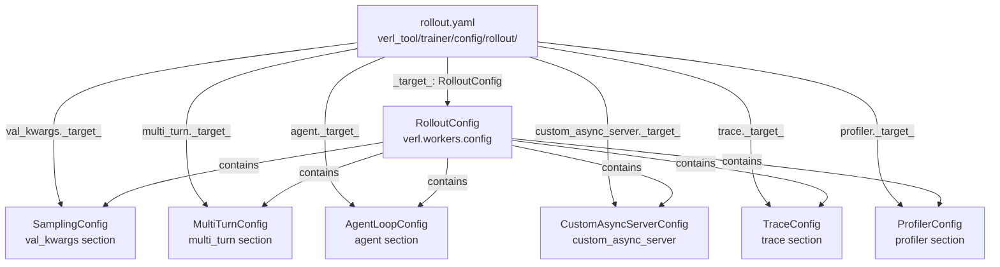
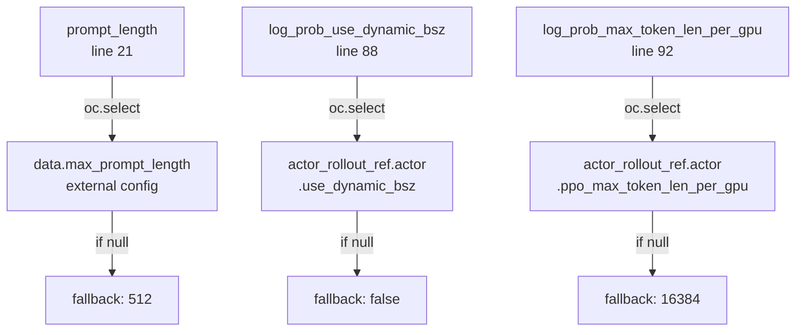
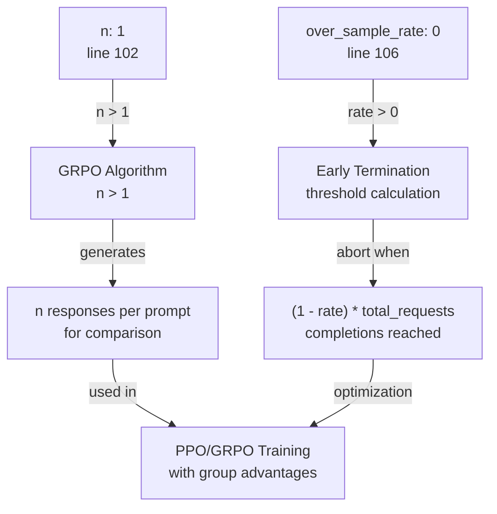
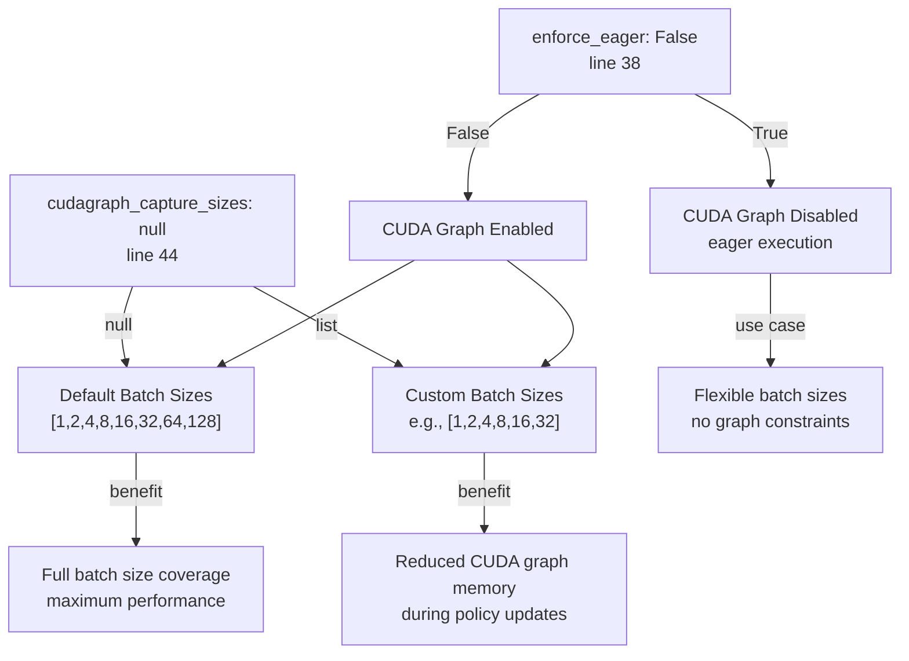
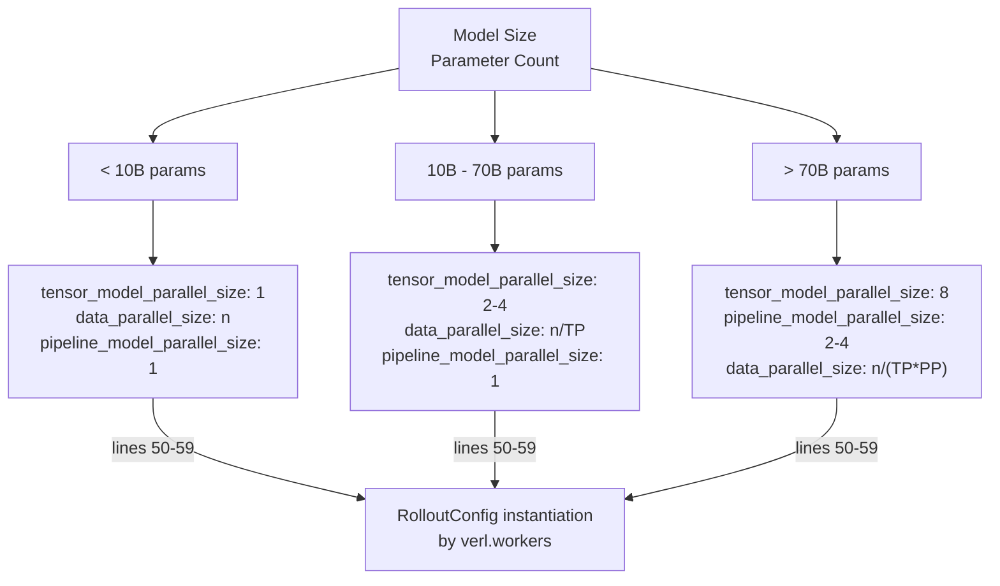
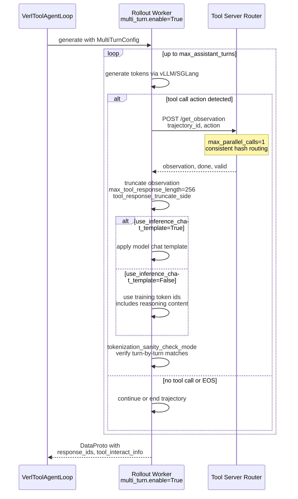
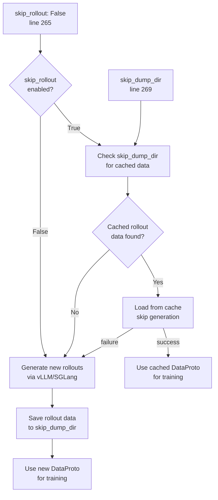

<!-- source: DeepWiki mcp.deepwiki.com · repo TIGER-AI-Lab/verl-tool · page 9.3 Configuration Deep Dive (Rollout Config) · fetched 2026-10-30 -->

# Configuration Deep Dive (Rollout Config)

<details>
<summary>Relevant source files</summary>

The following files were used as context for generating this wiki page:

- [verl_tool/trainer/config/rollout/rollout.yaml](verl_tool/trainer/config/rollout/rollout.yaml)

</details>


## Purpose and Scope

This document provides a comprehensive guide to the rollout configuration system in VerlTool, focusing on the parameters defined in `verl_tool/trainer/config/rollout/rollout.yaml`. The rollout configuration controls inference behavior during training, including sampling parameters, memory management, model parallelism, and multi-turn interaction settings.

For information about the actual rollout implementation and vLLM integration, see [Rollout and vLLM Integration](#2.5). For asynchronous rollout mode details, see [Asynchronous Rollout Mode](#2.6). For multi-turn interaction specifics, see [Multi-Turn RL (MTRL) System](#9.2). For distributed training resource allocation, see [Resource Management and Distributed Training](#2.7).

## Configuration Architecture

The rollout configuration is instantiated as a `verl.workers.config.RolloutConfig` dataclass and integrates with Hydra's OmegaConf system for dynamic parameter resolution and inheritance.

### Configuration Class Mapping

**Diagram: Rollout Configuration Class Structure**



Sources: [verl_tool/trainer/config/rollout/rollout.yaml:1-299]()

### OmegaConf Dynamic Resolution

The configuration uses OmegaConf's `${oc.select:}` syntax for parameter inheritance and fallback values:

**Diagram: OmegaConf Resolution Pattern**



Sources: [verl_tool/trainer/config/rollout/rollout.yaml:21-22](), [verl_tool/trainer/config/rollout/rollout.yaml:88-89]()

## Core Rollout Parameters

### Inference Engine Selection

| Parameter | Type | Default | Description |
|-----------|------|---------|-------------|
| `name` | str | `???` (required) | Inference engine: `hf`, `vllm`, or `sglang` |
| `mode` | str | `sync` | Rollout mode: `sync` (LLM) or `async` (AsyncLLM) |
| `skip_tokenizer_init` | bool | `True` | Skip tokenizer init for token-in-token-out generation |

The `name` parameter determines which inference backend is used:
- **hf**: HuggingFace transformers (simpler, slower)
- **vllm**: vLLM engine (optimized, CUDA graphs)
- **sglang**: SGLang alternative backend (supports multi-stage wake-up)

Sources: [verl_tool/trainer/config/rollout/rollout.yaml:5-8](), [verl_tool/trainer/config/rollout/rollout.yaml:272-273]()

### Length Configuration

| Parameter | Type | Default | Description |
|-----------|------|---------|-------------|
| `prompt_length` | int | from `data.max_prompt_length` or 512 | Maximum prompt length in tokens |
| `response_length` | int | from `data.max_response_length` or 512 | Maximum response length in tokens |
| `max_model_len` | int | `null` | Override max sequence length for engine |
| `max_num_seqs` | int | 1024 | Maximum number of sequences per batch |

The `prompt_length` and `response_length` inherit from data configuration when available, ensuring consistency between data preprocessing and inference.

Sources: [verl_tool/trainer/config/rollout/rollout.yaml:19-26](), [verl_tool/trainer/config/rollout/rollout.yaml:65-68]()

## Sampling Parameters

### Training Sampling Configuration

| Parameter | Type | Default | Description |
|-----------|------|---------|-------------|
| `temperature` | float | 1.0 | Sampling temperature (higher = more random) |
| `top_k` | int | -1 | Top-k sampling (-1 for vLLM, 0 for HF) |
| `top_p` | float | 1.0 | Nucleus sampling threshold |
| `do_sample` | bool | `True` | Enable sampling (HF only; False = greedy) |
| `n` | int | 1 | Number of responses per prompt (>1 for GRPO) |
| `ignore_eos` | bool | `False` | Continue generation after EOS token |

Sources: [verl_tool/trainer/config/rollout/rollout.yaml:10-18](), [verl_tool/trainer/config/rollout/rollout.yaml:35-36](), [verl_tool/trainer/config/rollout/rollout.yaml:98-102]()

### Validation Sampling Configuration

The `val_kwargs` section defines sampling behavior during validation epochs:

| Parameter | Type | Default | Description |
|-----------|------|---------|-------------|
| `temperature` | float | 0 | Greedy sampling for validation |
| `top_k` | int | -1 | Top-k disabled for deterministic output |
| `top_p` | float | 1.0 | No nucleus sampling restriction |
| `n` | int | 1 | Single response per validation sample |
| `do_sample` | bool | `False` | Disable sampling for reproducibility |

The validation configuration uses greedy sampling (`temperature=0`, `do_sample=False`) to ensure deterministic and reproducible evaluation results.

Sources: [verl_tool/trainer/config/rollout/rollout.yaml:123-142]()

### GRPO and Over-Sampling

**Diagram: GRPO Sampling Strategy**



The `over_sample_rate` parameter controls early termination during GRPO training. When set to a value > 0, the system aborts remaining requests when `(1 - over_sample_rate) * total_requests` completions are reached, improving throughput.

Sources: [verl_tool/trainer/config/rollout/rollout.yaml:101-106]()

## Memory and Performance Optimization

### GPU Memory Management

| Parameter | Type | Default | Description |
|-----------|------|---------|-------------|
| `gpu_memory_utilization` | float | 0.5 | Fraction of GPU memory for KV cache (vLLM/SGLang) |
| `free_cache_engine` | bool | `True` | Free engine KV cache after generation |
| `enable_prefix_caching` | bool | `False` | Cache KV blocks for common prefixes |
| `enable_chunked_prefill` | bool | `True` | Enable chunked prefill for higher throughput |

The `gpu_memory_utilization` parameter is critical for balancing KV cache size with model weights. Lower values (0.4-0.5) are safer for large models but may limit batch size. Higher values (0.7-0.9) maximize throughput but risk OOM errors.

Sources: [verl_tool/trainer/config/rollout/rollout.yaml:31-32](), [verl_tool/trainer/config/rollout/rollout.yaml:46-74]()

### CUDA Graph Optimization

**Diagram: CUDA Graph Configuration Flow**



CUDA graphs provide significant performance improvements by caching kernel launches. The `cudagraph_capture_sizes` parameter allows customizing batch sizes to reduce memory overhead. Smaller sets like `[1, 2, 4, 8, 16, 32]` save memory during policy updates when the inference engine cannot offload CUDA graphs.

Sources: [verl_tool/trainer/config/rollout/rollout.yaml:37-44]()

### Batching Configuration

| Parameter | Type | Default | Description |
|-----------|------|---------|-------------|
| `max_num_batched_tokens` | int | 8192 | Maximum tokens in a single batch |
| `max_num_seqs` | int | 1024 | Maximum sequences per batch |

These parameters interact with `enable_chunked_prefill`. When chunked prefill is enabled, increase `max_num_batched_tokens` or decrease `max_model_len` to achieve higher throughput.

Sources: [verl_tool/trainer/config/rollout/rollout.yaml:61-68]()

## Model Parallelism Configuration

### Parallelism Dimensions

The rollout configuration supports four parallelism dimensions that must align with the actor model's training configuration:

| Parameter | Type | Default | Description |
|-----------|------|---------|-------------|
| `tensor_model_parallel_size` | int | 2 | Tensor parallelism (TP) size |
| `data_parallel_size` | int | 1 | Data parallelism (DP) size |
| `expert_parallel_size` | int | 1 | Expert parallelism (EP) for MoE models |
| `pipeline_model_parallel_size` | int | 1 | Pipeline parallelism (PP) size |

Sources: [verl_tool/trainer/config/rollout/rollout.yaml:49-59]()

### Parallelism Strategy Flow

**Diagram: Model Parallelism Configuration Strategy**



The parallelism configuration must match the actor model's FSDP or Megatron settings to ensure weight compatibility during updates.

Sources: [verl_tool/trainer/config/rollout/rollout.yaml:28-29](), [verl_tool/trainer/config/rollout/rollout.yaml:49-59]()

## Log Probability Computation

### Log Prob Parameters

| Parameter | Type | Default | Description |
|-----------|------|---------|-------------|
| `log_prob_micro_batch_size` | int | `null` | (Deprecated) Global batch size for log_prob |
| `log_prob_micro_batch_size_per_gpu` | int | `null` | Local batch size per GPU for log_prob |
| `log_prob_use_dynamic_bsz` | bool | from `actor.use_dynamic_bsz` or `false` | Enable dynamic batching (sequence packing) |
| `log_prob_max_token_len_per_gpu` | int | from `actor.ppo_max_token_len_per_gpu` or 16384 | Max token length per GPU |
| `calculate_log_probs` | bool | `False` | Calculate and log rollout probabilities |

The `calculate_log_probs` parameter must be set to `True` when using truncated importance sampling, which requires rollout log probabilities for the importance weight computation.

Sources: [verl_tool/trainer/config/rollout/rollout.yaml:80-92](), [verl_tool/trainer/config/rollout/rollout.yaml:196-197]()

## Multi-Turn Configuration

### Multi-Turn Parameters

The `multi_turn` section configures tool-integrated agent interactions:

| Parameter | Type | Default | Description |
|-----------|------|---------|-------------|
| `enable` | bool | `False` | Enable multi-turn tool interaction |
| `max_assistant_turns` | int | `null` | Max assistant turns (default: max_length // 3) |
| `max_user_turns` | int | `null` | Max user turns (default: max_length // 3) |
| `max_parallel_calls` | int | 1 | Max parallel tool calls in single turn |
| `max_tool_response_length` | int | 256 | Max tokens in tool response |
| `tool_response_truncate_side` | str | `middle` | Truncation side: `left`, `middle`, `right` |
| `tool_config_path` | str | `null` | Path to tool configuration file |
| `interaction_config_path` | str | `null` | Path to interaction configuration |
| `format` | str | `hermes` | Multi-turn format: `hermes`, `llama3_json`, etc. |

Sources: [verl_tool/trainer/config/rollout/rollout.yaml:145-191]()

### Chat Template Configuration

| Parameter | Type | Default | Description |
|-----------|------|---------|-------------|
| `use_inference_chat_template` | bool | `False` | Use model's default chat template vs training tokens |
| `tokenization_sanity_check_mode` | str | `strict` | Tokenization validation: `disable`, `strict`, `ignore_strippable` |
| `num_repeat_rollouts` | int | `null` | Number of repeat rollouts per interaction |

The `use_inference_chat_template` parameter controls a critical tradeoff:
- **False**: Uses token ids from training, including reasoning content, maintains training consistency but creates longer prompts
- **True**: Uses model's default chat template, matches production behavior, may exclude reasoning content

The `tokenization_sanity_check_mode` prevents tokenization mismatches. Some models (Qwen/QwQ-32B, Qwen/Qwen3-xxB) produce different tokenization when tokenizing turn-by-turn vs all-at-once. Set to `disable` or `ignore_strippable` for these models.

Sources: [verl_tool/trainer/config/rollout/rollout.yaml:174-193]()

### Multi-Turn Interaction Flow

**Diagram: Multi-Turn Rollout Sequence**



Sources: [verl_tool/trainer/config/rollout/rollout.yaml:145-193]()

## Agent Loop Configuration

### Agent Worker Parameters

The `agent` section configures agent-based rollout with tool integration:

| Parameter | Type | Default | Description |
|-----------|------|---------|-------------|
| `num_workers` | int | 8 | Number of agent loop workers |
| `default_agent_loop` | str | `verltool_agent` | Default agent loop class name |
| `agent_loop_config_path` | str | `null` | Path to custom agent loop configs |

The `default_agent_loop` parameter specifies which agent loop implementation to use when the RL dataset doesn't set `agent_name`. VerlTool uses `verltool_agent` as the default, which implements the multi-turn tool interaction logic.

Sources: [verl_tool/trainer/config/rollout/rollout.yaml:200-222]()

### Custom Agent Loop Configuration

The `agent_loop_config_path` can point to a YAML file with multiple agent loop configurations:

```yaml
# Example structure (referenced in comments)
- name: react_agent
  _target_: recipe.langgraph_agent.react_agent_loop.ReactAgentLoop
  tools: ["get_current_temperature"]
- name: math_expression
  _target_: recipe.langgraph_agent.example.math_expression.MathExpressionReactAgentLoop
  min_terms: 2
  max_terms: 6
```

Each configuration instantiates a different `AgentLoop` subclass with specific parameters.

Sources: [verl_tool/trainer/config/rollout/rollout.yaml:213-222]()

### Custom Async Server

| Parameter | Type | Default | Description |
|-----------|------|---------|-------------|
| `custom_async_server.path` | str | `null` | Path to custom async server implementation |
| `custom_async_server.name` | str | `null` | Class name (e.g., `AsyncvLLMServer`) |

This allows replacing the default async server with custom implementations for specialized rollout logic.

Sources: [verl_tool/trainer/config/rollout/rollout.yaml:224-234]()

## Engine-Specific Configuration

### vLLM Engine Parameters

The `engine_kwargs.vllm` section accepts any vLLM engine arguments:

```yaml
engine_kwargs:
  vllm:
    # Example: custom attention backend
    # attention_backend: "FLASH_ATTN"
```

Common vLLM parameters that can be configured include:
- `attention_backend`: Attention implementation to use
- `quantization`: Quantization method (e.g., "awq", "gptq")
- `max_parallel_loading_workers`: Number of parallel model loading workers

Sources: [verl_tool/trainer/config/rollout/rollout.yaml:114-117]()

### SGLang Engine Parameters

The `engine_kwargs.sglang` section accepts SGLang-specific arguments:

```yaml
engine_kwargs:
  sglang:
    # SGLang-specific configuration
```

SGLang supports additional features like multi-stage wake-up:

| Parameter | Type | Default | Description |
|-----------|------|---------|-------------|
| `multi_stage_wake_up` | bool | `false` | Wake up inference engine in stages to reduce peak memory |

Multi-stage wake-up is only effective for SGLang rollout and helps reduce memory usage during training-rollout transitions.

Sources: [verl_tool/trainer/config/rollout/rollout.yaml:108-120]()

### Weight Update Optimization

| Parameter | Type | Default | Description |
|-----------|------|---------|-------------|
| `update_weights_bucket_megabytes` | int | 512 | Tensor bucket size (MB) for batch weight updates |

This parameter controls the maximum payload size for a single weight update request during rollout. Currently only supported in SGLang implementations. 

**Performance considerations**:
- Larger values improve throughput but increase memory overhead
- Default 512MB is optimized for typical GPU configurations
- For best performance with TP ≥ 8, enable `RAY_EXPERIMENTAL_NOSET_CUDA_VISIBLE_DEVICES` and manually set `CUDA_VISIBLE_DEVICES=0,1,2,3,4,5,6,7`

Sources: [verl_tool/trainer/config/rollout/rollout.yaml:236-248]()

## Advanced Features

### Model Weight Loading

| Parameter | Type | Default | Description |
|-----------|------|---------|-------------|
| `load_format` | str | `dummy` | Weight loader: `dummy`, `hf`, `megatron`, `safetensors` |
| `dtype` | str | `bfloat16` | Model parameters dtype (align with actor FSDP/Megatron) |

The `load_format` parameter determines how weights are loaded:
- **dummy**: Randomly initialize weights (for testing)
- **hf**: Load from HuggingFace format
- **megatron**: Load from Megatron-LM format
- **safetensors**: Load from safetensors format (recommended for large models with `use_shm=True`)

Sources: [verl_tool/trainer/config/rollout/rollout.yaml:28-29](), [verl_tool/trainer/config/rollout/rollout.yaml:76-78]()

### Rollout Data Tracing

The `trace` section enables detailed logging and monitoring of rollout data:

| Parameter | Type | Default | Description |
|-----------|------|---------|-------------|
| `backend` | str | `null` | Trace backend: `mlflow`, `weave` |
| `token2text` | bool | `False` | Translate token IDs to text in output |

When enabled, rollout traces are sent to the specified backend for analysis and debugging.

Sources: [verl_tool/trainer/config/rollout/rollout.yaml:251-260]()

### Skip Rollout and Caching

**Diagram: Rollout Caching Mechanism**



**Important**: Avoid using paths under `/tmp/ray/session*` as `skip_dump_dir`, as these are temporary Ray cluster directories that may be cleaned up.

Sources: [verl_tool/trainer/config/rollout/rollout.yaml:262-269]()

### Profiling Configuration

The `profiler` section enables performance profiling during rollout:

| Parameter | Type | Default | Description |
|-----------|------|---------|-------------|
| `tool` | str | from `global_profiler.tool` or `null` | Profiler tool: `nsys`, `npu`, `torch` |
| `enable` | bool | from `actor.profiler.enable` or `false` | Enable profiling |
| `all_ranks` | bool | from `actor.profiler.all_ranks` or `false` | Profile all ranks |
| `ranks` | list | from `actor.profiler.ranks` or `[]` | Specific ranks to profile |
| `save_path` | str | from `global_profiler.save_path` or `null` | Profile results save path |
| `tool_config` | dict | from `actor.profiler.tool_config` or `null` | Tool-specific configuration |

The profiler configuration inherits from the actor's profiler settings by default, ensuring consistent profiling across training components.

Sources: [verl_tool/trainer/config/rollout/rollout.yaml:275-298]()

## Configuration Best Practices

### Parameter Tuning Guidelines

**Diagram: Optimization Objectives and Parameter Settings**

```mermaid
graph TB
    Objective["Optimization Objective"]
    
    MaxThroughput["Maximize Throughput"]
    MinLatency["Minimize Latency"]
    SaveMemory["Reduce Memory Usage"]
    
    Objective --> MaxThroughput
    Objective --> MinLatency
    Objective --> SaveMemory
    
    MaxThroughput --> T1["gpu_memory_utilization: 0.7-0.9<br/>line 32"]
    MaxThroughput --> T2["max_num_batched_tokens: 16384+<br/>line 62"]
    MaxThroughput --> T3["enable_chunked_prefill: True<br/>line 71"]
    MaxThroughput --> T4["enable_prefix_caching: True<br/>line 74"]
    
    MinLatency --> L1["enforce_eager: True<br/>no CUDA graph overhead<br/>line 38"]
    MinLatency --> L2["max_num_seqs: 256-512<br/>smaller batches<br/>line 68"]
    MinLatency --> L3["tensor_model_parallel_size: 8<br/>more GPUs<br/>line 50"]
    
    SaveMemory --> M1["gpu_memory_utilization: 0.4-0.5<br/>line 32"]
    SaveMemory --> M2["cudagraph_capture_sizes<br/>[1,2,4,8,16,32]<br/>line 44"]
    SaveMemory --> M3["free_cache_engine: True<br/>line 47"]
    SaveMemory --> M4["enable_prefix_caching: False<br/>line 74"]
```



### Common Configuration Patterns

**Pattern 1: Small Model (<10B), High Throughput**
```yaml
name: vllm
tensor_model_parallel_size: 1
gpu_memory_utilization: 0.85
enable_chunked_prefill: True
max_num_batched_tokens: 16384
enforce_eager: False
```

**Pattern 2: Large Model (>70B), Memory Constrained**
```yaml
name: vllm
tensor_model_parallel_size: 8
pipeline_model_parallel_size: 2
gpu_memory_utilization: 0.45
cudagraph_capture_sizes: [1, 2, 4, 8, 16, 32]
free_cache_engine: True
```

**Pattern 3: Multi-Turn Tool Interaction**
```yaml
name: sglang
multi_turn:
  enable: True
  max_assistant_turns: 10
  max_tool_response_length: 512
  tool_response_truncate_side: middle
  use_inference_chat_template: True
  format: hermes
agent:
  num_workers: 16
  default_agent_loop: verltool_agent
```

**Pattern 4: GRPO with Over-Sampling**
```yaml
n: 4
over_sample_rate: 0.2
temperature: 1.0
top_p: 0.95
```

Sources: [verl_tool/trainer/config/rollout/rollout.yaml:1-299]()

### Validation Configuration Strategy

The separation between training and validation sampling parameters allows for different exploration strategies:

| Use Case | Training Config | Validation Config |
|----------|----------------|-------------------|
| Standard PPO | `temperature=1.0`, `do_sample=True` | `temperature=0`, `do_sample=False` |
| High Exploration | `temperature=1.2`, `top_p=0.9` | `temperature=0`, `do_sample=False` |
| GRPO | `n=4`, `temperature=1.0` | `n=1`, `temperature=0` |

Validation always uses greedy sampling to ensure deterministic evaluation, while training sampling can be adjusted based on the exploration requirements of the task.

Sources: [verl_tool/trainer/config/rollout/rollout.yaml:123-142]()

---

