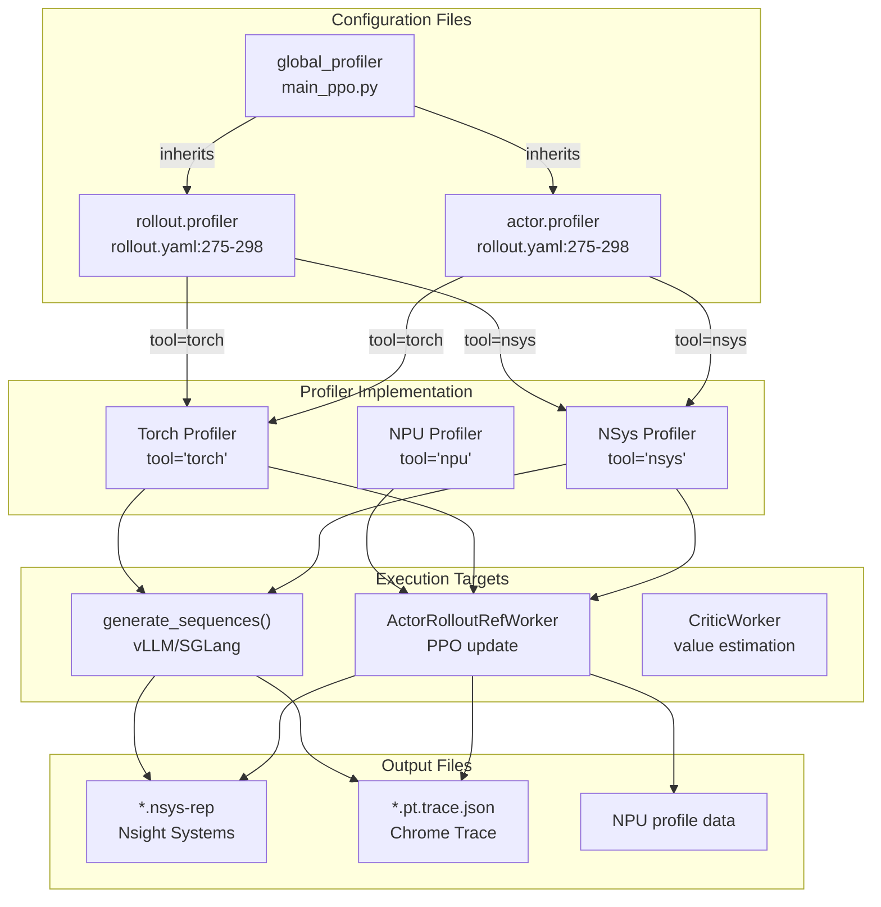
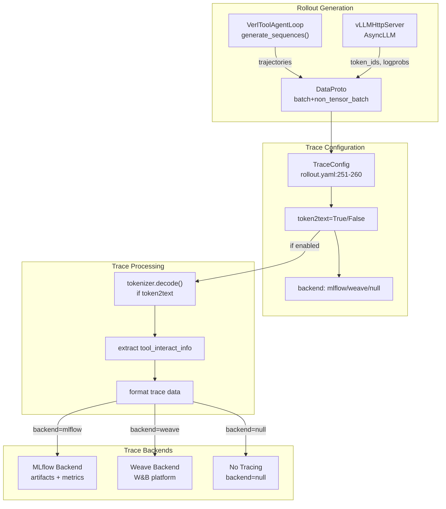
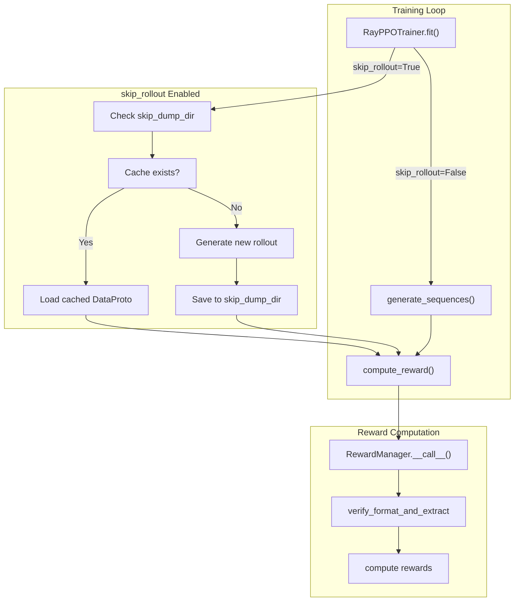

<!-- source: DeepWiki mcp.deepwiki.com · repo TIGER-AI-Lab/verl-tool · page 9.4 Debugging and Profiling · fetched 2026-10-30 -->

# Debugging and Profiling

<details>
<summary>Relevant source files</summary>

The following files were used as context for generating this wiki page:

- [verl_tool/servers/serve.py](verl_tool/servers/serve.py)
- [verl_tool/trainer/config/rollout/rollout.yaml](verl_tool/trainer/config/rollout/rollout.yaml)
- [verl_tool/trainer/main_ppo.py](verl_tool/trainer/main_ppo.py)
- [verl_tool/trainer/ppo/ray_trainer.py](verl_tool/trainer/ppo/ray_trainer.py)

</details>


This page documents the profiling tools and debugging features available in verl-tool for analyzing performance, tracing execution, and troubleshooting training runs. The primary focus is on profiling tools (NSys, Torch Profiler), tracing backends (MLflow, Weave), and the `skip_rollout` debugging feature.

## Overview

Verl-tool provides three primary debugging and profiling mechanisms:

1. **Profilers**: Performance profiling using `nsys`, `torch`, or `npu` profilers for identifying computational bottlenecks
2. **Trace Backends**: MLflow and Weave integration for trajectory-level data logging and debugging
3. **skip_rollout**: Cached rollout data for debugging reward computation without regenerating trajectories

These systems are configured independently and can be enabled selectively to diagnose specific issues without impacting overall training performance.

Sources: [verl_tool/trainer/config/rollout/rollout.yaml:251-298]()

## Profiler Configuration

The profiler system enables performance analysis of model execution, capturing detailed timing information for training (actor/critic) and rollout (generation) phases.

### Profiler Architecture and Configuration



**Diagram: Profiler Configuration and Execution Flow**

The profiler system is configured at three levels: global profiler settings in `main_ppo.py`, actor-specific settings, and rollout-specific settings. The configuration hierarchy allows component-specific profiling while maintaining global defaults.

Sources: [verl_tool/trainer/config/rollout/rollout.yaml:275-298](), [verl_tool/trainer/main_ppo.py:72-87]()

### Profiler Configuration Parameters

Profiler settings are defined in `ProfilerConfig` under the `profiler` section:

| Parameter | Type | Description | Default |
|-----------|------|-------------|---------|
| `tool` | str | Profiler tool: `nsys`, `torch`, `npu` | `null` |
| `enable` | bool | Enable profiling for this component | `false` |
| `all_ranks` | bool | Profile all distributed ranks | `false` |
| `ranks` | List[int] | Specific ranks to profile (e.g., `[0, 1]`) | `[]` |
| `save_path` | str | Directory to save profile output | `null` |
| `tool_config` | dict | Tool-specific configuration options | `null` |

**Configuration locations:**
- Global: `global_profiler` in main config
- Actor: `actor_rollout_ref.actor.profiler`
- Rollout: `actor_rollout_ref.rollout.profiler`

**Example configuration for NSys profiling:**

```yaml
# Global profiler configuration
global_profiler:
  tool: nsys
  save_path: /tmp/nsys_profiles
  global_tool_config:
    nsys:
      controller_nsight_options:
        trace: cuda,nvtx
        sample: cpu

# Rollout-specific profiler
actor_rollout_ref:
  rollout:
    profiler:
      _target_: verl.utils.profiler.ProfilerConfig
      tool: nsys
      enable: true
      all_ranks: false
      ranks: [0]
      save_path: /tmp/rollout_profiles
```

Sources: [verl_tool/trainer/config/rollout/rollout.yaml:275-298](), [verl_tool/trainer/main_ppo.py:72-87]()

### NSys Profiler

NSys (NVIDIA Nsight Systems) provides comprehensive GPU profiling for CUDA-enabled platforms. When `tool: nsys` is configured, the training framework uses NVTX markers to annotate execution phases.

**Key features:**
- CUDA kernel timelines and utilization
- Memory transfers between host and device
- NVTX custom annotations for verl components
- CPU activity correlation with GPU work

**NSys initialization in main_ppo.py:**

```python
if (is_cuda_available and 
    config.global_profiler.tool == "nsys" and
    config.global_profiler.get("steps") is not None):
    from verl.utils.import_utils import is_nvtx_available
    assert is_nvtx_available(), "nvtx is not available"
    
    nsight_options = OmegaConf.to_container(
        config.global_profiler.global_tool_config.nsys.controller_nsight_options
    )
    runner = TaskRunner.options(runtime_env={"nsight": nsight_options}).remote()
```

**Output format:** `.nsys-rep` files that can be opened in NVIDIA Nsight Systems GUI for visual analysis.

**Use cases:**
- GPU utilization analysis (kernel occupancy, idle time)
- Memory transfer bottlenecks
- CUDA kernel launch overhead
- Synchronization point identification

Sources: [verl_tool/trainer/main_ppo.py:72-87]()

### Torch Profiler

PyTorch's built-in profiler captures operator-level performance metrics for both CPU and GPU execution.

**Key features:**
- Operator execution time breakdown
- Memory allocation tracking
- CPU and GPU event correlation
- Python stack traces for debugging

**Output format:** `.pt.trace.json` files compatible with Chrome trace viewer and TensorBoard.

**Configuration example:**

```yaml
profiler:
  tool: torch
  enable: true
  ranks: [0]
  tool_config:
    activities: [cpu, cuda]
    record_shapes: true
    profile_memory: true
    with_stack: true
```

**Use cases:**
- PyTorch operator performance analysis
- Memory leak detection
- Operator fusion opportunities
- CPU-bound operation identification

Sources: [verl_tool/trainer/config/rollout/rollout.yaml:275-298]()

### NPU Profiler

For Ascend NPU hardware, the NPU profiler provides hardware-specific performance metrics.

**Configuration example:**

```yaml
profiler:
  tool: npu
  enable: true
  ranks: [0]
```

**Use cases:**
- Ascend NPU kernel performance
- NPU memory utilization
- Host-NPU communication overhead

Sources: [verl_tool/trainer/config/rollout/rollout.yaml:275-298]()

### Rank Selection Strategy

In distributed training, profiling all ranks simultaneously can significantly impact performance and generate large amounts of data. The `ranks` and `all_ranks` parameters control profiling scope:

**Single rank profiling (recommended for initial debugging):**
```yaml
profiler:
  all_ranks: false
  ranks: [0]  # Profile rank 0 only
```

**Multi-rank profiling (for distributed debugging):**
```yaml
profiler:
  all_ranks: false
  ranks: [0, 1, 2, 3]  # Profile first 4 ranks
```

**All ranks profiling (high overhead, use with caution):**
```yaml
profiler:
  all_ranks: true
  ranks: []  # Ignored when all_ranks is true
```

**Performance impact:** Profiling adds 10-30% overhead per profiled rank. Start with single-rank profiling and expand only when necessary.

Sources: [verl_tool/trainer/config/rollout/rollout.yaml:275-298]()

### Configuration Options

The trace system is configured in the rollout configuration file under the `trace` section:

| Parameter | Type | Description | Default |
|-----------|------|-------------|---------|
| `backend` | str | Trace backend: `mlflow`, `weave`, or `null` | `null` |
| `token2text` | bool | Convert token IDs to human-readable text | `False` |

**Example configuration:**

```yaml
trace:
  _target_: verl.workers.config.TraceConfig
  backend: mlflow
  token2text: True
```

When `token2text` is enabled, token IDs in the rollout data are decoded to text strings before logging, making it easier to inspect model outputs. However, this adds computational overhead and increases storage requirements.

### Trace Backends

#### MLflow Backend

MLflow traces capture structured rollout data including:
- Input prompts and generated responses
- Token-level log probabilities
- Reward scores and reward extra info
- Tool interaction sequences
- Validation results

MLflow stores traces as artifacts in the experiment tracking system, allowing you to correlate training metrics with specific trajectory examples.

#### Weave Backend

Weave provides a cloud-based observability platform integrated with Weights & Biases. When enabled, trace data is sent to Weave for visualization and analysis. This is particularly useful for:
- Inspecting multi-turn tool interactions
- Debugging reward computation issues
- Analyzing failure modes in agent loops

Sources: [verl_tool/trainer/config/rollout/rollout.yaml:251-260]()

## Trace Configuration

The trace system captures detailed rollout data including token sequences, log probabilities, reward information, and tool interactions. This data can be logged to external platforms (MLflow or Weave) for debugging and analysis.

### Trace System Architecture



**Diagram: Trace System Data Flow**

The trace system integrates with the rollout pipeline to capture generation data. When enabled, it processes `DataProto` objects containing both tensor data (token IDs, attention masks) and non-tensor metadata (tool interactions, stop reasons).

Sources: [verl_tool/trainer/config/rollout/rollout.yaml:251-260](), [verl_tool/trainer/ppo/ray_trainer.py:160-173]()

### Configuration Options

Trace configuration is specified in the `trace` section of `rollout.yaml`:

| Parameter | Type | Description | Default |
|-----------|------|-------------|---------|
| `backend` | str | Trace backend: `mlflow`, `weave`, or `null` | `null` |
| `token2text` | bool | Convert token IDs to text before logging | `False` |

**Example configuration:**

```yaml
trace:
  _target_: verl.workers.config.TraceConfig
  backend: mlflow
  token2text: True
```

**When to use `token2text`:**
- **True**: Human-readable logs for debugging (adds decoding overhead)
- **False**: Raw token IDs for minimal overhead (requires manual decoding)

Sources: [verl_tool/trainer/config/rollout/rollout.yaml:251-260]()

### MLflow Backend

MLflow traces capture structured rollout data as artifacts in the experiment tracking system. The implementation logs:

- Input prompts (tokenized or decoded)
- Generated responses
- Token-level log probabilities (if `calculate_log_probs: True`)
- Reward scores and `reward_extra_info`
- Tool interaction sequences (`tool_interact_info`)
- Trajectory stop reasons (`traj_stop_reason`)

**Trace data structure in validation:**

```python
# From ray_trainer.py _validate() method
reward_extra_infos_dict = {
    "reward": scores,
    "acc": accuracies,
    "tool_interact_info": tool_interactions,  # if present
    "traj_stop_reason": stop_reasons,
    "verl_tool_metrics": metrics
}

self._dump_generations(
    inputs=input_texts,
    outputs=output_texts,
    gts=ground_truths,
    scores=scores,
    reward_extra_infos_dict=reward_extra_infos_dict,
    dump_path=val_data_dir
)
```

**Use cases:**
- Debugging reward computation issues
- Inspecting multi-turn tool interactions
- Analyzing trajectory termination reasons
- Correlating training metrics with specific examples

Sources: [verl_tool/trainer/ppo/ray_trainer.py:160-173]()

### Weave Backend

Weave provides cloud-based observability integrated with Weights & Biases. When `backend: weave`, trace data is sent to the Weave platform for visualization.

**Configuration:**

```yaml
trace:
  backend: weave
  token2text: True
```

**Use cases:**
- Inspecting agent loop behavior in production
- Debugging tool call failures
- Analyzing format errors in structured outputs

Sources: [verl_tool/trainer/config/rollout/rollout.yaml:251-260]()

### Trace Data in Validation

The `_validate()` method in `AgentRayPPOTrainer` demonstrates trace data collection:

**Validation trace pipeline:**

```python
# Input collection
input_texts = [tokenizer.decode(ids, skip_special_tokens=True) 
               for ids in input_ids]

# Output collection
output_texts = [tokenizer.decode(ids[mask==1], skip_special_tokens=False) 
                for ids, mask in zip(output_ids, output_attention_mask)]

# Tool interaction info extraction
tool_interact_info = test_batch.non_tensor_batch.get('tool_interact_info', None)
if tool_interact_info:
    # Truncate image data for logging
    for tool_interact in tool_interact_info:
        if "image" in tool_interact:
            tool_interact['image'] = tool_interact['image'][:50]
```

The trace system captures detailed execution information including:
- Number of turns per trajectory (`__num_turns__`)
- Tool interaction sequences with truncated image data
- Trajectory stop reasons (EOS, max_turns, tool finish)
- Custom metrics from reward managers

Sources: [verl_tool/trainer/ppo/ray_trainer.py:132-159]()

## skip_rollout: Debugging Reward Computation

The `skip_rollout` feature enables debugging reward computation logic without regenerating expensive rollout data. When enabled, the system attempts to load cached trajectories from disk instead of calling the rollout engine.

### skip_rollout Configuration



**Diagram: skip_rollout Workflow**

**Configuration parameters:**

| Parameter | Type | Description | Default |
|-----------|------|-------------|---------|
| `skip_rollout` | bool | Load cached rollout data instead of generating | `False` |
| `skip_dump_dir` | str | Directory for cached rollout data | `/tmp/rollout_dump` |

**Example configuration:**

```yaml
# rollout.yaml
skip_rollout: True
skip_dump_dir: /tmp/rollout_dump
```

Sources: [verl_tool/trainer/config/rollout/rollout.yaml:262-269]()

### Use Cases for skip_rollout

**1. Reward Manager Development**

When iterating on reward computation logic, regenerating rollouts is unnecessary and time-consuming:

```yaml
# First run: generate and cache
skip_rollout: False
skip_dump_dir: /tmp/my_experiment/rollouts

# Subsequent runs: reuse cached data
skip_rollout: True
skip_dump_dir: /tmp/my_experiment/rollouts
```

Modify your reward manager implementation and rerun training. The cached rollouts will be loaded and only reward computation is re-executed.

**2. Format Verification Debugging**

Testing format extraction logic without waiting for model generation:

```python
# Modify reward manager's verify_format_and_extract
def verify_format_and_extract(self, response: str):
    # New extraction logic
    extracted = self.extract_solution(response)
    # Test with cached responses
    return extracted
```

**3. Penalty Tuning**

Adjusting reward penalties (curiosity, redundancy, format) on existing trajectories:

```python
# In reward manager
if not self.has_tool_interaction:
    reward -= 1.0  # Adjust penalty value
```

Run training with `skip_rollout: True` to test different penalty values on the same trajectories.

Sources: [verl_tool/trainer/config/rollout/rollout.yaml:262-269]()

### Cache Behavior

**Cache miss handling:**

If `skip_rollout: True` but no cached data exists in `skip_dump_dir`, the system automatically:
1. Generates new rollout data normally
2. Saves generated data to `skip_dump_dir`
3. Continues with training

**Cache invalidation:**

Cached rollout data should be invalidated when:
- Model checkpoint changes
- Sampling parameters change (`temperature`, `top_p`, `top_k`)
- Prompt format or preprocessing changes
- Tool server configuration changes

**Warning:** `skip_rollout` does not validate cache freshness. Always clear `skip_dump_dir` when changing model or generation parameters.

Sources: [verl_tool/trainer/config/rollout/rollout.yaml:262-269]()

## Logging Configuration

### Tool Server Logging

The tool server implements structured logging with configurable verbosity levels. Logging configuration is set via command-line arguments and environment variables.

**Log level configuration in serve.py:**

```python
# Command-line log level
numeric_level = getattr(logging, log_level.upper(), logging.INFO)
logging.basicConfig(
    level=numeric_level,
    format="%(asctime)s - %(name)s - %(levelname)s - %(message)s",
)

# Suppress noisy HTTP libraries
logging.getLogger("httpcore").setLevel(logging.WARNING)
logging.getLogger("httpx").setLevel(logging.WARNING)
logging.getLogger("hpack").setLevel(logging.WARNING)
```

**Log output locations:**

The tool server supports multiple log destinations:
- Console output (stdout/stderr)
- Per-backend log files: `tool_server_backend_{idx}.log`

**Log file creation:**

```python
log_directory_path = Path(log_directory or "tool-server-logs")
log_directory_path.mkdir(parents=True, exist_ok=True)

for idx, port in enumerate(ports):
    log_file = log_directory_path / f"tool_server_backend_{idx}.log"
    lf = open(log_file, "ab", buffering=0)  # Unbuffered
    self.file_handles.append(lf)
```

Sources: [verl_tool/servers/serve.py:598-609](), [verl_tool/servers/serve.py:489-491]()

### disable_log_stats Flag

The `disable_log_stats` flag controls inference engine statistics logging:

```yaml
# rollout.yaml
disable_log_stats: True
```

**When True:** Suppresses vLLM/SGLang periodic statistics output (tokens/second, batch sizes, KV cache usage)

**When False:** Enables detailed inference statistics for throughput analysis

**Use cases for disabling:**
- Production training runs (reduce log volume)
- When console output is rate-limited
- Focus on training metrics only

**Use cases for enabling:**
- Debugging inference performance issues
- Analyzing KV cache behavior
- Identifying throughput bottlenecks

Sources: [verl_tool/trainer/config/rollout/rollout.yaml:95]()

## Debugging Patterns and Workflows

### Pattern 1: Performance Profiling with NSys

**Goal:** Identify GPU utilization bottlenecks during rollout.

**Configuration:**

```yaml
# Global profiler
global_profiler:
  tool: nsys
  save_path: /tmp/nsys_profiles
  steps: [100, 200]  # Profile steps 100-200
  global_tool_config:
    nsys:
      controller_nsight_options:
        trace: cuda,nvtx,osrt
        sample: cpu
        cuda-memory-usage: true

# Rollout profiler
actor_rollout_ref:
  rollout:
    profiler:
      enable: true
      ranks: [0]
      tool: nsys
```

**Workflow:**

1. Run training with profiling enabled for target steps
2. NSys generates `.nsys-rep` files in `save_path`
3. Open in Nsight Systems GUI: `nsys-ui /tmp/nsys_profiles/*.nsys-rep`
4. Analyze CUDA kernel timeline, memory transfers, and NVTX markers

**What to look for:**
- Low GPU utilization (< 70%) indicates CPU bottlenecks
- Large gaps between kernels suggest synchronization issues
- Excessive memory transfers indicate inefficient data movement

Sources: [verl_tool/trainer/main_ppo.py:72-87]()

### Pattern 2: Reward Debugging with skip_rollout

**Goal:** Test reward manager changes without regenerating rollouts.

**Step 1: Generate and cache rollouts**

```yaml
skip_rollout: False
skip_dump_dir: /tmp/reward_debug/rollouts
```

Run training for one epoch to populate cache.

**Step 2: Modify reward manager**

```python
# In custom reward manager
def verify_format_and_extract(self, response: str):
    # Modified extraction logic
    solution = self.extract_solution_v2(response)  # New method
    return solution
```

**Step 3: Rerun with cached rollouts**

```yaml
skip_rollout: True
skip_dump_dir: /tmp/reward_debug/rollouts
```

The system loads cached trajectories and recomputes rewards using your modified reward manager.

**Verification:**

Check validation logs for updated reward scores:
```
val-core/dataset/acc/mean@8: 0.85  # Previous: 0.78
```

Sources: [verl_tool/trainer/config/rollout/rollout.yaml:262-269]()

### Pattern 3: Multi-Turn Debugging with Tracing

**Goal:** Understand why agent fails to use tools in multi-turn scenarios.

**Configuration:**

```yaml
trace:
  backend: mlflow
  token2text: True

# Enable validation dumps
trainer:
  validation_data_dir: /tmp/validation_dumps
```

**Workflow:**

1. Run validation with tracing enabled
2. Inspect dumped generations in MLflow or local files
3. Analyze `tool_interact_info` for each trajectory:

```json
{
  "trajectory_id": "traj_001",
  "tool_interact_info": [
    {"turn": 0, "action": "python", "observation": "42", "done": false},
    {"turn": 1, "action": "finish", "observation": "", "done": true}
  ],
  "traj_stop_reason": "tool_finish",
  "num_turns": 2
}
```

**Debugging checklist:**
- Are `action_stop_tokens` correctly configured?
- Is observation truncation losing critical context?
- Are tool outputs properly formatted?
- Is the model generating valid tool call syntax?

Sources: [verl_tool/trainer/ppo/ray_trainer.py:132-159]()

### Pattern 4: Memory Profiling with Torch Profiler

**Goal:** Identify memory leaks or excessive allocations.

**Configuration:**

```yaml
profiler:
  tool: torch
  enable: true
  ranks: [0]
  tool_config:
    activities: [cpu, cuda]
    profile_memory: true
    record_shapes: true
```

**Workflow:**

1. Enable Torch profiler for actor updates
2. Generate `.pt.trace.json` files
3. Load in Chrome trace viewer or TensorBoard:

```bash
tensorboard --logdir=/tmp/profiles
```

4. Filter by "Memory" view to identify allocation patterns

**What to look for:**
- Monotonically increasing memory usage (leak)
- Large temporary allocations (inefficient operations)
- Unexpected tensor retention (graph not freed)

Sources: [verl_tool/trainer/config/rollout/rollout.yaml:275-298]()

### Pattern 5: Trace + Profiler Combination

**Goal:** Correlate trajectory behavior with performance characteristics.

**Configuration:**

```yaml
# Enable both trace and profiler
trace:
  backend: mlflow
  token2text: True

profiler:
  tool: torch
  enable: true
  ranks: [0]

# Dump validation data
trainer:
  validation_data_dir: /tmp/combined_debug
```

**Analysis workflow:**

1. Identify slow trajectories in profiler output (high latency)
2. Cross-reference with trace data using `trajectory_id`
3. Determine if slowness is due to:
   - Long tool execution times (`tool_interact_info.execution_time`)
   - Excessive turns (`num_turns`)
   - Large observation sizes (check truncation)

This pattern is particularly useful for debugging agent loop performance issues.

Sources: [verl_tool/trainer/config/rollout/rollout.yaml:251-298](), [verl_tool/trainer/ppo/ray_trainer.py:160-173]()

### Pattern 6: Validation-Only Checkpoint Testing

**Goal:** Evaluate a model checkpoint without training.

**Configuration:**

```yaml
trainer:
  total_epochs: 1
  save_freq: -1  # Disable checkpoint saving
  val_freq: 1    # Validate at step 0

# Optional: skip rollout generation
skip_rollout: True
skip_dump_dir: /tmp/checkpoint_test/rollouts
```

**Workflow:**

1. Load pre-generated validation rollouts (if using `skip_rollout`)
2. Run single validation pass on checkpoint
3. Review metrics without modifying model weights

**Use cases:**
- A/B testing different checkpoints
- Evaluating checkpoint interpolations
- Testing reward manager on fixed outputs

Sources: [verl_tool/trainer/config/rollout/rollout.yaml:262-269]()

## Profiling Best Practices

### 1. Start with Single-Rank Profiling

Always begin profiling with a single rank to minimize overhead and data volume:

```yaml
profiler:
  all_ranks: false
  ranks: [0]
```

**Rationale:** Profiling introduces 10-30% overhead per rank. Multi-rank profiling should only be used when debugging rank-specific issues (e.g., pipeline parallelism synchronization).

### 2. Profile Specific Training Steps

Use the `steps` parameter to profile targeted portions of training:

```yaml
global_profiler:
  tool: nsys
  steps: [100, 110]  # Profile steps 100-110 only
```

**Rationale:** Continuous profiling generates massive data files and impacts training throughput. Profile representative steps after warmup.

### 3. Separate Rollout and Training Profiling

Enable profilers independently for rollout and actor phases:

```yaml
# Profile rollout only
actor_rollout_ref:
  rollout:
    profiler:
      enable: true
  actor:
    profiler:
      enable: false
```

**Rationale:** Rollout and training have different performance characteristics. Isolating them simplifies analysis.

### 4. Use skip_rollout for Reward Iteration

When modifying reward computation, always use cached rollouts:

```yaml
skip_rollout: True
skip_dump_dir: /tmp/reward_cache
```

**Rationale:** Rollout generation is expensive (10-100x slower than reward computation). Caching eliminates this overhead during reward debugging.

### 5. Enable Tracing for Validation Only

Minimize trace overhead by enabling only during validation:

```yaml
trace:
  backend: mlflow
  token2text: True  # Only for validation

# Trainer config
trainer:
  val_freq: 100  # Validate every 100 steps
```

**Rationale:** Tracing every training rollout generates excessive data. Validation samples are sufficient for most debugging.

### 6. Coordinate Log Levels

Suppress verbose logging when profiling to reduce I/O interference:

```yaml
# During profiling
disable_log_stats: True

# Tool server
tool_server:
  log_level: warning  # Not info
```

**Rationale:** Console I/O can skew profiling results. Minimize logging during performance analysis.

### 7. Clean Up Profile Data

Profile data accumulates quickly. Clean up after analysis:

```bash
# Remove old profile data
rm -rf /tmp/nsys_profiles/*.nsys-rep
rm -rf /tmp/torch_profiles/*.pt.trace.json
```

**Rationale:** Profile files are 100MB-1GB+ each. Regular cleanup prevents disk exhaustion.

Sources: [verl_tool/trainer/config/rollout/rollout.yaml:275-298](), [verl_tool/servers/serve.py:598-609]()

## Common Debugging Scenarios

### Scenario 1: Low GPU Utilization During Rollout

**Symptoms:** NSys profiler shows GPU idle time > 30% during generation.

**Diagnosis:**

1. Profile rollout with NSys:
```yaml
actor_rollout_ref:
  rollout:
    profiler:
      tool: nsys
      enable: true
      ranks: [0]
```

2. Open NSys output and examine CUDA timeline:
   - Look for gaps between kernel launches
   - Check CPU thread activity during GPU idle periods

**Common causes:**

- **Small batch sizes**: Increase `max_num_seqs` and `max_num_batched_tokens`
- **CPU-bound preprocessing**: Visible in NSys CPU timeline before CUDA kernels
- **Synchronization overhead**: Excessive CUDA events or graph compilation

**Solutions:**

```yaml
# Increase batch sizes
max_num_seqs: 1024  # From 256
max_num_batched_tokens: 16384  # From 8192

# Enable CUDA graphs (if not already)
enforce_eager: False
```

Sources: [verl_tool/trainer/config/rollout/rollout.yaml:38-68](), [verl_tool/trainer/main_ppo.py:72-87]()

### Scenario 2: Memory Leak in Multi-Turn Rollout

**Symptoms:** Memory usage increases steadily across rollouts, eventual OOM.

**Diagnosis:**

1. Enable Torch profiler with memory tracking:
```yaml
profiler:
  tool: torch
  enable: true
  tool_config:
    profile_memory: true
    record_shapes: true
```

2. Analyze memory timeline in TensorBoard or Chrome trace
3. Look for tensors that are not released between rollouts

**Common causes:**

- **Cached observations not cleared**: `env_cache` in tool server grows unbounded
- **Gradient accumulation**: Computation graph not detached
- **Image tensors retained**: Multi-modal data not freed

**Solutions:**

```python
# In agent loop, ensure proper cleanup
for trajectory in trajectories:
    # Detach tensors
    prompt_ids = prompt_ids.detach()
    # Clear tool server cache
    tool_server.delete_trajectory(trajectory_id)
```

Sources: [verl_tool/trainer/config/rollout/rollout.yaml:275-298]()

### Scenario 3: Incorrect Reward Scores After Modification

**Symptoms:** Validation accuracy doesn't match expected values after changing reward manager.

**Diagnosis:**

1. Use `skip_rollout` to isolate reward computation:
```yaml
skip_rollout: True
skip_dump_dir: /tmp/debug_rewards
```

2. Enable detailed tracing:
```yaml
trace:
  backend: mlflow
  token2text: True
```

3. Add debug logging in reward manager:
```python
def __call__(self, data: DataProto):
    for item in data:
        response = self.tokenizer.decode(item.batch["responses"])
        extracted = self.extract_solution(response)
        logger.info(f"Response: {response[:100]}")
        logger.info(f"Extracted: {extracted}")
        logger.info(f"Ground truth: {item.non_tensor_batch['reward_model']['ground_truth']}")
```

4. Check validation dumps for full trajectory context

**Common causes:**

- **Extraction regex incorrect**: Test regex on actual model outputs
- **Format changes**: Model output format drifted from training format
- **Tokenization issues**: `skip_special_tokens` setting differs

**Solutions:**

- Test extraction logic on cached rollouts with `skip_rollout: True`
- Inspect MLflow traces to see exact model outputs
- Verify format tags match between training data and inference

Sources: [verl_tool/trainer/config/rollout/rollout.yaml:262-269](), [verl_tool/trainer/ppo/ray_trainer.py:160-173]()

### Scenario 4: Tool Server Timeout Errors

**Symptoms:** Rollouts fail with "upstream timeout" or "502 Bad Gateway" errors.

**Diagnosis:**

1. Check tool server backend logs:
```bash
cat tool-server-logs/tool_server_backend_0.log | grep -i timeout
```

2. Examine worker health:
```bash
curl http://localhost:5000/health
```

3. Check consistent hashing distribution:
```python
# Add logging to serve.py _pick_worker_index
logger.info(f"Trajectory {trajectory_id} → worker {worker_idx}")
```

**Common causes:**

- **Tool execution timeout**: Python/SQL execution exceeds timeout
- **Worker overload**: Too few workers for request rate
- **Network issues**: Between router and backend workers

**Solutions:**

```yaml
# Increase tool server workers
tool_server:
  uvi_workers: 4  # From default 1
  workers_per_tool: 64  # From default 32

# Adjust timeouts
tool_server:
  request_timeout: 60.0  # From default (None)
```

```python
# In tool implementations, add timeout handling
try:
    result = execute_with_timeout(code, timeout=30)
except TimeoutError:
    return "Execution timed out", True  # done=True
```

Sources: [verl_tool/servers/serve.py:159-211](), [verl_tool/servers/serve.py:335-383]()

### Scenario 5: Trace Data Not Appearing in MLflow

**Symptoms:** `trace.backend: mlflow` configured but no trace data logged.

**Diagnosis:**

1. Verify MLflow tracking URI:
```bash
echo $MLFLOW_TRACKING_URI
```

2. Check trace configuration:
```yaml
trace:
  backend: mlflow  # Not null
  token2text: True
```

3. Ensure validation dumps are enabled:
```yaml
trainer:
  validation_data_dir: /tmp/val_dumps  # Must be set
```

4. Look for errors in training logs:
```bash
grep -i "trace\|mlflow" training.log
```

**Common causes:**

- **MLflow not installed**: `pip install mlflow` required
- **Invalid tracking URI**: MLflow server unreachable
- **validation_data_dir not set**: Dumps disabled
- **Trace backend is null**: Default value

**Solutions:**

```yaml
# Ensure all trace settings are correct
trace:
  backend: mlflow
  token2text: True

trainer:
  validation_data_dir: /tmp/val_dumps
  logger: mlflow  # Or wandb
```

```bash
# Verify MLflow connectivity
mlflow ui --backend-store-uri $MLFLOW_TRACKING_URI
```

Sources: [verl_tool/trainer/config/rollout/rollout.yaml:251-260](), [verl_tool/trainer/ppo/ray_trainer.py:163-172]()

## Configuration Summary

The following table summarizes all debugging and observability configuration options:

| Configuration | Location | Key Parameters | Purpose |
|--------------|----------|----------------|---------|
| Trace | `rollout.trace` | `backend`, `token2text` | Log trajectory data to MLflow/Weave |
| Profiler | `actor.profiler`, `rollout.profiler` | `tool`, `enable`, `ranks` | Profile model execution |
| Logging | `rollout.disable_log_stats` | Boolean flag | Control inference statistics |
| Skip Rollout | `rollout.skip_rollout` | `skip_rollout`, `skip_dump_dir` | Cache/reuse rollout data |
| Skip Tokenizer | `rollout.skip_tokenizer_init` | Boolean flag | Token-in/token-out mode |
| WandB | `trainer.logger` | `project_name`, `experiment_name` | Experiment tracking |
| MLflow | `trainer.logger` | `mlflow_tracking_uri` | Alternative experiment tracking |

### Complete Debugging Configuration Example

```yaml
# rollout.yaml
trace:
  backend: mlflow
  token2text: True

profiler:
  tool: torch
  enable: true
  ranks: [0]
  save_path: /tmp/profiles

disable_log_stats: False
skip_rollout: False
skip_dump_dir: /tmp/rollout_dump
skip_tokenizer_init: False

# trainer config
trainer:
  logger: wandb
  project_name: verl-debug
  experiment_name: debug-001
```

Sources: [verl_tool/trainer/config/rollout/rollout.yaml:251-298]()

## Best Practices

1. **Start Simple:** Enable one debugging feature at a time to avoid overwhelming output and performance degradation.

2. **Profile Selectively:** Profile single ranks first (`ranks: [0]`), then expand to multiple ranks only if needed.

3. **Trace Validation Only:** For large-scale training, enable tracing only during validation to reduce overhead while maintaining observability.

4. **Cache Rollouts During Development:** Use `skip_rollout` when iterating on reward logic, agent loop logic, or data preprocessing.

5. **Monitor Resource Usage:** Track GPU memory, CPU usage, and disk I/O alongside training metrics to identify bottlenecks early.

6. **Correlate Metrics:** Use WandB/MLflow dashboards to correlate reward trends with tool interaction rates and format penalties.

7. **Version Control Configs:** Store all configuration files in git to ensure reproducibility when debugging historical runs.

---

