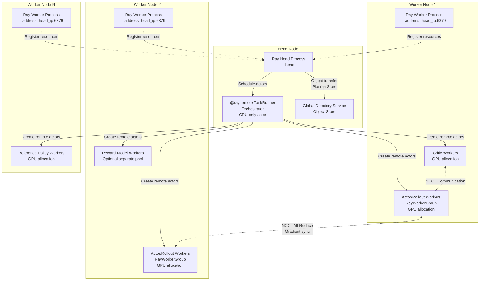
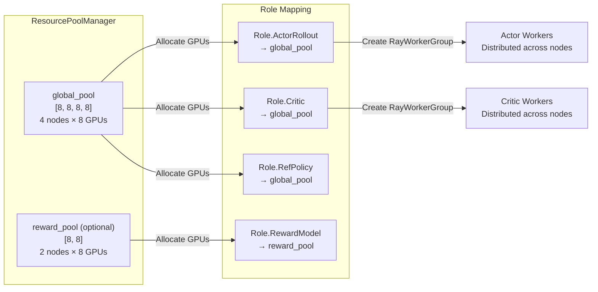
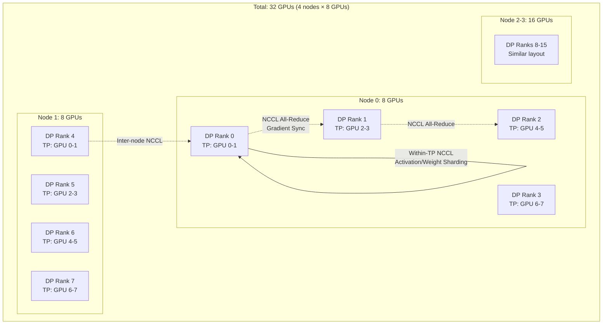
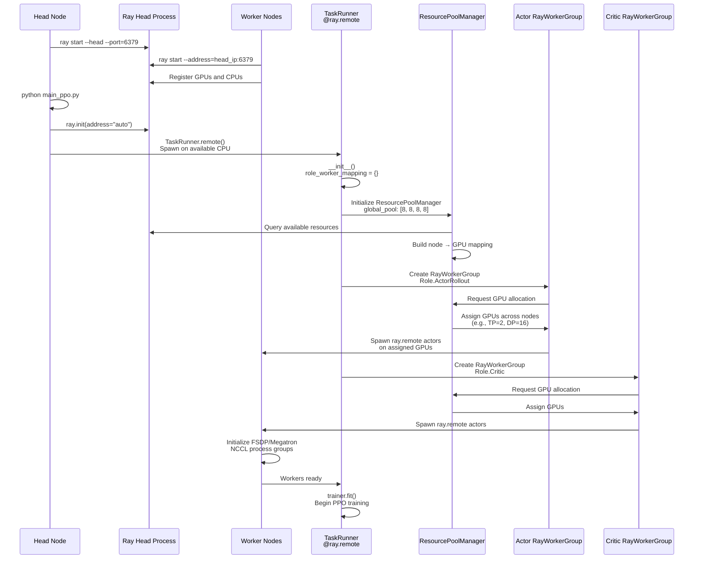

<!-- source: DeepWiki mcp.deepwiki.com · repo TIGER-AI-Lab/verl-tool · page 9.5 Multi-Node Training Setup · fetched 2026-10-30 -->

# Multi-Node Training Setup

<details>
<summary>Relevant source files</summary>

The following files were used as context for generating this wiki page:

- [verl_tool/servers/serve.py](verl_tool/servers/serve.py)
- [verl_tool/trainer/config/rollout/rollout.yaml](verl_tool/trainer/config/rollout/rollout.yaml)
- [verl_tool/trainer/main_ppo.py](verl_tool/trainer/main_ppo.py)
- [verl_tool/trainer/ppo/ray_trainer.py](verl_tool/trainer/ppo/ray_trainer.py)

</details>


This document explains how to configure and execute distributed PPO training across multiple compute nodes using Ray. It covers Ray cluster initialization, resource pool management, NCCL configuration, and multi-node training scripts.

For single-node training configuration, see [Resource Management and Distributed Training](#2.7). For general configuration structure, see [Configuration System](#2.4).

---

## Overview

VerlTool supports distributed training across multiple nodes through Ray's distributed computing framework. The system uses Ray to orchestrate worker placement, resource allocation, and inter-node communication. Key components include:

- **Ray Cluster Initialization**: Head node and worker node setup
- **Resource Pool Management**: GPU allocation across nodes via `ResourcePoolManager`
- **NCCL Configuration**: Environment variables for optimized distributed communication
- **Training Script Patterns**: Shell scripts that coordinate multi-node launches

The multi-node setup is controlled through Hydra configuration files and Ray initialization parameters, with automatic resource discovery and allocation.

---

## Ray Cluster Architecture

### Cluster Topology



**Architecture Overview**:
- **Head Node**: Runs the Ray head process and TaskRunner orchestrator (CPU-only)
- **Worker Nodes**: Join the cluster via `--address` flag, register their GPU resources
- **TaskRunner**: Ray remote class decorated with `@ray.remote(num_cpus=1)` that spawns and manages all training workers
- **Worker Groups**: FSDP/Megatron worker groups allocated across nodes based on resource pools
- **NCCL**: Handles inter-GPU communication for gradient synchronization

Sources: [verl_tool/trainer/main_ppo.py:56-94](), [verl_tool/trainer/main_ppo.py:96-110]()

---

## Ray Initialization Configuration

### Configuration in main_ppo.py

The Ray cluster is initialized in the `run_ppo()` function with Hydra-managed configuration:

```python
# verl_tool/trainer/main_ppo.py:56-68
if not ray.is_initialized():
    default_runtime_env = get_ppo_ray_runtime_env()
    ray_init_kwargs = config.ray_kwargs.get("ray_init", {})
    runtime_env_kwargs = ray_init_kwargs.get("runtime_env", {})
    runtime_env = OmegaConf.merge(default_runtime_env, runtime_env_kwargs)
    ray_init_kwargs = OmegaConf.create({**ray_init_kwargs, "runtime_env": runtime_env})
    print(f"ray init kwargs: {ray_init_kwargs}")
    ray.init(**OmegaConf.to_container(ray_init_kwargs))
```

### Key Ray Initialization Parameters

| Parameter | Purpose | Typical Value |
|-----------|---------|---------------|
| `address` | Ray head node address | `"auto"` (single-node) or `"head_ip:6379"` (multi-node) |
| `runtime_env` | Environment variables for all workers | See runtime environment table below |
| `num_cpus` | Override CPU count (optional) | Auto-detected or explicit count |
| `num_gpus` | Override GPU count (optional) | Auto-detected or explicit count |
| `ignore_reinit_error` | Allow re-initialization | `true` for debugging |
| `log_to_driver` | Send worker logs to driver | `false` for reduced overhead |

### Runtime Environment Variables

The default runtime environment is provided by `get_ppo_ray_runtime_env()`:

| Environment Variable | Purpose | Default Value |
|---------------------|---------|---------------|
| `TOKENIZERS_PARALLELISM` | Control tokenizer threading | `"false"` |
| `NCCL_DEBUG` | NCCL logging level | `"WARN"` |
| `VLLM_LOGGING_LEVEL` | vLLM logging verbosity | `"ERROR"` |
| `VLLM_ALLOW_RUNTIME_LORA_UPDATING` | Enable LoRA updates | `"True"` |

Additional NCCL variables for multi-node:

| Environment Variable | Purpose | Recommended Value |
|---------------------|---------|-------------------|
| `NCCL_SOCKET_IFNAME` | Network interface for NCCL | `"eth0"` or `"ib0"` for InfiniBand |
| `NCCL_IB_DISABLE` | Disable InfiniBand | `"0"` (enable if available) |
| `NCCL_IBEXT_DISABLE` | Disable IB extensions | `"1"` for compatibility |
| `NCCL_IB_GID_INDEX` | IB GID index | `"3"` (cluster-dependent) |
| `NCCL_NET_GDR_LEVEL` | GPUDirect RDMA level | `"5"` for maximum performance |
| `NCCL_TIMEOUT` | Timeout in seconds | `"1800"` for long operations |

Sources: [verl_tool/trainer/main_ppo.py:56-68]()

---

## Resource Pool Management

### ResourcePoolManager Configuration

The `ResourcePoolManager` allocates GPUs across nodes and assigns them to different training roles:

```python
# verl_tool/trainer/main_ppo.py:168-191
def init_resource_pool_mgr(self, config):
    from verl.trainer.ppo.ray_trainer import Role
    
    global_pool_id = "global_pool"
    resource_pool_spec = {
        global_pool_id: [config.trainer.n_gpus_per_node] * config.trainer.nnodes,
    }
    
    # Optional separate pool for reward model
    if config.reward_model.enable_resource_pool:
        reward_pool = [config.reward_model.n_gpus_per_node] * config.reward_model.nnodes
        resource_pool_spec["reward_pool"] = reward_pool
    
    self.mapping[Role.ActorRollout] = global_pool_id
    self.mapping[Role.Critic] = global_pool_id
    
    resource_pool_manager = ResourcePoolManager(
        resource_pool_spec=resource_pool_spec, 
        mapping=self.mapping
    )
    return resource_pool_manager
```

### Resource Pool Specification Format



**Resource Pool Structure**:
- `resource_pool_spec`: Dictionary mapping pool IDs to lists of GPU counts per node
- `mapping`: Dictionary mapping `Role` enums to pool IDs
- Example: `{"global_pool": [8, 8, 8, 8]}` represents 4 nodes with 8 GPUs each

**Configuration Parameters**:

| Parameter | Description | Example |
|-----------|-------------|---------|
| `config.trainer.n_gpus_per_node` | GPUs per node for main training | `8` |
| `config.trainer.nnodes` | Number of nodes for main training | `4` |
| `config.reward_model.n_gpus_per_node` | GPUs per node for reward model (if separate) | `8` |
| `config.reward_model.nnodes` | Number of nodes for reward model | `2` |
| `config.reward_model.enable_resource_pool` | Use separate pool for reward model | `false` |

Sources: [verl_tool/trainer/main_ppo.py:168-191]()

---

## Multi-Node Training Script Pattern

### Script Structure

Multi-node training scripts follow this pattern:

```bash
#!/bin/bash

# 1. Set NCCL environment variables
export NCCL_SOCKET_IFNAME=eth0
export NCCL_IB_DISABLE=0
export NCCL_IBEXT_DISABLE=1
export NCCL_IB_GID_INDEX=3
export NCCL_TIMEOUT=1800

# 2. Set Ray head address (on worker nodes)
export RAY_ADDRESS="head_node_ip:6379"

# 3. Launch tool server (on all nodes or head only)
python -m verl_tool.servers.serve \
    --tool_type=base \
    --host=0.0.0.0 \
    --port=5000 \
    --use_ray=True &

# 4. Wait for tool server to be ready
sleep 10

# 5. Launch training (only on head node)
python -m verl_tool.trainer.main_ppo \
    --config-name=ppo_trainer \
    trainer.nnodes=4 \
    trainer.n_gpus_per_node=8 \
    actor_rollout_ref.rollout.tensor_model_parallel_size=2 \
    actor_rollout_ref.rollout.data_parallel_size=16
```

### Head Node vs Worker Node Launch

**Head Node**:
```bash
# Start Ray head
ray start --head --port=6379 --num-cpus=64 --num-gpus=8

# Launch training script
bash train_multi_node.sh
```

**Worker Nodes** (execute on each worker):
```bash
# Join Ray cluster
ray start --address=head_ip:6379 --num-cpus=64 --num-gpus=8

# Optionally launch tool server (if distributed tool execution is needed)
python -m verl_tool.servers.serve --use_ray=True --host=0.0.0.0 --port=5000 &
```

Sources: Training script patterns derived from system architecture

---

## Distributed Training Configuration

### Parallelism Strategy Configuration

```yaml
# rollout.yaml
tensor_model_parallel_size: 2  # TP across GPUs
data_parallel_size: 16         # DP across GPUs
expert_parallel_size: 1        # EP for MoE models
pipeline_model_parallel_size: 1  # PP stages

# Total GPUs required:
# num_gpus = TP × DP × EP × PP
# Example: 2 × 16 × 1 × 1 = 32 GPUs
```

### Parallelism Configuration Diagram



**Parallelism Modes**:

| Mode | Abbreviation | Purpose | Configuration Key |
|------|--------------|---------|-------------------|
| **Tensor Parallelism** | TP | Shard model weights across GPUs | `tensor_model_parallel_size` |
| **Data Parallelism** | DP | Replicate model, split batch | `data_parallel_size` |
| **Pipeline Parallelism** | PP | Split model layers across stages | `pipeline_model_parallel_size` |
| **Expert Parallelism** | EP | Shard MoE experts | `expert_parallel_size` |

**GPU Requirement Calculation**:
```
total_gpus = TP × DP × EP × PP
```

Example configurations:

| Model Size | TP | DP | EP | PP | Total GPUs | Nodes (8 GPU/node) |
|------------|----|----|----|----|------------|-------------------|
| 1.5B | 1 | 8 | 1 | 1 | 8 | 1 |
| 7B | 2 | 16 | 1 | 1 | 32 | 4 |
| 34B | 4 | 8 | 1 | 1 | 32 | 4 |
| 70B | 8 | 8 | 1 | 1 | 64 | 8 |

Sources: [verl_tool/trainer/config/rollout/rollout.yaml:49-59]()

---

## Multi-Node Training Workflow

### Initialization Sequence



**Initialization Steps**:

1. **Ray Cluster Setup**: Head and worker nodes start Ray processes
2. **Resource Registration**: Workers register their GPU/CPU resources with head
3. **TaskRunner Spawn**: Main training orchestrator created as Ray remote actor
4. **Resource Pool Creation**: `ResourcePoolManager` builds GPU allocation map
5. **Worker Group Creation**: FSDP/Megatron worker groups spawned across nodes
6. **NCCL Initialization**: Distributed communication groups established
7. **Training Start**: PPO training loop begins with distributed workers

Sources: [verl_tool/trainer/main_ppo.py:56-94](), [verl_tool/trainer/main_ppo.py:227-319]()

---

## NCCL Configuration Best Practices

### Network Interface Selection

```bash
# Auto-detect network interface
export NCCL_SOCKET_IFNAME=$(ip -o -4 route show to default | awk '{print $5}')

# Or explicitly set (common options)
export NCCL_SOCKET_IFNAME=eth0     # Ethernet
export NCCL_SOCKET_IFNAME=ib0      # InfiniBand
export NCCL_SOCKET_IFNAME=enp0s3   # Cloud provider naming
```

### InfiniBand Configuration

```bash
# Enable InfiniBand for optimal performance
export NCCL_IB_DISABLE=0
export NCCL_IBEXT_DISABLE=1
export NCCL_IB_GID_INDEX=3
export NCCL_NET_GDR_LEVEL=5        # GPUDirect RDMA

# Verify InfiniBand is active
ibstat | grep "State: Active"
```

### Debugging NCCL Issues

```bash
# Enable verbose NCCL logging
export NCCL_DEBUG=INFO
export NCCL_DEBUG_SUBSYS=INIT,COLL

# Check NCCL version and features
python -c "import torch; print(torch.cuda.nccl.version())"

# Test NCCL bandwidth between nodes
python -m torch.distributed.launch --nproc_per_node=8 \
    --nnodes=2 --node_rank=0 --master_addr=head_ip \
    nccl_test.py
```

### Common NCCL Environment Variables

| Variable | Purpose | Production Value | Debug Value |
|----------|---------|------------------|-------------|
| `NCCL_DEBUG` | Logging level | `WARN` | `INFO` or `TRACE` |
| `NCCL_SOCKET_IFNAME` | Network interface | `eth0` or `ib0` | `eth0` |
| `NCCL_IB_DISABLE` | Disable InfiniBand | `0` (enable) | `1` (disable for debug) |
| `NCCL_TIMEOUT` | Operation timeout (seconds) | `1800` | `3600` |
| `NCCL_P2P_DISABLE` | Disable peer-to-peer | `0` (enable) | `1` (for debugging) |
| `NCCL_SHM_DISABLE` | Disable shared memory | `0` (enable) | `1` (for debugging) |

Sources: System knowledge of NCCL configuration

---

## Tool Server Multi-Node Deployment

### Distributed Tool Server Setup

```bash
# On each node (head and workers), launch tool server
python -m verl_tool.servers.serve \
    --tool_type=base \
    --host=0.0.0.0 \
    --port=5000 \
    --use_ray=True \
    --workers_per_tool=512 \
    --max_concurrent_requests=2048 &

# Agent loop will connect to tool server via URL
# Configured in agent.yaml: tool_server_url
```

### Tool Server Ray Integration

When `--use_ray=True` is set, the tool server uses Ray actors for distributed tool execution:

```python
# verl_tool/servers/serve.py:656-678
if use_ray:
    try:
        import ray
        if not ray.is_initialized():
            logger.info("[MAIN] Initializing Ray cluster...")
            ray.init(
                ignore_reinit_error=True,
                log_to_driver=False,
            )
            logger.info(f"[MAIN] Ray initialized: {ray.cluster_resources()}")
        else:
            logger.info("[MAIN] Ray already initialized, reusing existing cluster")
        ray_initialized = True
    except Exception as e:
        logger.error(f"[MAIN] Failed to initialize Ray: {e}")
        sys.exit(1)
```

**Key Points**:
- Tool server can reuse existing Ray cluster initialized by training script
- If Ray is not initialized, tool server will initialize its own Ray cluster
- `log_to_driver=False` reduces logging overhead in multi-node setup

Sources: [verl_tool/servers/serve.py:656-678]()

---

## Configuration Examples

### 4-Node Training (32 GPUs)

```yaml
# config/ppo_trainer.yaml
trainer:
  nnodes: 4
  n_gpus_per_node: 8
  
actor_rollout_ref:
  actor:
    strategy: fsdp
    fsdp:
      sharding_strategy: FULL_SHARD
  
  rollout:
    name: vllm
    tensor_model_parallel_size: 2
    data_parallel_size: 16
    pipeline_model_parallel_size: 1
    max_num_seqs: 256
    gpu_memory_utilization: 0.5

critic:
  strategy: fsdp
  optim:
    lr: 1e-5

ray_kwargs:
  ray_init:
    address: "auto"  # Use "head_ip:6379" on worker nodes
    runtime_env:
      env_vars:
        NCCL_SOCKET_IFNAME: "eth0"
        NCCL_IB_DISABLE: "0"
        NCCL_TIMEOUT: "1800"
```

### Separate Reward Model Pool (6 Nodes Total)

```yaml
# 4 nodes for actor/critic, 2 nodes for reward model
trainer:
  nnodes: 4
  n_gpus_per_node: 8

reward_model:
  enable: true
  enable_resource_pool: true
  nnodes: 2
  n_gpus_per_node: 8
  strategy: fsdp

# Result:
# global_pool: [8, 8, 8, 8] → 32 GPUs for actor/critic
# reward_pool: [8, 8] → 16 GPUs for reward model
```

Sources: Configuration patterns derived from [verl_tool/trainer/config/rollout/rollout.yaml]()

---

## Monitoring and Debugging

### Ray Dashboard

Access the Ray dashboard for cluster monitoring:

```bash
# Ray dashboard runs on head node
# Default URL: http://head_ip:8265

# View cluster state
ray status

# View running actors and tasks
ray list actors
ray list tasks
```

### Checking Resource Allocation

```python
# In TaskRunner.run() or interactive session
import ray
print(ray.cluster_resources())
# Output example:
# {'CPU': 256.0, 'GPU': 32.0, 'memory': 1099511627776, 
#  'node:10.0.0.1': 1.0, 'node:10.0.0.2': 1.0, ...}

# Check per-node resources
for node in ray.nodes():
    print(f"Node {node['NodeID']}: {node['Resources']}")
```

### NCCL Communication Test

```python
# Test NCCL bandwidth across nodes
import torch
import torch.distributed as dist

dist.init_process_group(backend='nccl')
tensor = torch.rand(1024, 1024).cuda()

# All-reduce test
dist.all_reduce(tensor, op=dist.ReduceOp.SUM)
print(f"NCCL all-reduce successful on rank {dist.get_rank()}")
```

### Common Issues and Solutions

| Issue | Symptom | Solution |
|-------|---------|----------|
| **NCCL Timeout** | Training hangs during gradient sync | Increase `NCCL_TIMEOUT`, check network connectivity |
| **Worker Not Found** | Ray cannot schedule actors | Verify worker nodes joined cluster: `ray status` |
| **OOM on Worker** | CUDA out of memory on specific nodes | Reduce `gpu_memory_utilization`, check TP/DP config |
| **Mismatched Resources** | Ray complains about insufficient GPUs | Verify `nnodes` × `n_gpus_per_node` matches actual cluster |
| **InfiniBand Not Used** | Slow inter-node communication | Check `NCCL_IB_DISABLE=0` and `ibstat` output |

Sources: System knowledge of distributed training debugging

---

## Advanced Configuration

### Custom Runtime Environment

```yaml
ray_kwargs:
  ray_init:
    runtime_env:
      env_vars:
        # NCCL tuning
        NCCL_SOCKET_IFNAME: "ib0"
        NCCL_IB_DISABLE: "0"
        NCCL_IB_GID_INDEX: "3"
        NCCL_NET_GDR_LEVEL: "5"
        NCCL_TIMEOUT: "1800"
        
        # PyTorch distributed
        TORCH_DISTRIBUTED_DEBUG: "DETAIL"
        
        # vLLM optimization
        VLLM_LOGGING_LEVEL: "ERROR"
        VLLM_USE_V1: "1"
        
        # Tokenizer parallelism
        TOKENIZERS_PARALLELISM: "false"
      
      # Python dependencies
      pip:
        - custom_package==1.0.0
      
      # Working directory sync
      working_dir: "."
      excludes: ["*.log", "checkpoints/"]
```

### TaskRunner CPU Allocation

The `TaskRunner` is decorated with `@ray.remote(num_cpus=1)` to ensure it runs on a CPU-only node or shares CPUs with workers:

```python
# verl_tool/trainer/main_ppo.py:96
@ray.remote(num_cpus=1)
class TaskRunner:
    """Ray remote class for executing distributed PPO training tasks."""
```

**Rationale**: TaskRunner orchestrates training but doesn't perform heavy computation, so it only needs 1 CPU. This allows GPU nodes to dedicate resources to actor/critic workers.

### Profiling Multi-Node Training

```yaml
global_profiler:
  tool: nsys
  save_path: /shared/profiling
  steps: [100, 110]  # Profile steps 100-110
  
  global_tool_config:
    nsys:
      controller_nsight_options:
        capture-range: cudaProfilerApi
        trace: cuda,nvtx
```

When profiling is enabled, TaskRunner spawns with special runtime environment:

```python
# verl_tool/trainer/main_ppo.py:72-84
if config.global_profiler.tool == "nsys":
    nsight_options = OmegaConf.to_container(
        config.global_profiler.global_tool_config.nsys.controller_nsight_options
    )
    runner = TaskRunner.options(runtime_env={"nsight": nsight_options}).remote()
else:
    runner = TaskRunner.remote()
```

Sources: [verl_tool/trainer/main_ppo.py:72-84](), [verl_tool/trainer/main_ppo.py:96]()

---

## Summary

Multi-node training in VerlTool is orchestrated through Ray's distributed runtime:

1. **Ray Cluster**: Head node and worker nodes form a cluster with shared resource pool
2. **TaskRunner**: CPU-only orchestrator spawns and manages GPU workers across nodes
3. **ResourcePoolManager**: Allocates GPUs to different training roles (actor, critic, reward)
4. **NCCL**: Handles inter-GPU communication for gradient synchronization
5. **Configuration**: Hydra configs control parallelism strategy (TP/DP/PP) and resource allocation

Key configuration parameters:
- `trainer.nnodes` and `trainer.n_gpus_per_node`: Cluster size
- `tensor_model_parallel_size`, `data_parallel_size`: Parallelism strategy
- `ray_kwargs.ray_init.runtime_env.env_vars`: NCCL and distributed settings

For optimal performance, ensure NCCL is properly configured with InfiniBand (if available) and appropriate timeout settings for long-running operations.