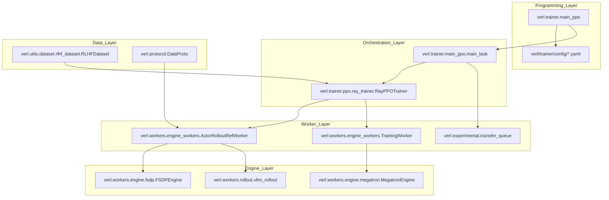

<!-- source: DeepWiki mcp.deepwiki.com · repo volcengine/verl · page 1 Overview · fetched 2026-10-21 -->

# Overview

Relevant source files

The following files were used as context for generating this wiki page:

- [README.md](README.md)
- [docs/advance/dpo_extension.rst](docs/advance/dpo_extension.rst)
- [docs/algo/baseline.md](docs/algo/baseline.md)
- [docs/algo/dapo.md](docs/algo/dapo.md)
- [docs/api/data.rst](docs/api/data.rst)
- [docs/api/single_controller.rst](docs/api/single_controller.rst)
- [docs/examples/gsm8k_example.rst](docs/examples/gsm8k_example.rst)
- [docs/examples/ppo_code_architecture.rst](docs/examples/ppo_code_architecture.rst)
- [docs/faq/faq.rst](docs/faq/faq.rst)
- [docs/hybrid_flow.rst](docs/hybrid_flow.rst)
- [docs/index.rst](docs/index.rst)
- [docs/perf/device_tuning.rst](docs/perf/device_tuning.rst)
- [docs/preparation/reward_function.rst](docs/preparation/reward_function.rst)
- [docs/start/multinode.rst](docs/start/multinode.rst)
- [docs/start/quickstart.rst](docs/start/quickstart.rst)
- [docs/workers/model_engine.rst](docs/workers/model_engine.rst)
- [examples/tutorial/slurm/ray_on_slurm.slurm](examples/tutorial/slurm/ray_on_slurm.slurm)

This document introduces the `verl` framework, its purpose as a reinforcement learning (RL) training library for large language models (LLMs), and provides a high-level overview of the system architecture. For detailed information about specific subsystems, see the child pages: [System Architecture and HybridFlow Design](#1.1), [Key Innovations and Design Patterns](#1.2), and [Supported Algorithms and Models](#1.3).

## Purpose and Scope

`verl` (**V**olcano Engine **R**einforcement **L**earning) is a flexible, efficient, and production-ready framework for post-training LLMs using RL algorithms [README.md:22-24](). It is the open-source implementation of the **HybridFlow** paper [README.md:26-27]() presented at EuroSys [README.md:14-14]().

The framework addresses the challenge of efficiently orchestrating complex RL training workflows that involve multiple distributed components: policy training, inference generation, reward computation, and value estimation [README.md:30-33](). `verl` enables researchers and practitioners to:

- Implement diverse RL algorithms (PPO, GRPO, RLOO, DAPO, etc.) with minimal code changes [README.md:30-30]().
- Scale training from single-GPU prototypes to multi-node clusters with hundreds of GPUs [README.md:34-34]().
- Integrate with existing LLM infrastructure such as PyTorch FSDP, Megatron-LM, vLLM, and SGLang [README.md:32-32]().
- Efficiently manage GPU resources across training and inference workloads via flexible device mapping [docs/index.rst:12-13]().
- Support multimodal models (**VeRL-Omni**), reasoning models, and multi-token prediction (**MTP**) [README.md:53-57](), [docs/index.rst:160-162]().

Sources: [README.md:14-34](), [docs/index.rst:12-162]()

## What is `verl`?

`verl` provides a complete software stack for LLM post-training via reinforcement learning [README.md:24-24]().

### Framework Component Stack
| Component | Purpose | Key Classes / Entities |
|-----------|---------|-------------|
| **Programming Model** | Define RL algorithm dataflows | `HybridFlow` (single/multi-controller) [docs/index.rst:8-9]() |
| **Training Orchestration** | Coordinate distributed execution | `RayPPOTrainer` [docs/index.rst:93-93]() |
| **Distributed Workers** | Execute training/inference tasks | `ActorRolloutRefWorker`, `TrainingWorker` [docs/index.rst:95-95]() |
| **Training Engines** | Backend for model training | `FSDPEngine`, `MegatronEngine`, `VeOmniEngine` [docs/index.rst:116-118](), [docs/index.rst:164-164]() |
| **Inference Engines** | High-throughput generation | `vLLM`, `SGLang`, `TensorRT-LLM` [docs/index.rst:94-99]() |
| **Data Pipeline** | Load and process training data | `RLHFDataset`, `DataProto` [docs/index.rst:49-50]() |
| **Configuration System** | Manage complex configurations | Hydra framework with OmegaConf [docs/index.rst:57-58]() |

The framework supports training on various hardware platforms including NVIDIA GPUs, AMD GPUs (ROCm), and Huawei Ascend NPUs [docs/index.rst:170-172]().

Sources: [README.md:24-24](), [docs/index.rst:8-172]()

## HybridFlow Programming Model

The HybridFlow programming model is the foundation of `verl`'s flexibility. It combines two execution paradigms [docs/index.rst:8-9]():

- **Single-Controller Paradigm**: A centralized controller orchestrates the entire workflow, dispatching data to workers and collecting results [docs/index.rst:8-9](). This is primarily implemented via `RayPPOTrainer` [docs/index.rst:93-93]().
- **Multi-Controller Paradigm**: Multiple independent controllers manage different parts of the workflow asynchronously [docs/index.rst:8-9](). This enables off-policy training, partial rollout, and truly asynchronous architectures where generation and training are decoupled [docs/index.rst:127-134]().

For details on the programming model, see [System Architecture and HybridFlow Design](#1.1).

Sources: [docs/index.rst:8-10](), [docs/index.rst:93-93](), [docs/index.rst:127-134]()

## System Architecture

Sources: [docs/index.rst:91-95](), [docs/examples/ppo_code_architecture.rst:10-11]()

## Core Subsystems

### Training Orchestration
The `RayPPOTrainer` class serves as the central orchestrator [docs/index.rst:93-93](). It manages `WorkerGroup` construction and runs the main loop of the RL algorithm (e.g., PPO) [docs/index.rst:93-93]().

### Distributed Workers
Workers are Ray remote actors that execute specific roles:
- **ActorRolloutRefWorker**: A hybrid worker that combines actor training, rollout generation, and reference computation [docs/index.rst:95-95]().
- **TrainingWorker**: A unified worker that handles training tasks for various backends like FSDP or Megatron, typically used for Critic and Reward Model roles [docs/index.rst:95-95]().

### Training Engines
The framework supports multiple training backends via configuration:
- **FSDP Backend**: Utilizes FSDP/FSDP2 for sharding and memory management [docs/index.rst:116-116]().
- **Megatron-LM Backend**: Utilizes Megatron-LM for better scalability and model parallelism [docs/index.rst:117-117]().

### Inference Engines
`verl` integrates with high-performance inference backends:
- **vLLM**: Optimized for high-throughput token generation [docs/index.rst:98-98]().
- **SGLang**: Optimized for multi-turn interactions and RadixAttention [docs/index.rst:98-98]().
- **TensorRT-LLM**: High-performance backend for NVIDIA GPUs [docs/index.rst:99-99]().

### Data Pipeline
- **RLHFDataset**: Manages tokenization and batching for RLHF workloads [docs/index.rst:50-50]().
- **DataProto**: The primary communication protocol for passing tensors and metadata between distributed workers [docs/index.rst:50-50]().

Sources: [docs/index.rst:49-99]()

## RL Training Flow

```mermaid
graph LR
    subgraph "Data_Loading"
        Dataset["verl.utils.dataset.rlhf_dataset.RLHFDataset"]
        Batch["verl.protocol.DataProto"]
    end
    
    subgraph "Rollout_Phase"
        Inference["verl.workers.engine_workers.ActorRolloutRefWorker"]
        Samples["verl.protocol.DataProto"]
    end
    
    subgraph "Evaluation_Phase"
        Reward["verl.workers.reward.RewardManager"]
        Advantage["verl.trainer.ppo.core_algos.compute_gae_advantage_return"]
    end
    
    subgraph "Policy_Update"
        Loss["verl.trainer.ppo.core_algos.compute_policy_loss"]
        Update["verl.trainer.ppo.ray_trainer.RayPPOTrainer.fit"]
    end
    
    Dataset --> Batch
    Batch --> Inference
    Inference --> Samples
    Samples --> Reward
    Reward --> Advantage
    Advantage --> Loss
    Loss --> Update
```

Sources: [docs/index.rst:73-87](), [docs/index.rst:91-95](), [docs/examples/ppo_code_architecture.rst:50-51]()

## Supported Algorithms and Models

`verl` supports a wide range of algorithms and model architectures [README.md:30-30](), [README.md:36-36]():

- **Algorithms**: PPO, GRPO, RLOO, DAPO, SPIN, SPPO, REINFORCE++, GDPO, CISPO, OTB, etc. [docs/index.rst:73-87]()
- **Models**: Qwen (2, 2.5, 3), Llama (2, 3), DeepSeek series, and MoE architectures [README.md:53-57](), [docs/algo/baseline.md:19-39]().

For details, see [Supported Algorithms and Models](#1.3).

Sources: [README.md:30-69](), [docs/index.rst:73-87](), [docs/algo/baseline.md:19-39]()

## Getting Started

To begin using `verl`:

1.  **Installation**: Follow the instructions for Docker or local environment setup using `uv` or `pip` [docs/index.rst:31-31]().
2.  **Data Preparation**: Prepare your datasets in Parquet format with the required fields (`prompt`, `ground_truth`) [examples/data_preprocess/gsm8k.py:99-100]().
3.  **Run Training**: Use provided recipes for common algorithms like PPO or GRPO via the main entry points [docs/index.rst:31-33]().

For more information, see Getting Started (Section 2).

Sources: [docs/index.rst:31-33](), [examples/data_preprocess/gsm8k.py:99-100]()

---

