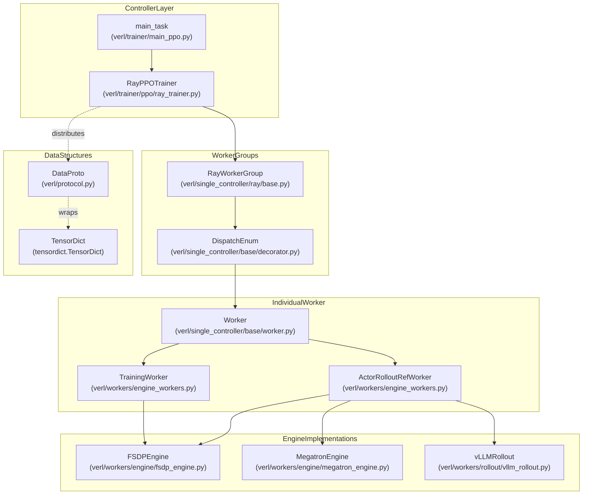
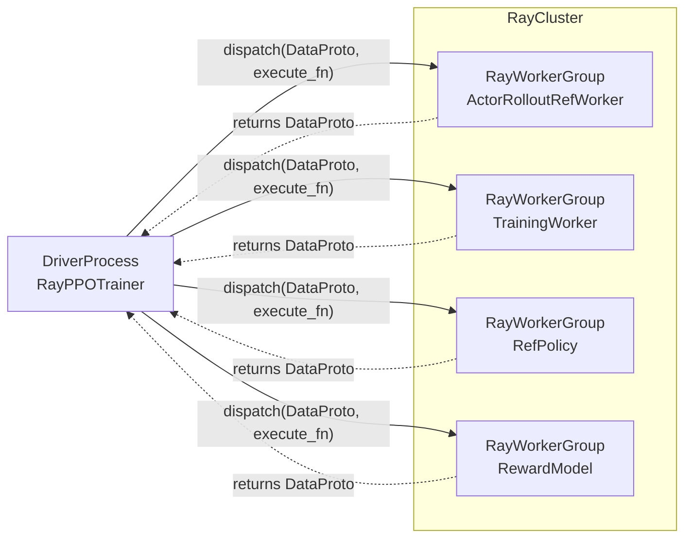
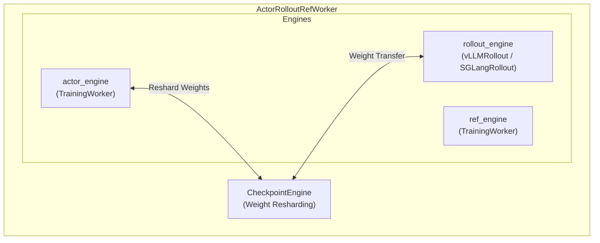

<!-- source: DeepWiki mcp.deepwiki.com · repo volcengine/verl · page 1.1 System Architecture and HybridFlow Design · fetched 2026-10-21 -->

# System Architecture and HybridFlow Design

Relevant source files

The following files were used as context for generating this wiki page:

- [README.md](README.md)
- [docs/advance/dpo_extension.rst](docs/advance/dpo_extension.rst)
- [docs/algo/baseline.md](docs/algo/baseline.md)
- [docs/algo/dapo.md](docs/algo/dapo.md)
- [docs/api/data.rst](docs/api/data.rst)
- [docs/api/single_controller.rst](docs/api/single_controller.rst)
- [docs/examples/gsm8k_example.rst](docs/examples/gsm8k_example.rst)
- [docs/examples/ppo_code_architecture.rst](docs/examples/ppo_code_architecture.rst)
- [docs/faq/faq.rst](docs/faq/faq.rst)
- [docs/hybrid_flow.rst](docs/hybrid_flow.rst)
- [docs/index.rst](docs/index.rst)
- [docs/perf/device_tuning.rst](docs/perf/device_tuning.rst)
- [docs/preparation/reward_function.rst](docs/preparation/reward_function.rst)
- [docs/start/multinode.rst](docs/start/multinode.rst)
- [docs/start/quickstart.rst](docs/start/quickstart.rst)
- [docs/workers/model_engine.rst](docs/workers/model_engine.rst)
- [examples/tutorial/slurm/ray_on_slurm.slurm](examples/tutorial/slurm/ray_on_slurm.slurm)
- [tests/single_controller/test_data_transfer.py](tests/single_controller/test_data_transfer.py)
- [tests/single_controller/test_device_mesh_register.py](tests/single_controller/test_device_mesh_register.py)
- [tests/single_controller/test_high_level_scheduling_api.py](tests/single_controller/test_high_level_scheduling_api.py)
- [tests/single_controller/test_ray_collectives.py](tests/single_controller/test_ray_collectives.py)
- [tests/single_controller/test_split_resource_pool.py](tests/single_controller/test_split_resource_pool.py)
- [tests/single_controller/test_worker_group_basics.py](tests/single_controller/test_worker_group_basics.py)
- [verl/single_controller/base/worker.py](verl/single_controller/base/worker.py)
- [verl/single_controller/base/worker_group.py](verl/single_controller/base/worker_group.py)
- [verl/single_controller/ray/__init__.py](verl/single_controller/ray/__init__.py)
- [verl/single_controller/ray/base.py](verl/single_controller/ray/base.py)

## Purpose and Scope

This document describes verl's **HybridFlow** programming model and the overall system architecture that enables flexible, efficient reinforcement learning for large language models. HybridFlow is the open-source implementation of the research paper ["HybridFlow: A Flexible and Efficient RLHF Framework"](https://arxiv.org/abs/2409.19256v2).

**Scope:** This page covers the architectural foundations and design principles of HybridFlow, focusing on the programming model, single-controller paradigm, and data orchestration.
- RL training loop mechanics → see [3.1]()
- Distributed execution with Ray → see [5]()
- Worker implementations → see [6]()
- Engine backends → see [8]()

Sources: [README.md:26-27](), [docs/index.rst:4-5]()

## What is HybridFlow?

HybridFlow is a **hybrid controller programming model** that combines single-controller and multi-controller paradigms to enable flexible representation and efficient execution of complex post-training dataflows. The key innovation is **decoupling computation from data dependencies**, allowing seamless integration with existing LLM frameworks (FSDP, Megatron-LM, vLLM, SGLang) while supporting flexible device mapping.

**Key Design Principles:**

1. **Single-Controller Orchestration**: A central controller coordinates all distributed workers via Ray, simplifying control flow [docs/index.rst:8-9]().
2. **Computation-Data Decoupling**: Workers perform computations independently; data dependencies are resolved through `DataProto` objects [verl/single_controller/base/decorator.py:91-117]().
3. **Hybrid Engine Architecture**: The same worker can switch between training and inference modes, eliminating redundant model copies [README.md:42-43]().
4. **Flexible Resource Allocation**: Models can be placed on different GPU sets for efficient resource utilization and scalability across different cluster sizes [README.md:34-35](), [docs/index.rst:12-13]().

Sources: [README.md:28-43](), [docs/index.rst:8-22](), [verl/single_controller/base/decorator.py:91-117]()

## High-Level Architecture and Code Entity Mapping

The following diagram bridges natural language space to code entity space, mapping high-level system components to their concrete implementation classes and modules within the codebase:

Title: System Architecture and Code Entities

Sources: [verl/single_controller/ray/base.py:113-164](), [verl/single_controller/base/worker.py:76-82](), [verl/single_controller/base/decorator.py:26-32]()

## Single-Controller vs Multi-Controller Paradigms

verl adopts a **single-controller** architecture where the driver entry point orchestrates all distributed workers. This contrasts with traditional multi-controller setups (where each node runs independent control loops). By using a single Python driver, complex RL training pipelines (rollout generation, reward evaluation, advantage estimation, policy optimization) are expressed imperatively.

Title: Single-Controller Communication Pattern and Code Mapping

Sources: [verl/single_controller/ray/base.py:113-164](), [verl/single_controller/base/worker_group.py:123-127]()

### Implementation Details

The `RayPPOTrainer` implements the central control logic in a standard Python training loop, while `RayWorkerGroup` manages the mapping of single-process calls to distributed Ray actor executions.

**Key Components:**
- **RayPPOTrainer**: Orchestrates worker construction and the primary execution loop for algorithms like PPO.
- **RayWorkerGroup**: Manages collections of `Worker` instances anchored to Ray placement groups [verl/single_controller/ray/base.py:113-164](). The `WorkerGroup` base class provides methods for worker management, aliveness checking, and method binding [verl/single_controller/base/worker_group.py:123-127]().
- **DataProto**: Provides a unified interface for passing tensors and metadata between the driver controller and distributed workers, incorporating automatic padding [verl/single_controller/base/decorator.py:91-117]().

Sources: [verl/single_controller/ray/base.py:113-164](), [verl/single_controller/base/decorator.py:91-117](), [verl/single_controller/base/worker_group.py:123-127]()

## Data Flow and DataProto

The `DataProto` class and its underlying `TensorDict` representation serve as the fundamental data communication primitives across the framework. They encapsulate both tensors and arbitrary non-tensor metadata, allowing verl to cleanly decouple computation logic from underlying cluster sharding structures.

### Communication Flow

When the controller dispatches execution to a worker group, `DataProto` manages transformations:
1. **Padding**: Data can be automatically padded to match worker counts or tensor slice constraints, tracked via `_padding_size_key` [verl/single_controller/ray/base.py:53-53]().
2. **Splitting**: Distributed tasks use automatic padding to partition inputs into chunks matching worker world sizes [docs/advance/dpo_extension.rst:161-162]().
3. **Merging**: Worker outputs are concatenated back into unified structures [docs/advance/dpo_extension.rst:170-171]().

### Metadata Handling
verl utilizes `TensorDict`'s capability to store non-tensor objects alongside tensor payloads, managing auxiliary states and dictionaries seamlessly [verl/utils/tensordict_utils.py:26-46]().

Sources: [verl/single_controller/ray/base.py:53-53](), [docs/advance/dpo_extension.rst:161-162](), [docs/advance/dpo_extension.rst:170-171](), [verl/utils/tensordict_utils.py:26-46]()

## Hybrid Engine Architecture

The **3D-HybridEngine** design enables a single worker group to multiplex across multiple operational roles (Actor training, Rollout generation, and Reference log-probability computation) without duplicating model weights in memory. This is achieved by using `ActorRolloutRefWorker` which can act as a standalone actor, rollout, or a hybrid engine depending on configuration [docs/examples/ppo_code_architecture.rst:102-105]().

Title: Hybrid Engine Design and Component Entities

Sources: [README.md:42-43](), [docs/workers/model_engine.rst:92-96]()

### Key Features:
- **Resharding**: Eliminates memory duplication and minimizes communication overhead during transitions between training and inference phases [README.md:42-43](). The `CheckpointEngine` abstraction handles saving and loading intermediate sharded checkpoints, including model, optimizer, and LR scheduler states [docs/workers/model_engine.rst:92-96]().
- **Backend Abstraction**: Supports FSDP/FSDP2 for flexible prototyping and Megatron-LM for ultra-scale training [docs/start/install.rst:18-20](). The backend selection is driven by configuration parameters like `config.actor_rollout_ref.actor.strategy` and `config.critic.strategy` [docs/examples/ppo_code_architecture.rst:107-109]().
- **Inference Integration**: Integrates directly with vLLM and SGLang for high-throughput rollout generation [docs/start/install.rst:13-13]().

Sources: [README.md:42-43](), [docs/start/install.rst:13-20](), [docs/workers/model_engine.rst:92-96](), [docs/examples/ppo_code_architecture.rst:102-105](), [docs/examples/ppo_code_architecture.rst:107-109]()

## Summary of Innovations

HybridFlow resolves the trade-off between architectural flexibility and performance through:
1. **Separating Control and Computation**: Python-driven drivers manage high-level RL routines, while dedicated workers execute high-throughput neural network operations [docs/index.rst:8-9]().
2. **Unified Data Interface**: `DataProto` and `TensorDict` isolate the controller from worker sharding specifics [verl/single_controller/base/decorator.py:91-117]().
3. **Flexible Device Mapping**: Models can be placed on configurable groups of accelerators [README.md:34-35](). `RayResourcePool` manages the allocation of resources (e.g., GPUs) to placement groups for workers [verl/single_controller/ray/base.py:113-164]().
4. **TransferQueue Integration**: Asynchronous data pipelines decouple execution boundaries across asynchronous stages [verl/utils/transferqueue_utils.py:184-202](). TransferQueue provides fine-grained, sub-sample-level data management and load-balancing capabilities, acting as a data gateway that decouples explicit data dependencies across computational tasks [docs/data/transfer_queue.md:20-22]().

Sources: [docs/index.rst:8-9](), [verl/single_controller/base/decorator.py:91-117](), [README.md:34-35](), [verl/utils/transferqueue_utils.py:184-202](), [verl/single_controller/ray/base.py:113-164](), [docs/data/transfer_queue.md:20-22]()

---

