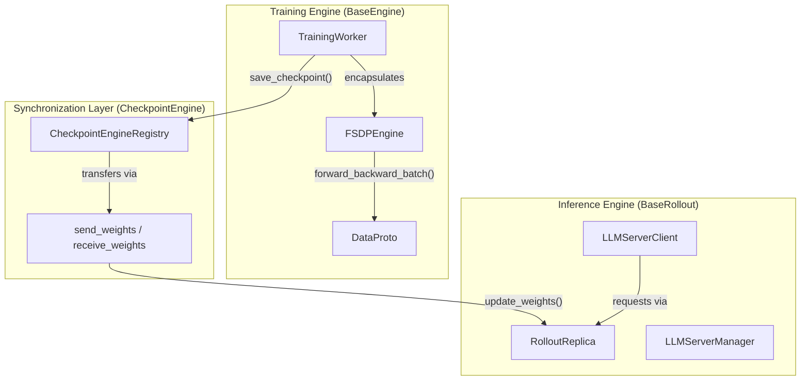
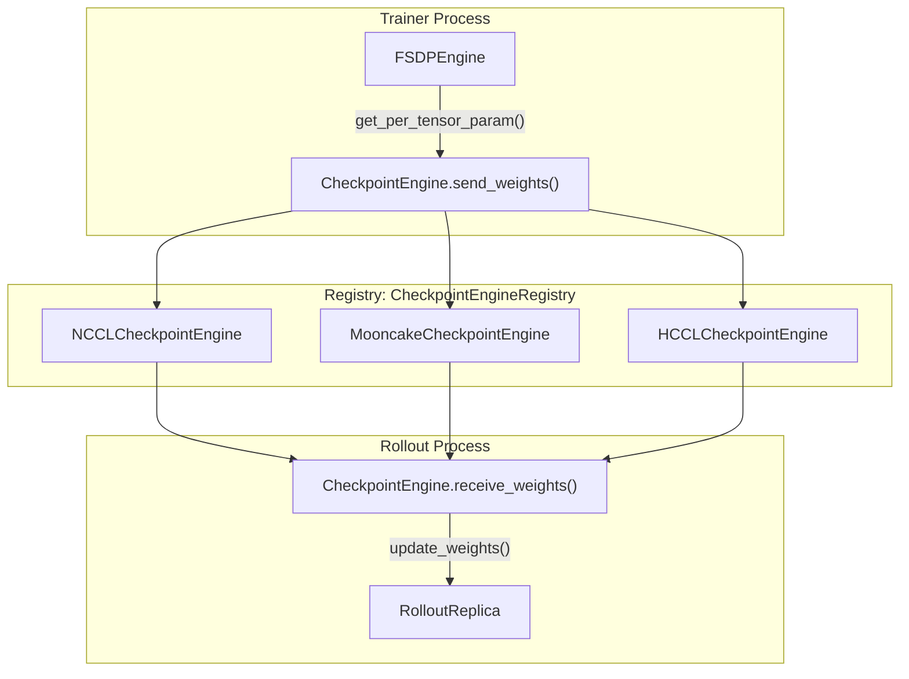
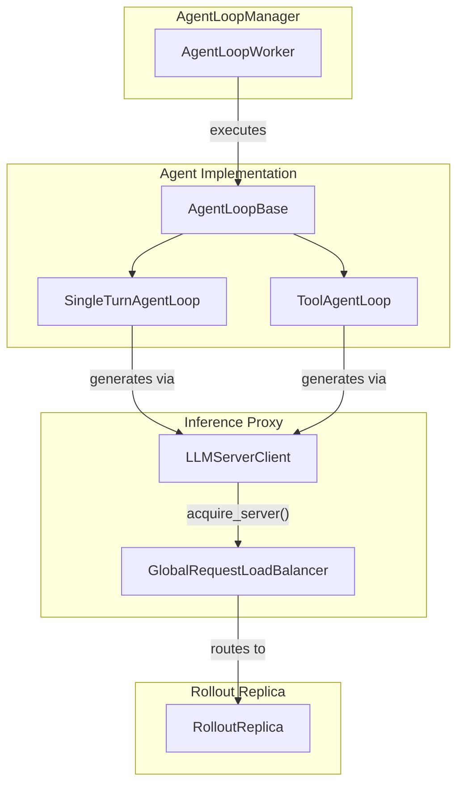

<!-- source: DeepWiki mcp.deepwiki.com · repo volcengine/verl · page 1.2 Key Innovations and Design Patterns · fetched 2026-10-21 -->

# Key Innovations and Design Patterns

Relevant source files

The following files were used as context for generating this wiki page:

- [README.md](README.md)
- [docs/faq/faq.rst](docs/faq/faq.rst)
- [docs/index.rst](docs/index.rst)
- [tests/checkpoint_engine/test_correctness_on_gpu.py](tests/checkpoint_engine/test_correctness_on_gpu.py)
- [tests/checkpoint_engine/test_correctness_on_npu.py](tests/checkpoint_engine/test_correctness_on_npu.py)
- [tests/checkpoint_engine/test_utils.py](tests/checkpoint_engine/test_utils.py)
- [tests/experimental/agent_loop/test_agent_loop_extra_fields_schema_on_cpu.py](tests/experimental/agent_loop/test_agent_loop_extra_fields_schema_on_cpu.py)
- [tests/experimental/agent_loop/test_basic_agent_loop.py](tests/experimental/agent_loop/test_basic_agent_loop.py)
- [tests/experimental/agent_loop/test_multi_modal.py](tests/experimental/agent_loop/test_multi_modal.py)
- [verl/checkpoint_engine/README.md](verl/checkpoint_engine/README.md)
- [verl/checkpoint_engine/__init__.py](verl/checkpoint_engine/__init__.py)
- [verl/checkpoint_engine/base.py](verl/checkpoint_engine/base.py)
- [verl/checkpoint_engine/hccl_checkpoint_engine.py](verl/checkpoint_engine/hccl_checkpoint_engine.py)
- [verl/checkpoint_engine/kimi_checkpoint_engine.py](verl/checkpoint_engine/kimi_checkpoint_engine.py)
- [verl/checkpoint_engine/mooncake_checkpoint_engine.py](verl/checkpoint_engine/mooncake_checkpoint_engine.py)
- [verl/checkpoint_engine/nccl_checkpoint_engine.py](verl/checkpoint_engine/nccl_checkpoint_engine.py)
- [verl/checkpoint_engine/nixl_checkpoint_engine.py](verl/checkpoint_engine/nixl_checkpoint_engine.py)
- [verl/experimental/agent_loop/agent_loop.py](verl/experimental/agent_loop/agent_loop.py)
- [verl/experimental/agent_loop/single_turn_agent_loop.py](verl/experimental/agent_loop/single_turn_agent_loop.py)
- [verl/experimental/agent_loop/tool_agent_loop.py](verl/experimental/agent_loop/tool_agent_loop.py)
- [verl/utils/net_utils.py](verl/utils/net_utils.py)

## Purpose and Scope

This page documents the core architectural innovations and design patterns that distinguish `verl` from traditional RLHF frameworks. It covers the technical mechanisms behind `verl`'s flexibility and efficiency, focusing on concrete implementation patterns, weight resharding strategies via the `CheckpointEngine` abstraction and 3D-HybridEngine, hybrid worker designs, checkpoint engine implementations (`NCCLCheckpointEngine`, `MooncakeCheckpointEngine`, `HCCLCheckpointEngine`), and agent loop integrations (`AgentLoopManager`, `ToolAgentLoop`, `SingleTurnAgentLoop`, `LLMServerClient`) for multi-turn reasoning and agentic reinforcement learning.

Sources: [verl/checkpoint_engine/base.py:116-128]()

---

## 1. HybridFlow Architecture: Decoupled Training and Inference

### 1.1 Core Principle

The HybridFlow architecture separates computation into two distinct execution paths, enabling seamless integration with existing LLM infrastructure while decoupling data dependencies.

1.  **Training Path**: Utilizes frameworks like **PyTorch FSDP** or **Megatron-LM** for efficient parameter updates and gradient computation. The `TrainingWorker` orchestrates this via a single-controller API, delegating execution to a `BaseEngine` implementation.
2.  **Inference Path**: Leverages high-throughput inference engines such as **vLLM** or **SGLang** for rollout generation via `RolloutReplica` and `LLMServerClient` [verl/workers/rollout/llm_server.py:43-55]().

This decoupling allows each subsystem to use specialized kernels and optimized memory layouts. For example, the inference path uses PagedAttention or RadixAttention, while the training path focuses on distributed sharding and gradient accumulation.

**Diagram: HybridFlow Execution Model and Code Entities**

Sources: [verl/workers/rollout/llm_server.py:43-88](), [verl/checkpoint_engine/base.py:116-128]()

---

## 2. 3D-HybridEngine: Efficient Weight Resharding

### 2.1 The Memory Redundancy Problem

In large-scale RLHF, model weights are often duplicated across training and inference processes. This leads to memory redundancy and significant communication bottlenecks when synchronizing updates across different parallelization strategies (e.g., FSDP sharding vs. Megatron Tensor Parallelism).

### 2.2 Solution: Unified CheckpointEngine Abstraction

The `CheckpointEngine` provides a unified abstract layer to synchronize weights between diverse training and inference backends [verl/checkpoint_engine/base.py:116-128](). It defines three primary APIs: `send_weights`, `receive_weights`, and `get_weights` [verl/checkpoint_engine/README.md:6-10](). The `CheckpointEngineRegistry` allows dynamic backend selection at runtime [verl/checkpoint_engine/base.py:49-93]().

**Diagram: CheckpointEngine Architecture and Implementations**

Sources: [verl/checkpoint_engine/base.py:49-128](), [verl/checkpoint_engine/nccl_checkpoint_engine.py:120-148]()

### 2.3 Bucketed Weight Transfer and Engine Implementations

To minimize communication overhead, `verl` packs sharded parameters into contiguous buckets described by `TensorMeta` (name, shape, dtype, chunk offset, chunk size, offset) [verl/checkpoint_engine/base.py:34-47](). 

Different backend implementations utilize specialized communication protocols:
- `NCCLCheckpointEngine`: Broadcasts weight buckets using PyTorch/NCCL collectives and ZeroMQ for metadata distribution [verl/checkpoint_engine/nccl_checkpoint_engine.py:120-155]().
- `MooncakeCheckpointEngine`: Leverages the Mooncake `TransferEngine` for high-performance P2P memory transfers with RDMA or direct transport [verl/checkpoint_engine/mooncake_checkpoint_engine.py:38-94]().
- `HCCLCheckpointEngine`: Implements Ascend NPU-specific weight synchronization using HCCL and StatelessProcessGroup [verl/checkpoint_engine/hccl_checkpoint_engine.py:104-146]().

| Backend | Comm Library | Hardware | Performance | Use Case |
| :--- | :--- | :--- | :--- | :--- |
| **nccl** | NCCL + ZMQ | NVIDIA GPU | Very High | Distributed on-policy/off-policy training [verl/checkpoint_engine/nccl_checkpoint_engine.py:120]() |
| **hccl** | HCCL + ZMQ | Ascend NPU | High | Huawei Ascend clusters [verl/checkpoint_engine/hccl_checkpoint_engine.py:104]() |
| **mooncake** | TransferEngine | NVIDIA/Ascend | High | Disaggregated clusters with P2P transfer [verl/checkpoint_engine/mooncake_checkpoint_engine.py:38]() |

Sources: [verl/checkpoint_engine/base.py:34-47](), [verl/checkpoint_engine/nccl_checkpoint_engine.py:120-155](), [verl/checkpoint_engine/mooncake_checkpoint_engine.py:38-94](), [verl/checkpoint_engine/hccl_checkpoint_engine.py:104-146]()

---

## 3. Hybrid Worker Design and Mode Switching

### 3.1 Rollout Deployment Modes

`verl` supports flexible deployment configurations orchestrated through Ray resource pools:
*   **HYBRID**: Rollout and training engines fused in the same process, sharing GPU memory contexts.
*   **STANDALONE / Disaggregated**: Separate worker groups for training and inference, communicating via `CheckpointEngine` weight transfer.
*   **COLOCATED**: Shared resource pools where inference replicas run alongside training workers with optimized memory handoffs.

### 3.2 BaseEngine Lifecycle

The `BaseEngine` abstract interface defines standard lifecycle management across backends:
*   **Initialization**: `initialize()` sets up model parallelism, optimizer states, and device placement.
*   **Mode Switching**: `train_mode()` and `eval_mode()` context managers handle gradient tracking and dropout state transitions.
*   **Memory Management**: Engines support parameter and optimizer offloading flags (`is_param_offload_enabled`, `is_optimizer_offload_enabled`) to mitigate memory pressure during rollout generation.

Sources: [verl/checkpoint_engine/base.py:116-128]()

---

## 4. Agent Loop Integration and Multi-Turn Orchestration

### 4.1 Agent Loop Architecture

For multi-turn conversation and agentic reinforcement learning, `verl` provides an asynchronous agent framework centered around agent loop abstractions such as `AgentLoopBase`, `SingleTurnAgentLoop` [verl/experimental/agent_loop/single_turn_agent_loop.py:28-36](), and `ToolAgentLoop` [verl/experimental/agent_loop/tool_agent_loop.py:101-125](). 

The `LLMServerClient` manages communication across OpenAI-compatible inference servers, featuring least-in-flight load balancing and sticky sessions for prefix caching via request load balancers [verl/workers/rollout/llm_server.py:43-48]().

**Diagram: Agent Loop and LLM Server Client Integration**

Sources: [verl/workers/rollout/llm_server.py:43-88](), [verl/experimental/agent_loop/single_turn_agent_loop.py:28-36](), [verl/experimental/agent_loop/tool_agent_loop.py:101-125]()

### 4.2 Data Standardization and Tensor Conversion

Agent execution produces structured output objects like `AgentLoopOutput` containing prompt token IDs, response token IDs, response masks, log probabilities, and multi-turn metrics [verl/experimental/agent_loop/agent_loop.py:88-116](). The `as_dict()` method translates these outputs into PyTorch tensors (`prompts`, `responses`, `response_mask`, `rollout_log_probs`), aligning them into `DataProto` batches for downstream RL training and advantage estimation [verl/experimental/agent_loop/agent_loop.py:117-149]().

Sources: [verl/experimental/agent_loop/agent_loop.py:88-161]()

---

## Summary of Design Patterns

| Pattern | Code Entity | Purpose |
| :--- | :--- | :--- |
| **Engine Abstraction** | `BaseEngine` | Decouples RL training logic from backend training frameworks (FSDP vs Megatron). |
| **Registry Pattern** | `CheckpointEngineRegistry` [verl/checkpoint_engine/base.py:49]() | Dynamically instantiates weight synchronization engines (`nccl`, `hccl`, `mooncake`). |
| **Bucketed Transfer** | `TensorMeta` [verl/checkpoint_engine/base.py:34]() | Packs sharded parameters into contiguous memory buckets for efficient network transfer. |
| **Load Balancing Client** | `LLMServerClient` [verl/workers/rollout/llm_server.py:43]() | Coordinates sticky sessions and load balancing across distributed rollout replicas. |

Sources: [verl/checkpoint_engine/base.py:34-93](), [verl/workers/rollout/llm_server.py:43-88]()

---

