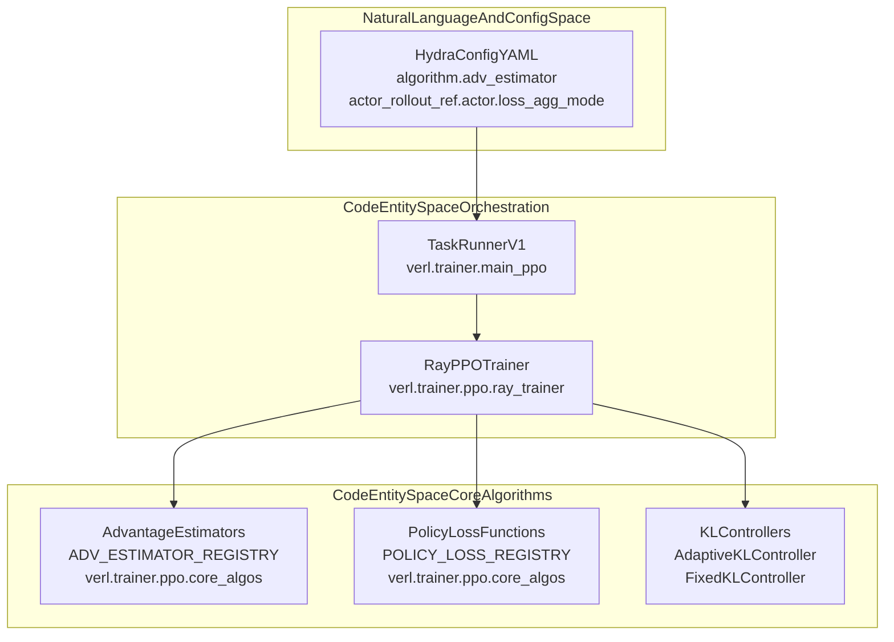
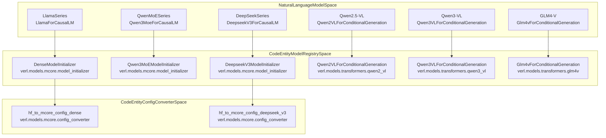
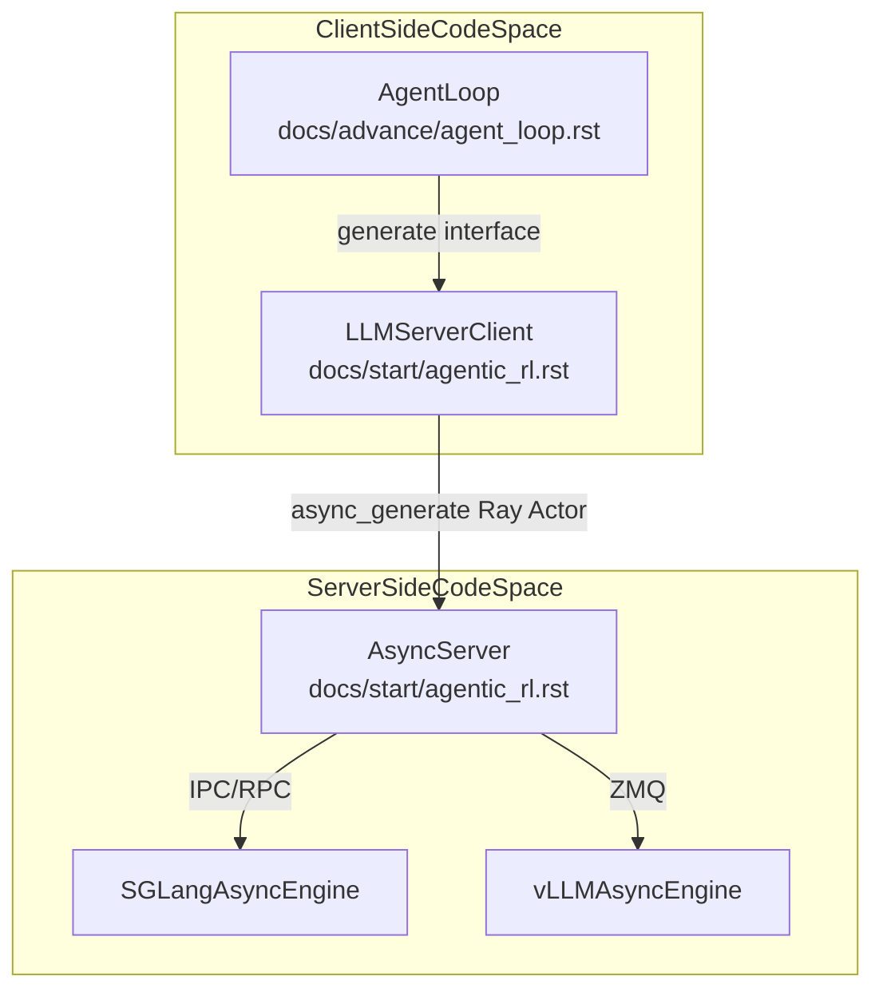

<!-- source: DeepWiki mcp.deepwiki.com · repo volcengine/verl · page 1.3 Supported Algorithms and Models · fetched 2026-10-21 -->

# Supported Algorithms and Models

Relevant source files

The following files were used as context for generating this wiki page:

- [README.md](README.md)
- [docs/examples/config.rst](docs/examples/config.rst)
- [docs/faq/faq.rst](docs/faq/faq.rst)
- [docs/index.rst](docs/index.rst)
- [docs/perf/perf_tuning.rst](docs/perf/perf_tuning.rst)
- [tests/models/test_fused_kernels_ulysses_sp_on_cpu.py](tests/models/test_fused_kernels_ulysses_sp_on_cpu.py)
- [tests/utils/test_experimental_torch_functional_on_cpu.py](tests/utils/test_experimental_torch_functional_on_cpu.py)
- [verl/models/transformers/dense_common.py](verl/models/transformers/dense_common.py)
- [verl/models/transformers/glm4v.py](verl/models/transformers/glm4v.py)
- [verl/models/transformers/kimi_vl.py](verl/models/transformers/kimi_vl.py)
- [verl/models/transformers/llama.py](verl/models/transformers/llama.py)
- [verl/models/transformers/monkey_patch.py](verl/models/transformers/monkey_patch.py)
- [verl/models/transformers/qwen2.py](verl/models/transformers/qwen2.py)
- [verl/models/transformers/qwen2_vl.py](verl/models/transformers/qwen2_vl.py)
- [verl/models/transformers/qwen3_5.py](verl/models/transformers/qwen3_5.py)
- [verl/models/transformers/qwen3_vl.py](verl/models/transformers/qwen3_vl.py)
- [verl/trainer/config/ppo_megatron_trainer.yaml](verl/trainer/config/ppo_megatron_trainer.yaml)
- [verl/trainer/config/ppo_trainer.yaml](verl/trainer/config/ppo_trainer.yaml)
- [verl/trainer/main_ppo.py](verl/trainer/main_ppo.py)
- [verl/trainer/ppo/core_algos.py](verl/trainer/ppo/core_algos.py)
- [verl/trainer/ppo/ray_trainer.py](verl/trainer/ppo/ray_trainer.py)
- [verl/utils/experimental/torch_functional.py](verl/utils/experimental/torch_functional.py)
- [verl/utils/ulysses.py](verl/utils/ulysses.py)

This page documents the reinforcement learning algorithms, advantage estimators, compatible model architectures, and advanced computational features supported within the `verl` framework. It serves as a technical reference for mapping high-level post-training workflows to underlying code entities, configuration parameters, and execution paths.

## Overview of Algorithm Support

`verl` employs a decoupled architecture where algorithm selection is independent of the underlying model parallel engine (e.g., FSDP, Megatron-Core) and rollout backend (e.g., vLLM, SGLang). The framework natively supports a comprehensive suite of post-training methods spanning on-policy RL, group-based optimization, preference learning, and specialized policy gradient variants [verl/trainer/ppo/core_algos.py:88-111](), [verl/trainer/config/ppo_trainer.yaml:73-82]().

### Algorithm Configuration and Code Mapping

The diagram below maps natural language configuration parameters and high-level training concepts to concrete code entities across the orchestration and algorithm execution layers.

**Title: Algorithm Configuration to Execution Mapping**

Sources: [verl/trainer/ppo/core_algos.py:37-151](), [verl/trainer/main_ppo.py:34-155]()

---

## Reinforcement Learning Algorithms

### PPO (Proximal Policy Optimization)
Standard PPO utilizes a clipped surrogate objective and optional KL penalties. `verl` implements an actor-critic paradigm where components like advantage estimation and KL control are decoupled [verl/trainer/ppo/core_algos.py:88-97]().

*   **Actor-Critic Architecture**: Requires both an actor model (policy) and a critic model (value function).
*   **GAE**: Uses Generalized Advantage Estimation for computing low-bias, variance-reduced advantage values [verl/trainer/ppo/core_algos.py:97]().
*   **KL Control**: Supports both `fixed` and `adaptive` KL controllers via `get_kl_controller` [verl/trainer/ppo/core_algos.py:193-213]().

Sources: [verl/trainer/ppo/core_algos.py:88-213]()

### GRPO (Group Relative Policy Optimization)
A critic-less algorithm that computes advantages using group-based reward normalization [verl/trainer/ppo/core_algos.py:98]().

*   **Critic-less**: Eliminates the separate value network, reducing memory footprint.
*   **Group Sampling**: Generates multiple completions per prompt to form a comparative group [verl/trainer/ppo/core_algos.py:98]().
*   **PrefixGrouper**: Optimizes shared prompt prefixes in group-based training to eliminate redundant attention computations [verl/models/transformers/monkey_patch.py:36-73]().

Sources: [verl/trainer/ppo/core_algos.py:98](), [verl/models/transformers/monkey_patch.py:36-73]()

### RLOO (REINFORCE Leave-One-Out)
Variance-reduced policy gradient using a leave-one-out baseline computed across a group of sampled completions [verl/trainer/ppo/core_algos.py:102]().

Sources: [verl/trainer/ppo/core_algos.py:102]()

### DAPO (Decoupled Clip and Dynamic Sampling Policy Optimization)
An algorithm variant utilizing decoupled asymmetric clipping and dynamic group filtering mechanisms [verl/trainer/config/ppo_trainer.yaml:79-96]().

*   **Decoupled Clipping**: Controlled via separate lower and upper bound thresholds [verl/trainer/config/ppo_trainer.yaml:121-131]().
*   **Dynamic Sampling**: Enables filtering of generation batches based on metrics like accuracy (`acc`) or reward to enhance sample efficiency [verl/trainer/config/ppo_trainer.yaml:80-96]().

Sources: [verl/trainer/config/ppo_trainer.yaml:79-131]()

### GMPO (Group-based Mixed Preference Optimization)
Supports mixed preference objectives and group-level advantage scaling for robust generation tuning [verl/trainer/ppo/core_algos.py:110]().

Sources: [verl/trainer/ppo/core_algos.py:110]()

### SAPO (Smooth Advantage Policy Optimization)
Applies smoothing functions to advantage estimations and policy clipping bounds to prevent abrupt gradient spikes [verl/trainer/ppo/core_algos.py:109]().

Sources: [verl/trainer/ppo/core_algos.py:109]()

### DPPO (Distributional / Decoupled PPO variants)
Implements advanced distributional policy updates and decoupled surrogate objectives [verl/trainer/ppo/core_algos.py:111]().

Sources: [verl/trainer/ppo/core_algos.py:111]()

### GSPO (Group Sequence Policy Optimization)
Optimizes sequence-level objectives across sampled groups with tailored reward aggregation [verl/trainer/ppo/core_algos.py:98]().

Sources: [verl/trainer/ppo/core_algos.py:98]()

### GPG (Group Preference Gradient)
Preference-based policy updates operating over group comparison scores [verl/trainer/ppo/core_algos.py:105]().

Sources: [verl/trainer/ppo/core_algos.py:105]()

### OTB (Optimal Token Baseline)
Token-level baseline estimation for fine-grained credit assignment during sequence generation [verl/trainer/ppo/core_algos.py:108]().

Sources: [verl/trainer/ppo/core_algos.py:108]()

### GDPO (Generalized Decoupled Policy Optimization)
Decoupled advantage estimation and policy loss computation for flexible hybrid objectives [verl/trainer/ppo/core_algos.py:111]().

Sources: [verl/trainer/ppo/core_algos.py:111]()

### REINFORCE++
Enhanced REINFORCE algorithm featuring improved baseline estimation and token-level updates [verl/trainer/ppo/core_algos.py:99]().

Sources: [verl/trainer/ppo/core_algos.py:99]()

### CISPO (Constrained Implicit Soft Policy Optimization)
Implicit soft constraint optimization ensuring policy updates remain within safe KL or distribution boundaries [verl/trainer/ppo/core_algos.py:104]().

Sources: [verl/trainer/ppo/core_algos.py:104]()

---

## Advantage Estimators

Advantage estimation functions are registered in `ADV_ESTIMATOR_REGISTRY` and configured via `algorithm.adv_estimator` [verl/trainer/config/ppo_trainer.yaml:73-74](), [verl/trainer/ppo/core_algos.py:113-116]().

| Estimator Name | `AdvantageEstimator` Enum Value | Description / Reference |
| :--- | :--- | :--- |
| **GAE** | `gae` | Generalized Advantage Estimation [verl/trainer/ppo/core_algos.py:97]() |
| **GRPO** | `grpo` | Group relative reward normalization [verl/trainer/ppo/core_algos.py:98]() |
| **RLOO** | `rloo` | Leave-one-out baseline within group [verl/trainer/ppo/core_algos.py:102]() |
| **REINFORCE++** | `reinforce_plus_plus` | Enhanced REINFORCE baseline [verl/trainer/ppo/core_algos.py:99]() |
| **GDPO** | `gdpo` | Generalized decoupled policy optimization [verl/trainer/ppo/core_algos.py:111]() |
| **OTB** | `optimal_token_baseline` | Token-level optimal baseline [verl/trainer/ppo/core_algos.py:108]() |
| **ReMax** | `remax` | Maximum reward baseline [verl/trainer/ppo/core_algos.py:101]() |

Sources: [verl/trainer/ppo/core_algos.py:88-111]()

---

## Supported Model Architectures

`verl` supports diverse model architectures across HuggingFace and Megatron-Core backends.

### Model Families
*   **Qwen Series**: Qwen2, Qwen2-MoE, Qwen2.5-VL, Qwen3, Qwen3-MoE [docs/algo/baseline.md:22-31]()
*   **Llama Series**: LlamaForCausalLM, Llama4, and sequence classification variants [docs/algo/baseline.md:27]()
*   **DeepSeek**: DeepSeek-V3 and DeepSeek-R1 series [docs/algo/baseline.md:28]()
*   **Gemma**: Gemma-2-2b-it and subsequent variants [docs/algo/baseline.md:19-21]()
*   **Mistral / Mixtral**: MixtralForCausalLM and sparse mixture-of-experts variants [docs/algo/baseline.md:35-36]()
*   **Multimodal (VL)**: Qwen2.5-VL [verl/models/transformers/qwen2_vl.py:24-28](), Qwen3-VL [verl/models/transformers/qwen3_vl.py:23-26](), GLM4-V [verl/models/transformers/glm4v.py:25-28](), Kimi-VL [verl/models/transformers/kimi_vl.py:24-27]()

### Model Architecture to Code Entity Mapping

The diagram below maps high-level model architecture names to specific internal initializers and configuration converter functions.

**Title: Model Architecture to Code Entity Mapping**

Sources: [docs/algo/baseline.md:19-39](), [verl/models/transformers/qwen2_vl.py:24-28](), [verl/models/transformers/qwen3_vl.py:23-26](), [verl/models/transformers/glm4v.py:25-28]()

---

## Advanced Model Features and Agentic RL

### Parallelism and Optimizations
*   **DeepSpeed-Ulysses Sequence Parallelism**: Scales sequence lengths via all-to-all communication across attention heads [verl/utils/ulysses.py:14-18](). This is integrated into attention mechanisms, for example, in Llama models [verl/models/transformers/llama.py:79-87]() and Qwen2-VL models [verl/models/transformers/qwen2_vl.py:33-39]().
*   **PrefixGrouper**: Optimizes multi-prompt attention computation for GRPO [verl/models/transformers/monkey_patch.py:36-73]().
*   **Multi-Token Prediction (MTP)**: Supports multi-token prediction heads via `MtpConfig` [verl/workers/config/model.py:30-68]().

Sources: [verl/models/transformers/monkey_patch.py:36-73](), [verl/workers/config/model.py:30-68](), [verl/models/transformers/llama.py:79-87](), [verl/models/transformers/qwen2_vl.py:33-39](), [verl/utils/ulysses.py:14-18]()

### Agentic RL Integration
`verl` supports Agentic RL training, enabling models to interact with tool environments across multi-turn trajectories using server-based asynchronous rollouts [docs/start/agentic_rl.rst:8-21]().

**Title: Agentic RL System Architecture**

Sources: [docs/start/agentic_rl.rst:36-45](), [docs/advance/agent_loop.rst:80-82]()

*   **`AgentLoopBase`**: Abstract interface defining the `run` method for user-defined agent trajectories [docs/advance/agent_loop.rst:44-57]().
*   **`AsyncServerBase`**: Abstract server interface providing unified `chat_completion` and token-level `generate` endpoints for vLLM and SGLang [docs/advance/agent_loop.rst:115-143]().

Sources: [docs/start/agentic_rl.rst:1-128](), [docs/advance/agent_loop.rst:1-169]()

---

