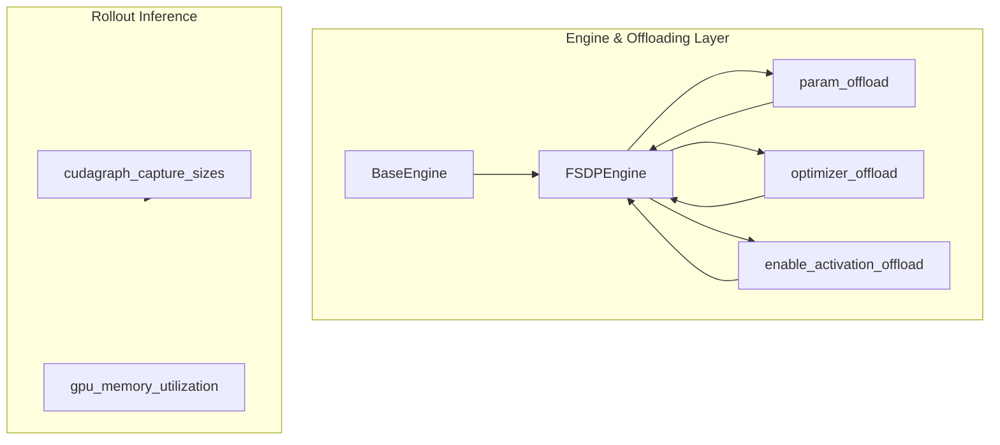
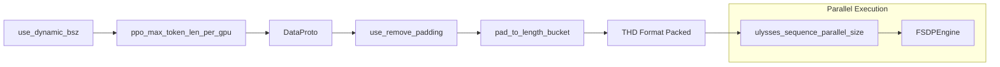

<!-- source: DeepWiki mcp.deepwiki.com · repo volcengine/verl · page 10 Performance Optimization · fetched 2026-10-21 -->

# Performance Optimization

Relevant source files

The following files were used as context for generating this wiki page:

- [docs/examples/config.rst](docs/examples/config.rst)
- [docs/perf/perf_tuning.rst](docs/perf/perf_tuning.rst)
- [verl/trainer/config/ppo_megatron_trainer.yaml](verl/trainer/config/ppo_megatron_trainer.yaml)
- [verl/trainer/config/ppo_trainer.yaml](verl/trainer/config/ppo_trainer.yaml)
- [verl/trainer/main_ppo.py](verl/trainer/main_ppo.py)
- [verl/trainer/ppo/core_algos.py](verl/trainer/ppo/core_algos.py)
- [verl/trainer/ppo/ray_trainer.py](verl/trainer/ppo/ray_trainer.py)

This page provides a high-level overview of the performance optimization techniques available across `verl`'s training and inference stack. It encompasses CPU offloading strategies, sequence-packing techniques, fused kernel dispatch, dynamic batching, FLOPs tracking, MoE routing, low-precision training, prefix-shared attention, and pipeline step skipping. 

As a parent page, this document summarizes the primary optimization dimensions and links to child pages for deep technical details. For configuration options associated with these features, see the Actor/Critic configuration page [4.2]() and the rollout configuration page [4.3](). For checkpoint-related memory considerations during weight transfer, see [7.5]().

Sources: [docs/perf/perf_tuning.rst:1-27]()

---

## Memory Management and Offloading

Engine backends support independent offloading of parameters, optimizer states, and activations to CPU memory to reduce GPU footprint [docs/perf/perf_tuning.rst:35-43](), [verl/trainer/config/ppo_trainer.yaml:156-157](). These techniques are essential for scaling large models across limited hardware accelerators.

- **FSDP Engine Offloading**: `FSDPEngine` supports parameter and optimizer offloading via `param_offload` and `optimizer_offload` configurations [verl/trainer/config/ppo_trainer.yaml:156-157](). Activation offloading is configurable via `enable_activation_offload=True` in model settings [docs/perf/perf_tuning.rst:122-125]().
- **Gradient Synchronization Control**: To minimize inter-GPU communication overhead during gradient accumulation, training engines implement synchronization contexts to defer synchronization until the final micro-batch using specialized accumulation flags [docs/perf/perf_tuning.rst:24-25]().
- **Rollout Memory Management**: Inference engines utilize `gpu_memory_utilization` to partition GPU memory between model weights and KV cache, where values between `0.5` and `0.7` typically balance throughput and out-of-memory risks [docs/perf/perf_tuning.rst:35-43]().

For details, see [Memory Management and Offloading](#10.1).

Title: "Memory Management Architecture and Code Entities"

Sources: [docs/perf/perf_tuning.rst:35-60](), [docs/perf/perf_tuning.rst:122-125](), [verl/trainer/config/ppo_trainer.yaml:156-157]()

---

## Sequence Parallelism and Remove Padding

To handle long contexts and eliminate padding overhead, `verl` supports sequence packing and parallel execution strategies [docs/perf/perf_tuning.rst:18](), [docs/perf/perf_tuning.rst:67-73]().

- **Remove Padding**: Enabling `use_remove_padding=True` strips padding tokens from token streams during model execution, boosting throughput for transformer architectures [docs/perf/perf_tuning.rst:67-83](), [docs/examples/config.rst:119]().
- **Ulysses Sequence Parallelism**: The FSDP and Megatron engines support `ulysses_sequence_parallel_size` to shard sequence dimensions across attention heads using all-to-all communication primitives [docs/perf/perf_tuning.rst:18](), [docs/examples/config.rst:143]().
- **Dynamic Batching**: `use_dynamic_bsz=True` dynamically scales micro-batch sizes based on token length budgets (`ppo_max_token_len_per_gpu`) to maintain uniform computational workloads [docs/examples/config.rst:125-126]().

For details, see [Sequence Parallelism and Remove Padding](#10.2).

Title: "Sequence Packing and Parallelism Data Flow Entities"

Sources: [docs/perf/perf_tuning.rst:18](), [docs/perf/perf_tuning.rst:67-83](), [docs/examples/config.rst:119-143]()

---

## Fused Kernels and Attention Implementations

`verl` integrates specialized fused kernels and attention backends to minimize memory bandwidth bottlenecks during policy updates and forward passes [docs/perf/perf_tuning.rst:20-27]().

- **Cross-Entropy Fusion**: Utilizes fused linear output projections, log probabilities, and entropy calculations to accelerate actor updates.
- **Attention Optimizations**: Integrates FlashAttention and custom fused layers like RoPE and bias-activation fusions.
- **Chunked Entropy Calculation**: Supports entropy calculation with chunking to cap peak memory utilization during large vocabulary logits processing [docs/perf/perf_tuning.rst:26-27]().

For details, see [Fused Kernels and Attention Implementations](#10.3).

Sources: [docs/perf/perf_tuning.rst:20-27]()

---

## FLOPs Counter and Performance Monitoring

Accurate performance monitoring ensures hardware resources are efficiently utilized across training iterations.

- **FlopsCounter System**: Estimates theoretical and achieved FLOPs for various transformer architectures, accounting for multi-head attention and Mixture-of-Experts layers.
- **Hardware Utilization**: Computes Model FLOPs Utilization (MFU) relative to device-specific hardware limits to evaluate compute efficiency.

For details, see [FLOPs Counter and Performance Monitoring](#10.4).

Sources: [docs/perf/perf_tuning.rst:1-27]()

---

## Router Replay and MoE Optimizations

Mixture-of-Experts (MoE) models introduce unique communication and routing challenges that `verl` addresses through dedicated configurations and replay mechanisms.

- **Expert Parallelism**: Configures expert parallel size and tensor parallel size to distribute expert parameters across accelerator groups.
- **DeepEP Integration**: Leverages high-performance expert-parallel communication libraries for optimized MoE execution.
- **Deterministic Routing**: Enforces stable routing behavior using precision controls and replay modes.

For details, see [Router Replay and MoE Optimizations](#10.5).

Sources: [docs/perf/perf_tuning.rst:1-27]()

---

## Low-Precision Training: FP8 and QAT

To decrease memory overhead and accelerate computation, `verl` supports low-precision rollout and quantization-aware training [docs/perf/perf_tuning.rst:89-118]().

- **FP8 Rollout**: Enables low-precision generation inference via rollout quantization settings.
- **Quantization-Aware Training (QAT)**: Provides configuration options within the training engine to support low-precision quantization modes with layer ignore patterns.

For details, see [Low-Precision Training: FP8 and QAT](#10.6).

Sources: [docs/perf/perf_tuning.rst:89-118]()

---

## PrefixGrouper: Prefix-Shared Attention Optimization

PrefixGrouper optimizes group-based reinforcement learning algorithms (such as GRPO) where multiple responses share identical prompt prefixes.

- **Shared Prompt Optimization**: Identifies common prompt prefixes across response groups to avoid redundant attention key-value calculations.
- **Monkey-Patch Integration**: Applied dynamically via attention wrapper patches to support multi-sample generation.

For details, see [PrefixGrouper: Prefix-Shared Attention Optimization](#10.7).

Sources: [docs/perf/perf_tuning.rst:1-27]()

---

## SkipManager: Pipeline Step Skipping for Development

The `SkipManager` framework accelerates local development and debugging cycles.

- **Skipping Actions**: Supports actions such as `CACHE` and `REPEAT` to bypass expensive rollout generation steps or reuse cached trajectories.
- **Trainer Integration**: Integrated directly into training loops across trainers to reduce iteration turnaround times during testing.

For details, see [SkipManager: Pipeline Step Skipping for Development](#10.8).

Sources: [docs/perf/perf_tuning.rst:1-27]()

---

