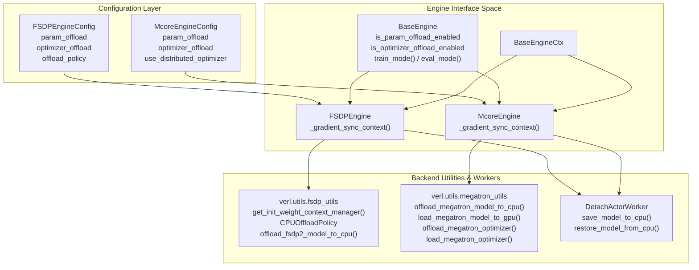
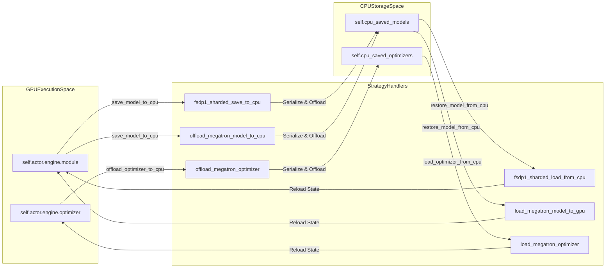

<!-- source: DeepWiki mcp.deepwiki.com · repo volcengine/verl · page 10.1 Memory Management and Offloading · fetched 2026-10-21 -->

# Memory Management and Offloading

Relevant source files

The following files were used as context for generating this wiki page:

- [docs/advance/ppo_lora.rst](docs/advance/ppo_lora.rst)
- [tests/models/test_transformer.py](tests/models/test_transformer.py)
- [tests/models/test_transformers_ulysses.py](tests/models/test_transformers_ulysses.py)
- [tests/plugin/test_platform_abstraction.py](tests/plugin/test_platform_abstraction.py)
- [tests/single_controller/test_device_agnostic_resources_on_cpu.py](tests/single_controller/test_device_agnostic_resources_on_cpu.py)
- [tests/special_distributed/run_all.sh](tests/special_distributed/run_all.sh)
- [tests/special_distributed/test_fsdp2_cpu_offload_state_dict.py](tests/special_distributed/test_fsdp2_cpu_offload_state_dict.py)
- [tests/special_distributed/test_fsdp2_pinned_model_transfer.py](tests/special_distributed/test_fsdp2_pinned_model_transfer.py)
- [tests/special_distributed/test_fsdp_ckpt.py](tests/special_distributed/test_fsdp_ckpt.py)
- [tests/special_distributed/test_torch_functional.py](tests/special_distributed/test_torch_functional.py)
- [tests/special_sanity/check_license.py](tests/special_sanity/check_license.py)
- [tests/utils/test_activation_offload.py](tests/utils/test_activation_offload.py)
- [tests/utils/test_attention_utils.py](tests/utils/test_attention_utils.py)
- [tests/utils/test_fsdp2_model_transfer_on_cpu.py](tests/utils/test_fsdp2_model_transfer_on_cpu.py)
- [tests/utils/test_profiler_markers.py](tests/utils/test_profiler_markers.py)
- [verl/utils/attention_padding_utils.py](verl/utils/attention_padding_utils.py)
- [verl/utils/fsdp_utils.py](verl/utils/fsdp_utils.py)
- [verl/utils/profiler/__init__.py](verl/utils/profiler/__init__.py)
- [verl/utils/torch_functional.py](verl/utils/torch_functional.py)

Memory management and offloading in `verl` enables training large language models that exceed single GPU memory capacity by strategically moving model parameters, optimizer states, and gradients between GPU and host memory. This system provides automatic context-based offloading during mode switches using `BaseEngineCtx`, explicit engine-level property checks (`BaseEngine.is_param_offload_enabled` and `BaseEngine.is_optimizer_offload_enabled`), and manual control via training engine interfaces and detachable worker utilities.

**Scope**: This page covers parameter, optimizer, and gradient offloading mechanisms across training backends (`FSDPEngine`, `McoreEngine`), gradient synchronization optimizations, FSDP2 CPU offloading and pinned memory transfers, checkpoint memory handling, and CPU offloading/restoration workflows using `BaseEngineCtx` context managers and worker extensions.

---

## Architecture Overview

The offloading system is structured around three main layers: configuration flags defined in engine configs, engine interface contracts (`BaseEngine` and `BaseEngineCtx`), and backend-specific implementation utilities that interact with FSDP composable policies (`CPUOffloadPolicy`) and Megatron-Core distributed optimizers.

Title: "Offloading Architecture and Code Entity Mapping"

Sources: `[verl/workers/engine/base.py:30-181]()`, `[verl/utils/fsdp_utils.py:42-76]()`, `[verl/experimental/separation/engine_workers.py:36-110]()`, `[verl/utils/megatron_utils.py:70-73]()`

---

## Configuration Flags

Offloading and memory behaviors are controlled via configuration options exposed in engine configurations.

### FSDP Offloading (FSDP1 & FSDP2)
| Flag | Description | Default | Implementation Reference |
|------|-------------|---------|--------------------------|
| `param_offload` | Offload model parameters to CPU when idle | `False` | `[verl/trainer/config/engine/fsdp.yaml:10-11]()` |
| `optimizer_offload` | Offload optimizer states to CPU memory | `False` | `[verl/trainer/config/engine/fsdp.yaml:14-15]()` |
| `offload_policy` | FSDP2-specific policy for param/grad/optimizer offloading | `False` | `[verl/trainer/config/engine/fsdp.yaml:18-19]()` |
| `reshard_after_forward` | Reshard shards after forward pass to minimize peak memory | `True` | `[verl/trainer/config/engine/fsdp.yaml:22-23]()` |

### Megatron-Core Memory Optimization
| Flag | Description | Default | Implementation Reference |
|------|-------------|---------|--------------------------|
| `param_offload` | Whether to offload model parameters to CPU and release gradient buffers while inactive | `False` | `[verl/trainer/config/engine/megatron.yaml:5]()` |
| `optimizer_offload` | Whether to offload optimizer state to CPU | `False` | `[verl/trainer/config/engine/megatron.yaml:8]()` |
| `use_distributed_optimizer` | Shards optimizer states across DP ranks | `True` | `[verl/trainer/config/engine/megatron.yaml:32]()` |
| `use_layer_wise_distributed_optimizer` | Enables layer-wise DDP layouts to reduce redundant buffers | `False` | `[verl/utils/megatron_utils.py:105-106]()` |

Sources: `[verl/trainer/config/engine/fsdp.yaml:10-23]()`, `[verl/trainer/config/engine/megatron.yaml:5-9]()`, `[verl/trainer/config/engine/megatron.yaml:32]()`, `[verl/utils/megatron_utils.py:105]()`

---

## Gradient Synchronization and BaseEngineCtx

`verl` manages state transitions and deferred gradient synchronization during gradient accumulation via `BaseEngineCtx` and backend-specific context managers.

### FSDP and Megatron Gradient Sync Contexts
- **Non-final micro-batches**: FSDP1 utilizes `model.no_sync()`, while FSDP2 calls `model.set_requires_gradient_sync(False)` to bypass redundant reduction communication across micro-batches. This behavior is controlled by the `use_no_sync_for_gradient_accumulation` flag in `FSDPEngineConfig`.
- **Final micro-batch**: Synchronization is re-enabled to trigger the required `all-reduce` or `reduce-scatter` operations prior to the optimizer step.
- **Memory Trade-off**: Retaining unsharded gradients across micro-batches increases peak GPU memory footprint in exchange for communication efficiency.

Sources: `[verl/trainer/config/engine/fsdp.yaml:59-61]()`, `[docs/perf/perf_tuning.rst:24-25]()`, `[tests/workers/test_fsdp_gradient_accumulation_sync_on_cpu.py:36-70]()`

---

## FSDP2 CPU Offloading and Pinned Model Transfers

For FSDP2 backends, model transfers between host memory (CPU) and device memory (GPU) leverage asynchronous non-blocking memory copies (`non_blocking=True`) and PyTorch's implicit pinned allocation handlers to optimize throughput during offload and restoration cycles `[tests/utils/test_fsdp2_model_transfer_on_cpu.py:26-42]()`.

Functions like `offload_fsdp2_model_to_cpu()` and `load_fsdp2_model_to_gpu()` facilitate dynamic memory migration, while `fsdp2_sharded_save_to_cpu()` manages sharded snapshots directly from CPU-based device meshes `[tests/utils/test_fsdp2_model_transfer_on_cpu.py:26-62]()`.

Sources: `[tests/utils/test_fsdp2_model_transfer_on_cpu.py:26-62]()`, `[tests/special_distributed/run_all.sh:22-27]()`

---

## Checkpoint Memory Management and Detachable Workers

To manage memory during model checkpoints and asynchronous separations, `verl` provides utilities for sharded persistence and CPU offloading/restoration.

### DetachActorWorker and Sharded CPU Migration
The `DetachActorWorker` class extends worker implementations to serialize and restore model states to and from CPU memory, facilitating offloading strategies in distributed setups `[verl/experimental/separation/engine_workers.py:36-43]()`.

For Megatron, `DetachActorWorker` uses `offload_megatron_model_to_cpu` and `load_megatron_model_to_gpu` to handle model parameter offloading and restoration `[verl/experimental/separation/engine_workers.py:101-104]()`. Similarly, `offload_megatron_optimizer` and `load_megatron_optimizer` are used for optimizer state offloading `[verl/utils/megatron_utils.py:72-73]()`.

Title: "Worker CPU State Migration Data Flow"

Sources: `[verl/experimental/separation/engine_workers.py:60-160]()`, `[verl/utils/megatron_utils.py:70-73]()`

---

## Implementation Details: Context Managers and Utilities

Engine instances interact with models via abstract interfaces and helper initialization contexts:

- **BaseEngine Interface**: Declares `train_mode()` and `eval_mode()` context managers alongside property checks `is_param_offload_enabled` and `is_optimizer_offload_enabled` `[verl/workers/engine/base.py:30-76]()`.
- **Initialization Contexts**: `get_init_weight_context_manager` utilizes `accelerate.init_empty_weights` (meta tensors) on non-zero ranks to prevent host-side OOM when instantiating large models `[verl/utils/fsdp_utils.py:64-75]()`.
- **Empty Cache Handling**: `init_fn` ensures local ranks allocate empty tensors on the target device and immediately clear memory caches `[verl/utils/fsdp_utils.py:57-61]()`.

Sources: `[verl/workers/engine/base.py:30-76]()`, `[verl/utils/fsdp_utils.py:42-76]()`

---

