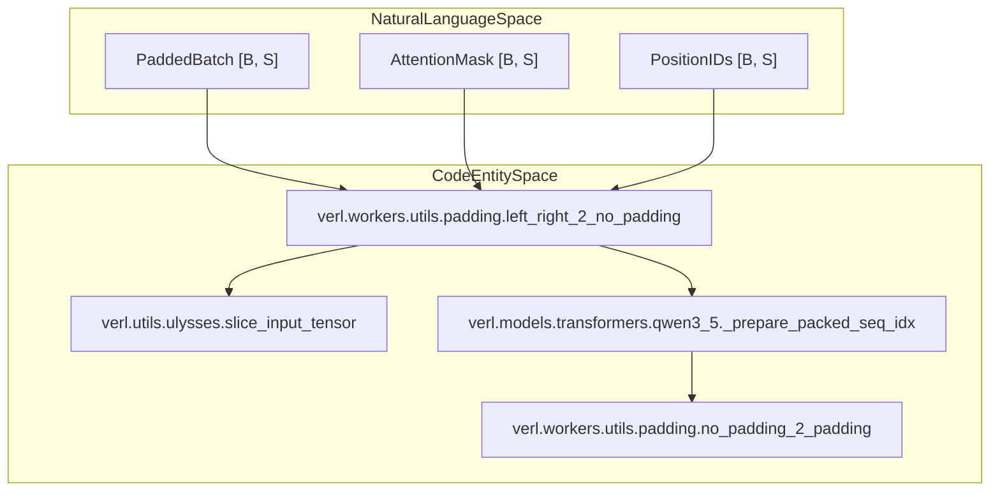
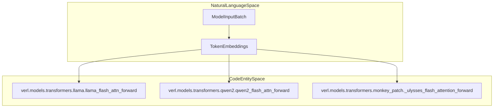
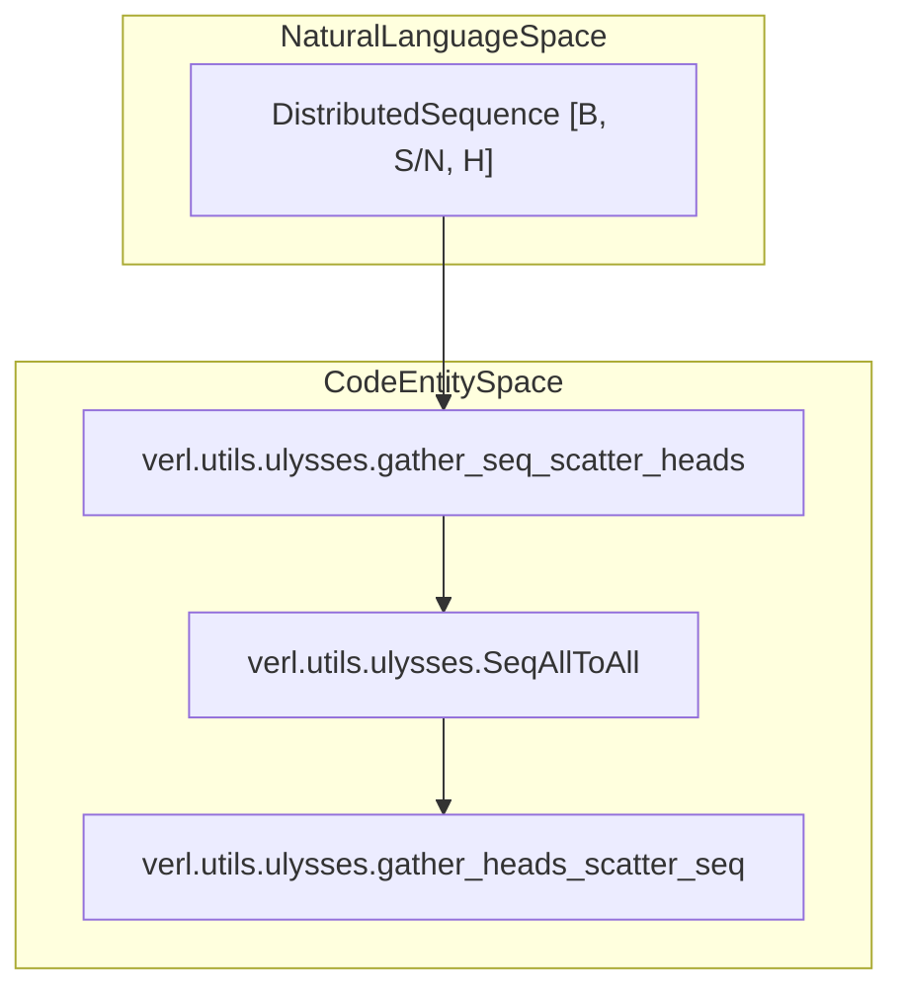

<!-- source: DeepWiki mcp.deepwiki.com · repo volcengine/verl · page 10.2 Sequence Parallelism and Remove Padding · fetched 2026-10-21 -->

# Sequence Parallelism and Remove Padding

Relevant source files

The following files were used as context for generating this wiki page:

- [tests/models/test_fsdp_no_padding_on_gpu.py](tests/models/test_fsdp_no_padding_on_gpu.py)
- [tests/models/test_fused_kernels_ulysses_sp_on_cpu.py](tests/models/test_fused_kernels_ulysses_sp_on_cpu.py)
- [tests/special_distributed/test_qwen35_linear_attention_ulysses_sp.py](tests/special_distributed/test_qwen35_linear_attention_ulysses_sp.py)
- [tests/utils/test_experimental_torch_functional_on_cpu.py](tests/utils/test_experimental_torch_functional_on_cpu.py)
- [tests/utils/test_padding_on_cpu.py](tests/utils/test_padding_on_cpu.py)
- [verl/models/transformers/dense_common.py](verl/models/transformers/dense_common.py)
- [verl/models/transformers/glm4v.py](verl/models/transformers/glm4v.py)
- [verl/models/transformers/kimi_vl.py](verl/models/transformers/kimi_vl.py)
- [verl/models/transformers/llama.py](verl/models/transformers/llama.py)
- [verl/models/transformers/monkey_patch.py](verl/models/transformers/monkey_patch.py)
- [verl/models/transformers/qwen2.py](verl/models/transformers/qwen2.py)
- [verl/models/transformers/qwen2_vl.py](verl/models/transformers/qwen2_vl.py)
- [verl/models/transformers/qwen3_5.py](verl/models/transformers/qwen3_5.py)
- [verl/models/transformers/qwen3_vl.py](verl/models/transformers/qwen3_vl.py)
- [verl/utils/experimental/torch_functional.py](verl/utils/experimental/torch_functional.py)
- [verl/utils/ulysses.py](verl/utils/ulysses.py)
- [verl/workers/utils/losses.py](verl/workers/utils/losses.py)
- [verl/workers/utils/padding.py](verl/workers/utils/padding.py)

This page documents two critical performance optimization techniques in `verl`: **sequence packing (remove padding)** and **sequence parallelism (DeepSpeed Ulysses and context parallel extensions)**. Sequence packing eliminates wasted computation on padding tokens by converting batches from padded format to packed format. Sequence parallelism enables training on longer sequences by distributing sequence dimensions across GPUs via All-to-All communication. `verl` implements these via custom monkey patches for Hugging Face models and specialized sequence processing utilities.

---

## 1. Sequence Packing (Remove Padding)

### Purpose and Data Formats
`verl` supports two primary data formats for sequences to optimize computation:

*   **BSHD Format** (`batch_size, seq_len, hidden_dim`): Traditional padded format where all sequences in a batch are padded to a common maximum length.
*   **THD Format** (`total_tokens, hidden_dim`): Packed format where padding tokens are removed and valid tokens from multiple sequences are concatenated contiguously. The "T" represents the total number of non-padding tokens across the batch.

Converting BSHD to THD eliminates unnecessary compute cycles spent on padding tokens during self-attention and feed-forward operations.

### Implementation and Preprocessing
Sequence manipulation utilities handle the transition between padded and packed layouts. The function `left_right_2_no_padding` converts standard left-right padded `TensorDict` batches into nested tensors and unpadded representations [verl/workers/utils/padding.py:23-94](). Conversely, `no_padding_2_padding` reconstructs padded responses from unpadded model outputs [verl/workers/utils/padding.py:97-141](). Input tensor slicing and padding for sequence parallelism are handled by `ulysses_pad_and_slice_inputs` and `slice_input_tensor` [verl/utils/ulysses.py:121-135]().

When dealing with advanced architectures like Qwen3.5, sequence indices are prepared using `_prepare_packed_seq_idx` and tensor chunks are handled via `_split_packed_args` [verl/models/transformers/qwen3_5.py:46-74](). Context parallelism communication for convolutional sequence layers is managed via `_ConvPrefixExchange` [verl/models/transformers/qwen3_5.py:77-90]() and `_prepend_cp_conv_prefix` [verl/models/transformers/qwen3_5.py:110-126]().

**Data Flow for Sequence Packing and Padding-Free Conversion**

Sources:
- [verl/workers/utils/padding.py:23-141]()
- [verl/utils/ulysses.py:121-135]()
- [verl/models/transformers/qwen3_5.py:46-90]()
- [verl/models/transformers/qwen3_5.py:110-126]()

---

## 2. Packed Sequence Forward Pass

Model forward passes must correctly interpret packed sequences (`cu_seqlens`) rather than standard 2D attention masks. Models modified for `verl` integrate custom forward functions that inject sequence parallelism and variable-length sequence handling (`varlen`).

### Model-Specific Integration
Different model families require tailored attention forward passes to support sequence packing and parallelism:
*   **Llama**: Uses `llama_flash_attn_forward` to manage sequence transposition, RoPE application, and Ulysses all-to-all communication [verl/models/transformers/llama.py:42-159]().
*   **Qwen2**: Uses `qwen2_flash_attn_forward` to handle KV head repetition, sliding window attention, and Ulysses sharding [verl/models/transformers/qwen2.py:35-156]().
*   **Qwen2-VL / Qwen3-VL / GLM4V**: Implement multi-modal position ID generation (`get_rope_index`) to ensure vision-text interleaved sequences maintain correct 3D RoPE coordinates prior to sequence sharding [verl/models/transformers/qwen2_vl.py:64-76](), [verl/models/transformers/qwen3_vl.py:99-111](), [verl/models/transformers/glm4v.py:65-75]().
*   **Qwen3.5**: Integrates custom chunked gated delta rules and packed causal convolution fallbacks for linear attention mechanisms [verl/models/transformers/qwen3_5.py:146-187]().

**Forward Pass Execution Flow**

Sources:
- [verl/models/transformers/llama.py:42-159]()
- [verl/models/transformers/qwen2.py:35-156]()
- [verl/models/transformers/qwen2_vl.py:64-76]()
- [verl/models/transformers/qwen3_vl.py:99-111]()
- [verl/models/transformers/glm4v.py:65-75]()
- [verl/models/transformers/qwen3_5.py:146-187]()
- [verl/models/transformers/monkey_patch.py:87-155]()

---

## 3. Ulysses Sequence Parallelism

`verl` utilizes **DeepSpeed Ulysses** for sequence parallelism, partitioning the sequence dimension across a dedicated process group [verl/utils/ulysses.py:14-18]().

### Core Mechanism: All-to-All
Ulysses redistributes tensors between the sequence dimension and the attention head dimension using `All-to-All` communication:

1.  `gather_seq_scatter_heads`: Transforms tensors from sequence-parallel chunks (`[bsz, seq/n, h, ...]`) to head-parallel chunks (`[bsz, seq, h/n, ...]`) [verl/utils/ulysses.py:66-87]().
2.  `gather_heads_scatter_seq`: The inverse operation, converting head-parallel tensors back to sequence-parallel chunks (`[bsz, seq/n, h, ...]`) [verl/utils/ulysses.py:90-105]().

The `SeqAllToAll` PyTorch autograd function implements the forward and backward communication passes using `all_to_all_tensor` [verl/utils/ulysses.py:137-186]().

### Process Group Management
Process group utilities allow querying and configuring the parallel environment:
*   `set_ulysses_sequence_parallel_group` [verl/utils/ulysses.py:34-40]()
*   `get_ulysses_sequence_parallel_group` [verl/utils/ulysses.py:42-47]()
*   `get_ulysses_sequence_parallel_world_size` [verl/utils/ulysses.py:50-55]()
*   `get_ulysses_sequence_parallel_rank` [verl/utils/ulysses.py:58-64]()

**Ulysses All-to-All Communication Flow**

Sources:
- [verl/utils/ulysses.py:14-18]()
- [verl/utils/ulysses.py:34-186]()

---

