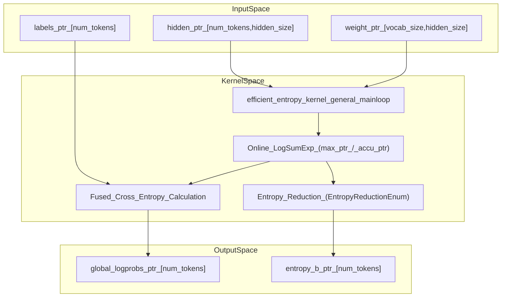
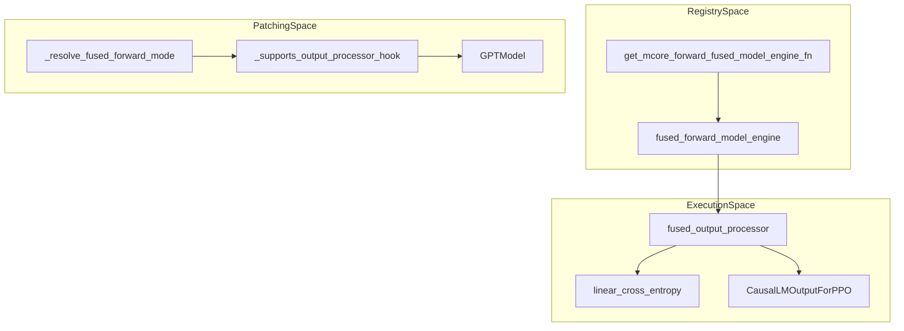

<!-- source: DeepWiki mcp.deepwiki.com · repo volcengine/verl · page 10.3 Fused Kernels and Attention Implementations · fetched 2026-10-21 -->

# Fused Kernels and Attention Implementations

Relevant source files

The following files were used as context for generating this wiki page:

- [tests/models/test_model_forward_fused.py](tests/models/test_model_forward_fused.py)
- [tests/utils/test_linear_cross_entropy.py](tests/utils/test_linear_cross_entropy.py)
- [tests/utils/test_linear_cross_entropy_on_cpu.py](tests/utils/test_linear_cross_entropy_on_cpu.py)
- [tests/utils/test_special_linear_cross_entropy_tp.py](tests/utils/test_special_linear_cross_entropy_tp.py)
- [tests/workers/test_megatron_liger_fused_kernels_on_cpu.py](tests/workers/test_megatron_liger_fused_kernels_on_cpu.py)
- [verl/models/mcore/__init__.py](verl/models/mcore/__init__.py)
- [verl/models/mcore/model_forward.py](verl/models/mcore/model_forward.py)
- [verl/models/mcore/model_forward_fused.py](verl/models/mcore/model_forward_fused.py)
- [verl/models/mcore/registry.py](verl/models/mcore/registry.py)
- [verl/models/mcore/util.py](verl/models/mcore/util.py)
- [verl/utils/checkpoint/megatron_checkpoint_manager.py](verl/utils/checkpoint/megatron_checkpoint_manager.py)
- [verl/utils/kernel/kernels.py](verl/utils/kernel/kernels.py)
- [verl/utils/megatron_utils.py](verl/utils/megatron_utils.py)
- [verl/utils/model.py](verl/utils/model.py)
- [verl/workers/engine/megatron/transformer_impl.py](verl/workers/engine/megatron/transformer_impl.py)

This page documents verl's fused kernel and attention implementation system, which provides high-performance computational kernels for transformer operations. Fused kernels combine multiple operations (e.g., matrix multiplication, softmax, and entropy reduction) into single optimized kernel calls to reduce memory bandwidth and improve throughput.

The system supports specialized optimizations for RL training, including:
- **Fused Linear Cross Entropy**: A custom Triton kernel that combines linear projection, log-probability calculation, and entropy reduction into a single pass [verl/utils/kernel/kernels.py:31-33]().
- **FlashAttention Integration**: Leveraging FlashAttention for efficient self-attention computations alongside Ulysses sequence parallelism.
- **Custom Kernel Usage**: Configuration options to enable or disable fused kernels and select implementation backends [verl/models/mcore/model_forward_fused.py:77-82]().
- **Megatron-Core (MCore) Fused Forward**: Integration with NVIDIA Megatron-Core for fused log-probability and entropy computation using native output processor hooks [verl/models/mcore/model_forward_fused.py:46-139]().
- **Sequence Packing (THD Format)**: Support for removing padding to optimize throughput in RL workloads with varying sequence lengths [verl/models/mcore/util.py:61-151]().
- **Multi-Token Prediction (MTP) Support**: Integration of fused kernels with MTP training configurations [verl/models/mcore/model_forward.py:65-114]().

---

## Fused Linear Cross Entropy Kernel

Verl implements an efficient entropy kernel that is particularly useful for PPO training, where both log-probabilities and policy entropy are required. This kernel avoids the materialization of the full logit tensor (which is typically `[batch * seq_len, vocab_size]`), significantly saving memory.

### Kernel Architecture and Data Flow

The `efficient_entropy_kernel_general_mainloop` is a Triton-based kernel designed to compute cross-entropy and token entropy simultaneously while minimizing memory movement. It supports CUDA Tensor Memory Accelerator (TMA) on supported hardware [verl/utils/kernel/kernels.py:48-49]().

**Title: Fused Linear Cross Entropy Data Flow and Code Mapping**

Sources: [verl/utils/kernel/kernels.py:48-49](), [verl/utils/kernel/kernels.py:103-111](), [verl/utils/kernel/kernels.py:188-214]()

### `FusedLinearForPPOFunction`

The `FusedLinearForPPOFunction` class in `verl.utils.experimental.torch_functional` provides a PyTorch `autograd.Function` wrapper for fused linear operations, specifically for PPO training [tests/utils/test_linear_cross_entropy.py:38-44](). It handles both forward and backward passes, optionally dispatching to optimized backends like Liger or FlashAttention's cross-entropy implementation.

The forward pass computes `log_probs` and `entropy` from `hidden_states`, `vocab_weights`, and `input_ids`. It can operate on batched inputs (3D `hidden_states`) by flattening them to 2D for processing and then reshaping the outputs [tests/utils/test_linear_cross_entropy.py:89-97]().

Sources: [tests/utils/test_linear_cross_entropy.py:38-97]()

---

## Megatron-Core Fused Forward Integration

For Megatron-based training, verl provides patching utilities to inject fused computation into the `GPTModel` forward pass [verl/models/mcore/model_forward_fused.py:158-168]().

- **Native Hook Mode**: For MCore 0.18.0+, verl uses the `output_processor` contract via `fused_output_processor`. This function receives hidden states and weights, calling `linear_cross_entropy` at the post-process boundary [verl/models/mcore/model_forward_fused.py:98-139](). This mode is detected by checking for `output_processor` and `output_processor_context` in the `GPTModel.forward` signature using `_supports_output_processor_hook` [verl/models/mcore/model_forward_fused.py:47-58]().
- **Legacy Mode**: For older MCore versions, verl monkey-patches the `forward` method of `GPTModel` to `_fused_GPTModel_forward`.

The `get_mcore_forward_fused_model_engine_fn` and `fused_forward_model_engine` functions handle the dispatch to the appropriate forward pass, passing arguments like `temperature`, `calculate_entropy`, and `cp_layout` [verl/models/mcore/registry.py:45-54](). They integrate with `preprocess_packed_seqs` for sequence packing and dynamic context parallelism [verl/models/mcore/util.py:61-151]().

**Title: Megatron Fused Forward Architecture and Code Entities**

Sources: [verl/models/mcore/registry.py:45-54](), [verl/models/mcore/model_forward_fused.py:47-139](), [verl/models/mcore/model_forward_fused.py:158-168]()

---

## FlashAttention Integration

Verl integrates FlashAttention for efficient self-attention computations. The framework utilizes specialized attention wrappers and monkey-patching utilities to ensure robust execution across sequence lengths and model topologies [verl/models/mcore/__init__.py:16-20]().

### Ulysses Sequence Parallelism with FlashAttention

For models configured with Ulysses Sequence Parallelism, FlashAttention is integrated with all-to-all communication operations:
1. **Key/Value State Repetition**: Repeating key/value states based on partition sizes.
2. **All-to-All Communication**: Redistributing `query_states`, `key_states`, and `value_states` across devices.
3. **FlashAttention Execution**: Executing the core attention forward pass.
4. **Output Redistribution**: Gathering heads and scattering sequences back to the layout expected by the engine.

Sources: [verl/models/mcore/__init__.py:16-20]()

---

## Sequence Packing and Data Formats

Verl supports optimized data formats to handle variable-length responses in RL training.

### THD vs BSHD Formats
- **THD (Token-Head-Dimension / Remove Padding)**: Sequences in a batch are concatenated into a single flat tensor. Preprocessing utilities such as `preprocess_packed_seqs` convert standard padded tensors into THD format using `PackedSeqParams` [verl/models/mcore/util.py:61-146]().
- **BSHD (Batch-Sequence-Head-Dimension)**: Standard padded format with explicit sequence length padding and alignment checks [verl/models/mcore/model_forward.py:135-137]().

### Context Parallelism (CP) Layouts
Context Parallelism splits sequences into chunks across GPUs. The `preprocess_packed_seqs` function computes split chunks and handles alignment sizes (including FP8 thd alignment via `_compute_fp8_thd_align_size`) to ensure compatibility with TransformerEngine [verl/models/mcore/util.py:49-81]().

Sources: [verl/models/mcore/util.py:49-146](), [verl/models/mcore/model_forward.py:135-137]()

---

## Custom Kernel Usage and Configuration

Verl provides configuration options via Hydra to control fused kernels and execution backends.

### Megatron Engine Configuration
The Megatron engine configuration defines parameters for sequence removal, padding buckets, router replay, and QAT [verl/workers/engine/megatron/transformer_impl.py:112-136]().

- `use_remove_padding`: Controls whether to use THD format (sequence packing) or standard BSHD format.
- `pad_to_length_bucket`: Bucket length to reduce THD shape variability.

Sources: [verl/workers/engine/megatron/transformer_impl.py:112-136]()

---

## Hardware Compatibility, FP8, and Memory Management

### Triton Memory Management
For Triton 3.5.0+, verl implements a custom allocator `alloc_fn` to handle Tensor Memory Accelerator (TMA) descriptors requiring global memory allocation [verl/utils/kernel/kernels.py:76-80](). This allocator is registered via `triton.set_allocator` and uses `contextvars` to ensure worker threads inherit the allocator without falling back to `NullAllocator` [verl/utils/kernel/kernels.py:83-99]().

### FP8 Alignment
When FP8 padding is enabled (`use_fp8_padding=True`), `_compute_fp8_thd_align_size` computes alignment requirements ensuring sequence lengths are compatible with block quantization and TransformerEngine constraints [verl/models/mcore/util.py:49-59]().

Sources: [verl/utils/kernel/kernels.py:76-99](), [verl/models/mcore/util.py:49-59]()

---

