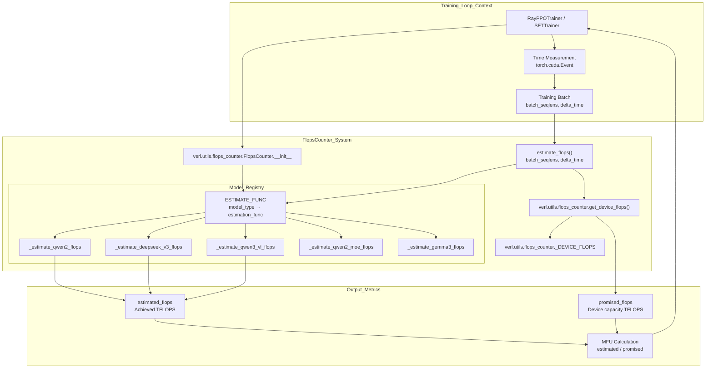
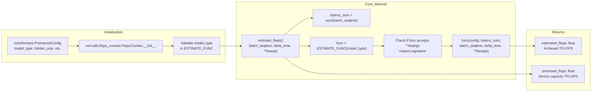
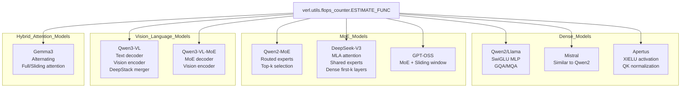

<!-- source: DeepWiki mcp.deepwiki.com · repo volcengine/verl · page 10.4 FLOPs Counter and Performance Monitoring · fetched 2026-10-21 -->

# FLOPs Counter and Performance Monitoring

<details>
<summary>Relevant source files</summary>

The following files were used as context for generating this wiki page:

- [docs/perf/torch_profiling.md](docs/perf/torch_profiling.md)
- [tests/trainer/ppo/test_metric_utils_on_cpu.py](tests/trainer/ppo/test_metric_utils_on_cpu.py)
- [tests/trainer/ppo/test_rollout_moe_lb_metrics_on_cpu.py](tests/trainer/ppo/test_rollout_moe_lb_metrics_on_cpu.py)
- [tests/utils/dataset/test_rl_dataset_on_cpu.py](tests/utils/dataset/test_rl_dataset_on_cpu.py)
- [tests/utils/test_flops_counter.py](tests/utils/test_flops_counter.py)
- [tests/utils/test_server_profiler.py](tests/utils/test_server_profiler.py)
- [tests/utils/test_torch_profile.py](tests/utils/test_torch_profile.py)
- [verl/models/transformers/apertus.py](verl/models/transformers/apertus.py)
- [verl/trainer/config/actor/actor.yaml](verl/trainer/config/actor/actor.yaml)
- [verl/trainer/config/critic/critic.yaml](verl/trainer/config/critic/critic.yaml)
- [verl/trainer/config/data/legacy_data.yaml](verl/trainer/config/data/legacy_data.yaml)
- [verl/trainer/config/profiler/profiler.yaml](verl/trainer/config/profiler/profiler.yaml)
- [verl/trainer/config/ref/ref.yaml](verl/trainer/config/ref/ref.yaml)
- [verl/trainer/ppo/metric_utils.py](verl/trainer/ppo/metric_utils.py)
- [verl/utils/dataset/rl_dataset.py](verl/utils/dataset/rl_dataset.py)
- [verl/utils/dataset/vision_utils.py](verl/utils/dataset/vision_utils.py)
- [verl/utils/flops_counter.py](verl/utils/flops_counter.py)
- [verl/utils/metric/__init__.py](verl/utils/metric/__init__.py)
- [verl/utils/metric/utils.py](verl/utils/metric/utils.py)
- [verl/utils/profiler/config.py](verl/utils/profiler/config.py)
- [verl/utils/profiler/profile.py](verl/utils/profiler/profile.py)
- [verl/utils/profiler/torch_profile.py](verl/utils/profiler/torch_profile.py)
- [verl/workers/config/actor.py](verl/workers/config/actor.py)
- [verl/workers/config/critic.py](verl/workers/config/critic.py)

</details>


## Purpose and Scope

This document describes the FLOPs (Floating Point Operations) counting and performance monitoring infrastructure in `verl`. The `FlopsCounter` system estimates computational throughput during training by calculating theoretical FLOPs based on model architecture and batch characteristics, then comparing against device capabilities to compute Model FLOPs Utilization (MFU). Additionally, the distributed profiling system (`DistProfiler`) provides unified support for system-level and framework-level profilers (such as NVIDIA Nsight/NVTX, Huawei Ascend MSTX, and PyTorch profiler) across training loops.

Sources: `[verl/utils/flops_counter.py:561-604]`, `[verl/utils/flops_counter.py:22-44]`, `[verl/utils/profiler/profile.py:88-179]`

## System Architecture

The FLOPs counting system operates during the training loop, receiving batch information and timing data to estimate achieved FLOPS and compare against theoretical device capacity.



**Diagram: FLOPs Counter System Architecture**

Sources: `[verl/utils/flops_counter.py:561-604]`, `[verl/utils/flops_counter.py:22-44]`

## FlopsCounter Class

### Initialization and Interface

The `FlopsCounter` class is initialized with a `PretrainedConfig` from HuggingFace transformers, which determines which estimation function to use based on `config.model_type` `[verl/utils/flops_counter.py:561-570]()`.



**Diagram: FlopsCounter Class Structure**

The initialization validates that the model type is supported `[verl/utils/flops_counter.py:573-577]()`. The `estimate_flops()` method dynamically checks if the estimation function accepts keyword arguments using `inspect.signature()` to support vision models that need additional parameters like `images_seqlens` `[verl/utils/flops_counter.py:590-600]()`.

**Key attributes:**
- `config`: `PretrainedConfig` - Model configuration containing architecture parameters `[verl/utils/flops_counter.py:562]()`.
- `self.model_type`: Extracted from the configuration `[verl/utils/flops_counter.py:563]()`.

**Key methods:**
- `estimate_flops(batch_seqlens, delta_time, **kwargs)`: Calculate achieved TFLOPS and theoretical device TFLOPS `[verl/utils/flops_counter.py:582-604]()`.

Sources: `[verl/utils/flops_counter.py:561-604]`, `[verl/utils/flops_counter.py:15-18]`

### Estimation Function Protocol

Each model-specific estimation function follows a common signature pattern:

```python
def _estimate_<model>_flops(
    config: PretrainedConfig,
    tokens_sum: int,
    batch_seqlens: list[int],
    delta_time: float,
    **kwargs  # Optional, for vision models or specific architectures
) -> float
```

**Parameters:**
- `config`: Model configuration with architecture parameters `[verl/utils/flops_counter.py:92]()`.
- `tokens_sum`: Total number of tokens in the batch `[verl/utils/flops_counter.py:92]()`.
- `batch_seqlens`: List of sequence lengths for each sample in the batch `[verl/utils/flops_counter.py:92]()`.
- `delta_time`: Time taken to process the batch (in seconds) `[verl/utils/flops_counter.py:92]()`.
- `**kwargs`: Optional parameters (e.g., `images_seqlens` for vision models) `[verl/utils/flops_counter.py:127]()`.

Sources: `[verl/utils/flops_counter.py:92-124]`, `[verl/utils/flops_counter.py:582-603]`

## Device FLOPS Database

The system maintains a database of theoretical FLOPS capacities for common accelerators `[verl/utils/flops_counter.py:22-44]()`. The `get_device_flops()` function retrieves the capacity for the current device by matching device name strings via `get_torch_device().get_device_name()` `[verl/utils/flops_counter.py:75-81]()`.

### Supported Devices

| Device Name | TFLOPS (FP16/BF16) | Notes |
|-------------|-------------------|-------|
| GB200 | 2,500 | NVIDIA Blackwell `[verl/utils/flops_counter.py:24]()` |
| B200 | 2,250 | NVIDIA Blackwell `[verl/utils/flops_counter.py:25]()` |
| MI300X | 1,307 | AMD Instinct `[verl/utils/flops_counter.py:26]()` |
| MI350X | 2,300 | AMD Instinct `[verl/utils/flops_counter.py:27]()` |
| MI355X | 2,500 | AMD Instinct `[verl/utils/flops_counter.py:28]()` |
| H100 / H800 / H200 | 989 | NVIDIA Hopper `[verl/utils/flops_counter.py:29-31]()` |
| L40S | 362.05 | NVIDIA Ada `[verl/utils/flops_counter.py:34]()` |
| A100 / A800 | 312 | NVIDIA Ampere `[verl/utils/flops_counter.py:32-33]()` |
| L40 | 181.05 | NVIDIA Ada `[verl/utils/flops_counter.py:35]()` |
| L20 | 119.5 | NVIDIA Ada `[verl/utils/flops_counter.py:37]()` |
| H20 | 148 | NVIDIA (China) `[verl/utils/flops_counter.py:38]()` |
| 910B / Ascend910 / Ascend950DT | 354-432 | Huawei Ascend NPU `[verl/utils/flops_counter.py:39-42]()` |
| A40 | 149.7 | NVIDIA Ampere `[verl/utils/flops_counter.py:36]()` |
| RTX 3070 Ti | 21.75 | Consumer GPU `[verl/utils/flops_counter.py:43]()` |
| CPU | 0.448 | Fallback `[verl/utils/flops_counter.py:23]()` |

The function performs substring matching, searching for device identifiers in reverse-sorted order of FLOPS capacity `[verl/utils/flops_counter.py:84-87]()`. Unknown devices return `float('inf')` `[verl/utils/flops_counter.py:82]()`.

Sources: `[verl/utils/flops_counter.py:22-44]`, `[verl/utils/flops_counter.py:47-89]`

## Model-Specific FLOPS Estimation

### Architecture Categories

The system categorizes models into architectural families, each requiring different FLOPS formulas `[verl/utils/flops_counter.py:538-558]()`:



Sources: `[verl/utils/flops_counter.py:538-558]`

### Dense Model FLOPS Formula (Qwen2/Llama)

The standard dense transformer FLOPS calculation consists of two main components: linear layer operations and attention matrix multiplications `[verl/utils/flops_counter.py:92-124]()`.

**Formula breakdown:**

1.  **Linear Layer FLOPs** (forward + backward = 6× parameters):
    -   `mlp_N = hidden_size * intermediate_size * 3` (for SwiGLU: gate, up, down) `[verl/utils/flops_counter.py:107]()`.
    -   `attn_linear_N = hidden_size * (q_size + k_size + v_size + num_attention_heads * head_dim)` `[verl/utils/flops_counter.py:108]()`.
    -   `emd_and_lm_head_N = vocab_size * hidden_size * 2` `[verl/utils/flops_counter.py:109]()`.
    -   `dense_N_flops = 6 * dense_N * tokens_sum` `[verl/utils/flops_counter.py:113]()`.

2.  **Attention QKV Matrix FLOPs** (forward + backward = 6×):
    -   `attn_qkv_flops = 6 * seqlen_square_sum * head_dim * num_attention_heads * num_hidden_layers` `[verl/utils/flops_counter.py:119]()`.
    -   `seqlen_square_sum` is the sum of squared sequence lengths in the batch `[verl/utils/flops_counter.py:116-118]()`.

Sources: `[verl/utils/flops_counter.py:92-124]`

### Advanced MoE: DeepSeek-V3

DeepSeek-V3 uses Multi-Head Latent Attention (MLA) and a hybrid architecture with dense and MoE layers `[verl/utils/flops_counter.py:264-316]()`.

**Architectural features:**
-   **MLA Compression**: Uses `q_lora_rank` and `kv_lora_rank` to reduce memory and computation `[verl/utils/flops_counter.py:276-281]()`.
-   **Hybrid MLP**: The first `first_k_dense_replace` layers are dense, while the rest are MoE with `n_routed_experts` and `n_shared_experts` `[verl/utils/flops_counter.py:287-302]()`.
-   **Expert Computation**: Only `num_experts_per_tok` experts are active per token `[verl/utils/flops_counter.py:301]()`.

Sources: `[verl/utils/flops_counter.py:264-316]`

### Vision-Language Model FLOPS (Qwen3-VL)

Vision-language models add a Vision Transformer (ViT) component that processes images `[verl/utils/flops_counter.py:127-168]()`.

**ViT-specific calculations:**
-   **Patch Embedding**: `patch_embed_N = hidden_size * in_channels * temporal_patch_size * patch_size * patch_size` `[verl/utils/flops_counter.py:218]()`.
-   **ViT Attention**: Uses a factor of 6 for bidirectional attention (forward + backward) `[verl/utils/flops_counter.py:236]()`.
-   **DeepStack Mergers**: Includes parameters for spatial merging based on `spatial_merge_size` `[verl/utils/flops_counter.py:254-255]()`.

Sources: `[verl/utils/flops_counter.py:127-168]`, `[verl/utils/flops_counter.py:215-262]`

### Sliding Window Attention (Gemma3)

Gemma3 alternates between full and sliding window attention layers `[verl/utils/flops_counter.py:355-421]()`. The system calculates the effective sequence length for sliding window layers as `min(seqlen, sliding_window)` `[verl/utils/flops_counter.py:397-401]()`.

Sources: `[verl/utils/flops_counter.py:355-421]`

### Model Type Registry

The `ESTIMATE_FUNC` dictionary maps HuggingFace model types to estimation functions `[verl/utils/flops_counter.py:538-558]()`:

| Model Type | Estimation Function | Architecture Notes |
|------------|-------------------|-------------------|
| `qwen2`, `llama`, `qwen3`, `mistral`, `seed_oss`, `mimo` | `_estimate_qwen2_flops` | Dense transformer with SwiGLU |
| `qwen2_moe`, `qwen3_moe` | `_estimate_qwen2_moe_flops` | MoE with top-k routing |
| `qwen3_vl` | `_estimate_qwen3_vl_flops` | Includes ViT FLOPS estimation |
| `qwen3_vl_moe` | `_estimate_qwen3_vl_moe_flops` | MoE + ViT |
| `deepseek_v3` | `_estimate_deepseek_v3_flops` | MLA + hybrid MoE |
| `gemma3_text` | `_estimate_gemma3_flops` | Sliding window attention |
| `apertus` | `_estimate_apertus_flops` | XIELU + QK norm |

Sources: `[verl/utils/flops_counter.py:538-558]`

## Performance Monitoring and Profiling

### Distributed Profiler System

The `DistProfiler` class provides a unified interface for various hardware-specific and framework-specific profiling tools `[verl/utils/profiler/profile.py:88-179]()`.

```mermaid
graph TD
    subgraph "Profiler_Abstraction"
        DistProfiler["verl.utils.profiler.profile.DistProfiler"]
        ProfilerConfig["verl.utils.profiler.config.ProfilerConfig"]
    end

    subgraph "GPU_Specific_Profilers"
        NsightSystemsProfiler["verl.utils.profiler.nvtx_profile.NsightSystemsProfiler"]
        NsightToolConfig["verl.utils.profiler.config.NsightToolConfig"]
        NVTX["NVTX API<br/>mark_start_range, mark_end_range"]
    end

    subgraph "NPU_Specific_Profilers"
        NPUProfiler["verl.utils.profiler.mstx_profile.NPUProfiler"]
        NPUToolConfig["verl.utils.profiler.config.NPUToolConfig"]
        MSTX["MSTX API<br/>torch_npu.npu.mstx"]
    end

    subgraph "Generic_Profilers"
        TorchProfiler["verl.utils.profiler.torch_profile.Profiler"]
        TorchMemoryProfiler["verl.utils.profiler.torch_memory_profile.TorchMemoryProfiler"]
        PrecisionDebugger["verl.utils.profiler.precision_debugger_profile.PrecisionDebuggerProfiler"]
    end

    DistProfiler --> ProfilerConfig
    DistProfiler -- "tool: nsys" --> NsightSystemsProfiler
    DistProfiler -- "tool: npu" --> NPUProfiler
    DistProfiler -- "tool: torch" --> TorchProfiler
    DistProfiler -- "tool: torch_memory" --> TorchMemoryProfiler
    DistProfiler -- "tool: precision_debugger" --> PrecisionDebugger

    NsightSystemsProfiler --> NsightToolConfig
    NsightSystemsProfiler --> NVTX
    NPUProfiler --> NPUToolConfig
    NPUProfiler --> MSTX
```



**Diagram: Distributed Profiler System**

**Supported Profiling Tools:**
-   **nsys**: NVIDIA Nsight Systems for system-level analysis `[verl/utils/profiler/profile.py:156-159]()`. `NsightSystemsProfiler` `[verl/utils/profiler/nvtx_profile.py:130-131]()` uses `nvtx` markers and can relocate Ray's Nsight reports `[verl/utils/profiler/nvtx_profile.py:155-177]()`.
-   **npu**: Huawei Ascend native performance analysis using `mstx` `[verl/utils/profiler/profile.py:160-163]()`. `NPUProfiler` `[verl/utils/profiler/mstx_profile.py:164-166]()` leverages `mstx` range markers `[verl/utils/profiler/mstx_profile.py:37-47]()`.
-   **torch**: PyTorch's built-in `torch.profiler` `[verl/utils/profiler/profile.py:164-167]()`.
-   **torch_memory**: Specialized CUDA memory snapshot dumps `[verl/utils/profiler/profile.py:168-171]()`.
-   **precision_debugger**: Precision analysis via `msprobe` `[verl/utils/profiler/profile.py:172-175]()`.

Sources: `[verl/utils/profiler/profile.py:88-179]`, `[verl/utils/profiler/mstx_profile.py:164-181]`, `[verl/utils/profiler/nvtx_profile.py:130-131]`, `[verl/utils/profiler/nvtx_profile.py:155-177]`, `[verl/utils/profiler/mstx_profile.py:37-47]`

## Performance Optimization Monitoring

### MFU Calculation and Interpretation

MFU measures what percentage of the hardware's theoretical peak FLOPS is achieved:
`MFU = estimated_flops / promised_flops` `[verl/utils/flops_counter.py:603]()`.

**Factors affecting MFU in verl:**
-   **Sequence Packing**: Reducing padding via `filter_overlong_prompts` in `RLHFDataset` improves MFU by reducing computation on padding tokens `[verl/utils/dataset/rl_dataset.py:119]()`.
-   **Batch Size**: Tuning `train_batch_size` helps saturate GPU compute units `[verl/trainer/config/data/legacy_data.yaml:42]()`.

Sources: `[verl/utils/flops_counter.py:603]`, `[verl/utils/dataset/rl_dataset.py:119-150]`, `[verl/trainer/config/data/legacy_data.yaml:42]`

## Testing and Validation

The test suite validates FLOPS estimation accuracy against hand-calculated expected values for various model architectures `[tests/utils/test_flops_counter.py:35-164]()`.

**Example Test Configuration (Llama2-7B):**
```python
"llama": {
    "config": {
        "model_type": "llama",
        "vocab_size": 32000,
        "hidden_size": 4096,
        "intermediate_size": 11008,
        "num_hidden_layers": 32,
        "num_attention_heads": 32,
        "num_key_value_heads": 32,
    },
    "batch_seqlens_tuple": ([512, 1024, 2048], [4096, 4096, 4096]),
    "expected_flops_tuple": (149226491215872 / 1e12, 536372695793664 / 1e12),
}
```

Sources: `[tests/utils/test_flops_counter.py:44-62]`

---

