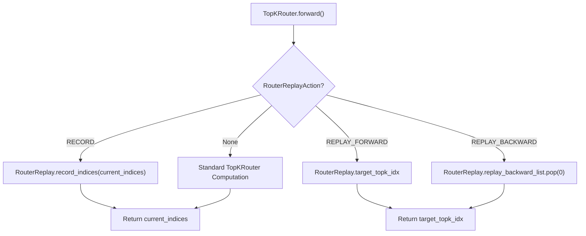
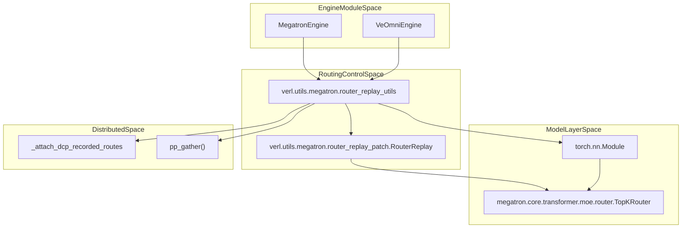

<!-- source: DeepWiki mcp.deepwiki.com · repo volcengine/verl · page 10.5 Router Replay and MoE Optimizations · fetched 2026-10-21 -->

# Router Replay and MoE Optimizations

<details>
<summary>Relevant source files</summary>

The following files were used as context for generating this wiki page:

- [.github/PULL_REQUEST_TEMPLATE.md](.github/PULL_REQUEST_TEMPLATE.md)
- [.github/workflows/type-coverage-check.yml](.github/workflows/type-coverage-check.yml)
- [examples/grpo_trainer/run_deepseek_v4_veomni.sh](examples/grpo_trainer/run_deepseek_v4_veomni.sh)
- [examples/router_replay/README.md](examples/router_replay/README.md)
- [tests/special_distributed/test_router_replay_empty_pp.py](tests/special_distributed/test_router_replay_empty_pp.py)
- [tests/special_sanity/check_pr_title.py](tests/special_sanity/check_pr_title.py)
- [tests/special_sanity/type_coverage_check.py](tests/special_sanity/type_coverage_check.py)
- [tests/utils/megatron/test_router_replay_model_walk_on_cpu.py](tests/utils/megatron/test_router_replay_model_walk_on_cpu.py)
- [tests/utils/test_config_router_replay_on_cpu.py](tests/utils/test_config_router_replay_on_cpu.py)
- [tests/utils/test_megatron_bshd_preprocess.py](tests/utils/test_megatron_bshd_preprocess.py)
- [tests/utils/test_megatron_router_replay_dcp.py](tests/utils/test_megatron_router_replay_dcp.py)
- [tests/utils/test_megatron_utils_nested_config.py](tests/utils/test_megatron_utils_nested_config.py)
- [tests/utils/veomni/test_router_replay_on_cpu.py](tests/utils/veomni/test_router_replay_on_cpu.py)
- [tests/workers/engine/megatron/test_router_replay_utils_on_cpu.py](tests/workers/engine/megatron/test_router_replay_utils_on_cpu.py)
- [tests/workers/test_router_replay_engine_helpers_on_cpu.py](tests/workers/test_router_replay_engine_helpers_on_cpu.py)
- [verl/trainer/config/actor/veomni_actor.yaml](verl/trainer/config/actor/veomni_actor.yaml)
- [verl/trainer/config/engine/veomni.yaml](verl/trainer/config/engine/veomni.yaml)
- [verl/trainer/config/ref/veomni_ref.yaml](verl/trainer/config/ref/veomni_ref.yaml)
- [verl/utils/megatron/router_replay_patch.py](verl/utils/megatron/router_replay_patch.py)
- [verl/utils/megatron/router_replay_utils.py](verl/utils/megatron/router_replay_utils.py)
- [verl/utils/reward_score/math_dapo.py](verl/utils/reward_score/math_dapo.py)
- [verl/utils/veomni/router_replay.py](verl/utils/veomni/router_replay.py)
- [verl/workers/config/engine.py](verl/workers/config/engine.py)
- [verl/workers/engine/veomni/transformer_impl.py](verl/workers/engine/veomni/transformer_impl.py)

</details>


## Purpose and Scope

This page documents verl's optimizations for training Mixture of Experts (MoE) models in Reinforcement Learning from Human Feedback (RLHF). The primary focus is the **router replay mechanism** that ensures deterministic routing decisions during training, as well as expert parallelism strategies and specialized optimizations for next-generation models like DeepSeek and Qwen series. These implementations are integrated with Megatron-Core (MCore), Megatron-Bridge, and the VeOmni backends.

Sources: [examples/router_replay/README.md:1-5]()

## Router Replay Overview

Router replay is a mechanism that records and replays expert routing decisions in MoE models to ensure deterministic behavior during training. This is critical because RL algorithms like PPO and GRPO require consistent routing between the rollout phase (where responses are generated) and the training phase (where log probabilities are re-computed for policy updates).

### The Problem: Non-Deterministic Routing

In MoE models, input tokens are dynamically routed to different expert networks based on learned routing scores. During RL training:

1.  **Rollout Phase**: Tokens are dynamically routed to experts, generating responses and computing old log probabilities.
2.  **Training Phase**: The same tokens must be routed to the **same experts** to accurately compute new log probabilities and subsequently calculate advantages/KL divergence.

Without router replay, routing decisions can be non-deterministic due to:
*   Load balancing algorithms (token dropping).
*   Numerical precision differences between inference engines (vLLM/SGLang) and training engines (Megatron/VeOmni).
*   Random tie-breaking in top-k selection.
*   Activation-checkpointing recompute during the backward pass.

This non-determinism causes **routing misalignment**, leading to incorrect advantage computation and training instability.

Sources: [examples/router_replay/README.md:1-3]()

### Router Replay Solution

Router replay solves this by:
1.  **Recording** expert routing decisions (top-k indices) during rollout or initial forward pass.
2.  **Storing** these decisions in the `DataProto` or `TensorDict` batch.
3.  **Replaying** the exact same routing decisions during the training forward/backward pass using patched router logic [verl/utils/megatron/router_replay_patch.py:44-49]().

Sources: [verl/utils/megatron/router_replay_patch.py:38-49](), [examples/router_replay/README.md:1-3]()

## Router Replay Modes

Verl supports three primary modes for handling MoE routing, configured via the `router_replay.mode` setting defined in `EngineRouterReplayConfig` [verl/workers/config/engine.py:48-67]():

| Mode | Description | Use Case |
| :--- | :--- | :--- |
| `disabled` | Default behavior. MoE routing operates normally without recording or replay. | Standard training or non-MoE models. [examples/router_replay/README.md:9]() |
| `R2` | Records indices during `compute_log_prob` (forward-only) and replays them in the actor update forward/backward. | Minimal, widely-compatible form; no rollout coordination required. [examples/router_replay/README.md:10]() |
| `R3` | Records indices at the rollout (inference) stage and replays them in both `compute_log_prob` and actor update. | Closes the loop end-to-end; requires rollout backend support (e.g., SGLang/vLLM). [examples/router_replay/README.md:11]() |

R3 mode requires specific rollout backend support to return router selection results. For vLLM, this typically requires version `>= 0.22.0` for models with complex layouts like hybrid-attention MoE models (e.g., Qwen3.5) to capture correct buffer shapes [examples/router_replay/README.md:80-87]().

Sources: [verl/workers/config/engine.py:48-67](), [verl/utils/megatron/router_replay_patch.py:38-43](), [examples/router_replay/README.md:8-12](), [examples/router_replay/README.md:80-87]()

## Implementation Details

### RouterReplay Class and Actions
The `RouterReplay` class in `verl/utils/megatron/router_replay_patch.py` manages the global state of MoE routers for Megatron-based models. It holds a static list of router instances and provides methods to control them globally via `RouterReplayAction` (`RECORD`, `REPLAY_FORWARD`, `REPLAY_BACKWARD`) [verl/utils/megatron/router_replay_patch.py:38-52]().

Key methods include:
*   `set_replay_data(all_layers_topk_indices)`: Distributes recorded indices to specific layers [verl/utils/megatron/router_replay_patch.py:55-68]().
*   `get_recorded_data()`: Collects indices from all layers [verl/utils/megatron/router_replay_patch.py:71-76]().
*   `get_replay_topk()`: The core logic that either records current routing decisions or retrieves replayed indices based on the current `RouterReplayAction` [verl/utils/megatron/router_replay_patch.py:109-136]().

Diagram: Patched Routing Logic Flow (`verl.utils.megatron.router_replay_patch.RouterReplay`)

Sources: [verl/utils/megatron/router_replay_patch.py:38-136]()

### Engine Integration and Distributed MoE Utilities

Verl provides helper components across engines to handle distributed MoE routing and tensor alignment:
*   **`verl.utils.megatron.router_replay_utils`**: This module contains utilities for handling router replay functionality in Megatron models [verl/utils/megatron/router_replay_utils.py:15-18](). It includes helper routines to coordinate layer mapping and tensor gathering.
*   **`RouterReplayHelper`**: This class within `router_replay_utils` provides static methods to query the current router replay action and manage the list of micro-batch routers [tests/workers/engine/megatron/test_router_replay_utils_on_cpu.py:73-76](). It correctly identifies the relevant routers within a model, even when a global registry might contain stale or orphaned instances [tests/utils/megatron/test_router_replay_model_walk_on_cpu.py:103-117]().
*   **`_attach_dcp_recorded_routes`**: This function in `verl.workers.engine.megatron.transformer_impl` is responsible for attaching dynamically context-parallel (DCP) recorded routes to the loss dictionary [tests/utils/megatron/test_router_replay_dcp.py:24-24]().
*   **`pp_gather`**: Handles pipeline-parallel gathering of router replay data, normalizing nested routes to CPU for `all_gather_object` [tests/utils/megatron/test_router_replay_dcp.py:110-128](). It also supports zero-layer BSHD stages [tests/utils/megatron/test_router_replay_dcp.py:130-157]().

Diagram: Code Entity Architecture for Router Replay and Distributed Gathering

Sources: [verl/utils/megatron/router_replay_utils.py:15-18](), [verl/utils/megatron/router_replay_patch.py:38-52](), [tests/workers/engine/megatron/test_router_replay_utils_on_cpu.py:73-76](), [tests/utils/megatron/test_router_replay_model_walk_on_cpu.py:103-117](), [tests/utils/megatron/test_router_replay_dcp.py:24-24](), [tests/utils/megatron/test_router_replay_dcp.py:110-157]()

## Expert Parallelism and MoE Optimizations

### Sequence Packing and MoE
When using sequence packing (`remove_padding`), MoE models require careful handling of the `routed_experts` tensor to maintain alignment with unpadded `input_ids`. The `preprocess_thd_engine` and `postprocess_thd_engine` utilities handle the conversion between nested tensors and BSHD (Batch, Sequence, Head, Dimension) format, ensuring correct padding and unpadding for MoE inputs and outputs [verl/utils/megatron/router_replay_utils.py:38-43](), [tests/utils/test_megatron_bshd_preprocess.py:108-126]().

Sources: [verl/utils/megatron/router_replay_utils.py:38-43](), [tests/utils/test_megatron_bshd_preprocess.py:108-126]()

## Configuration and Usage

### Enabling Router Replay
The mechanism is enabled by setting the mode in the actor's engine configuration. The path differs by engine: `actor.megatron.router_replay.mode` or `actor.veomni.router_replay.mode` [examples/router_replay/README.md:31-34]().

The `EngineRouterReplayConfig` dataclass defines the configuration for router replay, including the `mode` (`disabled`, `R2`, `R3`), `record_file`, and `replay_file` [verl/workers/config/engine.py:48-67]().

YAML Configuration Example (R3 Mode) [verl/trainer/config/engine/veomni.yaml:112-124]():
```yaml
actor:
  <engine>:
    router_replay:
      mode: "R3"

rollout:
  enable_rollout_routing_replay: True
```
[examples/router_replay/README.md:58-67]()

CLI Example:
```bash
actor_rollout_ref.actor.<engine>.router_replay.mode="R3"
actor_rollout_ref.rollout.enable_rollout_routing_replay=True
```
[examples/router_replay/README.md:72-75]()

Sources: [verl/workers/config/engine.py:48-67](), [verl/trainer/config/engine/veomni.yaml:112-124](), [examples/router_replay/README.md:20-75]()

---

