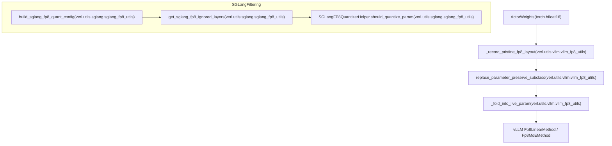
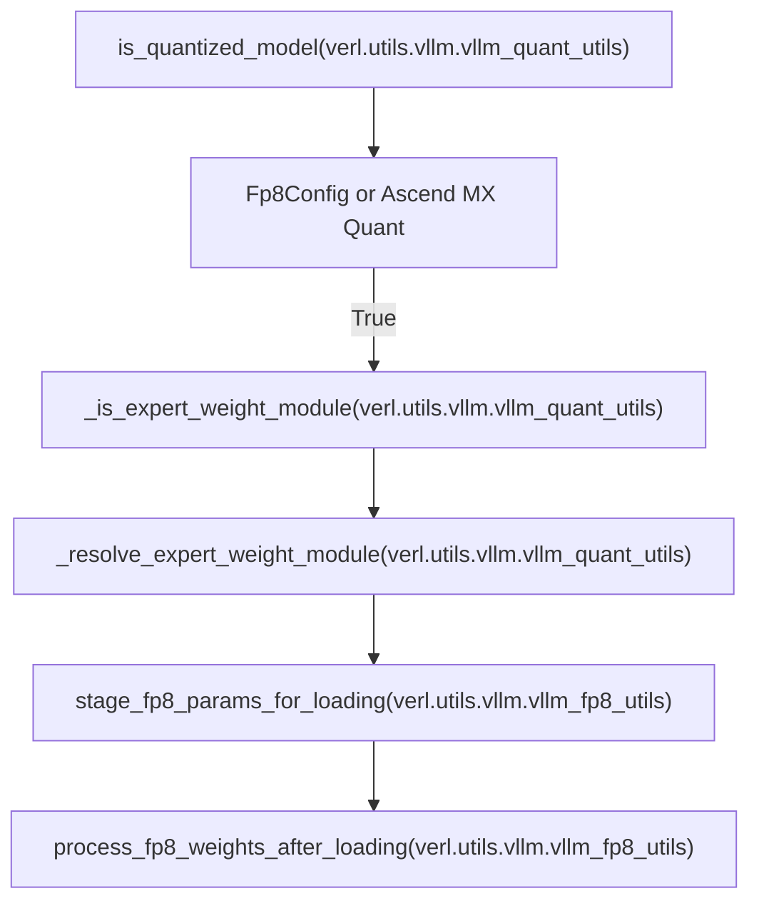

<!-- source: DeepWiki mcp.deepwiki.com · repo volcengine/verl · page 10.6 Low-Precision Training: FP8 and QAT · fetched 2026-10-21 -->

# Low-Precision Training: FP8 and QAT

Relevant source files

The following files were used as context for generating this wiki page:

- [docker/rocm/patches/non-leaf-fix.patch](docker/rocm/patches/non-leaf-fix.patch)
- [docs/advance/deepseek_v4_integration.rst](docs/advance/deepseek_v4_integration.rst)
- [examples/grpo_trainer/run_deepseek_v4_flash_megatron.sh](examples/grpo_trainer/run_deepseek_v4_flash_megatron.sh)
- [tests/trainer/ppo/test_reinforce_pp_multiturn_on_cpu.py](tests/trainer/ppo/test_reinforce_pp_multiturn_on_cpu.py)
- [tests/utils/test_npu_vllm_patch_on_cpu.py](tests/utils/test_npu_vllm_patch_on_cpu.py)
- [tests/utils/test_sglang_fp8_utils.py](tests/utils/test_sglang_fp8_utils.py)
- [tests/utils/test_vllm_fp8_restage_same_shape_on_cpu.py](tests/utils/test_vllm_fp8_restage_same_shape_on_cpu.py)
- [tests/utils/test_vllm_quant_utils_moe_on_cpu.py](tests/utils/test_vllm_quant_utils_moe_on_cpu.py)
- [verl/utils/distributed.py](verl/utils/distributed.py)
- [verl/utils/kernel/fp8_kernel.py](verl/utils/kernel/fp8_kernel.py)
- [verl/utils/megatron/dist_checkpointing.py](verl/utils/megatron/dist_checkpointing.py)
- [verl/utils/sglang/sglang_fp8_utils.py](verl/utils/sglang/sglang_fp8_utils.py)
- [verl/utils/vllm/__init__.py](verl/utils/vllm/__init__.py)
- [verl/utils/vllm/npu_vllm_patch.py](verl/utils/vllm/npu_vllm_patch.py)
- [verl/utils/vllm/patch.py](verl/utils/vllm/patch.py)
- [verl/utils/vllm/rocm_vllm_moe_expert_map.py](verl/utils/vllm/rocm_vllm_moe_expert_map.py)
- [verl/utils/vllm/vllm_fp4_utils.py](verl/utils/vllm/vllm_fp4_utils.py)
- [verl/utils/vllm/vllm_fp8_utils.py](verl/utils/vllm/vllm_fp8_utils.py)

## Purpose and Scope
This page documents the low-precision training and inference capabilities of the `verl` framework, focusing on **FP8 (8-bit Floating Point)** rollout-only and end-to-end training modes, **NVFP4 Quantization-Aware Training (QAT)** support, quantization configuration options, and backend-specific rollout patch utilities for vLLM and SGLang. These techniques reduce memory consumption, increase training and generation throughput, and mitigate precision gaps between training and inference backends.

Sources: [verl/utils/vllm/vllm_quant_utils.py](), [verl/utils/vllm/vllm_fp8_utils.py]()

---

## 1. FP8 Reinforcement Learning Modes

verl supports two primary operational modes for FP8 acceleration in reinforcement learning workflows:

### 1.1 FP8 Rollout Only
In this mode, the training loop (Actor and Critic updates) operates in standard **BF16** precision, while the rollout generation phase utilizes **FP8** quantization. This lowers GPU memory footprint during generation and improves generation throughput.

*   **Implementation & Staging**: verl leverages monkey-patching and specialized refit utilities to inject block-scale quantization logic into vLLM and SGLang execution paths [verl/utils/vllm/vllm_quant_utils.py]() [verl/utils/vllm/vllm_fp8_utils.py]().
*   **Weight Quantization**: Weights are dynamically quantized from higher precision formats to FP8 using blockwise quantization routines [verl/utils/kernel/fp8_kernel.py](). The `blockwise_cast_to_fp8_triton` function uses a Triton kernel for high-performance FP8 quantization, performing all computations (abs, max, scale, clamp) in a single pass to eliminate intermediate tensor allocations [verl/utils/kernel/fp8_kernel.py]().
*   **SGLang Layer Skipping**: Users can bypass FP8 weight quantization for sensitive modules (such as vision encoders or attention blocks) via the `SGLANG_FP8_IGNORED_LAYERS` environment variable or model `quantization_config` [verl/utils/sglang/sglang_fp8_utils.py](). The `SGLangFP8QuantizerHelper` class filters these layers during synchronization [verl/utils/sglang/sglang_fp8_utils.py]().

### 1.2 FP8 End-to-End (E2E)
This mode extends FP8 quantization across the entire RL loop—including forward/backward passes and optimizer states via **Transformer Engine**, combined with FP8 rollout inference via vLLM.

*   **Requirements**: Requires CUDA 12.9+, Transformer Engine supporting block-wise FP8, and the environment flag `NVTE_FP8_BLOCK_SCALING_FP32_SCALES=1`.
*   **Configuration**: Configured via `actor_rollout_ref.actor.megatron.override_transformer_config` with `fp8: "hybrid"` and `fp8_recipe: "blockwise"`. An example of configuring `ROLLOUT_KV_CACHE_DTYPE` to `fp8` can be seen in [examples/grpo_trainer/run_deepseek_v4_flash_megatron.sh]().
*   **Precision Consistency**: Aligning training and rollout precision minimizes distribution drift and KL divergence spikes compared to Rollout-only FP8 modes.

Sources: [verl/utils/vllm/vllm_fp8_utils.py](), [verl/utils/sglang/sglang_fp8_utils.py](), [examples/grpo_trainer/run_deepseek_v4_flash_megatron.sh]()

---

## 2. NVFP4 Quantization-Aware Training (QAT) Support

NVFP4 QAT introduces **fake quantization** nodes during training so that models learn to accommodate 4-bit quantization errors. These are materialized as true 4-bit weights during rollout inference, preventing KL divergence explosion.

### 2.1 Backend Implementations
*   **FSDP Backend**: Relies on `compressed-tensors` for vLLM rollout integration. Configuration parameters reside under `actor_rollout_ref.actor.fsdp_config.qat`.
*   **Megatron Backend**: Utilizes `modelopt` for vLLM quantization compatibility. Configuration parameters are managed under `actor_rollout_ref.actor.megatron.qat`.

### 2.2 Quantization Configuration
Users can define `ignore_patterns` to exclude sensitive layers (e.g., `lm_head`, `embed_tokens`).
*   **FSDP**: Employs the `re:` prefix for regular expression matching.
*   **Megatron**: Uses standard `fnmatch` glob syntax.

Sources: [verl/utils/vllm/vllm_quant_utils.py]()

---

## 3. DeepSeek V4 MXFP4 and Weight Refitting Support

For DeepSeek V4 series architectures, verl includes dedicated handling for **MXFP4** block-scaled quantization in routed experts, as well as general FP8 linear and MoE layers.

*   **Refit Mechanism**: When updating actor weights in vLLM, the framework re-asserts checkpoint layouts and replays weight conversions to ensure CUDA graphs captured during initialization remain valid [verl/utils/vllm/vllm_fp8_utils.py](), [verl/utils/vllm/vllm_fp4_utils.py]().
*   **Weight Refit Utility**: The function `replace_parameter_preserve_subclass` swaps weight tensors while preserving vLLM's `ModelWeightParameter` metadata so subsequent weight syncs shard incoming weights correctly [verl/utils/vllm/vllm_fp8_utils.py]().
*   **Live Parameter Folding**: `_fold_into_live_param` writes post-processing outputs directly into pre-allocated CUDA graph storage tensors [verl/utils/vllm/vllm_fp8_utils.py]().
*   **MXFP4 Specifics**: For MXFP4, `iter_deepseek_v4_weights` reinterprets expert weights as `uint8` bytes, as DeepSeek V4 checkpoints already ship quantized experts [verl/utils/vllm/vllm_fp4_utils.py](). The `_mxfp4_checkpoint_layout` function defines the expected layout of expert parameters before kernel post-processing [verl/utils/vllm/vllm_fp4_utils.py](). `_mxfp4_staging_data` reuses live storage for staging whenever possible to minimize memory overhead [verl/utils/vllm/vllm_fp4_utils.py]().

Sources: [verl/utils/vllm/vllm_fp8_utils.py](), [verl/utils/vllm/vllm_fp4_utils.py]()

---

## 4. Implementation Details and Data Flow

### 4.1 FP8 Quantization Logic & Data Flow
The `FP8QuantizerHelper` class (and its SGLang subclass `SGLangFP8QuantizerHelper`) inspects parameter names to determine target quantization modules, including linear projection layers while excluding layer norms and embeddings.

Diagram: FP8 Quantization and Refit Flow

Sources: [verl/utils/vllm/vllm_fp8_utils.py](), [verl/utils/sglang/sglang_fp8_utils.py]()

### 4.2 Parameter Metadata Preservation
When vLLM post-load hooks rebuild model parameters, standard wrappers drop custom subclass metadata. verl applies `_copy_param_subclass_attrs` to propagate metadata fields like `output_dim` and `weight_loader` across parameter rebuild events [verl/utils/vllm/vllm_fp8_utils.py](). This is crucial because vLLM's post-load hooks rebuild parameters as plain `torch.nn.Parameter`, dropping the subclass metadata that weight loaders dispatch on [verl/utils/vllm/vllm_fp8_utils.py]().

Sources: [verl/utils/vllm/vllm_fp8_utils.py]()

---

## 5. Rollout Engine FP8 Patch Utilities

verl provides backend-specific patch utilities to ensure smooth low-precision execution across vLLM and SGLang.

*   **vLLM**: `vllm_fp8_utils.py` handles refitting for `Fp8LinearMethod` and `Fp8MoEMethod`, tracking parameters like `weight_scale_inv` and `w13_weight` [verl/utils/vllm/vllm_fp8_utils.py](). `vllm_quant_utils.py` serves as the primary entry point driving quantization detection and expert weight module resolution [verl/utils/vllm/vllm_quant_utils.py](). The `patch_vllm_moe_model_weight_loader` function in [verl/utils/vllm/patch.py]() addresses a bug in vLLM where MoE weights might lack a `weight_loader`, ensuring proper weight loading for supported MoE models like DeepseekV2/V3, Mixtral, and Qwen2/3/3.5 MoE.
*   **SGLang**: `SGLangFP8QuantizerHelper` extends quantization helpers with SGLang-specific quantization configs and ignored layer filtering via `SGLANG_FP8_IGNORED_LAYERS` [verl/utils/sglang/sglang_fp8_utils.py]().
*   **NPU vLLM Patches**: `npu_vllm_patch.py` applies specific patches for vLLM on NPU (Ascend) devices, particularly for GLM-5.2 models. This includes patching `AscendRMSNorm` and `AscendSFAImpl` to ensure correct behavior for RMS normalization and attention mechanisms [verl/utils/vllm/npu_vllm_patch.py](). These patches are applied when the `verl.utils.vllm` module is imported [verl/utils/vllm/__init__.py]().

Diagram: vLLM Quantization Dispatch and Resolution

Sources: [verl/utils/vllm/vllm_quant_utils.py](), [verl/utils/vllm/vllm_fp8_utils.py](), [verl/utils/vllm/patch.py](), [verl/utils/vllm/npu_vllm_patch.py](), [verl/utils/vllm/__init__.py]()

---

