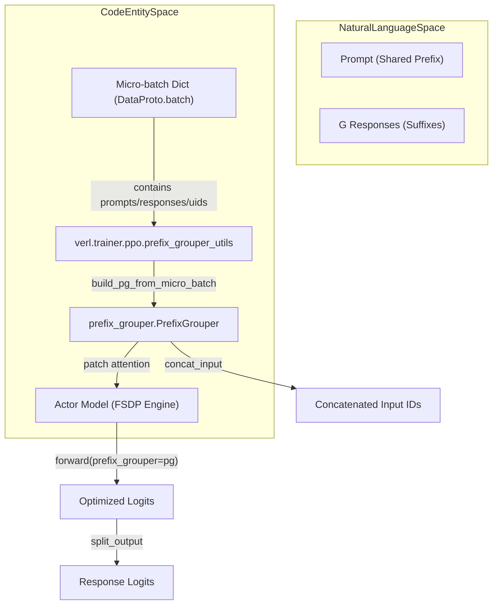
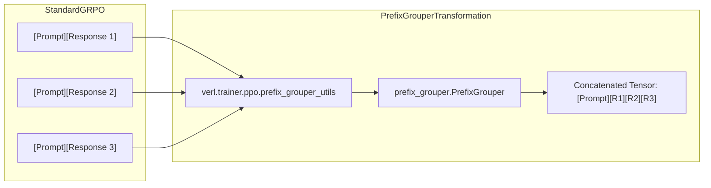

<!-- source: DeepWiki mcp.deepwiki.com · repo volcengine/verl · page 10.7 PrefixGrouper: Prefix-Shared Attention Optimization · fetched 2026-10-21 -->

# PrefixGrouper: Prefix-Shared Attention Optimization

<details>
<summary>Relevant source files</summary>

The following files were used as context for generating this wiki page:

- [examples/prefix_grouper/README.md](examples/prefix_grouper/README.md)
- [tests/utils/test_prepare_micro_batches_with_group_size.py](tests/utils/test_prepare_micro_batches_with_group_size.py)
- [tests/utils/test_seqlen_balancing.py](tests/utils/test_seqlen_balancing.py)
- [verl/trainer/ppo/prefix_grouper_utils.py](verl/trainer/ppo/prefix_grouper_utils.py)
- [verl/utils/seqlen_balancing.py](verl/utils/seqlen_balancing.py)

</details>


`PrefixGrouper` is a performance optimization for GRPO (Group Relative Policy Optimization) training that reduces redundant computation when multiple responses share the same prompt prefix [examples/prefix_grouper/README.md:1-3](). In standard GRPO workflows, a single prompt is expanded into $G$ responses, creating $G$ redundant copies of the prompt prefix during the training forward pass. `PrefixGrouper` decomposes this redundant attention computation into a single prefix self-attention block followed by suffix concat-attentions, significantly reducing FLOPs and device memory usage for long-context tasks [examples/prefix_grouper/README.md:11-13]().

## Architecture and Data Flow

The `PrefixGrouper` integration within `verl` patches standard attention functions and restructures micro-batches without requiring extensive modifications to model definitions [examples/prefix_grouper/README.md:63-65]().

### System to Code Entity Mapping

The following diagrams bridge the natural language RL concepts to the underlying code entities in `verl`.

**PrefixGrouper Integration Flow**

Sources: [verl/trainer/ppo/prefix_grouper_utils.py:46-100](), [examples/prefix_grouper/README.md:63-71]()

**Data Transformation for Shared Attention**

Sources: [verl/trainer/ppo/prefix_grouper_utils.py:87-91](), [examples/prefix_grouper/README.md:11-17]()

Sources: [verl/trainer/ppo/prefix_grouper_utils.py:46-100](), [examples/prefix_grouper/README.md:11-71]()

## Implementation Details

The optimization logic resides in `verl/trainer/ppo/prefix_grouper_utils.py` [verl/trainer/ppo/prefix_grouper_utils.py:1-215](). It groups samples sharing a unique identifier (`uid`), which represents identical prompt prefixes.

### Key Functions and Classes

1.  **`build_pg_from_micro_batch`**:
    *   Scans the micro-batch to determine group boundaries according to the `uid` tensor [verl/trainer/ppo/prefix_grouper_utils.py:55-67]().
    *   Extracts unique prompt prefixes and initializes the `PrefixGrouper` instance using `PrefixGrouper.from_ungrouped_masks` [verl/trainer/ppo/prefix_grouper_utils.py:76-85]().
    *   Constructs `concat_input_ids`, `attention_mask`, and `position_ids` for the grouped attention execution [verl/trainer/ppo/prefix_grouper_utils.py:87-91]().

2.  **`pg_forward`**:
    *   Invokes the actor model forward pass with the `prefix_grouper` object passed via keyword arguments [verl/trainer/ppo/prefix_grouper_utils.py:118-124]().
    *   Deconstructs the resulting output logits back into prefix and suffix components via `prefix_grouper.split_output` [verl/trainer/ppo/prefix_grouper_utils.py:126-128]().
    *   Computes token log probabilities using `logprobs_from_logits` [verl/trainer/ppo/prefix_grouper_utils.py:141]().

3.  **`build_position_ids_for_prefix_grouper`**:
    *   Constructs custom position identifiers where each response suffix resets its positional index relative to the end of the prompt prefix [verl/trainer/ppo/prefix_grouper_utils.py:23-43]().

4.  **`forward_micro_batch_with_prefix_grouper`**:
    *   Acts as the top-level execution wrapper handling mixed-precision autocast contexts, entropy computation, and padding masking [verl/trainer/ppo/prefix_grouper_utils.py:150-215]().

Sources: [verl/trainer/ppo/prefix_grouper_utils.py:23-215]()

## Configuration

`PrefixGrouper` is configured via Hydra configuration files and integrates natively with FSDP-backed actor workers [examples/prefix_grouper/README.md:27-44]().

| Parameter | Location | Description |
| :--- | :--- | :--- |
| `use_prefix_grouper` | `actor_rollout_ref.actor` | Enables or disables the PrefixGrouper optimization [examples/prefix_grouper/README.md:42-44](). |
| `use_remove_padding` | `actor_rollout_ref.model` | Must be set to `False` due to structural incompatibilities [examples/prefix_grouper/README.md:46-47](). |
| `balance_batch` | `trainer` | Enables group-level batch balancing to keep shared prompts on the same rank [examples/prefix_grouper/README.md:51-53](). |

**Example Configuration Snippet:**
```yaml
actor_rollout_ref:
  actor:
    use_prefix_grouper: True
  model:
    use_remove_padding: False 
trainer:
  balance_batch: True
```
Sources: [examples/prefix_grouper/README.md:37-53]()

## Limitations and Compatibility

Because `PrefixGrouper` alters attention mechanics, several constraints apply:

*   **Execution Backend**: Supported exclusively on **FSDP** workers; Megatron backend is not supported [examples/prefix_grouper/README.md:27-27]().
*   **Dynamic Batching**: Incompatible with `use_dynamic_bsz=True` [examples/prefix_grouper/README.md:28-28]() as it disrupts the required sample grouping layout.
*   **Kernel Optimizations**: Incompatible with sequence packing (`use_remove_padding=True`) and fused attention kernels (`use_fused_kernels=True`) [examples/prefix_grouper/README.md:29-30]().
*   **Parallelism**: Incompatible with Ulysses sequence parallelism (`use_ulysses_sp=True`) and ring-attention algorithms [examples/prefix_grouper/README.md:31-31]().
*   **Batch Size Rule**: When `balance_batch=True`, the batch size must satisfy `batch_size % (world_size * rollout.n) == 0` to prevent prompt groups from splitting across process ranks [examples/prefix_grouper/README.md:33-33]().

Sources: [examples/prefix_grouper/README.md:27-34]()

## Performance Benchmarks

Performance metrics measured on a Qwen3-4B model across a 4×H800 GPU cluster with a rollout group size of `rollout.n=4` [examples/prefix_grouper/README.md:72-74]():

| Context Length | Operation | With PG | Without PG | Speedup |
| :--- | :--- | :--- | :--- | :--- |
| **4K** | `old_log_prob` | 1.31s | 1.70s | **1.30x** |
| | `update_actor` | 4.80s | 6.07s | **1.26x** |
| | `step` | 17.08s | 19.40s | **1.14x** |
| **8K** | `old_log_prob` | 1.69s | 2.63s | **1.56x** |
| | `update_actor` | 5.98s | 10.18s | **1.70x** |
| | `step` | 19.48s | 24.71s | **1.27x** |

As context and prefix lengths grow, elimination of redundant token attention provides increasingly substantial training acceleration [examples/prefix_grouper/README.md:72-85]().

Sources: [examples/prefix_grouper/README.md:72-85]()

---

